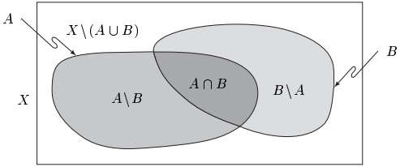
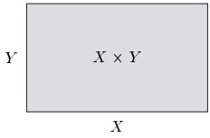

## 2 集合

尽管读者大概已经熟悉了基本的集合论，我们在本节中仍回顾其中一些相关的概念与记号。

##### 基本事实

若 $X$ 与 $Y$ 是集合，则 $X \subseteq Y$（“$'X$ 是 $Y$ 的子集”或“$X$ 包含于 $Y$”）表示 $X$ 的每个元素也是 $Y$ 的元素，即 $\forall x \in X: x \in Y$。有时，用 $Y \supseteq X$（“$'Y$ 包含 $X$”）代替 $X \subseteq Y$ 来书写更方便。集合的相等由下式定义：

\[ X=Y:\Leftrightarrow(X\subseteq Y)\land(Y\subseteq X). \]

下列陈述

\[ \begin{aligned}&X\subseteq X\quad&(\text{自反性})\\&(X\subseteq Y)\land(Y\subseteq Z)\Rightarrow(X\subseteq Z)\quad&(\text{传递性})\end{aligned} \]

是显然的。若 $X \subseteq Y$ 且 $X \neq Y$，则称 $X$ 为 $Y$ 的真子集。我们用 $X \subset Y$ 或 $Y \supset X$ 表示这一关系，并说“$X$ 真包含于 $Y$”。

若 $X$ 是集合，$E$ 是性质，则 $\{x \in X; E(x)\}$ 是 $X$ 的由所有使得 $E(x)$ 为真的 $X$ 的元素 $x$ 组成的子集。集合

\[ \varnothing_{X}:=\{x\in X;x\neq x\} \]

是 $X$ 的空子集。

2.1 注 (a) 设 $E$ 是性质。则

\[ x\in\emptyset_{X}\Rightarrow E(x) \]

对每个 $ x \in X $ 都为真（“空集具有一切性质”）。

证明 由 (1.4) 可得

\[ \left(x\in\emptyset_{X}\Rightarrow E(x)\right)=\neg(x\in\emptyset_{X})\lor E(x). \]

否定 $ \neg(x \in \emptyset_X) $ 对每个 $ x \in X $ 都为真。■

(b) 若 $X$ 与 $Y$ 是集合，则 $\emptyset_{X} = \emptyset_{Y}$，即空集恰好只有一个。这个集合记作 $\emptyset$，并且是任何集合的子集。

证明 由 (a) 可得 $ x \in \emptyset_X \Rightarrow x \in \emptyset_Y $，从而 $ \emptyset_X \subseteq \emptyset_Y $。由对称性，$ \emptyset_Y \subseteq \emptyset_X $，因此 $ \emptyset_X = \emptyset_Y $。■

包含单个元素 $x$ 的集合记作 $\{x\}$。类似地，由元素 $a$、$b$、...、*、$\circ$ 组成的集合写作 $\{a,b, \ldots, *, \circ\}$。

##### 幂集

若 $X$ 是集合，那么它的 $\text{幂} \mathbf{集} \mathcal{P}(X)$ 也是集合。$\mathcal{P}(X)$ 的元素是 $X$ 的子集。有时幂集写作 $2^X$，其原因将在第 3 节与习题 3.6 中阐明。下列事实显然成立：

\[ \emptyset\in\mathcal{P}(X),\quad X\in\mathcal{P}(X). \]

\[ x\in X\Longleftrightarrow\{x\}\in\mathcal{P}(X)\;. \]

\[ Y\subseteq X\Longleftrightarrow{~}Y\in\mathcal{P}(X)~. \]

特别地，$ \mathcal{P}(X) $ 永远不会是空的。

2.2 例 (a) $ \mathcal{P}(\emptyset) = \{\emptyset\} $，$ \mathcal{P}\big(\{\emptyset\}\big) = \{\emptyset, \{\emptyset\}\} $。

(b) $ \mathcal{P}\left(\{*, \circ\}\right) = \{\emptyset, \{*\}, \{\circ\}, \{*, \circ\}\} $。■

##### 补集、交集与并集

设 $A$ 与 $B$ 是集合 $X$ 的子集。则

\[ A\backslash B:=\left\{x\in X\;;\;(x\in A)\land(x\notin B)\right\} \]

是 $B$ 在 $A$ 中的（相对）补集。当集合 $X$ 由上下文可以清楚看出时，我们也写

\[ A^{c}:=X\backslash A \]

并称 $ A^{c} $ 为 $A$ 的补集。

集合

\[ A\cap B:=\left\{x\in X\;;\;(x\in A)\land(x\in B)\right\} \]

称为 $ A $ 与 $ B $ 的交集。若 $ A \cap B = \emptyset $，即 $ A $ 与 $ B $ 没有公共元素，则称 $ A $ 与 $ B $ 不交。显然，$ A \setminus B = A \cap B^c $。集合

\[ A\cup B:=\left\{x\in X\;;\;(x\in A)\lor(x\in B)\right\} \]

称为 $A$ 与 $B$ 的并集。

2.3 注 用维恩图把集合之间的关系直观地表示出来是有用的。每个集合用平面上由一条曲线围成的区域来表示。

这样的图不能用来证明定理，但是，通过提供关于集合之间可能关系的直观认识，它们确实能够提示关于集合的哪些陈述是可以证明的。■

在下列命题中，我们把交集运算与并集运算的一些简单代数性质汇集在一起。

2.4 命题 设 $X$、$Y$ 与 $Z$ 是某个集合的子集。

(i) $ X \cup Y = Y \cup X $，$ X \cap Y = Y \cap X $。（交换律）

(ii) $ X \cup (Y \cup Z) = (X \cup Y) \cup Z $，$ X \cap (Y \cap Z) = (X \cap Y) \cap Z $。（结合律）

(iii) $ X \cup (Y \cap Z) = (X \cup Y) \cap (X \cup Z) $。

$ X \cap (Y \cup Z) = (X \cap Y) \cup (X \cap Z). $

(iv) $ X \subseteq Y \Leftrightarrow X \cup Y = Y \Leftrightarrow X \cap Y = X $。

证明 这些都直接从定义得到。\footnote{当然，用这句话以及类似的说法（“这是清楚的”、“平凡的”等），我们的意思是读者应当自己去证明该论断！}■

##### 积

由两个对象 $a$ 与 $b$，我们可以形成一个新对象，即有序对 $ (a,b) $。两个有序对 $ (a,b) $ 与 $ (a',b') $ 的相等由下式定义：

\[ (a,b)=(a^{\prime},b^{\prime}):\Longleftrightarrow(a=a^{\prime})\land(b=b^{\prime}). \]

对象 $a$ 与 $b$ 称为有序对 $ (a, b) $ 的第一与第二分量。对于 $ x = (a, b) $，我们还定义

\[ \mathrm{pr}_{1}(x):=a~,\quad\mathrm{pr}_{2}(x):=b~, \]

并且，对 $j=1,2$（即对 $j\in\{1,2\}$），我们称 $\mathrm{pr}_{j}(x)$ 为 $x$ 的第 $j$ 个投影。

若 $X$ 与 $Y$ 是集合，则 $X$ 与 $Y$ 的（笛卡儿）积 $X \times Y$ 是所有满足 $x \in X$ 且 $y \in Y$ 的有序对 $(x, y)$ 的集合。

2.5 例与注 (a) 对于 $X := \{a, b\}$ 与 $Y := \{*, \odot, \square\}$，我们有

\[ X\times Y=\left\{(a,*),(b,*),(a,\odot),(b,\odot),(a,\Box),(b,\Box)\right\}. \]

(b) 正如注 2.3 中那样，对积 $ X \times Y $ 作直观表示是有用的。在这个图中，集合 $X$ 与 $Y$ 用直线表示，而 $ X \times Y $ 用矩形表示。我们再次强调，这样的图不能用来证明定理，而只能帮助建立直观。

我们对下列命题 2.6(i) 给出完整证明，以便读者熟悉证明的构造与书写方式。

2.6 命题 设 $X$ 与 $Y$ 是集合。

(i) $ X \times Y = \emptyset \Leftrightarrow (X = \emptyset) \lor (Y = \emptyset) $。

(ii) 一般地：$ X \times Y \neq Y \times X $。

证明 (i) 我们需要证明两个陈述，即

\[ X\times Y=\emptyset\Rightarrow(X=\emptyset)\lor(Y=\emptyset) \]

以及它的逆命题。证明的相应部分用符号“⇒”与“⇐”标注。

“⇒” 这一部分证明用反证法进行。设 $ X \times Y = \emptyset $，且陈述 $ (X = \emptyset) \lor (Y = \emptyset) $ 为假。则由例 1.1(c)，陈述 $ (X \neq \emptyset) \land (Y \neq \emptyset) $ 为真，从而存在元素 $ x \in X $ 与 $ y \in Y $。但此时 $ (x, y) \in X \times Y $，这与 $ X \times Y = \emptyset $ 矛盾。因此 $ X \times Y = \emptyset $ 蕴含 $ (X = \emptyset) \lor (Y = \emptyset) $。

“⇐” 我们证明该陈述的逆否命题

\[ (X=\emptyset)\lor(Y=\emptyset)\Rightarrow X\times Y=\emptyset. \]

设 $ X \times Y \neq \emptyset $。则存在某个 $ (x, y) \in X \times Y $，其中 $ x \in X $ 且 $ y \in Y $。因而有 $ (X \neq \emptyset) \land (Y \neq \emptyset) = \neg\big((X = \emptyset) \lor (Y = \emptyset)\big) $。

(ii) 见习题 4。

三个集合 $X$、$Y$ 与 $Z$ 的积由下式定义

\[ X\times Y\times Z:=(X\times Y)\times Z. \]

这一构造可以重复\footnote{见命题 5.11。}，从而定义 $n$ 个集合的积：

\[ X_{1}\times\cdots\times X_{n}:=\left(X_{1}\times\cdots\times X_{n-1}\right)\times X_{n}. \]

对于 $ X_1 \times \cdots \times X_n $ 中的 $ x $，我们写 $ (x_1, \ldots, x_n) $ 而不写 $ \left( \cdots ((x_1, x_2), x_3), \ldots, x_n \right) $，并对 $ 1 \leq j \leq n $ 称 $ x_j $ 为 $ x $ 的第 $ j $ 个分量。元素 $ x_j $ 也就是 $ \text{pr}_j(x) $，

$ x $ 的第 $ j $ 个投影。我们也可以把 $ X_1 \times \cdots \times X_n $ 写为

\[ \prod_{j=1}^{n} X_{j}. \]

若这个积中的所有因子都相同，即对 $j = 1, \ldots, n$ 有 $X_j = X$，则这个积写作 $X^n$。

##### 集合族

设 $\mathrm{A}$ 是非空集合，且对每个 $\alpha \in \mathrm{A}$，令 $A_\alpha$ 是集合。则 $\{A_\alpha; \alpha \in \mathrm{A}\}$ 称为集族，而 $\mathrm{A}$ 是这个集族的指标集。注意，我们不要求当指标 $\alpha$ 与 $\beta$ 不同时有 $A_\alpha \neq A_\beta$，也不要求每个指标对应的 $A_\alpha$ 非空。还要注意，集族永远不会是空的。

设 $X$ 是集合，$\mathcal{A} := \{A_\alpha; \alpha \in \mathrm{A}\}$ 是 $X$ 的子集族。把上述概念加以推广，我们把这个集族的交与并定义为

\[ \bigcap_{\alpha}A_{\alpha}:=\left\{x\in X\;;\;\forall\alpha\in\mathrm{A}\colon x\in A_{\alpha}\right\} \]

与

\[ \bigcup_{\alpha}A_{\alpha}:=\{x\in X\;;\;\exists\alpha\in\mathrm{A}\colon x\in A_{\alpha}\} \]

分别定义。注意，$\bigcap_{\alpha} A_{\alpha}$ 与 $\bigcup_{\alpha} A_{\alpha}$ 都是 $X$ 的子集。有时我们不写 $\bigcap_{\alpha} A_{\alpha}$，而写 $\bigcap_{\alpha\in\mathrm{A}} A_{\alpha}$，或 $\bigcap_{\alpha}\{x\in X; x\in A_{\alpha}\}$，或 $\bigcap_{A\in\mathcal{A}} A$，或简单地写 $\bigcap\mathcal{A}$。若 $\mathcal{A}$ 是有限集族，则它可以用有限多个自然数\footnote{见第 5 节。} $\{0,1,\ldots,n\}$ 来标号：$\mathcal{A}=\{A_{j}; j=0,\ldots,n\}$。此时我们也用 $\bigcup_{j=0}^{n} A_{j}$ 或 $A_{0}\cup\cdots\cup A_{n}$ 来表示 $\bigcup\mathcal{A}$。

下列命题把命题 2.4 推广到集族。

2.7 命题 设 $\{A_\alpha; \alpha \in \mathrm{A}\}$ 与 $\{B_\beta; \beta \in \mathrm{B}\}$ 是集合 $X$ 的子集族。

(i) $ \left(\bigcap_{\alpha}A_{\alpha}\right)\cap\left(\bigcap_{\beta}B_{\beta}\right)=\bigcap_{(\alpha,\beta)}A_{\alpha}\cap B_{\beta} $。

(ii) $ \left(\bigcup_{\alpha}A_{\alpha}\right)\cup\left(\bigcup_{\beta}B_{\beta}\right)=\bigcup_{(\alpha,\beta)}A_{\alpha}\cup B_{\beta} $。

(iii) $ \left(\bigcap_{\alpha}A_{\alpha}\right)\cup\left(\bigcap_{\beta}B_{\beta}\right)=\bigcap_{(\alpha,\beta)}A_{\alpha}\cup B_{\beta} $。

(iv) $ \left(\bigcup_{\alpha}A_{\alpha}\right)\cap\left(\bigcup_{\beta}B_{\beta}\right)=\bigcup_{(\alpha,\beta)}A_{\alpha}\cap B_{\beta} $。

(v) $ \left(\bigcap_{\alpha} A_{\alpha}\right)^{c} = \bigcup_{\alpha} A_{\alpha}^{c} $（德摩根律），$ \left(\bigcup_{\alpha} A_{\alpha}\right)^{c} = \bigcap_{\alpha} A_{\alpha}^{c} $。

这里 $ (\alpha, \beta) $ 跑遍指标集 $ A \times B $。

证明 这些都容易从定义得到。对于 (iii)，另见例 1.1。

2.8 注 细心的读者会注意到，我们还没有解释什么是集合。事实上，“集合”这个词，以及“元素”这个词，都是数学中未定义的概念。因此需要公理，即无需证明就假定为真的规则，它们说明这些概念应如何使用。本节及后续各节中关于集合的、未给出证明的陈述都可以视为公理。例如，陈述“集合的幂集是集合”就是这样一条公理。在本书中，我们无法讨论集合论的公理基础——也许除第 5 节中的几处注记之外。相反，我们把有兴趣的读者引向相关文献。集合论公理基础的简短易懂的表述，例如可以在 [Dug66]、[Ebb77]、[FP85] 与 [Hal74] 中找到。尽管如此，这个主题需要一定的数学成熟度，不推荐初学者学习。

我们强调，集合与元素“是什么”的问题并不重要。重要的是处理这些未定义概念所用的规则。■

##### 习题

1 设 $X$、$Y$ 与 $Z$ 是集合。证明包含关系的传递性，即

\[ (X\subseteq Y)\land(Y\subseteq Z)\Rightarrow X\subseteq Z. \]

2 验证命题 2.4 的断言。

3 给出命题 2.7 的完整证明。

4 设 $X$ 与 $Y$ 是非空集合。证明 $ X \times Y = Y \times X \Leftrightarrow X = Y $。

5 设 $A$ 与 $B$ 是集合 $X$ 的子集。确定下列集合：

(a) $ (A^{c})^{c} $

(b) $ A \cap A^{c} $

(c) $ A \cup A^{c} $

(d) $ (A^{c} \cup B) \cap (A \cap B^{c}) $。

(e) $ (A^{c} \cup B) \cup (A \cap B^{c}) $。

(f) $ (A^{c} \cup B^{c}) \cap (A \cup B) $。

(g) $ (A^{c} \cup B^{c}) \cap (A \cap B) $。

6 设 $X$ 是集合。证明

\[ \bigcup_{A\in\mathcal{P}(X)}A=X\quad\text{且}\quad\bigcap_{A\in\mathcal{P}(X)}A=\varnothing. \]

7 设 $X$ 与 $A$ 是集合 $U$ 的子集，$Y$ 与 $B$ 是集合 $V$ 的子集。证明下列结论：

(a) 若 $ A \times B \neq \emptyset $，则 $ A \times B \subseteq X \times Y \Leftrightarrow (A \subseteq X) \land (B \subseteq Y) $。

(b) $ (X \times Y) \cup (A \times Y) = (X \cup A) \times Y $。

(c) $ (X \times Y) \cap (A \times B) = (X \cap A) \times (Y \cap B) $。

(d) $ (X \times Y) \setminus (A \times B) = ((X \setminus A) \times Y) \cup (X \times (Y \setminus B)). $

8 设 $\{A_\alpha; \alpha \in \mathrm{A}\}$ 与 $\{B_\beta; \beta \in \mathrm{B}\}$ 是某个集合的子集族。证明下列结论：

\[ \left(\bigcap_{\alpha}A_{\alpha}\right)\times\left(\bigcap_{\beta}B_{\beta}\right)=\bigcap_{(\alpha,\beta)}A_{\alpha}\times B_{\beta}. \]

(b) $ (\bigcup_{\alpha} A_{\alpha}) \times (\bigcup_{\beta} B_{\beta}) = \bigcup_{(\alpha, \beta)} A_{\alpha} \times B_{\beta}. $
