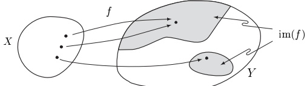
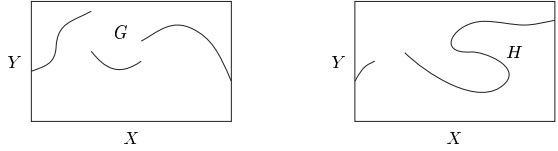
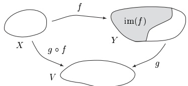
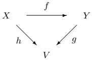
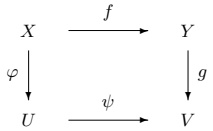
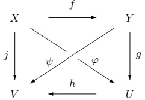
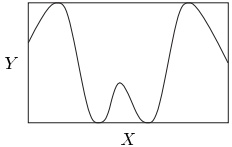
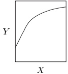
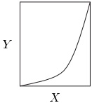
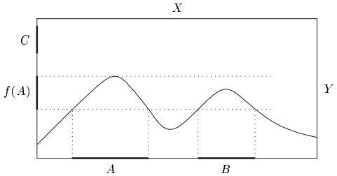

## 3 函数

函数对整个数学都具有根本的重要性。当然，这一概念在走向其现代含义的过程中经历了许多变化。其发展中的一个重要步骤，是摆脱与算术、算法或几何观念的任何联系。这就（忽略注 3.1 中所讨论的某些形式上的吹毛求疵）导致了我们在下面给出的集合论定义。

本节中 $X$、$Y$、$U$ 和 $V$ 是任意集合。

从 X 到 Y 的函数或映射 f 是一条规则，它对 X 的每个元素都恰好指定 Y 的一个元素。我们记

 \[ f\colon X\to Y\qquad\text{或}\qquad X\to Y~,\quad x\mapsto f(x)~, \] 

有时也记作 $f: X \to Y$，$x \mapsto f(x)$。这里 $f(x) \in Y$ 是 $f$ 在 $x$ 处的 $\text{值}$。集合 $X$ 称为 $f$ 的 $\text{定义域}$，记作 $\text{dom}(f)$，而 $Y$ 是 $f$ 的 $\text{陪域}$。最后

 \[ \mathrm{im}(f):=\left\{y\in Y\;;\;\exists x\in X\colon y=f(x)\right\} \] 

称为 f 的像。

若 $f: X \to Y$ 是函数，则

 \[ \operatorname{g r a p h}(f):=\left\{(x,y)\in X\times Y\;;\;y=f(x)\right\}=\left\{\left(x,f(x)\right)\in X\times Y\;;\;x\in X\right\} \] 

称为 $f$ 的图像。显然，函数的图像是笛卡儿积 $X \times Y$ 的子集。在下面关于 $X \times Y$ 的子集 $G$ 与 $H$ 的图中，$G$ 是从 $X$ 到 $Y$ 的函数的图像，而 $H$ 不是这样的函数的图像。

3.1 注 设 $G$ 是 $X \times Y$ 的子集，它具有如下性质：对每个 $x \in X$，恰有一个 $y \in Y$ 使 $(x, y) \in G$。于是我们可以按下述规则定义一个函数 $f: X \to Y$：对每个 $x \in X$，$f(x) := y$，其中 $y \in Y$ 是使 $(x, y) \in G$ 的唯一元素。显然 graph$(f) = G$。这一观察引出了下述定义：函数 $X \to Y$ 是一个有序三元组 $(X, G, Y)$，其中 $G \subseteq X \times Y$，使得对每个 $x \in X$，恰有一个 $y \in Y$ 使 $(x, y) \in G$。这个定义避免了有用但不精确的“规则”一词，并且只使用集合论的概念（但请参见注 2.8）。■

##### 简单例子

注意我们并未排除 $X = \emptyset$ 与 $Y = \emptyset$。若 $X$ 是空集，则从 $X$ 到 $Y$ 的函数恰有一个，即空函数 $\emptyset: \emptyset \to Y$。若 $Y = \emptyset$ 但 $X \neq \emptyset$，则从 $X$ 到 $Y$ 没有函数。两个函数 $f: X \to Y$ 与 $g: U \to V$ 是 $\text{相等}$ 的，记作 $f = g$，如果

 \[ X=U~,\quad Y=V\quad\text{ 且 }\quad f(x)=g(x)~,\qquad x\in X~. \] 

因此，两个函数若要相等，它们必须具有相同的定义域、陪域和规则。若其中一个条件不成立，则这两个函数是不同的。

3.2 例 (a) 函数 $ \mathrm{id}_{X}: X \to X $，$ x \mapsto x $ 是（X 的）恒等函数。若集合 X 由上下文已明确，我们常把 $ \mathrm{id}_{X} $ 写作 id。

(b) 若 $X \subseteq Y$，则 $i: X \to Y$，$x \mapsto x$ 称为 $X$ $\mathbf{到}$ $Y$ 的 $\mathbf{包含映射}$（嵌入、单射）。注意 $i = \mathrm{id}_X \iff X = Y$。

(c) 若 $X$ 与 $Y$ 非空且 $b \in Y$，则 $X \to Y$，$x \mapsto b$ 是常函数。

(d) 若 $ f: X \to Y $ 且 $ A \subseteq X $，则 $ f|A: A \to Y $，$ x \mapsto f(x) $ 是 $ f $ 在 $ A $ 上的限制。显然 $ f|A = f \Leftrightarrow A = X $。

(e) 设 $ A \subseteq X $ 且 $ g: A \to Y $。则任何满足 $ f|A = g $ 的函数 $ f: X \to Y $ 称为 $ g $ 的延拓，记作 $ f \supseteq g $。例如，用 (b) 的记号，有 $ id_Y \supseteq i $。（集合论记号 $ f \supseteq g $ 自然地来自注 3.1。）

(f) 设 $f: X \to Y$ 是满足 $\operatorname{im}(f) \subseteq U \subseteq Y \subseteq V$ 的函数。则有“诱导”函数 $f_1: X \to U$ 与 $f_2: X \to V$，它们由 $f_j(x) := f(x)$（对 $x \in X$ 与 $j = 1,2$）定义。通常我们对这些诱导函数使用同一个符号 $f$，因而按需把 $f$ 看作从 $X$ 到 $U$、从 $X$ 到 $Y$ 或从 $X$ 到 $V$ 的函数。

(g) 设 $ X \neq \emptyset $ 且 $ A \subseteq X $。则 $ A $ 的特征函数是

 \[ \chi_{A}\colon X\to\{0,1\},\quad x\mapsto\left\{\begin{array}{l l}{1,}&{\quad x\in A,}\\ {0,}&{\quad x\in A^{c}.}\\ \end{array}\right. \] 

(h) 若 $ X_{1}, \ldots, X_{n} $ 是非空集合，则投影

 \[ \operatorname{pr}_{k}:\prod_{j=1}^{n}X_{j}\rightarrow X_{k},\quad x=(x_{1},\ldots,x_{n})\mapsto x_{k},\qquad k=1,\ldots,n, \] 

是函数。■

##### 函数的复合

设 $f: X \to Y$ 与 $g: Y \to V$ 是两个函数。则我们定义一个新函数 $g \circ f$，即 $f$ 与 $g$ 的复合（更确切地说，“先 f 后 $g$”），由

 \[ g\circ f\colon X\to V~,\quad x\mapsto g\bigl(f(x)\bigr)~. \] 

3.3 命题 设 $f: X \to Y$、$g: Y \to U$ 与 $h: U \to V$ 是函数。则复合 $(h \circ g) \circ f$ 与 $h \circ (g \circ f): X \to V$ 都有定义，且

 \[ (h\circ g)\circ f=h\circ(g\circ f) \] 

（复合的结合性）。

证明 这直接由定义可得。

由这一命题，复合三个函数时不必使用括号。函数 (3.1) 可以简单地写作 $ h \circ g \circ f $。这种记号上的简化也适用于三个以上函数的复合。参见例 4.9(a) 与 5.10。

##### 交换图

把函数的复合用图表示出来常常是有用的。在这样的图中，我们用 $ X \xrightarrow{f} Y $ 代替 $ f: X \to Y $。图

是交换的，若 $h = g \circ f$。

类似地，图

是 **交换的**，若 $ g \circ f = \psi \circ \varphi $。有时人们会遇到带有很多“箭头”（即函数）的复杂图。这样的图是 **交换的**，如果下述成立：若 X 与 Y 是图中的集合，并且可以沿箭头经由两条不同的路径从 X 到达 Y，例如，

 \[ X\xrightarrow{f_{1}}A_{1}\xrightarrow{f_{2}}A_{2}\xrightarrow{f_{3}}\cdots\xrightarrow{f_{n}}Y\quad\text{且}\quad X\xrightarrow{g_{1}}B_{1}\xrightarrow{g_{2}}B_{2}\xrightarrow{g_{3}}\cdots\xrightarrow{g_{m}}Y, \] 

则函数 $ f_n \circ f_{n-1} \circ \cdots \circ f_1 $ 与 $ g_m \circ g_{m-1} \circ \cdots \circ g_1 $ 相等。例如，图

是交换的，若 $ \varphi = g \circ f $，$ \psi = h \circ g $ 且 $ j = h \circ g \circ f = h \circ \varphi = \psi \circ f $，这正是命题 3.3 的结合性陈述。

##### 单射、满射与双射

设 $f: X \to Y$ 是函数。则 $f$ 是 **满射的**，若 $\mathrm{im}(f) = Y$；$f$ 是 **单射的**，若对一切 $x, y \in X$，$f(x) = f(y)$ 蕴含 $x = y$；$f$ 是 **双射的**，若 $f$ 既单射又满射。人们也分别称 $f$ 为 **满射**、**单射** 或 **双射**。“onto”与“one-to-one”这两个说法常用来表示“满射”与“单射”。

3.4 例 (a) 下面画出其图像的这些函数说明了这些性质：

满射，非单射

单射，非满射

双射

(b) 设 $ X_1, \ldots, X_n $ 是非空集合。则对每个 $ k \in \{1, \ldots, n\} $，第 $ k $ 个投影 $ \text{pr}_k: \prod_{j=1}^n X_j \to X_k $ 是满射，但一般不是单射。

3.5 命题 设 $f: X \to Y$ 是函数。则 $f$ 是双射，当且仅当存在函数 $g: Y \to X$ 使得 $g \circ f = \mathrm{id}_X$ 且 $f \circ g = \mathrm{id}_Y$。此时，$g$ 由 $f$ 唯一确定。

证明 (i) “$\Rightarrow$” 设 $f: X \to Y$ 是双射。由于 $f$ 是满射，对每个 $y \in Y$ 都存在某个 $x \in X$ 使 $y = f(x)$。由于 $f$ 是单射，这个 $x$ 由 $y$ 唯一确定。这就定义了一个具有所需性质的函数 $g: Y \to X$。

(ii) “⇐” 由 $f \circ g = \mathrm{id}_{Y}$ 立即推出 $f$ 是满射。现在设 $x, y \in X$ 且 $f(x) = f(y)$。则有 $x = g(f(x)) = g(f(y)) = y$。因此 $f$ 是单射。

(iii) 若 $h: Y \to X$ 满足 $h \circ f = \mathrm{id}_{X}$ 与 $f \circ h = \mathrm{id}_{Y}$，则由命题 3.3 可得

 \[ g=g\circ\operatorname{id}_{Y}=g\circ(f\circ h)=(g\circ f)\circ h=\operatorname{id}_{X}\circ h=h. \] 

因此 g 由 f 唯一确定。

##### 逆函数

命题 3.5 引出了下述定义：设 $f: X \to Y$ 是双射。则 $f$ 的反函数 $f^{-1}$ 是满足 $f \circ f^{-1} = \mathrm{id}_{Y}$ 与 $f^{-1} \circ f = \mathrm{id}_{X}$ 的唯一函数 $f^{-1}: Y \to X$。

下面命题的证明留作习题（见习题 1 与 3）。

3.6 命题 设 $f: X \to Y$ 与 $g: Y \to V$ 是双射。则 $g \circ f: X \to V$ 是双射，且

 \[ (g\circ f)^{-1}=f^{-1}\circ g^{-1}. \] 

设 $f: X \to Y$ 是函数，$A \subseteq X$。则

 \[ f(A):=\left\{f(a)\in Y;a\in A\right\} \] 

称为 A 在 f 下的像。对每个 $C \subseteq Y$，

 \[ f^{-1}(C):=\left\{x\in X;f(x)\in C\right\} \] 

称为 C 在 f 下的原像。

3.7 例 设 $f: X \to Y$ 是图像如下所示的函数。

则 $ f^{-1}(C) = \emptyset $ 且 $ f^{-1}\big(f(A)\big) = A \cup B $，特别地 $ f^{-1}\big(f(A)\big) \supset A $。■

##### 集值函数

设 $ f: X \to Y $ 是函数。则利用上述定义，我们有两个“诱导”的集值函数，

 \[ f\colon\mathcal{P}(X)\to\mathcal{P}(Y)\;,\quad A\mapsto f(A)\quad\text{且}\quad f^{-1}\colon\mathcal{P}(Y)\to\mathcal{P}(X)\;,\quad B\mapsto f^{-1}(B)\;. \] 

对两个不同的函数使用同一个符号 f 不会导致混淆，因为其含义总能由上下文明确。

若 $f: X \to Y$ 是双射，则 $f^{-1}: Y \to X$ 存在，且对一切 $y \in Y$ 有 $\{f^{-1}(y)\} = f^{-1}\big(\{y\}\big)$。在这个等式以及一般情形中，上下文都明确所指的是 $f^{-1}$ 的哪一种含义。若 $f$ 不是双射，则只有集值函数 $f^{-1}$ 有定义，因此不可能产生混淆。无论哪种情形，我们都把 $f^{-1}\big(\{y\}\big)$ 写作 $f^{-1}(y)$，并称 $f^{-1}(y) \subseteq X$ 为 $f$ 在 $y$ 处的 $\mathbf{fiber}$。纤维 $f^{-1}(y)$ 就是方程 $f(x) = y$ 的解集 $\{x \in X; f(x) = y\}$。当然，它可能是空的。

3.8 命题 对于由 f 诱导出的集值函数，下列结论成立：

(i)  $ A \subseteq B \subseteq X \Rightarrow f(A) \subseteq f(B) $.

(ii)  $ A_\alpha \subseteq X $  $ \forall \alpha \in \mathrm{A} \Rightarrow f\left(\bigcup_\alpha A_\alpha\right) = \bigcup_\alpha f(A_\alpha) $.

(iii)  $ A_\alpha \subseteq X \quad \forall \alpha \in \mathrm{A} \Rightarrow f\left(\bigcap_\alpha A_\alpha\right) \subseteq \bigcap_\alpha f(A_\alpha) $.

(iv)  $ A \subseteq X \Rightarrow f(A^c) \supseteq f(X) \setminus f(A) $.

(i')  $ A' \subseteq B' \subseteq Y \Rightarrow f^{-1}(A') \subseteq f^{-1}(B') $.

(ii')  $ A'_\alpha \subseteq Y $  $ \forall \alpha \in \mathrm{A} \Rightarrow f^{-1}\left(\bigcup_\alpha A'_\alpha\right) = \bigcup_\alpha f^{-1}(A'_\alpha) $.

(iii')  $ A'_\alpha \subseteq Y $  $ \forall \alpha \in \mathrm{A} \Rightarrow f^{-1}\left(\bigcap_\alpha A'_\alpha\right) = \bigcap_\alpha f^{-1}(A'_\alpha) $.

(iv')  $ A' \subseteq Y \Rightarrow f^{-1}(A'^c) = [f^{-1}(A')]^c $.

若 $ g: Y \to V $ 是另一个函数，则 $ (g \circ f)^{-1} = f^{-1} \circ g^{-1} $。

这些断言的简单证明留给读者。

简言之，命题 3.8(i')-(iv') 说明函数 $ f^{-1} : \mathcal{P}(Y) \to \mathcal{P}(X) $ 保持一切集合运算。对诱导函数 $ f : \mathcal{P}(X) \to \mathcal{P}(Y) $ 一般并非如此，这从 (iii) 与 (iv) 可以看出。

最后，我们用 $\operatorname{Funct}(X,Y)$ 表示从 $X$ 到 $Y$ 的一切函数所成的集合。由于注 3.1，$\operatorname{Funct}(X,Y)$ 是 $\mathcal{P}(X\times Y)$ 的子集。对于 $\operatorname{Funct}(X,Y)$，我们也写作 $Y^X$。这与集合 $X$ 与自身的第 $n$ 个笛卡儿积的记号 $X^n$ 一致，因为它与从 $\{1,2,\ldots,n\}$ 到 $X$ 的一切函数所成的集合相同。若 $U\subseteq Y\subseteq V$，则

 \[ \operatorname{F u n c t}(X,U)\subseteq\operatorname{F u n c t}(X,Y)\subseteq\operatorname{F u n c t}(X,V)~, \] 

其中我们使用了例 3.2(f) 的约定。

##### 习题

1 证明命题 3.6。

2 证明命题 3.8，并说明所给出的包含关系一般是真包含。

3 设 $f: X \to Y$ 与 $g: Y \to V$ 是函数。证明下列各条：

(a) 若 f 与 g 是单射（满射），则 $ g \circ f $ 也是。

(b) f 是单射 $ \Leftrightarrow \exists h: Y \to X $，使得 $ h \circ f = \mathrm{id}_X $。

(c) $f$ 是满射 $\Longleftrightarrow \exists h: Y \to X$，使得 $f \circ h = \mathrm{id}_{Y}$。

4 设 $f: X \to Y$ 是函数。证明下列各条等价：

(a) f 是单射。

(b) $ f^{-1}(f(A)) = A $，$ A \subseteq X $。

(c) $ f(A \cap B) = f(A) \cap f(B) $，$ A, B \subseteq X $。

5 确定投影 $ pr_{k} $ 的纤维。

6 证明：对每个非空集合 X，函数

 \[ \mathcal{P}(X)\to\{0,1\}^{X}~,\quad A\mapsto\chi_{A} \] 

是双射。

7 设 $f: X \to Y$ 是函数，$i: A \to X$ 是子集 $A \subseteq X$ 到 $X$ 的包含映射。证明下列各条：

(a) $ f|A = f \circ i $。

(b) $ (f|A)^{-1}(B) = A \cap f^{-1}(B) $，$ B \subseteq Y $。
