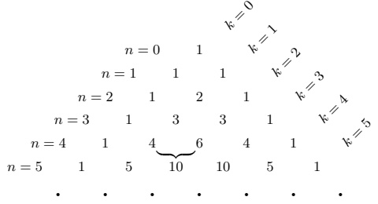

## 5 自然数

1888 年，R. 戴德金出版了《Was sind and was sollen die Zahlen?》（数是什么，数应当是什么？）一书 [Ded95]，论述自然数系统的集合论基础。它是这一学科发展中的一座里程碑，事实上也是数学史上的一个高峰。

本节从自然数的一个简单而“自然”的公理系统出发，在以后的各节中我们将构造整数、有理数、实数，最后是复数。与 D. 希尔伯特 1899 年对实数的公理化表述（见 [Hil23]）相比，这种构造性方法的优点在于：整个数学结构都可以由来自数理逻辑与公理化集合论的少数几块基石建立起来。

##### 皮亚诺公理

我们用 G. 皮亚诺提出的一套公理系统来定义自然数，它把如下想法形式化：给定任一自然数，总有一个紧接其后的更大自然数。

自然数由一个集合 $ \mathbb{N} $、一个特定的元素 $ 0 \in \mathbb{N} $ 以及一个函数 $ \nu: \mathbb{N} \to \mathbb{N}^\times := \mathbb{N} \setminus \{0\} $ 组成，并具有以下性质：

 $ (N_{0}) $  $ \nu $ 是单射。

 $ (N_1) $ 若 $ \mathbb{N} $ 的子集 $ N $ 含有 0，并且对一切 $ n \in N $ 都有 $ \nu(n) \in N $，则 $ N = \mathbb{N} $。

5.1 注 (a) 对 $ n \in \mathbb{N} $，元素 $ \nu(n) $ 称为 $ n $ 的后继，$ \nu $ 称为后继函数。元素 0 是唯一不是某个自然数的后继的自然数，也就是说，函数 $ \nu: \mathbb{N} \to \mathbb{N}^\times $ 是满射（并且与 $ (N_0) $ 一起构成双射）。

证明 令

 \[ N:=\left\{n\in\mathbb{N}\;;\;\exists n^{\prime}\in\mathbb{N}\colon\nu(n^{\prime})=n\right\}\cup\{0\}=\operatorname{i m}(\nu)\cup\{0\}. \] 

对 $ n \in N $ 有 $ \nu(n) \in \mathrm{im}(\nu) \subseteq N $。又由于 $ 0 \in N $，由 $ (N_1) $ 可得 $ N = \mathbb{N} $。由此立即推出 $ \mathrm{im}(\nu) = \mathbb{N}^\times $。■

(b) 人们通常把 $0,\nu(0),\nu(\nu(0)),\nu(\nu(\nu(0))),\ldots$ 写成 $0,1,2,3,\ldots$

(c) 有些作者宁愿让自然数从 1 而不是从 0 开始。当然，这并无数学上的意义。

(d) 公理 $ (N_{1}) $ 是归纳原理的一种形式。我们在命题 5.7 与例 5.8 中更详尽地讨论这一重要原理。■

5.2 注 (a) 我们以后会看到，学校里学到的关于数的算术的一切都可以由皮亚诺公理推出。即便如此，对数学家来说仍会出现两个重要问题：(1) 是否存在一个使皮亚诺

公理成立的系统 $ (\mathbb{N}, 0, \nu) $？也就是说，自然数有模型吗？(2) 如果有，有多少个模型？我们在此简要讨论这两个问题。

为简化讨论，我们引入以下概念：若存在单射函数 $f: M \to M$ 使得 $f(M) \subset M$，则称集合 $M$ 为无限系统。显然，自然数如果存在，就构成一个无限系统。这类系统的意义体现在 R. 戴德金所证明的下述定理中：任一无限系统都含有自然数的一个模型 $(\mathbb{N}, 0, \nu)$。

于是，自然数是否存在这个问题可以归结为无限系统是否存在。戴德金给出了这类系统存在性的一个证明，其中隐含地使用了 G. 弗雷格于 1893 年引入的“概括公理”：对集合的每个性质 E，集合

 \[ M_{E}:=\left\{x~;~x\text{ 是满足 }E\text{ 的集合}\right\} \] 

存在。1901 年 B. 罗素认识到这条公理会导出矛盾，即所谓悖论。罗素为 $ E $ 取性质“ $ x $ 是一个集合，且 $ x $ 不是自身的元素”。于是概括公理保证集合

 \[ M:=\left\{x\;;\;(x\text{ is a set})\land(x\notin x)\right\}. \] 

这显然导致矛盾

 \[ M\in M\Longleftrightarrow M\notin M. \] 

毫不奇怪，这类悖论动摇了集合论的基础。更仔细的考察表明，集合论中这类问题只在考虑“太大”的集合时才出现。为避免罗素的悖论，可以把对象的收集区分为两类：类与集合。集合是特殊的“小”类。若一个类是集合，它就可以被公理化地描述。概括公理于是变成：对集合的每个性质 E，类

 \[ M_{E}:=\left\{x~;~x\text{ 是满足 }E\text{ 的集合}\right\} \] 

存在。此时 $ M = \{x \;; \, (x \text{ 是一个集合}) \land (x \notin x)\} $ 是一个类而不是集合，罗素的矛盾不再出现。

此外还需要一条单独的公理，它蕴含我们已经多次用过的事实：对每个集合 X 与集合的性质 E，

 \[ \left\{x\;;\;(x\in X)\land E(x)\right\}=:\left\{x\in X\;;\;E(x)\right\}\text{ 是集合}. \] 

对这些问题的更完整的讨论，我们只能请读者参阅文献（例如 [FP85]）。

戴德金的研究表明，要在公理化集合论的框架内证明自然数的存在性，需要无穷公理：存在归纳集。这里归纳集是指这样的集合 $N$，它包含 $\emptyset$，并且对一切 $z \in N$，$z \cup \{z\}$ 也在 $N$ 中。考虑集合

 \[ \mathbb{N}:=\bigcap\left\{m~;~m\text{ 是归纳集}\right\}, \] 

以及由 $ \nu(z) := z \cup \{z\} $ 定义的函数 $ \nu: \mathbb{N} \to \mathbb{N} $。最后令 $ 0 := \emptyset $。可以证明 $ \mathbb{N} $ 本身是归纳集，并且 $ (\mathbb{N}, 0, \nu) $ 满足皮亚诺公理。因此 $ (\mathbb{N}, 0, \nu) $ 是自然数的一个模型。

现在设 $(\mathbb{N}^{\prime}, 0^{\prime}, \nu^{\prime})$ 是自然数的另一个模型。那么在集合论的框架内可以证明，存在双射 $\varphi: \mathbb{N} \to \mathbb{N}^{\prime}$ 使得 $\varphi(0) = 0^{\prime}$ 且 $\varphi \circ \nu = \nu^{\prime} \circ \varphi$，也就是说，$\varphi$ 是从 $(\mathbb{N}, 0, \nu)$ 到 $(\mathbb{N}^{\prime}, 0^{\prime}, \nu^{\prime})$ 的同构。因此，自然数在同构意义下是唯一的。于是谈论自然数是有意义的。证明与细节见 [FP85]。

(b) 在上一条注中，我们把讨论限制在冯·诺伊曼-伯奈斯-哥德尔（NBG）公理系统内，其中类的概念居于中心地位。事实上，这一概念完全可以避开。例如，同样流行的带选择公理的策梅洛-弗兰克尔集合论（ZFC）就不需要这一概念。幸运的是，可以证明这两个公理系统是等价的，即在两个系统中关于集合的可证明陈述是相同的。■

##### 自然数的算术

从皮亚诺公理出发，我们可以推出自然数算术的全部通常规则。

5.3 定理 在 $ \mathbb{N} $ 上存在加法 +、乘法 · 与偏序 ≤，它们由以下条件唯一确定：

(i) 加法是结合的、交换的，并以 0 为单位元。

(ii) 乘法是结合的、交换的，并以 $ 1 := \nu(0) $ 为单位元。

(iii) 分配律成立：

 \[ \left(\ell+m\right)\cdot n=\ell\cdot n+m\cdot n\;,\qquad\ell,m,n\in\mathbb{N}\;. \] 

(iv) 对 $ n \in \mathbb{N} $ 有 $ 0 \cdot n = 0 $ 与 $ \nu(n) = n + 1 $。

(v) $ \mathbb{N} $ 由 $ \leq $ 全序化，且 $ 0 = \min(\mathbb{N}) $。

(vi) 对 $ n \in \mathbb{N} $ 不存在 $ k \in \mathbb{N} $ 使 $ n < k < n+1 $。

(vii) 对一切 $ m, n \in \mathbb{N} $，

 \[ m\leq n\iff\exists d\in\mathbb{N}\quad:m+d=n, \] 

 \[ m<n\iff\exists d\in\mathbb{N}^{\times}\colon m+d=n\;. \] 

元素 d 是唯一的，称为 n 与 m 的差，记作：d := n - m。

(viii) 对一切 $ m, n \in \mathbb{N} $，

 \[ \begin{aligned}&m\leq n\iff m+\ell\leq n+\ell,\ell\in\mathbb{N},\\&m<n\iff m+\ell<n+\ell,\ell\in\mathbb{N}.\\ \end{aligned} \] 

(ix) 对一切 $ m, n \in \mathbb{N}^\times $，$ m \cdot n \in \mathbb{N}^\times $。

(x) 对一切 $ m, n \in \mathbb{N} $，

 \[ \begin{aligned}&m\leq n\iff m\cdot\ell\leq n\cdot\ell,\ell\in\mathbb{N}^{\times},\\&m<n\iff m\cdot\ell<n\cdot\ell,\ell\in\mathbb{N}^{\times}.\\ \end{aligned} \] 

证明 我们只证明满足 (i) 与

 \[ n+\nu(m)=\nu(n+m),\qquad n,m\in\mathbb{N}, \] 

的 $ \mathbb{N} $ 上的运算 + 的存在性与唯一性。其余论断我们推荐 [Lan30] 一书。这些证明都是初等的。对初学者来说，主要困难在于避免在从皮亚诺公理推出普通算术中的事实之前就使用它们。特别地，开始时 0 与 1 只是集合 $ \mathbb{N} $ 的某些特定元素，与我们通常设想的数 0 和 1 毫无关系。

(a) 先设 $ \circledast $ 是 $ \mathbb{N} $ 上的交换运算，使得

 \[ 0\circledast0=0\;,\quad n\circledast1=\nu(n)\quad\text{ 且 }\quad n\circledast\nu(m)=\nu(n\circledast m)\;,\qquad n,m\in\mathbb{N}\;. \] 

考虑集合

 \[ N:=\{n\in\mathbb{N}\;;\;0\circledast n=n\}. \] 

显然 0 在 $N$ 中。若 $n$ 在 $N$ 中，则 $0\circledast n = n$，于是由 (5.2) 得

 \[ 0\circledast\nu(n)=\nu(0\circledast n)=\nu(n). \] 

因此 $ \nu(n) $ 也在 N 中。由 $ (N_{1}) $ 便得 $ N = \mathbb{N} $，即

 \[ 0\circledast n=n\;,\qquad n\in\mathbb{N}\;. \] 

(b) 设 $ \circledcirc $ 是 $ \mathbb{N} $ 上另一个也满足 (5.2) 的交换运算，即

 \[ 0\circledcirc0=0\;,\quad n\circledcirc1=\nu(n)\quad\text{ 且 }\quad n\circledcirc\nu(m)=\nu(n\circledcirc m)\;,\qquad n,m\in\mathbb{N}\;. \] 

对任意但固定的 $ n \in \mathbb{N} $，令

 \[ M:=\left\{m\in\mathbb{N}\;;\;m\circledast n=m\circledcirc n\right\}. \] 

正如 (a) 中那样，由 (5.4) 可得 $0 \circledcirc n = n$。由 (5.3) 得到 $0 \circledast n = n = 0 \circledcirc n$，即 $0 \in M$。现在设 $m$ 在 $M$ 中。则 $m \circledast n = m \circledcirc n$，于是由 (5.2) 与 (5.4) 得

 \[ \nu(m)\circledast n=n\circledast\nu(m)=\nu(m\circledast n)=\nu(m\circledcirc n)=n\circledcirc\nu(m)=\nu(m)\circledcirc n\;. \] 

因此 $ \nu(m) $ 也在 $ M $ 中。公理 $ (N_1) $ 蕴含 $ M = \mathbb{N} $。由于 $ n \in \mathbb{N} $ 是任意的，我们证明了对一切 $ m, n \in \mathbb{N} $ 有 $ m \circledast n = m \circledcirc n $。因此满足 (5.2) 的交换运算 $ \circledast: \mathbb{N} \times \mathbb{N} \to \mathbb{N} $ 至多只有一个。

(c) 接下来我们构造 $ \mathbb{N} $ 上具有性质 (5.1) 的一个运算。定义

 \[ \begin{align*}N:=\left\{n\in\mathbb{N}\;;\;\exists\varphi_{n}:\mathbb{N}\to\mathbb{N}\text{ 使得 }\varphi_{n}(0)=\nu(n)\right.\\ \left.\text{ 且 }\varphi_{n}\big(\nu(m)\big)=\nu\big(\varphi_{n}(m)\big)\ \forall m\in\mathbb{N}\right\}.\end{align*} \] 

令 $ \varphi_0 := \nu $，我们看到 $ 0 \in N $。设 $ n \in N $。则存在函数 $ \varphi_n: \mathbb{N} \to \mathbb{N} $，使得 $ \varphi_n(0) = \nu(n) $，且对一切 $ m \in \mathbb{N} $ 有 $ \varphi_n(\nu(m)) = \nu(\varphi_n(m)) $。定义

 \[ \psi\colon\mathbb{N}\to\mathbb{N}\;,\quad m\mapsto\nu\bigl(\varphi_{n}(m)\bigr)\;. \] 

则 $ \psi(0) = \nu(\varphi_n(0)) = \nu(\nu(n)) $，并且还有

 \[ \psi\big(\nu(m)\big)=\nu\big(\varphi_{n}(\nu(m))\big)=\nu\big(\nu(\varphi_{n}(m))\big)=\nu\big(\psi(m)\big)~,\qquad m\in\mathbb{N}~. \] 

这样我们就证明了 $ n \in N $ 蕴含 $ \nu(n) \in N $。再一次，$ (N_1) $ 蕴含 $ N = \mathbb{N} $。

我们进一步证明，对每个 $ n \in \mathbb{N} $，(5.5) 中的函数 $ \varphi_n $ 是唯一的。对 $ n \in \mathbb{N} $，设 $ \psi_n: \mathbb{N} \to \mathbb{N} $ 是满足

 \[ \psi_{n}(0)=\nu(n)\quad\text{且}\quad\psi_{n}\bigl(\nu(m)\bigr)=\nu\bigl(\psi_{n}(m)\bigr),\qquad m\in\mathbb{N}, \] 

的函数，并定义

 \[ M_{n}:=\bigl\{m\in\mathbb{N}\;;\;\varphi_{n}(m)=\psi_{n}(m)\bigr\}\;. \] 

由 $\varphi_n(0) = \nu(n) = \psi_n(0)$ 推出 $0 \in M_n$。若 $m \in M_n$，则由此可得 $\varphi_n(\nu(m)) = \nu(\varphi_n(m)) = \nu(\psi_n(m)) = \psi_n(\nu(m))$。因此 $\nu(m)$ 也在 $M_n$ 中。公理 $(N_1)$ 蕴含 $M_n = \mathbb{N}$，也就是说 $\varphi_n = \psi_n$。

因此我们证明了，对每个 $ n \in \mathbb{N} $ 恰有一个函数

 \[ \varphi_{n}\colon\mathbb{N}\to\mathbb{N}\text{ 使得 }\varphi_{n}(0)=\nu(n)\text{ 且 }\varphi_{n}\bigl(\nu(m)\bigr)=\nu\bigl(\varphi_{n}(m)\bigr)\;,\qquad m\in\mathbb{N}\;. \] 

现在我们定义

 \[ +\colon\mathbb{N}\times\mathbb{N}\to\mathbb{N},\quad(n,m)\mapsto n+m:=\left\{\begin{array}{l l}{n,}&{\quad m=0,}\\ {\varphi_{n}(m^{\prime}),}&{\quad m=\nu(m^{\prime}).}\end{array}\right. \] 

由注 5.1(a)，+ 是 $ \mathbb{N} $ 上满足 (5.1) 的良定义运算。并且

 \[ n+0=n, \] 

 \[ n+1=n+\nu(0)=\varphi_{n}(0)=\nu(n)=\nu(n+0),\qquad n\in\mathbb{N}, \] 

以及

 \[ n+\nu(m)=\varphi_{n}(m)=\varphi_{n}\big(\nu(m^{\prime})\big)=\nu\big(\varphi_{n}(m^{\prime})\big)=\nu(n+m) \] 

对一切 $ n \in \mathbb{N} $、$ m \in \mathbb{N}^\times $ 与 $ m' := \nu^{-1}(m) $ 成立。这样我们证明了 $ \mathbb{N} $ 上满足 (5.1) 的运算 + 的存在性。我们已经证明了对一切 $ n \in \mathbb{N} $ 有 $ n + 0 = n $。连同 (5.3) 一起，这意味着 0 是 + 的单位元。

(d) 我们验证加法的结合性。设 $ \ell, m \in \mathbb{N} $ 任意，并令

 \[ N:=\left\{n\in\mathbb{N}\;;\;\left(\ell+m\right)+n=\ell+(m+n)\right\}. \] 

显然 $ 0 \in N $，且由 (5.1)，对一切 $ n \in N $ 有

 \[ (\ell+m)+\nu(n)=\nu\big((\ell+m)+n\big)=\nu\big(\ell+(m+n)\big)=\ell+\nu(m+n)=\ell+\big(m+\nu(n)\big). \] 

因此 $ n \in N $ 蕴含 $ \nu(n) \in N $。利用公理 $ (N_{1}) $ 我们断定 $ N = \mathbb{N} $。

(e) 为证明加法的交换性，我们先考虑集合

 \[ N:=\left\{n\in\mathbb{N}\;;\;n+1=1+n\right\}. \] 

这个集合当然含有 0。对 $ n \in N $，由 (5.1) 得

 \[ \nu(n)+1=\nu\bigl(\nu(n)\bigr)=\nu(n+1)=\nu(1+n)=1+\nu(n)~. \] 

因此 $ \nu(n) \in N $，且 $ (N_1) $ 蕴含 $ N = \mathbb{N} $。于是我们知道

 \[ n+1=1+n\;,\qquad n\in\mathbb{N}\;. \] 

现在固定 $ n \in \mathbb{N} $ 并定义

 \[ M:=\left\{m\in\mathbb{N}\;;\;m+n=n+m\right\}. \] 

同样 $ 0 \in M $。对 $ m \in M $，由 (d) 与 (5.7) 得

 \[ \begin{align*}\nu(m)+n&=(m+1)+n=m+(1+n)=m+(n+1)\\&=(m+n)+1=\nu(m+n)=\nu(n+m)=n+\nu(m),\end{align*} \] 

其中最后一步我们再次使用了 (5.1)。因此 $ \nu(m) $ 在 $ M $ 中，并且由 $ (N_1) $ 得 $ M = \mathbb{N} $。由于 $ n \in \mathbb{N} $ 是任意的，我们证明了对一切 $ m, n \in \mathbb{N} $ 有 $ n + m = m + n $。■

今后我们将不加说明地使用学校里学到的关于自然数算术的全部熟知事实。作为练习，鼓励读者证明其中几个，例如 $ 1+1=2 $、$ 2\cdot2=4 $ 与 $ 3\cdot4=12 $。

照例，我们把 $m \cdot n$ 写成 $mn$，并约定“乘法优先于加法”，即 $mn + k$ 表示 $(m \cdot n) + k$（而不是 $m(n + k)$）。最后，$\mathbb{N}^{\times}$ 的元素称为正自然数。

##### 带余除法

定理 5.3(x) 的一个简单推论是下面的消去律：

 \[ \mathrm{若}\;m,n\in\mathbb{N}\;\mathrm{且}\;k\in\mathbb{N}^{\times}\;\mathrm{满足}\;m k=n k,\;\mathrm{则}\;m=n. \] 

若存在 $ k \in \mathbb{N} $ 使 $ mk = n $，则称 $ m \in \mathbb{N}^\times $ 为 $ n \in \mathbb{N} $ 的一个 **因子**。若 $ m $ 是 $ n $ 的因子，我们记作 $ m|n $（ $ m $ 整除 $ n $）。唯一的自然数 $ k $ 称为 $ n $ 除以 $ m $ 的 **商**，记作 $ \frac{n}{m} $ 或 $ n/m $。若 $ m $ 与 $ n $ 是两个正自然数，则 $ m $ 不整除 $ n $ 或反过来 $ n $ 不整除 $ m $ 的情形常常出现。下面这个称为 **带余除法** 的命题阐明了普遍情形。

5.4 命题 对每个 $ m \in \mathbb{N}^\times $ 与 $ n \in \mathbb{N} $，存在唯一的 $ l, k \in \mathbb{N} $ 使得

 \[ n=km+\ell\quad\text{且}\quad\ell<m. \] 

证明 (a) 我们先验证存在性。固定 $ m \in \mathbb{N}^\times $ 并令

 \[ N:=\left\{n\in\mathbb{N}\;;\;\exists k,\ell\in\mathbb{N}\colon n=km+\ell,\ \ell<m\right\}. \] 

我们的目标是证明 $N = \mathbb{N}$。显然 0 在 $N$ 中，因为由定理 5.3(i) 与 (iv) 有 $0 = 0 \cdot m + 0$。现在设 $n \in N$。则存在 $k, \ell \in \mathbb{N}$ 使 $n = km + \ell$ 且 $\ell < m$，由此得 $n + 1 = km + (\ell + 1)$。若 $\ell + 1 < m$，则 $n + 1$ 在 $N$ 中。另一方面，若 $\ell + 1 = m$，则由定理 5.3(iii) 有 $n + 1 = (k + 1)m$，于是 $n + 1$ 又在 $N$ 中。这样我们证明了 $0 \in N$，并且 $n \in N$ 蕴含 $n + 1 \in N$。由归纳法，即由 $(N_1)$，我们断定 $N = \mathbb{N}$。

(b) 为证明唯一性，我们设存在 $ m \in \mathbb{N}^\times $ 与 $ k, k', \ell, \ell' \in \mathbb{N} $ 使得

 \[ k m+\ell=k^{\prime}m+\ell^{\prime}\quad\text{且}\quad\ell<m,\quad\ell^{\prime}<m. \] 

我们还可以设 $\ell \leq \ell'$，因为 $\ell' \leq \ell$ 的情形可由对称性得到。由 $\ell \leq \ell'$ 与 (5.9) 有 $k'm + \ell' = km + \ell \leq km + \ell'$，从而由定理 5.3(viii) 得 $k'm \leq km$。再由定理 5.3(x) 得到 $k' \leq k$。

另一方面，由 $ \ell^{\prime}<m $ 我们有不等式

 \[ km\leq km+\ell=k^{\prime}m+\ell^{\prime}<k^{\prime}m+m=(k^{\prime}+1)m. \] 

这里我们用了定理 5.3 的 (viii) 与 (iii)。由同一定理的 (x) 可得 $k < k' + 1$。连同 $k' \leq k$ 我们得到 $k' \leq k < k' + 1$，由定理 5.3(vi)，这只有在 $k = k'$ 时才可能。由 $k = k',$ (5.9) 以及定理 5.3(vii) 的唯一性论断可得 $\ell = \ell'$。■

在上面的证明中，我们把对定理 5.3 的所有引用都明确写出。在以后的讨论中我们将不再引用而直接使用这些规则。

##### 归纳原理

我们已经相当多地使用了归纳公理 $ (N_{1}) $。把这个公理用另一种形式，即良序原理，来使用往往很方便。

5.5 命题 自然数 $ \mathbb{N} $ 是良序的，即 $ \mathbb{N} $ 的每个非空子集都有最小元。

证明 我们用反证法证明这一论断。设 $ A \subseteq \mathbb{N} $ 非空且没有最小元。令

 \[ B:=\left\{n\in\mathbb{N}\;;\;n\text{ 是 }A\text{ 的下界}\right\}. \] 

显然 $0 \in B$。现在设 $n \in B$。由于 $A$ 没有最小元，$n$ 不可能在 $A$ 中，所以事实上对一切 $a \in A$ 有 $a > n$。这意味着对一切 $a \in A$ 有 $a \geq n + 1$，即 $n + 1 \in B$。由于归纳公理 $(N_1)$ 我们有 $B = \mathbb{N}$。但这蕴含 $A = \emptyset$，因为若 $m \in A$，则 $m \in \mathbb{N} = B$，也就是说 $m$ 是 $A$ 的下界，从而是 $A$ 的最小元，这是不可能的。因此我们找到了所要的矛盾：$A \neq \emptyset$ 且 $A = \emptyset$。■

作为使用良序原理的一个例子，我们讨论自然数的素因子分解。若 $ p \geq 2 $ 且 $ p $ 除 1 与 $ p $ 之外没有因子，则称自然数 $ p \in \mathbb{N} $ 为素数。

5.6 命题 除 0 与 1 之外，每个自然数都是有限多个素数之积，这些素数称为它的素因子。这里允许只有一个因子的“乘积”。这种素因子分解在因子的次序意义下是唯一的。

证明 设论断不成立。由命题 5.5，存在最小的不能分解为素数之积的自然数 $ n_0 $。特别地，$ n_0 $ 不可能是素数，所以存在 $ n, m \in \mathbb{N} $ 使 $ n_0 = n \cdot m $ 且 $ n, m > 1 $。这意味着 $ n < n_0 $ 且 $ m < n_0 $。由 $ n_0 $ 的最小性可得 $ n $ 与 $ m $ 各自都是有限多个素数之积，因此 $ n_0 = n \cdot m $ 也是这样的乘积。这与我们的假设矛盾，于是我们证明了对任何大于 1 的自然数都存在素因子分解。

为证明素因子分解的唯一性，我们反设存在具有两种不同素因子分解的数。设 $p$ 是具有素因子分解 $p = p_0p_1 \cdots p_k = q_0q_1 \cdots q_n$ 的最小的这样的数。对一切 $i$ 与 $j$ 都有 $p_i \neq q_j$，因为任何公因子都可以约去，从而得到一个具有两种不同素因子分解的更小的自然数 $p'$，这与 $p$ 的取法矛盾。

我们可以设 $ p_0 \leq p_1 \leq \cdots \leq p_k $ 与 $ q_0 \leq q_1 \leq \cdots \leq q_n $，以及 $ p_0 < q_0 $。令 $ q := p_0 q_1 \cdots q_n $。则 $ p_0 | q $ 且 $ p_0 | p $，从而 $ p_0 | (p - q) $。于是我们有素因子分解

 \[ p-q=p_0r_1\cdot\cdot\cdot r_\ell \] 

其中 $ r_1, \ldots, r_\ell $ 是某些素数。因为 $ p - q = (q_0 - p_0)q_1 \cdots q_n $，所以数 $ p - q $ 是正的。把 $ q_0 - p_0 $ 写成素数之积：$ q_0 - p_0 = t_0 \cdots t_s $。则

 \[ p-q=t_{0}\cdots t_{s}q_{1}\cdots q_{n} \] 

是 $p - q$ 的第二种素因子分解。显然 $p_0$ 不整除 $q_0 - p_0$。因此我们得到 $p - q$ 的两种素因子分解，其中只有一种含有 $p_0$。由于 $0 < p - q < p$，这与 $p$ 的最小性矛盾。■

本节的所有证明都依赖于归纳公理 $(N_1)$，或者是直接的，或者是通过良序原理。这条公理在数学中使用得如此频繁，因此把“归纳证明”形式化是值得的。对每个 $n \in \mathbb{N}$，设 $\mathcal{A}(n)$ 是一个陈述。为用关于 $n$ 的归纳法证明 $\mathcal{A}(n)$ 对每个 $n \in \mathbb{N}$ 成立，人们使用以下步骤：

(a) 证明 $ \mathcal{A}(0) $ 成立。

(b) 这一步分为两部分：

(α) 归纳假设：设 $ \mathcal{A}(n) $ 对某个 $ n \in \mathbb{N} $ 成立。

(β) 归纳步骤 $ (n \to n+1) $：证明 $ \mathcal{A}(n+1) $ 可由 $ (\alpha) $ 以及其他先前已证明的陈述推出。

若 (a) 与 (b) 都能完成，则 $ \mathcal{A}(n) $ 对一切 $ n \in \mathbb{N} $ 成立。为看出这一点，令

 \[ N:=\bigl\{n\in\mathbb{N}\;;\;\mathcal{A}(n)\text{ 为真}\bigr\}. \] 

则 (a) 蕴含 $ 0 \in N $，且由 (b) 得，对一切 $ n \in \mathbb{N} $，$ n \in N $ 蕴含 $ n + 1 \in N $。由 (N $ _1 $) 可得 $ N = \mathbb{N} $。

在许多应用中，从 0 以外的某个数开始归纳是有用的。这导致上述方法的一个轻微推广。

5.7 命题（归纳原理） 设 $ n_0 \in \mathbb{N} $，并且对每个 $ n \geq n_0 $，设 $ \mathcal{A}(n) $ 是一个陈述。若

(i) $ \mathcal{A}(n_{0}) $ 成立，且

(ii) 对每个 $ n \geq n_0 $，$ \mathcal{A}(n+1) $ 可由 $ \mathcal{A}(n) $ 成立的假设推出，

则 $ \mathcal{A}(n) $ 对一切 $ n \geq n_0 $ 成立。

证明 令 $N := \left\{ n \in \mathbb{N} ; \mathcal{A}(n + n_0) \text{ 成立} \right\}$。则如上由 $(N_1)$ 可得 $N = \mathbb{N}$。

对 $ m \in \mathbb{N} $ 与 $ n \in \mathbb{N}^\times $，我们记

 \[ m^{n}:=\underbrace{m\cdot m\cdot\cdot\cdot\cdot m}_{n\text{ 次}}. \] 

利用这一记号，我们可以给出归纳原理的一些简单应用。

5.8 例 (a) 对 $ n \in \mathbb{N}^\times $，有 $ 1 + 3 + 5 + \cdots + (2n - 1) = n^2 $。

证明（用归纳法） 我们可以从 $ n_{0}=1 $ 开始归纳，因为 $ 1=1\cdot1=1^{2} $。归纳假设是

设对某个 $ n \in \mathbb{N} $ 有 $ 1 + 3 + 5 + \cdots + (2n - 1) = n^2 $。

归纳步骤进行如下：

 \[ \begin{aligned}1+3+5+\cdots+\left(2(n+1)-1\right)&=1+3+5+\cdots+(2n+1)\\&=1+3+5+\cdots+(2n-1)+(2n+1)\\&=n^{2}+2n+1.\end{aligned} \] 

这里我们在最后一步使用了归纳假设。由于 $ n^2 + 2n + 1 = (n + 1)^2 $，这由分配律（定理 5.3(iii)）容易推出，我们完成了归纳步骤，从而证明了该论断。

(b) 对一切满足 $ n \geq 5 $ 的 $ n \in \mathbb{N} $，有 $ 2^n > n^2 $。

证明 我们从 $ n_0 = 5 $ 开始归纳，因为 $ 32 = 2^5 > 5^2 = 25 $。归纳假设是

 \[ \text{设对某个满足 } n \geq 5 \text{ 的 } n \in \mathbb{N} \text{ 有 } 2^n > n^2\text{。} \] 

归纳步骤可如下进行：由 (5.10) 得

 \[ 2^{n+1}=2\cdot2^{n}>2\cdot n^{2}=n^{2}+n\cdot n. \] 

由于 $ n \geq 5 $，我们还有 $ n \cdot n \geq 5n > 2n + 1 $。连同 (5.11)，这意味着

 \[ 2^{n+1}>n^{2}+2n+1=(n+1)^{2}. \] 

这就完成了归纳步骤，我们证明了该论断。■

我们再给出归纳原理的一个版本，它允许人们在证明归纳步骤 $ n \to n + 1 $ 时假设对 $ n_0 \leq k \leq n $ 的所有陈述 $ \mathcal{A}(k) $ 都成立。

5.9 命题 设 $ n_0 \in \mathbb{N} $，并且对每个 $ n \geq n_0 $，设 $ \mathcal{A}(n) $ 是一个陈述。若

(i) $ \mathcal{A}(n_{0}) $ 成立，且

(ii) 对每个 $ n \geq n_0 $，$ \mathcal{A}(n+1) $ 可由“对一切 $ n_0 \leq k \leq n $，$ \mathcal{A}(k) $ 成立”这一假设推出，

则 $ \mathcal{A}(n) $ 对一切 $ n \geq n_0 $ 成立。

证明 令

 \[ N:=\left\{n \in \mathbb{N} ; ~ n \geq n_{0} ~\text{ 且 } ~ \mathcal{A}(n) ~\text{ 为假}\right\} \] 

并设 $N \neq \emptyset$。由良序原理（命题 5.5），$N$ 有最小元，$m := \min(N)$，由 (i) 它满足 $m > n_0$。于是存在唯一的 $n \in \mathbb{N}$ 使 $n + 1 = m$。进一步，由 $m$ 的取法可得，对一切满足 $n_0 \leq k \leq n$ 的 $k \in \mathbb{N}$，$\mathcal{A}(k)$ 成立。于是 (ii) 蕴含 $\mathcal{A}(n + 1) = \mathcal{A}(m)$ 成立，矛盾。

5.10 例 设 $ \circledast $ 是集合 X 上的结合运算。则任何由 $ \circledast $、X 的元素与括号构成的合法表达式的值都与括号的位置无关。例如，

 \[ (a_{1}\circledast a_{2})\circledast(a_{3}\circledast a_{4})=\left((a_{1}\circledast a_{2})\circledast a_{3}\right)\circledast a_{4}=a_{1}\circledast(a_{2}\circledast(a_{3}\circledast a_{4})). \] 

证明 在本证明中，$ K_n $ 总表示某个“长度为 $ n' $ 的表达式”，即由 $ n $ 个元素 $ a_1, \ldots, a_n \in X $、$ n - 1 $ 个运算符号以及任意多个（正确嵌套的）括号组成的表达式，例如，

 \[ K_{7}:=\left((a_{1}\circledast a_{2})\circledast(a_{3}\circledast a_{4})\right)\circledast\left((a_{5}\circledast(a_{6}\circledast a_{7}))\right). \] 

我们将用关于 n 的归纳法证明

 \[ K_{n}=\left(\cdots\left(a_{1}\circledast a_{2}\right)\circledast a_{3}\right)\circledast\cdots\right)\circledast a_{n-1}\right)\circledast a_{n},\qquad n\in\mathbb{N}. \] 

对 n = 3，由结合性的定义该论断成立。我们的归纳假设是

 \[ \begin{aligned}&K_{k}=\left(\cdots\left(a_{1}\circledast a_{2}\right)\circledast a_{3}\right)\circledast\cdots\right)\circledast a_{k-1}\Big)\circledast a_{k}\\ &\text{对所有表达式 }K_{k}\text{，其长度 }k\in\mathbb{N}\text{ 且 }3\leq k\leq n.\\ \end{aligned} \] 

现在设 $ K_{n+1} $ 的长度为 $ n+1 $。则存在 $ \ell, m \in \mathbb{N}^\times $ 使 $ \ell + m = n + 1 $，以及表达式 $ K_\ell $ 与 $ K_m $ 使 $ K_{n+1} = K_\ell \circledast K_m $。现在有两种情形：

情形 1：m = 1。则 $ \ell = n $，$ K_m = a_{n+1} $，且由归纳假设，

 \[ K_{\ell}=\left(\cdots(a_{1}\circledast a_{2})\circledast a_{3}\right)\cdots\right)\circledast a_{n}. \] 

因此，

 \[ K_{n+1}=\left(\left(\cdots(a_{1}\circledast a_{2})\circledast a_{3}\right)\cdots\right)\circledast a_{n}\right)\circledast a_{n+1}. \] 

情形 2：m > 1。由归纳假设，$ K_m $ 可写成 $ K_m = K_{m-1} \circledast a_{n+1} $ 的形式，于是

 \[ K_{n+1}=K_{\ell}\circledast(K_{m-1}\circledast a_{n+1})=(K_{\ell}\circledast K_{m-1})\circledast a_{n+1}. \] 

但 $ K_{\ell} \circledast K_{m-1} $ 是长度为 n 的表达式，所以由归纳假设又有

 \[ K_{\ell}\circledast K_{m-1}=\left(\cdots(a_{1}\circledast a_{2})\circledast a_{3}\right)\cdots\big)\circledast a_{n}. \] 

这意味着

 \[ K_{n+1}=\left(\left(\cdots\left(a_{1}\circledast a_{2}\right)\circledast a_{3}\right)\cdots\right)\circledast a_{n}\right)\circledast a_{n+1}, \] 

这就完成了归纳步骤。■

##### 递归定义

现在我们来看归纳法的又一个应用：递归定义。它的重要性将在本节末尾的例子中变得清楚。

5.11 命题 设 $ X $ 是非空集合，$ a \in X $。对每个 $ n \in \mathbb{N}^\times $，设 $ V_n: X^n \to X $ 是函数。则存在唯一的函数 $ f: \mathbb{N} \to X $ 具有以下性质：

(i) $ f(0)=a $

 \[ \mathrm{(i i)}f(n+1)=V_{n+1}\bigl(f(0),f(1),\ldots,f(n)\bigr),n\in\mathbb{N}. \] 

证明 (a) 我们先证明这样的函数至多有一个。设 $ f, g: \mathbb{N} \to X $ 满足 $ f(0) = g(0) = a $ 且

 \[ \begin{aligned}&f(n+1)=V_{n+1}\big(f(0),\cdots,f(n)\big),\quad&n\in\mathbb{N}.\\&g(n+1)=V_{n+1}\big(g(0),\cdots,g(n)\big),\end{aligned} \] 

我们要证明 $f = g$，即对一切 $n \in \mathbb{N}$ 有 $f(n) = g(n)$。条件 $f(0) = g(0)$ ($= a$) 启动了归纳。作为归纳假设我们设对 $0 \leq k \leq n$ 有 $f(k) = g(k)$。由 (5.12) 可得 $f(n+1) = g(n+1)$。由命题 5.9 得对一切 $n \in \mathbb{N}$ 有 $f(n) = g(n)$，即 $f = g$。

(b) 我们转向函数 $ f $ 的存在性。我们先断言，对每个 $ n \in \mathbb{N} $，存在函数 $ f_n: \{0,1,\ldots,n\} \to X $ 使得

 \[ \begin{align*}f_{n}(0)&=a,\\f_{n}(k)&=f_{k}(k),\\f_{n}(k+1)&=V_{k+1}\big(f_{n}(0),\ldots,f_{n}(k)\big),\quad&0\leq k<n.\end{align*} \] 

这一断言的证明同样使用归纳法。显然该断言对 $ n = 0 $ 成立，因为不存在满足 $ 0 \leq k < 0 $ 的 $ k \in \mathbb{N} $。为完成归纳步骤 $ n \to n + 1 $，定义

 \[ f_{n+1}(k):=\left\{\begin{array}{ll}f_{n}(k),&\quad0\leq k\leq n,\\ V_{n+1}\big(f_{n}(0),\ldots,f_{n}(n)\big),&\quad k=n+1.\end{array}\right. \] 

由归纳假设，

 \[ f_{n+1}(k)=f_{n}(k)=f_{k}(k),\qquad k\in\mathbb{N},\quad0\leq k\leq n, \] 

并且连同 (5.13)，我们有

 \[ \begin{align*}f_{n+1}(k+1)=f_{n}(k+1)&=V_{k+1}\big(f_{n}(0),\ldots,f_{n}(k)\big)\\&=V_{k+1}\big(f_{n+1}(0),\ldots,f_{n+1}(k)\big)\end{align*} \] 

对 $0 < k + 1 \leq n$ 成立，于是

 \[ f_{n+1}(n+1)=V_{n+1}\big(f_{n}(0),\ldots,f_{n}(n)\big)=V_{n+1}\big(f_{n+1}(0),\ldots,f_{n+1}(n)\big). \] 

这就完成了归纳步骤，并证明了函数 $ f_n $ 对一切 $ n \in \mathbb{N} $ 的存在性。

(c) 经过这些预备步骤，我们最终用下式定义 $ f: \mathbb{N} \to X $：

 \[ f\colon\mathbb{N}\to X~,\quad f(n):=\left\{\begin{array}{l l}{a~,}&{\quad n=0~,}\\ {f_{n}(n)~,}&{\quad n\in\mathbb{N}^{\times}~.}\\ \end{array}\right. \] 

由于 (b) 中证明的函数 $ f_{n} $ 的性质，我们有

 \[ \begin{aligned}f(n+1)=f_{n+1}(n+1)&=V_{n+1}\big(f_{n+1}(0),\ldots,f_{n+1}(n)\big)\\&=V_{n+1}\big(f_{0}(0),\ldots,f_{n}(n)\big)\\&=V_{n+1}\big(f(0),\ldots,f(n)\big).\\ \end{aligned} \] 

这就完成了证明。■

5.12 例 设 $ \odot $ 是集合 $ X $ 上的结合运算，且对一切 $ k \in \mathbb{N} $ 有 $ x_k \in X $。对每个 $ n \in \mathbb{N} $，定义

 \[ \bigodot_{k=0}^{n}x_{k}:=x_{0}\odot x_{1}\odot\cdots\odot x_{n}. \] 

除非说明右端三个点的含义，否则这个定义是不完整的。最容易做到这一点的方法是使用递归定义。于是，对 $ n \in \mathbb{N}^x $，令

 \[ V_{n}\colon X^{n}\to X~,\quad(y_{0},\ldots,y_{n-1})\mapsto y_{n-1}\odot x_{n}~. \] 

由命题 5.11，存在唯一的函数 $ f: \mathbb{N} \to X $ 使得 $ f(0) = x_0 $ 且

 \[ f(n)=V_{n}\bigl(f(0),\ldots,f(n-1)\bigr)=f(n-1)\odot x_{n}~,\qquad n\in\mathbb{N}^\times~. \] 

现在对 $ n \in \mathbb{N} $ 定义 $ \bigodot_{k=0}^{n} x_k := f(n) $。由这个定义我们得到递推规则

 \[ \bigodot_{k=0}^{0}x_{k}=x_{0},\qquad\bigodot_{k=0}^{n}x_{k}=\bigodot_{k=0}^{n-1}x_{k}\odot x_{n},\quad n\in\mathbb{N}^{\times}, \] 

它们为 (5.14) 的记号提供了依据。■

当我们用符号 + 或 $ \cdot $ 表示集合 X 上的结合运算时，我们就把 + 称为 X 上的加法，把 $ \cdot $ 称为 X 上的乘法。对于和与积，我们使用通常的记号

 \[ \sum_{k=0}^{n}x_{k}:=x_{0}+x_{1}+\cdots+x_{n}\quad\text{且}\quad\prod_{k=0}^{n}x_{k}:=x_{0}\cdot x_{1}\cdot\cdots\cdot x_{n}. \] 

注意次序是有意义的，因为该运算未必是交换的。

5.13 注 (a) 和与积与指标的选择无关，即

 \[ \sum_{k=0}^{n}x_{k}=\sum_{j=0}^{n}x_{j}\quad\text{且}\quad\prod_{k=0}^{n}x_{k}=\prod_{j=0}^{n}x_{j}. \] 

若加法 + 与乘法 · 是交换的，则有

 \[ \sum_{k=0}^{n}x_{k}=\sum_{j=0}^{n}x_{\sigma(j)}\quad\text{且}\quad\prod_{k=0}^{n}x_{k}=\prod_{j=0}^{n}x_{\sigma(j)} \] 

其中 $ \sigma $ 是数 $ 0, \ldots, n $ 的任一置换，即任一满足下式的双射函数 $ \sigma: \{0, \ldots, n\} \to \{0, \ldots, n\} $。

(b) 设 + 与 $ \cdot $ 是 $ X $ 上的结合交换运算，且对 $ x, y, z \in X $ 满足分配律 $ (x + y) \cdot z = x \cdot z + y \cdot z $。则以下各式成立：

( $ \alpha $)

 \[ \sum_{k=0}^{n}a_{k}+\sum_{k=0}^{n}b_{k}=\sum_{k=0}^{n}(a_{k}+b_{k}). \] 

( $ \beta $)

 \[ \prod_{k=0}^{n}a_{k}\cdot\prod_{k=0}^{n}b_{k}=\prod_{k=0}^{n}(a_{k}\cdot b_{k}). \] 

(γ)

 \[ \sum_{j=0}^{m}a_{j}\cdot\sum_{k=0}^{n}b_{k}=\sum_{\substack{0\leq j\leq m\\ 0\leq k\leq n}}(a_{j}\cdot b_{k}). \] 

$(\gamma)$ 的右端是对一切可能的 $0 \leq j \leq m$ 与 $0 \leq k \leq n$ 的项 $a_j \cdot b_k$ 之和。这些规则可以用归纳法证明——这项工作我们留给读者。

5.14 例 (a) 作为递归定义的又一应用，考虑非空集合 $ X $ 与 $ X $ 上具有单位元 $ e $ 的结合运算 $ \circledast $。对 $ a \in X $ 定义

 \[ a^{0}:=e\;,\quad a^{n+1}:=a^{n}\circledast a\;,\qquad n\in\mathbb{N}\;. \] 

由命题 5.11 可得，$ a $ 的 $ n $ 次幂 $ a^n $ 对一切 $ n \in \mathbb{N} $ 都有定义。显然 $ a^1 = a $，并且

 \[ e^{n}=e~,\quad a^{n}\circledast a^{m}=a^{n+m}~,\quad(a^{n})^{m}=a^{n m}~,\qquad n,m\in\mathbb{N}~. \] 

若 $a$ 与 $b$ 交换，即 $a\circledast b = b\circledast a$，则

 \[ a^{n}\circledast b^{n}=(a\circledast b)^{n},\qquad n\in\mathbb{N}. \] 

若运算是交换的并用加法记号书写，则单位元记作 $ 0_X $，或者在没有混淆可能时简记为 0。

在交换的情形，我们递归地定义

 \[ 0\cdot a:=0_{X}~,\quad(n+1)\cdot a:=(n\cdot a)+a~,\qquad n\in\mathbb{N}~,\quad a\in X~, \] 

并把 $ n \cdot a $ 称为 a 的 n 倍。则

 \[ n\cdot a=\sum_{k=1}^{n}a:=\underbrace{a+\cdots+a}_{n terms},\qquad n\in\mathbb{N}^{\times}, \] 

并且 (5.15) 中的规则变成

 \[ n\cdot0_{X}=0_{X},\quad n\cdot a+m\cdot a=(n+m)\cdot a,\quad m\cdot(n\cdot a)=(mn)\cdot a \] 

以及

 \[ \boldsymbol{n}\cdot\boldsymbol{a}+\boldsymbol{n}\cdot\boldsymbol{b}=\boldsymbol{n}\cdot(\boldsymbol{a}+\boldsymbol{b}) \] 

其中 $ a, b \in X $ 且 $ m, n \in \mathbb{N} $。

这些命题的简单证明同样留给读者。

(b) 用下式递归地定义函数 $ \mathbb{N} \to \mathbb{N} $，$ n \mapsto n! $，即阶乘函数：

 \[ 0!:=1~,\quad(n+1)!:=(n+1)n!~,\qquad n\in\mathbb{N}~. \] 

不难看出，对 $ n \in \mathbb{N}^\times $ 有 $ n! = \prod_{k=1}^{n} k $。注意阶乘函数增长得非常快：

\[ \begin{aligned} &0!=1, \quad 1!=1, \quad 2!=2, \quad 3!=6, \quad 4!=24, \quad \ldots, \quad 10!>3{,}628{,}000, \quad \ldots, \quad 100!>9\cdot10^{157}, \quad \ldots \\ &1{,}000!>4\cdot10^{2{,}567}, \quad \ldots, \quad 10{,}000!>2\cdot10^{35{,}659}, \quad \ldots \end{aligned} \]

在第 VI 章中我们将推导出一个可用于估计这种快速增长的公式。 $ \blacksquare $

##### 习题

1 为注 5.13(b) 中的规则与例 5.14(a) 中的指数法则提供完整的证明。

2 用归纳法验证下列等式：

(a) $ \sum_{k=0}^{n} k = n (n + 1) / 2 $，$ n \in \mathbb{N} $。

 \[ \begin{array}{r}{(b) $ \sum_{k=0}^{n} k^{2} = n (n + 1) (2n + 1) / 6 $，$ n \in \mathbb{N} $。}\end{array} \] 

3 用归纳法验证下列不等式：

(a) 对一切 $ n \geq 2 $，有 $ n + 1 < 2^n $

(b) 若 $ a \in \mathbb{N} $ 且 $ a \geq 3 $，则对一切 $ n \in \mathbb{N} $ 有 $ a^n > n^2 $。

4 设 A 是有 n 个元素的集合。证明 $ \mathcal{P}(A) $ 有 $ 2^{n} $ 个元素。

5 (a) 证明对一切满足 $ m \leq n $ 的 $ m, n \in \mathbb{N} $，$ m!(n-m)! $ 整除 $ n! $。（提示：$ (n+1)!=n!(n+1-m)+n!m $。）

(b) 对 $ m, n \in \mathbb{N} $，二项式系数 $ \binom{n}{m} \in \mathbb{N} $ 由下式定义

 \[ {n \choose m}:=\left\{\begin{array}{c l}{\frac{n!}{m!(n-m)!},}&{\quad m\leq n,}\\ {0,}&{\quad m>n.}\\ \end{array}\right. \] 

证明下列各式：

(i) $ \binom{n}{m} = \binom{n}{n-m} $。

(ii) $ \binom{n}{m-1} + \binom{n}{m} = \binom{n+1}{m} $，$ 1 \leq m \leq n $。

(iii) $ \sum_{k=0}^{n}\binom{n}{k}=2^{n} $

(iv) $ \sum_{k=0}^{m}\binom{n+k}{n} = \binom{n+m+1}{n+1} $。

注 公式 (ii) 使得小二项式系数写成帕斯卡三角形的形式时容易计算。在这个三角形中，对称性 (i) 与等式 (iv) 都容易看出。

6 化简和式

 \[ S(m,n):=\sum_{k=0}^{n}\left[\binom{m+n+k}{k}2^{n+1-k}-\binom{m+n+k+1}{k}2^{n-k}\right] \] 

其中 $ m, n \in \mathbb{N} $。（提示：对 $ 1 \leq j < \ell $ 有 $ \binom{\ell}{j} - \binom{\ell}{j-1} = \binom{\ell+1}{j} - 2 \binom{\ell}{j-1} $。）

7 设 $ p \in \mathbb{N} $ 且 $ p > 1 $。证明 $ p $ 是素数当且仅当对一切 $ m, n \in \mathbb{N} $，

 \[ p\left|m n\right.\Rightarrow\left(p\left|m\text{ 或 }p\right|n\right). \] 

8 (a) 设 $ n \in \mathbb{N}^* $。证明下列 $ n $ 个连续数

 \[ (n+1)!+2,(n+1)!+3,\ldots,(n+1)!+(n+1) \] 

中没有一个是素数。因此素数集合中存在任意大的空隙。

(b) 证明不存在最大的素数。

（提示：设存在最大的素数，并设 $\{p_0, \ldots, p_m\}$ 是所有素数的集合。考虑 $q := p_0 \cdot \cdots \cdot p_m + 1$。）

9 著名的美国数学家 M.I. Stake 终于为托马斯·杰斐逊的断言“人生而平等”找到了一个数学证明：

命题 若 $M$ 是男人的有限集合，且 $a,b \in M$，则 $a$ 与 $b$ 相等。

证明 我们对 M 中男人的数目作归纳来证明该论断：

(a) 若 M 恰好含有一个男人，则该论断显然成立。

(b) 归纳步骤：设该论断对所有含 $n$ 个男人的集合成立。设 $M$ 是含 $n+1$ 个男人的集合，并设 $a$ 与 $b$ 是 $M$ 中的两个男人。我们将证明 $a$ 与 $b$ 相等。令 $M_a = M \setminus \{a\}$ 与 $M_b = M \setminus \{b\}$。这两个集合各含 $n$ 个男人。设 $c$ 在 $M_a$ 与 $M_b$ 的交集中。由于 $a, c \in M_b$，归纳假设蕴含 $a$ 与 $c$ 相等。同样，由于 $b, c \in M_a$，我们有 $b$ 与 $c$ 相等。该论断于是由相等的传递性推出。■

这个命题错在哪里？

10 证明对一切 $ n \in \mathbb{N} $，7 整除 $ 1 + 2^{(2^n)} + 2^{(2^{n+1})} $。

11 固定某个满足 $ g \geq 2 $ 的 $ g \in \mathbb{N} $。证明每个 $ n \in \mathbb{N}^\times $ 都可写成形式

 \[ n=\sum_{j=0}^{\ell}y_{j} g^{j} \] 

其中对 $ k \in \{0, \ldots, \ell\} $ 有 $ y_k \in \{0, \ldots, g-1\} $ 且 $ y_\ell > 0 $。进一步证明表达式 (5.16) 是唯一的，即若 $ n = \sum_{j=0}^{m} z_j g^j $，其中对 $ k \in \{0, \ldots, m\} $ 有 $ z_k \in \{0, \ldots, g-1\} $ 且 $ z_m > 0 $，则 $ \ell = m $ 且对 $ k \in \{0, \ldots, \ell\} $ 有 $ y_k = z_k $。
