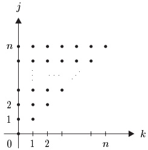

## 8 环、域与多项式

本节我们考虑定义了两种运算的集合。这里我们假定，就其中一种运算而言，该集合构成一个阿贝尔群，并且这两种运算满足适当的“分配律”。由此引出“环”和“域”的概念，它们把算术规则形式化。作为环的特别重要的例子，我们考虑幂级数环以及一个（和多个）未定元的多项式环，并推导它们的一些基本性质。多项式函数相对容易处理，而且在分析中很重要，因为“复杂的函数可以被多项式任意好地逼近”，这一断言我们稍后会说得更精确。

##### 环

由非空集合  $ R $ 以及两种运算——加法 + 与乘法  $ \cdot $——组成的三元组  $ (R, +, \cdot) $ 称为环，如果：

 $ (R_{1}) $  $ (R,+) $ 是阿贝尔群。

(R_{2}) 乘法是结合的。

(R_{3}) 分配律成立：

 \[ (a+b)\cdot c=a\cdot c+b\cdot c,\quad c\cdot(a+b)=c\cdot a+c\cdot b,\qquad a,b,c\in R. \] 

这里我们采用通常的约定，即乘法优先于加法。例如， $ a \cdot b + c $ 表示  $ (a \cdot b) + c $（先做乘法  $ d := a \cdot b $，再做加法  $ d + c $），而不是  $ a \cdot (b + c) $。此外，我们通常把  $ a \cdot b $ 写成  $ ab $。

若乘法是交换的，则称一个环为 **交换环**。此时，分配律  $ (R_{3}) $ 化为

 \[ (a+b)c=ac+bc~,\qquad a,b,c\in R~. \] 

若关于乘法存在单位元，则把它记作  $ 1_R $ 或简记为 1，并称为  $ R $ 的单位元（或乘法单位元），此时我们说  $ (R, +, \cdot) $ 是带单位元的环。当加法与乘法运算由上下文清楚可知时，我们只写  $ R $ 而不写  $ (R, +, \cdot) $。

8.1 注 设  $ R := (R, +, \cdot) $ 是一个环。

(a) 环  $ R $ 的加法群  $ (R, +) $ 的单位元，如例 5.14 那样记作  $ 0_R $，或简记为 0，并称为环  $ R $ 的零元（或加法单位元）。由命题 4.11， $ 0_R $ 以及  $ 1_R $（若存在）都是唯一的。

(b) 由注 7.1(d) 可得，对每个  $ a \in R $ 都有  $ -(-a) = a $。

(c) 对每一对 $a, b \in R$，由注 7.1(c)，方程 $a + x = b$ 有唯一解 $x \in R$，即 $x = b + (-a) =: b - a$（“$b$ 减 $a$”），称为 $a$ 与 $b$ 的差。

(d) 对一切  $ a \in R $，都有 0a = a0 = 0 与 -0 = 0。若  $ a \neq 0 $ 且存在某个  $ b \neq 0 $ 使 ab = 0 或 ba = 0，则称 a 为 R 的零因子。若 R 是交换环且没有零因子，即由 ab = 0 可推出 a = 0 或 b = 0，则称 R 为整环。

证明 由于 $0=0+0$，我们有 $a0=a(0+0)=a0+a0$。于是由 (c) 与等式 $a0+0=a0$ 可得 $a0=0$。同理可证 $0a=0$。第二个断言也由 (c) 得到。

(e) 对一切 $a, b \in R$，都有 $a(-b) = (-a)b = -(ab) =: -ab$ 与 $(-a)(-b) = ab$。

证明 由 $0 = b + (-b)$ 及 (d) 得 $0 = a0 = ab + a(-b)$。因此，正如上面那样，$a(-b) = -ab$。同理可证 $(-a)b = -ab$。两次使用这一事实可得

 \[ (-a)(-b)=-\left(a(-b)\right)=-(-ab)=ab, \] 

其中最后一个等号由 (b) 得到。■

(f) 若 $R$ 是带单位元的环，则对一切 $a \in R$ 都有 $(-1)a = -a$。

证明 这是 (e) 的特殊情形。■

(g) 由例 5.14(a)，对一切  $ n \in \mathbb{N} $ 与  $ a \in R $， $ n \cdot a = na $ 都有定义，且该例中的规则成立。特别地， $ 0_{\mathbb{N}} \cdot a := 0_R $。由 (d) 我们还有  $ 0_R \cdot a := 0_R $，因此略去  $ 0_{\mathbb{N}} $ 与  $ 0_R $ 的下标不会导致歧义。类似地，若  $ R $ 是带单位元的环，则  $ 1_{\mathbb{N}} \cdot a = 1_R \cdot a = a $。

8.2 例 (a) 平凡环恰好只有一个元素 0，它本身也记作 0。含有多于一个元素的环称为非平凡的。平凡环显然是交换的，并且有单位元。若 $R$ 是带单位元的环，则由对每个 $a \in R$ 都有 $1_R \cdot a = a$ 可得，$R$ 是平凡的当且仅当 $1_R = 0_R$。

(b) 设  $ R := (R, +, \cdot) $ 是环，X 是非空集合。则  $ R^X $ 关于运算

 \[ (f+g)(x):=f(x)+g(x)~,\quad(f g)(x):=f(x)g(x)~,\qquad x\in X~,\quad f,g\in R^{X}~. \] 

构成环。若 $R$ 是交换环（带单位元的环），则 $R^X := (R^X, +, \cdot)$ 也是（见例 4.12）。特别地，对 $m \geq 2$，环 $R$ 的直积 $R^m$ 关于运算

 \[ (a_{1},\cdots,a_{m})+(b_{1},\cdots,b_{m})=(a_{1}+b_{1},\cdots,a_{m}+b_{m}) \] 

以及

 \[ (a_{1},\ldots,a_{m})(b_{1},\ldots,b_{m})=(a_{1}b_{1},\ldots,a_{m}b_{m}) \] 

构成一个环，称为积环。若 $R$ 是非平凡的带单位元的环，且 $X$ 至少含有两个元素，则 $R^X$ 有零因子。

证明 第一个断言见例 4.12。对第二个断言，设  $ x, y \in X $ 满足  $ x \neq y $，而  $ f, g \in R^X $ 满足  $ f(x) = 1 $ 以及对一切  $ x' \in X \setminus \{x\} $ 有  $ f(x') = 0 $，又满足  $ g(y) = 1 $ 以及对一切  $ y' \in X \setminus \{y\} $ 有  $ g(y') = 0 $。则  $ fg = 0 $。

(c) 设 R 是环，S 是 R 的非空子集，且满足以下条件：

 $ (SR_{1}) $ S 是  $ (R, +) $ 的子群。

 \[ (\mathrm{S R}_{2})\setminus S\cdot S\subseteq S. \] 

则 $S$ 本身是一个环，即 $R$ 的子环，而 $R$ 称为 $S$ 的扩环。显然，$0 = \{0\}$ 与 $R$ 都是 $R$ 的子环。即使 $R$ 是带单位元的环，$S$ 也未必如此（见 (e)）。即便如此，若 $1_R \in S$，则 $1_R$ 是 $S$ 的单位元。当然，若 $R$ 是交换环，则 $S$ 也是。反之一般不成立。

(d) 子环的交是子环。

(e) 设  $ R $ 是非平凡的带单位元的环， $ S $ 是所有这样的  $ g \in R^\mathbb{N} $ 的集合：对 **几乎** 所有（即除有限多个之外的一切） $ n \in \mathbb{N} $ 都有  $ g(n) = 0 $。则  $ S $ 是  $ R^\mathbb{N} $ 的无单位元的子环。（为什么？）

(f) 设 $X$ 是一个集合。对 $X$ 的子集 $A$ 与 $B$，用下式定义它们的对称差 $A \triangle B$：

 \[ A\triangle B:=(A\cup B)\backslash(A\cap B)=(A\backslash B)\cup(B\backslash A). \] 

则  $ (\mathcal{P}(X), \triangle, \cap) $ 是带单位元的交换环。■

设 $R$ 与 $R'$ 是环。一个（环）同态是函数 $\varphi: R \to R'$，它与环的运算相容，即

 \[ \varphi(a+b)=\varphi(a)+\varphi(b)~,\quad\varphi(ab)=\varphi(a)\varphi(b)~,\qquad a,b\in R~. \] 

此外，若  $ \varphi $ 是双射，则称  $ \varphi $ 为（环）同构，并称 R 与  $ R' $ 同构。

从  $ R $ 到自身的同态  $ \varphi $ 称为（环）自同态。若  $ \varphi $ 是同构，则称它为（环）自同构。\footnote{当上下文清楚地表明所指的是哪一类同态——群、环（以及后来的域、向量空间或代数）——时，我们将使用“同态”“同构”“自同态”等词。}

8.3 注 (a) 环同态  $ \varphi: R \to R' $ 特别地是从  $ (R, +) $ 到  $ (R', +) $ 的群同态。 $ \varphi $ 的核  $ \ker(\varphi) $ 定义为这个群同态的核，即

 \[ \ker(\varphi)=\left\{a\in R;\;\varphi(a)=0\right\}=\varphi^{-1}(0). \] 

(b) 零函数  $ R \to R' $， $ a \mapsto 0_{R'} $ 是同态，且  $ \ker(\varphi) = R $。

(c) 设 $R$ 与 $R'$ 是带单位元的环，$\varphi: R \to R'$ 是同态。如 (b) 所示，不能推出 $\varphi(1_R) = 1_{R'}$。这可看作下述事实的结果：就乘法而言，环不是群。

##### 二项式定理

下面我们说明，环公理  $ (R_1)-(R_3) $ 除注 8.1 中的规则外还有其他重要的推论。

8.4 定理（二项式定理） 设 $a$ 与 $b$ 是带单位元的环 $R$ 中两个可交换的元素（即 $ab = ba$）。则对一切 $n \in \mathbb{N}$，

 \[ (a+b)^{n}=\sum_{k=0}^{n}\binom{n}{k}a^{k}b^{n-k}. \] 

证明 首先我们注意到，由例 5.14、注 8.1(g) 与习题 5.5，(8.3) 的两端都有定义，且该断言对 $n = 0$ 成立。若 (8.3) 对某个 $n \in \mathbb{N}$ 成立，则

 \[ \begin{align*}(a+b)^{n+1}&=(a+b)^{n}(a+b)=\biggl(\sum_{k=0}^{n}\binom{n}{k}a^{k} b^{n-k}\biggr)(a+b)\\&=\sum_{k=0}^{n}\binom{n}{k}a^{k+1}b^{n-k}+\sum_{k=0}^{n}\binom{n}{k}a^{k} b^{n+1-k}\\&=a^{n+1}+\sum_{k=0}^{n-1}\binom{n}{k}a^{k+1}b^{n-k}+\sum_{k=1}^{n}\binom{n}{k}a^{k} b^{n+1-k}+b^{n+1}\\&=a^{n+1}+\sum_{k=1}^{n}\biggl\{\binom{n}{k-1}+\binom{n}{k}\biggr\}a^{k} b^{n+1-k}+b^{n+1}.\end{align*} \] 

由习题 5.5 有  $ \binom{n}{k-1}+\binom{n}{k}=\binom{n+1}{k} $，于是

 \[ (a+b)^{n+1}=a^{n+1}+\sum_{k=1}^{n}\binom{n+1}{k}a^{k}b^{n+1-k}+b^{n+1}. \] 

于是由命题 5.7 的归纳原理可得该断言。■

##### 多项式定理

我们希望推广二项式定理，使 (8.3) 的左端允许出现多于两项的和。为使这一公式尽可能简单，引入以下记号是有用的：

对满足  $ m \geq 2 $ 的  $ m \in \mathbb{N} $，元素  $ \alpha = (\alpha_1, \ldots, \alpha_m) \in \mathbb{N}^m $ 称为（$ m $ 阶）多重指标。多重指标  $ \alpha \in \mathbb{N}^m $ 的长度  $ |\alpha| $ 由下式定义

 \[ |\alpha|:=\sum_{j=1}^{m}\alpha_{j}. \] 

再令

 \[ \alpha!:=\prod_{j=1}^{m}(\alpha_{j})!, \] 

并用下式定义  $ \mathbb{N}^{m} $ 上的自然（偏）序

 \[ \alpha\leq\beta:\Leftrightarrow(\alpha_{j}\leq\beta_{j},1\leq j\leq m). \] 

最后，设 $R$ 是带单位元的交换环，$m \in \mathbb{N}$ 且 $m \geq 2$。则我们令

 \[ a^{\alpha}:=\prod_{j=1}^{m}(a_{j})^{\alpha_{j}} \] 

其中  $ a = (a_1, \ldots, a_m) \in R^m $， $ \alpha = (\alpha_1, \ldots, \alpha_m) \in \mathbb{N}^m $。

8.5 定理（多项式定理） 设 R 是带单位元的交换环。则对一切  $ m \geq 2 $，

 \[ \Bigl(\sum_{j=1}^{m}a_{j}\Bigr)^{k}=\sum_{|\alpha|=k}\frac{k!}{\alpha!}a^{\alpha}\;,\qquad a=(a_{1},\ldots,a_{m})\in R^{m}\;,\quad k\in\mathbb{N}\;. \] 

这里  $ \sum_{|\alpha|=k} $ 是对  $ \mathbb{N}^m $ 中一切长度为  $ k $ 的多重指标求和。

证明 我们先对 m 归纳证明

 \[ k!/\alpha!\in\mathbb{N}^{\times}\qquad\text{对 }k\in\mathbb{N}\text{ 与 }\alpha\in\mathbb{N}^{m}\text{，}|\alpha|=k. \] 

先考虑  $ m = 2 $ 的情形。设  $ \alpha \in \mathbb{N}^2 $ 是任意一个长度为  $ k $ 的多重指标。则存在某个满足  $ 0 \leq \ell \leq k $ 的  $ \ell \in \mathbb{N} $ 使  $ \alpha = (\ell, k - \ell) $，于是由习题 5.5(b)，

 \[ \frac{k!}{\alpha!}=\frac{k!}{\ell!(k-\ell)!}=\binom{k}{\ell}\in\mathbb{N}^{\times}. \] 

现在设 (8.5) 对某个  $ m \geq 2 $ 成立。任取满足  $ |\alpha| = k $ 的  $ \alpha \in \mathbb{N}^{m+1} $。令  $ \alpha' := (\alpha_2, \ldots, \alpha_{m+1}) \in \mathbb{N}^m $。由归纳假设与习题 5.5(a) 可得

 \[ \frac{k!}{\alpha!}=\frac{(k-\alpha_{1})!}{\alpha^{\prime}!}\binom{k}{\alpha_{1}}\in\mathbb{N}^{\times}. \] 

这就完成了归纳以及 (8.5) 的证明。

为证明 (8.4)，我们再次对  $ m $ 归纳。 $ m = 2 $ 的情形就是二项式定理。于是我们假设  $ a = (a_1, \ldots, a_m, a_{m+1}) \in R^{m+1} $（对  $ m \geq 2 $）与

 $ k \in \mathbb{N} $ 是给定的。令  $ b := \sum_{j=2}^{m+1} a_j $，并利用定理 8.4 与归纳假设计算如下：

 \[ \begin{align*}\Big(\sum_{j=1}^{m+1}a_{j}\Big)^{k}=(a_{1}+b)^{k}&=\sum_{\alpha_{1}=0}^{k}\binom{k}{\alpha_{1}}a_{1}^{\alpha_{1}}b^{k-\alpha_{1}}\\&=\sum_{\alpha_{1}=0}^{k}\binom{k}{\alpha_{1}}a_{1}^{\alpha_{1}}\sum_{|\alpha^{\prime}|=k-\alpha_{1}}\frac{(k-\alpha_{1})!}{\alpha^{\prime}!}a_{2}^{\alpha_{2}}\cdot\cdots\cdot a_{m+1}^{\alpha_{m+1}}\\&=\sum_{\alpha_{1}=0}^{k}\sum_{|\alpha^{\prime}|=k-\alpha_{1}}\frac{(k-\alpha_{1})!}{\alpha^{\prime}!}\binom{k}{\alpha_{1}}a_{1}^{\alpha_{1}}\cdot\cdots\cdot a_{m+1}^{\alpha_{m+1}}\\&=\sum_{|\alpha|=k}\frac{k!}{\alpha!}a^{\alpha},\end{align*} \] 

其中最后一步我们用了 (8.6)。这就完成了归纳以及定理的证明。

8.6 注 (a) 多项式系数由下式定义\footnote{我们对多项式系数与二项式系数使用同一个符号 $\binom{\cdot}{\cdot}$。这不会引起误解，因为对多项式系数 $\binom{k}{\alpha}$（$k$ 在上、$\alpha$ 在下），有 $\alpha \in \mathbb{N}^m$ 且 $m \geq 2$，而对二项式系数 $\binom{k}{\ell}$（$k$ 在上、$\ell$ 在下），$\ell$ 总是自然数。}

 \[ \binom{k}{\alpha}:=\frac{k!}{\alpha!(k-|\alpha|)!}\;,\qquad k\in\mathbb{N}\;,\quad\alpha\in\mathbb{N}^{m}\;,\quad|\alpha|\leq k\;. \] 

则  $ (^k_\alpha) \in \mathbb{N}^\times $，并且若  $ R $ 是带单位元的交换环，则

 \[ (1+a_{1}+\cdots+a_{m})^{k}=\sum_{|\alpha|\leq k}{\binom{k}{\alpha}}a^{\alpha}\;,\qquad a=(a_{1},\ldots,a_{m})\in R^{m}\;,\quad k\in\mathbb{N}\;. \] 

证明 若  $ \beta := (\alpha_1, \ldots, \alpha_m, k - |\alpha|) \in \mathbb{N}^{m+1} $，则对一切  $ |\alpha| \leq k $ 都有  $ |\beta| = k $，且  $ \binom{k}{\alpha} = k! / \beta! $。于是由定理 8.5 可得该断言。

(b) 显然，若  $ a_1, \ldots, a_m $ 是任意带单位元的环中两两可交换的元素，则定理 8.5 与 (a) 也成立。

##### 域

当 $R \setminus \{0\}$ 关于乘法构成群时，环 $R$ 具有特别好的性质。这样的环称为域。具体地说，当下列条件得到满足时，$K$ 是一个域：

(F_{1}) K 是带单位元的交换环。

(F_{2})  $ 0 \neq 1 $。

(F$_3$)  $ K^\times := K \setminus \{0\} $ 关于乘法构成阿贝尔群。

阿贝尔群  $ K^{\times} = (K^{\times}, \cdot) $ 称为 K 的乘法群。

当然，域具有我们已经证明环所具有的一切性质。由于  $ K^{\times} $ 是阿贝尔群，我们同样由注 7.1 得到以下重要规则。

8.7 注 设 K 是一个域。

(a) 对一切  $ a \in K^\times $， $ (a^{-1})^{-1} = a $。

(b) 域没有零因子。

证明 设  $ ab = 0 $。若  $ a \neq 0 $，则用  $ a^{-1} $ 乘  $ ab = 0 $ 得 b = 0。

(c) 设  $ a \in K^\times $ 与  $ b \in K $。则存在唯一的  $ x \in K $ 使  $ ax = b $，即商  $ \frac{b}{a} := b/a := ba^{-1} $（ $ b $ 除以  $ a $）。

(d) 对 $a, c \in K$ 与 $b, d \in K^\times$，我们有下列结论：\footnote{用符号 $\pm$ 与 $\mp$ 可以把两个方程写得像一个方程。对其中的一个方程处处用上面的符号（$+$ 或 $-$），对另一个方程则处处用下面的符号。}

(i)  $ \frac{a}{b} = \frac{c}{d} \iff ad = bc. $

(ii)  $ \frac{a}{b} \pm \frac{c}{d} = \frac{ad \pm bc}{bd} $.

(iii)  $ \frac{a}{b} \cdot \frac{c}{d} = \frac{ac}{bd} $.

(iv)  $ \frac{a}{b}\bigg/\frac{c}{d} = \frac{ad}{bc},\quad c \neq 0. $

证明 前三个断言可通过把方程两端乘以 bd，再利用由  $ bdx = bdy $ 推出 x = y 这一规则来证明。规则 (iv) 是 (i) 的简单推论。

(e) 由 (c)，对 $a, b \in K^\times$，方程 $ax = b$ 有唯一解。另一方面，由注 8.1(d)，任何 $x \in K$ 都是方程 $0x = 0$ 的解。这是因为 0 没有乘法逆元。事实上，若 $0^{-1}$ 存在，则会推出 $0 \cdot 0^{-1} = 1$，而由于 $0 \cdot 0^{-1} = 0$，我们就会有 0 = 1，这与 $(F_2)$ 矛盾。这说明零关于乘法所起的特殊作用，它体现在 $K^\times$ 的定义以及“不允许除以零”这一熟悉的观念之中。

(f) 设  $ K' $ 是域， $ \varphi: K \to K' $ 是满足  $ \varphi \neq 0 $ 的同态。则

 \[ \varphi(1_{K})=1_{K^{\prime}}\quad\text{且}\quad\varphi(a^{-1})=\varphi(a)^{-1}~,\qquad a\in K^{\times}~. \] 

证明 由于  $ \varphi $ 是从  $ K^{\times} $ 到  $ K^{\prime \times} $ 的群同态，这由注 7.6(a) 得到。 $ \blacksquare $

当我们在域的情形使用“同态”“同构”等词时，我们指的当然是“环同态”“环同构”等，而不是群同态。

下面的例子表明域确实存在，因而公理  $ (F_{1})-(\mathrm{F}_{3}) $ 不会导致矛盾。

8.8 例 用下表在 {0,1} 上定义加法 + 与乘法 ·。

<table border=1 style='margin: auto; word-wrap: break-word;'><tr><td style='text-align: center; word-wrap: break-word;'>+</td><td style='text-align: center; word-wrap: break-word;'>0</td><td style='text-align: center; word-wrap: break-word;'>1</td></tr><tr><td style='text-align: center; word-wrap: break-word;'>0</td><td style='text-align: center; word-wrap: break-word;'>0</td><td style='text-align: center; word-wrap: break-word;'>1</td></tr><tr><td style='text-align: center; word-wrap: break-word;'>1</td><td style='text-align: center; word-wrap: break-word;'>1</td><td style='text-align: center; word-wrap: break-word;'>0</td></tr></table>

<table border=1 style='margin: auto; word-wrap: break-word;'><tr><td style='text-align: center; word-wrap: break-word;'>.</td><td style='text-align: center; word-wrap: break-word;'>0</td><td style='text-align: center; word-wrap: break-word;'>1</td></tr><tr><td style='text-align: center; word-wrap: break-word;'>0</td><td style='text-align: center; word-wrap: break-word;'>0</td><td style='text-align: center; word-wrap: break-word;'>0</td></tr><tr><td style='text-align: center; word-wrap: break-word;'>1</td><td style='text-align: center; word-wrap: break-word;'>0</td><td style='text-align: center; word-wrap: break-word;'>1</td></tr></table>

则可以验证  $ \mathbb{F}_2 := (\{0,1\}, +, \cdot) $ 是一个域。事实上，在同构意义下， $ \mathbb{F}_2 $ 是唯一含两个元素的域。 $ \blacksquare $

##### 有序域

在分析中重要的环与域，通常除代数结构之外还具有序结构。当然，为了证明有趣的定理，人们期望这两种结构以某种方式相容。于是，若带序  $ \leq $ 的环  $ R $ 满足以下条件，则称它为 **有序环**：\footnote{这里以及下文中，我们写 $a, b, \ldots, w > 0$ 表示 $a > 0, b > 0, \ldots, w > 0$。}

 $ (OR_{0}) $  $ (R,\leq) $ 是全序的。

 \[ (\mathrm{O R}_{1})~x<y\Rightarrow x+z<y+z,~z\in R. \] 

 \[ (\mathrm{OR}_{2})x,y>0\Rightarrow x y>0. \] 

当然，若 x > 0 则称元素  $ x \in R $ 为正的，若 x < 0 则称为负的。我们在下一个命题中汇集有序域的一些简单性质。

8.9 命题 设 $ K $ 是有序域，$ x, y, a, b \in K $。

(i) x > y  $ \Leftrightarrow $ x - y > 0.

(ii) 若 x > y 且 a > b，则  $ x + a > y + b $。

(iii) 若 a > 0 且 x > y，则 ax > ay。

(iv) 若 x > 0，则 -x < 0。若 x < 0，则 -x > 0。

(v) 设 x > 0。若 y > 0，则 xy > 0。若 y < 0，则 xy < 0。

(vi) 若 a < 0 且 x > y，则 ax < ay。

(vii) 对一切  $ x \in K^\times $ 都有  $ x^2 > 0 $。特别地，1 > 0。

(viii) 若 x > 0，则  $ x^{-1} > 0 $。

(ix) 若 x > y > 0，则  $ 0 < x^{-1} < y^{-1} $ 且  $ xy^{-1} > 1 $。

证明 所有这些断言都是公理  $ (OR_{1}) $ 与  $ (OR_{2}) $ 的简单推论。我们只验证 (ix) 由 (i)、(viii) 与  $ (OR_{2}) $ 得到，其余证明留给读者。

若 x > y > 0，则 x - y > 0， $ x^{-1} > 0 $ 且  $ y^{-1} > 0 $。由 (OR $ _{2} $) 得

 \[ 0<(x-y)x^{-1}y^{-1}=y^{-1}-x^{-1}, \] 

这蕴含  $ x^{-1} < y^{-1} $，以及

 \[ 0<(x-y)y^{-1}=x y^{-1}-1, \] 

这蕴含  $ xy^{-1} > 1 $。■

命题 8.9 的断言 (ii) 与 (vii) 蕴含：例 8.8 中的域 $\mathbb{F}_2$ 不能是有序的，因为否则我们就会有 $0 = 1 + 1 > 0$。在下一节中我们将说明有序域确实存在。

对有序域 $K$，绝对值函数 $|\cdot|: K \to K$ 与符号函数 $\mathrm{sign}(\cdot): K \to K$ 由下式定义

 \[ \left|x\right|:=\left\{\begin{array}{r l}{x\quad,\quad}&{x>0\quad,}\\ {0\quad,\quad}&{x=0\quad,}\\ {-x\quad,\quad}&{x<0\quad,}\end{array}\right.\qquad\mathrm{s i g n}x:=\left\{\begin{array}{r l}{1\quad,\quad}&{x>0\quad,}\\ {0\quad,\quad}&{x=0\quad,}\\ {-1\quad,\quad}&{x<0\quad.}\end{array}\right. \] 

8.10 命题 设 K 是有序域， $ x, y, a, \varepsilon \in K $ 且  $ \varepsilon > 0 $。

(i)  $ x = |x| $ sign( $ x $)， $ |x| = x $ sign( $ x $)。

(ii)  $ |x| = |-x| $， $ x \leq |x| $。

(iii)  $ |xy| = |x| |y| $.

(iv)  $ |x| \geq 0 $ 且  $ (|x| = 0 \Leftrightarrow x = 0) $。

(v)  $ |x - a| < \varepsilon \Leftrightarrow a - \varepsilon < x < a + \varepsilon $.

(vi)  $ |x + y| \leq |x| + |y| $（三角不等式）。

证明 前四个断言由定义立即得到。由命题 8.9 的 (vi) 与 (ii) 我们有

 \[ |x-a|<\varepsilon\Longleftrightarrow-\varepsilon<x-a<\varepsilon\Longleftrightarrow a-\varepsilon<x<a+\varepsilon, \] 

这就证明了 (v)。为验证 (vi)，先设 $x + y \geq 0$。则由 (ii) 可得 $|x + y| = x + y \leq |x| + |y|$。若 $x + y < 0$，则 $-(x + y) > 0$，因此

 \[ |x+y|=|-(x+y)|=|(-x)+(-y)|\leq|-x|+|-y|=|x|+|y|, \] 

这就完成了证明。■

8.11 推论（反向三角不等式） 在任何有序域 K 中都有

 \[ \left|x-y\right|\geq\left|\left|x\right|-\left|y\right|\right|,\qquad x,y\in K. \] 

证明 把三角不等式用于等式  $ x = (x - y) + y $ 得  $ |x| \leq |x - y| + |y| $，即  $ |x| - |y| \leq |x - y| $。在此不等式中交换 x 与 y 得  $ |y| - |x| \leq |y - x| = |x - y| $。■

##### 形式幂级数

设 $R$ 是非平凡的带单位元的环。在集合 $R^{\mathbb{N}} = \mathrm{Funct}(\mathbb{N}, R)$ 上定义加法为

 \[ (p+q)_{n}:=p_{n}+q_{n}~,\qquad n\in\mathbb{N}~, \] 

而乘法由卷积定义为

 \[ (pq)_{n}:=(p\cdot q)_{n}:=\sum_{j=0}^{n} p_{j} q_{n-j}=p_{0}q_{n}+p_{1}q_{n-1}+\cdots+p_{n} q_{0} \] 

其中 $n \in \mathbb{N}$。这里 $p_n$ 表示 $p \in R^\mathbb{N}$ 在 $n \in \mathbb{N}$ 处的值，称为 $p$ 的 $n$ 系数。在这种情形下，元素 $p \in R^\mathbb{N}$ 称为 $R$ 上的形式幂级数，并令 $R[[X]] := (R^\mathbb{N}, +, \cdot)$。下面的命题表明 $R[[X]]$ 是一个环。注意这个环与例 8.2(b) 中引入的函数环 $R^\mathbb{N}$ 不同。

8.12 命题  $ R[X] $ 是带单位元的环，即 $ R $ 上的形式幂级数环。若 $ R $ 是交换环，则 $ R[X] $ 也是。

证明 由 (8.7) 与例 7.2(d)， $ (R[X], +) $ 是阿贝尔群。

下面我们证明  $ (R_2) $ 成立。若  $ p, q, r \in R[X] $，则

 \[ \left((pq)r\right)_{n}=\sum_{j=0}^{n}(pq)_{j}r_{n-j}=\sum_{j=0}^{n}\sum_{k=0}^{j}p_{k}q_{j-k}r_{n-j} \] 

对一切  $ n \in \mathbb{N} $ 成立。(8.9) 中的二重和是对右图中圆点所对应的所有数对  $ (j, k) $ 求和。由于加法是结合且交换的运算，求和可按任意顺序进行。特别地，求和可以从“先列”改为“先行”，此时 (8.9) 的右端变为

 \[ \sum_{k=0}^{n}\sum_{j=k}^{n}p_{k}q_{j-k}r_{n-j}=\sum_{k=0}^{n}p_{k}\sum_{\ell=0}^{n-k}q_{\ell}r_{n-k-\ell}=\sum_{k=0}^{n}p_{k}(qr)_{n-k}=\left(p(qr)\right)_{n}, \] 

其中我们令  $ \ell := j - k $。

$(R_3)$ 的成立是清楚的，形式幂级数 $p$（满足 $p_0 = 1$ 且对 $n \in \mathbb{N}^\times$ 有 $p_n = 0$）是 $R[[X]]$ 的单位元这一事实也是清楚的。最后一个断言是平凡的。

我们用 X 表示幂级数

 \[ X_{n}:=\left\{\begin{array}{l l}{1,}&{\quad n=1,}\\ {0}&{\quad\text{其他情形}.}\end{array}\right. \] 

则对 $X^{m}$ 我们有（见例 5.14(a)）

 \[ X_{n}^{m}:=\left\{\begin{array}{l l}{1,}&{\quad n=m,}\\ {0,}&{\quad n\neq m,}\\ \end{array}\right.\qquad m,n\in\mathbb{N}. \] 

特别地， $ X^{0} $ 是 $ R[X] $ 的单位元。

对  $ a \in R $，我们用 $ aX^0 $ 表示常幂级数，

 \[ a X_{n}^{0}:=\left\{\begin{array}{l l}{a,}&{\quad n=0,}\\ {0,}&{\quad n>0,}\\ \end{array}\right. \] 

而用  $ RX^{0} $ 表示所有常幂级数的集合。由 (8.7) 与 (8.8) 可见， $ RX^{0} $ 是 $ R[X] $ 的包含单位元的子环，且函数

 \[ R\to R X^{0}~,\quad a\mapsto a X^{0} \] 

是同构。下面我们通常把 $R$ 与 $RX^0$ 等同，即把常幂级数 $aX^0$ 写成 $a$，并把 $R$ 看作 $R[[X]]$ 的子环。注意 (8.8) 还蕴含

 \[ (a p)_{n}=a p_{n}~,\qquad n\in\mathbb{N}~,\quad a\in R~,\qquad p\in R[[X]]~. \] 

##### 多项式

$R$ 上的多项式是形式幂级数 $p \in R[[X]]$，使得 $\{n; p_n \neq 0\}$ 是有限的，换言之，$p_n = 0$ “几乎处处”成立。容易看出，$R[[X]]$ 中所有多项式的集合是 $R[[X]]$ 的包含单位元的子环。这个子环记作 $R[X]$，称为 $R$ 上的多项式环。

若 $p$ 是多项式，则存在某个 $n \in \mathbb{N}$ 使当 $k > n$ 时 $p_k = 0$。由 (8.10) 与 (8.12) 可得 $p$ 可写成形式

 \[ p=\sum_{k}p_{k}X^{k}=\sum_{k=0}^{n}p_{k}X^{k}=p_{0}+p_{1}X+p_{2}X^{2}+\cdots+p_{n}X^{n} \] 

其中  $ p_0, \ldots, p_n \in \mathbb{R} $。当然，可能对某些（或全部） $ k \leq n $ 有  $ p_k = 0 $。当多项式按 (8.13) 那样写出时，规则 (8.7) 与 (8.8) 具有形式

 \[ \sum_{k}p_{k}X^{k}+\sum_{k}q_{k}X^{k}=\sum_{k}(p_{k}+q_{k})X^{k} \] 

以及

 \[ \Big(\sum_{k}p_{k}X^{k}\Big)\Big(\sum_{j}q_{j}X^{j}\Big)=\sum_{n}\Big(\sum_{j=0}^{n}p_{j}q_{n-j}\Big)X^{n}. \] 

注意 (8.15) 可通过把分配律与规则

 \[ (a X^{j})(b X^{k})=a b X^{j+k}~,\qquad a,b\in R~,\quad j,k\in\mathbb{N}~, \] 

用于等式左端而得到。

作为  $ R[X] $ 是环这一事实的一个简单应用，我们证明下面的二项式系数加法定理，它推广了习题 5.5 的公式 (ii)。

8.13 命题 对一切  $ \ell, m, n \in \mathbb{N} $，

 \[ {\binom{m+n}{\ell}}=\sum_{k=0}^{\ell}{\binom{m}{k}}{\binom{n}{\ell-k}}=\sum_{k=0}^{\ell}{\binom{m}{\ell-k}}{\binom{n}{k}}. \] 

证明 对 $1 + X \in R[X]$，由 (5.15) 可得

 \[ (1+X)^{m}(1+X)^{n}=(1+X)^{m+n}. \] 

由于 $X$ 与 $1=1X^{0}=X^{0}$ 可交换，即 $X1=1X$，二项式定理 (8.4) 蕴含

 \[ (1+X)^{j}=\sum_{i=0}^{j}\binom{j}{i}X^{i}\;,\qquad j\in\mathbb{N}\;. \] 

于是由 (8.15) 得

 \[ (1+X)^{m}(1+X)^{n}=\Big(\sum_{k=0}^{m}\binom{m}{k}X^{k}\Big)\Big(\sum_{j=0}^{n}\binom{n}{j}X^{j}\Big)\\=\sum_{\ell}\Big(\sum_{k=0}^{\ell}\binom{m}{k}\binom{n}{\ell-k}\Big)X^{\ell}, \] 

再由 (8.16) 与 (8.17) 可得

 \[ \sum_{\ell}\Bigl(\sum_{k=0}^{\ell}\Bigl(\overset{m}{k}\Bigr)\Bigl(\overset{n}{\ell-k}\Bigr)\Bigr)X^{\ell}=\sum_{\ell}\Bigl(\overset{m+n}{\ell}\Bigr)X^{\ell}~, \] 

这里考虑到了当  $ k > \ell $ 时  $ \binom{\ell}{k} = 0 $。现在通过比较等号两端  $ X^{\ell} $ 的系数即可得到该断言。\footnote{这里我们用了这样的事实：两个多项式，即两个从 $\mathbb{N}$ 到 $R$ 的函数，相等当且仅当它们的系数相同。} ■

若 $p = \sum_k p_k X^k \neq 0$ 是多项式，则由命题 5.5，存在最小的 $m \in \mathbb{N}$ 使当 $k > m$ 时 $p_k = 0$。数 $m$ 称为 $p$ 的 $\text{次数}$，记作 $\text{deg}(p)$，而 $p_m$ 称为 $p$ 的 $\text{首项}\ \text{系数}$。按约定，$\text{零}\ \text{多项式}$ $p = 0$ 的次数为 $-\infty$（$\text{负}\ \text{无穷}$），对此下列关系成立：\footnote{(8.18) 中的约定是为了使 (8.19) 这类法则对零多项式也成立。当然，$-\infty$ 不是自然数，它也不能是某个包含自然数的阿贝尔群的元素。（为什么不能？）}

 \[ -\infty<k~,\quad k\in\mathbb{N}~,\qquad-\infty+k=k+(-\infty)=-\infty~,\quad k\in\mathbb{N}\cup\{-\infty\}~. \] 

对  $ k + (-\infty) $ 我们也写作  $ k - \infty $。

显然

 \[ \deg(p+q)\leq\max\bigl(\deg(p),\deg(q)\bigr),\quad\deg(pq)\leq\deg(p)+\deg(q) \] 

对一切 $p, q \in R[X]$ 成立。若 $R$ 没有零因子，特别地，若 $R$ 是域，则我们有

 \[ \deg(pq)=\deg(p)+\deg(q). \] 

把任意元素  $ p \in R[X] $ 写成如下形式也是方便的

 \[ p=\sum_{k}p_{k}X^{k}~, \] 

这解释了“形式幂级数”这一名称。由于“无限和”在  $ R[[X]] $ 中没有意义，这只能看作书写函数  $ p \in R^{\mathbb{N}} $ 的另一种方式。也就是说， $ X^k $ 只是一个占位符，用来表示函数  $ p $ 在  $ k \in \mathbb{N} $ 处取值  $ p_k \in R $。即便如此，关系 (8.14)–(8.15) 仍可用于对这样的无限和进行计算。

##### 多项式函数

设  $ p = \sum_{k=0}^{n} p_k X^k $ 是 $ R $ 上的多项式。则我们定义 $ p $ 在 $ x \in R $ 处的 **值** 为

 \[ p(x):=\sum_{k=0}^{n}p_{k}x^{k}\in R. \] 

这定义了一个函数

 \[ \underline{{p}}\colon R\to R~,\quad x\mapsto p(x)~, \] 

即对应于 $ p \in R[X] $ 的多项式函数 $ \underline{p} \in R^R $。

8.14 注 (a) 对应于常多项式 $a$ 的多项式函数是常函数 $(x \mapsto a) \in R^R$。对应于 $X$ 的多项式函数是恒等函数 $\mathrm{id}_R \in R^R$。

(b) 设 $R$ 是交换环。则对一切 $p, q \in R[X]$，

 \[ (p+q)(x)=p(x)+q(x)~,\quad(p q)(x)=p(x)q(x)~,\qquad x\in R~, \] 

也就是说，函数

 \[ R[X]\to R^{R}~,\quad p\mapsto\underline{p} \] 

在  $ R^R $ 具有例 8.2(b) 的环结构时是同态。此外，这个同态把 1 映到 1。

证明 简单的验证留给读者。

(c) 若 R 是非平凡的有限环，则函数 (8.22) 不是单射。分析中重要的环是无限的，而对这样的环函数 (8.22) 是单射。

证明 对第一个断言，我们注意到，由于 $R$ 至少有两个元素，由命题 6.7 与 6.11，集合 $R[X] = R^N$ 是不可数的。由于 $R^R$ 是有限集，不可能存在从 $R[X]$ 到 $R^R$ 的单射。第二个断言在注 8.19(d) 中证明。

(d) 设 $M$ 是带单位元的环。假设存在函数 $R \times M \to M$，我们把它记作 $(a, m) \mapsto am$。则我们可以定义 $p = \sum_{k=0}^{n} p_k X^k$ 在 $m \in M$ 处的值为

 \[ p(m):=\sum_{k=0}^{n} p_{k} m^{k}. \] 

一个平凡但重要的情形是 $R$ 为 $M$ 的子环。此时任何 $p \in R[X]$ 也可看作 $M[X]$ 的元素，因此 $R[X] \subseteq M[X]$。在注 12.12 中我们将回到这一一般情形。

(e) 设  $ p = \sum_kp_k X^k \in R[X] $ 是形式幂级数。则对 $ x \in R $ 作形如  $ p(x) := \sum_kp_kx^k $ 的定义是没有意义的，因为“无限和”在  $ R $ 中一般没有定义。即便如此，在 II.9 节中我们将遇到某些形式幂级数，它们具有这样的性质：对某些  $ x \in R $，$ p $ 在 $ x $ 处的值  $ p(x) := \sum_kp_kx^k \in R $ 有意义。

(f) 为有效计算 $p(x)$，注意 $p$ 可写成形式

 \[ p=\Big(\big(\cdots\big((p_{n}X+p_{n-1})X+p_{n-2}\big)\cdots\big)X+p_{1}\Big)X+p_{0} \] 

（这可用归纳法容易地证明）。这提示了求 $p(x)$ 的一种“迭代过程”：用下式计算 $x_n, x_{n-1}, \ldots, x_0$：

 \[ x_{n}:=x~,\quad x_{k-1}:=p_{k}x_{k}+p_{k-1}~,\qquad k=n,n-1,\ldots,1~, \] 

然后令 $p(x)=x_0$。这个“算法”易于编程，且只需 $n$ 次乘法与 $n$ 次加法。另一方面，“直接”计算需要 $2n-1$ 次乘法与 $n$ 次加法。

##### 多项式的除法

对域 K 上的多项式，我们现在证明命题 5.4 的带余除法的一个重要版本。

8.15 命题 设 $K$ 是域，$p, q \in K[X]$ 且 $q \neq 0$。则存在唯一的多项式 $r$ 与 $s$ 使得

 \[ p=s q+r\quad\text{ 且 }\quad\deg(r)<\deg(q). \] 

证明 (a) 存在性：若  $ \deg(p) < \deg(q) $，则  $ s := 0 $ 与  $ r := p $ 满足 (8.23)。于是可设  $ n := \deg(p) \geq \deg(q) =: m $。这样我们有

 \[ p=\sum_{k=0}^{n}p_{k}X^{k},\quad q=\sum_{j=0}^{m}q_{j}X^{j},\qquad p_{n}\neq0,\quad q_{m}\neq0. \] 

令 $s_{(1)} := p_n q_m^{-1} X^{n-m} \in K[X]$。则 $p_{(1)} := p - s_{(1)} q$ 是满足 $\deg(p_{(1)}) < \deg(p)$ 的多项式。若 $\deg(p_{(1)}) < m$，则 $s := s_{(1)}$ 与 $r := p_{(1)}$ 满足 (8.23)。否则我们把上述论证用于 $p_{(1)}$ 以代替 $p$。按需重复，经有限多步后我们得到满足 (8.23) 的多项式 $r$ 与 $s$。

(b) 唯一性：设 $s_{(1)}$ 与 $r_{(1)}$ 是另外的多项式，具有性质 $p = s_{(1)}q + r_{(1)}$ 与 $\deg(r_{(1)}) < \deg(q)$。则 $(s_{(1)} - s)q = r - r_{(1)}$。若 $s_{(1)} - s \neq 0$，则由 (8.20) 我们会得到

 \[ \deg(r-r_{(1)})=\deg\bigl((s_{(1)}-s)q\bigr)=\deg(s_{(1)}-s)+\deg(q)>\deg(q), \] 

而由于  $ \deg(r - r_{(1)}) \leq \max(\deg(r), \deg(r_{(1)})) < \deg(q) $，这是不可能的。因此  $ s_{(1)} = s $，同样  $ r_{(1)} = r $。■

注意上述证明是“构造性的”，即多项式 r 与 s 可用 (a) 中描述的方法计算出来。

作为命题 8.15 的第一个应用，我们证明多项式可以按任意  $ a \in K $ “展开”。

8.16 命题 设 $K$ 是域，$p \in K[X]$ 是次数为 $n \in \mathbb{N}$ 的多项式，$a \in K$。则存在唯一的 $b_0, b_1, \ldots, b_n \in K$ 使得

 \[ p=\sum_{k=0}^{n}b_{k}(X-a)^{k}=b_{0}+b_{1}(X-a)+b_{2}(X-a)^{2}+\cdots+b_{n}(X-a)^{n}. \] 

特别地， $ b_{n} \neq 0 $。

证明 由于  $ \deg(X - a) = 1 $，由命题 8.15 可得存在唯一的  $ p_{(1)} \in K[X] $ 与  $ b_0 \in K $ 使  $ p = (X - a)p_{(1)} + b_0 $。由 (8.20) 我们有  $ \deg(p_{(1)}) = \deg(p) - 1 $，因此该断言可用归纳法证明。

##### 一次因式

命题 (8.16) 的一个直接推论是下面的因式分解定理。

8.17 定理 设 $K$ 是域，$p \in K[X]$ 且 $\deg(p) \geq 1$。若 $a \in K$ 是 $p$ 的零点，即 $p(a) = 0$，则 $X - a \in K[X]$ 整除 $p$，即存在唯一的 $q \in K[X]$ 使 $p = (X - a)q$，且 $\deg(q) = \deg(p) - 1$。

证明 把 (8.24) 的两端在 a 处取值得  $ 0 = p(a) = b_{0} $，于是

 \[ p=\sum_{k=1}^{n}b_{k}(X-a)^{k}=\Big(\sum_{j=0}^{n-1}b_{j+1}(X-a)^{j}\Big)(X-a), \] 

这就证明了该断言。■

8.18 推论 域上次数为 m 的非常数多项式至多有 m 个零点。

8.19 注 设 K 是一个域。

(a) 一般来说，非常数多项式可能没有零点。例如，若 K 是有序域，则由命题 8.9(ii) 与 (vii)，多项式  $ X^{2} + 1 $ 没有零点。

(b) 设  $ p \in K[X] $ 且  $ \deg(p) = m \geq 1 $。若  $ a_1, \ldots, a_n \in K $ 是  $ p $ 的全部零点，则  $ p $ 可唯一地写成形式

 \[ p=q\prod_{j=1}^{n}(X-a_{j})^{m(j)} \] 

其中  $ q \in K[X] $ 没有零点， $ m(j) \in \mathbb{N}^\times $。这里  $ m(j) $ 称为  $ p $ 的零点  $ a_j $ 的重数。若  $ m(j) = 1 $，则零点  $ a_j $ 是单重的。此外， $ \sum_{j=1}^{n} m(j) \leq m $。

证明 由定理 8.17 用归纳法可得。

(c) 若 $p$ 与 $q$ 是 $K$ 上次数 $\leq n$ 的多项式，且对某组互不相同的 $a_1, a_2, \ldots, a_{n+1} \in K$ 有 $p(a_i) = q(a_i)$，则 $p = q$（多项式的恒等定理）。

证明 由 (8.19) 我们有 $\deg(p - q) \leq n$。由于 $p - q$ 有 $n + 1$ 个零点，该断言由推论 8.18 得到。

(d) 若 K 是无限域，即集合 K 是无限的，则同态 (8.22) 是单射。\footnote{对有限域，这个论断不成立。见注 8.14(c) 与习题 16。}

证明 若 $p, q \in K[X]$ 满足 $\underline{p} = \underline{q}$，则对一切 $x \in K$ 有 $p(x) = q(x)$。由于 $K$ 是无限的，由 (c) 可得 $p = q$。■

##### 多元不定元的多项式

为结束本节，我们把上述结果推广到 $m$ 个未定元的形式幂级数与多项式的情形。与 $m=1$ 的情形（即 $R[[X]]$ 与 $R[X]$）类似，对 $m\in\mathbb{N}^\times$，我们在集合 $R^{(\mathbb{N}^m)}=\mathrm{Funct}(\mathbb{N}^m,R)$ 上定义加法与乘法为

 \[ (p+q)_{\alpha}:=p_{\alpha}+q_{\alpha}~,\qquad\alpha\in\mathbb{N}^{m}~, \] 

以及

 \[ (p q)_{\alpha}:=\sum_{\beta\leq\alpha}p_{\beta}q_{\alpha-\beta}~,\qquad\alpha\in\mathbb{N}^{m}~. \] 

在 (8.26) 中，求和遍及一切满足  $ \beta \leq \alpha $ 的多重指标  $ \beta \in \mathbb{N}^m $。在这种情形下， $ p \in R^{(\mathbb{N}^m)} $ 称为 $ R $ 上 $ m $ 个未定元的形式幂级数。我们令

 \[ R[\left[X_{1},\ldots,X_{m}\right]]:=\left(R^{(\mathbb{N}^{m})},+,\cdot\right), \] 

其中 + 与 · 如 (8.25) 与 (8.26) 中那样。

若形式幂级数  $ p \in R[X_1, \ldots, X_m] $ 对几乎所有的  $ \alpha \in \mathbb{N}^m $ 都有  $ p_\alpha = 0 $，则称它为 $ R $ 上 $ m $ 个未定元的多项式。所有这种多项式的集合记作  $ R[X_1, \ldots, X_m] $。

令  $ X := (X_1, \ldots, X_m) $，并对  $ \alpha \in \mathbb{N}^m $，用  $ X^\alpha $ 表示满足下式的形式幂级数（即函数  $ \mathbb{N}^m \to R $）

 \[ X_{\beta}^{\alpha}:=\left\{\begin{array}{l l}{1,}&{\quad\beta=\alpha,}\\ {0,}&{\quad\beta\neq\alpha,}\\ \end{array}\right.\qquad\beta\in\mathbb{N}^{m}. \] 

则每个 $p \in R[[X_1,\ldots,X_m]]$ 都可唯一地写成形式

 \[ p=\sum_{\alpha\in\mathbb{N}^{m}}p_{\alpha}X^{\alpha}. \] 

规则 (8.25) 与 (8.26) 变为

 \[ \sum_{\alpha\in\mathbb{N}^{m}}p_{\alpha}X^{\alpha}+\sum_{\alpha\in\mathbb{N}^{m}}q_{\alpha}X^{\alpha}=\sum_{\alpha\in\mathbb{N}^{m}}(p_{\alpha}+q_{\alpha})X^{\alpha} \] 

以及

 \[ \Big(\sum_{\alpha\in\mathbb{N}^{m}}p_{\alpha}X^{\alpha}\Big)\Big(\sum_{\beta\in\mathbb{N}^{m}}q_{\beta}X^{\beta}\Big)=\sum_{\alpha\in\mathbb{N}^{m}}\Big(\sum_{\beta\leq\alpha}p_{\beta}q_{\alpha-\beta}\Big)X^{\alpha}\;. \] 

同样，(8.27) 与 (8.28) 可通过使用分配律与规则

 \[ a X^{\alpha}b X^{\beta}=a b X^{\alpha+\beta},\qquad a,b\in R,\quad\alpha,\beta\in\mathbb{N}^{m}. \] 

多项式

 \[ p=\sum_{\alpha\in\mathbb{N}^{m}}p_{\alpha}X^{\alpha}\in R[X_{1},\ldots,X_{m}] \] 

的次数由下式定义\footnote{我们约定 $\max(\emptyset) = -\infty$ 与 $\min(\emptyset) = \infty$。}

 \[ \mathrm{d e g}(p):=\max\{|\alpha|\in\mathbb{N}\;;\;p_{\alpha}\neq0\}. \] 

形如  $ p_{\alpha}X^{\alpha} $（其中  $ \alpha \in \mathbb{N}^m $）的多项式称为单项式。若只要  $ |\alpha| \neq k $ 就有  $ p_{\alpha} = 0 $，则称多项式 (8.29) 是 $ k $ 次齐次的。每个次数为  $ k \in \mathbb{N} $ 的齐次多项式都具有形式

 \[ \sum_{|\alpha|=k}p_{\alpha}X^{\alpha}\;,\qquad p_{\alpha}\in R\;. \] 

次数  $ \leq 0 $ 的多项式称为 $ \text{常数多项式} $，次数为 1 的多项式称为 $ \text{线性多项式} $，次数为 2 的多项式称为 $ \text{二次多项式} $。

8.20 注 (a)  $ R[[X_1, \ldots, X_m]] $ 是带单位元  $ X^0 = X^{(0,0,\ldots,0)} $ 的环，即  $ X^0 $ 是函数  $ \mathbb{N}^m \to R $，它在  $ (0, 0, \ldots, 0) $ 处取值 1，在其他处取值为零。若  $ R $ 是交换环，则  $ R[[X_1, \ldots, X_m]] $ 也是。未定元  $ X_1, \ldots, X_n $ 的多项式环，即  $ R[X_1, \ldots, X_n] $，是  $ R[[X_1, \ldots, X_m]] $ 的子环。 $ R $ 同构于  $ R[[X_1, \ldots, X_n]] $ 的子环  $ RX^0 := \{a X^0 : a \in R\} $。借助这个同构我们把  $ R $ 与  $ RX^0 $ 等同，从而把  $ R $ 看作  $ R[X_1, \ldots, X_n] $ 的子环，并把  $ a X^0 $ 写成  $ a $。

(b) 设 $R$ 是交换环，$p \in R[X_1, \ldots, X_m]$。则我们定义 $p$ 在 $x := (x_1, \ldots, x_m) \in R^m$ 处的值为

 \[ p(x):=\sum_{\alpha\in\mathbb{N}^{m}}p_{\alpha}x^{\alpha}\in R, \] 

并定义相应的（m 元）多项式函数为

 \[ \underline{p}:R^{m}\to R~,\quad x\mapsto p(x)~. \] 

函数

 \[ R[X_{1},\ldots,X_{m}]\to R^{(R^{m})}~,\quad p\mapsto\underline{p} \] 

在  $ R^{(R^{m})} $ 被赋予例 8.2(b) 的环结构时是同态。

(c) 设 K 是无限域。则同态 (8.30) 是单射。

证明 设 $p \in K[X_1, \ldots, X_m]$。则由注 7.6(d)，只需证明：若对一切 $x = (x_1, \ldots, x_m) \in K^m$ 都有 $\underline{p}(x) = 0$，则 $\underline{p}$ 为零。显然 $p = \sum_\alpha p_\alpha X^\alpha$ 可写成形式

 \[ p=\sum_{j=0}^{n}q_{j} X_{m}^{j} \] 

其中  $ n \in \mathbb{N} $ 与  $ q_j \in K[X_1, \ldots, X_{m-1}] $ 适当选取。这提示了对未定元个数作归纳的证明：对  $ m = 1 $，由注 8.19(d) 该断言成立。下面设该断言对  $ 1 \leq k \leq m-1 $ 成立。利用 (8.31)，令

 \[ p_{(x^{\prime})}:=\sum_{j=0}^{n}\underline{{q}}_{j}(x_{1},\ldots,x_{m-1})X^{j}\in K[X]~,\qquad x^{\prime}:=(x_{1},\ldots,x_{m-1})\in K^{m-1}~. \] 

由于对  $ x \in K^{m} $ 有  $ \underline{p}(x) = 0 $，故对每个  $ \xi \in K $ 与固定的  $ x^{\prime} \in K^{m-1} $ 都有  $ p_{(x^{\prime})}(\xi) = 0 $。

注 8.19(d) 蕴含  $ p_{(x^{\prime})} = 0 $，即对一切  $ 0 \leq j \leq n $ 都有  $ \underline{q}_{j}(x_{1}, \ldots, x_{m-1}) = 0 $。由于  $ x^{\prime} \in K^{m-1} $ 是任意的，由归纳法可得对一切  $ j = 0, \ldots, n $ 都有  $ q_{j}(X_{1}, \ldots, X_{m-1}) = 0 $。这当然蕴含  $ p = 0 $。■

约定 设 $K$ 是无限域，$m \in \mathbb{N}^\times$。则我们把多项式环 $K[X_1, \ldots, X_m]$ 与它在 $K^{(K^m)}$ 中在同态 (8.30) 下的像等同。换句话说，我们把多项式 $p \in K[X_1, \ldots, X_m]$ 与多项式函数

 \[ K^{m}\to K~,\quad x\mapsto p(x)~. \] 

等同。因此  $ K[X_1, \ldots, X_m] $ 是  $ K^{(K^m)} $ 的子环，我们称它为 $ R $ 上 $ m $ 个未定元的多项式环。

##### 习题

1 设 $a$ 与 $b$ 是带单位元的环中可交换的元素，$n \in \mathbb{N}$。

证明以下结论：

(a)  $ a^{n+1} - b^{n+1} = (a - b) \sum_{j=0}^{n} a^j b^{n-j} $.

(b)  $ a^{n+1} - 1 = (a - 1) \sum_{j=0}^{n} a^j $.

注  $ \sum_{j=0}^{n} a^{j} $ 称为 $ R $ 中的有限几何级数。

2 对带单位元的环  $ R $，证明在  $ R[X] $ 中  $ (1 - X) \sum_k X^k = (\sum_k X^k)(1 - X) = 1 $。

注  $ \sum_k X^k $ 称为几何级数。

3 证明域上一个未定元的多项式环没有零因子。

4 证明有限域不能是有序的。

5 证明注 8.20(a) 与 (b)。

6 设 R 是带单位元的环。若 RI = IR = I，则称子环 I 为 R 的理想。若理想是 R 的真子集，则称它为真理想。证明以下结论：

(a) 理想 $I$ 是真理想当且仅当 $1 \notin I$。

(b) 域 K 恰好有两个理想： $ \{0\} $ 与 K。

(c) 若  $ \varphi: R \to R' $ 是环同态，则  $ \ker(\varphi) $ 是 R 的理想。

(d) 一族理想的交是理想。

(e) 设 I 是 R 的理想，并设 R/I 是商群  $ (R, +)/I $。在 R/I 上定义运算

 \[ R/I\times R/I\to R/I~,\quad(a+I,b+I)\mapsto a b+I~. \] 

证明以这个运算作为乘法时， $ R/I $ 是一个环，且商同态  $ p: R \to R/I $ 是环同态。

注 $R/I$ 称为 $R$ 模 $I$ 的商环，而对 $a \in R$，$a + I$ 是 $a$ 模 $I$ 的陪集。我们常把 $a \in b + I$ 写成 $a \equiv b$ (mod $I$)（‘$a$ 同余于 $b$ 模 $I$’）。

7 设 $R$ 是带单位元的交换环，$m \in \mathbb{N}$ 且 $m \geq 2$。设

 \[ \mathsf{S}_{m}\times\mathbb{N}^{m}\to\mathbb{N}^{m},\quad(\sigma,\alpha)\mapsto\sigma\cdot\alpha \] 

是如习题 7.6(d) 中那样的对称群  $ S_m $ 在  $ N^m $ 上的作用。证明以下结论：

(a) 等式

 \[ \sigma\cdot\textstyle\sum_{\alpha}a_{\alpha}X^{\alpha}:=\sum_{\alpha}a_{\alpha}X^{\sigma\cdot\alpha} \] 

定义了一个作用

 \[ \mathsf{S}_{m}\times R[X_{1},\ldots,X_{m}]\to R[X_{1},\ldots,X_{m}]~,\quad(\sigma,p)\mapsto\sigma\cdot p \] 

f Sm 在多项式环  $ R[X_1,\ldots,X_m] $ 上。

(b) 对每个  $ \sigma \in \mathcal{S}_m $， $ p \mapsto \sigma \cdot p $ 是  $ R[X_1, \ldots, X_m] $ 的自同构。

(c) 确定下列情形中的轨道  $ S_{3} \cdot p $：

(i) p := X_{1}.

(ii) p :=  $ X_{1}^{2} $.

(iii)  $ p := X_1^2 X_2 X_3^3 $.

(d) 若  $ \mathbf{S}_m \cdot p = \{p\} $，即它被所有置换固定，则称多项式  $ p \in R[X_1, \ldots, X_m] $ 为 **对称的**。证明  $ p $ 是对称的当且仅当它具有形式

 \[ p=\sum_{[\alpha]\in\mathbb{N}^{m}/\mathbb{S}_{m}}a_{[\alpha]}\left(\sum_{\beta\in[\alpha]}X^{\beta}\right) \] 

其中对一切  $ [\alpha] \in \mathbb{N}^{m} / \mathbb{S}_{m} $ 都有  $ a_{[\alpha]} \in R $。

(e) 确定 3 个未定元中一切次数  $ \leq 3 $ 的对称多项式。

(f) 证明初等对称函数

 \[ \begin{aligned}s_{1}&:=\sum_{1\leq j\leq m}X_{j}\\s_{2}&:=\sum_{1\leq j<k\leq m}X_{j}\cdot X_{k}\\&\vdots\\s_{k}&:=\sum_{1\leq j_{1}<j_{2}<\cdots<j_{k}\leq m}X_{j_{1}}\cdot X_{j_{2}}\cdot\cdots\cdot X_{j_{k}}\\&\vdots\\s_{m}&:=X_{1}X_{2}\cdots X_{m}\end{aligned} \] 

是对称多项式。

(g) 证明多项式

 \[ (X-X_{1})(X-X_{2})\cdots(X-X_{m})\in R[X_{1},\ldots,X_{m}][X] \] 

即环  $ R[X_1,\ldots,X_m] $ 上一个未定元 X 的多项式，满足

 \[ (X-X_{1})(X-X_{2})\cdots(X-X_{m})=\sum_{k=0}^{m}(-1)^{k}s_{k}X^{m-k} \] 

其中  $ s_0 := 1 \in \mathbb{R} $。

8 设 $R$ 是带单位元的交换环。对 $r \in R$，用 $p[r] := \sum_k r^k X^k$ 定义幂级数 $p[r] \in R[[X]]$。证明以下结论：

(a)  $ (p[1])^m = \sum_k \binom{m+k-1}{k} X^k $,  $ m \in \mathbb{N}^\times $.

 \[ \prod_{j=1}^{m}p[a_{j}]=\sum_{k}\big(\sum_{|\alpha|=k}a^{\alpha}\big)X^{k},~a:=(a_{1},\ldots,a_{m})\in R^{m},~m\in\mathbb{N}\text{ 满足 }m\geq2. \] 

(c)  $ \sum_{\substack{\alpha \in \mathbb{N}^m \\ |\alpha| = k}} 1 = \binom{m + k - 1}{k} $.

(d)  $ \sum_{\substack{\alpha \in \mathbb{N}^m \\ |\alpha| \leq k}} 1 = \binom{m + k}{k} $.

9 验证对任意集合 $X$，$(\mathcal{P}(X), \triangle, \cap)$ 是带单位元的交换环（见例 8.2(f)）。

10 设 K 是有序域， $ a, b, c, d \in K $。

(a) 证明不等式  $ \frac{|a+b|}{1+|a+b|} \leq \frac{|a|}{1+|a|} + \frac{|b|}{1+|b|} $。

(b) 证明：若 $b > 0$，$d > 0$ 且 $\frac{a}{b} < \frac{c}{d}$，则 $\frac{a}{b} < \frac{a+c}{b+d} < \frac{c}{d}$。

(c) 证明：若 $a, b \in K^\times$，则 $\left|\frac{a}{b} + \frac{b}{a}\right| \geq 2$。

11 证明在任何有序域 K 中都有

 \[ \sup\{a,b\}=\max\{a,b\}=\frac{a+b+\left|a-b\right|}{2}\ ,\qquad\begin{array}{l}a,b\in K.\end{array} \] 

 \[ \inf\{a,b\}=\min\{a,b\}=\frac{a+b-|a-b|}{2}, \] 

12 设  $ R $ 是有序环， $ a, b \in R $ 满足  $ a \geq 0 $ 与  $ b \geq 0 $。假设存在某个  $ n \in \mathbb{N}^\times $ 使  $ a^n = b^n $。证明  $ a = b $。

13 证明例 8.2(d) 与 (e) 中的断言。

14 设  $ K $ 是域。对  $ p = \sum_{k=0}^{n} p_k X^k \in K[X] $，令

 \[ D p:=\sum_{k=1}^{n}k p_{k}X^{k-1}\in K[X], \] 

若  $ n \in \mathbb{N}^\times $；若  $ p $ 是常数，则  $ Dp = 0 $。证明

 \[ D(p q)=p D q+q D p~,\qquad p,q\in K[X]~. \] 

15 求满足  $ \deg(r) < 3 $ 的  $ r, s \in K[X] $，使得

 \[ X^{5}-3X^{4}+4X^{3}=s(X^{3}-X^{2}+X-1)+r. \] 

16 设 K 是有限域。证明同态

 \[ K[X]\to K^{K}~,\quad p\mapsto\underline{p} \] 

由注 8.14(b) 给出，它一般不是单射。（提示： $ p := X^2 - X \in \mathbb{F}_2[X] $。）
