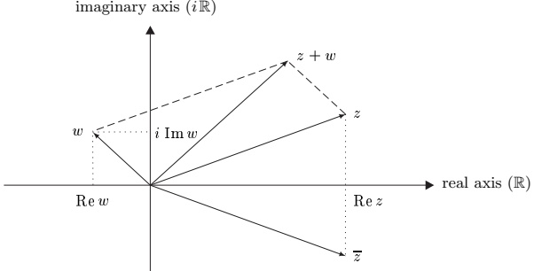
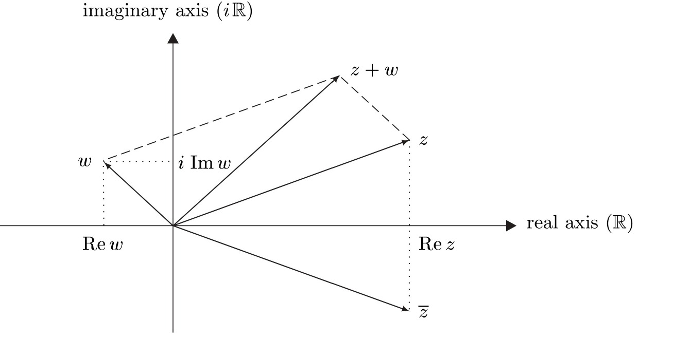
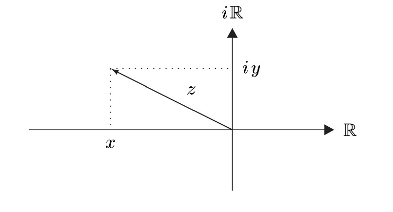
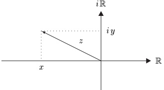
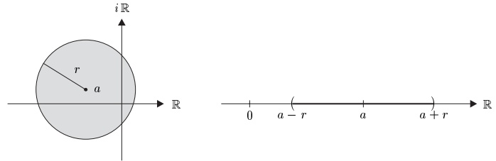

## 11 复数

在第 9 节中我们看到，在有序域 $K$ 中，一切平方都是非负的，即对 $x \in K$ 有 $x^2 \geq 0$。因此，方程 $x^2 = -1$ 在实数域中乃至在任何其他有序域中都是不可解的。在本节中，我们构造 $\mathbb{R}$ 的一个扩域，即复数域 $\mathbb{C}$，在其中一切二次方程（事实上，正如我们以后将看到的，一切代数方程）都至少有一个解。令人惊讶的是，与用戴德金分割把 $\mathbb{Q}$ 扩张到 $\mathbb{R}$ 相反，把 $\mathbb{R}$ 扩张到 $\mathbb{C}$ 是简单的。

##### 复数的构造

仿照把 $ \mathbb{N} $ 扩张到 $ \mathbb{Z} $、把 $ \mathbb{Z} $ 扩张到 $ \mathbb{Q} $ 时确立的模式，我们首先假设存在 $ \mathbb{R} $ 的一个扩域 $ K $ 以及某个 $ i \in K $ 使得 $ i^2 = -1 $。当然，$ i \notin \mathbb{R} $。由这一假设我们导出 $ K $ 的性质，这些性质将引导出 $ K $ 的显式构造。

由于 $K$ 是一个域，若 $x, y \in \mathbb{R}$，则 $z := x + iy$ 是 $K$ 的元素。此外，$z = x + iy$ 在 $K$ 中的表示是唯一的，即若还有 $z = a + ib$，其中 $a, b \in \mathbb{R}$，则 $x = a$ 且 $y = b$。为证明这一点，假设 $y \neq b$ 且 $x + iy = a + ib$。则由此可得 $i = (x - a)/(b - y) \in \mathbb{R}$，这是不可能的。

受这些观察的启发，我们令 $C := \{ x + iy \in K ; x, y \in \mathbb{R} \}$。对 $C$ 中的 $z = x + iy$ 与 $w = a + ib$，我们有（在 $K$ 中）

\[ \begin{aligned}z+w&=x+a+i(y+b)\in C,\\-z&=-x+i(-y)\in C,\\zw&=xa+ixb+iya+i^{2}yb=xa-yb+i(xb+ya)\in C,\end{aligned} \]

其中我们用了 $ i^2 = -1 $。最后，若 $ z = x + iy \neq 0 $，从而 $ x \in \mathbb{R}^\times $ 或 $ y \in \mathbb{R}^\times $。则我们有（在 $ K $ 中）

\[ \frac{1}{z}=\frac{1}{x+iy}=\frac{x-iy}{(x+iy)(x-iy)}=\frac{x}{x^{2}+y^{2}}+i\frac{-y}{x^{2}+y^{2}}\in C. \]

因此，$C$ 是 $K$ 的子域，也是 $\mathbb{R}$ 的扩域。

这一讨论表明，若这样的扩域存在，则 $C$ 是 $\mathbb{R}$ 的使方程 $x^{2} = -1$ 可解的最小扩域。剩下的存在问题我们通过一个构造来回答。

11.1 定理 存在 $ \mathbb{R} $ 的一个最小扩域 $ \mathbb{C} $，即复数域，在其中方程 $ z^2 = -1 $ 可解。它在同构意义下是唯一的。

证明 与从 $\mathbb{N}$ 构造 $\mathbb{Z}$ 以及从 $\mathbb{Z}$ 构造 $\mathbb{Q}$ 一样，上述讨论提示我们考虑数对 $(x, y) \in \mathbb{R}^2$，并按照 (11.1) 与 (11.2) 在 $\mathbb{R}^2$ 上定义运算。具体地，我们如下定义 $\mathbb{R}^2$ 上的加法与乘法：

\[ \mathbb{R}^{2}\times\mathbb{R}^{2}\to\mathbb{R}^{2},\quad\big((x,y),(a,b)\big)\mapsto(x+a,y+b) \]

以及

\[ \mathbb{R}^{2}\times\mathbb{R}^{2}\to\mathbb{R}^{2},\quad\big((x,y),(a,b)\big)\mapsto(x a-y b,x b+y a) \]

并令 $\mathbb{C} := (\mathbb{R}^2, +, \cdot)$。容易验证，$\mathbb{C}$ 是一个域，其加法单位元为 $(0,0)$，乘法单位元为 $(1,0)$，加法逆元为 $-(x,y) = (-x, -y)$，且当 $(x, y) \neq (0,0)$ 时乘法逆元为 $(x, y)^{-1} = \left(x/(x^2 + y^2), -y/(x^2 + y^2)\right)$。

容易验证

\[ \mathbb{R}\to\mathbb{C}\ ,\quad x\mapsto(x,0) \]

是一个单射同态。因此我们可以把 $ \mathbb{R} $ 与其在 $ \mathbb{C} $ 中的像等同起来，从而把 $ \mathbb{R} $ 视为 $ \mathbb{C} $ 的子域。

方程 $(0,1)^2 = (0,1)(0,1) = (-1,0) = -(1,0)$ 表明 $(0,1) \in \mathbb{C}$ 是 $z^2 = -1_{\mathbb{C}}$ 的一个解。

上述讨论表明，C 在同构意义下是 $ \mathbb{R} $ 的使方程 $ z^2 = -1 $ 可解的最小扩域。$ \blacksquare $

##### 基本性质

$ \mathbb{C} $ 的元素称为复数。由于对一切 $ y \in \mathbb{R} $ 有 $ (0,1)(y,0)=(0,y) $，我们有

\[ (x,y)=(x,0)+(0,1)(y,0)~,\qquad(x,y)\in\mathbb{R}^{2}~. \]

令 $ i := (0,1) \in \mathbb{C} $ 并利用等同 (11.3)，每个 $ z = (x,y) \in \mathbb{C} $ 都有如下形式的唯一表示：

\[ z=x+i y~,\qquad x,y\in\mathbb{R}~, \]

其中当然有 $ i^2 = -1 $。则 $ x = \text{Re } z $ 是 $ z $ 的 **实部**，$ y = \text{Im } z $ 是 $ z $ 的 **虚部**。$ z $ 的 **复共轭**定义为

\[ \overline{{z}}:=x-i y=\operatorname{R e}z-i\operatorname{I m}z. \]

任何满足 $ \mathrm{Re} z = 0 $ 的 $ z \in \mathbb{C}^\times $ 都称为（纯）虚数。

对任意的 $ x, y \in \mathbb{C} $，我们当然有 $ z = x + iy \in \mathbb{C} $。当我们想明确表示表达式 $ z = x + iy $ 是 $ z $ 分解成其实部与虚部的形式，即 $ x = \text{Re}z $ 且 $ y = \text{Im}z $ 时，我们写作

\[ z=x+i y\in\mathbb{R}+i\mathbb{R}. \]

11.2 注 (a) 若 $ z = x + iy \in \mathbb{R} + i\mathbb{R} $ 且 $ w = a + ib \in \mathbb{R} + i\mathbb{R} $，则 $ z + w $、$ -z $ 与 $ zw $ 由 (11.1) 中的公式给出，且若 $ z \neq 0 $，则 $ z^{-1} = 1/z $ 由 (11.2) 给出。

(b) 函数 $\mathbb{C} \to \mathbb{R}$，$z \mapsto \mathrm{Re}z$ 与 $\mathbb{C} \to \mathbb{R}$，$z \mapsto \mathrm{Im}z$ 都是良定义的、满射的，且 $z = \mathrm{Re}z + i \mathrm{Im}z$。

(c) 设 $X$ 是一个集合，$f: X \to \mathbb{C}$ 是一个‘复值函数’。则

\[ \operatorname{R e}f\colon X\to\mathbb{R}~,\quad x\mapsto\operatorname{R e}\bigl(f(x)\bigr) \]

与

\[ \operatorname{Im}f\colon X\to\mathbb{R},\quad x\mapsto\operatorname{Im}\big(f(x)\big) \]

定义了两个‘实值函数’，即 f 的实部与虚部。显然

\[ f=\operatorname{R e}f+i\operatorname{I m}f. \]

(d) 由构造，($ \mathbb{C} $,+) 是加法群 ( $ \mathbb{R}^2 $,+)（见例 7.2(d)）。因此，只要我们只考虑 $ \mathbb{C} $ 的加法结构，就可以把 $ \mathbb{C} $ 与 ( $ \mathbb{R}^2 $,+) 等同起来。这意味着我们可以把复数表示为坐标平面中的向量。\footnote{关于这些概念的公理化处理，我们再次请读者参见 [Gab96]（亦见第 12 节）。}复数的加法于是与向量加法相同，并可用‘平行四边形法则’几何地完成。同往常一样，当我们使用这种图形表示时，我们把向量 z 与其箭头的尖端等同起来，从而把 z 视为集合 $ \mathbb{R}^2 $ 的一个‘点’。

在 III.6 节我们将看到，C 中的乘法在坐标平面中也有一个简单的解释。

(e) 由于 $ (-i)^{2}=(-1)^{2}i^{2}=-1 $，方程 $ z^{2}=-1 $ 有两个解 $ z=\pm i $。由推论 8.18，没有其他解。

(f) 对 $ d \in \mathbb{R}^+ $ 我们有

\[ X^{2}-d=\left(X+\sqrt{d}\right)\left(X-\sqrt{d}\right)\quad\text{ 且 }\quad X^{2}+d=\left(X+i\sqrt{d}\right)\left(X-i\sqrt{d}\right)\;. \]

通过‘配方’，我们可以把满足 $a \ne 0$ 的 $aX^2 + bX + c \in \mathbb{R}[X]$ 写成如下形式：

\[ a X^{2}+b X+c=a\Big[\Big(X+\frac{b}{2a}\Big)^{2}-\frac{D}{4a^{2}}\Big] \]

在 C[X] 中，其中

\[ D:=b^{2}-4a c \]

是判别式。这意味着二次方程 $ az^{2} + bz + c = 0 $ 有解

\[ z_{1},z_{2}=\left\{\begin{array}{ll}\displaystyle\frac{-b\pm\sqrt{D}}{2a}&\in\mathbb{R},&D\geq0,\\ \displaystyle\frac{-b\pm i\sqrt{-D}}{2a}&\in\mathbb{C}\backslash\mathbb{R},&D<0.\end{array}\right. \]

此外

\[ z_{1}+z_{2}=-b/a,\quad z_{1}z_{2}=c/a \]

（见习题 8.7(g)）。若 $D<0$，则 $z_2=\overline{z}_1$。

(g) 由于 $ i^{2} = -1 < 0 $，域 $ \mathbb{C} $ 不能有序。

##### 复数的运算

在本节中，我们给出复数计算的几条重要法则。其证明都是初等的，留给读者。在坐标平面中几何地解释这些法则是很有启发性的。

11.3 命题 对所有 $ z, w \in \mathbb{C} $，

(i) $ \mathrm{Re}(z) = (z + \overline{z})/2 $，$ \mathrm{Im}(z) = (z - \overline{z})/(2i) $

(ii) $ z \in \mathbb{R} \Leftrightarrow z = \overline{z} $

(iii) $ \overline{\overline{z}}=z $

(iv) $ \overline{z + w} = \overline{z} + \overline{w} $，$ \overline{z w} = \overline{z} \overline{w} $

(v) $ z\overline{z} = x^2 + y^2 $，其中 $ x := \text{Re } z $，$ y := \text{Im } z $。

正如我们已经注意到的，$ \mathbb{C} $ 不能有序。尽管如此，$\mathbb{R}$ 上由其序诱导的绝对值函数可以延拓为 $ \mathbb{C} $ 上的一个非负函数 $ |\cdot| $，它也称为绝对值函数，\footnote{这一事实说明两个绝对值可以使用同一个符号 $|\cdot|$。当需要区分符号时，我们用 $|\cdot|_{\mathbb C}$ 表示 $\mathbb C$ 中的绝对值，用 $|\cdot|_{\mathbb R}$ 表示 $\mathbb R$ 中的绝对值（例如见命题 11.4(ii)）。}其定义为

\[ \mid\cdot\mid:\mathbb{C}\to\mathbb{R}^{+},\quad z\mapsto|z|:=\sqrt{z\;\overline{{z}}}. \]

因此，对 $ z = x + iy \in \mathbb{R} + i\mathbb{R} $，我们有 $ |z| = \sqrt{x^2 + y^2} $，于是 $ |z| $ 是坐标平面中向量 $ z $ 的长度。

我们在下一个命题中汇集绝对值函数的一些法则。

11.4 命题 设 $ z, w \in \mathbb{C} $。

(i) $ |zw| = |z| |w| $。

(ii) 对所有 $ z \in \mathbb{R} $，$ |z|_{\mathbb{C}} = |z|_{\mathbb{R}} $。

(iii) $ |\operatorname{Re}(z)| \leq |z| $，$ |\operatorname{Im}(z)| \leq |z| $，$ |z| = |\overline{z}| $。

(iv) $ |z| = 0 \Leftrightarrow z = 0 $。

(v) $ |z + w| \leq |z| + |w| $（三角不等式）。

(vi) 对所有 $ z \in \mathbb{C}^\times $，$ z^{-1} = 1/z = \overline{z}/|z|^2 $。

证明 设 $ z, w \in \mathbb{C} $，其中 $ z = x + iy \in \mathbb{R} + i\mathbb{R} $。

(i) 由命题 11.3(iv) 与注 9.9(a)，我们有

\[ |z w|=\sqrt{z w\cdot\overline{{z w}}}=\sqrt{z\overline{{z}}\cdot w\overline{{w}}}=\sqrt{z\overline{{z}}}\cdot\sqrt{w\overline{{w}}}=\left|z\right|\left|w\right|. \]

(ii) 对 $ z \in \mathbb{R} $，我们有 $ \overline{z} = z $，于是由注 9.9(b)，

\[ |z|_{\mathbb{C}}=\sqrt{z\overline{{z}}}=\sqrt{z^{2}}=|z|_{\mathbb{R}}. \]

(iii) 由注 10.10(c) 我们有 $ |\operatorname{Re}(z)| = |x| = \sqrt{x^2} \leq \sqrt{x^2 + y^2} = |z| $。类似地 $ |\operatorname{Im}(z)| \leq |z| $。由方程 $ \overline{\overline{z}} = z $ 我们得到 $ |z| = \sqrt{z\overline{z}} = \sqrt{\overline{z}\overline{\overline{z}}} = |\overline{z}| $。

(iv) 由命题 8.10 我们有

\[ |z|=0\Longleftrightarrow|z|^{2}=|x|^{2}+|y|^{2}=0\Longleftrightarrow|x|=|y|=0\Longleftrightarrow x=y=0. \]

(v) 我们有

\[ \begin{align*}\left|z+w\right|^{2}&=(z+w)\overline{(z+w)}=(z+w)(\overline{z}+\overline{w})\\&=z\overline{z}+z\overline{w}+w\overline{z}+w\overline{w}=\left|z\right|^{2}+z\overline{w}+\overline{z\overline{w}}+\left|w\right|^{2}\\&=\left|z\right|^{2}+2\operatorname{Re}(z\overline{w})+\left|w\right|^{2}\leq\left|z\right|^{2}+2\left|z\overline{w}\right|+\left|w\right|^{2}\\&=\left|z\right|^{2}+2\left|z\right|\left|w\right|+\left|w\right|^{2}=(|z|+|w|)^{2},\end{align*} \]

其中我们用了 (iii) 与命题 11.3。

(vi) 若 $ z \in \mathbb{C}^\times $，则 $ 1/z = \overline{z}/(z\overline{z}) = \overline{z}/|z|^2 $。■

11.5 推论 （反向三角不等式）对所有 $ z, w \in \mathbb{C} $，

\[ |z-w|\geq\left|\left|z\right|-\left|w\right|\right|. \]

证明 这由 C 中的三角不等式推出，正如推论 8.11 那样。

经验表明，在分析中，与数学的其他领域相反，真正重要的域只有 $ \mathbb{R} $ 和 $ \mathbb{C} $。此外，许多定义与定理对这两个域中的任意一个都同样适用。因此我们作如下约定：

约定 $ \mathbb{K} $ 表示域 ℝ 与 $ \mathbb{C} $ 中的任意一个。

##### 球

对 $ a \in \mathbb{K} $ 和 $ r > 0 $，我们称

\[ \mathbb{B}(a,r):=\mathbb{B}_{\mathbb{K}}(a,r):=\left\{x\in\mathbb{K}\;;\ |x-a|<r\right\} \]

为 $\mathbb{K}$ 中以 $ a $ 为中心、以 $ r $ 为半径的开球。若 $ \mathbb{K} = \mathbb{C} $，则 $ \mathbb{B}_{\mathbb{C}}(a, r) $ 是坐标平面中以 $ a $ 为中心、以 $ r $ 为半径的‘开圆盘’。若 $ \mathbb{K} $ 是域 $ \mathbb{R} $，则 $ \mathbb{B}_{\mathbb{R}}(a, r) $ 是 $\mathbb{R}$ 中以 $ a $ 为中心、长度为 $ 2r $ 的开区间 $ (a - r, a + r) $。

K 中以 a 为中心、以 r 为半径的闭球定义为

\[ \bar{\mathbb{B}}(a,r):=\bar{\mathbb{B}}_{\mathbb{K}}(a,r):=\left\{x\in\mathbb{K}\;;\;|x-a|\leq r\right\}. \]

于是 $ \bar{\mathbb{B}}_{\mathbb{R}}(a,r) $ 是闭区间 $ [a-r,a+r] $。我们常常分别用 $ \mathbb{D}(a,r) $ 与 $ \bar{\mathbb{D}}(a,r) $ 代替 $ \mathbb{B}_{\mathbb{C}}(a,r) $ 与 $ \bar{\mathbb{B}}_{\mathbb{C}}(a,r) $。$\mathbb{C}$ 中的开单位圆盘与闭单位圆盘分别是 $ \mathbb{D}:=\mathbb{D}(0,1) $ 与 $ \bar{\mathbb{D}}:=\bar{\mathbb{D}}(0,1) $。

##### 习题

1 (a) 证明：对每个 $ z \in \mathbb{C}\backslash(-\infty,0] $，存在唯一的 $ w \in \mathbb{C} $ 使得 $ w^2 = z $ 且 $ \mathrm{Re}(w) > 0 $。元素 $ w $ 称为 $ z $ 的主平方根，记为 $ \sqrt{z} $。

(b) 证明：对所有 $ z \in \mathbb{C} \setminus (-\infty, 0] $，

\[ \sqrt{z}=\sqrt{(|z|+\operatorname{Re}z)/2}+i\operatorname{sign}(\operatorname{Im}z)\sqrt{(|z|-\operatorname{Re}z)/2}\;. \]

(c) 计算 $ \sqrt{i} $。

方程 $ w^{2}=i $ 的其他解是什么？

2 对 $ z \in \left\{\frac{12+5i}{2+3i}, \sqrt{i}\right\} $ 计算 $ \overline{z} $、$ |z| $、Re $ z $、Im $ z $、Re $ (1/z) $ 与 Im $ (1/z) $。

3 在坐标平面中画出下列集合：

\[ A:=\left\{z\in\mathbb{C}\;;\;|z-1|\leq|z+1|\right\} \]

\[ B:=\left\{z\in\mathbb{C}\;;\;|z+1|\leq|z-i|\leq|z-1|\right\} \]

\[ C:=\left\{z\in\mathbb{C}\;;\;3z\overline{z}-6z-6\overline{z}+9=0\right\} \]

4 求方程 $ z^{4}=1 $ 与 $ z^{3}=1 $ 在 C 中的所有解。

5 给出命题 11.3 的证明。

6 设 $ m \in \mathbb{N}^\times $，且对 $ 0 \leq j \leq m $ 有 $ U_j \subseteq \mathbb{C} $。假设 $ a \in \mathbb{C} $ 具有如下性质：对每个 $ j $，存在某个 $ r_j > 0 $ 使得 $ \mathbb{B}(a, r_j) \subseteq U_j $。证明：对某个 $ r > 0 $，有 $ \mathbb{B}(a, r) \subseteq \bigcap_{j=0}^{m} U_j $。

7 对 $ a \in \mathbb{K} $ 与 $ r > 0 $，描述集合 $ \bar{\mathbb{B}}_{\mathbb{K}}(a, r) \setminus \mathbb{B}_{\mathbb{K}}(a, r) $。

8 证明：恒等函数与 $ z \mapsto \overline{z} $ 是 $\mathbb{C}$ 的仅有的使 $\mathbb{R}$ 的元素保持不动的域自同构。（提示：对自同构 $ \varphi $，考虑 $ \varphi(i) $。）

9 证明：$ S^1 := \{ z \in \mathbb{C} ; \, |z| = 1 \} $ 是乘法群 $ (\mathbb{C}^\times, \cdot) $ 的子群，即圆周群。

10 设 $ \mathbb{R}^{2\times2} $ 是实 $ 2\times2 $ 矩阵的非交换环。证明：形如

\[ \left[\begin{array}{cc}a&-b\\ b&a\end{array}\right] \]

的矩阵所成的集合 $ C $ 是 $ \mathbb{R}^{2\times2} $ 的子域，且函数

\[ \mathbb{R}+i\mathbb{R}\to\mathbb{R}^{2\times2},\quad a+i b\mapsto\left[\begin{array}{c c}a&-b\\ b&a\end{array}\right] \]

是从 C 到 C 的同构。（矩阵的必要性质可在任何一本线性代数书中找到。）

11 对 $ p = X^n + a_{n-1}X^{n-1} + \cdots + a_1X + a_0 \in \mathbb{C}[X] $，定义 $ R := 1 + \sum_{k=0}^{n-1} |a_k| $。证明：对所有满足 $ |z| > R $ 的 $ z \in \mathbb{C} $，有 $ |p(z)| > R $。

12 证明 C 中的平行四边形恒等式：

\[ |z+w|^{2}+|z-w|^{2}=2(|z|^{2}+|w|^{2})~,\qquad z,w\in\mathbb{C}~. \]

13 几何地描述函数 $ \mathbb{C}^\times \to \mathbb{C}^\times $，$ z \mapsto 1/z $。

14 求多项式 $ X^4 - 2X^3 - X^2 + 2X + 1 \in \mathbb{C}[X] $ 的所有零点。

（提示：把多项式乘以 $ 1/X^{2} $，并作代换 Y = X - 1/X。）

15 三次方程 设 k 是 C 中首项系数为 1 的三次多项式，即

\[ k=X^{3}+a X^{2}+b X+c. \]

为求 k 的零点，我们首先作代换 $ Y = X + a/3 $ 以得到

\[ Y^{3}+p Y+q\in\mathbb{C}[X]. \]

用 $a$、$b$ 与 $c$ 表示系数 $p$ 与 $q$。假设存在\footnote{在第 III.6 节中我们将证明这些复数存在。} $d$、$u$、$v \in \mathbb{C}$ 使得

\[ d^{2}=\left(\frac{q}{2}\right)^{2}+\left(\frac{p}{3}\right)^{3},\quad u^{3}=-\frac{q}{2}+d,\quad v^{3}=-\frac{q}{2}-d. \]

证明 $-3uv/p$ 是三次单位根，即 $(-3uv/p)^3 = 1$，于是我们可以选择 $u$ 和 $v$ 使得 $3uv = -p$。现在设 $\xi \neq 1$ 满足 $\xi^3 = 1$（见习题 4）。证明：

\[ y_{1}:=u+v~,\quad y_{2}:=\xi u+\xi^{2}v~,\quad y_{3}:=\xi^{2}u+\xi v \]

是方程 $ y^{3} + py + q = 0 $ 的解。
