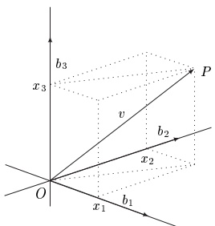
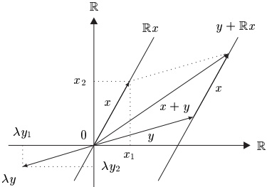

## 12 向量空间、仿射空间与代数

线性代数无疑是所有数学研究领域中最富成果的领域之一，并为数学各个部分中许多影响深远的理论奠定了基础。特别地，线性代数是分析学的主要工具之一，因此本节我们介绍基本概念并用例子加以说明。目标仍然是能够辨认出在后面各章中以不同形式频繁出现的简单代数结构。若要更深入地研究，我们请读者参阅线性代数的大量文献，例如 [Art91]、[Gab96]、[Koe83]、[Wal82] 和 [Wal85]。

以下设 K 是任意域。

##### 向量空间

域 K 上的向量空间（或简称 K-向量空间）是一个三元组  $ (V,+,\cdot) $，它由一个非空集合 V、V 上一个称为加法的“内”运算 +，以及一个“外”运算

 \[ K\times V\to V~,\quad(\lambda,v)\mapsto\lambda\cdot v~, \] 

组成，后者称为标量乘法，它们满足以下公理：

 $ (VS_{1}) $  $ (V,+) $ 是交换群。

(VS $ _{2} $) 分配律成立：

 \[ \lambda\cdot(v+w)=\lambda\cdot v+\lambda\cdot w~,\quad(\lambda+\mu)\cdot v=\lambda\cdot v+\mu\cdot v~,\qquad\lambda,\mu\in K~,\quad v,w\in V~. \] 

 \[ \left(\mathrm{V S}_{3}\right)\lambda\cdot(\mu v)=(\lambda\mu)\cdot v,\quad1\cdot v=v,\qquad\lambda,\mu\in K,\quad v\in V. \] 

若  $ K = \mathbb{R} $，则称向量空间为  $ \text{实} $ 的；若  $ K = \mathbb{C} $，则称为  $ \text{复} $ 的。当运算由上下文清楚可知时，我们把  $ (V, +, \cdot) $ 写作  $ V $。

12.1 注 (a) V 的元素称为向量，K 的元素称为标量。单词“vector”只是“向量空间的元素”的缩写。可能的几何解释我们留到后面讨论。

与环的情形一样，我们约定乘法优先于加法，并把  $ \lambda \cdot v $ 简写作  $ \lambda v $。

(b) (V,+) 的单位元称为零向量，记作 0，K 的零元也记作 0。对于 $ v\in V $ 的加法逆元，我们写作 -v，并令 v-w:=v+(-w)。这一点，以及在 K 中和 V 中用相同的符号“+”和“ $ \cdot $”表示运算，都不会导致误解，因为除了 $ (VS_{1}) $ 和 $ (VS_{3}) $ 之外，我们还有

 \[ 0v=0,\quad(-\lambda)v=\lambda(-v)=-(\lambda v)=:-\lambda v,\qquad\lambda\in K,\quad v\in V, \] 

以及法则

 \[ \lambda v=0\Rightarrow\left(\lambda=0\text{ 或 }v=0\right). \] 

在这一蕴含式中，第一个和最后一个零表示零向量，其余的零表示 K 的零元。

证明 由分配律和 K 中的算术法则可得

 \[ 0\cdot v=(0+0)\cdot v=0\cdot v+0\cdot v. \] 

由于零向量是  $ (V, +) $ 的单位元，我们还有  $ 0 \cdot v = 0 \cdot v + 0 $，于是由注 7.1(c) 可得  $ 0 \cdot v = 0 $。其余断言的证明留作习题。■

(c) 公理 (VS$_3$) 表明乘法群 $K^\times$ 从左边作用在 V 上（见习题 7.6）。事实上，(VS$_2$) 和 (VS$_3$) 可用来定义域作用在交换群上的概念。有时把 K 看作从右边作用在 V 上更为方便，为此对 (λ, v) ∈ K × V 定义 vλ := λv。■

##### 线性函数

设 V 和 W 是 K 上的向量空间。若函数  $ T: V \to W $ 满足

 \[ T(\lambda v+\mu w)=\lambda T(v)+\mu T(w)~,\qquad\lambda,\mu\in K~,\quad v,w\in V~. \] 

则称它是（K-）线性的。因此，线性函数不过是与向量空间运算相容的函数，换言之，它是（向量空间）同态。从 $V$ 到 $W$ 的所有线性函数之集记作 $\operatorname{Hom}(V, W)$ 或 $\operatorname{Hom}_K(V, W)$，而 $\operatorname{End}(V) := \operatorname{Hom}(V, V)$ 是所有（向量空间）自同态之集。双射同态 $T \in \operatorname{Hom}(V, W)$ 是（向量空间）同构。双射自同态 $T \in \operatorname{End}(V)$ 是（向量空间）自同构。若存在从 $V$ 到 $W$ 的同构，则称 $V$ 与 $W$ 同构，并写作 $V \cong W$。显然 $\cong$ 是任一 $K$-向量空间集合上的等价关系。

约定 “V 和 W 是向量空间且 $T:V\to W$ 是线性函数”这一陈述总意味着 $V$ 和 $W$ 是同一域上的向量空间。

12.2 注 (a) 对于线性函数 $T: V \to W$，当 $v \in V$ 时，通常把 $T(v)$ 写作 $Tv$，只要这样做不会导致误解。

(b) 向量空间同态 $T: V \to W$ 特别是群同态 $T: (V,+) \to (W,+)$。因此对所有的 $v \in V$ 都有 $T0 = 0$ 和 $T(-v) = -Tv$。$T$ 的核（或零空间）就是这个群同态的核：

 \[ \ker(T)=\left\{v\in V;Tv=0\right\}=T^{-1}0. \] 

因此 $T$ 是单射当且仅当其核是平凡的，即若 $\ker(T) = \{0\}$（见注 7.6(a) 和 (d)）。

(c) 设 $U$、$V$ 和 $W$ 是 $K$ 上的向量空间。则对所有的 $S \in \mathrm{Hom}(U, V)$ 和 $T \in \mathrm{Hom}(V, W)$ 都有 $T \circ S \in \mathrm{Hom}(U, W)$。

(d) $ V $ 的自同构之集  $ \text{Aut}(V) $，即从  $ V $ 到自身的所有双射线性函数之集，是  $ V $ 的置换群的子群。它称为  $ V $ 的 **自同构群**。

12.3 例 设 V 和 W 是 K 上的向量空间。

(a) 零（向量）空间或平凡（向量）空间由单个向量 0 组成，通常就简记作 0。任何其他向量空间都是非平凡的。

(b) 若下列条件成立，则 V 的非空子集 U 称为子空间：

$ (SS_{1}) $ U 是 (V,+) 的子群。

$ (SS_{2}) $ $U$ 对标量乘法封闭：$K \cdot U \subseteq U$。

容易验证，U 是 V 的子空间当且仅当 U 对 V 的两种运算都封闭，即若

 \[ U+U\subseteq U\;,\quad K\cdot U\subseteq U\;. \] 

(c) 线性函数 $T: V \to W$ 的核与像分别是 $V$ 和 $W$ 的子空间。若 $T$ 是单射，则 $T^{-1} \in \mathrm{Hom}(\mathrm{im}(T), V)$。

(d) 当把域运算解释为向量空间运算时，K 是它自身上的向量空间。

(e) 设 X 是集合。则  $ V^{X} $ 以如下运算成为 K-向量空间（见例 4.12）

 \[ (f+g)(x):=f(x)+g(x),\quad(\lambda f)(x):=\lambda f(x),\qquad x\in X,\quad\lambda\in K,\quad f,g\in V^{X}. \] 

特别地，对于  $ m \in \mathbb{N}^\times $， $ K^m $ 以如下运算成为  $ K $-向量空间

 \[ x+y=\left(x_{1}+y_{1},\cdots,x_{m}+y_{m}\right),\quad\lambda x=\left(\lambda x_{1},\cdots,\lambda x_{m}\right) \] 

其中 $\lambda \in K$，$x = (x_1, \ldots, x_m)$ 与 $y = (y_1, \ldots, y_m)$ 属于 $K^m$。显然，$K^1$ 与 $K$ 是相同的（作为 $K$-向量空间）。

(f) 上述构造提示了如下推广。设 $V_{1},\ldots,V_{m}$ 是 $K$ 上的向量空间。则 $V:=V_{1}\times\cdots\times V_{m}$ 是一个向量空间，称为 $V_{1},\ldots,V_{m}$ 的积向量空间，其运算由下式定义

 \[ v+w:=\left(v_{1}+w_{1},\ldots,v_{m}+w_{m}\right),\quad\lambda v:=\left(\lambda v_{1},\ldots,\lambda v_{m}\right) \] 

其中  $ v = (v_1, \ldots, v_m) \in V $， $ w = (w_1, \ldots, w_m) \in V $， $ \lambda \in K $。

(g) 在  $ K $ 上  $ m \in \mathbb{N}^* $ 个未定元的形式幂级数环  $ K[[X_1, \ldots, X_m]] $ 上，我们定义函数

 \[ K\times K[[X_{1},\ldots,X_{m}]]\to K[[X_{1},\ldots,X_{m}]]~,\quad(\lambda,p)\mapsto\lambda p \] 

为

 \[ \lambda\Big(\sum_{\alpha}p_{\alpha}X^{\alpha}\Big):=\sum_{\alpha}(\lambda p_{\alpha})X^{\alpha}~. \] 

以这一运算作为标量乘法，再加上已经定义的加法， $ K[[X_1, \ldots, X_m]] $ 是一个  $ K $-向量空间，即  $ m $ 个未定元的形式幂级数向量空间。显然， $ K[X_1, \ldots, X_m] $ 是  $ K[[X_1, \ldots, X_m]] $ 的子空间，后者是  $ m $ 个未定元的多项式向量空间。

若 $K$ 是无限的，则把 $K[X_{1},\ldots,X_{m}]$ 中的多项式与 $K^{(K^{m})}$ 中的多项式函数等同起来（见注 8.20(c)）意味着 $K[X_{1},\ldots,X_{m}]$ 也是 $K^{(K^{m})}$ 的子空间。

(h) Hom(V,W) 是  $ W^{V} $ 的子空间

(i) 设 U 是 V 的子空间。则由命题 7.4 和注 7.5(b)， $ (V,+)/U $ 是交换群。容易验证

 \[ K\times(V,+)/U\to(V,+)/U~,\quad(\lambda,x+U)\mapsto\lambda x+U \] 

是一个定义良好的函数，它满足公理 $ (VS_{2}) $ 和 $ (VS_{3}) $。因此 (V,+)/U 是 K-向量空间，我们把它记作 V/U，并称为 V 模 U 的商空间。最后，商同态

 \[ \pi:V\to V/U~,\quad x\mapsto[x]:=x+U \] 

是线性函数。

(j) 对于  $ T \in \text{Hom}(V, W) $，存在唯一的线性函数  $ \widehat{T} $： $ V/\ker(T) \to W $，使得下图交换。

 \[ \begin{tikzcd}[row sep=2.4em, column sep=3.4em]
 V \arrow[rr, "T"] \arrow[rd, "\pi"'] & & W \\
 & V/\ker(T) \arrow[ru, "\widehat{T}"']
 \end{tikzcd} \] 

此外， $ \widehat{T} $ 是单射，且 $ \operatorname{im}(\widehat{T}) = \operatorname{im}(T) $。

证明 这直接由 (c)、(i) 和例 4.2(c) 得到。■

(k) 设 $\{U_\alpha; \alpha \in \mathbb{A}\}$ 是 $V$ 的一族子空间。则 $\bigcap_{\alpha \in \mathbb{A}} U_\alpha$ 是 $V$ 的子空间。若 $M$ 是 $V$ 的子集，则

 \[ \operatorname{span}(M):=\bigcap\{U;U\text{是}V\text{的子空间且}U\supseteq M\} \] 

是 V 的包含 M 的最小子空间，称为 M 的张成。

(l) 若 $U_1$ 和 $U_2$ 是 $V$ 的子空间，则 $U_1 \times U_2$ 在 $V$ 中加法下的像是 $V$ 的子空间，称为 $U_1$ 与 $U_2$ 的 $\text{和}$，记作 $U_1 + U_2$。若 $U_1 \cap U_2 = \{0\}$，则该和是 $\text{直}$ 的，此时写作 $U_1 \oplus U_2$。

(m) 若 $U$ 是 $V$ 的子空间且 $T \in \mathrm{Hom}(V, W)$，则 $T|U$ 是从 $U$ 到 $W$ 的线性函数。当 $V = W$ 时，若 $T(U) \subseteq U$，则称 $U$ 在 $T$ 下是 $\mathbf{不变}$ 的。只要不引起混淆，我们就把 $T|U$ 写作 $T$。

##### 向量空间的基

设 $V$ 是非平凡的 $K$-向量空间。形如 $\sum_{j=1}^{m} \lambda_{j} v_{j}$ 的表达式，其中 $\lambda_{1}, \ldots, \lambda_{m} \in K$，$v_{1}, \ldots, v_{m} \in V$，称为向量 $v_{1}, \ldots, v_{m}$（在 $K$ 上）的（有限）线性组合。若存在不全为零的 $\lambda_{1}, \ldots, \lambda_{m} \in K$ 使得 $\lambda_{1} v_{1} + \cdots + \lambda_{m} v_{m} = 0$，则称向量 $v_{1}, \ldots, v_{m}$ 线性相关。若不存在这样的标量，即若

 \[ \lambda_{1}v_{1}+\cdots+\lambda_{m}v_{m}=0\Rightarrow\lambda_{1}=\cdots=\lambda_{m}=0, \] 

则向量  $ v_1, \ldots, v_m $ 线性无关。 $ V $ 的子集  $ A $ 称为线性无关的，如果  $ A $ 的每个有限子集都线性无关。按约定，空集是线性无关的。 $ V $ 的线性无关子集  $ B $ 若满足  $ \text{span}(B) = V $，则称为  $ V $ 的基。线性代数的一个基本结果是：若  $ V $ 有一个含  $ m $ 个向量的有限基，则  $ V $ 的每个基都恰好含  $ m $ 个向量。在这种情形下， $ m $ 称为向量空间  $ V $ 的 **维数**，即 **dim**(V)，我们并说  $ V $ 是  $ m $ **维**的。若  $ V $ 没有有限基，则  $ V $ 是 **无限维**的，$ \dim(V) = \infty $。最后，我们定义 $ \dim(0) = 0 $。关于维数的一个非常自然且有用的事实是：若 $ W $ 是 $ V $ 的子空间，则 $ \dim(W) \leq \dim(V) $。关于向量空间维数的这些断言的证明，请读者参阅线性代数文献。

12.4 例 (a) 设  $ m \in \mathbb{N}^\times $。对  $ j = 1, \ldots, m $，定义

 \[ e_{j}:=\left(0,\ldots,0,\underset{(j)}{1},0,\ldots,0\right)\in K^{m}\quad, \] 

即  $ e_j $ 是  $ K^m $ 中第  $ j $ 个分量为 1 而其余分量为 0 的向量。则  $ \{e_1, \ldots, e_m\} $ 是  $ K^m $ 的一个基，称为标准基。因此  $ K^m $ 是  $ m $ 维向量空间，称为  $ K $ 上的标准  $ m $ 维向量空间。

(b) 设 $X$ 是有限集。对 $x \in X$，定义 $e_x \in K^X$ 为

 \[ e_{x}(y):=\left\{\begin{array}{l l}{1,}&{\quad y=x,}\\ {0,}&{\quad y\neq x.}\end{array}\right. \] 

则集合 $\{e_x; x \in X\}$ 是 $K^X$ 的一个基（标准基），因此 $\dim(K^X) = \text{Num}(X)$。

(c) 对于  $ n \in \mathbb{N} $ 和  $ m \in \mathbb{N}^\times $，置

 \[ K_{n}[X_{1},\ldots,X_{m}]:=\left\{p\in K[X_{1},\ldots,X_{m}];\operatorname{d e g}(p)\leq n\right\}. \] 

则  $ K_n[X_1, \ldots, X_m] $ 是  $ K[X_1, \ldots, X_m] $ 的子空间，且单项式集合  $ \{X^\alpha; |\alpha| \leq n\} $ 构成一个基。从而

 \[ \mathrm{dim}\big(K_{n}[X_{1},\ldots,X_{m}]\big)=\binom{m+n}{n}, \] 

且 $K[X_{1},\ldots,X_{m}]$ 是无限维空间。

证明 由于  $ K_n[X_1, \ldots, X_m] $ 的元素是从  $ \mathbb{N}^m $ 的某个有限子集到  $ K $ 的函数，由 (b) 可得单项式  $ \{X^\alpha; |\alpha| \leq n\} $ 构成一个基。习题 8.8(d) 表明这样的单项式有  $ \binom{m+n}{n} $ 个。若  $ k := \dim(K[X_1, \ldots, X_m]) $ 有限，则任何子空间的维数都不超过  $ k $。但这与子空间  $ K_n[X_1, \ldots, X_m] $ 矛盾，因为它们的维数可以任意大。

(d) 对于  $ m, n \in \mathbb{N}^* $，

 \[ K_{n,\mathrm{hom}}[X_{1},\cdots,X_{m}]:=\left\{\sum_{|\alpha|=n}a_{\alpha}X^{\alpha};a_{\alpha}\in K,\alpha\in\mathbb{N}^{m},|\alpha|=n\right\} \] 

是  $ K_n[X_1, \ldots, X_m] $ 的子空间，称为  $ m $ 个未定元的  $ n $ 次齐次多项式的向量空间。它的维数是  $ \binom{m+n-1}{n} $。

证明 与前一个证明一样，次数为 n 的单项式集合构成一个基。该断言随即由习题 8.8(c) 得到。

12.5 注 设对某个 $m \in \mathbb{N}^\times$，$V$ 是 $m$ 维 $K$-向量空间，且 $\{b_1, \ldots, b_m\}$ 是 $V$ 的一个基。则对每个 $v \in V$，存在唯一的 $m$ 元组 $(x_1, \ldots, x_m) \in K^m$ 使得

 \[ v=\sum_{j=1}^{m}x_{j}b_{j}. \] 

反之，这样的 m 元组通过 (12.2) 定义了 V 中唯一的向量 v。从而，函数

 \[ K^{m}\to V~,\quad(x_{1},\ldots,x_{m})\mapsto\textstyle\sum_{j=1}^{m}x_{j}b_{j} \] 

是双射。由于该函数显然是线性的，它是从 $K^{m}$ 到 $V$ 的同构。因此我们证明了每个 $m$ 维 $K$-向量空间都同构于标准 $m$ 维空间 $K^{m}$。这当然解释了“标准空间”这一名称。

##### 仿射空间

向量空间这一抽象概念在当今数学、特别是现代分析中起着如此根本的作用，它源于我们对熟悉的三维世界中“有向箭头”的直观“向量演算”。向量空间概念的几何解释仍然非常有用，即使在抽象情形下也是如此，正如我们在把 C 与坐标平面等同起来时已经看到的那样。在这样的解释中，我们常把向量看作“点”，把某些向量集看作“直线”和“平面”等等。为了给这些概念一个坚实的基础并避免混淆，我们简短地介绍仿射空间。这将使我们能够不加进一步说明地使用最适合给定情形的语言。

设 V 是 K-向量空间，E 是非空集合，其元素称为点。若存在函数

 \[ V\times E\to E~,\quad(v,P)\mapsto P+v \] 

具有以下性质，则称 E 是 V 上的仿射空间：

 \[ \left(\mathrm{A S}_{1}\right)P+0=P,P\in E. \] 

 \[ \left(\mathrm{A S}_{2}\right)\mathrm{\boldmath~P~}+\left(v+w\right)=\left(P+v\right)+w,\mathrm{\boldmath~P\in E,~}v,w\in V. \] 

 $ (AS_3) $ 对每个  $ P, Q \in E $，存在唯一的  $ v \in V $ 使得  $ Q = P + v $。

由  $ (AS_{3}) $ 提供的唯一向量 v 记作  $ \overrightarrow{PQ} $。它满足

 \[ Q=P+\overrightarrow{P Q}. \] 

由 (AS $ _{1} $) 我们有  $ \overrightarrow{PP}=0 $，而由 (AS $ _{2} $) 可得函数

 \[ E\times E\to V~,\quad(P,Q)\mapsto\overrightarrow{P Q} \] 

满足方程

 \[ \overrightarrow{P Q}+\overrightarrow{Q R}=\overrightarrow{P R}\;,\qquad P,Q,R\in E\;. \] 

由于  $ \overrightarrow{PP}=0 $，这特别蕴含

 \[ \overrightarrow{P Q}=-\overrightarrow{Q P}~,\qquad P,Q\in E~. \] 

此外，由 $(AS_3)$，对每个 $P \in E$ 和 $v \in V$ 存在唯一的 $Q \in E$ 使得 $\overrightarrow{PQ} = v$，即 $Q := P + v$。因此 $V$ 也称为仿射空间 $E$ 的方向空间。

12.6 注 (a) 公理 $ (AS_{1}) $ 和 $ (AS_{2}) $ 表明加法群 (V, +) 作用在集合 E 上（从右边）（见习题 7.6）。由公理 $ (AS_{3}) $ 可得，这一作用只有一个轨道，即该群传递地作用在 E 上。

(b) 对每个  $ v \in V $，

 \[ \tau_{v}\colon E\to E~,\quad P\mapsto P+v \] 

是 $E$ 按向量 $v$ 的平移。由 $(AS_1)$ 和 $(AS_2)$ 可得，平移之集是 $E$ 的置换群的子群。

设 $E$ 是 $V$ 上的仿射空间。选取 $E$ 的一个固定点 $O$，即$\text{原点}$。则函数 $V \to E$，$v \mapsto O + v$ 是双射，其逆为 $E \to V$，$P \mapsto \overrightarrow{OP}$。向量 $\overrightarrow{OP}$ 称为 $P$ 的（关于 $O$ 的）位置向量。

若 $\{b_1, \ldots, b_m\}$ 是 $V$ 的一个基，则存在唯一的 $m$ 元组 $(x_1, \ldots, x_m) \in K^m$ 使得

 \[ \overrightarrow{OP}=\sum_{j=1}^{m}x_{j}b_{j}. \] 

在这种情形下，数  $ x_{1}, \ldots, x_{m} $ 称为点 P 关于（仿射）坐标系  $ (O; b_{1}, \ldots, b_{m}) $ 的（仿射）坐标。双射函数

 \[ E\to K^{m}~,\quad P\mapsto(x_{1},\ldots,x_{m})~. \] 

它把每个点  $ P \in E $ 映到其坐标，称为  $ E $ 关于  $ (O; b_1, \ldots, b_m) $ 的坐标函数。

按定义，仿射空间的维数就是其方向空间的维数。零维空间只含一个点，一维空间是（仿射）直线，二维仿射空间是（仿射）平面。$E$ 的仿射子空间是形如 $P + W = \{P + w; w \in W\}$ 的集合，其中 $P \in E$，$W$ 是方向空间 $V$ 的子空间。

12.7 例 任何 K-向量空间 V 都可看作它自身上的仿射空间。$(V,+)$ 在 $V$ 上的作用就是 $V$ 中的加法。此时对 $v, w \in V$ 有 $\overrightarrow{vw} = w - v$。（这里 $v$ 被解释为点，而等号左边和右边的 $w$ 分别被解释为点和向量！）我们当然选取零向量作为原点。

若  $ \dim(V) = m \in \mathbb{N}^\times $ 且  $ \{b_1, \ldots, b_m\} $ 是  $ V $ 的一个基，则我们可以利用坐标函数 (12.3) 把  $ V $ 与 **标准空间**  $ K^m $ 等同起来。通过 (12.3)，基  $ (b_1, \ldots, b_m) $ 被映到  $ K^m $ 的标准基  $ e_1, \ldots, e_m $。于是  $ K^m $ 中的运算导致（至少在  $ m = 2 $ 且  $ K = \mathbb{R} $ 的情形）熟悉的

“向量演算”，其中例如向量加法可以用“平行四边形法则”来完成：

从几何观点看，向量是一个箭头，其首尾位于 $E$ 的某两个点，比如说 $P$ 和 $Q$。也就是说，箭头是点的有序对 $(P,Q)$。两个这样的箭头 $(P,Q)$ 与 $(P',Q')$ 相等，如果 $\overrightarrow{PQ} = \overrightarrow{P'Q'}$，即若存在某个 $v \in V$ 使得 $P = Q + v$ 且 $P' = Q' + v$；或者更几何地说，若 $(P', Q')$ 可由 $(P,Q)$ 经某个平移得到。

约定 除非另有说明，我们把任何 K-向量空间 V 看作以零向量为原点的、其自身上的仿射空间。此外，只要适当，我们把 K 看作它自身上的向量空间。

由于这一约定，向量空间的元素可以根据情形既称为“向量”也称为“点”，而几何概念“直线”“平面”和“仿射子空间”在任何向量空间中都有意义。

##### 仿射函数

设 $V$ 和 $W$ 是 $K$ 上的向量空间。函数 $\alpha: V \to W$ 称为仿射的，如果存在线性函数 $A: V \to W$ 使得

 \[ \alpha(v_{1})-\alpha(v_{2})=A(v_{1}-v_{2}),\qquad v_{1},v_{2}\in V. \] 

当这样的 $A$ 存在时，它由 $\alpha$ 唯一确定。事实上，令 $v_1 := v$ 和 $v_2 := 0$ 便得到对所有 $v \in V$ 有 $A(v) = \alpha(v) - \alpha(0)$。反之，一旦对某个 $v_0 \in V$ 已知 $\alpha(v_0)$，$\alpha$ 就由 $A \in \mathrm{Hom}(V, W)$ 唯一确定。事实上，取 $v_1 := v$ 和 $v_2 := v_0$，由 (12.4) 可得

 \[ \alpha(v)=\alpha(v_{0})+A(v-v_{0})=\alpha(v_{0})-A v_{0}+A v~,\qquad v\in V~. \] 

因此我们证明了下面的命题。

12.8 命题 设 V 和 W 是 K 上的向量空间。则  $ \alpha: V \to W $ 是仿射的当且仅当它具有形式

 \[ \alpha(v)=w+A v~,\qquad v\in V~, \] 

其中  $ w \in W $， $ A \in \text{Hom}(V, W) $。此外， $ A $ 由  $ \alpha $ 唯一确定，而  $ \alpha $ 由  $ A $ 和  $ \alpha(0) $ 唯一确定。

把向量空间解释为仿射空间使得我们能够赋予某些抽象对象以几何意义。目前，这不过是我们从关于三维世界的直觉中搬来的一种语言。在后面各章中，几何观点将变得越来越重要，甚至对无限维向量空间也是如此，因为它提示了有用的解释和可能的证明方法。无限维向量空间经常以函数空间的形式出现，即作为  $ K^X $ 的子空间出现。对这些空间的深入研究对于透彻理解分析学不可或缺，但不属于本书的范围。这是“高等”分析、特别是泛函分析的目标。

把有限维向量空间解释为仿射空间还有一个极其重要的计算方面。坐标系的引入导致用坐标的方程和不等式对几何对象作具体描述。坐标系由原点和基的选取决定，而把这些选取做得使计算尽可能简单是至关重要的。坐标系的正确选取对于给定问题的成功解决可能具有决定性意义。

##### 多项式插值

为了说明上述想法，我们说明如何通过在  $ K_m[X] $ 中巧妙地选取基来容易地解决多项式的插值问题。多项式插值问题如下：

给定  $ m \in \mathbb{N}^\times $、 $ \mathbb{K} $ 中互不相同的  $ x_0, \ldots, x_m $ 以及函数  $ f: \{x_0, \ldots, x_m\} \to \mathbb{K} $，求多项式  $ p \in \mathbb{K}_m[X] $ 使得

 \[ p(x_{j})=f(x_{j}),\qquad0\leq j\leq m. \] 

下面的命题表明这个问题有唯一解。

12.9 命题 多项式插值问题有唯一解  $ p := p_m[f; x_0, \ldots, x_m] \in \mathbb{K}_m[X] $。

证明 拉格朗日多项式  $ \ell_j[x_0, \ldots, x_m] \in \mathbb{K}_m[X] $ 定义为

 \[ \ell_{j}[x_{0},\ldots,x_{m}]:=\prod_{\stackrel{k=0}{k\neq j}}^{m}\frac{X-x_{k}}{x_{j}-x_{k}}\;,\qquad0\leq j\leq m\;. \] 

显然

 \[ \ell_{j}[x_{0},\ldots,x_{m}](x_{k})=\delta_{j k}~,\qquad0\leq j,k\leq m~, \] 

其中

 \[ \delta_{j k}:=\left\{\begin{array}{l l}{1,}&{\quad j=k,}\\ {0,}&{\quad j\neq k,}\\ \end{array}\right.\qquad j,k\in\mathbb{Z}, \] 

是克罗内克符号。则拉格朗日插值多项式

 \[ L_{m}[f;x_{0},\ldots,x_{m}]:=\sum_{j=0}^{m}f(x_{j})\ell_{j}[x_{0},\ldots,x_{m}]\in\mathbb{K}_{m}[X] \] 

是该问题的一个解。若  $ p \in \mathbb{K}_m[X] $ 是满足 (12.7) 的另一个多项式，则多项式

 \[ p - L_{m} \lbrack f;x_{0}, \dots, x_{m} \rbrack \in {\mathbb{K}}_{m} \lbrack {X}\rbrack \] 

有 $m+1$ 个不同的零点 $x_0, \ldots, x_m$，因此由推论 8.18 得 $p = L_m[f; x_0, \ldots, x_m]$。这就证明了唯一性断言。■

12.10 注 (a) 上述关于多项式插值问题的简单而显式的解，归功于我们选取次数为  $ m $ 的拉格朗日多项式作为  $ \mathbb{K}_m[X] $ 的基。如果我们选用“典范”基  $ \{X^j;\, 0 \leq j \leq m\} $，那就必须求解方程组

 \[ \sum_{k=0}^{m}p_{k}x_{j}^{k}=f(x_{j}),\qquad0\leq j\leq m, \] 

即 $m+1$ 个未知量 $p_{0},\ldots,p_{m}$（所求多项式的系数）的 $m+1$ 个线性方程。由线性代数我们知道，方程组 (12.9) 对任意右端项都可解，当且仅当系数矩阵的行列式

 \[ \left[\begin{array}{c c c c c}1&x_{0}&x_{0}^{2}&\cdots&x_{0}^{m}\\ 1&x_{1}&x_{1}^{2}&\cdots&x_{1}^{m}\\ \vdots&\vdots&\vdots&\vdots&\vdots\\ 1&x_{m}&x_{m}^{2}&\cdots&x_{m}^{m}\end{array}\right] \] 

不为零。(12.10) 是范德蒙德矩阵，其行列式的值为

 \[ \prod_{0\leq j<k\leq m}(x_{k}-x_{j}) \] 

（例如见 [Gab96]）。由于该行列式不为零，我们便得到命题 12.9 的存在性和唯一性断言。命题 12.9 的证明给出了  $ p:=p_m[f;x_0,\ldots,x_m] $ 的显式形式，而用线性代数的标准方法（例如高斯–若尔当消元法）求解 (12.9) 一般不能给出 p 的这样简单的表达式。

(b) 若把点和函数值的个数增加一个，则所有拉格朗日多项式都必须重新计算。因此，把  $ p_m[f; x_0, \ldots, x_m] $ 写成如下形式往往更为实用

 \[ p_{m}[f;x_{0},\ldots,x_{m}]=\sum_{j=0}^{m}a_{j}\omega_{j}[x_{0},\ldots,x_{j-1}] \] 

其中  $ \omega_{0} := 1 $，并用到牛顿多项式

 \[ \omega_{j}[x_{0},\ldots,x_{j-1}]=(X-x_{0})(X-x_{1})\cdots(X-x_{j-1})\in\mathbb{K}_{j}[X],\qquad1\leq j\leq m. \] 

于是 (12.7) 导出一个三角形线性方程组。

 \[ \begin{aligned}&a_{0}=f(x_{0})\\ &a_{0}+a_{1}\omega_{1}[x_{0}](x_{1})=f(x_{1})\\ &\cdots\cdots\cdots\cdots\cdots\cdots\cdots\cdots\cdots\cdots\cdots\cdots\cdots\cdots\cdots\\ &a_{0}+a_{1}\omega_{1}[x_{0}](x_{m})+\cdots+a_{m}\omega_{m}[x_{0},\ldots,x_{m-1}](x_{m})=f(x_{m})\text{,}\\ \end{aligned} \] 

它易于用“回代”（从顶部开始逐次代入）求解。在这种形式下， $ p_m[f; x_0, \ldots, x_m] $ 称为牛顿插值多项式。因此在这种情形下，选取  $ \mathbb{K}_m[X] $ 的基  $ \{\omega_j[x_0, \ldots, x_{j-1}]; 0 \leq j \leq m\} $ 同样导致简单的解。■

##### 代数

设 $X$ 是非空集合。则 $X$ 到 $K$ 的所有函数之集 $K^X$ 由例 8.2(b) 具有环结构，由例 12.3(e) 具有向量空间结构。此外，环乘法与标量乘法是相容的，其意义为

 \[ \begin{array}{r}{(\lambda f)\cdot(\mu g)=(\lambda\mu)f g~,\qquad\lambda,\mu\in K~,\quad f,g\in K^{X}~.}\end{array} \] 

这种情形出现得足够频繁，因而有它自己的名称。

一个 K-向量空间 A 连同运算

 \[ \mathcal{A}\times\mathcal{A}\to\mathcal{A}~,\quad(a,b)\mapsto a\odot b \] 

若下列条件成立，则称为 K 上的代数：

 $ (A_1) $  $ (\mathcal{A}, +, \odot) $ 是环。

(A $ _{2} $) 分配律成立：

 \[ \begin{aligned}(\lambda a+\mu b)\odot c&=\lambda(a\odot c)+\mu(b\odot c)\\a\odot(\lambda b+\mu c)&=\lambda(a\odot b)+\mu(a\odot c)\end{aligned} \] 

对所有的  $ a, b, c \in \mathcal{A} $ 和  $ \lambda, \mu \in K $。

对于  $ \mathcal{A} $ 中的环乘法  $ \odot $，我们同样把  $ a \odot b $ 写作  $ ab $。这不会导致误解，因为由上下文总能清楚看出指的是哪种乘法。这一记法也由  $ \mathcal{A} $ 中成立的分配律所支持。

一般说来，代数（即环  $ (\mathcal{A}, \odot) $）既不必是交换的，也不必含有单位元。

12.11 例 (a) 设 X 是非空集合。则  $ K^X $ 关于例 8.2(b) 和例 12.3(e) 的运算是带有单位元的交换 K-代数。

(b) 对  $ m \in \mathbb{N}^\times $， $ K[\![X_1, \ldots, X_m]\!] $ 是带有单位元的交换  $ K $-代数，且  $ K[X_1, \ldots, X_m] $ 是带有单位元的子代数。

(c) 设 V 是 K-向量空间。则以复合作为环乘法的 End(V) 是 K-代数。于是

 \[ A B x=A(B x),\qquad x\in V,\quad A,B\in\operatorname{E n d}(V), \] 

且 $I := \mathrm{id}_{V}$ 是 $\mathrm{End}(V)$ 的单位元。一般说来，$\mathrm{End}(V)$，即 $V$ 的 **自同态**代数，不是交换的。

12.12 注 设 V 是 K-向量空间。定义函数

 \[ K[X]\times End(V)\to End(V)~,\quad(p,A)\mapsto p(A) \] 

为

 \[ p(A):=\sum_{k}p_{k}A^{k},\qquad p=\sum_{k}p_{k}X^{k}. \] 

容易证明，对 $A \in \mathrm{End}(V)$，函数

 \[ K[X]\to End(V)~,\quad p\mapsto p(A) \] 

是代数同态，即它与所有代数运算相容。■

##### 差分算子与求和公式

我们以一些应用来结束本节，这些应用说明上面引入的代数概念。

设 $E$ 是 $\mathbb{K}$ 上的向量空间。在 $E^{\mathbb{N}}$ 上定义差分算子 $\triangle$ 为

 \[ \triangle f_{n}:=f_{n+1}-f_{n}~,\qquad n\in\mathbb{N}~,\quad f:=(n\mapsto f_{n})\in E^{\mathbb{N}}~. \] 

显然  $ \triangle \in \mathrm{End}(E^{\mathbb{N}}) $。若  $ I $ 表示  $ \mathrm{End}(V) $ 的单位元，则

 \[ (I+\triangle)f_{n}=f_{n+1}~,\qquad n\in\mathbb{N}~,\quad f\in E^{\mathbb{N}}~, \] 

即  $ I + \triangle $ 是左移算子。若把  $ f $ 写成“序列” $ f = (f_0, f_1, f_2, \ldots) $，则我们有  $ (I + \triangle)f = (f_1, f_2, f_3, \ldots) $，并由归纳法得

 \[ (I+\triangle)^{k}f_{n}=f_{n+k},\qquad n\in\mathbb{N},\quad f\in E^{\mathbb{N}}, \] 

从而  $ (I + \triangle)^{k} f = (f_{k}, f_{k+1}, f_{k+2}, \ldots) $。

把二项式定理（命题 8.4）应用于环  $ \mathrm{End}(E^{\mathbb{N}}) $，我们得到

 \[ \triangle^{k}=\left(-I+(I+\triangle)\right)^{k}=\sum_{j=0}^{k}(-1)^{k-j}{k\choose j}(I+\triangle)^{j},\qquad k\in\mathbb{N}, \] 

于是由 (12.12) 得

 \[ \triangle^{k}f_{n}=\sum_{j=0}^{k}(-1)^{k-j}{k\choose j}f_{n+j},\qquad k,n\in\mathbb{N},\quad f\in E^{\mathbb{N}}. \] 

二项式定理还蕴含

 \[ (I+\triangle)^{k}=\sum_{j=0}^{k}\binom{k}{j}\triangle^{j}, \] 

于是

 \[ f_{n+k}=\sum_{j=0}^{k}\binom{k}{j}\triangle^{j} f_{n}~,\qquad n\in\mathbb{N}~,\quad f\in E^{\mathbb{N}}~. \] 

由最后一个公式我们最终得到

 \[ \sum_{k=0}^{m}f_{k}=\sum_{k=0}^{m}\sum_{j=0}^{k}\binom{k}{j}\triangle^{j}f_{0}=\sum_{j=0}^{m}\sum_{k=j}^{m}\binom{k}{j}\triangle^{j}f_{0}=\sum_{j=0}^{m}\binom{m+1}{j+1}\triangle^{j}f_{0} \] 

其中 $ m \in \mathbb{N} $。这里我们像命题 8.12 的证明中那样交换了求和次序，并在最后一步用到了习题 5.5。稍微改变指标的记号就得到一般的求和公式

 \[ \sum_{k=0}^{m-1}f_{k}=\sum_{j=1}^{m}\binom{m}{j}\triangle^{j-1}f_{0}\;,\qquad m\in\mathbb{N}^{\times}\;,\quad f\in E^{\mathbb{N}}\;. \] 

##### 牛顿插值多项式

设  $ h \in \mathbb{K}^\times $， $ x_0 \in \mathbb{K} $。对每个  $ m \in \mathbb{N}^\times $ 和  $ f \in \mathbb{K}^\mathbb{K} $，由命题 12.9 存在唯一的次数  $ \leq m $ 的插值多项式  $ p := N_m[f; x_0; h] $ 满足

 \[ p(x_{0}+j h)=f(x_{0}+j h),\qquad j=0,\ldots,m, \] 

即 f 与 p 在等距点  $ x_{0}, x_{0} + h, \ldots, x_{0} + mh $ 处取值相同。于是

 \[ N_{m}[f;x_{0};h]=N_{m}[f;x_{0},x_{0}+h,\ldots,x_{0}+m h]~. \] 

由注 12.10(b)，我们可以把  $ N_{m}[f; x_{0}; h] $ 写成牛顿形式\footnote{我们约定，“空乘积” $ \prod_{k=0}^{-1} $ 的值为 1。}

 \[ N_{m}[f;x_{0};h]=\sum_{j=0}^{m}a_{j}\prod_{k=0}^{j-1}(X-x_{k}). \] 

下面的命题表明，在这种情形下，系数  $ a_j $ 可以用差分算子  $ \triangle^j $ 容易地表示。为此我们定义长度为  $ h $ 的差商算子  $ \triangle_h $ 为

 \[ \triangle_{h} f(x):=\frac{f(x+h)-f(x)}{h}\;,\qquad x\in\mathbb{K}\;,\quad f\in\mathbb{K}^{\mathbb{K}}\;. \] 

显然， $ \triangle_h \in \mathrm{End}(\mathbb{K}^\mathbb{K}) $。对  $ j \in \mathbb{N} $，我们令  $ \triangle_h^j := (\triangle_h)^j $。

12.13 命题 对于函数  $ f $ 和等距点  $ x_j := x_0 + jh $（ $ 0 \leq j \leq m $），牛顿插值多项式具有形式

 \[ N_{m}[f;x_{0};h]=\sum_{j=0}^{m}\frac{\triangle_{h}^{j}f(x_{0})}{j!}\prod_{k=0}^{j-1}(X-x_{k})~. \] 

证明 采用注 12.10 的记号，我们需要证明对 $j = 0, \ldots, m$ 有 $j! a_j = \triangle_h^j f(x_0)$。由于

 \[ \omega_{j}[x_{0},\cdots,x_{j-1}](x_{k})=\prod_{\ell=0}^{j-1}(x_{k}-x_{\ell})=k(k-1)\cdots(k-j+1)h^{j}=j!\binom{k}{j}h^{j} \] 

对  $ 0 \leq j < k \leq m $ 成立，注 12.10(b) 中的方程组具有形式

 \[ \begin{aligned}&a_{0}=f(x_{0})\\ &a_{0}+ha_{1}=f(x_{1})\\ &\cdots\cdots\cdots\cdots\cdots\cdots\cdots\cdots\cdots\cdots\cdots\cdots\cdots\cdots\cdots\\ &a_{0}+1!\binom{m}{1}ha_{1}+\cdots+m!\binom{m}{m}h^{m}a_{m}=f(x_{m}).\\ \end{aligned} \] 

现在用归纳法证明该断言。对 $m=0$ 断言显然成立。假设对 $0 \leq j \leq n$ 有 $a_j = \triangle_h^j f(x_0)/j!$。对 $m = n+1$，由 (12.16) 可得

 \[ \begin{align*}f(x_{n+1})&=\sum_{j=0}^{n} j!\binom{n+1}{j}h^{j}\frac{\triangle_{h}^{j} f(x_{0})}{j!}+(n+1)!h^{n+1}a_{n+1}\\&=\sum_{j=0}^{n}\binom{n+1}{j}\triangle^{j} f_{0}+(n+1)!h^{n+1}a_{n+1},\end{align*} \] 

其中对  $ n \in \mathbb{N} $，我们通过  $ f_0(n) := f(x_0 + nh) $ 定义  $ f_0 \in \mathbb{K}^{\mathbb{N}} $。由 (12.13) 我们有

 \[ \sum_{j=0}^{n}\binom{n+1}{j}\triangle^{j} f_{0}=\sum_{j=0}^{n+1}\binom{n+1}{j}\triangle^{j} f_{0}-\triangle^{n+1}f_{0}=f_{n+1}-\triangle^{n+1}f_{0}. \] 

由于  $ f(x_{n+1}) = f_{n+1} $，由 (12.17) 得到

 \[ \triangle^{n+1}f_{0}=(n+1)!h^{n+1}a_{n+1}, \] 

从而  $ (n+1)! a_{n+1} = \triangle_h^{n+1} f(x_0) $。因此该断言对每个  $ m \in \mathbb{N} $ 成立。■

12.14 注 (a) 对  $ f \in \mathbb{K}^{\mathbb{K}} $，令

 \[ r_{m}[f;x_{0};h]:=f-N_{m}[f;x_{0};h] \] 

为“误差函数”。按构造， $ f: \mathbb{K} \to \mathbb{K} $ 被插值多项式  $ N_m[f; x_0; h] $ “逼近”，使得在点  $ x_0 + jh $（ $ 0 \leq j \leq m $）处误差为零。在 IV.3 节中我们将看到，对某些大类函数可以控制误差。此外，我们将在 V.4 节中证明，相当一般的函数都可以被多项式“任意接近地”（在适当的意义下）逼近。

(b) 显然 (12.15) 对任意的  $ f \in E^{\mathbb{K}} $ 也有意义，并且

 \[ N_{m}[f;x_{0};h](x_{j})=f(x_{j}),\qquad0\leq j\leq m. \] 

(c) 若 $\triangle^k f$ 是常数，即若 $\triangle^{k+1} f = 0$，则函数 $f \in E^{\mathbb{N}}$ 称为 $k \in \mathbb{N}^\times$ 阶等差数列。由 (12.15) 和注 8.19(c) 可得，对每个多项式 $p \in \mathbb{K}_k[X]$、每个 $h \in \mathbb{K}^\times$ 和每个 $x_0 \in \mathbb{K}$，函数 $\mathbb{N} \to \mathbb{K}$，$n \mapsto p(x_0 + hn)$ 是 $k$ 阶等差数列。特别地，对每个 $k \in \mathbb{N}$，“幂序列” $\mathbb{N} \to \mathbb{N}$，$n \mapsto n^k$ 是 $k$ 阶等差数列。

对于 k 阶等差数列，求和公式 (12.14) 具有简单的形式：

 \[ \sum_{j=0}^{n}f_{j}=\sum_{i=0}^{k}\binom{n+1}{i+1}\triangle^{i}f_{0}~,\qquad n\in\mathbb{N}~. \] 

特别地，对于“幂和”我们有

 \[ \sum_{j=0}^{n}j=\binom{n+1}{2}=\frac{n(n+1)}{2}, \] 

 \[ \sum_{j=0}^{n}j^{2}=\binom{n+1}{2}+2\binom{n+1}{3}=\frac{n(n+1)(2n+1)}{6}, \] 

 \[ \sum_{j=0}^{n}j^{3}=\binom{n+1}{2}+6\binom{n+1}{3}+6\binom{n+1}{4}=\frac{n^{2}(n+1)^{2}}{4}=\left(\sum_{j=0}^{n}j\right)^{2}, \] 

读者容易验证这些公式。■

##### 习题

以下设 $K$ 是域，而 $E$、$E_j$、$F$、$F_j$（$1 \leq j \leq m$）是 $K$ 上的向量空间。

1 (a) 确定 K 的所有子空间。

(b) $ \mathbb{C} $ 在  $ \mathbb{R} $ 上的维数是多少？

2 (a) 证明投影  $ \mathrm{pr}_{k}: E_{1} \times \cdots \times E_{m} \to E_{k} $ 与典范单射

 \[ i_{k}\colon E_{k}\to E_{1}\times\cdots\times E_{m}~,\quad x\mapsto\underset{(k)}{(0,\ldots,0,x,0,\ldots,0)} \] 

是线性的，并确定相应的核与像。

(b) 证明  $ E_k \cong \operatorname{im}(i_k) $， $ 1 \leq k \leq m $。

3 证明  $ T: \mathbb{R}^2 \to \mathbb{R}^2 $， $ (x, y) \mapsto (x - y, y - x) $ 是线性的。确定子空间  $ \ker(T) $ 和  $ \operatorname{im}(T) $。

4 设下图是交换的。

 \[ \begin{tikzcd}[row sep=2.4em, column sep=3.6em]
E \arrow[r, "T"] \arrow[d, "P"'] & F \arrow[d, "Q"] \\
E_{1} \arrow[r, "S"'] & F_{1}
\end{tikzcd} \] 

若 $T$、$P$ 和 $Q$ 是线性的，且 $P$ 是满射，那么 $S$ 也是线性的吗？

5 设 $X$ 是非空集合，$x_0 \in X$。证明由下式定义的函数 $\delta_{x_0} : E^X \to E$

 \[ \delta_{x_{0}}(f):=f(x_{0}),\qquad f\in E^{X}, \] 

是线性的。

6 设 $E$ 和 $F$ 是有限维的。证明 $\dim(E \times F) = \dim(E) \dim(F)$。

7 对  $ T \in \mathrm{Hom}(E, F) $，证明  $ E/\ker(T) \cong \mathrm{im}(T) $。

8 设  $ x_0, \ldots, x_m \in \mathbb{K} $ 互不相同。证明下列柯西等式对拉格朗日多项式  $ \ell_j := \ell_j[x_0, \ldots, x_m] \in \mathbb{K}_m[X] $ 成立：

(a)  $ \sum_{j=0}^{m} \ell_j = 1 $（=  $ X^0 $）。

 \[ \mathrm{(b)}\ (X-y)^{k}=\textstyle\sum_{j=0}^{m}(x_{j}-y)^{k}\ell_{j},\ y\in\mathbb{K},\ 1\leq k\leq m. \] 

9 证明：对互不相同的  $ x_0, \ldots, x_m \in \mathbb{K} $，拉格朗日多项式  $ \ell_j $（ $ 0 \leq j \leq m $）与牛顿多项式  $ \omega_j $（ $ 0 \leq j \leq m $）构成  $ \mathbb{K}_m[X] $ 的基。

10 设  $ x_0, \ldots, x_m \in \mathbb{K} $ 互不相同， $ f \in \mathbb{K}^{\mathbb{K}} $。证明下列结论：

(a) 注 12.10(b) 中牛顿多项式的系数  $ a_{j} $ 由下式给出

 \[ a_{n}=\sum_{j=0}^{n}\frac{f(x_{j})}{\prod_{\substack{k=0\\ k\neq j}}^{n}(x_{j}-x_{k})}=:f[x_{0},\ldots,x_{n}]~,\qquad0\leq n\leq m~. \] 

(b) 系数  $ f[x_0, \ldots, x_n] $ 关于其自变量是对称的。也就是说，若  $ 0 \leq n \leq m $ 且  $ \sigma $ 是  $ \{0,1, \ldots, n\} $ 的置换，则  $ f[x_0, \ldots, x_n] = f[x_{\sigma(0)}, \ldots, x_{\sigma(n)}] $。

 \[ \mathrm{(c)}f[x_{0},\ldots,x_{n}]=\frac{f[x_{0},\ldots,x_{n-1}]-f[x_{1},\ldots,x_{n}]}{x_{0}-x_{n}},1\leq n\leq m. \] 

注 由于 (c)，数  $ f[x_{0}, \ldots, x_{n}] $ 易于递推地计算。

（提示：(a)  $ p_n[f, x_0, \ldots, x_n] = L_n[f, x_0, \ldots, x_n] $， $ 0 \leq n \leq m $。

(c) $p_n[f, x_0, \ldots, x_n] = b_0 + b_1 (X - x_n) + \cdots + b_n (X - x_n) (X - x_{n-1}) \cdots (X - x_1)$，其中对 $1 \leq n \leq m$ 有 $a_n = b_n$。由此可以证明 $b_n = f[x_n, x_{n-1}, \ldots, x_1]$ 且 $(x_n - x_0) a_n + a_{n-1} - b_{n-1} = 0$。）

11 对  $ f \in E^{\mathbb{N}} $，证明  $ f_n = \sum_{j=0}^{k} (-1)^j \binom{k}{j} \triangle^j f_{n+k-j} $， $ n \in \mathbb{N} $。

（提示： $ I = (I + \triangle) - \triangle $。）

12 对  $ h \in \mathbb{K}^\times $ 和  $ k, m \in \mathbb{N} $，证明  $ \triangle_h^k \in \mathrm{Hom}(\mathbb{K}_m[X], \mathbb{K}_{m-k}[X]) $，其中若  $ j $ 为负，则我们置  $ \mathbb{K}_j[X] := 0 $。

 $ \triangle_h^k X^m $ 的首项系数是什么？

13 对  $ n \in \mathbb{N} $ 验证恒等式  $ \sum_{i=0}^{n} j^{4} = n (n+1)(2n+1)(3n^{2} + 3n-1)/30 $。

14 证明  $ \mathbb{Q}(\sqrt{2}) := \{a + b\sqrt{2} ; a, b \in \mathbb{Q}\} $（见习题 10.2）是  $ \mathbb{Q} $ 上的向量空间。它的维数是多少？

15  $ \mathbb{R} $ 可看作域  $ \mathbb{Q}(\sqrt{2}) $ 上的向量空间。1 与  $ \sqrt{3} $ 在  $ \mathbb{Q}(\sqrt{2}) $ 上线性无关吗？

16 对  $ m \in \mathbb{N} $ 和  $ \mathbb{K} $ 的  $ m + 1 $ 元子集  $ \{x_0, \ldots, x_m\} $，考虑函数

 \[ e\colon\mathbb{K}_{m}[X]\to\mathbb{K}^{m+1}~,\quad p\mapsto\bigl(p(x_{0}),\ldots,p(x_{m})\bigr)~. \] 

证明  $ e $ 是从  $ \mathbb{K}_m[X] $ 到  $ \mathbb{K}^{m+1} $ 的同构。 $ e^{-1} $ 是什么？

17 设 $T: K \to E$ 是线性的。证明存在唯一的 $m \in E$ 使得对所有的 $x \in K$ 有 $T(x) = xm$。
