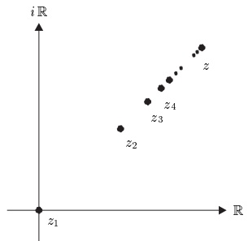
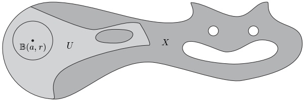

## 1 序列的收敛

本节考察定义在自然数上、因而只取可数个值的函数。对于这样的函数  $ \varphi\colon \mathbb{N} \to X $，我们特别关心当  $ n $ 趋于无穷时值  $ \varphi(n) $ 的性态。由于我们只能对  $ \varphi $ 求值有限多次，也就是说，我们永远无法“到达无穷”，因此我们必须发展出一些方法，使我们能够证明关于无穷多个“在无穷附近”的函数值的陈述。这样的方法构成了收敛序列的理论，我们在本节中加以介绍。

##### 序列

设 $X$ 为一个集合。$X$ 中的一个序列就是 $\mathbb{N}$ 到 $X$ 的一个函数。若 $\varphi: \mathbb{N} \to X$ 是一个序列，我们也写

\[ (x_{n}),\;(x_{n})_{n\in\mathbb{N}}\quad\text{ 或 }\quad(x_{0},x_{1},x_{2},\ldots) \]

来表示  $ \varphi $，其中  $ x_n := \varphi(n) $ 是序列  $ \varphi = (x_0, x_1, x_2, \ldots) $ 的第  $ n $ 项。

$ \mathbb{K} $ 中的序列称为数列，全体数列构成的  $ \mathbb{K} $-向量空间  $ \mathbb{K}^{\mathbb{N}} $ 记作  $ s $ 或  $ s(\mathbb{K}) $（见例 I.12.3(e)）。更确切地说，若  $ \mathbb{K} = \mathbb{R} $（或  $ \mathbb{K} = \mathbb{C} $），则称  $ (x_n) $ 为**实**（或**复**）**数列**。

1.1 注 （a）区分序列  $ (x_n) $ 与其像  $ \{x_n : n \in \mathbb{N}\} $ 至关重要。例如，若对所有  $ n $ 都有  $ x_n = x \in X $，即  $ (x_n) $ 是常值序列，则  $ (x_n) = (x, x, x, \ldots) \in X^{\mathbb{N}} $，而  $ \{x_n : n \in \mathbb{N}\} $ 是单元素集  $ \{x\} $。

（b）设  $ (x_n) $ 是  $ X $ 中的序列，$ E $ 是一个性质。则若存在某个  $ m \in \mathbb{N} $，使得对所有  $ n \geq m $ 都有  $ E(x_n) $ 为真，即  $ E $ 对除有限多个  $ x_n $ 之外的所有项都成立，我们就说  $ E $ 对  $ (x_n) $ 的**几乎所有**项成立。当然，$ E(x_n) $ 也可能对若干（或全部）$ n < m $ 为真。若存在子集  $ N \subseteq \mathbb{N} $，使得  $ \text{Num}(N) = \infty $ 且  $ E(x_n) $ 对每个  $ n \in N $ 都为真，则  $ E $ 对**无穷多**项为真。例如，实数列

\[ \left(-5,4,-3,2,-1,0,-\frac{1}{2},\frac{1}{3},-\frac{1}{4},\frac{1}{5},\cdots,-\frac{1}{2n},\frac{1}{2n+1},\cdots\right) \]

有无穷多个正项、无穷多个负项，且其绝对值对几乎所有项都小于 1。

（c）对  $ m \in \mathbb{N}^\times $，函数  $ \psi: m + \mathbb{N} \to X $ 也称为  $ X $ 中的序列。也就是说，$ (x_j)_{j \geq m} = (x_m, x_{m+1}, x_{m+2}, \ldots) $ 是  $ X $ 中的序列，尽管其指标不从 0 开始。这一约定是合理的，因为在用函数  $ \mathbb{N} \to m + \mathbb{N} $，$ n \mapsto m + n $ 进行“重新编号”之后，“平移序列” $ (x_j)_{j \geq m} $ 可与（通常的）序列  $ (x_{m+k})_{k \in \mathbb{N}} \in X^\mathbb{N} $ 等同。■

若画出由  $ z_n := (1 - 1/n)(1 + i) $ 定义的复数列  $ (z_n)_{n \geq 1} $ 的前几项，就会观察到，随着  $ n $ 增大，点  $ z_n $ 越来越“任意接近”于  $ z := 1 + i $。换句话说，随着  $ n $ 增大，$ z_n $ 到  $ z $ 的距离变得“任意小”。本节的目标是把我们关于这类数列收敛的直观与几何观念公理化，使之能应用于向量空间以及其他更抽象的集合中的序列。

首先我们认识到，距离的概念至关重要。在  $ \mathbb{K} $ 中，借助绝对值函数我们可以确定两点之间的距离。为了研究任意集合  $ X $ 中序列的收敛性，我们首先需要给  $ X $ 赋予一种结构，使得  $ X $ 中两个元素之间的“距离”能够被确定。

##### 度量空间

设 $X$ 为一个集合。若下列条件成立，则称函数 $d: X \times X \to \mathbb{R}^+$ 为 $X$ 上的一个 $\mathbf{度量}$：

 $ (M_1) $  $ d(x, y) = 0 \Leftrightarrow x = y $。

\[ (\mathrm{M}_{2})~d(x,y)=d(y,x),~x,y\in X(\text{对称性}). \]

\[ \mathrm{(M_{3})}\ d(x,y)\leq d(x,z)+d(z,y),\ x,y,z\in X\ (\text{三角不等式}). \]

若 $d$ 是 $X$ 上的度量，则称 $(X,d)$ 为度量空间。当度量由上下文明确时，我们就用 $X$ 简记 $(X,d)$。最后，我们称 $d(x,y)$ 为度量空间 $X$ 中点 $x$ 与 $y$ 之间的距离。

公理 $(M_{1})-(\mathrm{M}_{3})$ 显然是距离函数相当自然的性质。例如，$(M_{3})$ 可视为如下规则的公理化表述：“从 $x$ 到 $y$ 的直达路径比从 $x$ 到 $z$ 再到 $y$ 的路径更短”。

在度量空间  $ (X, d) $ 中，对  $ a \in X $ 和  $ r > 0 $，集合

\[ \mathbb{B}(a,r):=\mathbb{B}_{X}(a,r):=\left\{x\in X;d(a,x)<r\right\} \]

称为以 a 为中心、r 为半径的开球，而

\[ \bar{\mathbb{B}}(a,r):=\bar{\mathbb{B}}_{X}(a,r):=\left\{x\in X;d(a,x)\leq r\right\} \]

称为以 a 为中心、r 为半径的闭球。

1.2 例 （a）K 是带有自然度量的度量空间

\[ \mathbb{K}\times\mathbb{K}\to\mathbb{R}^{+}~,\quad(x,y)\mapsto\left|x-y\right|. \]

除非另有说明，我们总把 K 视为带有自然度量的度量空间。\footnote{注意，按照这个约定，上面给出的开球与闭球的定义（应用于 $\mathbb K$ 时）与第 I.11 节中的定义一致。}

证明  $ (M_{1})-(M_{3}) $ 的有效性直接由命题 I.11.4 得出。

（b）设 $(X,d)$ 为度量空间，$Y$ 为 $X$ 的非空子集。则 $d$ 在 $Y\times Y$ 上的限制 $d_{Y}:=d|Y\times Y$ 是 $Y$ 上的度量，称为诱导度量，且 $(Y,d_{Y})$ 是度量空间，是 $X$ 的度量子空间。当不会引起误解时，我们用 $d$ 代替 $d_{Y}$。

（c）C 的任意非空子集都是度量空间，其度量由 C 上的自然度量诱导而来。以这种方式在 R 上诱导出的度量就是 （a）中所定义的自然度量。

（d）设 $X$ 为非空集合。则由 $d(x,y):=1$（当 $x\neq y$）与 $d(x,x):=0$ 所定义的函数是 $X$ 上的度量，称为 $X$ 上的 $\text{离散}$ 度量。

（e）设  $ (X_j, d_j) $，$ 1 \leq j \leq m $ 为度量空间，且  $ X := X_1 \times \cdots \times X_m $。则函数

\[ d(x,y):=\max_{1\leq j\leq m}d_{j}(x_{j},y_{j}) \]

（其中 $x := (x_1, \ldots, x_m) \in X$，$y := (y_1, \ldots, y_m) \in X$）是 $X$ 上的度量，称为积度量。度量空间 $X := (X, d)$ 称为度量空间 $(X_j, d_j)$ 的积。可以验证

\[ \mathbb{B}_{X}(a,r)=\prod_{j=1}^{m}\mathbb{B}_{X_{j}}(a_{j},r),\quad\bar{\mathbb{B}}_{X}(a,r)=\prod_{j=1}^{m}\bar{\mathbb{B}}_{X_{j}}(a_{j},r) \]

对所有  $ a := (a_1, \ldots, a_m) \in X $ 和  $ r > 0 $ 成立。■

度量空间公理的一个重要推论是反向三角不等式（见推论 I.11.5）。

1.3 命题 设  $ (X,d) $ 为度量空间。则对所有  $ x,y,z\in X $ 我们有

\[ d(x,y)\geq|d(x,z)-d(z,y)|. \]

证明 由 (M$_3$) 我们得到不等式  $ d(x, y) \geq d(x, z) - d(y, z) $。交换 x 与 y 得到

\[ d(x,y)=d(y,x)\geq d(y,z)-d(x,z)=-\left(d(x,z)-d(y,z)\right), \]

若存在某个  $ r > 0 $，使得  $ \mathbb{B}(a, r) \subseteq U $，则称度量空间  $ X $ 的子集  $ U $ 为  $ a \in X $ 的邻域。点  $ a $ 的所有邻域构成的集合记作  $ \mathcal{U}(a) $，即

$ \mathcal{U}(a) := \mathcal{U}_X(a) := \{ U \subseteq X ; \, U \text{ 是 } a \text{ 的邻域 } \} \subseteq \mathcal{P}(X) $。

1.4 例 设 X 为度量空间，$a\in X$。

（a）对每个  $ \varepsilon > 0 $，$ \mathbb{B}(a, \varepsilon) $ 和  $ \bar{\mathbb{B}}(a, \varepsilon) $ 都是 a 的邻域，分别称为  $ a $ 的开  $ \varepsilon $-邻域与闭  $ \varepsilon $-邻域。

（b）显然 $X$ 属于 $\mathcal{U}(a)$。若 $U_1, U_2 \in \mathcal{U}(a)$，则 $U_1 \cap U_2$ 与 $U_1 \cup U_2$ 也属于 $\mathcal{U}(a)$。凡包含 $a \in X$ 的某个邻域的 $U \subseteq X$ 也属于 $\mathcal{U}(a)$。

证明 依假设，存在  $ r_j > 0 $，使得  $ \mathbb{B}(a, r_j) \subseteq U_j $（$ j = 1, 2 $）。由  $ r := \min\{r_1, r_2\} $ 定义  $ r > 0 $，则  $ \mathbb{B}(a, r) \subseteq U_1 \cap U_2 \subseteq U_1 \cup U_2 $。其余断言是显然的。

（c）对带有由  $ \mathbb{R} $ 诱导的度量的  $ X := [0,1] $，$ [1/2,1] $ 是 1 的邻域，但不是  $ 1/2 $ 的邻域。■

本节其余部分，$X := (X, d)$ 是度量空间，$(x_n)$ 是 $X$ 中的序列。

##### 聚点

若 a 的每个邻域都包含序列的无穷多项，则称  $ a \in X $ 为  $ (x_n) $ 的聚点。

在考察一些例子之前，先给出聚点的如下刻画是有用的：

1.5 命题 下列诸条件等价：

（i）a 是  $ (x_{n}) $ 的聚点

（ii）对每个  $ U \in \mathcal{U}(a) $ 与  $ m \in \mathbb{N} $，存在某个  $ n \geq m $，使得  $ x_n \in U $。

（iii）对每个  $ \varepsilon > 0 $ 与  $ m \in \mathbb{N} $，存在某个  $ n \geq m $，使得  $ x_n \in \mathbb{B}(a, \varepsilon) $。

证明 这直接由定义得出。

1.6 例 （a）实数列  $ ((-1)^n)_{n \in \mathbb{N}} $ 有两个聚点，即 1 与 -1。

（b）复数列  $ (i^n)_{n \in \mathbb{N}} $ 有四个聚点，即  $ \pm 1 $ 与  $ \pm i $。

（c）常值序列  $ (x,x,x,\ldots) $ 有唯一的聚点 x。

（d）自然数序列  $ (n)_{n \in \mathbb{N}} $ 没有聚点。

（e）设  $ \varphi $ 为  $ \mathbb{N} $ 到  $ \mathbb{Q} $ 的双射（由命题 I.9.4，这样的函数存在）。对每个  $ n \in \mathbb{N} $，由  $ x_n := \varphi(n) $ 定义序列  $ (x_n) $。则所有实数都是  $ (x_n) $ 的聚点。

证明 假设存在某个  $ a \in \mathbb{R} $ 不是  $ (x_n) $ 的聚点。则由命题 1.5，存在  $ \varepsilon > 0 $ 与  $ m \in \mathbb{N} $，使得

\[ x_{n}\notin\mathbb{B}(a,\varepsilon)=(a-\varepsilon,a+\varepsilon),\qquad n\geq m. \]

也就是说，区间  $ (a - \varepsilon, a + \varepsilon) $ 只包含有限多个有理数。但由命题 I.10.8，这是不可能的。

##### 收敛

若 a 的每个邻域都包含序列的几乎所有项，则称序列  $ (x_n) $ 收敛（或是收敛的），其极限为 a。此时我们写\footnote{当不会产生误解时，我们也写 $\lim_{n}x_{n}=a$、$\lim x_{n}=a$ 或 $x_{n}\to a$。}

\[ \lim_{n\to\infty}x_{n}=a\qquad\text{或}\qquad x_{n}\to a\qquad(n\to\infty), \]

并且我们说当 n 趋于  $ \infty $ 时  $ (x_n) $ 收敛于 a。不收敛的序列  $ (x_n) $ 称为发散的，我们说  $ (x_n) $ 发散。

定义的本质部分是：极限的每个邻域都包含序列的几乎所有项。在  $ X = \mathbb{K} $ 的情形，这一要求对应于如下几何直观：$ x_n $ 到 a 的距离“变得任意小”。若  $ a $ 是  $ (x_n) $ 的聚点而  $ U $ 是  $ a $ 的邻域，则  $ U $ 当然包含序列的无穷多项，但序列的无穷多项也可能不在  $ U $ 中。

下一个命题同样只是相应定义的重新表述。

1.7 命题 下列陈述等价：

（i）$ \lim x_{n}=a $

（ii）对每个  $ U \in \mathcal{U}(a) $，存在某个\footnote{我们用这个记号表示数 $N$ 一般依赖于 $U$（或 $\varepsilon$）。} $ N := N(U) $，使得对所有  $ n \geq N $ 都有  $ x_n \in U $。

（iii）对每个  $ \varepsilon > 0 $，存在某个\textsuperscript{\thefootnote} $ N := N(\varepsilon) $，使得对所有  $ n \geq N $ 都有  $ x_n \in \mathbb{B}(a, \varepsilon) $。

下列例子相当简单。对于更复杂的例子，我们需要从第 4 节开始建立的方法。

1.8 例 （a）对实数列  $ (1/n)_{n \in \mathbb{N}^\times} $，我们有  $ \lim(1/n) = 0 $。

证明 设  $ \varepsilon > 0 $。由推论 I.10.7，存在某个  $ N \in \mathbb{N}^\times $，使得  $ 1/N < \varepsilon $。则对所有  $ n \geq N $ 有  $ 1/n \leq 1/N < \varepsilon $，即对所有  $ n \geq N $ 有  $ 1/n \in (0, \varepsilon) \subseteq \mathbb{B}(0, \varepsilon) $。■

（b）对由下式定义的复数列  $ (z_{n}) $

\[ z_{n}:=\frac{n+2}{n+1}+i\frac{2n}{n+2}, \]

我们有  $ \lim z_{n}=1+2i $

证明 设  $ \varepsilon > 0 $。由推论 I.10.7，存在某个  $ N \in \mathbb{N} $，使得  $ 1/N < \varepsilon/8 $。则对所有  $ n \geq N $，我们有

\[ \frac{n+2}{n+1}-1=\frac{1}{n+1}<\frac{1}{N}<\frac{\varepsilon}{8}<\frac{\varepsilon}{2} \]

且

\[ 2-\frac{2n}{n+2}=\frac{4}{n+2}<\frac{4}{N}<\frac{\varepsilon}{2}. \]

从而

\[ \left|z_{n}-(1+2i)\right|^{2}=\left|\frac{n+2}{n+1}-1\right|^{2}+\left|\frac{2n}{n+2}-2\right|^{2}<\frac{\varepsilon^{2}}{4}+\frac{\varepsilon^{2}}{4}<\varepsilon^{2},\qquad n\geq N. \]

这表明对所有  $ n \geq N $ 都有  $ z_n \in \mathbb{B}_{\mathbb{C}}((1 + 2i), \varepsilon) $。■

（c）常值序列  $ (a, a, a, \ldots) $ 收敛于 a。

（d）实数列  $ ((-1)^n)_{n \in \mathbb{N}} $ 是发散的。

（e）设 $X$ 为度量空间 $(X_j, d_j)$（$1 \leq j \leq m$）的积。则序列\footnote{下文我们常常记 $x^{j}:=\mathrm{pr}_{j}(x)$，其中 $x\in X$ 且 $1\leq j\leq m$。即使在 $X_{j}=\mathbb K$ 的情形，从上下文也能看出 $x^{j}$ 是积空间中点的分量还是 $x$ 的幂。}$(x_n) = \left((x_n^1, \ldots, x_n^m)\right)_{n \in \mathbb{N}}$ 在 $X$ 中收敛于点 $a := (a^1, \ldots, a^m)$ 当且仅当，对每个 $j \in \{1, \ldots, m\}$，序列 $(x_n^j)_{n \in \mathbb{N}}$ 在 $X_j$ 中收敛于 $a^j \in X_j$。

证明 对每个给定的 $\varepsilon > 0$，几乎所有 $x_n$ 都在 $\mathbb{B}_X(a, \varepsilon) = \prod_{j=1}^m \mathbb{B}_{X_j}(a^j, \varepsilon)$ 中，当且仅当对每个 $j = 1, \ldots, m$，几乎所有 $x_n^j$ 都在 $\mathbb{B}_{X_j}(a^j, \varepsilon)$ 中（见例 1.2(e)）。

##### 有界集

若存在某个  $ M > 0 $，使得对所有  $ x, y \in Y $ 都有  $ d(x, y) \leq M $，则称子集  $ Y \subseteq X $ 是  $ d $-有界的，或称为在  $ X $ 中有界（关于度量  $ d $）。在这种情况下，由下式定义的  $ Y $ 的直径

\[ diam(Y):=\sup_{x,y\in Y}d(x,y), \]

是有限的。若序列  $ (x_n) $ 的像  $ \{x_n; n \in \mathbb{N}\} $ 有界，则称  $ (x_n) $ 有界。

1.9 例 （a）对所有  $ a \in X $ 与  $ r > 0 $，$ \mathbb{B}(a, r) $ 和  $ \bar{\mathbb{B}}(a, r) $ 在  $ X $ 中有界。

（b）有界集的每个子集都有界。有界集的有限并有界。

（c）$ X $ 的子集  $ Y $ 在  $ X $ 中有界，当且仅当存在某个  $ x_0 \in X $ 与  $ r > 0 $，使得  $ Y \subseteq \mathbb{B}_X(x_0, r) $。若  $ Y \neq \emptyset $，则存在某个具有此性质的  $ x_0 \in Y $。

（d）有界区间是有界的。

（e）$ \mathbb{K} $ 的子集  $ Y $ 有界，当且仅当存在某个  $ M > 0 $，使得对所有  $ y \in Y $ 都有  $ |y| \leq M $。 $ \blacksquare $

1.10 命题 任何收敛序列都是有界的。

证明 设  $ x_n \to a $。则存在某个  $ N $，使得对所有  $ n \geq N $ 都有  $ x_n \in \mathbb{B}(a,1) $。由三角不等式可得

\[ d(x_{n},x_{m})\leq d(x_{n},a)+d(a,x_{m})\leq2~,\qquad m,n\geq N~. \]

由于还存在某个 $M \geq 0$，使得对所有 $j, k \leq N$ 都有 $d(x_j, x_k) \leq M$，故对所有 $m, n \in \mathbb{N}$ 都有 $d(x_n, x_m) \leq M + 2$。

##### 极限的唯一性

1.11 命题 设  $ (x_{n}) $ 收敛，极限为 a。则 a 是  $ (x_{n}) $ 的唯一聚点。

证明  $ a $ 显然是  $ (x_n) $ 的聚点。为证唯一性，设  $ b \neq a $ 是  $ X $ 的某个点。则由  $ (M_1) $，$ \varepsilon := d(b, a)/2 $ 为正。由于  $ a = \lim x_n $，存在某个  $ N $，使得对所有  $ n \geq N $ 都有  $ d(a, x_n) < \varepsilon $。于是由命题 1.3 可得

\[ d(b,x_{n})\geq|d(b,a)-d(a,x_{n})|\geq d(b,a)-d(a,x_{n})>2\varepsilon-\varepsilon=\varepsilon,\qquad n\geq N. \]

也就是说，$ (x_n) $ 的几乎所有项都在  $ \mathbb{B}(b, \varepsilon) $ 之外。故  $ b $ 不是  $ (x_n) $ 的聚点。 $ \blacksquare $

1.12 注 命题 1.11 的逆命题不成立，也就是说，存在恰好只有一个聚点的发散序列，例如  $ \left(\frac{1}{2}, 2, \frac{1}{3}, 3, \frac{1}{4}, 4, \ldots\right) $。

作为命题 1.11 的直接推论，我们有：

1.13 推论 收敛序列的极限是唯一的。

##### 子序列

设 $\varphi = (x_n)$ 为 $X$ 中的序列，$\psi: \mathbb{N} \to \mathbb{N}$ 为严格递增函数。则 $\varphi \circ \psi \in X^\mathbb{N}$ 称为 $\varphi$ 的子序列。把上面为序列 $\varphi$ 引入的记号 $(x_n)_{n \in \mathbb{N}}$ 加以推广，我们对于子序列 $\varphi \circ \psi$ 写作 $(x_{n_k})_{k \in \mathbb{N}}$，其中 $n_k := \psi(k)$。由于 $\psi$ 严格递增，我们有 $n_0 < n_1 < n_2 < \cdots$。

1.14 例 序列  $ ((-1)^n)_{n \in \mathbb{N}} $ 有两个常值子序列  $ ((-1)^{2k})_{k \in \mathbb{N}} = (1,1,1,\ldots) $ 与  $ ((-1)^{2k+1})_{k \in \mathbb{N}} = (-1,-1,-1,\ldots) $。■

1.15 命题 若  $ (x_n) $ 是极限为  $ a $ 的收敛序列，则  $ (x_n) $ 的每个子序列  $ (x_{n_k})_{k \in \mathbb{N}} $ 都收敛，且  $ \lim_{k \to \infty} x_{n_k} = a $。

证明 设  $ (x_{n_k})_{k \in \mathbb{N}} $ 为  $ (x_n) $ 的子序列，$ U $ 为  $ a $ 的邻域。因为  $ a = \lim x_n $，存在某个  $ N $，使得对所有  $ n \geq N $ 都有  $ x_n \in U $。由子序列的定义，对所有  $ k \in \mathbb{N} $ 都有  $ n_k \geq k $，于是特别地，对所有  $ k \geq N $ 都有  $ n_k \geq N $。故对所有  $ k \geq N $ 都有  $ x_{n_k} \in U $。这意味着  $ (x_{n_k}) $ 收敛于  $ a $。

1.16 例 对  $ m \geq 2 $，

\[ \frac{1}{k^{m}}\to0\quad(k\to\infty)\quad\text{ 且 }\quad\frac{1}{m^{k}}\to0\quad(k\to\infty). \]

证明 对所有 $k \in \mathbb{N}^\times$，令 $\psi_1(k) := k^m$ 与 $\psi_2(k) := m^k$。由于 $\psi_i: \mathbb{N}^\times \to \mathbb{N}^\times$（$i=1,2$）严格递增，$(k^{-m})_{k\in\mathbb{N}^\times}$ 与 $(m^{-k})_{k\in\mathbb{N}^\times}$ 是 $(1/n)_{n\in\mathbb{N}^\times}$ 的子序列。于是断言由命题 1.15 与例 1.8(a) 得出。

下一个命题给出序列聚点的进一步刻画。

1.17 命题 点 $a$ 是序列 $(x_n)$ 的聚点，当且仅当存在 $(x_n)$ 的某个子序列 $(x_{n_k})_{k \in \mathbb{N}}$ 收敛于 $a$。

证明 设 $a$ 为 $(x_n)$ 的聚点。我们递归地定义自然数序列 $(n_k)_{k \in \mathbb{N}}$：

\[ n_{0}:=0~,\quad n_{k}:=\operatorname*{m i n}\bigl\{m\in\mathbb{N}~;~m>n_{k-1},~x_{m}\in\mathbb{B}(a,1/k)\bigr\}~,\qquad k\in\mathbb{N}^{\times}~. \]

由于 $a$ 是 $(x_{n})$ 的聚点，集合

\[ \left\{m\in\mathbb{N}\;;\;m>n_{k-1},\;x_{m}\in\mathbb{B}(a,1/k)\right\}\;,\qquad k\in\mathbb{N}^{\times}\;, \]

非空。由良序原理，对每个  $ k \in \mathbb{N}^\times $，$ n_k $ 都有良定义。于是  $ \psi: \mathbb{N} \to \mathbb{N} $，$ k \mapsto n_k $ 有良定义且严格递增。

下面证明子序列 $(x_{n_k})_{k \in \mathbb{N}}$ 收敛于 $a$。设 $\varepsilon > 0$。由推论 I.10.7，存在某个 $K := K(\varepsilon) \in \mathbb{N}^\times$，使得对所有 $k \geq K$ 都有 $1/k < \varepsilon$。由 $n_k$ 的构造，我们有

\[ x_{n_{k}}\in\mathbb{B}(a,1/k)\subseteq\mathbb{B}(a,\varepsilon),\qquad k\geq K. \]

故  $ a = \lim_{k \to \infty} x_{n_k} $。

反之，设  $ (x_{n_k})_{k \in \mathbb{N}} $ 为  $ (x_n) $ 的子序列，且  $ a = \lim_{k \to \infty} x_{n_k} $。则由命题 1.11，$ a $ 是  $ (x_{n_k})_{k \in \mathbb{N}} $ 的聚点，从而也是  $ (x_n) $ 的聚点。■

##### 习题

1 设 $d$ 为 $\mathbb{K}$ 上的离散度量，且 $X := (\mathbb{K}, d)$。

（a）对  $ a \in X $ 与  $ r > 0 $，显式描述  $ \mathbb{B}_X(a, r) $ 与  $ \bar{\mathbb{B}}_X(a, r) $。

（b）描述 X 中任意序列的聚点。

（c）对  $ a \in X $，描述  $ X $ 中所有满足  $ x_n \to a $ 的序列  $ (x_n) $。

2 证明例 1.2(e) 的断言。

3 证明序列  $ (z_n)_{n \geq 1} $（其中  $ z_n := (1 - 1/n)(1 + i) $）收敛于  $ 1 + i $（正如注 1.1 后面的图所表明的那样）。

4 证明例 1.9 的断言。

5 在下列情形中，确定复数列  $ (z_{n}) $ 的所有聚点：

（a）$ z_n := \left( (1 + i) / \sqrt{2} \right)^n $

（b）$ z_n := (1 + (-1)^n)(n + 1)n^{-1} + (-1)^n $。

（c）$ z_n: = (-1)^n n / (n + 1) $。

6 对  $ n \in \mathbb{N} $，定义

\[ a_{n}:=n+\frac{1}{k}-\frac{k^{2}+k-2}{2}, \]

其中  $ k \in \mathbb{N}^\times $ 满足

\[ k^{2}+k-2\leq2n\leq k^{2}+3k-2. \]

证明  $ (a_{n}) $ 有良定义，并确定  $ (a_{n}) $ 的所有聚点。（提示：显式算出序列的前几项以理解整个序列。）

7 对  $ m, n \in \mathbb{N}^\times $，定义

\[ d(m,n):=\left\{\begin{array}{c l}{(m+n)/m n~,}&{\quad m\neq n~,}\\ {0~,}&{\quad m=n~.}\\ \end{array}\right. \]

证明  $ (\mathbb{N}^\times, d) $ 是度量空间，并对  $ n \in \mathbb{N}^\times $ 描述  $ A_n := \bar{\mathbb{B}}(n, 1 + 1/n) $。

8 设  $ X := \{ z \in \mathbb{C} ; \, |z| \leq 3 \} $ 带有自然度量。描述  $ \mathbb{B}_X(0,3) $ 与  $ \mathbb{B}_X(2,4) $。证明  $ \mathbb{B}_X(2,4) \subset \mathbb{B}_X(0,3) $。

9 集合  $ X $ 上的两个度量  $ d_1 $ 与  $ d_2 $ 称为**等价**的，若对每个  $ x \in X $ 与  $ \varepsilon > 0 $，存在正数  $ r_1 $ 与  $ r_2 $，使得

\[ \mathbb{B}_{1}(x,r_{1})\subseteq\mathbb{B}_{2}(x,\varepsilon)\;,\quad\mathbb{B}_{2}(x,r_{2})\subseteq\mathbb{B}_{1}(x,\varepsilon)\;. \]

这里 $\mathbb{B}_j$ 表示 $(X, d_j)$ 中的球，$j = 1, 2$。现设 $(X, d)$ 为度量空间，且

\[ \delta(x,y):=\frac{d(x,y)}{1+d(x,y)}~,\qquad x,y\in X~. \]

证明 $d$ 与 $\delta$ 是 $X$ 上的等价度量。（提示：函数 $t \mapsto t/(1 + t)$ 是递增的。）

10 对 $X := (0,1)$，证明下列各点：

（a）$ d(x, y) := |(1/x) - (1/y)| $ 是 X 上的度量。

（b）自然度量与 d 等价。

（c）在  $ \mathbb{R} $ 上不存在与自然度量等价、且在 X 上诱导出度量 d 的度量。

11 设  $ (X_j, d_j) $（$ j = 1, \ldots, n $）为度量空间，$ X := X_1 \times \cdots \times X_n $，$ d $ 为  $ X $ 上的积度量。证明

\[ \delta(x,y):=\sum_{j=1}^{n}d_{j}(x_{j},y_{j}),\qquad x:=(x_{1},\ldots,x_{n})\in X,\quad y:=(y_{1},\ldots,y_{n})\in X, \]

是 X 上的度量，且与 d 等价。

12 对  $ z, w \in \mathbb{C} $，令

\[ \delta(z,w):=\left\{\begin{array}{c l}{\left|z-w\right|,}&{\quad\text{若}\;z=\lambda w\;\text{对某个}\;\lambda>0\;,}\\ {\left|z\right|+\left|w\right|}&{\quad\text{其他情形}\;.}\\ \end{array}\right. \]

证明  $ \delta $ 在 $ \mathbb{C} $ 上定义了一个度量，即 SNCF-度量。\footnote{法国铁路系统（SNCF）的使用者会注意到，两座城市之间（例如波尔多与里昂之间）最快的连接常常要经过巴黎。}

13 设  $ (x_n) $ 为  $ \mathbb{C} $ 中的序列，且对所有  $ n \in \mathbb{N} $ 都有  $ \mathrm{Re} x_n = 0 $。证明：若  $ (x_n) $ 收敛于  $ x $，则  $ \mathrm{Re} x = 0 $。
