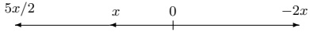
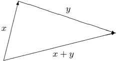
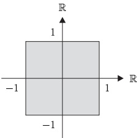
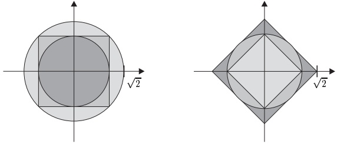

## 3 赋范向量空间

在本节中，我们考虑向量空间上的度量。当然，我们希望这样的度量与向量空间结构相容，因此我们从已经具有距离概念的向量空间 $ \mathbb{R}^2 $ 着手。具体地说，如果我们用 $ \|x\| $ 表示 $ \mathbb{R}^2 $ 中向量 $ x $ 的长度，那么 $\mathbb{R}^2$ 中两点 $ x, y \in \mathbb{R}^2 $ 之间的距离就是 $ \|x - y\| $。稍后我们将看到，这在 $ \mathbb{R}^2 $ 上定义了一个度量（见注 3.1(a)）。除了与度量的这种关系之外，函数 $ x \mapsto \|x\| $ 关于向量空间结构还具有某些性质：

首先我们注意到，$ \mathbb{R}^2 $ 中向量的长度是非负的，即对所有 $ x \in \mathbb{R}^2 $ 有 $ \|x\| \geq 0 $，并且长度为零的唯一向量是零向量。

对于 $ x \in \mathbb{R}^2 $ 和 $ \alpha > 0 $，我们可以把 $ \alpha x $ 看作向量 $ x $ 被拉伸（或压缩）了因子 $ \alpha $。如果 $ \alpha < 0 $，那么 $ \alpha x $ 就是 $ x $ 被拉伸（或压缩）了因子 $ -\alpha $，然后再反向。

无论哪种情形，向量 $ \alpha x $ 的长度都是 $ \|\alpha x\| = |\alpha|\|x\| $。

最后，对于 $ \mathbb{R}^2 $ 中所有的向量 $ x $ 和 $ y $，我们有

三角不等式 $ \|x + y\| \leq \|x\| + \|y\| $。

这三条性质足以使 $ \|x - y\| $ 成为 $ \mathbb{R}^2 $ 上的一个度量。由于它们也容易推广到任意向量空间，我们自然而然地引出赋范向量空间的如下定义。

##### 范数

设 $ E $ 是 $ \mathbb{K} $ 上的向量空间。如果函数 $ \|\cdot\|: E \to \mathbb{R}^+ $ 满足下列条件，则称之为**范数**：

 $ (N_1) $  $ \|x\| = 0 \Leftrightarrow x = 0 $.

 $ (N_2) $  $ \|\lambda x\| = |\lambda|\|x\| $,  $ x \in E $,  $ \lambda \in \mathbb{K} $（正齐性）.

 $ (N_3) $  $ \|x + y\| \leq \|x\| + \|y\| $,  $ x, y \in E $（三角不等式）.

由一个向量空间 $E$ 和一个范数 $\|\cdot\|$ 组成的对 $(E, \|\cdot\|)$ 称为赋范向量空间。\footnote{除非另有说明，今后向量空间都假定为 $\mathbb K$-向量空间。}如果范数在上下文中是明确的，我们就用 $E$ 代替 $(E, \|\cdot\|)$。

3.1 注 设 $ E := (E, \|\cdot\|) $ 是一个赋范向量空间。

(a) 函数

\[ d\colon E\times E\to\mathbb{R}^{+}\;,\qquad(x,y)\mapsto\|x-y\| \]

是 E 上的一个度量，即由范数诱导的度量。因此任何赋范向量空间也是一个度量空间。

证明 公理 $(M_{1})$ 和 $(M_{2})$ 立即由 $(N_{1})$ 和 $(N_{2})$ 得出。公理 $(M_{3})$ 由 $(N_{3})$ 得出，因为

\[ d(x,y)=\|x-y\|=\|(x-z)+(z-y)\|\leq\|x-z\|+\|z-y\|=d(x,z)+d(z,y) \]

对所有 $ x, y, z \in E $ 成立。 ■

(b) 逆三角不等式对范数成立：

\[ \left\|x-y\right\|\geq\left|\left\|x\right\|-\left\|y\right\|\right|,\qquad x,y\in E. \]

证明 命题 1.3 蕴含诱导度量的逆三角不等式。因此

\[ \left\|x-y\right\|=d(x,y)\geq|d(x,0)-d(0,y)|=\left|\left\|x\right\|-\left\|y\right\|\right| \]

对所有 $ x, y \in E $ 成立。 ■

(c) 由于 (a)，第 1 节中所有关于度量空间的陈述对 E 也成立。特别地，‘邻域’、‘聚点’和‘收敛’的概念在 E 中是良定义的。

例如，E 中极限为 x 的序列 $ (x_{n}) $ 的收敛具有如下含义

\[ x_{n}\to x\text{（在 }E\text{ 中）}\Longleftrightarrow\forall\varepsilon>0\exists N\in\mathbb{N}:\|x_{n}-x\|<\varepsilon\forall n\geq N. \]

进一步地，回顾第 2 节可知，任何其证明不用到 $ \mathbb{K} $ 的域结构或序结构的陈述，对 $ E $ 中的序列也成立。

特别地，注 2.1 以及命题 2.2 和 2.10 在任何赋范向量空间中都成立。 ■

##### 球

对 $ a \in E $ 和 $ r > 0 $，我们把以 $ a $ 为中心、以 $ r $ 为半径的开球和闭球定义为

\[ \mathbb{B}_{E}(a,r):=\mathbb{B}(a,r):=\left\{x\in E;\|x-a\|<r\right\} \]

和

\[ \bar{\mathbb{B}}_{E}(a,r):=\bar{\mathbb{B}}(a,r):=\left\{x\in E\;;\;\|x-a\|\leq r\right\}\;. \]

注意到，当 d 由范数诱导时，这些定义与度量空间 $ (E,d) $ 的定义一致。我们也记

\[ \mathbb{B}:=\mathbb{B}(0,1)=\{x\in E;\|x\|<1\}\quad\text{且}\quad\bar{\mathbb{B}}:=\bar{\mathbb{B}}(0,1)=\{x\in E;\|x\|\leq1\} \]

表示 E 中的开单位球和闭单位球。利用 (I.4.1) 的记号，我们有

\[ r\mathbb{B}=\mathbb{B}(0,r),\quad r\bar{\mathbb{B}}=\bar{\mathbb{B}}(0,r),\quad a+r\mathbb{B}=\mathbb{B}(a,r),\quad a+r\bar{\mathbb{B}}=\bar{\mathbb{B}}(a,r). \]

##### 有界集

如果 E 的子集 X 在诱导度量空间中有界，则称 X 在 E 中有界（或范数有界）。

3.2 注 设 $ E := (E, \|\cdot\|) $ 是一个赋范向量空间。

(a)  $ X \subseteq E $ 有界当且仅当存在某个 $ r > 0 $，使得 $ X \subseteq r\mathbb{B} $，即对所有 $ x \in X $ 有 $ \|x\| < r $。

(b) 如果 $X$ 和 $Y$ 是 $E$ 的非空有界子集，那么 $X \cup Y$、$X + Y$ 以及 $\lambda X$（$\lambda \in \mathbb{K}$）也是有界的。

(c) 例 1.2(d) 表明，在每个向量空间 $V$ 上，都存在一个度量，使得 $V$ 关于该度量是有界的。但是，如果 $V$ 非零，那么 $(N_{2})$ 蕴含在 $V$ 上不存在具有此性质的范数。

##### 例

现在我们为 I.12 节中引入的向量空间定义适当的范数。

3.3 例 (a) 绝对值 $ |\cdot| $ 是向量空间 $ \mathbb{K} $ 上的一个范数。

约定 除非另有说明，今后我们把 $ \mathbb{K} $ 视为带有上述范数的赋范向量空间。

(b) 设 $F$ 是赋范向量空间 $E := (E, \|\cdot\|)$ 的子空间。那么 $\|\cdot\|$ 到 $F$ 的限制 $\|\cdot\|_F := \|\cdot\| \big| F$ 是 $F$ 上的一个范数。因此 $F := (F, \|\cdot\|_F)$ 是带有这个诱导范数的赋范向量空间。当不会引起混淆时，我们用符号 $\|\cdot\|$ 表示 $F$ 上的诱导范数。

(c) 设 $ (E_j, \|\cdot\|_j) $,  $ 1 \leq j \leq m $, 是 $ \mathbb{K} $ 上的赋范向量空间。那么

\[ \|x\|_{\infty}:=\max_{1\leq j\leq m}\|x_{j}\|_{j},\qquad x=(x_{1},\ldots,x_{m})\in E:=E_{1}\times\cdots\times E_{m}, \]

在积向量空间 $E$ 上定义了一个范数，称为积范数。当 $d_j$ 是由 $\|\cdot\|_j$ 在 $E_j$ 上诱导的度量时，由这个范数在 $E$ 上诱导的度量与例 1.2(e) 的积度量一致。

证明 显然 $ (\mathrm{N}_1) $ 满足。由 $ \|\cdot\|_j $ 的正齐性，对每个 $ \lambda \in \mathbb{K} $ 和 $ x \in E $，我们得到

\[ \|\lambda x\|_{\infty}=\max_{1\leq j\leq m}\|\lambda x_{j}\|_{j}=\max_{1\leq j\leq m}|\lambda|\|x_{j}\|_{j}=|\lambda|\max_{1\leq j\leq m}\|x_{j}\|_{j}=|\lambda|\|x\|_{\infty}, \]

因此 $ (N_{2}) $ 成立。最后，由 $ x + y = (x_{1} + y_{1}, \ldots, x_{m} + y_{m}) $ 以及

范数 $ \|\cdot\|_j $ 的三角不等式可得

\[ \|x+y\|_{\infty}=\max_{1\leq j\leq m}\|x_{j}+y_{j}\|_{j}\leq\max_{1\leq j\leq m}(\|x_{j}\|_{j}+\|y_{j}\|_{j})\leq\|x\|_{\infty}+\|y\|_{\infty} \]

对所有 $ x, y \in E $ 成立，即 $ (N_3) $ 成立。因此 (3.1) 在积向量空间 $ E $ 上定义了一个范数。最后一个断言是显然的。 $ \blacksquare $

(d) 对 $ m \in \mathbb{N}^\times $，$ \mathbb{K}^m $ 是带有最大范数的赋范向量空间

\[ |x|_{\infty}:=\operatorname*{m a x}_{1\leq j\leq m}|x_{j}|~,\qquad x=(x_{1},\ldots,x_{m})\in\mathbb{K}^{m}~. \]

在 $ m = 1 $ 的情形中，$ (\mathbb{K}^1, |\cdot|_{\infty}) = (\mathbb{K}, |\cdot|) = \mathbb{K} $。

证明 这是 (c) 的特殊情形。

##### 有界函数空间

设 $X$ 是一个非空集合，$(E, \|\cdot\|)$ 是一个赋范向量空间。如果函数 $u \in E^X$ 在 $E$ 中的像有界，则称 $u$ 是$\text{有界的}$。对 $u \in E^X$，定义

\[ \left\|u\right\|_{\infty}:=\left\|u\right\|_{\infty,X}:=\sup_{x\in X}\left\|u(x)\right\|\in\mathbb{R}^{+}\cup\left\{\infty\right\}. \]

3.4 注 (a) 对 $ u \in E^X $，下列命题等价：

(i) u 是有界的。

(ii)  $ u(X) $ 在 E 中有界。

(iii) 存在某个 $ r > 0 $，使得对所有 $ x \in X $ 有 $ \|u(x)\| \leq r $

(iv)  $ \|u\|_{\infty} < \infty $。

(b) 显然 $ \mathrm{id} \in \mathbb{K}^{\mathbb{K}} $ 不是有界的，即 $ \|\mathrm{id}\|_{\infty} = \infty $。 ■

注 3.4(b) 表明，当 $ E $ 非平凡时，$ \|\cdot\|_\infty $ 可能不是向量空间 $ E^X $ 上的范数。因此我们令

\[ B(X,E):=\left\{u\in E^{X}:~u\text{ 有界}\right\}, \]

并把 $B(X,E)$ 称为从 $X$ 到 $E$ 的有界函数空间。

3.5 命题  $ B(X,E) $ 是 $ E^X $ 的子空间，并且 $ \|\cdot\|_\infty $ 是 $ B(X,E) $ 上的一个范数，称为上确界范数。

证明 第一个断言由注 3.2(b) 得出。由注 3.4(a)，函数 $ \|\cdot\|_\infty: B(X,E) \to \mathbb{R}^+ $ 是良定义的。$ \|\cdot\|_\infty $ 的公理 ($ N_1 $) 由下式得出

\[ \|u\|_{\infty}=0\Longleftrightarrow\left(\|u(x)\|=0,x\in X\right)\Longleftrightarrow\left(u(x)=0,x\in X\right)\Longleftrightarrow\left(u=0\text{（在 }E^{X}\text{ 中）}\right) \]

这里我们当然用到了 $ \|\cdot\| $ 是 $ E $ 上的范数这一事实。对 $ u \in B(X, E) $ 和 $ \alpha \in \mathbb{K} $，我们有

\[ \left\|\alpha u\right\|_{\infty}=\sup\left\{\left\|\alpha u(x)\right\|;x\in X\right\}=\sup\left\{\left|\alpha\right|\left\|u(x)\right\|;x\in X\right\}=\left|\alpha\right|\left\|u\right\|_{\infty}. \]

因此 $ \|\cdot\|_{\infty} $ 也满足 $ (\mathrm{N}_{2}) $。

最后，对所有 $ u, v \in B(X, E) $ 和 $ x \in X $，我们有 $ \|u(x)\| \leq \|u\|_\infty $，并且也有 $ \|v(x)\| \leq \|v\|_\infty $。因此

\[ \begin{align*}\|u+v\|_{\infty}&=\sup\big\{\|u(x)+v(x)\|;x\in X\big\}\\&\leq\sup\big\{\|u(x)\|+\|v(x)\|;x\in X\big\}\leq\|u\|_{\infty}+\|v\|_{\infty},\end{align*} \]

所以 $ \|\cdot\|_{\infty} $ 满足公理 $ (N_{3}) $。 ■

约定 今后，$ B(X,E) $ 表示从 $ X $ 到 $ E $ 的有界函数空间连同其上确界范数 $ \|\cdot\|_\infty $，即

\[ B(X,E):=\big(B(X,E),\|\cdot\|_{\infty}\big). \]

3.6 注 (a) 如果 $ X := \mathbb{N} $，那么 $ B(X, E) $ 是 $ E $ 中有界序列的赋范向量空间。在特殊情形 $ E := \mathbb{K} $ 中，$ B(\mathbb{N}, \mathbb{K}) $ 记作 $ \ell_\infty $，即

\[ \ell_{\infty}:=\ell_{\infty}(\mathbb{K}):=B(\mathbb{N},\mathbb{K}) \]

是带有上确界范数的有界序列的赋范向量空间

\[ \|(x_{n})\|_{\infty}=\operatorname*{s u p}_{n\in\mathbb{N}}|x_{n}|~,\qquad(x_{n})\in\ell_{\infty}~. \]

(b) 由于由命题 1.10，任何收敛序列都是有界的，由注 2.3 可得，$c_0$ 和 $c$ 是 $\ell_\infty$ 的子空间。因此 $c_0$ 和 $c$ 是关于上确界范数的赋范向量空间，并且作为子空间有 $c_0 \subseteq c \subseteq \ell_\infty$。

(c) 如果对某个 $ m \in \mathbb{N}^\times $ 有 $ X = \{1, \ldots, m\} $，那么

\[ B(X,E)=(E^{m},\|\cdot\|_\infty), \]

其中 $ \|\cdot\|_\infty $ 是例 3.3(c) 的积范数（经过显然的等同）。因此这里的记号与例 3.3(c) 的记号是一致的。 $ \blacksquare $

##### 内积空间

现在我们考虑赋范向量空间 $ E := (\mathbb{R}^2, |\cdot|_{\infty}) $。按照上述记号，$ E $ 的单位球是

\[ \mathbb{B}_{E}=\left\{x\in\mathbb{R}^{2}\;;\;|x|_{\infty}\leq1\right\}=\left\{\left(x_{1},x_{2}\right)\in\mathbb{R}^{2}\;;\ -1\leq x_{1},x_{2}\leq1\right\}. \]

因此 $ \mathbb{B}_E $ 是平面中边长为 2、中心为 0 的正方形。在任何赋范向量空间 $ (F, \|\cdot\|) $ 中，集合 $ \{x \in F : \|x\| = 1\} $，即单位球的‘边界’，称为 $ (F, \|\cdot\|) $ 中的单位球面。对于我们的空间 $ E $，这就是图中正方形的边界。这个单位球面上的每一点到原点的距离都是 1 个单位。当然，这个距离是在诱导度量 $ |\cdot|_{\infty} $ 中度量的，因此‘球’和‘球面’的几何外观可能与我们以往的经验相反。在学校里我们学到，如果按照毕达哥拉斯的方式，把一点与原点之间的距离定义为它的各分量平方和的平方根，我们就得到‘圆’形的圆（关于 $ \mathbb{B}_C $ 另见 I.11 节）。我们希望通过在 $ \mathbb{K}^m $ 上定义一个称之为欧几里得范数的新范数，把这个距离概念推广到 $ \mathbb{K}^m $。这一范数无论从历史还是实用的角度看都很重要。为此，我们需要做一些准备工作。

设 E 是域 K 上的向量空间。函数

\[ (\cdot|\cdot)\colon E\times E\to\mathbb{K}\;,\quad(x,y)\mapsto(x\mid y) \]

如果满足下列条件，则称为 E 上的标量积或内积：\footnote{若 $\mathbb K=\mathbb R$，则由命题 I.11.3，对一切 $\alpha\in\mathbb R$ 有 $\overline{\alpha}:=\alpha$ 且 $\mathrm{Re}\,\alpha:=\alpha$。因此在下面的定义中我们可以忽略复共轭符号与符号 Re。}

\[ \left(SP_{1}\right)\ \left(x\mid y\right)=\overline{\left(y\mid x\right)},\ x,y\in E. \]

\[ \left(\mathrm{SP}_{2}\right)\left(\lambda x+\mu y\left|z\right.\right)=\lambda(x\left|z\right)+\mu(y\left|z\right.),\ x,y,z\in E,\ \lambda,\mu\in\mathbb{K}. \]

\[ \left(\mathrm{SP}_{3}\right)\left(x\mid x\right)\geq0,x\in E\text{，且 }\left(x\mid x\right)=0\Longleftrightarrow x=0. \]

带有标量积 $(\cdot|\cdot)$ 的向量空间 $E$ 称为内积空间，并记作 $(E,(\cdot|\cdot))$。同样地，当不会引起混淆时，我们用 $E$ 代替 $(E,(\cdot|\cdot))$。

3.7 注 (a) 在实情形 $ \mathbb{K} = \mathbb{R} $ 中，(SP $ _{1} $) 可以写成

\[ (x\mid y)=(y\mid x),\qquad x,y\in E. \]

换言之，当 $E$ 是实向量空间时，函数 (3.4) 是**对称的**。当 $\mathbb{K} = \mathbb{C}$ 且 $(\mathrm{SP}_1)$ 成立时，称函数 (3.4) 是**埃尔米特的**。

(b) 由 $ (SP_{1}) $ 和 $ (SP_{2}) $ 可得

\[ (x\mid\lambda y+\mu z)=\overline{\lambda}(x\mid y)+\overline{\mu}(x\mid z),\qquad x,y,z\in E,\quad\lambda,\mu\in\mathbb{K}, \]

也就是说，对每个固定的 $ x \in E $，函数 $ (x \mid \cdot) $: $ E \to \mathbb{K} $ 是共轭线性的。由于 $ (\mathrm{SP}_1) $ 意味着对每个固定的 $ x \in E $，$ (\cdot | x) $: $ E \to \mathbb{K} $ 是线性的，因此我们说 (3.4) 是一个**半双线性的**形式。在实情形 $ \mathbb{K} = \mathbb{R} $ 中，(3.5) 仅仅意味着对 $ x \in E $，$ (x \mid \cdot) $: $ E \to \mathbb{R} $ 是线性的。在这种情况下，(3.4) 称为 $ E $ 上的双线性形式。

最后，$ (SP_{3}) $ 意味着形式 (3.4) 是正（定）的。有了这些定义，我们可以说：当 E 是复向量空间时，标量积是 E 上的正的埃尔米特半双线性形式；当 E 是实向量空间时，标量积是正对称双线性形式。

(c) 对任意 $x,y\in E$，$(x\pm y\mid x\pm y)=(x\mid x)\pm2\operatorname{Re}(x\mid y)+(y\mid y)$。\footnote{正如已经提到的，用符号 $\pm$ 与 $\mp$ 可以把两个方程写得像一个方程。对其中的一个方程处处用上面的符号（$+$ 或 $-$），对另一个方程则处处用下面的符号。}

(d) 对所有 $ x \in E $ 有 $ (x|0) = 0 $。 ■

设 $ m \in \mathbb{N}^\times $。对 $ \mathbb{K}^m $ 中的 $ x = (x_1, \ldots, x_m) $ 和 $ y = (y_1, \ldots, y_m) $，定义

\[ (x\mid y):=\sum_{j=1}^{m}x_{j}\overline{y}_{j}. \]

容易验证，这在 $ \mathbb{K}^m $ 上定义了一个标量积。它称为 $ \mathbb{K}^m $ 上的欧几里得内积。

##### 柯西-施瓦茨不等式

做完这些准备之后，我们现在可以证明关于内积空间的最有用的定理之一。

3.8 定理（柯西-施瓦茨不等式）设 $ (E, (\cdot \mid \cdot)) $ 是一个内积空间。那么

\[ \left|(x\mid y)\right|^{2}\leq(x\mid x)(y\mid y),\qquad x,y\in E, \]

并且 (3.6) 中等号成立当且仅当 x 和 y 线性相关。

证明 (a) 对 $y = 0$，该断言由注 3.7(d) 得出。那么假设 $y \neq 0$。对任何 $\alpha \in \mathbb{K}$，我们有

\[ \begin{align*}0\leq\left(x-\alpha y\right|\boldsymbol{x}-\alpha\boldsymbol{y})&=\left(\boldsymbol{x}\mid\boldsymbol{x}\right)-2\operatorname{Re}(\boldsymbol{x}\mid\alpha\boldsymbol{y})+\left(\alpha\boldsymbol{y}\mid\alpha\boldsymbol{y}\right)\\&=\left(\boldsymbol{x}\mid\boldsymbol{x}\right)-2\operatorname{Re}\left(\overline{\alpha}(\boldsymbol{x}\mid\boldsymbol{y})\right)+\left|\alpha\right|^{2}\left(\boldsymbol{y}\mid\boldsymbol{y}\right).\end{align*} \]

令 $ \alpha := (x|y)/(y|y) $，可得

\[ 0\leq(x|x)-2\operatorname{R e}\Bigl(\frac{\overline{{(x|y)}}}{(y|y)}(x|y)\Bigr)+\frac{|(x|y)|^{2}}{(y|y)^{2}}(y|y)=(x|x)-\frac{|(x|y)|^{2}}{(y|y)}, \]

因此 (3.6) 成立。如果 $ x \neq \alpha y $，那么由 (3.7) 我们看到 (3.6) 是严格不等式。

(b) 最后，设 $x$ 和 $y$ 是 $E$ 中线性相关的向量。那么存在某个 $(\alpha, \beta) \in \mathbb{K}^2 \setminus \{(0,0)\}$，使得 $\alpha x + \beta y = 0$。如果 $\alpha \neq 0$，那么 $x = -(\beta/\alpha)y$，并且我们有

\[ \left|(x\left|y\right)\right|^{2}=\left|\frac{\beta}{\alpha}\right|^{2}\left|\left(y\right|y\right)\right|^{2}=\left(-\frac{\beta}{\alpha}y\right|-\frac{\beta}{\alpha}y\Big)(y\left|y\right)=(x\left|x\right)(y\left|y\right). \]

如果 $ \beta \neq 0 $，那么 $ y = -(\alpha / \beta)x $，类似的计算给出 $ |(x | y)|^2 = (x | x)(y | y) $。

3.9 推论（经典柯西-施瓦茨不等式）设 $ \xi_1, \ldots, \xi_m $ 和 $ \eta_1, \ldots, \eta_m $ 是 $ \mathbb{K} $ 中的元素。那么

\[ \left|\sum_{j=1}^{m}\xi_{j}\overline{\eta}_{j}\right|^{2}\leq\left(\sum_{j=1}^{m}|\xi_{j}|^{2}\right)\left(\sum_{j=1}^{m}|\eta_{j}|^{2}\right) \]

等号成立当且仅当存在数 $\alpha, \beta \in \mathbb{K}$，使得 $(\alpha, \beta) \neq (0, 0)$，并且对所有 $j = 1, \ldots, m$ 有 $\alpha \xi_j + \beta \eta_j = 0$。

证明 这由把定理 3.8 应用于带欧几里得内积的 $ \mathbb{K}^m $ 而得出。 $ \blacksquare $

设 $ (E, (\cdot|\cdot)) $ 是任意内积空间。那么由 $ (x|x) \geq 0 $ 可得，$ \|x\| := \sqrt{(x|x)} \geq 0 $ 对所有 $ x \in E $ 都是良定义的，并且

\[ \left\|x\right\|=0\Longleftrightarrow\left\|x\right\|^{2}=0\Longleftrightarrow\left(x\mid x\right)=0\Longleftrightarrow x=0. \]

因此 $ \|\cdot\| $ 满足范数公理 $ (N_1) $。$ \|\cdot\| $ 的 $ (N_2) $ 的证明也很容易，因为对 $ \alpha \in \mathbb{K} $ 和 $ x \in E $，

\[ \left\|\alpha x\right\|=\sqrt{\left(\alpha x\left|\alpha x\right.\right)}=\sqrt{\left|\alpha\right|^{2}\left(x\left|x\right.\right)}=\left|\alpha\right|\left\|x\right\|. \]

下一个命题表明，$ (\mathrm{N}_3) $（即三角不等式）可由柯西-施瓦茨不等式推出，从而 $ \|\cdot\|: E \to \mathbb{R}^+ $ 是 $ E $ 上的一个范数。

3.10 定理 设 $ (E, (\cdot | \cdot)) $ 是一个内积空间，并且

\[ \left\|x\right\|:=\sqrt{\left(x\left|x\right.\right)}\;,\qquad x\in E\;. \]

那么 $ \|\cdot\| $ 是 $ E $ 上的一个范数，即由标量积 $ (\cdot|\cdot) $ 诱导的范数。

证明 鉴于上述讨论，只需证明 $ \|\cdot\| $ 的三角不等式。由柯西-施瓦茨不等式，我们有

\[ \left|(x\mid y)\right|\leq\sqrt{(x\mid x)(y\mid y)}=\sqrt{\left\|x\right\|^{2}\left\|y\right\|^{2}}=\left\|x\right\|\left\|y\right\|. \]

因此

\[ \begin{align*}\left\|x+y\right\|^{2}&=(x+y\mid x+y)=(x\left|x\right)+2\mathrm{Re}(x\left|y\right)+(y\left|y\right)\\&\leq\left\|x\right\|^{2}+2\left|(x\left|y\right)\right|+\left\|y\right\|^{2}\leq\left\|x\right\|^{2}+2\left\|x\right\|\left\|y\right\|+\left\|y\right\|^{2}\\&=(\left\|x\right\|+\left\|y\right\|)^{2},\end{align*} \]

也就是说，我们已经证明了 $ \|x + y\| \leq \|x\| + \|y\| $。 ■

由于定理 3.10，我们作如下约定：

约定 任何内积空间 $ (E, (\cdot|\cdot)) $ 都视为一个赋范向量空间，其范数如上由 $ (\cdot|\cdot) $ 诱导。

由标量积诱导的范数也称为希尔伯特范数。

利用范数，我们可以把定理 3.8 的柯西-施瓦茨不等式改写成如下形式：

3.11 推论 设 $ (E, (\cdot|\cdot)) $ 是一个内积空间。那么

\[ \left|\left(x\left|y\right)\right|\leq\left\|x\right\|\left\|y\right\|,\qquad x,y\in E. \]

##### 欧几里得空间

一个特别重要的例子是 $ \mathbb{K}^m $ 上的欧几里得内积。由于我们如此频繁地使用这个内积，作如下约定是方便的：

约定 除非另有说明，我们认为 $ \mathbb{K}^m $ 带有欧几里得内积（$ \cdot|\cdot $）和诱导范数\footnote{在 $m=1$ 的情形，这个记号与 $\mathbb K$ 中绝对值的记号 $|\cdot|$ 一致，因为对一切 $x,y\in\mathbb K^{1}=\mathbb K$ 有 $(x\mid y)=x\overline{y}$。它与多重指标 $\alpha\in\mathbb N^{m}$ 的长度的记号 $|\alpha|$ 并不一致。从上下文应当能看清指的是哪种含义。}

\[ \left|x\right|:=\sqrt{\left(x\left|x\right.\right)}=\sqrt{\sum_{j=1}^{m}\left|x_{j}\right|^{2}},\qquad x=\left(x_{1},\ldots,x_{m}\right)\in\mathbb{K}^{m}, \]

即欧几里得范数。在实情形中，我们也用 $ x \cdot y $ 表示 $ (x \mid y) $。

现在我们有了向量空间 $ \mathbb{K}^m $ 上的两个范数，即最大范数

\[ |x|_{\infty}=\max_{1\leq j\leq m}|x_{j}|,\qquad x=(x_{1},\ldots,x_{m})\in\mathbb{K}^{m}, \]

和欧几里得范数 $ |\cdot| $。我们再按如下方式定义另一个范数

\[ |x|_{1}:=\sum_{j=1}^{m}|x_{j}|~,\qquad x=(x_{1},\ldots,x_{m})\in\mathbb{K}^{m}~. \]

事实上，验证这是一个范数是容易的，留给读者完成。下一个命题利用柯西-施瓦茨不等式的又一次应用表明，欧几里得范数与范数 $ |\cdot|_1 $ 和 $ |\cdot|_{\infty} $ 是‘可比较的’。

3.12 命题 设 $ m \in \mathbb{N}^\times $。

\[ |x|_{\infty}\leq|x|\leq\sqrt{m}\left|x\right|_{\infty},\quad\frac{1}{\sqrt{m}}\left|x\right|_{1}\leq\left|x\right|\leq\left|x\right|_{1},\qquad x\in\mathbb{K}^{m}. \]

证明 由对 $ k = 1, \ldots, m $ 成立的不等式 $ |x_k|^2 \leq \sum_{j=1}^m |x_j|^2 $ 立即可得 $ |x|_{\infty} \leq |x| $。不等式

\[ \sum_{j=1}^{m}\left|x_{j}\right|^{2}\leq\Big(\sum_{j=1}^{m}\left|x_{j}\right|\Big)^{2}\quad\text{且}\quad\sum_{j=1}^{m}\left|x_{j}\right|^{2}\leq m\max_{1\leq j\leq m}\left|x_{j}\right|^{2}=m\big(\max_{1\leq j\leq m}\left|x_{j}\right|\big)^{2} \]

显然成立，因此我们已经证明了 $ |x| \leq |x|_{1} $ 和 $ |x| \leq \sqrt{m} |x|_{\infty} $。由推论 3.9 可得

\[ \left|x\right|_{1}=\sum_{j=1}^{m}1\cdot\left|x_{j}\right|\leq\left(\sum_{j=1}^{m}1^{2}\right)^{1/2}\left(\sum_{j=1}^{m}\left|x_{j}\right|^{2}\right)^{1/2}=\sqrt{m}\left|x\right|, \]

这就完成了证明。 ■

##### 等价范数

设 $E$ 是一个向量空间。$E$ 上的两个范数 $\|\cdot\|_1$ 和 $\|\cdot\|_2$ 称为等价的，如果存在某个 $K \geq 1$，使得

\[ \frac{1}{K}\left\|x\right\|_{1}\leq\left\|x\right\|_{2}\leq K\left\|x\right\|_{1},\qquad x\in E. \]

在这种情况下，我们记作 $ \|\cdot\|_1 \sim \|\cdot\|_2 $。

3.13 注 (a) 不难证明，$ \sim $ 是一个固定向量空间的所有范数的集合上的等价关系。

(b) 命题 3.12 的定性断言现在可以表示成如下形式

\[ |\cdot|_{1}\sim|\cdot|\sim|\cdot|_{\infty}\quad\text{在 }{\mathbb{K}}^{m}\text{ 上}. \]

(c) 为了使命题 3.12 的定量断言更清晰，我们用 $ \mathbb{B}^{m} $ 表示实开欧几里得单位球，即

\[ \mathbb{B}^{m}:=\mathbb{B}_{\mathbb{R}^{m}}, \]

并分别用 $ \mathbb{B}_1^m $ 和 $ \mathbb{B}_\infty^m $ 表示 $ (\mathbb{R}^m, |\cdot|_1) $ 和 $ (\mathbb{R}^m, |\cdot|_{\infty}) $ 中的单位球。那么命题 3.12 说的是

\[ \mathbb{B}^{m}\subseteq\mathbb{B}_{\infty}^{m}\subseteq\sqrt{m}\mathbb{B}^{m}\;,\quad\mathbb{B}_{1}^{m}\subseteq\mathbb{B}^{m}\subseteq\sqrt{m}\mathbb{B}_{1}^{m}\;. \]

在 m = 2 的情形中，这些包含关系如下图所示：

注意到

\[ \mathbb{B}_{\infty}^{m}=\underbrace{\mathbb{B}_{\infty}^{1}\times\cdots\times\mathbb{B}_{\infty}^{1}}_{m}=(-1,1)^{m}, \]

但是，对于 $ \mathbb{B}^{m} $ 和 $ \mathbb{B}_{1}^{m} $，没有类似的表示。

(d) 设 $ E = (E, \|\cdot\|) $ 是一个赋范向量空间，$ \|\cdot\|_1 $ 是 $ E $ 上与 $ \|\cdot\| $ 等价的一个范数。令 $ E_1 := (E, \|\cdot\|_1) $。那么

\[ \mathcal{U}_{E}(a)=\mathcal{U}_{E_{1}}(a),\qquad a\in E, \]

也就是说，a 的邻域集合只依赖于范数的等价类。等价范数产生相同的邻域集合。

证明 (i) 由注 3.1(a)，集合 $ \mathcal{U}_E(a) $ 和 $ \mathcal{U}_{E_1}(a) $ 对每个 $ a \in E $ 都是良定义的。

(ii) 由 (3.9) 可得 $ K^{-1}\mathbb{B}_{E_1} \subseteq \mathbb{B}_E \subseteq K\mathbb{B}_{E_1} $，因此，对 $ a \in E $ 和 $ r > 0 $，我们有

\[ \mathbb{B}_{E_{1}}(a,K^{-1}r)\subseteq\mathbb{B}_{E}(a,r)\subseteq\mathbb{B}_{E_{1}}(a,K r)~. \]

(iii) 对每个 $U \in \mathcal{U}_E(a)$，存在一个 $r > 0$，使得 $\mathbb{B}_E(a, r) \subseteq U$。由 (3.11) 我们得到 $\mathbb{B}_{E_1}(a, K^{-1}r) \subseteq U$，即 $U \in \mathcal{U}_{E_1}(a)$。这表明 $\mathcal{U}_E(a) \subseteq \mathcal{U}_{E_1}(a)$。

反之，如果 $U \in \mathcal{U}_{E_1}(a)$，那么存在某个 $\delta > 0$，使得 $\mathbb{B}_{E_1}(a, \delta) \subseteq U$。令 $r := \delta/K > 0$。那么由 (3.11)，我们有 $\mathbb{B}_E(a, r) \subseteq U$，从而 $U \in \mathcal{U}_E(a)$。因此我们已经证明了 $\mathcal{U}_{E_1}(a) \subseteq \mathcal{U}_E(a)$。

(e) 利用双射

\[ \mathbb{C}\ni z=x+i y\longleftrightarrow(x,y)\in\mathbb{R}^{2}, \]

复数 $\mathbb{C} := \mathbb{R} + i\mathbb{R}$ 可以与集合 $\mathbb{R}^2$ 等同（甚至如注 I.11.2(c) 所示，与阿贝尔群 $(\mathbb{R}^2, +)$ 等同）。更一般地，对 $m \in \mathbb{N}^\times$，集合 $\mathbb{C}^m$ 和 $\mathbb{R}^{2m}$ 可以利用双射\footnote{我们要强调，复向量空间 $\mathbb C^{m}$ 不能与实向量空间 $\mathbb R^{2m}$ 等同（为什么不能？）！}

\[ \mathbb{C}^{m}\ni(z_{1},\ldots,z_{m})=(x_{1}+i y_{1},\ldots,x_{m}+i y_{m})\longleftrightarrow(x_{1},y_{1},\ldots,x_{m},y_{m})\in\mathbb{R}^{2m}. \]

关于这个典范等同，

\[ \mathbb{B}_{\mathbb{C}^{m}}=\mathbb{B}^{2m}=\mathbb{B}_{\mathbb{R}^{2m}} \]

从而

\[ \mathcal{U}_{\mathbb{C}^{m}}=\mathcal{U}_{\mathbb{R}^{2m}}. \]

因此，对于拓扑问题，即关于点的邻域的陈述，集合 $ \mathbb{C}^m $ 和 $ \mathbb{R}^{2m} $ 可以等同。

(f) ‘聚点’和‘收敛’的概念是拓扑概念，也就是说，它们是用邻域来定义的。因此它们在换成等价范数时保持不变。

##### 积空间中的收敛

作为上述讨论以及先前讨论的结果，我们现在有了 $ \mathbb{K}^m $ 中收敛序列的一个简单但非常有用的刻画。

3.14 命题 设 $ m \in \mathbb{N}^\times $，并且对 $ n \in \mathbb{N} $ 有 $ x_n = (x_n^1, \ldots, x_n^m) \in \mathbb{K}^m $。那么下列命题等价：

(i) 序列 $ (x_n)_{n \in \mathbb{N}} $ 在 $ \mathbb{K}^m $ 中收敛到 $ x = (x^1, \ldots, x^m) $。

(ii) 对每个 $ k \in \{1, \ldots, m\} $，序列 $ (x_n^k)_{n \in \mathbb{N}} $ 在 $ \mathbb{K} $ 中收敛到 $ x^k $。

证明 这直接由例 1.8(e) 以及注 3.13(c) 和 (d) 得出。

命题 3.14 的断言 (ii) 通常称为序列 $ (x_n) $ 的按分量收敛，因此命题 3.14 可以稍微不严格地表述为：$ \mathbb{K}^m $ 中的序列收敛当且仅当它按分量收敛。因此原则上只需研究 $ \mathbb{K} $ 中序列的收敛——事实上，由于注 3.13(e)，只需研究 $ \mathbb{R} $ 中的收敛。出于许多原因（读者在进一步的学习中会自行发现），在我们的表述中作这样的‘简化’几乎没有什么好处。

##### 习题

1 设 $ \|\cdot\| $ 是 $ \mathbb{K} $-向量空间 $ E $ 上的一个范数。证明：对每个 $ T \in \text{Aut}(E) $，函数 $ \|x\|_T := \|Tx\| $,  $ x \in E $, 在 $ E $ 上定义了一个范数 $ \|\cdot\|_T $。特别地，对每个 $ \alpha \in \mathbb{K}^\times $，函数 $ E \to \mathbb{R}^+ $,  $ x \mapsto \|\alpha x\| $ 是 $ E $ 上的一个范数。

2 假设赋范向量空间 $ E = (E, \|\cdot\|) $ 中的序列 $ (x_n) $ 收敛到 $ x $。证明：$ [0, \infty) $ 中的序列 $ (\|x_n\|) $ 收敛到 $ \|x\| $。

3 验证注 3.4(a) 的断言。

4 证明平行四边形恒等式。

\[ 2(\|x\|^{2}+\|y\|^{2})=\|x+y\|^{2}+\|x-y\|^{2},\qquad x,y\in E, \]

在任何内积空间 $ (E, (\cdot|\cdot)) $ 中都成立。

5 对哪些 $ \lambda := (\lambda_1, \ldots, \lambda_m) \in \mathbb{K}^m $，

\[ \left(\cdot\mid\cdot\right)_{\lambda}:\mathbb{K}^{m}\times\mathbb{K}^{m}\to\mathbb{K},\quad(x,y)\mapsto\sum_{k=1}^{m}\lambda_{k}x_{k}\overline{y}_{k} \]

是 $ \mathbb{K}^{m} $ 上的标量积？

6 设 $ (E, (\cdot|\cdot)) $ 是一个实内积空间。证明不等式

\[ \left(\left\|x\right\|+\left\|y\right\|\right)\frac{\left(x\mid y\right)}{\left\|x\right\|\left\|y\right\|}\leq\left\|x+y\right\|\leq\left\|x\right\|+\left\|y\right\|~,\qquad x,y\in E\backslash\left\{0\right\}~. \]

等号何时成立？（提示：对第一个不等式两边平方。）

7 设 $X$ 是一个度量空间。$X$ 的子集 $Y$ 称为闭的，如果 $Y$ 中每个在 $X$ 中收敛的序列 $(y_n)$ 都在 $Y$ 中收敛，即 $\lim y_n \in Y$。

证明 $c_{0}$ 是 $\ell_{\infty}$ 的闭子空间。

8 设 $ \|\cdot\|_1 $ 和 $ \|\cdot\|_2 $ 是向量空间 $ E $ 上的等价范数。定义

\[ d_{j}(x,y):=\|x-y\|_{j}~,\qquad x,y\in E~,\quad j=1,2~. \]

证明 $ d_{1} $ 和 $ d_{2} $ 是 E 上的等价度量。

9 设 $ (X_j, d_j) $,  $ 1 \leq j \leq n $, 是度量空间。证明由下式定义的函数

\[ (x,y)\mapsto\Bigl(\sum_{j=1}^{n}d_{j}(x_{j},y_{j})^{2}\Bigr)^{1/2} \]

对所有 $ x = (x_1, \ldots, x_n) $,  $ y = (y_1, \ldots, y_n) $ 且 $ x, y \in X := X_1 \times \cdots \times X_n $，是一个度量，且等价于 $ X $ 上的积度量。

10 设 $ (E, (\cdot|\cdot)) $ 是一个内积空间。如果 $ (x|y) = 0 $，则称 $ E $ 中的两个元素 $ x, y $ 是正交的。在这种情况下我们记作 $ x \perp y $。如果对所有满足 $ x \neq y $ 的 $ x, y \in M $ 都有 $ x \perp y $，则称子集 $ M \subseteq E $ 是正交系。最后，如果 $ M $ 是一个正交系且对所有 $ x \in M $ 有 $ \|x\| = 1 $，则称 $ M $ 是标准正交系。

设 $\{x_0, \ldots, x_m\} \subseteq E$ 是一个正交系，且对 $0 \leq j \leq m$ 有 $x_j \neq 0$。证明下列结论：

(a)  $ \{x_{0}, \ldots, x_{m}\} $ 线性无关。

(b)  $ \left\|\sum_{k=0}^{m} x_k\right\|^2 = \sum_{k=0}^{m} \|x_k\|^2 $（毕达哥拉斯定理）。

11 设 F 是内积空间 E 的一个子空间。证明 F 的正交补，即

\[ F^{\perp}:=\left\{x\in E;x\perp y=0,y\in F\right\}, \]

是 $E$ 的闭子空间（见习题 7）。

12 设 $ B = \{u_0, \ldots, u_m\} $ 是内积空间 $ (E, (\cdot \mid \cdot)) $ 中的标准正交系，且 $ F := \text{span}(B) $。定义

\[ p_{F}\colon E\to F~,\quad x\mapsto\sum_{k=0}^{m}(x|u_{k})u_{k}~. \]

证明下列结论：

(a)  $ x - p_F(x) \in F^\perp $,  $ x \in E $。

(b)  $ \|x - p_F(x)\| = \inf_{y \in F} \|x - y\| $,  $ x \in E $。

(c)  $ \|x - p_F(x)\|^2 = \|x\|^2 - \sum_{k=0}^{m} |(x | u_k)|^2 $,  $ x \in E $。

(d)  $ p_F \in \mathrm{Hom}(E, F) $ 且 $ p_F^2 = p_F $。

(e)  $ \mathrm{im}(p_F) = F $,  $ \mathrm{ker}(p_F) = F^\perp $，且 $ E = F \oplus F^\perp $。

（提示：(b) 对 $y \in F$，我们有 $\|x - y\|^2 = \|x - p_F(x)\|^2 + \|p_F(x) - y\|^2$，这由习题 10 和 (a) 得出。）

13 设 B 和 F 如习题 12，证明下列结论：

(a) 对所有 $ x \in E $，$ \sum_{k=0}^{m} |(x | u_{k})|^{2} \leq \|x\|^{2} $。

(b) 对所有 $ x \in F $，

\[ x=\sum_{k=0}^{m}(x\left|u_{k}\right)u_{k}\quad\text{且}\quad\left\|x\right\|^{2}=\sum_{k=0}^{m}\left|\left(x\left|u_{k}\right)\right|^{2}\right.. \]

（提示：为了证明 (a)，使用柯西-施瓦茨不等式。）

14 对 $m, n \in \mathbb{N}^\times$，设 $\mathbb{K}^{m \times n}$ 是所有元素属于 $\mathbb{K}$ 的 $m \times n$ 矩阵的集合。我们可以把 $\mathbb{K}^{m \times n}$ 看作从 $\{1, \ldots, m\} \times \{1, \ldots, n\}$ 到 $\mathbb{K}$ 的所有函数的集合，因此由例 I.12.3(e)，$\mathbb{K}^{m \times n}$ 是一个向量空间。这里对 $\alpha \in \mathbb{K}$ 和 $A, B \in \mathbb{K}^{m \times n}$，$\alpha A$ 和 $A + B$ 分别是通常的标量乘法和矩阵加法。证明下列结论：

(a) 由下式定义的 $ \mathbb{K}^{m\times n} $ 上的函数

\[ |A|:=\left(\sum_{j=1}^{m}\sum_{k=1}^{n}\left|a_{j k}\right|^{2}\right)^{1/2},\qquad A=[a_{j k}]\in\mathbb{K}^{m\times n}, \]

是一个范数。

(b) 下列函数定义了等价范数：

 $ (\alpha)\ [a_{jk}] \mapsto \sum_{j=1}^{m} \sum_{k=1}^{n} |a_{jk}| $

 $ (\beta) $  $ [a_{jk}] \mapsto \max_{1 \leq j \leq m} \sum_{k=1}^{n} |a_{jk}| $

 $ (\gamma) $  $ [a_{jk}] \mapsto \max_{1 \leq k \leq n} \sum_{j=1}^{m} |a_{jk}| $

 $ (\delta) $  $ [a_{jk}] \mapsto \max_{\substack{1 \leq j \leq m\\ 1 \leq k \leq n}} |a_{jk}| $

15 设 $E$ 和 $F$ 是赋范向量空间。证明 $B(E, F) \cap \mathrm{Hom}(E, F) = \{0\}$。
