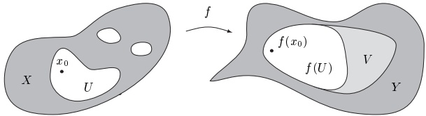
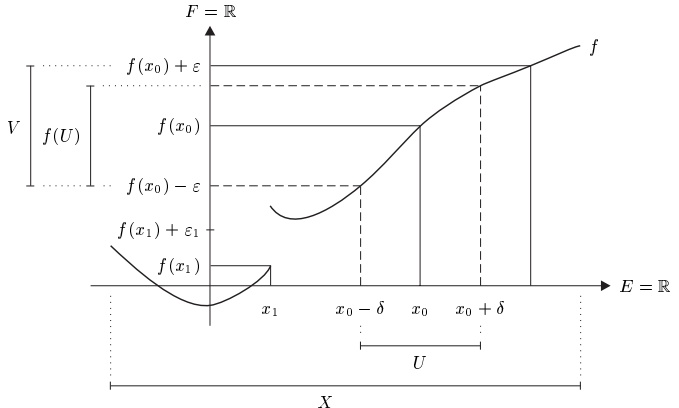

## 1 连续性

经验表明，尽管一般来说函数可能非常复杂且难以描述，但出现在应用中的函数却具有某些重要的定性性质，其中之一就是连续性。对于函数 $ f: X \to Y $，连续（或不连续）度量的是像 $ f(X) \subseteq Y $ 中的“微小变化”如何由定义域 $ X $ 中相应的“微小变化”引起。为使其有意义，集合 $ X $ 与 $ Y $ 必须被赋予某种额外结构，以便能对“微小变化”给出精确的含义。度量空间显然是具备这种额外结构的集合的候选。

##### 基本性质与例子

设 $f: X \to Y$ 是度量空间\footnote{在 $ X $ 中的度量 $ d_X $ 与在 $ Y $ 中的度量 $ d_Y $，我们通常都写作 $ d $。} $(X, d_X)$ 与 $(Y, d_Y)$ 之间的函数。则 $f$ 在 $x_0 \in X$ 处 **连续**，若对 $Y$ 中 $f(x_0)$ 的每个邻域 $V$，存在 $X$ 中 $x_0$ 的邻域 $U$，使得 $f(U) \subseteq V$。

因此，为证明 $f$ 在 $x_0$ 处的连续性，我们假设给定了 $f(x_0)$ 的任意邻域 $V$，然后证明存在 $x_0$ 的邻域 $U$，使得 $f(U) \subseteq V$，即对所有 $x \in U$ 有 $f(x) \in V$。

函数 $f: X \to Y$ 是 **连续的**，若它在 $X$ 的每一点处连续。若 $f$ 在 $x_0$ 处不连续，则称 $f$ 在 $x_0$ 处 **不连续的**。最后，$f$ 是 **不连续的**，若它在 $X$ 的（至少）一点处不连续，即若 $f$ 不连续。从 $X$ 到 $Y$ 的所有连续函数构成的集合记为 $C(X,Y)$。显然 $C(X,Y)$ 是 $Y^X$ 的子集。

连续性的这个定义使用了邻域的概念，因此相当简单。在具体情形中，下面的等价表述往往更有用。

1.1 命题 函数 $ f: X \to Y $ 在 $ x_0 \in X $ 处连续，当且仅当对每个 $ \varepsilon > 0 $，存在某个\footnote{记号 $ \delta := \delta(x_0, \varepsilon) $ 表明 $ \delta $ 一般依赖于 $ x_0 \in X $ 与 $ \varepsilon > 0 $。} $ \delta := \delta(x_0, \varepsilon) > 0 $，满足性质

\[ d\big(f(x_{0}),f(x)\big)<\varepsilon\quad\text{对所有 }x\in X\text{ 使得 }d(x_{0},x)<\delta. \]

证明 ‘$\Rightarrow$’ 设 $f$ 在 $x_0$ 处连续，且 $\varepsilon > 0$。则对于邻域 $V := \mathbb{B}_Y(f(x_0), \varepsilon) \in \mathcal{U}_Y(f(x_0))$，存在某个 $U \in \mathcal{U}_X(x_0)$，使得 $f(U) \subseteq V$。由定义，存在某个 $\delta := \delta(x_0, \varepsilon) > 0$，使得 $\mathbb{B}_X(x_0, \delta) \subseteq U$。因此

\[ f\bigl(\mathbb{B}_{X}(x_{0},\delta)\bigr)\subseteq f(U)\subseteq V=\mathbb{B}_{Y}\bigl(f(x_{0}),\varepsilon\bigr). \]

这些包含关系蕴含 (1.1)。

‘⇐’ 假设 (1.1) 成立，且 $ V \in \mathcal{U}_Y(f(x_0)) $。则存在某个 $ \varepsilon > 0 $，使得 $ \mathbb{B}_Y(f(x_0), \varepsilon) \subseteq V $。由 (1.1)，存在某个 $ \delta > 0 $，使得 $ U := \mathbb{B}_X(x_0, \delta) $ 的像包含于 $ \mathbb{B}_Y(f(x_0), \varepsilon) $，从而也包含于 $ V $。因此 $ f $ 在 $ x_0 $ 处连续。 ■

1.2 推论 设 $E$ 与 $F$ 为赋范向量空间，且 $X \subseteq E$。则 $f: X \to F$ 在 $x_0 \in X$ 处连续，当且仅当对每个 $\varepsilon > 0$，存在某个 $\delta := \delta(x_0, \varepsilon) > 0$，满足

\[ \begin{array}{r l}{\|f(x)-f(x_{0})\|_{F}<\varepsilon}&{{}{\text{对所有 }}x\in X{\text{ 使得 }}\|x-x_{0}\|_{E}<\delta.}\end{array} \]

证明 这直接由赋范向量空间中度量的定义得出。

假设 $E := F := \mathbb{R}$，且函数 $f: X \to \mathbb{R}$ 由下面的图像给出。

则 $f$ 在 $x_0$ 处连续，因为对每个 $\varepsilon > 0$，存在某个 $\delta > 0$，使得 $U := (x_0 - \delta, x_0 + \delta)$ 的像包含于 $V := (f(x_0) - \varepsilon, f(x_0) + \varepsilon)$。

另一方面，不存在 $\delta>0$ 使得对所有 $x\in(x_1,x_1+\delta)$ 都有 $|f(x)-f(x_1)|<\varepsilon_1$，因此 $f$ 在 $x_1$ 处不连续。

1.3 例 在下面的例子中，X 与 Y 都是度量空间。

(a) 平方根函数 $ \mathbb{R}^+ \to \mathbb{R}^+ $，$ x \mapsto \sqrt{x} $ 是连续的。

证明 设 $ x_0 \in \mathbb{R}^+ $，$ \varepsilon > 0 $。若 $ x_0 = 0 $，我们令 $ \delta := \varepsilon^2 > 0 $。则

\[ \left|\sqrt{x}-\sqrt{x_{0}}\right|=\sqrt{x}<\varepsilon,\qquad x\in\left[0,\delta\right). \]

否则 $ x_0 > 0 $，我们取 $ \delta := \delta(x_0, \varepsilon) := \min\{\varepsilon \sqrt{x_0}, x_0\} $。则

\[ \left|\sqrt{x}-\sqrt{x_{0}}\right|=\left|\frac{x-x_{0}}{\sqrt{x}+\sqrt{x_{0}}}\right|<\frac{\left|x-x_{0}\right|}{\sqrt{x_{0}}}\leq\varepsilon \]

对所有 $ x \in (x_0 - \delta, x_0 + \delta) $ 成立。 ■

(b) 下取整函数 $ \lfloor \cdot \rfloor $：$ \mathbb{R} \to \mathbb{R} $，$ x \mapsto \lfloor x \rfloor := \max\{k \in \mathbb{Z} ; k \leq x\} $ 在 $ x_0 \in \mathbb{R} \setminus \mathbb{Z} $ 处连续，而在 $ x_0 \in \mathbb{Z} $ 处不连续。

证明 若 $ x_0 \in \mathbb{R} \backslash \mathbb{Z} $，则存在唯一的 $ k \in \mathbb{Z} $，使得 $ x_0 \in (k, k+1) $。若取 $ \delta := \min\{x_0 - k, k+1 - x_0\} > 0 $，则显然有

\[ |\lfloor x\rfloor-\lfloor x_{0}\rfloor|=0,\qquad x\in(x_{0}-\delta,x_{0}+\delta)~. \]

因此下取整函数 $ \lfloor \cdot \rfloor $ 在 $ x_{0} $ 处连续。

否则，对 $ x_0 \in \mathbb{Z} $，对所有 $ x < x_0 $ 有不等式 $ \left|\lfloor x \rfloor - \lfloor x_0 \rfloor\right| = \lfloor x_0 \rfloor - \lfloor x \rfloor \geq 1 $。故不存在 $ x_0 $ 的邻域 $ U $，使得对所有 $ x \in U $ 都有 $ \left|\lfloor x \rfloor - \lfloor x_0 \rfloor\right| < 1/2 $。即 $ \lfloor \cdot \rfloor $ 在 $ x_0 $ 处不连续。

(c) 狄利克雷函数 $ f: \mathbb{R} \to \mathbb{R} $ 定义为

\[ f(x):=\left\{\begin{array}{l l}{1,}&{\quad x\in\mathbb{Q},}\\ {0,}&{\quad x\in\mathbb{R}\backslash\mathbb{Q},}\end{array}\right. \]

处处不连续，即它在每个 $ x_0 \in \mathbb{R} $ 处都不连续。

证明 设 $ x_0 \in \mathbb{R} $。由于有理数 $ \mathbb{Q} $ 与无理数 $ \mathbb{R} \setminus \mathbb{Q} $ 都在 $ \mathbb{R} $ 中稠密（见命题 I.10.8 与 I.10.11），故在 $ x_0 $ 的每个邻域中都有某个 $ x $，使得 $ |f(x) - f(x_0)| = 1 $。因此 $ f $ 在 $ x_0 $ 处不连续。

(d) 假设 $ f: X \to \mathbb{R} $ 在 $ x_0 \in X $ 处连续，且 $ f(x_0) > 0 $。则存在 $ x_0 $ 的邻域 $ U $，使得对所有 $ x \in U $ 都有 $ f(x) > 0 $。

证明 令 $ \varepsilon := f(x_0)/2 > 0 $。则存在 $ x_0 $ 的邻域 $ U $，使得

\[ f(x_{0})-f(x)\leq|f(x)-f(x_{0})|<\varepsilon=\frac{f(x_{0})}{2},\qquad x\in U. \]

因此对所有 $ x \in U $ 都有 $ f(x) > f(x_0)/2 > 0 $。 ■

(e) 函数 $ f: X \to Y $ 以利普希茨常数 $ \alpha > 0 $ 利普希茨连续，若

\[ d\big(f(x),f(y)\big)\leq\alpha d(x,y)~,\qquad x,y\in X~. \]

每个利普希茨连续函数都是连续的。\footnote{逆命题不成立。见习题 18。}

证明 给定 $ x_0 \in X $ 与 $ \varepsilon > 0 $，令 $ \delta := \varepsilon/\alpha $。则 $ f $ 的连续性由命题 1.1 得出。注意，在此情形中 $ \delta $ 与 $ x_0 \in X $ 无关。

(f) 任何常值函数 $ X \to Y $，$ x \mapsto y_0 $ 都是利普希茨连续的。

(g) 恒等函数 id：$X \to X$，$x \mapsto x$ 是利普希茨连续的。

(h) 若 $ E_1, \ldots, E_m $ 为赋范向量空间，则 $ E := E_1 \times \cdots \times E_m $ 关于例 II.3.3(c) 中的积范数 $ \|\cdot\|_\infty $ 是赋范向量空间。典范投影

\[ \operatorname{pr}_{k}\colon E\to E_{k}~,\quad x=(x_{1},\ldots,x_{m})\mapsto x_{k}~,\qquad1\leq k\leq m~, \]

都是利普希茨连续的。特别地，投影 $ \operatorname{pr}_k : \mathbb{K}^m \to \mathbb{K} $ 是利普希茨连续的。

证明 对 $ x = (x_1, \ldots, x_m) $ 与 $ y = (y_1, \ldots, y_m) $，我们有

\[ \|\operatorname*{p r}_{k}(x)-\operatorname*{p r}_{k}(y)\|_{E_{k}}=\|x_{k}-y_{k}\|_{E_{k}}\leq\|x-y\|_{\infty}, \]

这蕴含 $ \operatorname{pr}_{k} $ 的利普希茨连续性。对于余下的断言，见命题 II.3.12。

(i) 函数 $ z \mapsto \mathrm{Re}(z) $、$ z \mapsto \mathrm{Im}(z) $ 与 $ z \mapsto \overline{z} $ 中的每一个都在 $ \mathbb{C} $ 上利普希茨连续。

证明 这由不等式

\[ \max\left\{\mid\operatorname{Re}(z_{1})-\operatorname{Re}(z_{2})\mid,\mid\operatorname{Im}(z_{1})-\operatorname{Im}(z_{2})\mid\right\}\leq\left|z_{1}-z_{2}\right|=\left|\overline{z}_{1}-\overline{z}_{2}\right|,\qquad z_{1},z_{2}\in\mathbb{C}, \]

得出，而该不等式来自命题 I.11.4。 ■

(j) 设 E 是赋范向量空间。则范数函数

\[ \|\cdot\|\colon E\to\mathbb{R}~,\quad x\mapsto\|x\| \]

是利普希茨连续的。

证明 反向三角形不等式

\[ \mid\|x\|-\|y\|\mid\leq\|x-y\|,\qquad x,y\in E, \]

蕴含该断言。 ■

(k) 若 $ A \subseteq X $ 且 $ f: X \to Y $ 在 $ x_0 \in A $ 处连续，则 $ f|A: A \to Y $ 在 $ x_0 $ 处连续。这里 $ A $ 具有由 $ X $ 诱导的度量。

证明 这直接由 f 的连续性以及诱导度量的定义得出。

(I) 设 $ M \subseteq X $ 是 $ X $ 的非空子集。对每个 $ x \in X $，

\[ d(x,M):=\inf_{m\in M}d(x,m) \]

称为 x 到 M 的距离。距离函数

\[ d(\cdot,M):X\to\mathbb{R}~,\quad x\mapsto d(x,M) \]

是利普希茨连续的。

证明 设 $ x, y \in X $。由三角形不等式，对每个 $ m \in M $ 有 $ d(x, m) \leq d(x, y) + d(y, m) $。由于对所有 $ m \in M $ 有 $ d(x, M) \leq d(x, m) $，这蕴含

\[ d(x,M)\leq d(x,y)+d(y,m)~,\qquad m\in M~. \]

对所有 $ m \in M $ 取下确界，得

\[ d(x,M)\leq d(x,y)+d(y,M). \]

将此等式与 x 和 y 互换后所得的同一等式结合，得

\[ |d(x,M)-d(y,M)|\leq d(x,y), \]

这证明了 $ d(\cdot, M) $ 的利普希茨连续性。 ■

(m) 对任何内积空间 $ (E, (\cdot|\cdot)) $，标量积 $ (\cdot|\cdot): E \times E \to \mathbb{K} $ 是连续的。

证明 设 $ (x, y), (x_0, y_0) \in E \times E $，且 $ \varepsilon \in (0, 1) $。由三角形不等式与柯西-施瓦茨不等式，得

\[ \begin{align*}\left|(x|y)-(x_{0}|y_{0})\right|&\leq\left|(x-x_{0}|y)\right|+\left|(x_{0}|y-y_{0})\right|\\&\leq\|x-x_{0}\|\|y\|+\|x_{0}\|\|y-y_{0}\|\\&\leq d\big((x,y),(x_{0},y_{0})\big)\left(\|y\|+\|x_{0}\|\right)\\&\leq d\big((x,y),(x_{0},y_{0})\big)\left(\|x_{0}\|+\|y_{0}\|+\|y-y_{0}\|\right),\end{align*} \]

其中 $d$ 是积度量。令 $M := \max\{1, \|x_0\|, \|y_0\|\}$，且 $\delta := \varepsilon/(1 + 2M)$。则对所有 $(x, y) \in \mathbb{B}_{E \times E}((x_0, y_0), \delta)$，由上述不等式得

\[ \left|\left(x\mid y\right)-\left(x_{0}\mid y_{0}\right)\right|<\delta(2M+\delta)<\varepsilon, \]

这证明了标量积在点 $ (x_{0}, y_{0}) $ 处的连续性。 ■

(n) 设 $E$ 与 $F$ 为赋范向量空间，且 $X \subseteq E$。则 $f: X \to F$ 在 $x_0 \in X$ 处的连续性与 $E$ 及 $F$ 上等价范数的选取无关。

证明 这容易由推论 1.2 得出。

(o) 度量空间 $X$ 与 $Y$ 之间的函数 $f$ 是等距的（或称为等距映射），若对所有 $x, x' \in X$ 有 $d(f(x), f(x')) = d(x, x')$，即若 $f$ “保持距离”。显然，这样的函数是利普希茨连续的，并且是从 $X$ 到其像 $f(X)$ 的双射。若 $E$ 与 $F$ 为赋范向量空间且 $T: E \to F$ 线性，则 $T$ 等距当且仅当对所有 $x \in E$ 有 $\|Tx\| = \|x\|$。若此外 $T$ 还是满射，则 $T$ 是从 $E$ 到 $F$ 的等距同构，且 $T^{-1}$ 也是等距的。

##### 序列连续性

邻域概念对连续性的定义和序列收敛的定义都是核心的。这提示我们，函数的连续性可以用序列来定义：度量空间 $ X $ 与 $ Y $ 之间的函数 $ f: X \to Y $ 在 $ x \in X $ 处称为 **序列连续的**，若对 $ X $ 中每个满足 $ \lim x_k = x $ 的序列 $ (x_k) $，都有 $ \lim f(x_k) = f(x) $。

1.4 定理（序列准则） 设 $X, Y$ 为度量空间。则函数 $f: X \to Y$ 在 $x$ 处连续，当且仅当它在 $x$ 处序列连续。

证明 ‘$\Rightarrow$’ 设 $(x_k)$ 是 $X$ 中满足 $x_k \to x$ 的序列。设 $V$ 是 $Y$ 中 $f(x)$ 的邻域。由假设，存在 $X$ 中 $x$ 的邻域 $U$，使得 $f(U) \subseteq V$。由于 $x_k \to x$，存在某个 $N \in \mathbb{N}$，使得对所有 $k \geq N$ 有 $x_k \in U$。因此对所有 $k \geq N$ 有 $f(x_k) \in V$，即 $f(x_k)$ 收敛到 $f(x)$。

‘⇐’ 反设 $f$ 序列连续但在 $x$ 处不连续。则存在 $f(x)$ 的邻域 $V$，使得 $x$ 的任何邻域 $U$ 都不满足 $f(U) \subseteq V$。特别地，我们有

\[ f\left(\mathbb{B}(x,1/k)\right)\cap V^{c}\neq\emptyset,\qquad k\in\mathbb{N}^{\times}. \]

因此，对每个 $ k \in \mathbb{N}^\times $，我们可取某个 $ x_k \in X $，使得 $ d(x, x_k) < 1/k $ 且 $ f(x_k) \notin V $。按构造，$ (x_k) $ 收敛到 $ x $，但 $ (f(x_k)) $ 不收敛到 $ f(x) $。这与 $ f $ 的序列连续性矛盾。 $ \blacksquare $

设 $f: X \to Y$ 是度量空间之间的连续函数。则对 $X$ 中任何收敛序列 $(x_{k})$，有

\[ \lim f(x_{k})=f(\lim x_{k}). \]

因此人们说“连续函数与取极限运算可交换”。

##### 连续函数的加法与乘法

定理 1.4 使我们能够把关于收敛序列的定理应用于连续函数。为此，先引入几个定义是有益的。

设 $M$ 为任意集合，$F$ 为向量空间。设 $f$ 与 $g$ 是满足 $\mathrm{dom}(f)$, $\mathrm{dom}(g) \subseteq M$ 且取值于 $F$ 的函数。则 $f$ 与 $g$ 的 $\text{和}$ 是由下式定义的函数 $f + g$：

\[ f+g\colon\operatorname{d o m}(f+g):=\operatorname{d o m}(f)\cap\operatorname{d o m}(g)\to F~,\quad x\mapsto f(x)+g(x)~. \]

类似地，对 $ \lambda \in \mathbb{K} $，我们定义 $ \lambda f $ 为\footnote{若 $ f $ 与 $ g $ 定义在整个 $ M $ 上，则 $ f + g $ 与 $ \lambda f $ 的定义与例 I.12.3(e) 中的定义一致。}

\[ \lambda f:\operatorname{dom}(f)\to F,\quad x\mapsto\lambda f(x). \]

最后，在特殊情形 $F = \mathbb{K}$ 中，我们令

\[ \mathrm{dom}(f\cdot g):=\mathrm{dom}(f)\cap\mathrm{dom}(g), \]

\[ \mathrm{dom}(f/g):=\mathrm{dom}(f)\cap\left\{x\in\mathrm{dom}(g);g(x)\neq0\right\}, \]

并将 f 与 g 的乘积与商定义为

\[ f\cdot g:\mathrm{dom}(f\cdot g)\to\mathbb{K},\quad x\mapsto f(x)\cdot g(x) \]

以及

\[ f/g\colon\operatorname{d o m}(f/g)\to\mathbb{K}~,\quad x\mapsto f(x)/g(x)\enspace. \]

1.5 命题 假设 X 是度量空间，F 是赋范向量空间，且

\[ f:\operatorname{dom}(f)\subseteq X\to F~,\quad g:\operatorname{dom}(g)\subseteq X\to F \]

都在 $ x_0 \in \mathrm{dom}(f) \cap \mathrm{dom}(g) $ 处连续。

(i) $ f + g $ 与 $ \lambda f $ 在 $ x_{0} $ 处连续。

(ii) 若 $ F = \mathbb{K} $，则 $ f \cdot g $ 在 $ x_0 $ 处连续。

(iii) 若 $ F = \mathbb{K} $ 且 $ g(x_0) \neq 0 $，则 $ f/g $ 在 $ x_0 $ 处连续。

证明 这些断言由定理 1.4 的序列准则、命题 II.2.2 与注 II.3.1(c)，以及命题 II.2.4(ii)、II.2.6 与例 1.3(d) 得出。

1.6 推论

(i) 有理函数是连续的。

(ii) $n$ 元多项式是连续的（在 $\mathbb{K}^{n}$ 上）。

(iii) $ C(X,F) $ 是 $ F^X $ 的子空间，即从 X 到 F 的连续函数\footnote{在不致引起混淆时，我们常把 $ C(X, \mathbb{K}) $ 写作 $ C(X) $。}构成的向量空间。

证明 断言 (i) 与 (iii) 是命题 1.5 的直接结论。对于 (ii)，还需要例 1.3(h)。

1.7 命题 设 $ a = \sum a_k X^k $ 是收敛半径 $ \rho_a $ 为正的幂级数。则由 $ a $ 表示的函数 $ \underline{a} $ 在 $ \rho_a $ $ \mathbb{B} $ 上连续。

证明 设 $ x_0 \in \rho_a \mathbb{B}_{\mathbb{C}} $，$ \varepsilon > 0 $，且 $ |x_0| < r < \rho_a $。由定理 II.9.2，级数 $ \sum |a_k| r^k $ 收敛，故存在某个 $ K \in \mathbb{N} $，使得

\[ \sum_{k=K+1}^{\infty}\left|a_{k}\right|r^{k}<\varepsilon/4. \]

因此，对 $ |x| \leq r $，我们有

\[ \begin{align*}|\underline{a}(x)-\underline{a}(x_{0})|&\leq\left|\sum_{k=0}^{K}a_{k} x^{k}-\sum_{k=0}^{K}a_{k} x_{0}^{k}\right|+\sum_{k=K+1}^{\infty}|a_{k}|\left|x\right|^{k}+\sum_{k=K+1}^{\infty}|a_{k}|\left|x_{0}\right|^{k}\\&\leq|p(x)-p(x_{0})|+2\sum_{k=K+1}^{\infty}|a_{k}|r^{k},\end{align*} \]

其中我们已令

\[ p:=\sum_{k=0}^{K}a_{k}X^{k}\in\mathbb{C}[X]~. \]

由推论 1.6，存在某个 $ \delta \in (0, r - |x_0|) $，使得

\[ |p(x)-p(x_{0})|<\varepsilon/2~,\qquad|x-x_{0}|<\delta~. \]

结合 (1.2) 与 (1.3)，这蕴含对所有 $ |x - x_0| < \delta $ 有 $ |\underline{a}(x) - \underline{a}(x_0)| < \varepsilon $。由于 $ \mathbb{B}(x_0, \delta) \subseteq \rho_a \mathbb{B}_{\mathbb{C}} $，我们已证明该断言。 $ \blacksquare $

下面这个重要定理往往为某些函数的连续性提供简单的证明。我们将在定理之后的例子中加以说明。

1.8 定理（复合的连续性） 设 $X$、$Y$ 与 $Z$ 为度量空间。假设 $f: X \to Y$ 在 $x \in X$ 处连续，$g: Y \to Z$ 在 $f(x) \in Y$ 处连续。则复合 $g \circ f: X \to Z$ 在 $x$ 处连续。

证明 设 $W$ 是 $Z$ 中 $g \circ f(x) = g(f(x))$ 的邻域。由于 $g$ 在 $f(x)$ 处连续，存在 $Y$ 中 $f(x)$ 的邻域 $V$，使得 $g(V) \subseteq W$。由于 $f$ 在 $x$ 处连续，存在 $X$ 中 $x$ 的邻域 $U$，使得 $f(U) \subseteq V$。因此

\[ g\circ f(U)=g\bigl(f(U)\bigr)\subseteq g(V)\subseteq W~, \]

由此即得断言。 ■

1.9 例 在下文中，X 是度量空间，E 是赋范向量空间。

(a) 设 $ f: X \to E $ 在 $ x_0 $ 处连续。则 $ f $ 的范数

\[ \left\|f\right\|:X\to\mathbb{R},\quad x\mapsto\left\|f(x)\right\|, \]

在 $ x_{0} $ 处连续

证明 由例 1.3(j)，$ \|\cdot\|: E \to \mathbb{R} $ 是利普希茨连续的。由于 $ \|f\| = \|\cdot\| \circ f $，该断言由定理 1.8 得出。

(b) 设 $ g: \mathbb{R} \to X $ 连续。则函数 $ \widehat{g}: E \to X $，$ x \mapsto g(\|x\|) $ 是连续的。

证明 只需注意到 $ \widehat{g} = g \circ \|\cdot\| $ 是连续函数的复合。

(c) 定理 1.8 的逆命题不成立，即 $ g \circ f $ 的连续性并不蕴含 f 或 g 连续。

证明 令 $ Z := [-3/2, -1/2] \cup (1/2, 3/2] $ 与 $ I := [-1, 1] $。定义函数 $ f: Z \to \mathbb{R} $ 与 $ g: I \to \mathbb{R} $ 如下：

\[ f(x):=\left\{\begin{array}{l l}{x+1/2\;,}&{\quad x\in\left[-3/2,-1/2\right],}\\ {x-1/2\;,}&{\quad x\in\left(1/2,3/2\right],}\end{array}\right. \]

以及

\[ g(y):=\left\{\begin{array}{l l}{y-1/2\;,}&{\quad y\in\left[-1,0\right],}\\ {y+1/2\;,}&{\quad y\in\left(0,1\right].}\end{array}\right. \]

不难验证 $ f: Z \to \mathbb{R} $ 连续，而 $ g: I \to \mathbb{R} $ 在 0 处不连续，但复合 $ f \circ g = \mathrm{id}_I $ 与 $ g \circ f = \mathrm{id}_Z $ 都连续。我们把构造 $ f $ 也不连续的类似例子的任务留给读者。

(d) 函数 $ f: \mathbb{R} \to \mathbb{R} $，$ x \mapsto 1 / \sqrt{1 + x^2} $ 是连续的。

证明 由于 $ 1/\sqrt{1+x^2} = \sqrt{1/(1+x^2)} $，该断言由推论 1.6.(i)、命题 1.5.(iii)、定理 1.8 与例 1.3(a) 得出。

(e) 指数函数 $ \exp: \mathbb{C} \to \mathbb{C} $ 是连续的。

证明 这由命题 1.7 与例 II.9.5(a) 得出。 ■

1.10 命题 设 $X$ 为度量空间。则从 $X$ 到 $\mathbb{K}^m$ 的函数 $f = (f_1, \ldots, f_m)$ 在 $x$ 处连续，当且仅当对每个 $k$，$f_k: X \to \mathbb{K}$ 在 $x$ 处连续。特别地，$f: X \to \mathbb{C}$ 在 $x$ 处连续，当且仅当 $\operatorname{Re} f$ 与 $\operatorname{Im} f$ 在 $x$ 处连续。

证明 设 $ (x_n) $ 是 X 中满足 $ x_n \to x $ 的序列。由命题 II.3.14，我们有

\[ f(x_{n})\to f(x)\iff f_{k}(x_{n})\to f_{k}(x),~k=1,\ldots,m~. \]

该断言现由序列准则得出。 ■

##### 单侧连续性

设 $X$ 是 $\mathbb{R}$ 的子集，且 $x_0 \in X$。$\mathbb{R}$ 的序结构使我们能考虑 $x_0$ 的单侧邻域。具体地，对 $\delta > 0$，集合 $X \cap (x_0 - \delta, x_0]$（或 $X \cap [x_0, x_0 + \delta)$）称为 $x_0$ 的左（或右）$\delta$-邻域。

现在设 $Y$ 为度量空间。则 $f: X \to Y$ 在 $x_0$ 处左（或右）连续，若对 $Y$ 中 $f(x_0)$ 的每个邻域 $V$，存在某个 $\delta > 0$，使得 $f(X \cap (x_0 - \delta, x_0]) \subseteq V$（或 $f(X \cap [x_0, x_0 + \delta)) \subseteq V$）。

与命题 1.1 一样，只需考虑 $Y$ 中 $f(x_0)$ 的 $\varepsilon$-邻域，即 $f: X \to Y$ 在 $x_0$ 处左（或右）连续，当且仅当对每个 $\varepsilon > 0$，存在某个 $\delta > 0$，使得对 $x$ 的左（或右）$\delta$-邻域中的所有 $x$，有 $d(f(x_0), f(x)) < \varepsilon$。

显然，连续函数既左连续又右连续。另一方面，单侧连续性并不蕴含连续性，如下面的例子所示。

1.11 例 (a) 下取整函数 $ \lfloor \cdot \rfloor $：$ \mathbb{R} \to \mathbb{R} $ 在 $ x \in \mathbb{R} \setminus \mathbb{Z} $ 处连续，而在 $ x \in \mathbb{Z} $ 处右连续但不左连续。

(b) 函数

\[ \mathrm{s i g n}:\mathbb{R}\to\mathbb{R}\;,\quad x\mapsto\left\{\begin{array}{r l}{-1\;,}&{\quad x<0\;,}\\ {0\;,}&{\quad x=0\;,}\\ {1\;,}&{\quad x>0\;,}\\ \end{array}\right. \]

在 0 处既非左连续也非右连续。

下一个命题把定理 1.4 的序列准则推广到单侧连续函数。

1.12 命题 设 $ Y $ 为度量空间，$ X \subseteq \mathbb{R} $，且 $ f: X \to Y $。则下列命题等价：

(i) f 在 $ x \in X $ 处左（或右）连续。

(ii) 对 X 中每个满足 $ x_n \to x $ 且 $ x_n \leq x $（或 $ x_n \geq x $）的序列 $ (x_n) $，序列 $ (f(x_n)) $ 收敛到 $ f(x) $。

证明 该断言的证明与定理 1.4 的证明类似。

单侧连续性也可用于刻画连续性。

1.13 命题 设 $ Y $ 为度量空间，$ X \subseteq \mathbb{R} $，且 $ f: X \to Y $。则下列命题等价：

(i) f 在 $ x_{0} $ 处连续。

(ii) f 在 $ x_{0} $ 处左连续且右连续。

证明 蕴含关系 $\Rightarrow$ 是显然的。

$\Leftarrow$ 设 $\varepsilon > 0$。由 $f$ 在 $x_0$ 处的左连续性与右连续性，存在正数 $\delta^-$ 与 $\delta^+$，使得对所有 $x \in X \cap (x_0 - \delta^-, x_0]$ 与 $x \in X \cap [x_0, x_0 + \delta^+)$，有 $d(f(x), f(x_0)) < \varepsilon$。令 $\delta := \min\{\delta^-, \delta^+\}$。则对所有 $x \in X \cap (x_0 - \delta, x_0 + \delta)$，有 $d(f(x), f(x_0)) < \varepsilon$。因此 $f$ 在 $x_0$ 处连续。

##### 习题

1 锯齿形函数： $ \mathbb{R} \to \mathbb{R} $ 定义为

\[ \operatorname{z i g z a g}(x):=\left|\left\lfloor x+1/2\right\rfloor-x\right|\mathrm{~,~}\quad x\in\mathbb{R}\mathrm{~,~} \]

其中 $ \lfloor\cdot\rfloor $ 是下取整函数。画出锯齿形的图像，并证明以下结论：

(a) 锯齿形(x) = |x| 对所有 |x| ≤ 1/2 成立。

(b) 锯齿形 $ (x + n) = \text{zigzag}(x) $，$ x \in \mathbb{R} $，$ n \in \mathbb{Z} $。

(c) 锯齿形是连续的。

2 设 $ q \in \mathbb{Q} $。证明函数 $ (0, \infty) \to (0, \infty) $，$ x \mapsto x^q $ 是连续的。\footnote{在第 6 节中，我们将更一般地研究函数 $ x \mapsto x^q $。}（提示：见习题 II.2.7。）

3 设 $ \varphi: \mathbb{R} \to (-1,1) $，$ x \mapsto x/(1+|x|) $。证明 $ \varphi $ 是双射，且 $ \varphi $ 与 $ \varphi^{-1} $ 连续。

4 证明或反驳函数

\[ f:\mathbb{Q}\to\mathbb{R},\quad x\mapsto\left\{\begin{array}{ll}0,&x<\sqrt{2},\\1,&x>\sqrt{2},\end{array}\right. \]

是连续的。

5 设 $d_1$ 与 $d_2$ 是 $X$ 上的度量，且 $X_j := (X, d_j)$，$j = 1, 2$。则若对每个 $x \in X$ 有 $\mathcal{U}_{X_1}(x) \supseteq \mathcal{U}_{X_2}(x)$，即若每点具有比 $d_2$ 邻域更多的 $d_1$ 邻域，则称 $d_1$ 强于 $d_2$。此时也称 $d_2$ 弱于 $d_1$。

证明以下结论：

(a) $ d_1 $ 强于 $ d_2 $，当且仅当恒等函数 $ i: X_1 \to X_2 $，$ x \mapsto x $ 是连续的。

(b) $ d_1 $ 与 $ d_2 $ 等价，当且仅当 $ d_1 $ 既强于又弱于 $ d_2 $，即对每个 $ x \in X $，$ \mathcal{U}_{X_1}(x) = \mathcal{U}_{X_2}(x) $。

6 设 $ f: \mathbb{R} \to \mathbb{R} $ 是加法群 ($ \mathbb{R},+ $) 的连续\footnote{可以证明，$ (\mathbb{R}, +) $ 存在不连续的同态（见第 III 卷习题 IX.5.6）。}同态。证明 $ f $ 是线性的，即存在某个 $ a \in \mathbb{R} $，使得 $ f(x) = ax $，$ x \in \mathbb{R} $。（提示：证明对所有 $ q \in \mathbb{Q} $ 有 $ f(q) = qf(1) $，并利用命题 I.10.8。）

7 设 $ f: \mathbb{R} \to \mathbb{R} $ 定义为

\[ f(x):=\left\{\begin{array}{c c}{-1,}&{x\geq1,}\\ {1/n,}&{1/(n+1)\leq x<1/n,}\\ {0,}&{x\leq0.}\\ \end{array}\right.n\in\mathbb{N}^{\times}, \]

f 在何处连续？在何处左连续？在何处右连续？

8 假设 $X$ 是度量空间，且 $f, g \in \mathbb{R}^X$ 在 $x_0$ 处连续。证明或反驳\footnote{见例 I.4.4(c)。}

\[ |f|,\quad f^{+}:=0\lor f,\quad f^{-}:=0\lor\left(-f\right),\quad f\lor g,\quad f\land g \]

都在 $ x_{0} $ 处连续。（提示：例 1.3(j) 与习题 I.8.11。）

9 设 $ f: \mathbb{R} \to \mathbb{R} $ 与 $ g: \mathbb{R} \to \mathbb{R} $ 定义为

\[ f(x):=\left\{\begin{array}{r l}{1\quad,\quad}&{x\text{ 为有理数},}\\ {-1\quad,\quad}&{x\text{ 为无理数},}\end{array}\right.\quad g(x):=\left\{\begin{array}{r l}{x\quad,\quad}&{x\text{ 为有理数},}\\ {-x\quad,\quad}&{x\text{ 为无理数}.}\end{array}\right. \]

函数 $f$、$g$、$|f|$、$|g|$ 与 $f \cdot g$ 在何处连续？

10 设 $ f: \mathbb{R} \to \mathbb{R} $ 定义为

\[ f(x):=\left\{\begin{array}{c l}{1/n\;,}&{\quad x\in\mathbb{Q}\text{ 且 }x=m/n\text{ 为最简分数}\;,}\\ {0\;,}&{\quad x\in\mathbb{R}\backslash\mathbb{Q}\;.}\end{array}\right. \]

证明 $f$ 在每个无理数处连续，而在每个有理数处不连续。\footnote{可以证明，不存在从 $ \mathbb{R} $ 到 $ \mathbb{R} $ 的函数，它在每个有理数处连续而在每个无理数处不连续（见习题 V.4.5）。}（提示：对每个 $x \in \mathbb{Q}$，由命题 I.10.11，存在序列 $x_n \in \mathbb{R} \setminus \mathbb{Q}$，使得 $x_n \to x$。因此 $f$ 不能在 $x$ 处连续。

设 $ x \in \mathbb{R} \setminus \mathbb{Q} $，且 $ \varepsilon > 0 $。则只有有限多个 $ n \in \mathbb{N} $ 满足 $ n \leq 1/\varepsilon $。因此存在某个 $ \delta > 0 $，使得任何满足 $ n \leq 1/\varepsilon $ 的 $ q = m/n $ 都不在 $ (x - \delta, x + \delta) $ 中。即对 $ y = m/n \in (x - \delta, x + \delta) $，有 $ f(y) = f(m/n) = 1/n < \varepsilon $。

11 考虑函数

\[ f:\mathbb{R}^{2}\to\mathbb{R},\quad(x,y)\mapsto\left\{\begin{array}{c l}{x y/(x^{2}+y^{2}),}&{\quad(x,y)\neq(0,0),}\\ {0,}&{\quad(x,y)=(0,0),}\\ \end{array}\right. \]

并对固定的 $ x_0 \in \mathbb{R} $，定义

\[ f_{1}\colon\mathbb{R}\to\mathbb{R}~,\quad x\mapsto f(x,x_{0})~,\qquad f_{2}\colon\mathbb{R}\to\mathbb{R}~,\quad x\mapsto f(x_{0},x)~. \]

证明以下结论：

(a) $ f_{1} $ 与 $ f_{2} $ 是连续的。

(b) $f$ 在 $\mathbb{R}^2 \setminus \{(0,0)\}$ 上连续，而在 $(0,0)$ 处不连续。（提示：对零序列 $(x_n)$，考虑 $f(x_n, x_n)$。）

12 证明从 $ \mathbb{K}^n $ 到 $ \mathbb{K}^m $ 的任何线性函数都是利普希茨连续的。（提示：利用命题 II.3.12 与适当的范数。）

13 假设 $V$ 与 $W$ 是赋范向量空间，且 $f: V \to W$ 是从 $(V,+)$ 到 $(W,+)$ 的连续群同态。证明 $f$ 是线性的。（提示：若 $\mathbb{K} = \mathbb{R}$，$x \in V$ 且 $q \in \mathbb{Q}$，则 $f(qx) = qf(x)$。另见习题 6。）

14 设 $ (E, (\cdot|\cdot)) $ 是内积空间，且 $ x_0 \in E $。证明函数

\[ E\to\mathbb{K}~,\quad x\mapsto(x\left|x_{0}\right)~,~\quad E\to\mathbb{K}~,\quad x\mapsto(x_{0}\left|x\right) \]

是连续的。

15 设 $ A \in \mathrm{End}(\mathbb{K}^n) $。证明函数

\[ \mathbb{K}^{n}\to\mathbb{K},\quad x\mapsto(A x\mid x) \]

是连续的。（提示：利用习题 12 与柯西-施瓦茨不等式。）

16 设 $ n \in \mathbb{N}^\times $。矩阵 $ A = [a_{jk}] \in \mathbb{K}^{n \times n} $ 的行列式定义为（见习题 I.9.6）

\[ \det A=\sum_{\sigma\in\mathsf{S}_{n}}(\mathrm{sign}\sigma)a_{1\sigma(1)}\cdot\cdots\cdot a_{n\sigma(n)}. \]

证明函数

\[ \mathbb{K}^{n\times n}\to\mathbb{K}~,\quad A\mapsto\det A \]

是连续的（见习题 II.3.14）。（提示：利用双射

\[ \mathbb{K}^{m\times n}\to\mathbb{K}^{m n},\quad\left[\begin{array}{c c c}{a_{11},}&{\ldots,}&{a_{1n}}\\ {\vdots}&{}&{\vdots}\\ {a_{m1},}&{\ldots,}&{a_{m n}}\\ \end{array}\right]\mapsto\left(a_{11},\ldots,a_{1n},a_{21},\ldots,a_{m n}\right) \]

来定义 $ \mathbb{K}^{m\times n} $ 上的自然拓扑。）

17 设 $X$ 与 $Y$ 为度量空间，且 $f: X \to Y$。对 $x \in X$，函数

\[ \omega_{f}(x,\cdot):(0,\infty)\to\mathbb{R}~,\quad\varepsilon\mapsto\sup_{y,z\in\mathbb{B}(x,\varepsilon)}d\big(f(y),f(z)\big) \]

称为 f 的连续模。令

\[ \omega_{f}(x):=\inf_{\varepsilon>0}\omega_{f}(x,\varepsilon). \]

证明 f 在 x 处连续，当且仅当 $ \omega_{f}(x)=0 $。

18 证明平方根函数 $ w: \mathbb{R}^+ \to \mathbb{R} $，$ x \mapsto \sqrt{x} $ 连续但不利普希茨连续。证明对每个 $ a > 0 $，$ w \mid [a, \infty) $ 是利普希茨连续的。

