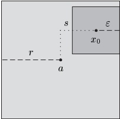
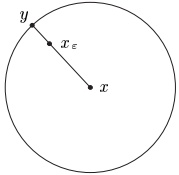
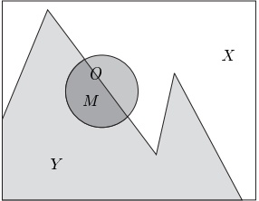

## 2 拓扑基础

为了更深入地理解连续函数，我们在本节引入拓扑空间的一些基本概念。主要结果是定理 2.20，它把连续函数刻画为拓扑空间之间保持结构的函数。

##### 开集

在下文中，$X := (X, d)$ 是一个度量空间。若 $X$ 的子集 $A$ 的元素 $a$ 存在一个邻域 $U$ 使得 $U \subseteq A$，则称 $a$ 为 $A$ 的内点。若 $A$ 的每个点都是内点，则称集合 $A$ 是开集。

2.1 注 (a) 显然，$ a $ 是 $ A $ 的内点当且仅当存在某个 $ \varepsilon > 0 $ 使得 $ \mathbb{B}(a, \varepsilon) \subseteq A $。

(b) A 是开集当且仅当 A 是其每个点的邻域。

2.2 例 开球 $ \mathbb{B}(a, r) $

证明 对 $x_0 \in \mathbb{B}(a, r)$，令 $s := d(x_0, a)$。则 $\varepsilon := r - s$ 是正的。对所有 $x \in \mathbb{B}(x_0, \varepsilon)$，我们有

 \[ d(x,a)\leq d(x,x_{0})+d(x_{0},a)<\varepsilon+s=r, \] 

因此 $\mathbb{B}(x_0,\varepsilon)$ 包含于 $\mathbb{B}(a,r)$。这表明 $x_0$ 是 $\mathbb{B}(a,r)$ 的内点。$\blacksquare$

2.3 注 (a) “内点”与“开集”这两个概念依赖于周围的度量空间 $X$。有时把这一点明确说出是有用的，即“$a$ 是 $A$ 关于 $X$ 的内点，或“$A$ 在 $X$ 中是开集”。

例如，$\mathbb{R}$ 中的开球，即开区间 $J$，由前例可知在 $\mathbb{R}$ 中是开集。然而，若我们把 $\mathbb{R}$ 视为嵌入到 $\mathbb{R}^2$ 中，则 $J$ 在 $\mathbb{R}^2$ 中不是开集。

(b) 设 $ X = (X, \|\cdot\|) $ 是赋范向量空间，$ \|\cdot\|_1 $ 与 $ \|\cdot\| $ 是 $ X $ 上的等价范数。则由注 II.3.13(d)，

 \[ A\text{ 是 }(X,\|\cdot\|)\text{ 中的开集}\Longleftrightarrow A\text{ 是 }(X,\|\cdot\|_{1})\text{ 中的开集}. \] 

因此，若 A 关于某个特定范数是开集，则它关于所有等价范数都是开集。

(c) 由例 2.2 可得，度量空间中的每个点都有开邻域。

2.4 命题 设 $ \mathcal{T} := \{O \subseteq X; O \text{ 是开集}\} $ 是开集族。

(i) $ \emptyset, X \in \mathcal{T} $。

(ii) 若对所有 $ \alpha \in \mathbb{A} $ 有 $ O_\alpha \in \mathcal{T} $，则 $ \bigcup_\alpha O_\alpha \in \mathcal{T} $。也就是说，开集的任意并是开集。

(iii) 若 $ O_0, \ldots, O_n \in \mathcal{T} $，则 $ \bigcap_{k=0}^{n} O_k \in \mathcal{T} $。也就是说，开集的有限交是开集。

证明 (i) 显然 $ X $ 在 $ \mathcal{T} $ 中，而由注 I.2.1(a)，$\emptyset$ 也是开集。

(ii) 设 $ \mathbf{A} $ 是指标集，对所有 $ \alpha \in \mathbf{A} $ 有 $ O_\alpha \in \mathcal{T} $，且 $ x_0 $ 是 $ \bigcup_\alpha O_\alpha $ 的一个点。则存在某个 $ \alpha_0 \in \mathbf{A} $ 使得 $ x_0 \in O_{\alpha_0} $。由于 $ O_{\alpha_0} $ 是开集，存在 $ x_0 $ 在 $ X $ 中的某个邻域 $ U $ 使得 $ U \subseteq O_{\alpha_0} \subseteq \bigcup_\alpha O_\alpha $。因此 $ \bigcup_\alpha O_\alpha $ 是开集。

(iii) 设 $O_0, \ldots, O_n \in \mathcal{T}$ 且 $x_0 \in \bigcap_{k=0}^n O_k$。则存在正数 $\varepsilon_k$ 使得对 $k = 0, \ldots, n$ 有 $\mathbb{B}(x_0, \varepsilon_k) \subseteq O_k$。令 $\varepsilon := \min\{\varepsilon_0, \ldots, \varepsilon_n\} > 0$。则 $\mathbb{B}(x_0, \varepsilon)$ 包含于每个 $O_k$，从而 $\mathbb{B}(x_0, \varepsilon) \subseteq \bigcap_{k=0}^n O_k$。

命题 2.4 的性质 (i)–(iii) 涉及集合运算 $ \bigcup $ 与 $ \bigcap $，但不涉及度量。这提示我们对度量空间的概念作如下推广：设 $ M $ 是一个集合，$ \mathcal{T} \subseteq \mathcal{P}(M) $ 是满足 (i)–(iii) 的子集族。则 $ \mathcal{T} $ 称为 $ M $ 上的一个拓扑，$ \mathcal{T} $ 的元素称为关于 $ \mathcal{T} $ 的开集。最后，二元组 $ (M, \mathcal{T}) $ 称为拓扑空间。

2.5 注 (a) 设 $ \mathcal{T} \subseteq \mathcal{P}(X) $ 是命题 2.4 中的集合族。则 $ \mathcal{T} $ 称为由度量 $ d $ 在 $ X $ 上诱导的拓扑。若 $ X $ 是带有由范数诱导的度量的赋范向量空间，则 $ \mathcal{T} $ 称为范数拓扑。

(b) 设 $(X,\|\cdot\|)$ 是赋范向量空间，$\|\cdot\|_1$ 是 $X$ 上与 $\|\cdot\|$ 等价的范数。设 $\mathcal{T}_{\|\cdot\|}$ 与 $\mathcal{T}_{\|\cdot\|_1}$ 分别是由 $(X,\|\cdot\|)$ 与 $(X,\|\cdot\|_1)$ 诱导的范数拓扑。由注 2.3(b)，$\mathcal{T}_{\|\cdot\|}$ 与 $\mathcal{T}_{\|\cdot\|_1}$ 重合，也就是说，等价范数在 $X$ 上诱导相同的拓扑。

##### 闭集

度量空间 X 的子集 A 称为在 X 中是闭集，若 $ A^{c} $ 在 X 中是开集\footnote{注意，$ A $ 不是开集并\textbf{不}蕴含 $ A $ 是闭集。例如，设 $ X := \mathbb{R} $ 与 $ A := [0, 1) $。则 $ A $ 在 $ \mathbb{R} $ 中既不是开集也不是闭集。}。

2.6 命题

(i) $ \emptyset $ 与 X 是闭集。

(ii) 闭集的任意交是闭集。

(iii) 闭集的有限并是闭集。

证明 这些断言容易由命题 2.4 与命题 I.2.7(iii) 得出。

2.7 注 (a) 开集的无限交不必是开集。

证明 例如，在 $ \mathbb{R} $ 中有 $ \bigcap_{n=1}^{\infty} \mathbb{B}(0,1/n) = \{0\} $。$ \blacksquare $

(b) 闭集的无限并不必是闭集。

证明 例如，在 $ \mathbb{R} $ 中有 $ \bigcup_{n=1}^{\infty}\left[\mathbb{B}(0,1/n)\right]^{c}=\mathbb{R}^{\times} $。$ \blacksquare $

设 $ A \subseteq X $ 且 $ x \in X $。若 $ x $ 在 $ X $ 中的每个邻域都与 $ A $ 有非空交集，则称 $ x $ 为 $ A $ 的聚点。若 $ x $ 在 $ X $ 中的每个邻域都含有 $ A $ 中异于 $ x $ 的点，则称元素 $ x \in X $ 为 $ A $ 的**极限点**。最后我们置

 \[ \overline{A}:=\left\{x\in X;x\text{ 是 }A\text{ 的聚点}\right\}. \] 

显然 A 的每个元素以及 A 的每个极限点都是 A 的聚点。事实上 $ \overline{A} $ 是 A 与 A 的极限点集合之并。

2.8 命题 设 A 是度量空间 X 的子集。

(i) $ A \subseteq \overline{A} $。

(ii) $ A = \overline{A} \Leftrightarrow A $ 是闭集。

证明 断言 (i) 是显然的。

(ii) “$\Rightarrow$” 设 $x \in A^c = (\overline{A})^c$。由于 $x$ 不是 $A$ 的聚点，存在某个 $U \in \mathcal{U}(x)$ 使得 $U \cap A = \emptyset$。于是 $U \subseteq A^c$，即 $x$ 是 $A^c$ 的内点。从而 $A^c$ 是开集，$A$ 在 $X$ 中是闭集。

“$\Leftarrow$” 设 $A$ 在 $X$ 中是闭集。则 $A^c$ 在 $X$ 中是开集。对任何 $x \in A^c$，存在某个 $U \in \mathcal{U}(x)$ 使得 $U \subseteq A^c$。这意味着 $U$ 与 $A$ 不交，从而 $x$ 不是 $A$ 的聚点，即 $x \in (\overline{A})^c$。因此我们证明了包含关系 $A^c \subseteq (\overline{A})^c$，它等价于 $\overline{A} \subseteq A$。结合 (i)，这推出 $\overline{A} = A$。

集合 A 的极限点是 A 中某些序列的极限。

2.9 命题 X 的元素 x 是 A 的极限点当且仅当存在 $ A \setminus \{x\} $ 中的序列 $ (x_k) $ 收敛于 x。

证明 设 $x$ 是 $A$ 的极限点。对每个 $k \in \mathbb{N}^\times$，在 $\mathbb{B}(x, 1/k)$ 中选取某个元素 $x_k \neq x$。则 $(x_k)$ 是 $A\backslash\{x\}$ 中的序列，且 $x_k \to x$。

反之，设 $ (x_k) $ 是 $ A \setminus \{x\} $ 中的序列且 $ x_k \to x $。则对 $ x $ 的每个邻域 $ U $，存在某个 $ k \in \mathbb{N} $ 使得 $ x_k \in U $。这意味着 $ x_k \in U \cap (A \setminus \{x\}) $。因此 $ x $ 的每个邻域都含有 $ A $ 中异于 $ x $ 的元素。$ \blacksquare $

2.10 推论 X 的元素 x 是 A 的聚点当且仅当存在 A 中的序列 $ (x_k) $ 使得 $ x_k \to x $。

证明 若 $x$ 是极限点，则断言由命题 2.9 得出。否则，若 $x$ 是 $A$ 的聚点但不是 $A$ 的极限点，则存在 $x$ 的邻域 $U$ 使得 $U \cap A = \{x\}$。于是 $x$ 在 $A$ 中，而常序列 $(x_k)$（对所有 $k \in \mathbb{N}$ 有 $x_k = x$）具有所要求的性质。

我们现在可以用收敛序列来刻画闭集。

2.11 命题 对 $ A \subseteq X $，下列陈述等价：

(i) A 是闭集。

(ii) A 包含它的所有极限点。

(iii) A 中每个在 X 中收敛的序列，其极限都在 A 中。

证明 “(i) $ \Rightarrow $ (ii)” A 的任何极限点也是聚点，从而包含于 $ \overline{A} $。由 (i) 与命题 2.8，$ A = \overline{A} $，从而所有极限点都在 $ A $ 中。

$ ^{'(ii) \Rightarrow (iii)'} $ 设 $ (x_k) $ 是 $ A $ 中的序列且 $ x_k \to x $（在 $ X $ 中）。则由推论 2.10，$ x $ 是 $ A $ 的聚点。这意味着，要么 $ x $ 在 $ A $ 中，要么 $ x $ 是 $ A $ 的极限点，因此由假设，$ x $ 在 $ A $ 中。

“(iii)⇒(i)” 这一蕴含由命题 2.8 与推论 2.10 得出。■

##### 集合的闭包

设 A 是度量空间 X 的子集。按下式定义 A 的闭包：

 \[ \mathrm{cl}(A):=\mathrm{cl}_{X}(A):=\bigcap_{B\in M}B \] 

其中

 \[ M:=\{B\subseteq X\;;\;B\supseteq A\text{ 且 }B\text{ 是 }X\text{ 中的闭集}\} \] 

由于 $X$ 是闭集且包含 $A$，集合 $M$ 非空，此定义是有意义的。由命题 2.6(ii)，$\operatorname{cl}(A)$ 是闭集。由于 $A \subseteq \operatorname{cl}(A)$，$A$ 的闭包正是包含 $A$ 的最小闭集，也就是说，任何包含 $A$ 的闭集也包含 $\operatorname{cl}(A)$。

在下一个命题中我们证明，$A$ 的闭包就是 $A$ 的所有聚点之集，即 $\overline{A} = \mathrm{cl}(A)$。

2.12 命题 设 A 是度量空间 X 的子集。则 $ \overline{A} = \mathrm{cl}(A) $。

证明 (i) 首先我们证明 $ \overline{A} \subseteq \mathrm{cl}(A) $。若 $ \mathrm{cl}(A) = X $，则陈述显然成立。反之设 $ \mathrm{cl}(A) \neq X $ 且 $ x \in U := (\mathrm{cl}(A))^c $。由于 $ \mathrm{cl}(A) $ 是

闭集，$U$ 是开集，从而是 $x$ 的邻域。由 $A \subseteq \mathrm{cl}(A)$ 可得 $A$ 与 $U$ 不交，即 $x$ 不是 $A$ 的聚点。这推出 $\left(\mathrm{cl}(A)\right)^c \subseteq (\overline{A})^c$，从而 $\overline{A} \subseteq \mathrm{cl}(A)$。

(ii) 现在我们证明相反的包含关系 $ \operatorname{cl}(A) \subseteq \overline{A} $。同样，情形 $ \overline{A} = X $ 是平凡的。若 $ x \notin \overline{A} $，则存在 $ x $ 的开邻域 $ U $ 使得 $ U \cap A = \emptyset $，即 $ A $ 包含于闭集 $ U^c $。于是 $ x \in U \subseteq (\operatorname{cl}(A))^c $，我们证明了 $ (\overline{A})^c \subseteq (\operatorname{cl}(A))^c $，等价地有 $ \operatorname{cl}(A) \subseteq \overline{A} $。

下面的推论汇集了“$ \overline{A} $ 是包含 A 的最小闭集”这一事实的一些简单推论。

2.13 推论 设 A 与 B 是 X 的子集。

(i) $ A \subseteq B \Rightarrow \overline{A} \subseteq \overline{B} $。

(ii) $ \overline{(A)}=\overline{A}. $

(iii) $ \overline{A \cup B} = \overline{A} \cup \overline{B} $。

证明 断言 (i) 与 (ii) 直接由命题 2.12 得出。

为证明 (iii)，我们首先注意到，由命题 2.6(iii) 与 2.12，$ \overline{A \cup B} $ 是闭集。由于 $ \overline{A \cup B} $ 包含 $ A \cup B $，命题 2.12 推出 $ \overline{A \cup B} \subseteq \overline{A} \cup \overline{B} $。另一方面 $ \overline{A \cup B} $ 也是闭集。由于 $ A \subseteq \overline{A \cup B} $ 且 $ B \subseteq \overline{A \cup B} $，我们得到包含关系 $ \overline{A} \subseteq \overline{A \cup B} $ 与 $ \overline{B} \subseteq \overline{A \cup B} $。合起来，这些推出 $ \overline{A} \cup \overline{B} \subseteq \overline{A \cup B} $。

这个推论表明，函数 $ h: \mathcal{P}(X) \to \mathcal{P}(X) $，$ A \mapsto \overline{A} $ 是递增的且幂等的，即 $ h \circ h = h $。

##### 集合的内部

闭集、聚点与闭包之间的关系，对于开集有一个平行的对应物，我们在本节中加以描述。取代闭包角色的是 A 的内部，定义为

 \[ \mathrm{i n t}(A):=\mathrm{i n t}_{X}(A):=\bigcup\{O\subseteq A\;;\;O\text{ 是 }X\text{ 中的开集}\}. \] 

显然 int(A) 是 A 的子集，且由命题 2.4(ii)，int(A) 是开集。因此 int(A) 是 A 的最大开子集。聚点的角色由内点承担，我们定义

 \[ \mathring{A}:=\{a\in A\;;\;a\text{ 是 }A\text{ 的内点}\} \] 

于是，与命题 2.12 相对应，我们有：

2.14 命题 设 A 是度量空间 X 的子集。则 $ \mathring{A} = \operatorname{int}(A) $

证明 (i) 对每个 $ a \in \mathring{A} $，存在 a 的开邻域 $ U $ 使得 $ U \subseteq A $。于是 $ a \in U \subseteq \mathrm{int}(A) $，从而我们证明了 $ \mathring{A} \subseteq \mathrm{int}(A) $。

(ii) 反之，设 $a \in \mathrm{int}(A)$。则存在 $A$ 的开子集 $O$ 使得 $a \in O$。于是 $O$ 是 $a$ 的包含于 $A$ 的邻域，即 $a$ 是 $A$ 的内点。因此我们有包含关系 $\mathrm{int}(A) \subseteq \mathring{A}$。

下面的推论是这个命题的直接推论。

2.15 推论 设 A 与 B 是 X 的子集。

(i) $ A \subseteq B \Rightarrow \mathring{A} \subseteq \mathring{B} $。

(ii) $ (\mathring{A})^{\circ} = \mathring{A} $

(iii) A 是开集 $ \Leftrightarrow A = \mathring{A} $。

与闭包的情形类似，函数 $ \mathcal{P}(X) \to \mathcal{P}(X) $，$ A \mapsto \mathring{A} $ 是递增的且幂等的。

##### 集合的边界

直观上，我们期望平面中圆盘的边界是包围它的圆周。利用开集与闭集的概念，可以把边界应当是什么这一概念精确化。具体地，对度量空间 $X$ 的子集 $A$，$A$ 的（拓扑）边界定义为 $\partial A := \overline{A} \backslash \mathring{A}$。例如，$X$ 的边界是空的，即 $\partial X = \emptyset$。

2.16 命题 设 A 是 X 的子集。

(i) $ \partial A $ 是闭集。

(ii) $x$ 在 $\partial A$ 中当且仅当 $x$ 的每个邻域都与 $A$ 和 $A^{c}$ 两者有非空交集。

证明 这些断言直接由 $ \partial A = \overline{A} \cap (\mathring{A})^{c} $ 得出。■

##### 豪斯多夫条件

下面的命题表明，在度量空间中，任何两个不同的点都有不交的邻域。

2.17 命题 设 $x, y \in X$ 满足 $x \neq y$。则存在 $x$ 的邻域 $U$ 与 $y$ 的邻域 $V$ 使得 $U \cap V = \emptyset$。

证明 由于 $ x \neq y $，我们有 $ \varepsilon := d(x, y)/2 > 0 $。令 $ U := \mathbb{B}(x, \varepsilon) $ 与 $ V := \mathbb{B}(y, \varepsilon) $。假设 $ U \cap V \neq \emptyset $，于是存在某个 $ z \in U \cap V $。则由三角形不等式，

 \[ 2\varepsilon=d(x,y)\leq d(x,z)+d(z,y)<\varepsilon+\varepsilon=2\varepsilon, \] 

矛盾。因此 U 与 V 不交。

命题 2.17 的断言称为豪斯多夫条件。为证明这个条件，我们本质地利用了度量的存在性。事实上存在命题 2.17 不成立的（非度量）拓扑空间。这种拓扑空间的一个简单例子出现在习题 10 中。

豪斯多夫条件的一个简单推论是

 \[ \bigcap\left\{U\;;\;U\in\mathcal{U}_{X}(x)\right\}=\left\{x\right\}\;,\qquad x\in X\;, \] 

这意味着有足够多的邻域来区分度量空间中的点。

2.18 推论 度量空间的任何单元素子集都是闭集。

证明\footnote{这也是命题 2.11(iii) 的一个简单推论（另见注 2.29(d)）。} 固定 $x \in X$。若 $X = \{x\}$，则断言由命题 2.6(i) 得出。否则，若 $y \in \{x\}^c$，则由命题 2.17，存在 $x$ 的邻域 $U$ 与 $y$ 的邻域 $V$ 使得 $U \cap V = \emptyset$。特别地，$\{x\} \cap V \subseteq U \cap V = \emptyset$，从而 $V \subseteq \{x\}^c$。因此 $\{x\}^c$ 是开集。■

##### 例子

我们用一些例子来说明这些新概念，这些例子特别表明，先前定义的“开区间”、“闭区间”、“开球”与“闭球”这些概念与拓扑概念是一致的。

2.19 例 (a) 开区间 $ (a, b) \subseteq \mathbb{R} $ 在 $ \mathbb{R} $ 中是开集。

(b) 闭区间 $ [a, b] \subseteq \mathbb{R} $ 在 $ \mathbb{R} $ 中是闭集。

(c) 设 $ I \subseteq \mathbb{R} $ 是区间，$ a := \inf I $ 且 $ b := \sup I $。则

 \[ \partial I=\left\{\begin{array}{r l}{\emptyset\quad,}&{\quad I=\mathbb{R}\text{ 或 }I=\emptyset\quad,}\\ {\{a\}\quad,}&{\quad a\in\mathbb{R}\text{ 且 }b=\infty\quad,}\\ {\{b\}\quad,}&{\quad b\in\mathbb{R}\text{ 且 }a=-\infty\quad,}\\ {\{a,b\}\quad,}&{\quad-\infty<a<b<\infty\quad,}\\ {\{a\}\quad,}&{\quad a=b\in\mathbb{R}\quad.}\end{array}\right. \] 

(d) 闭球 $ \bar{\mathbb{B}}(x,r) $ 是闭集。

证明 若 $X = \bar{\mathbb{B}}(x, r)$ 则无须证明。故设 $\bar{\mathbb{B}}(x, r) \neq X$ 且 $y$ 不在 $\bar{\mathbb{B}}(x, r)$ 中，即 $\varepsilon := d(x, y) - r > 0$。则对 $z \in \mathbb{B}(y, \varepsilon)$，由反向三角形不等式得

 \[ d(x,z)\geq d(x,y)-d(y,z)>d(x,y)-\varepsilon=r. \] 

因此球 $ \mathbb{B}(y,\varepsilon) $ 包含于 $ (\bar{\mathbb{B}}(x,r))^c $。由于这对所有 $ y\in(\bar{\mathbb{B}}(x,r))^c $ 成立，$ (\bar{\mathbb{B}}(x,r))^c $ 是开集。■

(e) 在任何度量空间中，对 $ r \geq 0 $ 有 $ \overline{\mathbb{B}(x,r)} \subseteq \bar{\mathbb{B}}(x,r) $。若 $ X $ 是赋范向量空间\footnote{存在度量空间，其中 $ \overline{\mathbb{B}(x,r)} $ 是 $ \bar{\mathbb{B}}(x,r) $ 的真子集，如习题 3 所示。} 且 $ r > 0 $，则 $ \overline{\mathbb{B}(x,r)} = \bar{\mathbb{B}}(x,r) $。

证明 第一个断言是 (d) 与命题 2.12 的推论。

对第二个断言，设 $X$ 是赋范向量空间且 $r > 0$。只需证明包含关系 $\bar{\mathbb{B}}(x, r) \subseteq \overline{\mathbb{B}}(x, r)$。反设 $\overline{\mathbb{B}}(x, r) \subset \bar{\mathbb{B}}(x, r)$。选取某个 $y \in \bar{\mathbb{B}}(x, r) \setminus \overline{\mathbb{B}}(x, r)$，并注意到 $d(y, x) = \|y - x\| = r > 0$，因此 $x \neq y$。对 $\varepsilon \in (0, 1)$，定义

 \[ x_{\varepsilon}:=x+(1-\varepsilon)(y-x)=\varepsilon x+(1-\varepsilon)y. \] 

则 $ \|x - x_\varepsilon\| = (1 - \varepsilon) \|y - x\| = (1 - \varepsilon) r < r $ 且 $ \|y - x_\varepsilon\| = \varepsilon \|x - y\| = \varepsilon r > 0 $。现在设 $ (\varepsilon_k) $ 是 $ (0,1) $ 中的零序列，且对所有 $ k \in \mathbb{N} $ 有 $ x_k := x_{\varepsilon_k} $。则 $ (x_k) $ 是 $ \mathbb{B}(x, r) $ 中的序列且 $ x_k \to y $。由命题 2.10，$ y $ 是 $ \mathbb{B}(x, r) $ 的聚点，即 $ y \in \overline{\mathbb{B}(x, r)} $。但这与 $ y $ 的选取矛盾。■

(f) 在任何赋范向量空间 X 中，

 \[ \partial\mathbb{B}(x,r)=\partial\bar{\mathbb{B}}(x,r)=\left\{y\in X;\|x-y\|=r\right\}. \] 

证明 这由 (e) 得出。

(g) $ n $-球面 $ S^n := \{x \in \mathbb{R}^{n+1} ; |x| = 1\} $ 在 $ \mathbb{R}^{n+1} $ 中是闭集。

证明 由于 $ S^n = \partial \mathbb{B}^{n+1} $，断言由命题 2.16(i) 得出。■

### 连续函数的刻画

我们现在给出先前预告的本节主要结果。

2.20 定理 设 $ f: X \to Y $ 是度量空间 X 与 Y 之间的函数。则下列陈述等价：

(i) f 是连续的。

(ii) 对 Y 中每个开集 O，$ f^{-1}(O) $ 在 X 中是开集。

(iii) 对 Y 中每个闭集 A，$ f^{-1}(A) $ 在 X 中是闭集。

证明 “(i)⇒(ii)” 设 $O \subseteq Y$ 是开集。若 $f^{-1}(O) = \emptyset$，则断言由命题 2.4(i) 得出。故设 $f^{-1}(O) \neq \emptyset$。由于 $f$ 连续，对每个 $x \in f^{-1}(O)$，存在 $x$ 在 $X$ 中的开邻域 $U_x$ 使得 $f(U_x) \subseteq O$。这推出

 \[ x\in U_{x}\subseteq f^{-1}(O),\qquad x\in f^{-1}(O), \] 

由此我们得到

 \[ \bigcup_{x\in f^{-1}(O)}U_{x}=f^{-1}(O). \] 

由例 2.2 与命题 2.4(iii)，$ f^{-1}(O) $ 在 X 中是开集。

“(ii)$\Rightarrow$(iii)” 设 $ A \subseteq Y $ 是闭集。则 $ A^c $ 在 $ Y $ 中是开集。由 (ii) 与命题 I.3.8(iv')，$ f^{-1}(A^c) = (f^{-1}(A))^c $ 在 $ X $ 中是开集。因此 $ f^{-1}(A) $ 在 $ X $ 中是闭集。

“(iii)⇒(i)” 设 $ x \in X $。若 $ V $ 是 $ f(x) $ 在 $ Y $ 中的开邻域，则 $ V^c $ 在 $ Y $ 中是闭集。由命题 I.3.8(iv’) 与我们的假设，$ (f^{-1}(V))^c = f^{-1}(V^c) $ 在 $ X $ 中是闭集，即 $ U := f^{-1}(V) $ 在 $ X $ 中是开集。由于 $ x \in U $，$ U $ 是 $ x $ 的满足 $ f(U) \subseteq V $ 的邻域。这意味着 $ f $ 在 $ x $ 处连续。■

2.21 注 根据此定理，一个函数连续当且仅当任何开集的原像是开集，当且仅当任何闭集的原像是闭集。为给出这个重要结果的另一种表述，我们用 $\mathcal{T}_{X}$ 表示度量空间 $X$ 的拓扑，即

 \[ \mathcal{T}_{X}:=\left\{O\subseteq X\;;\;O\text{ 是 }X\text{ 中的开集}\right\}. \] 

则

 \[ f\colon X\to Y\text{ 是连续的}\Longleftrightarrow f^{-1}\colon\mathcal{T}_{Y}\to\mathcal{T}_{X}, \] 

也就是说，$ f: X \to Y $ 连续当且仅当 $ \mathcal{T}_Y $ 在集值函数 $ f^{-1}: \mathcal{P}(Y) \to \mathcal{P}(X) $ 下的像包含于 $ \mathcal{T}_X $。■

下面的例子表明如何用定理 2.20 证明某些集合是开集或闭集。

2.22 例 (a) 设 $X$ 与 $Y$ 是度量空间，$f: X \to Y$ 连续。则对每个 $y \in Y$，$f$ 的纤维 $f^{-1}(y)$ 在 $X$ 中是闭集，也就是说，方程 $f(x) = y$ 的解集是闭集。

证明 这由推论 2.18 与定理 2.20 得出。

(b) 设 $ k, n \in \mathbb{N}^\times $ 满足 $ k \leq n $。则 $ \mathbb{K}^k $ 在 $ \mathbb{K}^n $ 中是闭集。

证明 若 k = n 则断言是显然的。对 k < n，考虑投影

 \[ \operatorname{pr}\colon\mathbb{K}^{n}\to\mathbb{K}^{n-k}~,\quad\left(x_{1},\ldots,x_{n}\right)\mapsto\left(x_{k+1},\ldots,x_{n}\right)\;. \] 

则例 1.3(h) 表明这个函数是连续的。此外 $ \mathbb{K}^k = \mathrm{pr}^{-1}(0) $。因此断言由 (a) 得出。$ \blacksquare $

(c) 不等式的解集 设 $ f: X \to \mathbb{R} $ 连续且 $ r \in \mathbb{R} $。则 $ \{x \in X; f(x) \leq r\} $ 在 $ X $ 中是闭集，$ \{x \in X; f(x) < r\} $ 在 $ X $ 中是开集。

证明 显然

 \[ \left\{x\in X;f(x)\leq r\right\}=f^{-1}\big((-\infty,r]\big)\quad\text{且}\quad\left\{x\in X;f(x)<r\right\}=f^{-1}\big((-\infty,r)\big). \] 

因此断言由例 2.19(a)、(b) 与定理 2.20 得出。

(d) 闭的 n 维单位立方体

 \[ I^{n}:=\left\{x\in\mathbb{R}^{n};0\leq x_{k}\leq1,1\leq k\leq n\right\} \] 

在 $ \mathbb{R}^{n} $ 中是闭集。

证明 设 $ \mathrm{pr}_k: \mathbb{R}^n \to \mathbb{R} $，$ (x_1, \ldots, x_n) \mapsto x_k $ 是第 $ k $ 个投影。则

 \[ I^{n}=\bigcap_{k=1}^{n}\left(\left\{x\in\mathbb{R}^{n} ;\mathrm{pr}_{k}(x)\leq1\right\}\cap\left\{x\in\mathbb{R}^{n} ;\mathrm{pr}_{k}(x)\geq0\right\}\right). \] 

由 (c)，$ I^{n} $ 是闭集的有限交，从而由命题 2.6，它本身是闭集。

(e) 闭集（或开集）的连续像不必是闭集（或开集）。

证明 (i) 设 $X := \mathbb{R}^2$ 且 $A := \{(x, y) \in \mathbb{R}^2 ; xy = 1\}$。由于函数 $\mathbb{R}^2 \to \mathbb{R}$，$(x, y) \mapsto xy$ 是连续的（见命题 1.5(ii)），由 (a) 可得集合 $A$ 在 $X$ 中是闭集。尽管投影 $\mathrm{pr}_1 : \mathbb{R}^2 \to \mathbb{R}$ 是连续的，但 $\mathrm{pr}_1(A) = \mathbb{R}^{\times}$ 在 $\mathbb{R}$ 中不是闭集。

(ii) 对第二个断言，设 $ X := Y := \mathbb{R} $，$ O := (-1,1) $ 且 $ f: \mathbb{R} \to \mathbb{R} $，$ x \mapsto x^2 $。则 $ O $ 在 $ \mathbb{R} $ 中是开集且 $ f $ 连续，但 $ f(O) = [0,1) $ 在 $ \mathbb{R} $ 中不是开集。$ \blacksquare $

##### 连续延拓

设 $X$ 与 $Y$ 是度量空间。设 $D \subseteq X$，$f: D \to Y$ 连续，且 $a \in X$ 是 $D$ 的极限点。若 $D$ 不是闭集，则 $a$ 可能不在 $D$ 中，从而 $f$ 在 $a$ 处无定义。在本节中我们考虑是否能定义 $f(a)$，使得 $f$ 在 $D \cup \{a\}$ 上连续。若这样的延拓存在，则对 $D$ 中任何收敛于 $a$ 的序列 $(x_n)$，$(f(x_n))$ 收敛于 $f(a)$。因此，对（不必连续的）函数 $f: D \to Y$ 与 $D$ 的极限点 $a$，我们定义

 \[ \lim_{x\to a}f(x)=y \] 

若 $y \in Y$ 满足：对 $D$ 中每个收敛于 $a$ 的序列 $(x_n)$，序列 $(f(x_n))$ 在 $Y$ 中收敛于 $y$。

2.23 注 (a) 下列陈述等价：

(i) $ \lim_{x \to a} f(x) = y $。

(ii) 对 $ y $ 在 $ Y $ 中的每个邻域 $ V $，存在 $ a $ 在 $ X $ 中的邻域 $ U $ 使得 $ f(U \cap D) \subseteq V $。

证明 “(i)⇒(ii)” 我们证明逆否命题。设存在 $y$ 在 $Y$ 中的邻域 $V$，使得对 $a$ 在 $X$ 中的每个邻域 $U$ 都有 $f(U \cap D) \not\subseteq V$。特别地，

 \[ f\bigl(\mathbb{B}_{X}(a,1/n)\cap D\bigr)\cap V^{c}\neq\emptyset\;,\qquad n\in\mathbb{N}^{\times}\;. \] 

因此，对每个 $n \in \mathbb{N}^\times$，我们可以选取某个 $x_n \in \mathbb{B}_X(a,1/n) \cap D$ 使得 $f(x_n) \in V^c$。特别地，序列 $(x_n)$ 在 $D$ 中且收敛于 $a$。由于对每个 $n$ 有 $f(x_n) \notin V$，$(f(x_n))$ 不可能收敛于 $y$。

“(ii)⇒(i)” 设 $ (x_n) $ 是 $ D $ 中的序列且在 $ X $ 中有 $ x_n \to a $，$ V $ 是 $ y $ 在 $ Y $ 中的邻域。由假设，存在 a 的某个邻域 $ U $ 使得 $ f(U \cap D) \subseteq V $。由于 $ (x_n) $ 收敛于 $ a $，存在某个 $ N \in \mathbb{N} $ 使得对所有 $ n \geq N $ 有 $ x_n \in U $。因此对所有 $ n \geq N $，像 $ (f(x_n)) $ 包含于 $ V $。这意味着 $ f(x_n) \to y $。■

(b) 若 $ a \in D $ 是 $ D $ 的极限点，则

 \[ \lim_{x\to a}f(x)=f(a)\Longleftrightarrow f\text{ 在 }a\text{ 处连续}. \] 

证明 这由 (a) 得出。

2.24 命题 设 $X$ 与 $Y$ 是度量空间，$D \subseteq X$，$f: D \to Y$ 连续。设 $a \in D^c$ 是 $D$ 的极限点，且存在某个 $y \in Y$ 使得 $\lim_{x \to a} f(x) = y$。则

 \[ \overline{f}\colon D\cup\{a\}\to Y,\quad x\mapsto\left\{\begin{array}{c l}{f(x),}&{\quad x\in D,}\\ {y,}&{\quad x=a,}\\ \end{array}\right. \] 

是 $f$ 到 $D \cup \{a\}$ 上的连续延拓。

证明 我们只需证明 $ \overline{f}\colon D\cup\{a\}\to Y $ 在 $ a $ 处连续。但这直接由注 2.23 得出。$ \blacksquare $

对特殊情形 $ X \subseteq \mathbb{R} $，我们可以如下定义单侧极限。设 $ D \subseteq X $，$ f: D \to Y $ 是函数，$ a \in X $ 是 $ D \cap (-\infty, a] $（或 $ D \cap [a, \infty) $）的极限点。则我们定义\footnote{在不致引起混淆时，我们也写作 $ f(a-) := \lim_{x \to a-} f(x) $ 与 $ f(a+) := \lim_{x \to a+} f(x) $。}左（或右）极限

 \[ \lim_{x\to a-}f(x)\quad(\text{或}\lim_{x\to a+}f(x)) \] 

与 $\lim_{x \to a} f(x)$ 类似，只允许满足 $x_n < a$（或 $x_n > a$）的序列。类似地，若对每个满足 $x_n \to \infty$（或 $x_n \to -\infty$）的序列 $(x_n)$ 都有 $f(x_n) \to y$，我们写作 $y = \lim_{x \to \infty} f(x)$（或 $y = \lim_{x \to -\infty} f(x)$）。

2.25 例 (a) 设 $ X := \mathbb{R} $，$ D := \mathbb{R} \setminus \{1\} $，$ n \in \mathbb{N}^\times $，且 $ f: D \to \mathbb{R} $ 由 $ f(x) := (x^n - 1)/(x - 1) $ 定义。则

 \[ \lim_{x\to1}f(x)=\lim_{x\to1}\frac{x^{n}-1}{x-1}=n. \] 

证明 由习题 I.8.1(b) 我们有

 \[ \frac{x^{n}-1}{x-1}=1+x+x^{2}+\cdots+x^{n-1}. \] 

断言由此以及 $ \mathbb{R} $ 中多项式的连续性得出。

(b) 对 $X := \mathbb{C}$ 与 $D := \mathbb{C}^\times$，

 \[ \lim_{z\to0}\frac{\exp(z)-1}{z}=1. \] 

证明 由 $ \exp(z) = \sum z^k / k! $ 我们得到

 \[ \frac{\exp(z)-1}{z}-1=\frac{z}{2}\Big[1+\frac{z}{3}+\frac{z^{2}}{3\cdot4}+\frac{z^{3}}{3\cdot4\cdot5}+\cdots\Big]. \] 

因此，对所有满足 $ |z| < 1 $ 的 $ z \in \mathbb{C}^\times $，我们有不等式

 \[ \left|\frac{\exp(z)-1}{z}-1\right|\leq\frac{|z|}{2}\bigl[1+|z|+|z^{2}|+|z^{3}|+\cdots\bigr]=\frac{|z|}{2(1-|z|)}. \] 

断言于是由

 \[ \lim_{z\to0}\left(\frac{|z|}{2(1-|z|)}\right)=0 \] 

得出，它是注 2.23(b) 与 $ |z|/(1-|z|) $ 在 z=0 处连续性的推论。

(c) 设 $X := D := Y := \mathbb{R}$，且对 $n \in \mathbb{N}$ 有 $f(x) := x^n$。则

 \[ \lim_{x\to\infty}x^{n}=\left\{\begin{array}{cl}1,&n=0,\\\infty,&n\in\mathbb{N}^{\times},\end{array}\right. \] 

且

 \[ \lim_{x\to-\infty}x^{n}=\left\{\begin{array}{r}1,\\ \infty,\\ -\infty,\end{array}\quad\begin{array}{l}n=0,\\ n\in2\mathbb{N}^{\times},\\ n\in2\mathbb{N}+1.\end{array}\right. \] 

(d) 因为 $ \lim_{x \to 0^-} 1/x = -\infty $ 且 $ \lim_{x \to 0+} 1/x = \infty $，函数 $ \mathbb{R}^\times \to \mathbb{R} $，$ x \mapsto 1/x $ 不能延拓为 $ \mathbb{R} $ 上的连续函数。

##### 相对拓扑

设 $X$ 是度量空间，$Y$ 是 $X$ 的子集。则 $Y$ 本身关于由 $X$ 诱导的度量 $d_Y := d|Y \times Y$ 是度量空间，因此“在 $(Y, d_Y)$ 中是开集”与“在 $(Y, d_Y)$ 中是闭集”都是良定义的概念。

有另一种定义 $Y$ 的开子集的方法，它完全避免使用度量。这个定义只要求 $X$ 是拓扑空间。具体地，若存在 $X$ 中的开集 $O$（或 $X$ 中的闭集 $A$）使得 $M = O \cap Y$（或 $M = A \cap Y$），则 $Y$ 的子集 $M$ 在 $Y$ 中是 $\text{开的}$（或 $\text{闭的}$）。若 $M \subseteq Y$ 在 $Y$ 中是开集（或闭集），我们也说 $M$ 在 $Y$ 中是相对开的（或相对闭的）。利用这些定义，容易看出 $X$ 的拓扑结构在 $Y$ 上诱导出拓扑结构。

因此我们有定义 Y 的开子集的两种方式。下一个命题表明这些定义是等价的。

2.26 命题 设 $X$ 是度量空间且 $M \subseteq Y \subseteq X$。则 $M$ 在 $Y$ 中是开集（或闭集）当且仅当 $M$ 在 $(Y, d_Y)$ 中是开集（或闭集）。

证明 不失一般性，我们可以设 M 非空。

(i) 设 $M$ 在 $Y$ 中是开集。则存在 $X$ 中的某个开集 $O$ 使得 $M = O \cap Y$。于是，对每个 $x \in M$，存在某个 $r > 0$ 使得 $\mathbb{B}_X(x, r) \subseteq O$。由于

 \[ \mathbb{B}_{Y}(x,r)=\mathbb{B}_{X}(x,r)\cap Y\subseteq O\cap Y=M, \] 

x 是 M 关于 $ (Y, d_{Y}) $ 的内点。从而 M 在 $ (Y, d_{Y}) $ 中是开集。

(ii) 现在设 $M$ 在 $(Y, d_Y)$ 中是开集。对每个 $x \in M$，存在某个 $r_x > 0$ 使得 $\mathbb{B}_Y(x, r_x) \subseteq M$。令 $O := \bigcup_{x \in M} \mathbb{B}_X(x, r_x)$。则由例 2.2 与命题 2.4(ii)，$O$ 是 $X$ 的开子集。此外，由命题 I.2.7(ii)，

 \[ O\cap Y=\Big(\bigcup_{x\in M}\mathbb{B}_{X}(x,r_{x})\Big)\cap Y=\bigcup_{x\in M}\big(\mathbb{B}_{X}(x,r_{x})\cap Y\big)=\bigcup_{x\in M}\mathbb{B}_{Y}(x,r_{x})=M. \] 

因此 M 在 X 中是开集。

(iii) 接下来设 $M$ 在 $Y$ 中是闭集，即存在 $X$ 中的闭集 $A$ 使得 $M = Y \cap A$。因为 $Y \setminus M = Y \cap A^c$，由 (i) 可得 $Y \setminus M$ 在 $(Y, d_Y)$ 中是开集。因此 $M$ 在 $(Y, d_Y)$ 中是闭集。

(iv) 最后，若 $M$ 在 $(Y, d_Y)$ 中是闭集，则 $Y \setminus M$ 在 $(Y, d_Y)$ 中是开集。由 (ii)，$Y \setminus M$ 在 $Y$ 中是开集，于是存在 $X$ 中的开集 $O$ 使得 $O \cap Y = Y \setminus M$。这推出 $M = Y \cap O^c$，从而 $M$ 在 $Y$ 中是闭集。■

2.27 推论 若 $ M \subseteq Y \subseteq X $，则 M 在 Y 中是开集当且仅当 $ Y \setminus M $ 在 Y 中是闭集。

2.28 例 (a) 设 $ X := \mathbb{R}^2 $，$ Y := \mathbb{R} \times \{0\} $ 且 $ M := (0, 1) \times \{0\} $。则 $ M $ 在 $ Y $ 中是开集，但在 $ X $ 中不是。

(b) 设 $X := \mathbb{R}$ 且 $Y := (0, 2]$。则 $(1, 2]$ 在 $Y$ 中是开集但在 $X$ 中不是，$(0, 1]$ 在 $Y$ 中是闭集但在 $X$ 中不是。

##### 一般拓扑空间

尽管度量空间是我们大部分讨论的自然框架，但在后面的章节——以及其他书中——一般拓扑空间也很重要。为此，分析本节的诸定义与命题，找出哪些在任何拓扑空间中都成立，是有益的。我们在下面的注中做这件事。

2.29 注 设 $ X = (X, \mathcal{T}) $ 是拓扑空间。

(a) 如上，若 $ A^c $ 是开集，即若 $ A^c \in \mathcal{T} $，则称 $ A \subseteq X $ 是闭集。聚点、极限点与 $ \overline{A} $ 的定义保持不变。则显然命题 2.6 与 2.8 仍然成立。

(b) 若存在开集 $O$ 使得 $A \subseteq O \subseteq U$，则称子集 $U \subseteq X$ 为 $X$ 的子集 $A$ 的**邻域**。若 $A = \{x\}$，则 $U$ 称为 $x$ 的**邻域**。$x$ 的所有邻域之集我们仍记作 $\mathcal{U}(x)$，或更精确地记作 $\mathcal{U}_X(x)$。显然每个点都有开邻域。若 $x$ 的某个邻域包含于 $A$，则称点 $x$ 为 $A \subseteq X$ 的**内部**点。显然这些定义与已为度量空间引入的定义是一致的。

最后，$ A \subseteq X $ 的内部 $ \mathring{A} $ 与边界 $ \partial A $ 的定义与度量空间的情形完全相同。于是容易验证命题 2.12 与 2.14，以及推论 2.13 与 2.15 仍然成立。因此我们有 $ \overline{A} = \mathrm{cl}(A) $ 与 $ \mathring{A} = \mathrm{int}(A) $。

(c) 命题 2.9 与 2.11，以及推论 2.10 在一般拓扑空间中不成立。尽管如此，下列结论总是成立：若 $A$ 是闭集且 $(x_k)$ 是 $A$ 中的收敛序列且 $\lim x_k = x$，则 $x$ 在 $A$ 中。当然，这里序列的 $\text{收敛}$ 与收敛序列的 $\text{极限}$ 的定义与 II.1 节中完全相同。对命题 2.9 证明的分析表明，用到的是度量空间的下列性质：

 \[ \left.\begin{gathered} \text{对每个点 } x \in X \text{，存在 } x \text{ 的邻域序列 } (U_k) \text{，使得} \\ \text{对 } x \text{ 的任何邻域 } U \text{，存在某个 } k \in \mathbb{N} \text{ 使得 } U_k \subseteq U\text{。} \end{gathered}\right\} \] 

对度量空间，取 $ U_k := \mathbb{B}(x, 1/k) $ 即可。

如上所述的邻域序列 $ (U_{k}) $ 称为 x 的可数邻域基。使 (2.2) 成立的拓扑空间称为满足第一可数性公理。

(d) 我们已经注意到，命题 2.17 在一般拓扑空间中不成立。满足豪斯多夫条件的拓扑空间称为豪斯多夫空间。命题 2.17 表明任何度量空间都是豪斯多夫空间。

在豪斯多夫空间中，推论 2.18 以完全相同的证明成立，因此每个单元素集都是闭集。此外，豪斯多夫空间中的收敛序列有唯一的极限。

(e) 拓扑空间之间函数的连续性的定义与 1 节中完全相同。因此关于复合的连续性的定理 1.8 仍然成立。当 X 是任意拓扑空间时，命题 1.5 与 1.10 成立，但证明必须修改，以便更直接地使用连续性的定义（见习题 19）。

最后，定理 2.20——本节中最重要的定理——对任意拓扑空间成立。因此拓扑空间之间的函数连续当且仅当开集（或闭集）的原像是开集（或闭集）。若 X 是拓扑空间且 Y 是豪斯多夫空间，则例 2.22(a) 与 (c) 仍然成立（为什么？）。

(f) 若 X 与 Y 是任意拓扑空间，则定理 1.4 证明的第一部分表明，从 X 到 Y 的任何连续函数也是序列连续的。同一证明的第二部分表明，若 X 满足第一可数性公理，则其逆成立。

(g) 设 $X$ 与 $Y$ 是拓扑空间，$a \in X$ 是 $D \subseteq X$ 的极限点。则对 $f: D \to Y$，极限

 \[ \lim_{x\to a}f(x) \] 

只有当 X 满足第一可数性公理（更精确地，若 a 有可数邻域基）时才能如在 (2.1) 中那样定义。此时，注 2.23(a) 仍然成立。若 X 是任意拓扑空间，则用注 2.23(a) 的 (ii) 作为 (2.3) 的定义。无论哪种情形，注 2.23(b) 与命题 2.24 都成立。

(h) 若 Y 是拓扑空间 X 的子集，则相对开（即在 Y 中是开集）与相对闭（即在 Y 中是闭集）的概念如前定义。则

 \[ \mathcal{T}_{Y}:=\left\{B\subseteq Y;B\text{ 是 }Y\text{ 中的开集}\right\} \] 

是 $Y$ 上的拓扑，称为 $Y$ 关于 $X$ 的 $\text{相对}$（或 $\text{诱导}$）$\text{拓扑}$。因此 $(Y, \mathcal{T}_Y)$ 本身是拓扑空间，从而是 $X$ 的 $\text{拓扑子空间}$。容易看出，$A \subseteq Y$ 是相对闭的当且仅当 $A$ 在 $(Y, \mathcal{T}_Y)$ 中是闭集，即若 $A^c \in \mathcal{T}_Y$（见推论 2.27）。此外，若 $X$ 是豪斯多夫空间（或满足第一可数性公理），则 $(Y, \mathcal{T}_Y)$ 也是。若 $i := i_Y : Y \to X$，$y \mapsto y$ 是例 I.3.2(b) 的包含映射，则对所有 $A \subseteq X$ 有 $i^{-1}(A) = A \cap Y$。因此，若 $Y$ 有某个其他拓扑 $\mathcal{T}_Y'$，则 $i : (Y, \mathcal{T}_Y') \to X$ 连续当且仅当 $\mathcal{T}_Y'$ 强于相对拓扑 $\mathcal{T}_Y$。

(i) 设 $X$ 与 $Y$ 是拓扑空间，$A$ 是 $X$ 的带有相对拓扑的子集。若 $f: X \to Y$ 在 $x_0 \in A$ 处连续，则 $f|A: A \to Y$ 在 $x_0$ 处连续（见例 1.3(k)）。

证明 这由 $ f|A = f\circ i_A $ 与 (h) 得出。■

##### 习题

1 对度量空间 $X$ 的下列子集 $M$，确定 $\overline{M}$、$\mathring{M}$、$\partial M$ 以及 $M$ 的所有极限点之集 $M'$：

(a) $ M = (0, 1] $，$ X = \mathbb{R} $。

(b) $ M = (0,1] \times \{0\} $，$ X = \mathbb{R}^2 $。

(c) $ M = \{1/n; n \in \mathbb{N}^\times\}, X = \mathbb{R} $。

(d) $ M = \mathbb{Q} $，$ X = \mathbb{R} $。

(e) $ M = \mathbb{R} \setminus \mathbb{Q} $，$ X = \mathbb{R} $。

2 设 $ \mathbb{Q} $ 带有自然度量，$ S := \{ x \in \mathbb{Q} ; -\sqrt{2} < x < \sqrt{2} \} $。证明或否定下列陈述：

(a) S 在 Q 中是开集。

(b) S 在 Q 中是闭集。

3 设 X 是非空集合，d 是 X 上的离散度量。证明下列结论：

(a) X 的每个子集都是开集，即 $ \mathcal{P}(X) $ 是 $ (X, d) $ 的拓扑。

(b) 一般地，$ \bar{\mathbb{B}}(x,r)=\overline{\mathbb{B}(x,r)} $ 并不成立。

4 对 $S := \left\{ (x, y) \in \mathbb{R}^2 ; \, x^2 + y^2 < 1 \right\} \setminus \left([0,1) \times \{0\}\right)$，确定 $(\overline{S})^0$。是否有 $(\overline{S})^0 = S$？

5 设 $X$ 是度量空间且 $A \subseteq X$。证明 $\mathring{A} = X \setminus \overline{(X \setminus A)}$。

6 设 $ X_j $（$ j = 1, \ldots, n $）是度量空间，$ X := X_1 \times \cdots \times X_n $。证明下列结论：

(a) 若对所有 $j$ 有 $O_j$ 在 $X_j$ 中是开集，则 $O_1 \times \cdots \times O_n$ 在 $X$ 中是开集。

(b) 若对所有 $j$ 有 $A_{j}$ 在 $X_{j}$ 中是闭集，则 $A_{1} \times \cdots \times A_{n}$ 在 $X$ 中是闭集。

7 设 $ h: \mathcal{P}(X) \to \mathcal{P}(X) $ 是具有下列性质的函数：

(i) $ h(\emptyset) = \emptyset $，

(ii) $ h(A) \supseteq A $，$ A \in \mathcal{P}(X) $，

(iii) $ h(A \cup B) = h(A) \cup h(B) $，$ A, B \in \mathcal{P}(X) $，

(iv) $ h \circ h = h $。

(a) 令 $ \mathcal{T}_h := \{ A^c \in \mathcal{P}(X) ; \, h(A) = A \} $，并证明 $ (X, \mathcal{T}_h) $ 是拓扑空间。

(b) 给定拓扑空间 $ (X, \mathcal{T}) $，求一个满足 (i)-(iv) 且 $ \mathcal{T}_h = \mathcal{T} $ 的函数 $ h: \mathcal{P}(X) \to \mathcal{P}(X) $。

8 设 $X$ 是度量空间且 $A, B \subseteq X$。证明或否定 $(A \cup B)^\circ = \mathring{A} \cup \mathring{B}$ 与 $(A \cap B)^\circ = \mathring{A} \cap \mathring{B}$。

9 考虑由 $ \delta(x, y) := |x - y|/(1 + |x - y|) $（见习题 II.1.9）给出的 $ \mathbb{R} $ 上的度量。证明集合 $ A_n := [n, \infty) $（$ n \in \mathbb{N} $）在 $ (\mathbb{R}, \delta) $ 中是闭的且有界的\footnote{另见习题 3.5。}，且对每个 $ k \in \mathbb{N} $ 有 $ \bigcap_{n=0}^{k} A_n \neq \emptyset $，而 $ \bigcap A_n = \emptyset $。

10 设 $X := \{1, 2, 3, 4, 5\}$ 且

 \[ \mathcal{T}:=\left\{\varnothing,X,\{1\},\{3,4\},\{1,3,4\},\{2,3,4,5\}\right\}. \] 

证明 $ (X, \mathcal{T}) $ 是拓扑空间，并确定 $ \{2, 4, 5\} $ 的闭包。

11 设 $ \mathcal{T}_1 $ 与 $ \mathcal{T}_2 $ 是集合 $ X $ 上的拓扑。证明或否定 $ \mathcal{T}_1 \cup \mathcal{T}_2 $ 与 $ \mathcal{T}_1 \cap \mathcal{T}_2 $ 是 $ X $ 上的拓扑。

12 设 X 与 Y 是度量空间。证明

 \[ f\colon X\to Y\text{ 是连续的}\Longleftrightarrow f(\overline{A})\subseteq\overline{f(A)},\;A\subseteq X\;. \] 

13 设 $ A $ 与 $ B $ 是度量空间 $ X $ 的闭子集。设 $ Y $ 是度量空间，$ g: A \to Y $ 与 $ h: B \to Y $ 是连续函数，满足

 \[ g\mid A\cap B=h\mid A\cap B\quad\text{若}\quad A\cap B\neq\varnothing. \] 

证明函数

 \[ f\colon A\cup B\to Y~,\quad x\mapsto\left\{\begin{array}{l l}{g(x)~,\quad}&{x\in A~,}\\ {h(x)~,\quad}&{x\in B~,}\\ \end{array}\right. \] 

是连续的。

14 度量空间 $(X,d)$ 与 $(Y,\delta)$ 之间的函数 $f: X \to Y$ 称为开的，若 $f(\mathcal{T}_d) \subseteq \mathcal{T}_\delta$，即若开集的像是开集。若对任何闭集 $A$ 都有 $f(A)$ 是闭集，则函数 $f$ 称为闭的。设 $d$ 表示 $\mathbb{R}$ 上的自然度量，$\delta$ 表示离散度量。证明下列结论：

(a) id: $ (\mathbb{R}, d) \to (\mathbb{R}, \delta) $ 是开的且闭的，但不连续。

(b) id: $ (\mathbb{R}, \delta) \to (\mathbb{R}, d) $ 是连续的，但既不开也不闭。

15 设 $f: \mathbb{R} \to \mathbb{R}$，$x \mapsto \exp(x)$ zigzag$(x)$（见习题 1.1）。则 $f$ 是连续的，但既不开也不闭。（提示：考虑习题 II.8.10，并确定 $f\big((-\infty,0)\big)$ 与 $f\big(\{\, -(2n+1)/2 \;;\; n\in\mathbb{N}\,\}\big)$。）

16 证明函数

 \[ f\colon[0,2]\to[0,2],\quad x\mapsto\left\{\begin{array}{c l}{0,}&{\quad x\in[0,1],}\\ {x-1,}&{\quad x\in(1,2],}\\ \end{array}\right. \] 

是连续的且闭的，但不开。

17 设 $ S^1 := \{(x, y) \in \mathbb{R}^2; x^2 + y^2 = 1\} $ 是 $ \mathbb{R}^2 $ 中的单位圆，带有自然度量。证明函数

 \[ f\colon S^{1}\to[0,2),\quad(x,y)\mapsto\left\{\begin{array}{c l}{0,}&{\quad y\geq0,}\\ {1+x,}&{\quad y\leq0,}\\ \end{array}\right. \] 

是闭的，但既不连续也不开。

18 设 X 与 Y 是度量空间，且

 \[ p\colon X\times Y\to X~,\quad(x,y)\mapsto x \] 

是到 X 上的典范投影。则 p 是连续的且开的，但一般不是闭的。

19 对任意拓扑空间 X 证明命题 1.5 与 1.10。

20 设 X 与 Y 是度量空间，$ f: X \to Y $。证明（见习题 1.17）

 \[ A_{n}:=\left\{x\in X\;;\;\omega_{f}(x)\geq1/n\right\} \] 

对每个 $ n \in \mathbb{N}^{\times} $ 都是闭集。

21 设 $X$ 是度量空间且 $A \subseteq X$。证明下列结论：

(i) 若 A 是完备的，则 A 在 X 中是闭集。其逆一般不正确。

(ii) 若 X 是完备的，则 A 完备当且仅当 A 在 X 中是闭集。

