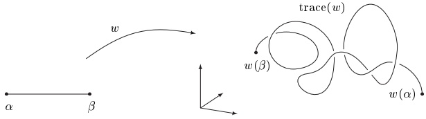
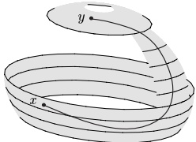
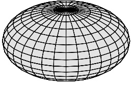
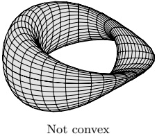
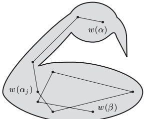
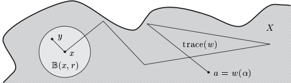

## 4 连通性

直观上很明显，$ \mathbb{R} $ 中的一个开区间是“连通的”，但若去掉一个点，它就变成“不连通的”。在本节中，我们将使这个直观的连通性概念更加精确。在这样做的过程中，我们再次发现拓扑起着本质的作用。

##### 定义与基本性质

度量空间 X 称为连通的，若 X 不能表示成两个不交的非空开子集的并。因此 X 是连通的当且仅当

 \[ \nexists O_{1},O_{2}\subseteq X,\text{ 开、非空、满足 }O_{1}\cap O_{2}=\varnothing\text{ 且 }O_{1}\cup O_{2}=X. \] 

X 的子集 M 称为在 X 中连通的，若 M 关于由 X 诱导的度量是连通的。

4.1 例 (a) 显然，空集和任何单元素集都是连通的。

(b) 自然数集 N 不是连通的。

证明 由例 2.19(a) 与定理 2.26，子集 $ O_1 := \{0\} = \mathbb{N} \cap (-\infty, 1/2) $ 和 $ O_2 := \{1, 2, 3, \ldots\} = \mathbb{N} \cap (1/2, \infty) $ 在 $ \mathbb{N} $ 中是开集。当然，由于 $ O_1 \cap O_2 = \emptyset $ 且 $ O_1 \cup O_2 = \mathbb{N} $，这表明 $ \mathbb{N} $ 不是连通的。

(c) 有理数集 Q 在 $ \mathbb{R} $ 中不是连通的。

证明 子集 $O_1 := \left\{ x \in \mathbb{Q} ; x < \sqrt{2} \right\}$ 与 $O_2 := \left\{ x \in \mathbb{Q} ; x > \sqrt{2} \right\}$ 是开的、非空的，且满足 $O_1 \cap O_2 = \emptyset$ 和 $O_1 \cup O_2 = \mathbb{Q}$。■

4.2 命题 对任何度量空间 X，下列各条等价：

(i) X 是连通的。

(ii) X 是 X 中唯一既开又闭的非空子集。

证明 “(i)⇒(ii)” 令 $O$ 是 $X$ 中一个既开又闭的非空子集。则 $O^{c}$ 在 $X$ 中也是既开又闭的，并且当然有 $O \cap O^{c} = \emptyset$ 与 $X = O \cup O^{c}$。由于 $X$ 是连通的且由假设 $O$ 非空，由此可得 $O^{c}$ 必为空。因此 $O = X$。

“(ii)⇒(i)” 设 $O_1$ 与 $O_2$ 是 $X$ 的非空开子集，满足 $O_1 \cap O_2 = \emptyset$ 且 $O_1 \cup O_2 = X$。则 $O_1 = O_2^c$ 在 $X$ 中是非空的、既开又闭的，因此由假设，$O_1 = O_2^c = X$。这蕴含 $O_2 = \emptyset$，矛盾。

4.3 注 这个命题常按如下方式用于证明关于连通集的陈述：假设我们要证明连通集中的每个元素 x 集合 $X$ 具有性质 $E$，即 $E(x)$ 对所有 $x \in X$ 成立。令

 \[ O:=\left\{x\in X;E(x)\text{ 为真 }\right\}. \] 

那么只需证明集合 O 非空、既开又闭，因为这样一来，由命题 4.2，O = X。■

##### $ \mathbb{R} $ 中的连通性

下一个命题刻画了 $ \mathbb{R} $ 的所有连通子集，并且给出了我们第一个非平凡连通集的具体例子。

4.4 定理 $ \mathbb{R} $ 的一个子集是连通的当且仅当它是一个区间。

证明 由例 4.1(a)，我们可以假设该子集含有多于一个元素。

“$\Rightarrow$” 令 $X \subseteq \mathbb{R}$ 是连通的。

(i) 令 $ a := \inf(X) \in \mathbb{R} $ 和 $ b := \sup(X) \in \mathbb{R} $。由于 $ X $ 至少有两个元素，区间 $ (a, b) $ 非空，并且\footnote{若 $a$ 与 $b$ 是实数，则 $(a, b) \cup \{a, b\} = [a, b]$。} $ X \subseteq (a, b) \cup \{a, b\} $。

(ii) 我们首先证明包含关系 $(a,b) \subseteq X$。反设 $(a,b)$ 不包含于 $X$。则存在某个 $c \in (a,b)$ 不在 $X$ 中。令 $O_1 := X \cap (-\infty, c)$ 和 $O_2 := X \cap (c, \infty)$。则由命题 2.26，$O_1$ 与 $O_2$ 在 $X$ 中是开集。当然，$O_1$ 与 $O_2$ 不交，且它们的并是 $X$。根据我们对 $a$、$b$、$c$ 的选取，存在元素 $x, y \in X$ 使得 $x < c$ 且 $y > c$。这意味着 $x$ 属于 $O_1$ 且 $y$ 属于 $O_2$，从而 $O_1$ 与 $O_2$ 非空。因此 $X$ 不是连通的，这与我们的假设矛盾。

(iii) 由于我们已经证明了包含关系 $(a,b)\subseteq X\subseteq(a,b)\cup\{a,b\}$，$X$ 是一个区间。

“⇐” (i) 反设 $X$ 是一个区间，并且存在 $X$ 的开子集、非空子集 $O_1$ 与 $O_2$，使得 $O_1 \cap O_2 = \emptyset$ 且 $O_1 \cup O_2 = X$。选取 $x \in O_1$ 和 $y \in O_2$，并首先考虑 $x < y$ 的情形。由于 $\mathbb{R}$ 是序完备的，$z := \sup(O_1 \cap [x, y])$ 是一个良定义的实数。

(ii) 元素 $z$ 不可能在 $O_1$ 中，因为 $O_1$ 在 $X$ 中是开集且 $X$ 是区间，从而存在某个 $\varepsilon > 0$ 使得 $[z, z + \varepsilon) \subseteq O_1 \cap [x, y]$。这与 $z$ 的上确界性质矛盾。类似地，$z$ 不可能在 $O_2$ 中，因为否则存在某个 $\varepsilon > 0$ 使得

 \[ (z-\varepsilon,z]\subseteq O_{2}\cap[x,y]~, \] 

这与 $ O_1 \cap O_2 = \emptyset $ 以及 $ z $ 的定义矛盾。于是 $ z \notin O_1 \cup O_2 = X $。另一方面，由于 $ X $ 是区间，$ [x, y] $ 包含于 $ X $。这导致矛盾：$ z \in [x, y] \subseteq X $ 且 $ z \notin X $。$ y < x $ 的情形可类似地证明。

##### 广义介值定理

连通集具有这样的性质：它们在连续函数下的像也是连通的。这个重要的事实可以利用第 2 节的结果轻松证明。

4.5 定理 设 $X$ 与 $Y$ 是度量空间，$f: X \to Y$ 连续。若 $X$ 是连通的，则 $f(X)$ 也是连通的。也就是说，连通集的连续像是连通的。

证明 反设 $f(X)$ 不是连通的。则存在 $f(X)$ 的非空子集 $V_1$ 与 $V_2$，使得 $V_1$ 与 $V_2$ 在 $f(X)$ 中是开集，$V_1 \cap V_2 = \emptyset$ 且 $V_1 \cup V_2 = f(X)$。由命题 2.26，存在 $Y$ 中的开集 $O_j$ 使得对 $j = 1,2$ 有 $V_j = O_j \cap f(X)$。令 $U_j := f^{-1}(O_j)$。则由定理 2.20，对 $j = 1,2$，$U_j$ 在 $X$ 中是开集。此外

 \[ U_{1}\cup U_{2}=X~,\quad U_{1}\cap U_{2}=\varnothing\qquad\text{ 且 }\qquad U_{j}\neq\varnothing~,\quad j=1,2~, \] 

这对连通集 X 是不可能的。

4.6 推论 区间的连续像是连通的。

我们将在接下来的两节中说明，定理 4.4 与 4.5 是研究实函数的极其有用的工具。我们现在已经注意到这些定理的如下简单推论。

4.7 定理（广义介值定理） 设 $X$ 是连通度量空间，$f: X \to \mathbb{R}$ 连续。则 $f(X)$ 是一个区间。特别地，$f$ 取到任意两个给定函数值之间的每个值。

证明 这直接由定理 4.4 与 4.5 推出。

##### 道路连通性

设 $\alpha, \beta \in \mathbb{R}$ 满足 $\alpha < \beta$。连续函数 $w: [\alpha, \beta] \to X$ 称为连接端点 $w(\alpha)$ 与 $w(\beta)$ 的连续道路。

度量空间 $X$ 称为道路连通的，若对每一对 $(x, y) \in X \times X$，存在 $X$ 中连接 $x$ 与 $y$ 的连续道路。度量空间的子集称为道路连通的，若它关于诱导度量是道路连通的度量空间。

4.8 命题 任何道路连通空间都是连通的。

证明 反设存在一个道路连通但不连通的度量空间 $X$。则存在 $X$ 中的非空开集 $O_1$、$O_2$，使得 $O_1 \cap O_2 = \emptyset$ 且 $O_1 \cup O_2 = X$。选取 $x \in O_1$ 与 $y \in O_2$。由假设，存在道路 $w: [\alpha, \beta] \to X$ 使得 $w(\alpha) = x$ 且 $w(\beta) = y$。令 $U_j := w^{-1}(O_j)$。则由定理 2.20，$U_j$ 在 $[a, \beta]$ 中是开集。现在我们有 $\alpha$ 在 $U_1$ 中、$\beta$ 在 $U_2$ 中，以及 $U_1 \cap U_2 = \emptyset$ 和 $U_1 \cup U_2 = [\alpha, \beta]$，因此区间 $[a, \beta]$ 不是连通的。这与定理 4.4 矛盾。

设 $E$ 是赋范向量空间，$a, b \in E$。$E$ 的线性结构允许我们考虑 $E$ 中的“直线”道路：

 \[ v:[0,1]\to E~,\quad t\mapsto(1-t)a+t b~. \] 

我们用 $\left[\!\!\left[a, b\right]\!\!\right]$ 表示道路 v 的像。

$E$ 的子集 $X$ 称为 $\mathbf{凸}$ 的，若对每一对 $(a,b)\in X\times X$，$\left[\!\!\left[a,b\right]\!\!\right]$ 都包含于 $X$。

凸
 

4.9 注 设 E 是赋范向量空间。

(a) E 的每个凸子集都是道路连通的且连通的。

证明 设 $X$ 是凸的，$a, b \in X$。则 (4.1) 定义了 $X$ 中连接 $a$ 与 $b$ 的一条道路。因此 $X$ 是道路连通的。于是命题 4.7 蕴含 $X$ 是连通的。

(b) 对所有 $ a \in E $ 与 $ r > 0 $，球 $ \mathbb{B}_E(a, r) $ 和 $ \bar{\mathbb{B}}_E(a, r) $ 都是凸的。

证明 对 $ x, y \in \mathbb{B}_E(a, r) $ 与 $ t \in [0, 1] $，我们有

 \[ \begin{align*}\|(1-t)x+ty-a\|&=\|(1-t)(x-a)+t(y-a)\|\\&\leq(1-t)\left\|x-a\right\|+t\left\|y-a\right\|<(1-t)r+tr=r.\end{align*} \] 

这个不等式蕴含 $ \left[\!\!\left[x, y\right]\!\!\right] $ 在 $ \mathbb{B}_E(a, r) $ 中。第二个断言可类似地证明。

(c) $ \mathbb{R} $ 的子集是凸的当且仅当它是区间。

证明 设 $X \subseteq \mathbb{R}$ 是凸的。则由 (a)，$X$ 是连通的，从而由定理 4.4，$X$ 是区间。区间是凸的这一断言是显然的。

在 $\mathbb{R}^2$ 中，存在不是凸的连通集的简单例子。即便如此，在这些情形中，集合中的任意一对点似乎都可以用由有限多条直线段组成的道路连接起来。下面的定理表明，只要集合是开集，这一结论不仅在 $\mathbb{R}^2$ 中成立，而且在任何赋范向量空间中都成立。

设 $X$ 是赋范向量空间的子集。函数 $w: [\alpha, \beta] \to X$ 称为 $X$ 中的 $\text{折线道路}$\footnote{函数 $w: [\alpha, \beta] \to X$ 显然在每一点左连续且右连续，因此由命题 1.12 连续。于是折线道路特别地是一条道路。}，若存在 $n \in \mathbb{N}$ 与实数 $\alpha_0, \ldots, \alpha_{n+1}$ 使得 $\alpha = \alpha_0 < \alpha_1 < \cdots < \alpha_{n+1} = \beta$ 且

 \[ w\big((1-t)\alpha_{j}+t\alpha_{j+1}\big)=(1-t)w(\alpha_{j})+t w(\alpha_{j+1}) \] 

对所有 $ t \in [0,1] $ 和 $ j = 0, \ldots, n $ 成立。

4.10 定理 设 X 是赋范向量空间的非空开连通子集。则 X 中任意一对点都可以用 X 中的一条折线道路连接。

证明 设 $ a \in X $，并且

 $ M := \{ x \in X ; \text{ 存在一条折线道路，在 } X \text{ 中连接 } x \text{ 与 } a \} $。

我们现在应用注 4.3 中描述的证明技巧。

(i) 因为 $ a \in M $，集合 M 非空。

(ii) 我们接着证明 $M$ 在 $X$ 中是开集。设 $x \in M$。由于 $X$ 是开集，存在某个 $r > 0$ 使得 $\mathbb{B}(x, r) \subseteq X$。由注 4.9(b)，对每个 $y \in \mathbb{B}(x, r)$，集合 $\left[\!\!\left[x, y\right]\!\!\right]$ 都包含于 $\mathbb{B}(x, r)$，从而也包含于 $X$。由于 $x \in M$，存在折线道路 $w: [\alpha, \beta] \to X$ 使得 $w(\alpha) = a$ 且 $w(\beta) = x$。

现在按如下方式定义 $ \widetilde{w}: [\alpha, \beta + 1] \to X $：

 \[ \widetilde{w}(t):=\left\{\begin{array}{c l}{w(t),}&{\quad t\in[\alpha,\beta]~,}\\ {(t-\beta)y+(\beta+1-t)x,}&{\quad t\in(\beta,\beta+1]~.}\\ \end{array}\right. \] 

则 $ \tilde{w} $ 是 X 中连接 a 和 y 的折线道路。这表明 $ \mathbb{B}(x,r) $ 包含于 M，x 是 M 的内点，且 M 在 X 中是开集。

(iii) 还要证明 $M$ 是闭集。设 $y \in X \backslash M$。由于 $X$ 是开集，存在某个 $r > 0$ 使得 $\mathbb{B}(y, r)$ 包含于 $X$。集合 $\mathbb{B}(y, r)$ 与 $M$ 必不交，因为若 $x \in \mathbb{B}(y, r) \cap M$，则由 (ii) 的论证，$X$ 中会存在连接 $a$ 与 $y$ 的折线道路，从而 $y$ 在 $M$ 中，与假设矛盾。于是 $y$ 是 $X \backslash M$ 的内点，并且由于 $y \in X \backslash M$ 是任意的，$X \backslash M$ 是开集。这蕴含 $M$ 在 $X$ 中是闭集。

4.11 推论 赋范向量空间的开子集是连通的当且仅当它是道路连通的。

证明 这由命题 4.8 与定理 4.10 推出。

##### 一般拓扑空间中的连通性

在本节末尾，我们分析上述证明对度量存在性的依赖程度。

4.12 注 (a) “连通”与“道路连通”的定义只依赖于拓扑，并且不使用度量。因此它们在任何拓扑空间中都是有效的。命题 4.2、4.5 与 4.8 也同样成立。特别地，当 X 是任意拓扑空间时，广义介值定理（定理 4.7）成立。

(b) 存在连通但不是道路连通的空间的例子。正因如此，定理 4.10 特别有用。

##### 习题

在下文中，X 是度量空间。

1 证明下列各条的等价性：

(a) X 是连通的。

(b) 不存在连续满射 $ X \to \{0,1\} $。

2 设对指标集 $ A $ 中的每个 $ \alpha $，$ C_\alpha \subseteq X $ 是连通的。证明：若对所有 $ \alpha, \beta \in A $ 有 $ C_\alpha \cap C_\beta \neq \emptyset $，则 $ \bigcup_\alpha C_\alpha $ 是连通的。也就是说，两两相交的连通集的任意并是连通的。（提示：使用习题 1 并用反证法证明。）

3 通过例子说明，连通集的交一般来说不是连通的。

4 设 $ X_j $（$ j = 1, \ldots, n $）是度量空间。证明积 $ X_1 \times \cdots \times X_n $ 是连通的当且仅当每个 $ X_j $ 都是连通的。（提示：把 $ X \times Y $ 写成形如 $ (X \times \{y\}) \cup (\{x\} \times Y) $ 的集合的并。）

5 证明连通集的闭包也是连通的。（提示：考虑连续函数 $ f: \overline{A} \to \{0,1\} $，并利用 $ f(\overline{A}) \subseteq \overline{f(A)} $（见习题 2.12）。）

6 给定一个元素 $ x \in X $，集合

 \[ K(x):=\bigcup_{Y\in M}Y\quad\text{ 其中 }\quad M:=\{Y\subseteq X\;;\;Y\text{ 是连通的且 }x\in Y\} \] 

由习题 2，是 X 中包含 x 的最大连通子集，因此称为 x 在 X 中的连通分支。证明下列各条：

(a) $ \{K(x) : x \in X\} $ 是 $ X $ 的一个划分，也就是说，每个 $ x \in X $ 恰好包含在 $ X $ 的一个连通分支中。

(b) 每个连通分支都是闭的。

7 确定 Q 在 $ \mathbb{R} $ 中的所有连通分支。

8 设 $ E = (E, \|\cdot\|) $ 是满足 $ \dim(E) \geq 2 $ 的赋范向量空间。证明 $ E \setminus \{0\} $ 与单位球面 $ S := \{x \in E; \|x\| = 1\} $ 都是连通的。

9 证明下列度量空间 X 与 Y 不同胚（见习题 3.3）：

(a) $ X := S^{1} $，$ Y := [0, 1] $。

(b) $ X := \mathbb{R} $，$ Y := \mathbb{R}^n $，$ n \geq 2 $。

(c) $ X := (0,1) \cup (2,3) $，$ Y := (0,1) \cup (2,3] $。

（提示：在每种情形中，从 X 中去掉一个或两个点。）

10 证明所有实正交 $ n \times n $ 矩阵构成的集合 $ O(n) $ 不是连通的。（提示：函数 $ O(n) \to \{-1,1\} $，$ A \mapsto \det A $ 是连续的且是满射的（见习题 1.16）。）

11 对 $ b_{j,k} \in \mathbb{R} $，$ 1 \leq j, k \leq n $，考虑双线性形式

 \[ B:\mathbb{R}^{n}\times\mathbb{R}^{n}\to\mathbb{R},\quad(x,y)\mapsto\sum_{j,k=1}^{n}b_{j,k}x_{j}y_{k}. \] 

若对所有 $x \in \mathbb{R}^n \setminus \{0\}$ 有 $B(x,x) > 0$（或 $B(x,x) < 0$），则称 $B$ 是正定的（或负定的）。若 $B$ 既不正定也不负定，则它是不定的。证明下列各条：

(a) 若 $B$ 是不定的，则存在某个 $x \in S^{n-1}$ 使得 $B(x,x) = 0$。

(b) 若 $B$ 是正定的，则存在某个 $\beta > 0$ 使得 $B(x, x) \geq \beta |x|^2$，$x \in \mathbb{R}^n$。（提示：对 (a) 用介值定理。对 (b) 用极值定理。）

12 设 $E$ 是向量空间。设 $x_1, \ldots, x_n \in E$ 与 $\alpha_1, \ldots, \alpha_n \in \mathbb{R}^+$ 满足 $\sum_{j=1}^n \alpha_j = 1$。则称 $\sum_{j=1}^n \alpha_j x_j$ 为 $x_1, \ldots, x_n$ 的凸组合。证明下列各条：

(a) E 的凸子集的任意交都是凸的。

(b) E 的子集 M 是凸的当且仅当 M 对凸组合封闭，也就是说，M 的点的每个凸组合都在 M 中。

(c) 若 $E$ 是赋范向量空间且 $M \subseteq E$ 是凸的，则 $\bar{M}$ 与 $\overline{M}$ 也都是凸的。

