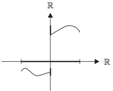
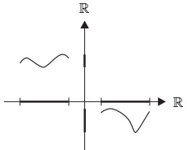
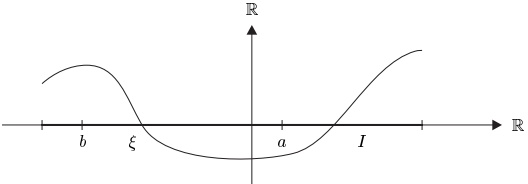
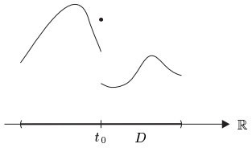
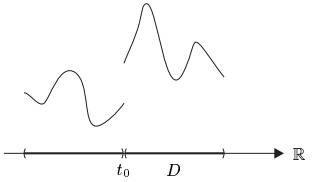

## 5 $ \mathbb{R} $ 上的函数

我们关于连续性的抽象展开，在应用于 $ \mathbb{R} $ 上的实值函数时尤为富有成效。这当然是 $ \mathbb{R} $ 丰富结构的直接结果。

##### 波尔查诺介值定理

将广义介值定理应用于实值函数，便得到这一重要定理的波尔查诺原初版本。

5.1 定理（波尔查诺介值定理）设 $ I \subseteq \mathbb{R} $ 是区间，$ f: I \to \mathbb{R} $ 连续。则 $ f(I) $ 是区间。也就是说，区间的连续像是区间。

证明 这由定理 4.4 与定理 4.7 得出。■

在下文中，$ I $ 表示 $ \mathbb{R} $ 中的一个非空区间。

5.2 例（a）若 $ f $ 不连续，或不定义在区间上，则波尔查诺介值定理中的断言不成立。这可由下面的函数图像加以说明：

（b）若 $f: I \to \mathbb{R}$ 连续，且存在 $a, b \in I$ 使得 $f(a) < 0 < f(b)$，则存在某个介于 $a$ 与 $b$ 之间的 $\xi$，使得 $f(\xi) = 0$。

（c）每个次数为奇数的多项式 $ p \in \mathbb{R}[X] $ 都有实零点。

证明 不失一般性，可将 $ p $ 写成如下形式

 \[ p=X^{2n+1}+a_{2n}X^{2n}+\cdots+a_{0} \] 

其中 $ n \in \mathbb{N} $，$ a_k \in \mathbb{R} $。于是

 \[ p(x)=x^{2n+1}\Big(1+\frac{a_{2n}}{x}+\cdots+\frac{a_{0}}{x^{2n+1}}\Big)~,\qquad x\in\mathbb{R}^\times~. \] 

对于充分大的 $ R > 0 $，有

 \[ 1+\frac{a_{2n}}{R}+\cdots+\frac{a_{0}}{R^{2n+1}}\geq1-\frac{|a_{2n}|}{R}-\cdots-\frac{|a_{0}|}{R^{2n+1}}\geq\frac{1}{2}, \] 

因此 $p(R) \geq R^{2n+1}/2 > 0$ 且 $p(-R) \leq -R^{2n+1}/2 < 0$。由于多项式函数连续，断言由（b）得出。■

##### 单调函数

$ \mathbb{R} $ 的序完备性对单调函数有着深远的影响。作为第一个例子，我们证明一个单调但未必连续的实函数在区间端点处的左、右极限的存在性。

5.3 命题 设 $ f: I \to \mathbb{R} $ 单调，$ \alpha := \inf I $，$ \beta := \sup I $。则

 \[ \operatorname*{l i m}_{x\to\alpha+}f(x)=\left\{\begin{array}{c l}{\operatorname*{i n f}f(I),}&{\quad\text{若 }f\text{ 递增},}\\ {\operatorname*{s u p}f(I),}&{\quad\text{若 }f\text{ 递减},}\\ \end{array}\right. \] 

且

 \[ \operatorname*{l i m}_{x\to\beta-}{f(x)}=\left\{\begin{array}{c l}{\operatorname*{s u p}{f(I)}~,}&{\quad\text{若 }f\text{ 递增}~,}\\ {\operatorname*{i n f}{f(I)}~,}&{\quad\text{若 }f\text{ 递减}~.}\\ \end{array}\right. \] 

证明 设 $f$ 递增，且 $b := \sup f(I) \in \bar{\mathbb{R}}$。由 $b$ 的定义，对每个 $\gamma < b$，存在某个 $x_\gamma \in I$ 使得 $f(x_\gamma) > \gamma$。由于 $f$ 递增，有

 \[ \gamma<f(x_{\gamma})\leq f(x)\leq b~,\qquad x\geq x_{\gamma}~. \] 

于是注 2.23 关于左极限的类似结论蕴含 $ \lim_{x \to \beta^-} f(x) = b $。区间左端点处以及递减函数情形的断言类似地证明。

为研究实函数的不连续点与连续延拓，我们需要下面的引理。

5.4 引理 设 $ D \subseteq \mathbb{R} $，$ t \in \mathbb{R} $，且

 \[ \overline{D}_{t}:=\overline{D\cap(-\infty,t)}\cap\overline{D\cap(t,\infty)}. \] 

若 $\overline{D}_{t}$ 非空，则 $\overline{D}_{t}=\{t\}$，且存在 $D$ 中的序列 $(r_{n})$、$(s_{n})$ 使得

 \[ r_{n}<t~,~s_{n}>t~,\quad n\in\mathbb{N}~,\qquad\text{且}\qquad\operatorname*{l i m}r_{n}=\operatorname*{l i m}s_{n}=t~. \] 

证明 设 $ \overline{D}_t \neq \emptyset $，且 $ \tau \in \overline{D}_t $。则由 $ \overline{D}_t $ 的定义以及命题 2.9，存在 $ D $ 中的序列 $ (r_n) $ 与 $ (s_n) $，使得

（i）$ r_n < t $，$ n \in \mathbb{N} $，且 $ \lim r_n = \tau $，（ii）$ s_n > t $，$ n \in \mathbb{N} $，且 $ \lim s_n = \tau $。由命题 II.2.7，（i）蕴含 $ \tau \leq t $，（ii）蕴含 $ \tau \geq t $。于是 $ \tau = t $，所有断言得证。

5.5 例（a）设 $ D $ 是区间。则

 \[ \overline{{D}}_{t}=\left\{\begin{array}{c c}{\{t\},}&{\quad t\in\mathring{D},}\\ {\varnothing,}&{\quad t\notin\mathring{D}.}\\ \end{array}\right. \] 

（b）若 $ D = \mathbb{R}^\times $，则对每个 $ t \in \mathbb{R} $，有 $ \overline{D}_t = \{t\} $。■

现在考虑函数 $f: D \to X$，其中 $X = (X, d)$ 是度量空间，$D$ 是 $\mathbb{R}$ 的子集。设 $t_0 \in \mathbb{R}$ 满足 $\overline{D}_{t_0} \neq \emptyset$。若单侧极限 $f(t_0+) = \lim_{t \to t_0+} f(t)$ 与 $f(t_0-) = \lim_{t \to t_0-} f(t)$ 存在且不相等，则称 $t_0$ 为 $f$ 的一个 $\text{跳跃\textbf{不连续点}}$，并称 $d(f(t_0+), f(t_0-))$ 为该跳跃不连续点在 $t_0$ 处的 $\text{大小}$。

5.6 命题 若 $ f: I \to \mathbb{R} $ 单调，则 $ f $ 除至多可数个跳跃不连续点外连续。

证明 只需考虑递增函数 $f: I \to \mathbb{R}$ 的情形。对 $t_0 \in \mathring{I}$，把命题 5.3 应用于限制函数 $f|I \cap (-\infty, t_0)$ 与 $f|I \cap (t_0, \infty)$ 中的每一个，即得 $\lim_{t \to t_0+} f(t)$ 与 $\lim_{t \to t_0-} f(t)$ 存在。由命题 1.12 与 1.13，只需证明集合

 \[ M:=\left\{t_{0}\in\mathring{I};\;f(t_{0}-)\neq f(t_{0}+)\right\} \] 

可数。对每个 $t \in M$，有 $f(t-) < f(t+)$，故可选取某个 $r(t) \in \mathbb{Q} \cap (f(t-), f(t+))$。这定义了一个函数

 \[ r\colon M\to\mathbb{Q}~,\quad t\mapsto r(t)~, \] 

由于 $f$ 递增，该函数必为单射。于是 $M$ 与 $\mathbb{Q}$ 的一个子集等势。特别地，由命题 I.6.7 与 I.9.4，$M$ 可数。

##### 连续单调函数

下面的重要定理表明，任何严格单调的连续函数都是单射，并具有定义在其像上的连续单调反函数。

5.7 定理（单调函数的反函数定理）设 $ I \subseteq \mathbb{R} $ 是非空区间，$ f: I \to \mathbb{R} $ 连续且严格递增（或严格递减）。

（i）$ J := f(I) $ 是区间。

（ii）$f: I \to J$ 是双射。

（iii）$ f^{-1} $：$ J \to I $ 连续且严格递增（或严格递减）。

证明 断言（i）由定理 5.1 得出，（ii）是 $ f $ 严格单调性的直接结果。

为证（iii），设 $f$ 严格递增，并令 $g := f^{-1} : J \to I$。若 $s_1, s_2 \in J$ 满足 $s_1 < s_2$，则 $g(s_1) < g(s_2)$；因为否则

 \[ s_{1}=f\big(g(s_{1})\big)\geq f\big(g(s_{2})\big)=s_{2}. \] 

于是 $ g $ 严格递增。

为证 $ g: J \to I $ 的连续性，只需考虑 $ J $ 含有多于一个点的情形，因为否则断言显然。设 $ g $ 在 $ s_0 \in J $ 处不连续。则存在 $ \varepsilon > 0 $ 与 $ J $ 中的序列 $ (s_n) $，使得

 \[ |s_{n}-s_{0}|<1/n\quad\text{且}\quad|g(s_{n})-g(s_{0})|\geq\varepsilon\;,\qquad n\in\mathbb{N}^{\times}\;. \] 

于是对所有 $ n \in \mathbb{N}^\times $，有 $ s_n \in [s_0 - 1, s_0 + 1] $；又因 $ g $ 递增，存在 $ \alpha, \beta \in \mathbb{R} $ 使得 $ \alpha < \beta $，且

 \[ t_{n}:=g(s_{n})\in[\alpha,\beta]~. \] 

由波尔查诺-魏尔斯特拉斯定理，序列 $(t_n)$ 有收敛子序列 $(t_{n_k})_{k\in\mathbb{N}}$。设 $t_0$ 为该子序列的极限。则 $f$ 的连续性蕴含，当 $k \to \infty$ 时 $f(t_{n_k}) \to f(t_0)$。但由（5.1）的第一个断言，我们也知道 $f(t_{n_k}) = s_{n_k}$ 收敛于 $s_0$。于是 $s_0 = f(t_0)$，从而

 \[ g(s_{n_{k}})=t_{n_{k}}\to t_{0}=g(s_{0})\ (k\to\infty)~. \] 

这与（5.1）的第二个断言矛盾，证明完成。■

5.8 例（a）对每个 $ n \in \mathbb{N}^* $，函数

 \[ \mathbb{R}^{+}\to\mathbb{R}^{+}\ ,\quad x\mapsto\sqrt[n]{x} \] 

连续\footnote{另见习题 II.2.7。}且严格递增。此外，$ \lim_{x \to \infty} \sqrt[n]{x} = \infty $。

证明 对 $ n \in \mathbb{N}^x $，令 $ f: \mathbb{R}^+ \to \mathbb{R}^+ $ 由 $ t \mapsto t^n $ 定义。作为多项式函数的限制，$ f $ 连续。若 $ 0 \leq s < t $，则

 \[ f(t)-f(s)=t^{n}-s^{n}=t^{n}\Big(1-\Big(\frac{s}{t}\Big)^{n}\Big)>0, \] 

这表明 $f$ 严格递增。最后 $\lim_{t \to \infty} f(t) = \infty$，故所有断言由定理 5.7 得出。■

（b）一般来说，若 $ I $ 不是区间，则定理 5.7（iii）中的连续性断言不成立。

证明 例 1.9（c）中的函数 $ f: Z \to \mathbb{R} $ 连续且严格递增，但其反函数不连续。

单调函数的反函数定理的更多重要应用将在下一节出现。

##### 习题

在下文中，$ I $ 是含有多于一个点的紧致区间。

1 设 $ f: I \to I $ 连续。证明 $ f $ 有不动点，即存在某个 $ \xi \in I $ 使得 $ f(\xi) = \xi $。

2 设 $ f: I \to \mathbb{R} $ 连续且为单射。证明 $ f $ 严格单调。

3 设 $D$ 是 $\mathbb{R}$ 的开子集，$f: D \to \mathbb{R}$ 连续且为单射。证明 $f: D \to f(D)$ 是同胚。\footnote{见习题 3.3。}

4 设 $ \alpha: \mathbb{N} \to \mathbb{Q} $ 是双射，且对 $ x \in \mathbb{R} $，令 $ N_x $ 为集合 $ \{k \in \mathbb{N} : \alpha(k) \leq x\} $。设 $ (y_n) $ 是 $ (0, \infty) $ 中的序列，满足 $ \sum y_n < \infty $。定义

 \[ f:\mathbb{R}\to\mathbb{R},\quad x\mapsto\sum_{k\in N_{x}}y_{k}. \] 

证明下列结论：\footnote{本习题表明命题 5.6 不能加强。}

（a）$ f $ 严格单调。

（b）$ f $ 在每个无理数处连续。

（c）在每个有理数 $ q $ 处，存在大小为 $ y_n $ 的跳跃不连续点，其中 $ n = \alpha^{-1}(q) $。

5 考虑函数

 \[ f\colon[0,1]\to[0,1],\quad x\mapsto\left\{\begin{array}{c l}{x\quad,\quad}&{x\text{ 为有理数}\quad,}\\ {1-x\quad,\quad}&{x\text{ 为无理数}\quad.}\end{array}\right. \] 

证明下列结论：

（a）$ f $ 是双射。

（b）$ f $ 在 $[0,1]$ 的任何子区间上都不单调。

（c）$ f $ 仅在 $ x = 1/2 $ 处连续。

6 设 $ f_{0} := $ 锯齿函数（见习题 1.1），且

 \[ F(x):=\sum_{n=0}^{\infty}4^{-n}f_{0}(4^{n}x)~,\qquad x\in\mathbb{R}~. \] 

证明下列结论：

（a）$ F $ 良定义。

（b）$ F $ 在任何区间上都不单调。

（c）$ F $ 连续。

（提示：（a）对每个 $ x \in \mathbb{R} $，为 $ \sum 4^{-n} f_0(4^n x) $ 找出一个收敛的优级数。

（b）对所有 $ x \in \mathbb{R} $ 与 $ n \in \mathbb{N} $，令 $ f_n(x) := 4^{-n} f_0(4^n x) $。对 $ k \in \mathbb{Z} $ 与 $ m \in \mathbb{N}^* $，令 $ a := k \cdot 4^{-m} $，$ h := 4^{-2m-1} $。则

 \[ f_{n}(a)=0,\quad n\geq m,\qquad\text{且}\qquad f_{n}(a\pm h)=0,\quad n\geq2m+1, \] 

因此 $ F(a \pm h) - F(a) \geq h $。最后用 $ k \cdot 4^{-m} $（$ k \in \mathbb{Z} $，$ m \in \mathbb{N}^\times $）逼近任意 $ x \in \mathbb{R} $。

（c）对 $ x, y \in \mathbb{R} $ 与 $ m \in \mathbb{N}^\times $，有 $ |F(x) - F(y)| \leq \sum_{k=0}^{m} |f_k(x) - f_k(y)| + 4^{-m}/3 $。

7 设 $f: I \to \mathbb{R}$ 单调。证明 $\omega_f(x) = |f(x+) - f(x-)|$，其中 $\omega_f(x)$ 如习题 1.17 中所定义。

