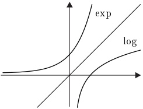
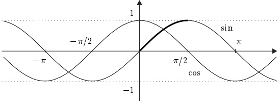
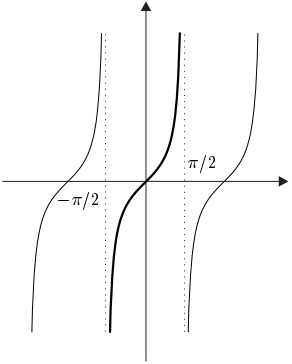
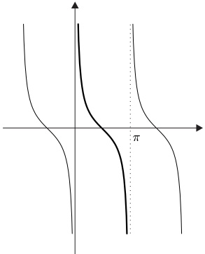
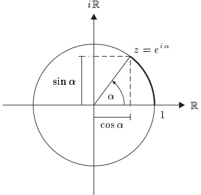
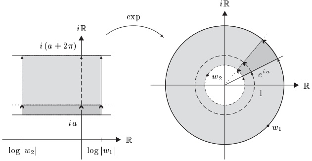
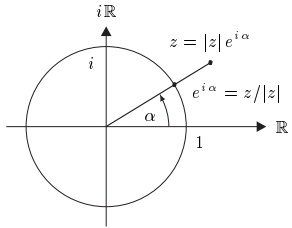
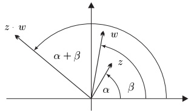
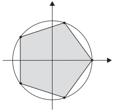

## 6 指数函数与相关函数

在本节（相当长的一节）中，我们研究数学中最重要的函数之一——指数函数。其重要性已体现在它与三角函数和对数函数的密切关系中，我们也将考察后两者。

##### 欧拉公式

在第 II 章中，我们利用指数级数定义了指数函数。

 \[ \exp(z):=e^{z}:=\sum_{n=0}^{\infty}\frac{z^{n}}{n!}=1+z+\frac{z^{2}}{2!}+\frac{z^{3}}{3!}+\cdots~,\qquad z\in\mathbb{C}~. \] 

用记号 $ e^{z} $ 表示 $ \exp(z) $ 的用法由例 II.8.12(b) 提供依据。与这个级数相关联的是余弦级数

 \[ \sum(-1)^{n}\frac{z^{2n}}{(2n)!}=1-\frac{z^{2}}{2!}+\frac{z^{4}}{4!}-+\cdots, \] 

以及正弦级数

 \[ \sum(-1)^{n}\frac{z^{2n+1}}{(2n+1)!}=z-\frac{z^{3}}{3!}+\frac{z^{5}}{5!}-+\cdots. \] 

我们将证明：与指数级数类似，余弦级数与正弦级数处处绝对收敛。由这些级数定义的函数，

 \[ \cos:\mathbb{C}\to\mathbb{C}~,\quad z\mapsto\sum_{n=0}^{\infty}(-1)^{n}\frac{z^{2n}}{(2n)!} \] 

以及

 \[ \sin:\mathbb{C}\to\mathbb{C}\;,\quad z\mapsto\sum_{n=0}^{\infty}(-1)^{n}\frac{z^{2n+1}}{(2n+1)!}\;, \] 

分别称为余弦函数与正弦函数。\footnote{我们稍后将会看到，这些定义给出熟悉的三角函数。}

6.1 定理

(i) 指数级数、余弦级数与正弦级数具有无穷收敛半径。

(ii) 函数 $ \exp $、$ \cos $、$ \sin $ 在实变元上取实值。

(iii) 指数函数的加法定理成立：

 \[ e^{w+z}=e^{w}e^{z}~,\qquad w,z\in\mathbb{C}~. \] 

(iv) 欧拉公式成立：

 \[ e^{i z}=\cos z+i\sin z~,\qquad z\in\mathbb{C}~. \] 

(v) 函数 $ \exp $、$ \cos $ 与 $ \sin $ 在 C 上连续。

证明 (i) 在例 II.8.7(c) 中，我们已经证明了指数级数具有收敛半径 $ \infty $。因此阿达马公式给出

 \[ \infty=\frac{1}{\varlimsup_{n\to\infty}\sqrt[n]{1/n!}}=\varliminf_{n\to\infty}\sqrt[n]{n!}. \] 

由定理 II.5.7，序列 $ ( \sqrt[n]{n!} )_{n \in \mathbb{N}} $ 及其所有子序列都收敛到 $ \infty $。因此

 \[ \frac{1}{\varlimsup_{n\to\infty}\sqrt[2n]{1/(2n)!}}=\lim_{n\to\infty}\sqrt[2n]{(2n)!}=\infty \] 

以及

 \[ \frac{1}{\varlimsup_{n\to\infty}\sqrt[2n+1]{1/(2n+1)!}}=\lim_{n\to\infty}\sqrt[2n+1]{(2n+1)!}=\infty, \] 

从而由阿达马公式，余弦级数与正弦级数具有无穷收敛半径。

(ii) 因为 $ \mathbb{R} $ 是域，所以当 z 为实数时，上述级数的所有部分和均为实数。由于 $ \mathbb{R} $ 在 $ \mathbb{C} $ 中是闭的，断言得证。

(iii) 这已在例 II.8.12(a) 中证明。

(iv) 对 $ n \in \mathbb{N} $，我们有

 \[ i^{2n}=(i^{2})^{n}=(-1)^{n}\quad\text{且}\quad i^{2n+1}=i\cdot i^{2n}=i\cdot(-1)^{n}. \] 

因此，由命题 II.7.5。

 \[ e^{i z}=\sum_{n=0}^{\infty}\frac{(i z)^{n}}{n!}=\sum_{k=0}^{\infty}\frac{(i z)^{2k}}{(2k)!}+\sum_{k=0}^{\infty}\frac{(i z)^{2k+1}}{(2k+1)!}=\cos z+i\sin z \] 

对所有 $ z \in \mathbb{C} $。

(v) 这由命题 1.7 可得。

6.2 注 (a) 余弦是偶函数，正弦是奇函数，即\footnote{见习题 II.9.7。}

 \[ \cos(z)=\cos(-z)\quad\text{且}\quad\sin(z)=-\sin(-z),\qquad z\in\mathbb{C}. \] 

(b) 由 (a) 与欧拉公式 (6.1) 可得

 \[ \cos(z)=\frac{e^{i z}+e^{-i z}}{2}\;,\quad\sin(z)=\frac{e^{i z}-e^{-i z}}{2i}\;,\qquad z\in\mathbb{C}\;. \] 

(c) 对 $ w, z \in \mathbb{C} $，我们有

 \[ e^{z}\neq0,\quad e^{-z}=1/e^{z},\quad e^{z-w}=e^{z}/e^{w},\quad\overline{{e^{z}}}=e^{\overline{{z}}}. \] 

证明 由加法定理可得 $ e^z e^{-z} = e^{z-z} = e^0 = 1 $，前三个断言由此得证。

由例 1.3(i)，函数 $\mathbb{C} \to \mathbb{C}$，$w \mapsto \overline{w}$ 连续。于是定理 1.4 蕴含

 \[ \overline{e^{z}}=\lim_{n\to\infty}\sum_{k=0}^{n}\frac{z^{k}}{k!}=\lim_{n\to\infty}\sum_{k=0}^{n}\frac{\overline{z}^{k}}{k!}=e^{\overline{z}} \] 

对所有 $ z \in \mathbb{C} $。■

(d) 对所有 $ x \in \mathbb{R} $，$ \cos(x) = \mathrm{Re}(e^{ix}) $ 且 $ \sin(x) = \mathrm{Im}(e^{ix}) $。

证明 这由欧拉公式与定理 6.1(ii) 可得。■

在下面的命题中，我们用“三角函数”这一名称指称余弦与正弦。这一用法在注 6.18 之后得到说明。

6.3 命题（三角函数的加法定理）对所有 $ z, w \in \mathbb{C} $，我们有\footnote{在不致产生误解时，通常把 $\cos(z)$ 与 $\sin(z)$ 写作 $\cos z$ 与 $\sin z$。}

(i)

 \[ \cos(z\pm w)=\cos z\cos w\mp\sin z\sin w, \] 

 \[ \sin(z\pm w)=\sin z\cos w\pm\cos z\sin w. \] 

(ii)  $ \sin z - \sin w = 2 \cos \frac{z + w}{2} \sin \frac{z - w}{2} $，

 \[ \cos z-\cos w=-2\sin\frac{z+w}{2}\sin\frac{z-w}{2}. \] 

证明 (i) (6.3) 中的公式与指数函数的加法定理给出

 \[ \begin{aligned}\cos z\cos w-\sin z\sin w&=\frac{1}{4}\big\{(e^{iz}+e^{-iz})(e^{iw}+e^{-iw})+(e^{iz}-e^{-iz})(e^{iw}-e^{-iw})\big\}\\&=\frac{1}{2}\big\{e^{i(z+w)}+e^{-i(z+w)}\big\}=\cos(z+w)\end{aligned} \] 

对所有 $ z, w \in \mathbb{C} $。再利用 (6.2)，可得

 \[ \cos(z-w)=\cos z\cos w+\sin z\sin w~,\qquad z,w\in\mathbb{C}~. \] 

(i) 中的第二个公式可类似证明。

(ii) 对 $ z, w \in \mathbb{C} $，令 $ u := (z + w)/2 $ 与 $ v := (z - w)/2 $。则 $ u + v = z $ 且 $ u - v = w $，于是利用 (i)，我们得到

 \[ \begin{aligned}\sin z-\sin w&=\sin(u+v)-\sin(u-v)=2\cos u\sin v\\&=2\cos\frac{z+w}{2}\sin\frac{z-w}{2}.\end{aligned} \] 

(ii) 中的第二个公式可类似证明。

6.4 推论 对 $ z \in \mathbb{C} $，$ \cos^2 z + \sin^2 z = 1 $。

证明 在命题 6.3(i) 中令 z = w，我们得到

 \[ \cos^{2}z+\sin^{2}z=\cos(z-z)=\cos(0)=1, \] 

这证明了断言。■

若把 $ z \in \mathbb{C} $ 写成 $ z = x + iy $ 的形式，其中 $ x, y \in \mathbb{R} $，则 $ e^z = e^x e^{iy} $。这一简单观察表明，指数函数完全由实指数函数 $ \exp_{\mathbb{R}} := \exp | \mathbb{R} \text{ 以及 } \exp \text{ 在 } i\mathbb{R} \text{ 上的限制} $ 所确定，即由 $ \exp_{i\mathbb{R}} := \exp | i\mathbb{R} $ 所确定。因此，为理解“复”指数函数 $ \exp: \mathbb{C} \to \mathbb{C} $，我们先分别研究这两个函数。

##### 实指数函数

我们在下一个命题中汇集函数 $ \exp_{\mathbb{R}} $ 最重要的定性性质。

6.5 命题

(i) 若 x < 0，则 0 < $ e^{x} $ < 1。若 x > 0，则 1 < $ e^{x} $ < $ \infty $。

(ii) $ \exp_{\mathbb{R}}: \mathbb{R} \to \mathbb{R}^+ $ 严格递增。

(iii) 对每个 $ \alpha \in \mathbb{Q} $，

 \[ \lim_{x\to\infty}\frac{e^{x}}{x^\alpha}=\infty, \] 

即指数函数的增长比任何幂函数都快。

(iv) $ \lim_{x \to -\infty} e^x = 0 $。

证明 (i) 由

 \[ e^{x}=1+\sum_{n=1}^{\infty}\frac{x^{n}}{n!},\qquad x\in\mathbb{R}, \] 

可见对所有 $ x > 0 $，$ e^x > 1 $。若 $ x < 0 $，则 $ -x > 0 $，从而 $ e^{-x} > 1 $。这意味着 $ e^x = e^{-(-x)} = 1/e^{-x} \in (0,1) $。

(ii) 设 $ x, y \in \mathbb{R} $ 满足 $ x < y $。由于 $ e^x > 0 $ 且 $ e^{y-x} > 1 $，由此可得

 \[ e^{y}=e^{x+(y-x)}=e^{x}e^{y-x}>e^{x}. \] 

(iii) 只需考虑 $ \alpha > 0 $ 的情形。令 $ n := \lfloor \alpha \rfloor + 1 $。由指数级数可得 $ e^x > x^{n+1}/(n+1) $! 对所有 $ x > 0 $ 成立。因此

 \[ \frac{e^{x}}{x^{\alpha}}>\frac{e^{x}}{x^{n}}>\frac{x}{(n+1)!},\qquad x>0, \] 

这证明了断言。

(iv) 若在 (iii) 中令 $ \alpha = 0 $，我们得到 $ \lim_{x \to \infty} e^x = \infty $。因此

 \[ \lim_{x\to-\infty}e^{x}=\lim_{y\to\infty}e^{-y}=\lim_{y\to\infty}\frac{1}{e^{y}}=0, \] 

于是所有断言都得证。

##### 对数与幂函数

由命题 6.5 我们有

 $ \exp_{\mathbb{R}}: \mathbb{R} \to \mathbb{R}^+ \text{ 是连续的且严格递增的，并且 } \exp(\mathbb{R}) = (0, \infty) $

因此，由定理 5.7，实指数函数有定义在 $(0,\infty)$ 上的连续且严格递增的反函数。这个反函数称为（自然）对数，记作 log，即

 \[ \operatorname{l o g}:=\left(\operatorname{e x p}_{\mathbb{R}}\right)^{-1}:(0,\infty)\to\mathbb{R}~. \] 

特别地，$ \log 1 = 0 $ 且 $ \log e = 1 $。

6.6 定理（对数函数的加法定理）对所有 $ x, y \in (0, \infty) $，

 \[ \log(xy)=\log x+\log y\quad\text{ 且 }\quad\log(x/y)=\log x-\log y. \] 

证明 设 $x, y \in (0, \infty)$。对 $a := \log x$ 与 $b := \log y$，我们有 $x = e^a$ 与 $y = e^b$。于是指数函数的加法定理蕴含 $xy = e^a e^b = e^{a+b}$ 与 $x/y = e^a / e^b = e^{a-b}$，断言由此得证。

6.7 命题 对所有 $ a > 0 $ 与 $ r \in \mathbb{Q} $，\footnote{注意，(6.4) 的左端是正数 $a$ 的 $r$ 次幂（其定义见注 I.10.10(d)），而右端是指数函数在 $r\log a \in \mathbb{R}$ 处的值。还要注意，当 $a=e$ 时，(6.4) 化为例 II.8.12(b)。}

 \[ a^{r}=e^{r\log a}. \] 

证明 由定义，我们有 $ a = e^{\log a} $，于是定理 6.1(iii) 蕴含对所有 $ n \in \mathbb{N} $，$ a^n = (e^{\log a})^n = e^{n(\log a)} $。此外，

 \[ a^{-n}=(e^{\log a})^{-n}=\frac{1}{(e^{\log a})^{n}}=\frac{1}{e^{n\log a}}=e^{-n\log a},\qquad n\in\mathbb{N}. \] 

现在令 $x := e^{\frac{1}{n} \log a}$。则 $x^n = e^n(\frac{1}{n} \log a) = e^{\log a} = a$，于是由命题 I.10.9，对所有 $n \in \mathbb{N}^\times$，$e^{\frac{1}{n} \log a} = a^{\frac{1}{n}}$。

现在设 $ r \in \mathbb{Q} $。则存在 $ p \in \mathbb{Z} $ 与 $ q \in \mathbb{N}^\times $ 使得 $ r = p/q $。由上我们有

 \[ a^{r}=a^{\frac{p}{q}}=\left(a^{\frac{1}{q}}\right)^{p}=\left(e^{\frac{1}{q}\log a}\right)^{p}=e^{\frac{p}{q}\log a}=e^{r\log a}, \] 

这就完成了 (6.4) 的证明。■

设 $a > 0$。迄今为止，我们只对有理指数 $r$ 定义了 $a^r$，并且对这样的指数我们已经证明了 $a^r = e^{r \log a}$。由于 $e^{r \log a}$ 对任意实数 $r \in \mathbb{R}$ 都有定义，这提示了一个显然的推广。具体地，我们定义

 \[ a^{x}:=e^{x\log a}~,\qquad x\in\mathbb{R}~,\quad a>0~. \] 

6.8 命题 对所有 $ a, b > 0 $ 与 $ x, y \in \mathbb{R} $，

 \[ a^{x}a^{y}=a^{x+y},\quad\frac{a^{x}}{a^{y}}=a^{x-y},\quad a^{x}b^{x}=(ab)^{x},\quad\frac{a^{x}}{b^{x}}=\left(\frac{a}{b}\right)^{x}, \] 

 \[ \log(a^{x})=x\log a~,\quad(a^{x})^{y}=a^{xy}~. \] 

证明 例如。

 \[ a^{x}a^{y}=e^{x\log a}e^{y\log a}=e^{(x+y)\log a}=a^{x+y} \] 

以及

 \[ (a^{x})^{y}=(e^{x\log a})^{y}=e^{xy\log a}=a^{xy}. \] 

其余断言可类似证明。■

6.9 命题 对所有 $ \alpha > 0 $，

 \[ \lim_{x\to\infty}\frac{\log x}{x^{\alpha}}=0\quad\text{ 且 }\quad\lim_{x\to0+}x^{\alpha}\log x=0. \] 

特别地，对数函数的增长比任何（任意小的）正幂函数都慢。

证明 由于对数递增，由命题 6.5(iii) 可得

 \[ \lim_{x\to\infty}\frac{\log x}{x^{\alpha}}=\lim_{x\to\infty}\frac{\log x}{e^{\alpha\log x}}=\lim_{y\to\infty}\frac{y}{e^{\alpha y}}=\frac{1}{\alpha}\lim_{t\to\infty}\frac{t}{e^{t}}=0. \] 

对第二个极限，我们有

 \[ \lim_{x\to0+}x^{\alpha}\log x=\lim_{y\to\infty}\left(\frac{1}{y}\right)^{\alpha}\log\frac{1}{y}=-\lim_{y\to\infty}\frac{\log y}{y^{\alpha}}=0, \] 

这证明了断言。■

注意到命题 6.5(iii) 对 $ \alpha \in \mathbb{R} $ 也成立。

##### $ i\mathbb{R} $ 上的指数函数

函数 $ \exp_{i\mathbb{R}} $ 与实指数函数 $ \exp_{\mathbb{R}} $ 的性质完全不同。例如，$ \exp_{\mathbb{R}} $ 严格递增，而我们将证明 $ \exp_{i\mathbb{R}} $ 是周期函数。在确定其周期的过程中，我们将定义常数 $ \pi $。为证明这些断言，我们首先需要几个引理。

6.10 引理  对所有 $ t \in \mathbb{R} $，$ |e^{it}| = 1 $。

证明 由于对所有 $ z \in \mathbb{C} $，$ \overline{e^z} = e^{\overline{z}} $，我们有

 \[ |e^{i t}|^{2}=e^{i t}\overline{{(e^{i t})}}=e^{i t}e^{-i t}=e^{0}=1\;,\qquad t\in\mathbb{R}\;, \] 

断言由此得证。■

有时考虑如下函数比考虑 $ \exp_{i\mathbb{R}} $ 更为有用：

 \[ \mathrm{c i s}\colon\mathbb{R}\to\mathbb{C}~,\quad t\mapsto e^{i t}~. \] 

引理 6.10 表明 cis 的像包含在 $ S^1 := \{ z \in \mathbb{C} ; \, |z| = 1 \} $ 中。在下一个引理中，我们加强这一结果，并证明 cis 的像是整个 $ S^1 $。

6.11 引理 cis( $  \mathbb{R}  $) =  $  S^1  $。

证明 (i) 第一步我们证明余弦函数的像是

 \[ \cos(\mathbb{R})=\mathrm{p r}_{1}\left[\mathrm{c i s}(\mathbb{R})\right]=\left[-1,1\right]. \] 

(6.5) 中的第一个等式是欧拉公式的显然推论。为证明第二个等式，令 $ I := \cos(\mathbb{R}) $。于是由波尔查诺介值定理（定理 5.1）可知 $ I $ 是一个区间。此外，由引理 6.10 我们知道

 \[ I=\mathrm{p r}_{1}\left(\mathrm{c i s}(\mathbb{R})\right)\subseteq[-1,1]. \] 

当然，$1 = \cos(0)$ 属于 $I$，但 $I = \{1\}$ 不可能，因为若对所有 $z \in \mathbb{R}$ 有 $\cos(z) = 1$，则由推论 II.9.9，余弦级数将为 $1 + 0z + 0z^2 + \cdots$。于是 $I$ 具有形式

 \[ I=\left[a,1\right]\quad\text{或}\quad I=\left(a,1\right] \] 

对某个适当的 $ a \in [-1,1) $。

假设 $a$ 不等于 $-1$。由于 $a_0 := (a + 1)/2$ 属于 $I$，存在某个 $t_0 \in \mathbb{R}$ 使得 $a_0 = \cos t_0$。令

 \[ z_{0}:=\mathrm{c i s}(t_{0})=\cos t_{0}+i\sin t_{0}. \] 

则，由推论 6.4，

 \[ \begin{align*}\mathrm{pr}_{1}(z_{0}^{2})&=\mathrm{Re}\big((\cos t_{0}+i\sin t_{0})^{2}\big)=\cos^{2}t_{0}-\sin^{2}t_{0}\\&=2\cos^{2}t_{0}-1=2a_{0}^{2}-1=a-\frac{1-a^{2}}{2}<a,\end{align*} \] 

因为由假设 $ a^{2} < 1 $。不等式 $ \mathrm{pr}_{1}(z_{0}^{2}) < a $ 与 $ \mathrm{pr}_{1}(z_{0}^{2}) = \mathrm{pr}_{1}(e^{2it_{0}}) $ 属于 I 这一事实矛盾。因此我们断定 $ a = -1 $。

为完成 (6.5) 的证明，还需证明 -1 属于 $I$。我们知道存在某个 $t_0 \in \mathbb{R}$ 使得 $\cos t_0 = 0$。由于 $\sin^2 t_0 = 1 - \cos^2 t_0 = 1$，这蕴含 $z_0 = e^{it_0} = i \sin t_0 = \pm i$。因此

 \[ -1=\mathrm{pr}_{1}(-1)=\mathrm{pr}_{1}(z_{0}^{2})=\mathrm{pr}_{1}(e^{2i t_{0}})\in I, \] 

如所断言。

(ii) 接下来我们证明 $ S^1 \subseteq \mathrm{cis}(\mathbb{R}) $。若 $ z \in S^1 $，则

 \[ \mathrm{R e}z\in[-1,1]=\mathrm{p r}_{1}\left(\mathrm{c i s}(\mathbb{R})\right), \] 

于是由 (i)，存在某个 $t \in \mathbb{R}$ 使得 $\mathrm{Re} z = \mathrm{Re} e^{it}$。此外，由 $|z| = 1 = |e^{it}|$ 可知，要么 $z = e^{it}$，要么 $\overline{z} = e^{it}$。在第一种情形，$z \in \mathrm{cis}(\mathbb{R})$ 显然。否则 $\overline{z} = e^{it}$，而由 $z = \overline{\overline{z}} = \overline{e^{it}} = e^{-it}$ 可知，此时也有 $z \in \mathrm{cis}(\mathbb{R})$。于是我们证明了 $S^{1} \subseteq \mathrm{cis}(\mathbb{R})$。这连同引理 6.10 蕴含 $\mathrm{cis}(\mathbb{R}) = S^{1}$。■

6.12 引理 集合 $ M := \{t > 0\}; e^{it} = 1 $ 有最小元。

证明 (i) 首先我们证明 $ M $ 非空。由引理 6.11，存在某个 $ t \in \mathbb{R}^\times $ 使得 $ e^{it} = -1 $。因为

 \[ e^{-it}=\frac{1}{e^{it}}=\frac{1}{-1}=-1, \] 

我们可以假设 $t>0$。则 $e^{2it}=(e^{it})^2=(-1)^2=1$，且 $M$ 非空。

(ii) 接下来我们证明 $ M $ 在 $ \mathbb{R} $ 中是闭的。为证明这一点，取 $ M $ 中收敛到 $ t^* \in \mathbb{R} $ 的序列 $ (t_n) $。由于 $ t_n $ 对所有 $ n $ 都为正，我们有 $ t^* \geq 0 $。此外，cis 的连续性蕴含

 \[ e^{i t^{*}}=\mathrm{c i s}(t^{*})=\mathrm{c i s}(\lim t_{n})=\lim\mathrm{c i s}(t_{n})=1. \] 

为证明 $M$ 是闭的，还需证明 $t^*$ 为正。反设 $t^* = 0$。则存在某个 $m \in \mathbb{N}$ 使得 $t_m \in (0,1)$。由欧拉公式我们有 $1 = e^{it_m} = \cos t_m + i \sin t_m$，从而 $\sin t_m = 0$。

把推论 II.7.9 应用于正弦级数

 \[ \sin t=t-\frac{t^{3}}{6}+\frac{t^{5}}{5!}-+\cdots \] 

我们得到

 \[ \sin t\geq t(1-t^{2}/6)~,\qquad0<t<1~. \] 

对 $t_m$，这给出 $0 = \sin t_m \geq t_m (1 - t_m^2/6) > 5t_m/6$，矛盾。因此 $M$ 是闭的。

(iii) 由于 M 是非空且下有界的闭集，它有最小元。

##### $ \pi $ 的定义及其推论

前面的引理使得可以如下定义一个数 $ \pi $：

 \[ \pi:=\frac{1}{2}\min\{t>0;e^{it}=1\}. \] 

我们将在第 VI.5 节看到，这样定义的数 $\pi$ 具有通常的几何意义，例如作为单位圆的面积。然而目前，$\pi$ 只是满足 $e^{2\pi i}=1$ 的最小正实数。

考虑数 $ e^{i\pi} $。我们有 $ (e^{i\pi})^2 = e^{2\pi i} = 1 $，于是 $ e^{i\pi} = \pm1 $。由 $ \pi $ 的定义，情形 $ e^{i\pi} = 1 $ 不可能，于是 $ e^{i\pi} = -1 $。这还蕴含 $ e^{-i\pi} = 1/e^{i\pi} = -1 $。这些特殊情形可用来确定所有满足 $ e^z = 1 $ 或 $ e^z = -1 $ 的其他 $ z \in \mathbb{C} $。

6.13 命题

(i) $ e^z = 1 \iff z \in 2\pi i \mathbb{Z} $。

(ii) $ e^z = -1 \Leftrightarrow z \in \pi i + 2\pi i\mathbb{Z} $。

证明 (i) “⇐” 对所有 $ k \in \mathbb{Z} $，我们有 $ e^{2\pi ik} = (e^{2\pi i})^k = 1 $。

“⇒” 设 $ z = x + iy $（$ x, y \in \mathbb{R} $）满足 $ e^z = 1 $。则

 \[ 1=\left|e^{z}\right|=\left|e^{x}\right|\left|e^{iy}\right|=e^{x}, \] 

从而 $ x = 0 $。若 $ k \in \mathbb{Z} $ 与 $ r \in [0, 2\pi) $ 满足 $ y = 2\pi k + r $，则

 \[ 1=e^{i y}=e^{2\pi k i}e^{i r}=e^{i r}. \] 

$ \pi $ 的定义蕴含 $ r = 0 $，于是 $ z = 2\pi i k $，其中 $ k \in \mathbb{Z} $。

(ii) 由于 $ e^{-i\pi} = -1 $，我们有 $ e^z = -1 $ 当且仅当 $ e^{z-i\pi} = e^z e^{-i\pi} = 1 $。由 (i)，$ e^{z-i\pi} = 1 $ 当且仅当 $ z - i\pi = 2\pi ik $，即对某个 $ k \in \mathbb{Z} $，$ z = i\pi + 2\pi ik $。■

由命题 6.13(i) 我们有，对所有 $ k \in \mathbb{Z} $，$ e^{z+2\pi ik} = e^z e^{2\pi ik} = e^z $，从而得到下面的推论。

6.14 推论 指数函数是以 $ 2\pi i $ 为周期的周期函数\footnote{若 $ E $ 是向量空间而 $ M $ 是集合，则称 $ f: E \to M $ 以 $ p \in E \setminus \{0\} $ 为\textbf{周期}，若对所有 $ x \in E $ 有 $ f(x+p) = f(x) $。}，即

 \[ e^{z}=e^{z+2\pi i k},\qquad z\in\mathbb{C},\quad k\in\mathbb{Z}. \] 

利用命题 6.13 我们还可证明，函数 cis 在长度为 $ 2\pi $ 的半开区间上是双射。

6.15 命题 对每个 $ a \in \mathbb{R} $，函数

 \[ \begin{aligned}&\mathrm{cis}\mid[a,a+2\pi):[a,a+2\pi)\to S^{1},\\&\mathrm{cis}\mid(a,a+2\pi):(a,a+2\pi]\to S^{1}\end{aligned} \] 

都是双射。

证明 (i) 设对某个 $ s, t \in \mathbb{R} $ 有 cis $ t = \text{cis } s $。由于 $ e^{i(t-s)} = 1 $，由命题 6.13，存在某个 $ k \in \mathbb{Z} $ 使得 $ t = s + 2\pi k $。这意味着上述每个函数都是单射。

(ii) 设 $ z \in S^1 $。由引理 6.11，存在某个 $ t \in \mathbb{R} $ 使得 $ \mathrm{cis} t = z $。此外存在 $ k_1, k_2 \in \mathbb{Z} $，$ r_1 \in [0, 2\pi) $ 与 $ r_2 \in (0, 2\pi] $ 使得

 \[ t=a+2\pi k_{1}+r_{1}=a+2\pi k_{2}+r_{2}. \] 

由推论 6.14，$ \mathrm{cis}(a+r_1)=\mathrm{cis}(a+r_2)=\mathrm{cis}t=z $，于是这些函数也是满射。■

6.16 定理

(i) $ \cos z = \cos(z + 2k\pi) $，$ \sin z = \sin(z + 2k\pi) $，$ z \in \mathbb{C} $，$ k \in \mathbb{Z} $，

即 cos 与 sin 是以 $ 2\pi $ 为周期的周期函数。

(ii) 对所有 $ z \in \mathbb{C} $，

 \[ \cos z=0\Longleftrightarrowz\in\pi/2+\pi\mathbb{Z}, \] 

 \[ \sin z=0\Longleftrightarrowz\in\pi\mathbb{Z}. \] 

(iii) 函数 $ \sin: \mathbb{R} \to \mathbb{R} $ 在 $ (0, \pi) $ 上为正，且在闭区间 $ [0, \pi/2] $ 上严格递增。

(iv) $ \cos(z + \pi) = -\cos z $，$ \sin(z + \pi) = -\sin z $，$ z \in \mathbb{C} $。

(v) $ \cos z = \sin(\pi/2 - z) $，$ \sin z = \cos(\pi/2 - z) $，$ z \in \mathbb{C} $。

(vi) $ \cos(\mathbb{R}) = \sin(\mathbb{R}) = [-1, 1] $。

证明 断言 (i) 由 (6.3) 与推论 6.14 可得。

(ii) 由 (6.3) 与命题 6.13 我们有

 \[ \cos z=0\Longleftrightarrow e^{i z}+e^{-i z}=0\Longleftrightarrow e^{2i z}=-1\Longleftrightarrow z\in\pi/2+\pi\mathbb{Z}. \] 

类似地

 \[ \sin z=0\Longleftrightarrow e^{i z}-e^{-i z}=0\Longleftrightarrow e^{2i z}=1\Longleftrightarrow z\in\pi\mathbb{Z}. \] 

(iii) 由我们刚刚证明的结果，对 $ x \in (0, \pi) $ 有 $ \sin x \neq 0 $。不等式 (6.6) 表明，对所有 $ x \in (0, \sqrt{6}) $，$ \sin x $ 为正。由于介值定理（定理 5.1），实际上我们必须有

 \[ \sin x>0,\qquad x\in(0,\pi). \] 

类似地，由于 $ \cos(0)=1 $ 且对所有 $ t\in(-\pi/2,\pi/2) $ 有 $ \cos t\neq0 $，介值定理蕴含对所有在 $ (-\pi/2,\pi/2) $ 中的 $ t $，$ \cos t>0 $。

对第二个断言，设 $ 0 \leq x < y \leq \pi/2 $。由命题 6.3(ii) 我们有

 \[ \sin y-\sin x=2\cos\frac{y+x}{2}\sin\frac{y-x}{2}. \] 

由于 $(y+x)/2$ 与 $(y-x)/2$ 都属于 $(0,\pi/2)$，(6.8) 的右边为正，因此 $\sin y > \sin x$。

(iv) 由 (ii) 我们有 $ \sin\pi=0 $，于是由命题 6.13(ii)，

 \[ \cos\pi=\cos\pi+i\sin\pi=e^{i\pi}=-1. \] 

现在设 $ z \in \mathbb{C} $。由命题 6.3(i) 我们得到

 \[ \cos(z+\pi)=\cos z\cos\pi-\sin z\sin\pi=-\cos z \] 

以及

 \[ \sin(z+\pi)=\sin z\cos\pi+\cos z\sin\pi=-\sin z. \] 

(v) 由 (ii) 我们有 $ \cos(\pi/2)=0 $，于是利用 (iii) 与推论 6.4，我们得到

 \[ 0<\sin(\pi/2)=\left|\sin(\pi/2)\right|=\sqrt{1-\cos^{2}(\pi/2)}=1. \] 

由命题 6.3(i) 我们现在有

 \[ \cos(\pi/2-z)=\cos(\pi/2)\cos z+\sin(\pi/2)\sin z=\sin z \] 

以及

 \[ \sin(\pi/2-z)=\sin(\pi/2)\cos z-\cos(\pi/2)\sin z=\cos z. \] 

(vi) 我们已在 (6.5) 中证明 $ \cos(\mathbb{R}) = [-1, 1] $。由 (v) 我们还得到 $ \sin(\mathbb{R}) = \cos(\mathbb{R}) $。■

6.17 注 (a) 由于等式

 \[ \sin(x+\pi)=-\sin x\;,\quad\cos x=\sin(\pi/2-x)\;,\qquad x\in\mathbb{R}\;, \] 

以及正弦为奇函数这一事实，实正弦函数与实余弦函数完全由 $ \sin x $ 在 $ [0,\pi/2] $ 上的值所确定。

(b) $ \pi/2 $ 是余弦函数的最小正零点。

原则上，这一观察连同余弦级数可用来以任意精度逼近数 $ \pi $。例如，由推论 II.7.9，我们有不等式

 \[ 1-\frac{t^{2}}{2}<\cos t<1-\frac{t^{2}}{2}+\frac{t^{4}}{24},\qquad t\in\mathbb{R}^{\times}, \] 

于是 $ \cos 2 < -1/3 $，且对所有 $ 0 \leq t < \sqrt{2} $ 有 $ \cos t > 0 $。由介值定理我们知道，余弦函数在区间 $ [\sqrt{2}, 2) $ 中有一个零点。事实上，由于对所有 $ 0 \leq t < \sqrt{2} $ 有 $ \cos t > 0 $，最小正零点（即 $ \pi/2 $）必在此区间内。于是 $ 2\sqrt{2} \leq \pi < 4 $。由于两个不同的零点相隔距离至少为 $ \pi $，故 $ \pi/2 $ 是区间 $ (0, 2) $ 中唯一的零点。

为得到更好的逼近，取区间 $ [\sqrt{2}, 2) $ 中点处的某个 $ t $，然后利用余弦级数与推论 II.7.9 来计算 $ \cos t $ 的符号。

这将确定 $ \pi/2 $ 是在 $ [\sqrt{2}, t) $ 中还是在 $ (t, 2) $ 中。重复这一过程，$ \pi $ 可被以任意精度确定。经过相当大的努力，人们得到\footnote{记住 $\pi$ 的数字的一个常用口诀是：“How I like a drink, alcoholic of course, after the heavy lectures involving quantum mechanics.” 每个单词的字母个数给出 $\pi$ 的相应数字。}

 \[ \pi=3.14159~26535~89793~23846~26433~83279\quad\therefore \] 

我们稍后将发展一种计算 $ \pi $ 的高效得多的方法。

(c) 若一个复数是某个系数为整数的非常数多项式的零点，则称其为代数数。不是代数数的复数称为超越数。特别地，实超越数是无理数。

1882 年，F. 林德曼证明了 $ \pi $ 是超越数。这连同代数的经典结果，给出了“化圆为方”不可能性的数学证明。也就是说，仅用直尺和圆规不可能作一个面积等于给定圆面积的正方形。

##### 正切函数与余切函数

正切函数与余切函数定义为

 \[ \tan z:=\frac{\sin z}{\cos z}\;,\quad z\in\mathbb{C}\backslash\left(\frac{\pi}{2}+\pi\mathbb{Z}\right)\;,\qquad\cot z:=\frac{\cos z}{\sin z}\;,\quad z\in\mathbb{C}\backslash\pi\mathbb{Z}\;. \] 

限制到实数上，正切函数与余切函数有如下图像：

正切

余切

6.18 注 (a) 正切函数与余切函数是连续的、以 $ \pi $ 为周期的周期函数，且为奇函数。

(b) 正切函数的加法定理成立：

 \[ \tan(z\pm w)=\frac{\tan z\pm\tan w}{1\mp\tan z\tan w} \] 

对所有满足 $ z \pm w \in \mathrm{dom}(\tan) $ 的 $ w, z \in \mathrm{dom}(\tan) $。

证明 这由命题 6.3(i) 易得。

(c) 对所有 $ z \in \mathbb{C} \setminus \pi \mathbb{Z} $，$ \cot z = -\tan(z - \pi/2) $。

证明 这直接由定理 6.16(iv) 可得。

##### 复指数函数

在命题 6.1(v) 与 6.15 中我们已经看到，函数

 \[ \mathrm{c i s}\colon[0,2\pi)\to S^{1}~,\quad t\mapsto e^{i t} \] 

是连续的双射，于是对每个 $ z \in S^1 $，存在唯一的 $ \alpha \in [0, 2\pi) $ 使得

 \[ z=e^{i\alpha}=\mathrm{c i s}(\alpha)=\cos\alpha+i\sin\alpha. \] 

数 $ \alpha \in [0, 2\pi) $ 可解释为从 1 到 $ z = e^{i\alpha} $ 的圆弧长度（见习题 12），同样也可解释为一个角。此外，由定理 6.16 我们知道 cis: $ \mathbb{R} \to S^1 $ 有周期 $ 2\pi $。因此这个函数把实轴绕 $ S^1 $ 缠绕无穷多次。

6.19 命题 对 $ a \in \mathbb{R} $，设 $ I_a $ 是形如 $ [a, a + 2\pi) $ 或 $ (a, a + 2\pi] $ 的区间。则函数

 \[ \exp(\mathbb{R}+i I_{a}):\mathbb{R}+i I_{a}\to\mathbb{C}^{\times}~,\quad z\mapsto e^{z} \] 

是连续的双射。

证明 连续性由定理 6.1(v) 显然。为验证单射性，我们假设存在 $w, z \in \mathbb{R} + iI_a$ 使得 $e^z = e^w$。把 $z = x + iy$ 与 $w = \xi + i\eta$ 写出来，其中 $x, y, \xi$ 与 $\eta$ 为实数。则引理 6.10 蕴含

 \[ e^{x}=|e^{x}e^{iy}|=|e^{\xi}e^{i\eta}|=e^{\xi}~, \] 

于是由命题 6.5，$ x=\xi $。我们现在有

 \[ e^{i(y-\eta)}=e^{x+i y-(\xi+i y)}=e^{z}/e^{w}=1~, \] 

由命题 6.13，这蕴含 $ y - \eta \in 2\pi\mathbb{Z} $。由假设，$ |y - \eta| < 2\pi $，于是 $ y = \eta $。这样我们就证明了 (6.9) 中的函数是单射。

设 $ w \in \mathbb{C}^\times $。对 $ x := \log|w| \in \mathbb{R} $ 我们有 $ e^x = |w| $。由命题 6.15，存在唯一的 $ y \in I_a $ 使得 $ e^{iy} = w/|w| \in S^1 $。令 $ z = x + iy \in \mathbb{R} + iI_a $，我们有 $ e^z = e^xe^{iy} = |w|(w/|w|) = w $。■

上一命题中的函数可如下用图形表示。

最后我们注意到

 \[ \mathbb{C}=\bigcup_{k\in\mathbb{Z}}\left\{\mathbb{R}+i\left[a+2k\pi,a+2(k+1)\pi\right)\right\} \] 

是复平面的一个划分，于是由命题 6.19 可知，指数函数 $ \exp: \mathbb{C} \to \mathbb{C}^\times $ 把复平面绕原点缠绕无穷多次，无穷多次地覆盖去心复平面 $ \mathbb{C}^\times $。

##### 极坐标

利用指数函数，我们可以用极坐标表示复数。在这种表示下，两个复数的乘法有简单的几何解释。

6.20 定理（复数的极坐标表示）每个 $ z \in \mathbb{C}^\times $ 都有如下形式的唯一表示

 \[ z=|z|e^{i\alpha} \] 

其中 $ \alpha \in [0, 2\pi) $。

证明 这直接由命题 6.19 可得。■

该定理中的实数 $ \alpha \in [0, 2\pi) $ 称为 $ z \in \mathbb{C}^\times $ 的规范化辐角，记作 $ \arg_N(z) $。

6.21 注 (a)（复数的乘积）设 $ w, z \in \mathbb{C}^\times $，$ \alpha := \arg_N(z) $ 与 $ \beta := \arg_N(w) $。把 $ z $ 与 $ w $ 相乘，我们得到 $ zw = |z||w| e^{i(\alpha + \beta)} $，于是由引理 6.10 与推论 6.14，

 \[ \begin{aligned}\left|zw\right|&=\left|z\right|\left|w\right|,\\\arg_{N}(zw)&\equiv\arg_{N}(z)+\arg_{N}(w)\end{aligned} \] 

模 2π。

(b) 对 $ n \in \mathbb{N}^\times $，方程 $ z^n = 1 $ 恰有 $ n $ 个复数解，即 $ n $ 次单位根，

 \[ z_{k}:=e^{2\pi i k/n}~,\qquad k=0,\ldots,n-1~. \] 

点 $ z_k $ 在单位圆上，且是以 1 为一个顶点的正 $ n $ 边形的顶点。

(c) 对所有 $ a \in \mathbb{C} $ 与 $ k \in \mathbb{N}^\times $，方程 $ z^k = a $ 在 $ \mathbb{C} $ 中可解。\footnote{这填补了例 3.9(b) 中代数基本定理证明中的空缺。它还表明习题 I.11.15 中关于三次方程的解的假设成立。}

证明 若 $a=0$，断言显然。否则，$a=|a|e^{i\alpha}$，其中 $\alpha:=\arg_{N}(a)\in[0,2\pi)$。令 $z:=\sqrt[k]{|a|}e^{i\alpha/k}$。则

 \[ z^{k}=(\sqrt[k]{|a|}e^{i\alpha/k})^{k}=(\sqrt[k]{|a|})^{k}(e^{i\alpha/k})^{k}=|a|e^{i\alpha}=a, \] 

于是我们找到了所需的解。■

(d)（平面的极坐标表示）对每个 $ (x, y) \in \mathbb{R}^2 \setminus \{(0,0)\} $，存在唯一的实数 $ r > 0 $ 与 $ \alpha \in [0, 2\pi) $ 使得

 \[ x=r\cos\alpha\quad\text{ 且 }\quad y=r\sin\alpha. \] 

证明 设 $ x, y \in \mathbb{R} $，且 $ z := x + iy \in \mathbb{C}^\times $。令

 \[ r:=|z|=\sqrt{x^{2}+y^{2}}>0\quad\text{且}\quad\alpha:=\arg_{N}(z)\in[0,2\pi)~. \] 

则，由定理 6.20 与欧拉公式，我们有

 \[ x+i y=z=r e^{i\alpha}=r\cos\alpha+i r\sin\alpha~, \] 

断言由此得证。■

(e) 对所有 $ z \in \mathbb{C} $，$ |e^z| = e^{\mathrm{Re}z} $。

证明 这由 $ |e^z| = |e^{\mathrm{Re}z} e^{i \mathrm{Im} z}| = e^{\mathrm{Re}z} |e^{i \mathrm{Im} z}| = e^{\mathrm{Re}z} $ 可得。■

##### 复对数

对给定的 $ w \in \mathbb{C}^\times $，我们要确定方程 $ e^z = w $ 的所有解。由定理 6.20 我们知道这个方程可解，因为

 \[ w=e^{\log|w|+i\arg_{N}(w)}. \] 

现在设 $ z \in \mathbb{C} $ 是 $ e^z = w $ 的任意一个解。由推论 6.14 与命题 6.15，存在唯一的 $ k \in \mathbb{Z} $ 使得 $ z = \log |w| + i \arg_N(w) + 2\pi ki $。因此

 \[ \left\{\log|w|+i\left(\arg_{N}(w)+2\pi k\right)\in\mathbb{C}\;;\;k\in\mathbb{Z}\right\} \] 

是方程 $ e^{z} = w $ 的所有解的集合。集合

 \[ \mathrm{A r g}(w):=\mathrm{a r g}_{N}(w)+2\pi\mathbb{Z} \] 

称为 w 的辐角，而集合

 \[ \mathrm{Log}(w):=\log|w|+i\operatorname{Arg}(w) \] 

称为 w 的（复）对数。

这些等式定义了两个集值函数

 \[ \operatorname{A r g}\colon\mathbb{C}^{\times}\to\mathcal{P}(\mathbb{C})\;,\quad w\mapsto\operatorname{A r g}(w)\;, \] 

 \[ \operatorname{L o g}\colon\mathbb{C}^{\times}\to\mathcal{P}(\mathbb{C})\;,\quad w\mapsto\operatorname{L o g}(w)\;, \] 

分别称为辐角函数与对数函数。

由于集值函数一般相当笨重，我们利用如下事实：对每个 $w \in \mathbb{C}^\times$，存在唯一的 $\varphi =: \arg(w) \in (-\pi, \pi]$ 使得 $w = |w| e^{i\varphi}$。这定义了一个实值函数

 \[ \arg:\mathbb{C}^{\times}\to(-\pi,\pi],\quad w\mapsto\arg(w) \] 

称为辐角的主值。对数的主值\footnote{对 $w \in (0, \infty)$，这个定义与实对数 $(\exp|_{\mathbb{R}})^{-1}$ 一致。}定义为

 \[ \operatorname{l o g}\colon\mathbb{C}^{\times}\to\mathbb{R}+i(-\pi,\pi]~,\quad w\mapsto\operatorname{l o g}|w|+i\operatorname{a r g}(w)~. \] 

命题 6.5 与 6.15 蕴含 $ \log $ 是双射，且

 \[ \begin{aligned}&e^{\log w}=w\ ,\qquad w\in\mathbb{C}^{\times}\ ,\\&\log e^{z}=z\ ,\qquad z\in\mathbb{R}+i\left(-\pi,\pi\right].\\ \end{aligned} \] 

特别地，$ \log w $ 对 $ w < 0 $ 有定义，且此时 $ \log w = \log |w| + i\pi $。

对集值复对数，我们有

 \[ e^{\operatorname{L o g}w}=w~,\quad w\in\mathbb{C}^{\times}~,\qquad\operatorname{L o g}e^{z}=z+2\pi i\mathbb{Z}~,\quad z\in\mathbb{C}~. \] 

最后，\footnote{关于集合上 $+$ 与 $-$ 的含义，见 (I.4.1)。}

 \[ \operatorname{Log}(zw)=\operatorname{Log}z+\operatorname{Log}w~,\quad\operatorname{Log}(z/w)=\operatorname{Log}z-\operatorname{Log}w \] 

对所有 $ w, z \in \mathbb{C}^x $。这可以类似于自然对数的加法定理（定理 6.6）来证明。

##### 复幂

对 $ z \in \mathbb{C}^\times $ 与 $ w \in \mathbb{C} $，

 \[ z^{w}:=e^{w\operatorname{L o g}z} \] 

称为 $ z $ 的（复）幂。由于 Log 是集值函数，$ z^{w} $ 是一个集合。具体地，

 \[ {z}^{w}=\left\{e^{w(\log|z|+i(\arg_{N}(z)+2\pi k))}\;;\;k\in\mathbb{Z}\right\}. \] 

$ z^{w} $ 的主值当然利用对数的主值来定义：

 \[ \mathbb{C}^{\times}\to\mathbb{C}~,\qquad z\mapsto z^{w}:=e^{w\log z}~. \] 

命题 6.8 中的规则容易推广到幂函数的主值：

 \[ z^{a}z^{b}=z^{a+b}\quad\text{且}\quad z^{a}\cdot w^{a}=(z w)^{a} \] 

对所有 $ w, z \in \mathbb{C}^\times $ 与 $ a, b \in \mathbb{C} $。

6.22 注 (a) 定理 6.1(iii) 表明

 \[ exp:({\mathbb{C}},+)\to({\mathbb{C}}^{\times},\cdot) \] 

是阿贝尔群 $(\mathbb{C},+)$ 与 $(\mathbb{C}^{\times},\cdot)$ 之间的群同态。此外，命题 6.13 与 6.15 蕴含 (6.14) 是满射，且其核为 $2\pi i\mathbb{Z}$。由例 I.7.8(c)，商群 $(\mathbb{C},+)/(2\pi i\mathbb{Z})$ 同构于 $(\mathbb{C}^{\times},\cdot)$。

(b) 单位圆 $ S^{1} $ 构成阿贝尔群 $ (S^{1}, \cdot) $，即乘法之下的圆群（见习题 I.11.9）。由定理 6.1(iii) 与命题 6.13、6.15 可知

 \[ \mathrm{c i s}:(\mathbb{R},+)\to(S^{1},\cdot) \] 

是核为 $ 2\pi\mathbb{Z} $ 的满群同态。因此群 $ (S^1, \cdot) $ 与 $ (\mathbb{R}, +)/(2\pi\mathbb{Z}) $ 同构。

(c) 函数

 \[ \exp_{\mathbb{R}}:(\mathbb{R},+)\to\big((0,\infty),\cdot\big) \] 

是群同构，其逆为 log: $ (0, \infty) \to \mathbb{R} $。■

### 指数函数的进一步表示

在习题 II.4.3 中我们看到，对有理变元，指数函数由下式给出

 \[ e^{r}=\lim_{n\to\infty}\left(1+\frac{r}{n}\right)^{n}. \] 

这一结果可推广到任意复数。

6.23 定理 对所有 $ z \in \mathbb{C} $，

 \[ e^{z}=\lim_{n\to\infty}\left(1+\frac{z}{n}\right)^{n}. \] 

证明 设 $ z \in \mathbb{C} $。由习题 I.8.1 我们有

 \[ a^{n}-b^{n}=(a-b)\sum_{k=0}^{n-1}a^{k}b^{n-k-1},\qquad a,b\in\mathbb{C}, \] 

于是

 \[ \begin{align*}e^{z}-(1+z/n)^{n}&=(e^{z/n})^{n}-(1+z/n)^{n}\\&=\left[e^{z/n}-(1+z/n)\right]\sum_{k=0}^{n-1}(e^{z/n})^{k}(1+z/n)^{n-1-k}.\end{align*} \] 

由例 2.25(b) 我们知道

 \[ r_{n}:=\left[\frac{e^{z/n}-1}{z/n}-1\right]\to0\;,\qquad n\to\infty\;. \] 

为估计

 \[ L_{n}:=\sum_{k=0}^{n-1}(e^{z/n})^{k}(1+z/n)^{n-1-k},\qquad n\in\mathbb{N}^{\times}, \] 

我们利用不等式

 \[ |e^{w}|=e^{\mathrm{R e}w}\leq e^{|w|},\quad|1+w|\leq1+|w|\leq e^{|w|} \] 

得到

 \[ |L_{n}|\leq\sum_{k=0}^{n-1}(e^{|z|/n})^{k}(e^{|z|/n})^{n-1-k}=n(e^{|z|/n})^{n-1}\leq n e^{|z|},\qquad n\in\mathbb{N}^{\times}. \] 

结合 (6.15)、(6.17) 与 (6.18) 我们得到

 \[ \left|e^{z}-\left(1+\frac{z}{n}\right)^{n}\right|=\left|\frac{z}{n}r_{n}L_{n}\right|\leq\left|\frac{z}{n}\right|\left|r_{n}\right|n e^{\left|z\right|}=\left|z\right|e^{\left|z\right|}\left|r_{n}\right|, \] 

这连同 (6.16) 证明了断言。

##### 习题

1 证明函数 cis: $ \mathbb{R} \to \mathbb{C} $ 与 $ \cos, \sin : \mathbb{R} \to \mathbb{R} $ 是利普希茨连续的，且利普希茨常数为 1。（提示：见例 2.25(b)。）

2 对 $ z \in \mathbb{C} $ 与 $ m \in \mathbb{N} $，证明棣莫弗公式。

 \[ \left(\cos z+i\sin z\right)^{m}=\cos(m z)+i\sin(m z). \] 

3 证明下列三角恒等式：

 \[ (a)\cos^{2}(z/2)=(1+\cos z)/2,\ \sin^{2}(z/2)=(1-\cos z)/2,\ z\in\mathbb{C}. \] 

 \[ \mathrm{(b)}\operatorname{t a n}(z/2)=(1-\operatorname{c o s}z)/\operatorname{s i n}z=\operatorname{s i n}z/(1+\operatorname{c o s}z),z\in\mathbb{C}\backslash(\pi\mathbb{Z}). \] 

4 双曲余弦函数与双曲正弦函数定义为

 \[ \operatorname{c o s h}(z):=\frac{e^{z}+e^{-z}}{2}\quad\text{且}\quad\operatorname{s i n h}(z):=\frac{e^{z}-e^{-z}}{2}~,\qquad z\in\mathbb{C}~. \] 

对 $ w, z \in \mathbb{C} $，证明下列各式：

(a)  $ \cosh^{2}z - \sinh^{2}z = 1 $。

(b)  $ \cosh(z+w) = \cosh z \cosh w + \sinh z \sinh w $。

(c)  $ \sinh(z+w) = \sinh z \cosh w + \cosh z \sinh w $。

(d)  $ \cosh z = \cos iz $，$ \sinh z = -i \sin iz $。

(e)  $ \cosh z = \sum_{k=0}^{\infty} \frac{z^{2k}}{(2k)!} $，$ \sinh z = \sum_{k=0}^{\infty} \frac{z^{2k+1}}{(2k+1)!} $。

5 双曲正切函数与双曲余切函数由下式定义：

 \[ \operatorname{t a n h}z:=\frac{\sinh(z)}{\cosh(z)}\:,\quad z\in\mathbb{C}\backslash\pi i\left(\mathbb{Z}+1/2\right)\:,\qquad\text{ 且 }\qquad\coth z:=\frac{\cosh(z)}{\sinh(z)}\:,\quad z\in\mathbb{C}\backslash\pi i\mathbb{Z}\:. \] 

函数 $ \cosh $、$ \sinh $、$ \tanh $ 与 $ \coth $ 对实变元取实值。画出这些实值函数的图像。

证明下列各式：

(a) 函数

 \[ \mathrm{c o s h}~,\quad\mathrm{s i n h}~,\quad\mathrm{t a n h}:\mathbb{C}\backslash\pi i(\mathbb{Z}+1/2)\to\mathbb{C}~,\quad\mathrm{c o t h}:\mathbb{C}^{\times}\to\mathbb{C}\backslash\pi i\mathbb{Z} \] 

都是连续的。

(b)  $ \lim_{x \to \pm \infty} \tanh(x) = \pm 1 $，$ \lim_{x \to \pm 0} \coth(x) = \pm \infty $。

(c)  $ \cosh: [0,\infty) \to \mathbb{R} $ 严格递增，且 $ \cosh([0,\infty)) = [1,\infty) $。

(d)  $ \sinh: \mathbb{R} \to \mathbb{R} $ 严格递增且是双射。

(e) tanh:  $ \mathbb{R} \to (-1,1) $ 严格递增且是双射。

(f) coth:  $ (0, \infty) \to \mathbb{R} $ 严格递减，且 $ \coth((0, \infty)) = (1, \infty) $。

(g) tanh:  $ \mathbb{R} \to (-1,1) $ 是利普希茨连续的，且利普希茨常数为 1。

6 确定下列极限：

 \[ \mathrm{(a)}\operatorname*{l i m}_{x\to{0+}}x^{x}~,\quad\mathrm{(b)}\operatorname*{l i m}_{x\to{0+}}x^{1/x}~,\quad\mathrm{(c)}\operatorname*{l i m}_{z\to{0}}\frac{\operatorname{l o g}(1+z)}{z}~. \] 

（提示：(c) 见例 2.25(b)。）

7 对 x, y > 0，证明不等式

 \[ \frac{\log x+\log y}{2}\leq\log\Bigl(\frac{x+y}{2}\Bigr). \] 

8 确定下列极限：

 \[ \mathrm{(a)}\operatorname*{l i m}_{z\to0}\frac{\operatorname{s i n}z}{z}~,\qquad\mathrm{(b)}\operatorname*{l i m}_{z\to0}\frac{a^{z}-1}{z}~,\quad a\in\mathbb{C}^{\times}~. \] 

9 证明函数

 \[ \arg:\mathbb{C}\backslash(-\infty,0]\to(-\pi,\pi),\quad\log:\mathbb{C}\backslash(-\infty,0]\to\mathbb{R}+i(-\pi,\pi), \] 

都是连续的。（提示：(i)  $ \arg = \arg \circ \nu $，其中对所有 $ z \in \mathbb{C}^{\times} $ 有 $ \nu(z) := z/|z| $）(ii)  $ \arg\big|_{(S^{1}\setminus\{-1\})}=\big[\mathrm{cis}\big|_{(-\pi,\pi)}\big]^{-1} $ (iii) 对形如 $ [-a,a] $（$ a\in(0,\pi) $）的区间利用习题 3.3(b)。）

10 证明幂函数主值的下列法则：

 \[ z^{a}z^{b}=z^{a+b}~,\quad z^{a}w^{a}=(z w)^{a}~,\qquad z,w\in\mathbb{C}^{\times}~,\quad a,b\in\mathbb{C}~. \] 

11 计算 $ i^{i} $ 及其主值。

12 设 $ x \in \mathbb{R} $，$ n \in \mathbb{N}^\times $，且对所有 $ k = 0,1,\ldots,n $ 有 $ z_{n,k} := e^{ixk/n} \in S^1 $。令

 \[ L_{n}:=\sum_{k=1}^{n}\left|z_{n,k}-z_{n,k-1}\right|, \] 

即以 $ z_{n,0}, z_{n,1}, \ldots, z_{n,n} $ 为顶点的折线路径的长度。证明

 \[ L_{n}=2n\left|\sin\bigl(x/(2n)\bigr)\right|\quad\text{且}\quad\operatorname*{l i m}_{n\to\infty}L_{n}=\left|x\right|. \] 

注 对大的 $n \in \mathbb{N}$ 与 $x \in [0, 2\pi]$，$[0, x]$ 在函数 cis 之下的像由以 $z_{n,0}, z_{n,1}, \ldots, z_{n,n}$ 为顶点的折线路径逼近。于是 $L_n$ 是圆上 1 与 cis($x) = e^{ix}$ 之间弧长的近似。本习题表明，函数 cis: $\mathbb{R} \to S^1$ 把直线 $\mathbb{R}$ 缠绕到 $S^1$ 上的方式使长度得以保持。

13 研究函数 $ \mathbb{C} \to \mathbb{C} $，$ z \mapsto z^2 $ 的性质。特别地，对 $ z = x + iy $，计算双曲线 $ x^2 - y^2 = \text{const} $、$ xy = \text{const} $ 以及直线 $ x = \text{const} $、$ y = \text{const} $ 的像。

14 确定下列方程在 C 中的全部解：

(a)  $ z^{4} = (\sqrt{2}/2)(1 + i) $。

(b)  $ z^{5}=i $。

(c)  $ z^{3} + 6z + 2 = 0 $

(d)  $ z^{3}+(1-2i)z^{2}-(1+2i)z-1=0 $

（提示：对 (c) 与 (d) 中的三次方程，利用习题 I.11.15。）

15 对 $ x \in \mathbb{R} $ 与 $ n \in \mathbb{N} $，令

 \[ f_{n}(x):=\lim_{k\to\infty}\left(\cos(n!\pi x)\right)^{2k}. \] 

确定 $ \lim_{n \to \infty} f_n(x) $。（提示：分别考虑 $ x \in \mathbb{R} \setminus \mathbb{Q} $ 的情形，并利用 $ |\cos(m\pi)| = 1 $ 当且仅当 $ m \in \mathbb{Z} $ 这一事实。）

16 证明 $ \cosh 1 $ 是无理数。（提示：习题 II.7.10。）

