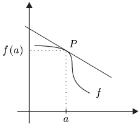
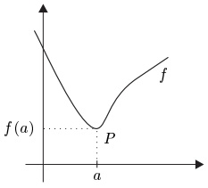
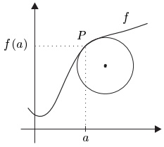
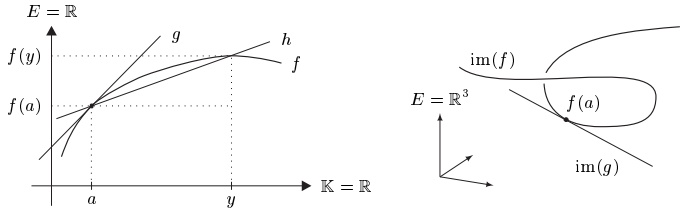
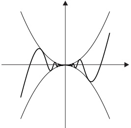
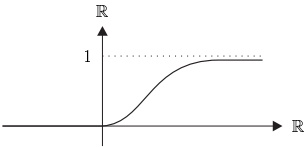

## 1 可微性

正如本章导言中已经提到的，我们发展微分学的动机，是希望用线性近似来描述函数的局部行为。于是我们被引向切线问题：给定实函数图像上的一点，确定该图像在该点处的切线。

切线问题
 

极值问题
 

密切圆问题
 

求函数的极值或求一点处的密切圆（即与图像贴合得最好的圆）的问题，与切线问题密切相关，从而也与微分学密切相关。

在下文中，$X \subseteq \mathbb{K}$ 是一个集合，$a \in X$ 是 $X$ 的聚点，而 $E = (E, \|\cdot\|)$ 是 $\mathbb{K}$ 上的赋范向量空间。

##### 导数

函数 $ f: X \to E $ 称为在 $a$ 处可微，若极限

\[ f^{\prime}(a):=\lim_{x\to a}\frac{f(x)-f(a)}{x-a} \]

在 $E$ 中存在。当此情形出现时，$f'(a) \in E$ 称为 $f$ 在 $a$ 处的导数。除了符号 $f'(a)$，导数还有许多其他记号：

\[ \dot{f}(a)\;,\quad\partial f(a)\;,\quad D f(a)\;,\quad\frac{d f}{d x}(a)\;. \]

在我们系统地研究可微函数之前，先给出定义的一些有用变形。

1.1 定理 对 $f: X \to E$，下列命题等价：

(i) $f$ 在 $a$ 处可微。

(ii) 存在某个 $ m_{a} \in E $，使得

\[ \lim_{x\to a}\frac{f(x)-f(a)-m_{a}(x-a)}{x-a}=0. \]

(iii) 存在 $ m_a \in E $ 和一个在 $a$ 处连续的函数 $ r: X \to E $，使得 $ r(a) = 0 $ 且

\[ f(x)=f(a)+m_{a}(x-a)+r(x)(x-a),\qquad x\in X. \]

在情形 (ii) 与 (iii) 中，$ m_{a}=f'(a) $。

证明 蕴含 ‘(i)⇒(ii)’ 显然，只需令 $ m_a := f'(a) $。

‘(ii)⇒(iii)’ 定义

\[ r(x):=\left\{\begin{array}{cl}0,&x=a,\\\frac{f(x)-f(a)-m_{a}(x-a)}{x-a},&x\neq a.\end{array}\right. \]

于是，由注 III.2.23(b) 与 (ii)，$r$ 具有所述性质。

‘(iii)⇒(i)’ 这同样显然。■

1.2 推论 若 $f: X \to E$ 在 $a$ 处可微，则 $f$ 在 $a$ 处连续。

证明 这立即由定理 1.1 的蕴含 ‘(i)⇒(iii)’ 得出。■

推论 1.2 的逆命题不成立：存在连续但不可微的函数（见例 1.13(k)）。

##### 线性近似

设 $f: X \to E$ 在 $a$ 处可微。则函数

\[ g:\mathbb{K}\to E~,\quad x\mapsto f(a)+f^{\prime}(a)(x-a) \]

是仿射的，且 $ g(a) = f(a) $。此外，由定理 1.1 可得

\[ \lim_{x\to a}\frac{\|f(x)-g(x)\|}{|x-a|}=0. \]

因此 $f$ 与 $g$ 在点 $a$ 处重合，且当 $x \to a$ 时，“误差” $\|f(x) - g(x)\|$ 比 $|x - a|$ 更快地趋于零。这一观察提示如下定义：函数 $f: X \to E$ 称为在 $a$ 处近似线性，若存在仿射函数 $g: \mathbb{K} \to E$，使得

\[ f(a)=g(a)\quad\text{ 且 }\quad\lim_{x\to a}\frac{\|f(x)-g(x)\|}{|x-a|}=0. \]

下面的推论表明，这一性质与可微性实际上是一回事。

1.3 推论 函数 $f: X \to E$ 在 $a$ 处可微，当且仅当它在 $a$ 处近似线性。此时，逼近的仿射函数 $g$ 唯一，且由下式给出

\[ g\colon\mathbb{K}\to E~,\quad x\mapsto f(a)+f^{\prime}(a)(x-a)~. \]

证明 ‘⇒’ 这直接由定理 1.1 得出。

‘⇐’ 设 $ g: \mathbb{K} \to E $ 是在 $ a $ 处逼近 $ f $ 的仿射函数。由命题 I.12.8，存在唯一的元素 $ b, m \in E $，使得对所有 $ x \in \mathbb{K} $ 有 $ g(x) = b + mx $。由于 $ g(a) = f(a) $，实际上对所有 $ x \in \mathbb{K} $ 有 $ g(x) = f(a) + m(x - a) $。于是结论由定理 1.1 得出。■

1.4 注 (a) 假设函数 $f: X \to E$ 在 $a$ 处可微。如上，对所有 $x \in \mathbb{K}$ 定义 $g(x) := f(a) + f'(a)(x - a)$。则 $g$ 的图像是过 $(a, f(a))$ 且在该点 $(a, f(a))$ 附近逼近 $f$ 的图像的仿射直线。这条直线称为 $f$ 在 $(a, f(a))$ 处的**切线**。在 $\mathbb{K} = \mathbb{R}$ 的情形，这一定义与初等几何的直观一致。

表达式

\[ \frac{f(y)-f(a)}{y-a},\qquad y\neq a, \]

称为 $f$ 的差商。仿射函数

\[ h(x):=f(a)+\frac{f(y)-f(a)}{y-a}(x-a),\qquad x\in\mathbb{K}, \]

的图像称为过 $ (a, f(a)) $ 与 $ (y, f(y)) $ 的**割线**。在 $ \mathbb{K} = \mathbb{R} = E $ 的情形，$ f $ 在 $ a $ 处可微意味着，当 $ y \to a $ 时，过 $ (a, f(a)) $ 与 $ (y, f(y)) $ 的割线的**斜率** $ (f(y) - f(a)) / (y - a) $ 收敛于在 $ (a, f(a)) $ 处的切线的斜率 $ f'(a) $。

(b) 设 $ X = J \subseteq \mathbb{R} $ 是区间，$ E = \mathbb{R}^3 $。假设 $ f(t) $ 给出空间中的点在时刻 $ t \in J $ 的位置。则 $ |f(t) - f(t_0)| / |t - t_0| $ 是时刻 $ t_0 $ 与 $ t $ 之间“平均速度”的绝对值，而 $ \dot{f}(t_0) $ 表示该点在时刻 $ t_0 $ 的瞬时速度。

(c) (i) 假设 $ \mathbb{K} = E = \mathbb{R} $，且 $ f: X \subseteq \mathbb{R} \to \mathbb{R} $ 是在 $ a $ 处可微的函数。把 $ f $ 看作从 $ \mathbb{C} $ 到 $ \mathbb{C} $ 的函数，即令

\[ f_{\mathbb{C}}\colon X\subseteq\mathbb{C}\to\mathbb{C}\;,\qquad f_{\mathbb{C}}(x):=f(x)\;,\quad x\in X\;. \]

则 $ f_{\mathbb{C}} $ 也在 $ a $ 处可微，且 $ f_{\mathbb{C}}^{\prime}(a) = f^{\prime}(a) $。

(ii) 现在假设 $ \mathbb{K} = E = \mathbb{C} $，且 $ f: X \subseteq \mathbb{C} \to \mathbb{C} $ 是在 $ a \in Y := X \cap \mathbb{R} $ 处可微的函数。还假设 $ a $ 是 $ Y $ 的聚点，且 $ f(Y) \subseteq \mathbb{R} $。则 $ f|Y: Y \to \mathbb{R} $ 在 $ a $ 处可微，且 $ (f|Y)'(a) = f'(a) \in \mathbb{R} $。

证明 这直接由定义、$ f $ 的可微性以及 $ \mathbb{R} $ 在 $ \mathbb{C} $ 中闭这一事实得出。 $ \blacksquare $

##### 求导法则

1.5 命题 设 $ E_1, \ldots, E_n $ 是赋范向量空间，$ E := E_1 \times \cdots \times E_n $。则 $ f = (f_1, \ldots, f_n) : X \to E $ 在 $ a $ 处可微，当且仅当每个分量函数 $ f_j : X \to E_j $ 在 $ a $ 处可微。此时，

\[ \partial f(a)=\left(\partial f_{1}(a),\ldots,\partial f_{n}(a)\right). \]

因此向量可以逐分量求导。

证明 对差商，我们有

\[ \frac{f(x)-f(a)}{x-a}=\left(\frac{f_{1}(x)-f_{1}(a)}{x-a},\cdots,\frac{f_{n}(x)-f_{n}(a)}{x-a}\right),\qquad x\neq a. \]

于是结论由例 II.1.8(e) 得出。■

在下一个定理中，我们汇总进一步的求导法则，这些法则使函数导数的计算变得相当容易。

1.6 定理

(i)（线性）设 $f, g: X \to E$ 在 $a$ 处可微，$\alpha, \beta \in \mathbb{K}$。则函数 $\alpha f + \beta g$ 也在 $a$ 处可微，且

\[ \left(\alpha f+\beta g\right)^{\prime}(a)=\alpha f^{\prime}(a)+\beta g^{\prime}(a). \]

换言之，在 $a$ 处可微的函数构成的集合形成 $E^X$ 的子空间 $V$，且函数 $V \to E$，$f \mapsto f'(a)$ 是线性的。

(ii)（乘积法则）设 $ f, g: X \to \mathbb{K} $ 在 $ a $ 处可微。则函数 $ f \cdot g $ 也在 $ a $ 处可微，且

\[ (f\cdot g)^{\prime}(a)=f^{\prime}(a)g(a)+f(a)g^{\prime}(a). \]

在 $a$ 处可微的函数构成的集合形成 $\mathbb{K}^{X}$ 的子代数。

(iii)（商法则）设 $ f, g: X \to \mathbb{K} $ 在 $ a $ 处可微，且 $ g(a) \neq 0 $。则函数 $ f/g $ 也在 $ a $ 处可微，且

\[ \left(\frac{f}{g}\right)^{\prime}(a)=\frac{f^{\prime}(a)g(a)-f(a)g^{\prime}(a)}{\left[g(a)\right]^{2}}. \]

证明 所有这些结论都直接由我们在 II.2 节证明的收敛数列的法则得出。

对 (i)，这特别明显。为证明乘积法则 (ii)，我们把 $ f \cdot g $ 的差商写成

\[ \frac{f(x)g(x)-f(a)g(a)}{x-a}=\frac{f(x)-f(a)}{x-a}g(x)+f(a)\frac{g(x)-g(a)}{x-a},\qquad x\neq a. \]

由推论 1.2，$g$ 在 $a$ 处连续，于是结论由命题 II.2.2 与 II.2.4 以及定理 III.1.4 得出。

对 (iii)，我们有 $ g(a) \neq 0 $，于是由例 III.1.3(d)，存在 $ a $ 在 $ X $ 中的邻域 $ U $，使得对所有 $ x \in U $ 有 $ g(x) \neq 0 $。于是，对每个 $ x \in U \setminus \{a\} $，我们有

\[ \Big(\frac{f(x)}{g(x)}-\frac{f(a)}{g(a)}\Big)(x-a)^{-1}=\frac{1}{g(x)g(a)}\Big[\frac{f(x)-f(a)}{x-a}g(a)-f(a)\frac{g(x)-g(a)}{x-a}\Big], \]

由此结论成立。■

##### 链式法则

复杂的函数常常可以表示为较简单函数的复合。下面的法则描述这种复合如何求导。

1.7 定理（链式法则）假设 $f: X \to \mathbb{K}$ 在 $a$ 处可微，且 $f(a)$ 是 $Y$ 的聚点，其中 $f(X) \subseteq Y \subseteq \mathbb{K}$。若 $g: Y \to E$ 在 $f(a)$ 处可微，则 $g \circ f$ 在 $a$ 处可微，且

\[ (g\circ f)^{\prime}(a)=g^{\prime}\big(f(a)\big)f^{\prime}(a). \]

证明 由假设与定理 1.1，存在在 $a$ 处连续的函数 $ r: X \to \mathbb{K} $，使得 $ r(a) = 0 $ 且

\[ f(x)=f(a)+f^{\prime}(a)(x-a)+r(x)(x-a),\qquad x\in X. \]

类似地，存在在 $b:=f(a)$ 处连续的函数 $s:Y\to E$，使得 $s(b)=0$ 且

\[ g(y)=g(b)+g^{\prime}(b)(y-b)+s(y)(y-b),\qquad y\in Y. \]

现在设 $ x \in X $，并在 (1.2) 中令 $ y := f(x) $。于是，利用 (1.1)，

\[ \begin{align*}(g\circ f)(x)&=g\big(f(a)\big)+g^{\prime}\big(f(a)\big)\big(f(x)-f(a)\big)+s\big(f(x)\big)\big(f(x)-f(a)\big)\\&=(g\circ f)(a)+g^{\prime}\big(f(a)\big)f^{\prime}(a)(x-a)+t(x)(x-a),\end{align*} \]

其中对所有 $ x \in X $，$ t(x) := g'(f(a))r(x) + s(f(x))\left(f'(a) + r(x)\right) $。由假设、推论 1.2 与定理 III.1.8，$ t: X \to E $ 在 $a$ 处连续。此外，

\[ t(a)=g^{\prime}\big(f(a)\big)r(a)+s(b)\big(f^{\prime}(a)+r(a)\big)=0~. \]

结论现在由定理 1.1 得出。

##### 反函数

利用链式法则，我们可以导出反函数可微性的判别准则，并计算它们的导数。

1.8 定理（反函数的可微性）设 $f: X \to \mathbb{K}$ 是单射，且在 $a$ 处可微。此外，假设 $f^{-1}: f(X) \to X$ 在 $b := f(a)$ 处连续。则 $f^{-1}$ 在 $b$ 处可微，当且仅当 $f'(a)$ 非零。此时，

\[ (f^{-1})^{\prime}(b)=\frac{1}{f^{\prime}(a)},\qquad b=f(a). \]

证明 ‘⇄’ 对恒等式 $ f^{-1} \circ f = \mathrm{id}_X $ 应用链式法则，得到

\[ 1=\left(\mathrm{i d}_{X}\right)^{\prime}(a)=\left(f^{-1}\right)^{\prime}\big(f(a)\big)f^{\prime}(a), \]

从而 $ (f^{-1})'(b) = 1/f'(a) $。

‘⇐’ 我们首先确认 $b$ 是 $Y := f(X)$ 的聚点。由假设，$a$ 是 $X$ 的聚点，于是由命题 III.2.9，存在 $X \setminus \{a\}$ 中的序列 $(x_k)$，使得 $\lim x_k = a$。由于 $f$ 连续，我们有 $\lim f(x_k) = f(a)$。由于 $f$ 是单射，我们还有对所有 $k \in \mathbb{N}$ 有 $f(x_k) \neq f(a)$，这表明 $b = f(a)$ 是 $Y$ 的聚点。

现在设 $(y_k)$ 是 $Y$ 中的序列，使得对所有 $k \in \mathbb{N}$ 有 $y_k \neq b$，且 $\lim y_k = b$。令 $x_k := f^{-1}(y_k)$。则 $x_k \neq a$ 且 $\lim x_k = a$，因为 $f^{-1}$ 在 $b$ 处连续。由于

\[ 0\neq f^{\prime}(a)=\lim_{k}\frac{f(x_{k})-f(a)}{x_{k}-a}, \]

存在某个 K，使得

\[ 0\neq\frac{f(x_{k})-f(a)}{x_{k}-a}=\frac{y_{k}-b}{f^{-1}(y_{k})-f^{-1}(b)},\qquad k\geq K. \]

因此，对 $ f^{-1} $ 的差商，我们有

\[ \frac{f^{-1}(y_{k})-f^{-1}(b)}{y_{k}-b}=\frac{x_{k}-a}{f(x_{k})-f(a)}=1\Big/\frac{f(x_{k})-f(a)}{x_{k}-a},\qquad k\geq K, \]

于是取极限 $ k \to \infty $ 即得结论。■

1.9 推论 设 $ I $ 是区间，$ f: I \to \mathbb{R} $ 严格单调且连续。假设 $ f $ 在 $ a \in I $ 处可微。则 $ f^{-1} $ 在 $ f(a) $ 处可微，当且仅当 $ f'(a) $ 非零，且此时 $ (f^{-1})' \big(f(a)\big) = 1/f'(a) $。

证明 由定理 III.5.7，$f$ 是单射，且 $f^{-1}$ 在区间 $J:=f(I)$ 上连续。因此结论由定理 1.8 得出。

##### 可微函数

至此我们考虑的是如下情形：$X$ 是 $\mathbb{K}$ 的任意子集，$a \in X$ 是 $X$ 的聚点。在这些条件下，我们研究了 $f: X \to E$ 在 $a$ 处的可微性。显然的下一个问题是，$f$ 是否在 $X$ 的每一点处可微。为使这一问题有意义，必须要求 $X$ 的每一点都是 $X$ 的聚点。

设 $M$ 是度量空间。子集 $A \subseteq M$ 称为完全的，若每个 $a \in A$ 都是 $A$ 的聚点。\footnote{当 $ M = \mathbb{R} $ 且 $ A $ 是区间时，这个定义与 1.10 节中的定义一致（见例 1.10(b)）。}

1.10 例 (a) 赋范向量空间的任何非空开子集都是完全的。

(b) 赋范向量空间的凸子集（特别地，$ \mathbb{R} $ 中的区间）是完全的，当且仅当它含有多于一个点。

设 $ X \subseteq \mathbb{K} $ 是完全的。则 $ f: X \to E $ 称为在 $ X $ 上可微，若 $ f $ 在 $ X $ 的每一点处可微。函数

\[ f^{\prime}\colon X\to E~,\quad x\mapsto f^{\prime}(x) \]

称为 $f$ 的导数。它也记作 $\dot{f}$、$\partial f$、$Df$ 与 $df/dx$。

##### 高阶导数

若 $ f: X \to E $ 可微，那么自然要问导数 $ f' $ 本身是否可微。当此情形出现时，$ f $ 称为二次可微，我们

称 $ \partial^2 f := f'' := \partial(\partial f) $ 为 $ f $ 的二阶导数。重复这一过程，我们可以定义 $ f $ 的更高阶导数。具体地，我们令

\[ \begin{align*}\partial^{0}f:&=f^{(0)}:=f,\quad\partial^{1}f(a):=f^{(1)}(a):=f^{\prime}(a),\\\partial^{n+1}f(a)&:=f^{(n+1)}(a):=\partial(\partial^{n}f)(a)\end{align*} \]

对所有 $ n \in \mathbb{N} $ 成立。元素 $ \partial^n f(a) \in E $ 称为 $ f $ 在 $ a $ 处的 $ n $ 阶导数。函数 $ f $ 称为在 $ X $ 上 $ n $ 次可微，若 $ n $ 阶导数在每个 $ a \in X $ 处存在。若 $ f $ 是 $ n $ 次可微的，且 $ n $ 阶导数

\[ \partial^{n}f\colon X\to E~,\quad x\mapsto\partial^{n}f(x) \]

连续，则 $f$ 是 $n$ 次连续可微的。

从 $X$ 到 $E$ 的 $n$ 次连续可微函数构成的空间记作 $C^n(X,E)$。特别地，$C^0(X,E) = C(X,E)$ 是已在 III.1 节引入的 $X$ 上的连续 $E$-值函数构成的空间。最后

\[ C^{\infty}(X,E):=\bigcap_{n\in\mathbb{N}}C^{n}(X,E) \]

是从 $X$ 到 $E$ 的无限次可微（或光滑）函数构成的空间。在不会引起误解时，我们写

\[ C^{n}(X):=C^{n}(X,\mathbb{K}),\qquad n\in\bar{\mathbb{N}}\;, \]

1.11 注 设 $ n \in \mathbb{N} $。

(a) 为使 $a$ 处的 $ (n+1) $ 阶导数有定义，$a$ 必须是 $ n $ 阶导数的定义域的聚点。特别地，若 $ n $ 阶导数在 $a$ 的某个邻域上存在，则情形正是如此。

(b) 若函数 $ f: X \to E $ 在 $ a \in X $ 处是 $ (n+1) $-次可微的，则由推论 1.2，对每个 $ j \in \{0,1,\ldots,n\} $，$ f $ 的 $ j $ 阶导数在 $ a $ 处连续。

(c) 不难看出，包含关系

\[ C^{\infty}(X,E)\subseteq C^{n+1}(X,E)\subseteq C^{n}(X,E)\subseteq C(X,E)~,\qquad n\in\mathbb{N}~, \]

成立。■

在下一个定理中，我们汇总在 $n$ 次连续可微函数空间 $ C^{n}(X,E) $ 中成立的一些最重要的法则。

1.12 定理 设 $ X \subseteq \mathbb{K} $ 是完全的，$ k \in \mathbb{N} $ 且 $ n \in \bar{\mathbb{N}} = \mathbb{N} \cup \{\infty\} $。

(i)（线性）对所有 $ f, g \in C^k(X, E) $ 与 $ \alpha, \beta \in \mathbb{K} $，

\[ \alpha f+\beta g\in C^{k}(X,E)\quad\text{ 且 }\quad\partial^{k}(\alpha f+\beta g)=\alpha\partial^{k}f+\beta\partial^{k}g. \]

因此 $C^{n}(X,E)$ 是 $C(X,E)$ 的子空间，且微分算子

\[ \partial:C^{n+1}(X,E)\to C^{n}(X,E)~,\quad f\mapsto\partial f \]

是线性的。

(ii)（莱布尼茨法则）设 $ f, g \in C^k(X) $。则 $ f \cdot g $ 属于 $ C^k(X) $，且

\[ \partial^{k}(f g)=\sum_{j=0}^{k}\binom{k}{j}(\partial^{j}f)\partial^{k-j}g. \]

因此 $ C^n(X) $ 是 $ \mathbb{K}^X $ 的子代数。

证明 (i) 第一个断言由定理 1.6 与命题 III.1.5 得出。

(ii) 由于定理 1.6 与命题 III.1.5，只需确认莱布尼茨法则 (1.3)。我们对 $k$ 作归纳来证明。情形 $k=0$ 已在命题 III.1.5 中证明。对归纳步骤 $ k \to k + 1 $，我们利用等式

\[ \binom{k+1}{j}=\binom{k}{j-1}+\binom{k}{j},\qquad k\in\mathbb{N},\quad1\leq j\leq k, \]

它来自习题 I.5.5。归纳假设、乘积法则与 (i) 蕴含

\[ \begin{align*}\partial^{k+1}(fg)&=\partial\Big(\sum_{j=0}^{k}\binom{k}{j}(\partial^{j} f)\partial^{k-j}g\Big)\\&=\sum_{j=0}^{k}\binom{k}{j}\big[(\partial^{j+1}f)\partial^{k-j}g+(\partial^{j} f)\partial^{k-j+1}g\big]\\&=(\partial^{k+1}f)g+f\partial^{k+1}g+\sum_{j=1}^{k}\Big[\binom{k}{j-1}+\binom{k}{j}\Big](\partial^{j} f)\partial^{k-j+1}g\\&=\sum_{j=0}^{k+1}\binom{k+1}{j}(\partial^{j} f)\partial^{k+1-j}g.\end{align*} \]

因此归纳完成。■

1.13 例 (a) 设 $a$ 是 $X \subseteq \mathbb{R}$ 的聚点。则 $f: X \to \mathbb{C}$ 在 $a$ 处可微，当且仅当 $\operatorname{Re} f$ 与 $\operatorname{Im} f$ 在 $a$ 处可微。此时，

\[ f^{\prime}(a)=(\operatorname{R e}f)^{\prime}(a)+i(\operatorname{I m}f)^{\prime}(a). \]

证明 这由命题 1.5 得出。

(b) 设 $ p = \sum_{k=0}^{n} a_k X^k $ 是多项式。\footnote{按照 I.8 节末的约定，我们也把多项式看作函数。} 则 $ p $ 是光滑的，且

\[ p^{\prime}(x)=\sum_{k=1}^{n}ka_{k}x^{k-1},\qquad x\in\mathbb{C}. \]

证明 设 $ 1 := 1X^0 $ 是代数 $ \mathbb{K}[X] $ 中的单位元，按照我们的约定，它与对所有 $ x \in \mathbb{K} $ 由 $ \mathbf{1}(x) = 1 $ 定义的常值函数相同。则显然

\[ \mathbf{1}\in C^{\infty}(\mathbb{K})\quad\text{且}\quad\partial\mathbf{1}=0. \]

现在用归纳法证明

\[ X^{n}\in C^{\infty}(\mathbb{K})\quad\text{且}\quad\partial(X^{n})=n X^{n-1},\qquad n\in\mathbb{N}^{\times}. \]

情形 $n=1$ 成立，因为平凡地 $\partial X = \mathbf{1}$，且由 (1.4)，$\mathbf{1} \in C^\infty(\mathbb{K})$。对归纳步骤 $n \to n+1$，我们利用乘积法则：

\[ \partial(X^{n+1})=\partial(X^{n}X)=\partial(X^{n})X+X^{n}\partial X=nX^{n-1}X+X^{n}\mathbf{1}=(n+1)X^{n}. \]

因此 (1.5) 成立。对任意多项式 $ \sum_{k=0}^{n} a_k X^k $，结论现在由定理 1.12(i) 得出。■

(c) 有理函数在其定义域上光滑。

证明 这由 (b)、定理 1.6 与推论 III.1.6 得出。

(d) 指数函数属于 $ C^\infty(\mathbb{K}) $，且满足 $ \partial(\exp) = \exp $。

证明 只需证明公式 $ \partial(\exp) = \exp $。对 $ z \in \mathbb{C} $，差商为

\[ \frac{e^{z+h}-e^{z}}{h}=e^{z}\frac{e^{h}-1}{h}\;,\qquad h\in\mathbb{C}^{\times}\;, \]

于是结论由例 III.2.25(b) 得出。■

(e) 对对数函数，我们有

\[ \operatorname{l o g}\in C^{\infty}\bigl(\mathbb{C}\backslash(-\infty,0],\mathbb{C}\bigr),\qquad(\operatorname{l o g})^{\prime}(z)=1/z,\quad z\in\mathbb{C}\backslash(-\infty,0]. \]

证明 由 (III.6.11)，我们有 $ \log = [\exp |\mathbb{R} + i(-\pi,\pi)]^{-1} $，且对数在 $ \mathbb{R} + i(-\pi,\pi) $ 上连续（见习题 III.6.9）。对每个 $ z \in \mathbb{C}\backslash(-\infty,0] $，存在唯一的 $ x $ 属于 $ \mathbb{R} + i(-\pi,\pi) $，使得 $ z = e^x $。由定理 1.8 与 (d)，我们有

\[ (\log)^{\prime}(z)=\frac{1}{(\exp)^{\prime}(x)}=\frac{1}{\exp(x)}=\frac{1}{z}, \]

于是结论由 (c) 得出。■

(f) 设 $ a \in \mathbb{C} \setminus (-\infty, 0] $。则\footnote{为避免为函数 $ z \mapsto a^z $ 引入新记号，我们有点不精确地把 $ [z \mapsto a^z]'(z) $ 写作 $ (a^z)' $。由于不会引起误解，在类似情形中都将使用这一简化记号。}

\[ [z\mapsto a^{z}]\in C^{\infty}(\mathbb{C})\quad\text{ 且 }\quad(a^{z})^{\prime}=a^{z}\log a~,\quad z\in\mathbb{C}~. \]

证明 由于对所有 $ z \in \mathbb{C} $ 有 $ a^z = e^{z\log a} $，

\[ (a^{z})^{\prime}=(e^{z\log a})^{\prime}=(\log a)e^{z\log a}=a^{z}\log a \]

由链式法则与 (d) 得出。由于 $ [z \mapsto a^z] $: $ \mathbb{C} \to \mathbb{C} $ 连续（为什么？），一个简单的归纳表明 $ [z \mapsto a^z] \in C^\infty(\mathbb{C}) $。 $ \blacksquare $

(g) 设 $ a \in \mathbb{C} $。则对幂函数，我们有

\[ [z\mapsto z^{a}]\in C^{\infty}\bigl(\mathbb{C}\backslash(-\infty,0],\mathbb{C}\bigr)\quad\text{且}\quad(z^{a})^{\prime}=a z^{a-1}\;. \]

证明 与 (f) 一样，对所有 $ z \in \mathbb{C}\backslash(-\infty,0] $ 有 $ z^a = e^{a \log z} $，于是由链式法则与 (e)，我们得到

\[ (z^{a})^{\prime}=(e^{a\log z})^{\prime}=\frac{a}{z}e^{a\log z}=\frac{a}{z}z^{a}=a z^{a-1}, \]

其中在最后一步我们还利用了 (III.6.13)。■

(h) $ \mathrm{cis} \in C^{\infty}(\mathbb{R}, \mathbb{C}) $，且对所有 $ t \in \mathbb{R} $ 有 $ \mathrm{cis}^{\prime}(t) = i \mathrm{cis}(t) $。

证明 由 (d) 与链式法则，对所有 $ t \in \mathbb{R} $ 有 $ \mathrm{cis}^{\prime}(t) = (e^{it})^{\prime} = i e^{it} = i \mathrm{cis}(t) $。■

(i) 余弦与正弦属于 $ C^\infty(\mathbb{C}) $，且 $ \cos' = -\sin $、$ \sin' = \cos $。

证明 由 (III.6.3)，余弦与正弦可以用指数函数表示：

\[ \cos z=\frac{e^{iz}+e^{-iz}}{2},\quad\sin z=\frac{e^{iz}-e^{-iz}}{2i},\qquad z\in\mathbb{C}. \]

利用 (d) 与链式法则，我们得到

\[ \cos^{^{\prime}}z=i\frac{e^{iz}-e^{-iz}}{2}=-\sin z,\quad\sin^{^{\prime}}z=i\frac{e^{iz}+e^{-iz}}{2i}=\cos z, \]

因此余弦与正弦是光滑的。

(j) 正切函数与余切函数在其定义域上光滑，且

\[ \tan^{\prime}=\frac{1}{\cos^{2}}=1+\tan^{2},\quad\cot^{\prime}=\frac{-1}{\sin^{2}}=-1-\cot^{2}. \]

证明 商法则与 (i) 给出

\[ \tan^{\prime}z=\left(\frac{\sin}{\cos}\right)^{\prime}(z)=\frac{\cos^{2}z+\sin^{2}z}{\cos^{2}z}=\frac{1}{\cos^{2}z}=1+\tan^{2}z\;,\qquad z\in\mathbb{C}\backslash\left(\pi/2+\pi\mathbb{Z}\right)\;. \]

余切函数的证明类似。

(k) 函数 $ f: \mathbb{R} \to \mathbb{R} $，$ x \mapsto |x| $ 在 0 处连续但不可微。

**证明** 对所有 $ n \in \mathbb{N} $ 令 $ h_n := (-1)^n / (n + 1) $。则 $ (h_n) $ 是零序列，使得对所有 $ n \in \mathbb{N} $ 有 $ (f(h_n) - f(0)) h_n^{-1} = (-1)^n $。因此 $ f $ 在 0 处不可微。 $ \blacksquare $

(1) 考虑函数

\[ f(x):=\left\{\begin{array}{c l}{x^{2}\sin\frac{1}{x},}&{\quad x\in\mathbb{R}^{\times},}\\ {0,}&{\quad x=0.}\end{array}\right. \]

则 $f$ 在 $\mathbb{R}$ 上可微，但导数 $f'$ 在 0 处不连续。即 $f \notin C^{1}(\mathbb{R})$。

证明 对 $f$ 在 0 处的差商，我们有

\[ \frac{f(x)-f(0)}{x}=x\sin\frac{1}{x},\qquad x\neq0, \]

于是由命题 II.2.4 有 $ f'(0) = 0 $。对所有 $ x \in \mathbb{R}^\times $，$ f'(x) = 2x \sin x^{-1} - \cos x^{-1} $，因此

\[ f^{\prime}\Big(\frac{1}{2\pi n}\Big)=\frac{1}{\pi n}\operatorname{s i n}(2\pi n)-\operatorname{c o s}(2\pi n)=-1~,\qquad n\in\mathbb{N}^\times~. \]

因此 $ f' $ 在 0 处不连续。

(m) 存在在 $ \mathbb{R} $ 上连续但处处不可微的函数。

证明 设 $f_0$ 是习题 III.1.1 中的函数。对 $n>0$，对所有 $x\in\mathbb{R}$ 由 $f_n(x):=4^{-n}f_0(4^n x)$ 定义函数 $f_n$。显然，$f_n$ 是斜率为 $\pm1$ 的分段仿射函数，且以 $4^{-n}$ 为周期。由习题 III.5.6 我们知道，函数 $F:=\sum_{n=0}^{\infty}f_n$ 在 $\mathbb{R}$ 上连续。

设 $a \in \mathbb{R}$。则对每个 $n \in \mathbb{N}$，存在某个 $h_n \in \{\pm 4^{-(n+1)}\}$，使得对 $k \leq n$，$f_k$ 在 $a$ 与 $a + h_n$ 之间是仿射的。因此对所有 $0 \leq k \leq n$ 有 $\left[f_k(a + h_n) - f_k(a)\right]/h_n = \pm 1$。对 $k > n$，我们有 $f_k(a + h_n) = f_k(a)$，因为此时 $f_k$ 以 $h_n$ 为周期。这蕴含

\[ \frac{F(a+h_{n})-F(a)}{h_{n}}=\sum_{k=0}^{n}\frac{f_{k}(a+h_{n})-f_{k}(a)}{h_{n}}=\sum_{k=0}^{n}\pm1, \]

因此 $F$ 在 $a$ 处不可微。

\[ C^{\infty}(X,E)\subset C^{n+1}(X,E)\subset C^{n}(X,E)\subset C(X,E),\ n\in\mathbb{N}^{\times}. \]

证明 鉴于注 1.11(c)，只需证明这些包含关系是真包含。我们只考虑情形 $X := \mathbb{R}$，$E := \mathbb{R}$，并把一般情形留给读者。对每个 $n \in \mathbb{N}$，由

\[ f_{n}(x):=\left\{\begin{array}{c l}{x^{n+2}\operatorname{s i n}(x^{-1}),}&{\quad x\neq0\;,}\\ {0,}&{\quad x=0\;.}\\ \end{array}\right. \]

定义 $f_n: \mathbb{R} \to \mathbb{R}$。则一个简单的归纳论证表明 $ f_n \in C^n(\mathbb{R}) \setminus C^{n+1}(\mathbb{R}) $。情形 $ n = 0 $ 已在 (l) 中证明。■

1.14 注 读者应当注意到，把注 1.4(c.ii) 应用于例 1.13(b)–(g) 与 (i)、(j)，就得到实多项式、有理函数、幂函数、指数函数、对数函数与三角函数的导数的通常法则。

##### 单侧可微性

若 $ X \subseteq \mathbb{R} $，$ a \in X $ 是 $ X \cap [a, \infty) $ 的聚点，且

\[ \partial_{+}f(a):=\lim_{x\to a+}\frac{f(x)-f(a)}{x-a} \]

存在，则 $f: X \to E$ 在 $a$ 处右可微，且 $\partial_{+}f(a) \in E$ 称为 $f$ 在 $a$ 处的右导数。

类似地，若 $a$ 是 $(-\infty, a] \cap X$ 的聚点，且

\[ \partial_{-}f(a):=\lim_{x\to a-}\frac{f(x)-f(a)}{x-a} \]

存在，则 $f$ 在 $a$ 处左可微，且 $\partial_{-}f(a)$ 称为 $f$ 在 $a$ 处的左导数。若 $a$ 既是 $X \cap [a, \infty)$ 又是 $(-\infty, a] \cap X$ 的聚点，且 $f$ 在 $a$ 处可微，则显然

\[ \partial_{+}f(a)=\partial_{-}f(a)=\partial f(a). \]

1.15 例 (a) 对 $ f: \mathbb{R} \to \mathbb{R} $，$ x \mapsto |x| $，

\[ \partial_{+}f(0)=1,\quad\partial_{-}f(0)=-1,\qquad\partial_{+}f(x)=\partial_{-}f(x)=\mathrm{s i g n}(x),\quad x\neq0. \]

(b) 设 $a < b$ 且 $f: [a, b] \to E$。则 $f$ 在 $a$（或 $b$）处可微，当且仅当 $f$ 在 $a$（或 $b$）处右（或左）可微。■

例 1.15(a) 表明，函数 $f: X \to E$ 的左、右导数的存在并不蕴含导数的存在。下一个命题表明，所缺的条件是单侧导数必须相等。

1.16 命题 设 $ X \subseteq \mathbb{R} $，$ f: X \to E $ 在 $ a \in X $ 处右可微且左可微，且 $ \partial_+(a) = \partial_-(a) $。则 $ f $ 在 $ a $ 处可微，且 $ \partial f(a) = \partial_+(a) $。

证明 由假设与命题 1.1(iii)，存在函数

\[ r_{+}:X\cap[a,\infty)\to E\quad\text{ 且 }\quad r_{-}:(-\infty,a]\cap X\to E \]

它们在 $a$ 处连续，且满足 $ r_{+}(a)=r_{-}(a)=0 $ 以及

\[ f(x)=f(a)+\partial_{\pm}f(a)(x-a)+r_{\pm}(x)(x-a),\qquad x\in X,\quad x\gtrless a. \]

现在令 $ \partial f(a) := \partial_{+} f(a) = \partial_{-} f(a) $，并令

\[ r(x):=\left\{\begin{array}{l l}{r_{+}(x)\;,\quad}&{x\in X\cap[a,\infty)\;,}\\ {r_{-}(x)\;,\quad}&{x\in(-\infty,a]\cap X\;.}\\ \end{array}\right. \]

则由命题 III.1.12，$ r: X \to E $ 在 $a$ 处连续，$ r(a) = 0 $，且

\[ f(x)=f(a)+\partial f(a)(x-a)+r(x)(x-a),\qquad x\in X. \]

因此结论由命题 1.1(iii) 得出。■

1.17 例 设

\[ f(x):=\left\{\begin{array}{c l}{e^{-1/x}\;,}&{\quad x>0\;,}\\ {0\;,}&{\quad x\leq0\;.}\\ \end{array}\right. \]

则 $f$ 是光滑的，且其所有导数在 $x = 0$ 处都为零。

证明 只需证明 $f$ 的所有导数都存在，且满足

\[ \partial^{n}f(x)=\left\{\begin{array}{c l}{p_{2n}(x^{-1})e^{-x^{-1}},}&{\quad x>0,}\\ {0,}&{\quad x\leq0,}\\ \end{array}\right. \]

其中 $ p_{2n} $ 表示次数 $ \leq 2n $ 的实系数多项式。

显然对 $x < 0$，(1.6) 成立。在情形 $x > 0$，对 $n = 0$，(1.6) 成立。若公式对某个 $n \in \mathbb{N}$ 成立，则

\[ \begin{align*}\partial^{n+1}f(x)&=\partial\big(p_{2n}(x^{-1})e^{-x^{-1}}\big)\\&=-\partial p_{2n}(x^{-1})(x^{-2})e^{-x^{-1}}+p_{2n}(x^{-1})e^{-x^{-1}}x^{-2}\\&=p_{2(n+1)}(x^{-1})e^{-x^{-1}},\end{align*} \]

其中 $p_{2(n+1)}(X):=\big(p_{2n}(X)-\partial p_{2n}(X)\big)X^{2}$。由于 $\deg(p_{2n})\leq2n$，$\partial p_{2n}$ 的次数至多为 $2n-1$，且 (I.8.20) 给出 $\deg(p_{2(n+1)})\leq2(n+1)$。因此对所有 $x>0$，(1.6) 成立。

还需考虑情形 $x = 0$。我们再次用归纳法证明。情形 $ n = 0 $ 是平凡的。对归纳步骤 $ n \to n + 1 $，我们计算

\[ \partial_{+}(\partial^{n}f)(0)=\lim_{x\to0+}\frac{\partial^{n}f(x)-\partial^{n}f(0)}{x-0}=\lim_{x\to0+}\left[x^{-1}p_{2n}(x^{-1})e^{-x^{-1}}\right], \]

其中第二个等号利用了归纳假设与 (1.6)。此外，由命题 III.6.5(iii) 与 II.5.2(i)，我们有

\[ \lim_{x\to0+}\left[q(x^{-1})e^{-x^{-1}}\right]=\lim_{y\to\infty}\frac{q(y)}{e^{y}}=0 \]

对所有 $ q \in \mathbb{R}[X] $ 成立。因此 $ \partial^n f $ 在 0 处右可微，且 $ \partial_+(\partial^n f)(0) = 0 $。由于 $ \partial^n f $ 显然在 0 处左可微，且 $ \partial_-( \partial^n f)(0) = 0 $，由命题 1.16 可得 $ \partial^{n+1} f(0) = 0 $。这就完成了 (1.6) 的证明。 $ \blacksquare $

##### 习题

1 当 $ f(x) $ 为下列函数时，计算 $ f: (0, \infty) \to \mathbb{R} $ 的导数：

\[ \mathrm{(a)~}(x^{x})^{x}~,\quad\mathrm{(b)~}x^{(x^{x})}~,\quad\mathrm{(c)~}x^{1/x}~,\quad\mathrm{(d)~}\log\log(1+x)~, \]

\[ \mathrm{(e)}x^{\sin x},\quad\mathrm{(f)}\sqrt[3]{x^{3/5}+\sin^{3}(1/x)-\tan^{2}(x)},\quad\mathrm{(g)}\frac{\cos x}{2+\sin\log x}. \]

2 对 $ m, n \in \mathbb{N} $，由

\[ f_{m,n}(x):=\left\{\begin{array}{c l}{x^{n}\operatorname{s i n}(x^{-m})~,}&{\quad x\neq0~,}\\ {0~,}&{\quad x=0~.}\\ \end{array}\right. \]

定义 $ f_{m,n} : \mathbb{R} \to \mathbb{R} $。对哪些 $ k \in \bar{\mathbb{N}} $ 有 $ f_{m,n} \in C^k(\mathbb{R}) $？

3 假设 $ f, g: \mathbb{K} \to \mathbb{K} $ 满足 $ f' = f $，对所有 $ x \in \mathbb{K} $ 有 $ f(x) \neq 0 $，且 $ g' = g $。证明 $ f $ 与 $ g $ 属于 $ C^\infty(\mathbb{K}, \mathbb{K}) $，且存在某个 $ c \in \mathbb{K} $，使得 $ g = cf $。

4 证明 $ f: \mathbb{C} \to \mathbb{C} $，$ z \mapsto \overline{z} $ 处处不可微。

5 $f: \mathbb{C} \to \mathbb{C}$，$z \mapsto z\overline{z}$ 在哪些点处可微？

6 设 $U$ 是 $\mathbb{K}$ 中 $0$ 的邻域，$E$ 是赋范向量空间，$f: U \to E$。

(a) 假设存在数 $ K > 0 $ 与 $ \alpha > 1 $，使得对所有 $ x \in U $ 有 $ |f(x)| \leq K|x|^\alpha $。证明 $ f $ 在 0 处可微。

(b) 假设 $ f(0) = 0 $，且存在 $ K > 0 $ 与 $ \alpha \in (0,1) $，使得对所有 $ x \in U $ 有 $ |f(x)| \geq K|x|^\alpha $。证明 $ f $ 在 0 处不可微。

(c) 若对所有 $ x \in U $ 有 $ |f(x)| = K|x| $，能得出什么结论？

7 对函数 $ f: \mathbb{R} \to \mathbb{R} $，$ x \mapsto \lfloor x \rfloor + \sqrt{x - \lfloor x \rfloor} $ 计算 $ \partial_\pm f(x) $。$ f $ 在何处可微？

8 假设 $ I $ 是完全区间，$ f, g: I \to \mathbb{R} $ 可微。证明或反驳函数 $ |f| $、$ f \vee g $ 与 $ f \wedge g $ (a) 可微，(b) 单侧可微。

9 设 $U$ 在 $\mathbb{K}$ 中开，$a \in U$，$f: U \to E$。证明或反驳下列命题：

(a) 若 $f$ 在 $a$ 处可微，则

\[ f^{\prime}(a)=\lim_{h\to0}\frac{f(a+h)-f(a-h)}{2h}. \]

(b) 若 $ \lim_{h\to0}\left[f(a+h)-f(a-h)\right]/2h $ 存在，则 $f$ 在 $a$ 处可微，且 (1.8) 成立。

10 设 $ n \in \mathbb{N}^\times $ 且 $ f \in C^n(\mathbb{K}) $。证明

\[ \partial^{n}\left(x f(x)\right)=x\partial^{n}f(x)+n\partial^{(n-1)}f(x). \]

11 对 $ n \in \mathbb{N}^* $，证明

\[ \partial^{n}(x^{n-1}e^{1/x})=(-1)^{n}\frac{e^{1/x}}{x^{n+1}},\qquad x>0. \]

12 勒让德多项式 $ P_{n} $ 由下式定义：

\[ P_{n}(x):=\frac{1}{2^{n}n!}\partial^{n}\bigl[(x^{2}-1)^{n}\bigr],\qquad n\in\mathbb{N}. \]

(a) 计算 $ P_{0}, P_{1}, \ldots, P_{5} $。

(b) 证明 $ P_{n} $ 是次数为 $n$ 且在 $ (-1,1) $ 中有 $n$ 个零点的多项式。
