## 2 中值定理及其应用

设 $ f: \mathbb{R} \to \mathbb{R} $ 是一个可微函数。若我们从几何上把 $ f' $ 视为 $ f $ 的图像上各点处切线的斜率，则直观上很清楚：借助 $ f' $，不仅可以研究 $ f $ 的局部性质，还可以研究其整体性质。例如，若 $ f $ 在 $ a $ 处取得局部极值，则在 $ (a, f(a)) $ 处的切线必为水平，即 $ f'(a) = 0 $。另一方面，若导数 $ f' $ 处处为正，则 $ f $ 具有递增这一整体性质。

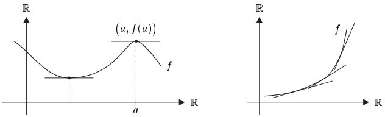

下面，我们将这些想法加以推广并使之更加精确。
 

##### 极值

设 $X$ 是度量空间，$f$ 是 $X$ 上的实值函数。若存在 $x_0$ 的邻域 $U$ 使得对所有 $x \in U$ 有 $f(x_0) \leq f(x)$（或 $f(x_0) \geq f(x)$），则称 $f$ 在 $x_0 \in X$ 处取得 $\text{局部}$ $\text{极小值}$（或 $\text{局部}$ $\text{极大值}$）。若对所有 $x \in X$ 有 $f(x_0) \leq f(x)$（或 $f(x_0) \geq f(x)$），则称函数 $f$ 在 $x_0$ 处取得 $\text{全局}$ $\text{极小值}$（或 $\text{全局}$ $\text{极大值}$）。最后，若 $f$ 在 $x_0$ 处取得 $\text{局部}$（或 $\text{全局}$）$\text{极小值}$ 或 $\text{极大值}$，则称 $f$ 在 $x_0$ 处取得 $\text{局部}$（或 $\text{全局}$）$\text{极值}$。

2.1 定理（局部极值的必要条件） 设 $ X \subseteq \mathbb{R} $ 且 $ f: X \to \mathbb{R} $ 在 $ a \in \mathring{X} $ 处取得局部极值。若 $ f $ 在 $ a $ 处可微，则 $ f'(a) = 0 $。

证明 设 $f$ 在 $a$ 处取得局部极小值。则存在开区间 $I$ 使得 $a \in I \subseteq X$ 且对所有 $x \in I$ 有 $f(x) \geq f(a)$。于是

\[ \frac{f(x)-f(a)}{x-a}\left\{\begin{array}{ll}\geq0,\quad&x\in I\cap(a,\infty),\\ \leq0,\quad&x\in(-\infty,a)\cap I.\end{array}\right. \]

在极限 $ x \to a $ 下，这意味着 $ 0 \leq \partial_+ f(a) = \partial_- f(a) \leq 0 $，从而 $ f'(a) = 0 $。若 $ f $ 在 $ a $ 处取得局部极大值，则 $ -f $ 在 $ a $ 处取得局部极小值。因此，此时也有 $ f'(a) = 0 $。■

若 $X \subseteq \mathbb{K}$ 且 $f: X \to E$ 在 $a \in X$ 处可微且 $f'(a) = 0$，则称 $a$ 为 $f$ 的**临界点**。因此，定理 2.1 表明：若 $f$ 在 $a \in \mathring{X}$ 处取得局部极值且在 $a$ 处可微，则 $a$ 是 $f$ 的临界点。

2.2 注 设 $ f\colon [a,b] \to \mathbb{R} $ 且 $ -\infty < a < b < \infty $。

(a) 若 $f$ 在 $a$ 处可微且在 $a$ 处取得局部极小值（或极大值），则 $f'(a) \geq 0$（或 $f'(a) \leq 0$）。类似地，若 $f$ 在 $b$ 处可微且在 $b$ 处取得局部极小值（或极大值），则 $f'(b) \leq 0$（或 $f'(b) \geq 0$）。

证明 这直接由定理 2.1 的证明得出。

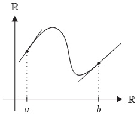

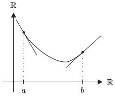

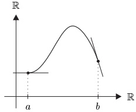

(b) 设 $f$ 在 $ [a,b] $ 上连续且在 $ (a,b) $ 上可微。则

\[ \max_{x\in[a,b]}f(x)=f(a)\lor f(b)\lor\max\{f(x);x\in(a,b),f^{\prime}(x)=0\}, \]

也就是说，$f$ 要么在 $[a,b]$ 的端点处，要么在 $(a,b)$ 内的临界点处取得最大值。类似地

\[ \min_{x\in[a,b]}f(x)=f(a)\land f(b)\land\min\{f(x)~;~x\in(a,b),~f^{\prime}(x)=0\}~. \]

证明 由极值定理（推论 III.3.8），存在 $ x_0 \in [a, b] $ 使得对 $ x \in [a, b] $ 有 $ f(x_0) \geq f(x) $。若 $ x_0 $ 不是 $ [a, b] $ 的端点，则由定理 2.1，$ x_0 $ 是 $ f $ 的临界点。第二个断言可类似证明。

(c) 若 $ x_0 \in (a, b) $ 是 $ f $ 的临界点，并不能推出 $ f $ 在 $ x_0 $ 处取得极值。

证明 考虑三次多项式 $ f(x) := x^3 $ 在 $ x_0 = 0 $ 处的情形。■

##### 中值定理

在下面两个定理中，$a$ 和 $b$ 是满足 $a < b$ 的实数。

2.3 定理（罗尔定理） 设 $ f \in C([a, b], \mathbb{R}) $ 在 $ (a, b) $ 上可微。若 $ f(a) = f(b) $，则存在某个 $ \xi \in (a, b) $ 使得 $ f'(\xi) = 0 $。

证明 若 $f$ 在区间 $[a,b]$ 上为常数，则结论显然。事实上，此时 $f'=0$。若 $f$ 在 $[a,b]$ 上不为常数，则 $f$ 在 $(a,b)$ 内取得极值，结论由注 2.2(b) 得出。

2.4 定理（中值定理） 若 $ f \in C([a, b], \mathbb{R}) $ 在 $ (a, b) $ 上可微，则存在某个 $ \xi \in (a, b) $ 使得

\[ f(b)=f(a)+f^{\prime}(\xi)(b-a). \]

证明 令

\[ g(x):=f(x)-\frac{f(b)-f(a)}{b-a}x~,\qquad x\in[a,b]~. \]

则 $ g\colon [a,b] \to \mathbb{R} $ 满足罗尔定理的假设。因此存在某个 $ \xi \in (a,b) $ 使得

\[ 0=g^{\prime}(\xi)=f^{\prime}(\xi)-\frac{f(b)-f(a)}{b-a}, \]

这就证明了结论。■

从几何上看，中值定理说的是：存在（至少）一个点 $ \xi \in (a, b) $，使得 $ f $ 的图像在 $ (\xi, f(\xi)) $ 处的切线 $ t $ 平行于经过 $ (a, f(a)) $ 与 $ (b, f(b)) $ 的割线 $ s $，也就是说，这两条直线的斜率相等：

\[ f^{\prime}(\xi)=\frac{f(b)-f(a)}{b-a}. \]

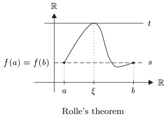

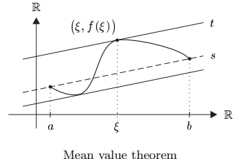

##### 单调性与可微性

2.5 定理（单调函数的刻画） 设 $I$ 是完全区间且 $f \in C(I, \mathbb{R})$ 在 $\mathring{I}$ 上可微。

(i) $f$ 递增（或递减）当且仅当对所有 $x \in \mathring{I}$ 有 $f'(x) \geq 0$（或 $f'(x) \leq 0$）。

(ii) 若对所有 $ x \in \mathring{I} $ 有 $ f'(x) > 0 $（或 $ f'(x) < 0 $），则 $ f $ 严格递增（或严格递减）。

证明 (i) “$\Rightarrow$” 若 $f$ 递增，则

\[ \frac{f(y)-f(x)}{y-x}\geq0,\qquad x,y\in\mathring{I},\quad x\neq y. \]

取极限 $ y \to x $，我们得到对所有 $ x \in \mathring{I} $ 有 $ f'(x) \geq 0 $。$ f $ 递减的情形可类似证明。

“⇐” 设 $ x, y \in I $ 满足 $x < y$。由中值定理，存在某个 $ \xi \in (x, y) $ 使得

\[ f(y)=f(x)+f^{\prime}(\xi)(y-x). \]

若对所有 $ z \in \mathring{I} $ 有 $ f'(z) \geq 0 $，则特别地有 $ f'(\xi) \geq 0 $，于是由 (2.1) 可得 $ f(y) \geq f(x) $。因此 $ f $ 递增。类似地，若对所有 $ z \in \mathring{I} $ 有 $ f'(z) \leq 0 $，则 $ f $ 递减。

断言 (ii) 直接由 (2.1) 得出。■

2.6 注 (a)（常数函数的刻画） 在定理 2.5 的假设下，$f$ 为常数当且仅当 $ f' = 0 $。

证明 这由定理 2.5(i) 得出。

(b) 定理 2.5(ii) 的逆命题不成立。函数 $ f(x) := x^3 $ 严格递增，但其导数在 $0$ 处为零。此外，在 (a) 中，定义域为区间这一点是本质性的（为什么？）。

作为罗尔定理的进一步应用，我们证明实可微函数单射性的一个简单判据。

2.7 命题 设 $ I $ 是完全区间且 $ f \in C(I, \mathbb{R}) $ 在 $ \mathring{I} $ 上可微。若 $ f' $ 在 $ \mathring{I} $ 内没有零点，则 $ f $ 是单射。

证明 若 $f$ 不是单射，则存在 $x, y \in I$ 使得 $x < y$ 且 $f(x) = f(y)$。于是，由罗尔定理，$f'$ 在 $x$ 与 $y$ 之间有一个零点。

2.8 定理 设 $ I $ 是完全区间且 $ f: I \to \mathbb{R} $ 可微，且对所有 $ x \in I $ 有 $ f'(x) \neq 0 $。

(i) $f$ 严格单调。

(ii) $J := f(I)$ 是完全区间。

(iii) $ f^{-1} $: $ J \to \mathbb{R} $ 可微，且对所有 $ x \in I $ 有 $ (f^{-1})' \big(f(x)\big) = 1/f'(x) $。

证明 首先我们验证 (ii)。由推论 1.2 与命题 2.7，$f$ 连续且单射。于是介值定理与例 1.10(b) 蕴含 $J$ 是完全区间。

为证 (i)，假设 $f$ 不严格单调。由于由注 2.6(a)，$f$ 在任何完全子区间上都不为常数，故存在 $x < y < z$ 使得 $f(x) > f(y) < f(z)$ 或 $f(x) < f(y) > f(z)$。由介值定理与极值定理，$f$ 在某个 $\xi \in (x, z)$ 处取得极值。由定理 2.1，我们有 $f'(\xi) = 0$，这与我们的假设矛盾。最后，断言 (iii) 由 (i) 及推论 1.2 与 1.9 得出。

2.9 注 (a) 函数 cis: $ \mathbb{R} \to \mathbb{C} $ 具有周期 $ 2\pi $，因此当然不是单射。尽管如此，对所有 $ t \in \mathbb{R} $ 有 $ \mathrm{cis}'(t) = ie^{it} \neq 0 $。这表明命题 2.7 对复值（或向量值）函数不成立。

(b) 若定理 2.8 的假设成立，则由 (i) 与定理 2.5 可得，要么

\[ f^{\prime}(x)>0,\quad x\in I,\qquad\text{或}\qquad f^{\prime}(x)<0,\quad x\in I. \]

注意，(2.2) 并不能由“对所有 $ x \in I $ 有 $ f'(x) \neq 0 $”与介值定理推出，因为 $ f' $ 可能不连续。■

2.10 应用 对三角函数，我们有

\[ \cos^{\prime}x=-\sin x\neq0,\quad\cot^{\prime}x=-1/\sin^{2}x\neq0,\quad x\in(0,\pi), \]

\[ \sin^{\prime}x=\cos x\neq0,\qquad\tan^{\prime}x=1/\cos^{2}x\neq0,\qquad x\in(-\pi/2,\pi/2). \]

因此，由定理 2.8，这些函数在给定区间上的限制是单射，且具有可微的反函数，即反三角函数。这些反函数的通常记号是

\[ \arcsin:=\left(\sin\big|(-\pi/2,\pi/2)\right)^{-1}:(-1,1)\to(-\pi/2,\pi/2), \]

\[ \arccos:=\left(\cos\mid(0,\pi)\right)^{-1}:(-1,1)\to(0,\pi), \]

\[ \arctan:=\left(\tan\big|(-\pi/2,\pi/2)\right)^{-1}:\mathbb{R}\to(-\pi/2,\pi/2)~, \]

\[ \operatorname{a r c c o t}:=\left(\cot\mid(0,\pi)\right)^{-1}\qquad\quad:\mathbb{R}\to(0,\pi)~. \]

为计算反三角函数的导数，我们使用定理 2.8(iii)。对反正弦函数，这给出

\[ \arcsin^{\prime}x=\frac{1}{\sin^{\prime}y}=\frac{1}{\cos y}=\frac{1}{\sqrt{1-\sin^{2}y}}=\frac{1}{\sqrt{1-x^{2}}},\qquad x\in(-1,1), \]

其中我们已令 $ y := \arcsin x $ 并使用了 $ x = \sin y $。类似地，对反正切函数，

\[ \arctan^{\prime}x=\frac{1}{\tan^{\prime}y}=\frac{1}{1+\tan^{2}y}=\frac{1}{1+x^{2}},\qquad x\in\mathbb{R}, \]

其中 $ y \in (-\pi/2, \pi/2) $ 由 $ x = \tan y $ 确定。

反余弦函数与反余切函数的导数可用同样方法计算，总结起来，我们有

\[ \begin{aligned}\arcsin^{\prime}x&=\frac{1}{\sqrt{1-x^{2}}},\quad\arccos^{\prime}x=\frac{-1}{\sqrt{1-x^{2}}},\quad&x\in(-1,1),\\\arctan^{\prime}x&=\frac{1}{1+x^{2}},\quad\operatorname{arccot}^{\prime}x=\frac{-1}{1+x^{2}},\quad&x\in\mathbb{R}.\end{aligned} \]

特别地，(2.3) 表明反三角函数是光滑的。

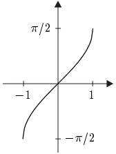

反正弦
 

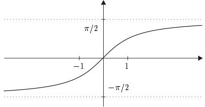

反正切
 

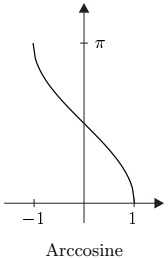

反余弦
 

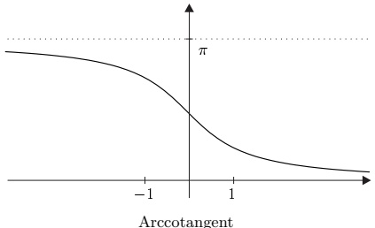

反余切
 

##### 凸性与可微性

我们已经看到，单调性是研究实函数时一个非常有用的概念。因此，导数单调的可微函数具有“特别良好”的性质，也就不足为奇了。

设 $C$ 是向量空间 $V$ 的凸子集。则 $f: C \to \mathbb{R}$ 是凸的，若

\[ f\big((1-t)x+t y\big)\leq(1-t)f(x)+t f(y),\qquad x,y\in C,\quad t\in(0,1), \]

且严格凸的，若

\[ f\big((1-t)x+t y\big)<(1-t)f(x)+t f(y),\qquad x,y\in C,\quad x\neq y,\quad t\in(0,1). \]

最后，若 $-f$ 是凸的（或严格凸的），则称 $f$ 是凹的（或严格凹的）。

2.11 注 (a) 显然，$f$ 是凹的（或严格凹的）当且仅当

\[ f\big((1-t)x+ty\big)\geq(1-t)f(x)+tf(y), \]

（或

\[ f\big((1-t)x+ty\big)>(1-t)f(x)+tf(y)\ \Big) \]

对所有满足 $ x \neq y $ 的 $ x, y \in C $ 以及对所有 $ t \in (0,1) $ 成立。

(b) 设 $ I \subseteq \mathbb{R} $ 是完全区间\footnote{由注 III.4.9(c)，$ \mathbb{R} $ 的子集 $ I $ 是凸的当且仅当 $ I $ 是区间。}且 $ f: I \to \mathbb{R} $。则下列各命题等价：

(i) $f$ 是凸的。

(ii) 对所有满足 $a < b$ 的 $ a, b \in I $，

\[ f(x)\leq f(a)+\frac{f(b)-f(a)}{b-a}(x-a),\qquad a<x<b. \]

(iii) 对所有满足 $a < b$ 的 $ a, b \in I $，

\[ \frac{f(x)-f(a)}{x-a}\leq\frac{f(b)-f(a)}{b-a}\leq\frac{f(b)-f(x)}{b-x},\qquad a<x<b. \]

(iv) 对所有满足 $a < b$ 的 $ a, b \in I $，

\[ \frac{f(x)-f(a)}{x-a}\leq\frac{f(b)-f(x)}{b-x},\qquad a<x<b. \]

若在 (ii)–(iv) 中，符号 $ \leq $ 处处被 $<$ 替换，则这些命题等价于 $f$ 严格凸。对凹函数与严格凹函数，有类似的命题成立。

证明 “(i) $\Rightarrow$ (ii) 设 $a, b \in I$ 满足 $a < b$ 且 $x \in (a, b)$。令 $t := (x - a)/(b - a)$。则 $t \in (0,1)$ 且 $(1 - t)a + tb = x$，于是由 $f$ 的凸性可得

\[ f(x)\leq\Big(1-\frac{x-a}{b-a}\Big)f(a)+\frac{x-a}{b-a}f(b)=f(a)+\frac{f(b)-f(a)}{b-a}(x-a). \]

“(ii)⇒(iii)” (iii) 中的第一个不等式直接由 (ii) 得出。由 (ii) 我们还有

\[ f(b)-f(x)\geq f(b)-f(a)-\frac{f(b)-f(a)}{b-a}(x-a)=\frac{f(b)-f(a)}{b-a}(b-x), \]

由此可得

\[ \frac{f(b)-f(a)}{b-a}\leq\frac{f(b)-f(x)}{b-x}. \]

'(iv)$\Rightarrow$(i)' 设 $ a, b \in I $ 满足 $ a < b $ 且 $ t \in (0,1) $。则 $ x := (1 - t)a + tb $ 属于 $ (a,b) $，于是

\[ \frac{f(x)-f(a)}{x-a}\leq\frac{f(b)-f(x)}{b-x}. \]

这个不等式蕴含

\[ f\big((1-t)a+t b\big)=f(x)\leq\frac{b-x}{b-a}f(a)+\frac{x-a}{b-a}f(b)=(1-t)f(a)+t f(b). \]

因此 $f$ 是凸的。

其余断言可类似证明。■

(c) 从几何上看，(b) 的 (ii) 说的是：$f|(a,b)$ 的图像位于经过 $(a,f(a))$ 与 $(b,f(b))$ 的割线下方。

(b) 的不等式 (iii) 说的是：经过 $(a, f(a))$ 与 $(x, f(x))$ 的割线的斜率，小于经过 $(a, f(a))$ 与 $(b, f(b))$ 的割线的斜率，而后者又小于经过 $(x, f(x))$ 与 $(b, f(b))$ 的割线的斜率。

2.12 定理（凸函数的刻画） 设 $I$ 是完全区间且 $f: I \to \mathbb{R}$ 可微。则 $f$（严格）凸当且仅当 $f'$（严格）递增。

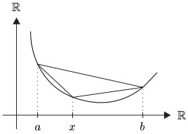

证明 ‘$\Rightarrow$’ 设 $f$ 严格凸，且 $a,b\in I$ 满足 $a<b$。则我们可选取 $(a,b)$ 中的严格递减序列 $(x_n)$ 与 $(a,b)$ 中的严格递增序列 $(y_n)$，使得 $\lim x_n=a$、$\lim y_n=b$ 且 $x_0<y_0$。由注 2.11(b) 我们有

\[ \frac{f(x_{n})-f(a)}{x_{n}-a}<\frac{f(x_{0})-f(a)}{x_{0}-a}<\frac{f(y_{0})-f(x_{0})}{y_{0}-x_{0}}<\frac{f(y_{n})-f(y_{0})}{y_{n}-y_{0}}<\frac{f(y_{n})-f(b)}{y_{n}-b}. \]

取极限 $ n \to \infty $，我们得到

\[ f^{\prime}(a)\leq\frac{f(x_{0})-f(a)}{x_{0}-a}<\frac{f(y_{0})-f(x_{0})}{y_{0}-x_{0}}\leq f^{\prime}(b). \]

因此 $ f^{\prime} $ 严格递增。

若 $f$ 凸，则上述讨论表明不等式 $a < b$ 蕴含 $f'(a) \leq f'(b)$。也就是说，$f'$ 递增。

“⇐” 设 $a,b,x \in I$ 满足 $a < x < b$。由中值定理，存在 $\xi \in (a,x)$ 与 $\eta \in (x,b)$ 使得

\[ \frac{f(x)-f(a)}{x-a}=f^{\prime}(\xi)\quad\text{且}\quad\frac{f(b)-f(x)}{b-x}=f^{\prime}(\eta). \]

于是结论由注 2.11(b) 及 $ f' $ 的（严格）单调性得出。■

2.13 推论 设 $ I $ 是完全区间且 $ f: I \to \mathbb{R} $ 二次可微。

(i) $f$ 凸当且仅当对所有 $ x \in I $ 有 $ f''(x) \geq 0 $。

(ii) 若对所有 $ x \in I $ 有 $ f''(x) > 0 $，则 $ f $ 严格凸。

证明 这直接由定理 2.5 与 2.12 得出。

2.14 例 (a) $ \exp: \mathbb{R} \to \mathbb{R} $ 严格递增且严格凸。

(b) $ \log: (0, \infty) \to \mathbb{R} $ 严格递增且严格凹。

(c) 对 $ \alpha \in \mathbb{R} $，设 $ f_{\alpha}:(0, \infty) \to \mathbb{R} $，$ x \mapsto x^{\alpha} $ 为幂函数。则 $ f_{\alpha} $ 是

严格递增且严格凸的，若 $ \alpha > 1 $，

严格递增且严格凹的，若 $ 0 < \alpha < 1 $，

严格递减且严格凸的，若 $ \alpha < 0 $。

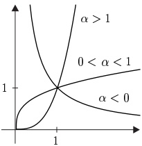

证明 所有断言都由定理 2.5、推论 2.13 及下列关系得出：

 $ (\alpha)\ \exp = \exp' = \exp'' > 0, $

 $ (\beta)\ \log'(x) = x^{-1} > 0,\ \log''(x) = -x^{-2} < 0 $ 对所有 $ x \in (0, \infty) $ 成立，

 $ (\gamma) $  $ f'_{\alpha} = \alpha f_{\alpha-1} $， $ f''_{\alpha} = \alpha (\alpha-1) f_{\alpha-2} $，且 $ f_{\beta}(x) > 0 $ 对所有 $ x \in (0, \infty) $ 与 $ \beta \in \mathbb{R} $ 成立。■

##### 杨、赫尔德与闵可夫斯基不等式

对数函数的凹性与指数函数的单调性，使得分析学中一个基本不等式——杨不等式——可以得到一个优雅的证明。为给出这个证明，引入下列记号是很有用的：对 $p \in (1, \infty)$，我们称 $p' := p/(p-1)$ 为 $p$ 的赫尔德共轭。它由方程\footnote{特别地，由 (2.4) 可得 $ (p')' = p $。}确定

\[ \frac{1}{p}+\frac{1}{p^{\prime}}=1. \]

2.15 定理（杨不等式） 对 $ p \in (1, \infty) $，

\[ \xi\eta\leq\frac{1}{p}\xi^{p}+\frac{1}{p^{\prime}}\eta^{p^{\prime}},\qquad\xi,\eta\in\mathbb{R}^{+}. \]

证明 只需考虑 $ \xi, \eta \in (0, \infty) $ 的情形。对数函数的凹性与 (2.4) 蕴含不等式

\[ \log\Bigl(\frac{\xi^{p}}{p}+\frac{\eta^{p^{\prime}}}{p^{\prime}}\Bigr)\geq\frac{1}{p}\log\xi^{p}+\frac{1}{p^{\prime}}\log\eta^{p^{\prime}}=\log\xi+\log\eta=\log\xi\eta. \]

由于指数函数递增，且对所有 $ x $ 有 $ \exp \log x = x $，故所证不等式成立。■

2.16 应用 (a)（几何平均与算术平均不等式\footnote{见习题 I.10.10。}） 对 $ n \in \mathbb{N}^\times $ 与 $ x_j \in \mathbb{R}^+ $，$ 1 \leq j \leq n $，

\[ \sqrt[n]{\prod_{j=1}^{n} x_{j}}\leq\frac{1}{n}\sum_{j=1}^{n} x_{j}. \]

证明 我们可以假设所有 $ x_j $ 均为正。对 $ n = 1 $，(2.5) 显然成立。现在假设 (2.5) 对某个 $ n \in \mathbb{N}^* $ 成立。则

\[ \sqrt[n+1]{\prod_{j=1}^{n+1}x_{j}}\leq\left(\frac{1}{n}\sum_{j=1}^{n}x_{j}\right)^{n/(n+1)}(x_{n+1})^{1/(n+1)}. \]

对这个不等式的右边，我们应用杨不等式，其中

\[ \xi:=\left(\frac{1}{n}\sum_{j=1}^{n}x_{j}\right)^{n/(n+1)},\quad\eta:=(x_{n+1})^{1/(n+1)},\quad p:=1+\frac{1}{n}. \]

则

\[ \xi\eta\leq\frac{1}{p}\xi^{p}+\frac{1}{p^{\prime}}\eta^{p^{\prime}}=\frac{1}{n+1}\sum_{j=1}^{n}x_{j}+\frac{1}{n+1}x_{n+1}=\frac{1}{n+1}\sum_{j=1}^{n+1}x_{j}, \]

这就证明了结论。■

(b)（赫尔德不等式） 对 $ p \in (1, \infty) $ 与 $ x = (x_1, \ldots, x_n) \in \mathbb{K}^n $，定义

\[ |x|_{p}:=\big(\sum_{j=1}^{n}|x_{j}|^{p}\big)^{1/p}. \]

则\footnote{在 $ p = p' = 2 $ 的情形，此式化为柯西-施瓦茨不等式。}

\[ \sum_{j=1}^{n}\left|x_{j} y_{j}\right|\leq\left|x\right|_{p}\left|y\right|_{p^{\prime}},\qquad x,y\in\mathbb{K}^{n}. \]

证明 只需考虑 $ x \neq 0 $ 且 $ y \neq 0 $ 的情形。由杨不等式我们有

\[ \frac{|x_{j}|}{|x|_{p}}\frac{|y_{j}|}{|y|_{p^{\prime}}}\leq\frac{1}{p}\frac{|x_{j}|^{p}}{|x|_{p}^{p}}+\frac{1}{p^{\prime}}\frac{|y_{j}|^{p^{\prime}}}{|y|_{p^{\prime}}^{p^{\prime}}},\qquad1\leq j\leq n. \]

对这些不等式关于 $j$ 求和，得到

\[ \frac{\sum_{j=1}^{n}\left|x_{j}y_{j}\right|}{\left|x\right|_{p}\left|y\right|_{p^{\prime}}}\leq\frac{1}{p}+\frac{1}{p^{\prime}}=1, \]

于是结论成立。■

(c)（闵可夫斯基不等式） 对所有 $ p \in (1, \infty) $，

\[ |x+y|_{p}\leq|x|_{p}+|y|_{p}\;,\qquad x,y\in\mathbb{K}^{n}\;. \]

证明 由三角不等式我们有

\[ \begin{align*}\left|x+y\right|_{p}^{p}&=\sum_{j=1}^{n}\left|x_{j}+y_{j}\right|^{p-1}\left|x_{j}+y_{j}\right|\\&\leq\sum_{j=1}^{n}\left|x_{j}+y_{j}\right|^{p-1}\left|x_{j}\right|+\sum_{j=1}^{n}\left|x_{j}+y_{j}\right|^{p-1}\left|y_{j}\right|.\end{align*} \]

因此赫尔德不等式蕴含

\[ \begin{align*}|x+y|^{p}_{p}&\leq|x|_{p}\left(\sum^{n}_{j=1}|x_{j}+y_{j}|^{p}\right)^{1/p^{\prime}}+|y|_{p}\left(\sum^{n}_{j=1}|x_{j}+y_{j}|^{p}\right)^{1/p^{\prime}}\\&=\left(|x|_{p}+|y|_{p}\right)|x+y|^{p/p^{\prime}}_{p}.\end{align*} \]

若 $x + y = 0$，则结论平凡成立。否则我们可以用 $|x + y|_{p}^{p/p'}$ 去除这个不等式的两边，得到 $|x + y|_{p}^{p-p/p'} \leq |x|_{p} + |y|_{p}$。由于 $p - p/p' = 1$，这就证明了结论。

这些不等式的一个直接推论是，$ |\cdot|_{p} $ 是 $ \mathbb{K}^{n} $ 上的一个范数：

2.17 命题 对每个 $p \in [1, \infty]$，$|\cdot|_{p}$ 是 $\mathbb{K}^{n}$ 上的范数。

证明 我们已经在 II.3 节中看到，$ |\cdot|_{1} $ 与 $ |\cdot|_{\infty} $ 是 $ \mathbb{K}^{n} $ 上的范数。若 $ p \in (1, \infty) $，则闵可夫斯基不等式恰好是 $ |\cdot|_{p} $ 的三角不等式。其余范数公理的有效性是显然的。 $ \blacksquare $

##### 向量值函数的中值定理

在本节的其余部分，$a$ 和 $b$ 是满足 $a < b$ 的实数。

设 $ f: [a, b] \to \mathbb{R} $ 可微。则由中值定理，存在某个 $ \xi \in (a, b) $ 使得

\[ f(b)-f(a)=f^{\prime}(\xi)(b-a). \]

即使 $\xi \in (a, b)$ 未知，(2.6) 仍然给出了 $f$ 在 $[a, b]$ 上的改变量与 $f'$ 在该区间上的取值之间的一种关系。对于从 $[a, b]$ 映入赋范向量空间 $E$ 的可微函数，(2.6) 一般并不成立，这正如我们从注 2.9(a) 所知。

在应用中，往往并不需要知道 $f$ 在 $[a, b]$ 上改变量的精确值。有时知道一个合适的界就足够了。对实值函数，我们直接由 (2.6) 得到这样一个界：

\[ \left|f(b)-f(a)\right|\leq\sup_{\xi\in(a,b)}\left|f^{\prime}(\xi)\right|(b-a). \]

下一个定理对向量值函数证明了一个类似的命题。

2.18 定理（向量值函数的中值定理） 设 $E$ 是赋范向量空间且 $f \in C([a, b], E)$ 在 $(a, b)$ 上可微。则

\[ \left\|f(b)-f(a)\right\|\leq\sup_{t\in(a,b)}\left\|f^{\prime}(t)\right\|(b-a). \]

证明 只需考虑 $f'$ 有界的情形，于是存在某个 $\alpha > 0$ 使得对所有 $t \in (a, b)$ 有 $\alpha > \|f'(t)\|$。固定 $\varepsilon \in (0, b - a)$，令

\[ {S}:=\left\{\sigma\in[a+\varepsilon,b];\|f(\sigma)-f(a+\varepsilon)\|\leq\alpha(\sigma-a-\varepsilon)\right\}. \]

集合 $S$ 非空，因为 $a + \varepsilon$ 属于 $S$。由于 $f$ 的连续性，$S$ 是闭的（见例 III.2.22(c)），并且由海涅-博雷尔定理，它是紧致的。因此 $s := \max S$ 存在，且属于区间 $[a + \varepsilon, b]$。

假设 $s < b$。则对所有 $ t \in (s, b) $，

\[ \left\|f(t)-f(a+\varepsilon)\right\|\leq\left\|f(t)-f(s)\right\|+\alpha(s-a-\varepsilon). \]

由于 $f$ 在 $[a+\varepsilon,b)$ 上可微，我们有

\[ \frac{\|f(t)-f(s)\|}{t-s}\to\|f^{\prime}(s)\|\ (t\to s)~. \]

由 $ \alpha $ 的定义，存在某个 $ \delta \in (0, b - s) $ 使得

\[ \left\|f(t)-f(s)\right\|\leq\alpha(t-s),\qquad0<t-s<\delta. \]

结合 (2.7)，这蕴含

\[ \left\|f(t)-f(a+\varepsilon)\right\|\leq\alpha(t-a-\varepsilon),\qquad s<t<s+\delta, \]

这与 $s$ 的最大性矛盾。因此我们有 $s = b$，从而也有

\[ \left\|f(b)-f(a+\varepsilon)\right\|\leq\alpha(b-a-\varepsilon) \]

对 $ \left\{ \|f'(t)\| ; t \in (a,b) \right\} $ 的每个上界 $ \alpha $ 成立，也就是说，

\[ \left\|f(b)-f(a+\varepsilon)\right\|\leq\sup_{t\in(a,b)}\left\|f^{\prime}(t)\right\|(b-a-\varepsilon). \]

由于这对每个 $ \varepsilon \in (0, b - a) $ 成立，取极限 $ \varepsilon \to 0 $ 并利用 $ f $ 的连续性，即得结论。 $ \blacksquare $

2.19 推论 设 $I$ 是紧致的完全区间，$E$ 是赋范向量空间，且 $f \in C(I, E)$ 在 $\mathring{I}$ 上可微。若 $f'$ 在 $\mathring{I}$ 上有界，则 $f$ 是利普希茨连续的。特别地，$C^1(I, E)$ 中的任何函数都是利普希茨连续的。

证明 第一个断言直接由定理 2.18 得出。若 $ f \in C^1(I, E) $，则由推论 III.3.7，导数 $ f' $ 在 $ I $ 上有界。

##### 第二中值定理

下面这个命题通常被称为第二中值定理。

2.20 命题 设 $ f, g \in C([a, b], \mathbb{R}) $ 在 $ (a, b) $ 上可微，且对所有 $ x \in (a, b) $ 有 $ g'(x) \neq 0 $。则存在某个 $ \xi $ 属于 $ (a, b) $ 使得

\[ \frac{f(b)-f(a)}{g(b)-g(a)}=\frac{f^{\prime}(\xi)}{g^{\prime}(\xi)}. \]

证明 罗尔定理蕴含 $ g(a) \neq g(b) $，于是

\[ h(x):=f(x)-\frac{f(b)-f(a)}{g(b)-g(a)}\big(g(x)-g(a)\big) \]

对所有 $x \in [a,b]$ 有良好定义。此外，$h$ 在 $[a,b]$ 上连续，在 $(a,b)$ 上可微，且满足 $h(a) = h(b)$。由罗尔定理，存在某个 $\xi \in (a,b)$ 使得 $h'(\xi) = 0$。由于

\[ h^{\prime}(x)=f^{\prime}(x)-\frac{f(b)-f(a)}{g(b)-g(a)}g^{\prime}(x),\qquad x\in(a,b), \]

结论成立。■

##### 洛必达法则

作为第二中值定理的一个应用，我们推导一个法则，它对于计算两个函数之商的极限是有用的，此时该极限具有“0/0”或“∞/∞”的形式。

2.21 命题 设 $ f, g: (a, b) \to \mathbb{R} $ 可微，且对所有 $ x \in (a, b) $ 有 $ g(x) \neq 0 $。又设下列两者之一成立：

(i)  $ \lim_{x \to a} f(x) = \lim_{x \to a} g(x) = 0 $

(ii)  $ \lim_{x \to a} g(x) = \pm \infty $。

则

\[ \lim_{x\to a}\frac{f(x)}{g(x)}=\lim_{x\to a}\frac{f^{\prime}(x)}{g^{\prime}(x)}, \]

若右边的极限在 $ \bar{\mathbb{R}} $ 中存在。

证明 设 $\alpha := \lim_{x \to a} f'(x) / g'(x) < \infty$。则对每一对满足 $\alpha < \alpha_1 < \alpha_0$ 的 $\alpha_0$ 与 $\alpha_1$，存在某个 $x_1 \in (a, b)$ 使得对所有 $a < x < x_1$ 有 $f'(x) / g'(x) < \alpha_1$。由第二中值定理，对所有满足 $x < y$ 的 $x, y \in (a, x_1)$，存在某个 $\xi \in (x, y)$ 使得

\[ \frac{f(y)-f(x)}{g(y)-g(x)}=\frac{f^{\prime}(\xi)}{g^{\prime}(\xi)}. \]

由于 $ \xi < y < x_{1} $，可得

\[ \frac{f(y)-f(x)}{g(y)-g(x)}<\alpha_{1}<\alpha_{0},\qquad x,y\in(a,x_{1}). \]

假设 (i) 成立。则在 (2.8) 中取极限 $ x \to a $，得到

\[ f(y)/g(y)\leq\alpha_{1}<\alpha_{0},\qquad a<y<x_{1}. \]

若取而代之的是 $ \lim_{x \to a} g(x) = \infty $，则对每个 $ y \in (a, x_1) $，存在某个 $ x_2 \in (a, y) $ 使得对所有 $ a < x < x_2 $ 有 $ g(x) > 1 \lor g(y) $。由 (2.8) 我们得到

\[ \frac{f(x)}{g(x)}<\alpha_{1}-\alpha_{1}\frac{g(y)}{g(x)}+\frac{f(y)}{g(x)},\qquad a<x<x_{2}. \]

当 $x \to a$ 时，这个不等式的右边收敛到 $\alpha_1$。因此存在某个 $x_3 \in (a, x_2)$ 使得对所有 $a < x < x_3$ 有 $f(x)/g(x) < \alpha_0$。由于 $\alpha_0$ 可取得任意接近于 $\alpha$，由这一点与 (2.9) 可得，在两种情形下都有

\[ \varlimsup_{x\to a}f(x)/g(x)\leq\alpha. \]

若 $ \alpha \in (-\infty, \infty] $，则由类似的论证，

\[ \varliminf_{x\to a}f(x)/g(x)\geq\alpha. \]

因此，若 (i) 或 $ \lim_{x \to a} g(x) = \infty $ 成立，我们就已证明了结论。情形 $ \lim_{x \to a} g(x) = -\infty $ 可类似证明，留给读者。

2.22 注 当然，关于左极限 $ x \to b $ 的相应命题也成立。此外，命题 2.21 的证明在 $ a = -\infty $ 与 $ b = \infty $ 的情形下仍然有效。■

2.23 例 (a) 对所有 $ m, n \in \mathbb{N}^* $ 与 $ a \in \mathbb{R} $，

\[ \lim_{x\to a}\frac{x^{n}-a^{n}}{x^{m}-a^{m}}=\lim_{x\to a}\frac{nx^{n-1}}{mx^{m-1}}=\frac{n}{m}a^{n-m}. \]

(b) 设 $ n \geq 2 $ 且对 $ 1 \leq k \leq n $ 有 $ a_k \in [0, \infty) $。则由命题 2.21，我们有

\[ \begin{aligned}\lim_{x\to\infty}\left(\sqrt[n]{x^{n}+a_{1}x^{n-1}+\cdots+a_{n}}-x\right)&=\lim_{y\to0+}\frac{\sqrt[n]{1+a_{1}y+\cdots+a_{n}y^{n}}-1}{y}\\&=\lim_{y\to0+}\frac{1}{n}\frac{a_{1}+2a_{2}y+\cdots+na_{n} y^{n-1}}{(1+a_{1}y+\cdots+a_{n} y^{n})^{1-1/n}}\\&=\frac{a_{1}}{n}.\end{aligned} \]

(c) 对所有 $ a \in \mathbb{R}^* $，

\[ \lim_{x\to0}\frac{1-\cos(ax)}{1-\cos x}=a^{2}. \]

证明 使用洛必达法则两次，我们得到

\[ \lim_{x\to0}\frac{1-\cos(ax)}{1-\cos x}=\lim_{x\to0}\frac{a\sin(ax)}{\sin x}=\lim_{x\to0}\frac{a^{2}\cos(ax)}{\cos x}=a^{2}, \]

于是结论得证。■

##### 习题

1 设 $ f: \mathbb{R} \to \mathbb{R} $ 由下式定义：

\[ f(x):=\left\{\begin{array}{c l}{e^{-1/x^{2}},}&{\quad x\neq0,}\\ {0,}&{\quad x=0.}\\ \end{array}\right. \]

证明 $f$ 属于 $C^\infty(\mathbb{R})$，$f$ 在 $x=0$ 处有孤立\footnote{若存在 $ x_0 $ 的邻域 $ U $ 使得对所有 $ x \in U \setminus \{x_0\} $ 有 $ f(x) > f(x_0) $，则称函数 $ f $ 在 $ x_0 $ 处有\textbf{孤立极小值}。}的全局极小值，且对 $k\in\mathbb{N}$ 有 $f^{(k)}(0)=0$。

2 设 $f$ 为例 1.17 中的函数，并令 $F(x) := e^e f(f(1) - f(1 - x))$，$x \in \mathbb{R}$。证明

\[ F(x)=\left\{\begin{array}{ll}0,&x\leq0,\\1,&x\geq1,\end{array}\right. \]

且 $F$ 在 $[0,1]$ 上严格递增。

3 设 $ -\infty < a < b < \infty $ 且 $ f \in C([a, b], \mathbb{R}) $ 在 $ (a, b] $ 上可微。证明：若 $ \lim_{x \to a} f'(x) $ 存在，则 $ f $ 属于 $ C^1([a, b], \mathbb{R}) $ 且 $ f'(a) = \lim_{x \to a} f'(x) $。（提示：使用中值定理。）

4 设 $ a > 0 $ 且 $ f \in C^2([-a, a], \mathbb{R}) $ 为偶函数。证明：存在某个 $ g \in C^1([0, a^2], \mathbb{R}) $ 使得对所有 $ x \in [-a, a] $ 有 $ f(x) = g(x^2) $。特别地，$ f'(0) = 0 $。（提示：习题 3。）

5 函数

\[ \operatorname{c o s h}^{-1}\colon[1,\infty)\to\mathbb{R}^{+}\quad\text{且}\quad\sinh^{-1}\colon\mathbb{R}\to\mathbb{R} \]

分别称为反双曲余弦函数与反双曲正弦函数。

(a) 证明 $ \cosh^{-1} $ 与 $ \sinh^{-1} $ 有良好定义，且

\[ \cosh^{-1}(x)=\log\bigl(x+\sqrt{x^{2}-1}\bigr),\qquad x\geq1, \]

\[ \sinh^{-1}(x)=\log\bigl(x+\sqrt{x^{2}+1}\bigr)~,\qquad x\in\mathbb{R}~. \]

(b) 计算这些函数的前两个导数。

(c) 讨论 $\cosh$、$\sinh$、$ \cosh^{-1} $ 与 $ \sinh^{-1} $ 的凸性与凹性。画出这些函数的图像草图。

6 设 $ n \in \mathbb{N}^\times $ 且对所有 $ x \in \mathbb{R} $ 有 $ f(x) := 1 + x + x^2/2! + \cdots + x^n/n! $。证明：若 $ n $ 为奇，则方程 $ f(x) = 0 $ 恰有一个实解；若 $ n $ 为偶，则没有实解。

7 设 $ -\infty \leq a < b \leq \infty $ 且 $ f: (a, b) \to \mathbb{R} $ 连续。若存在 $ a_0, b_0 $ 使得 $ a \leq a_0 < x_o < b_0 \leq b $，且 $ f|(a_0, x_0) $ 凸而 $ f|(x_0, b_0) $ 凹，或 $ f|(a_0, x_0) $ 凹而 $ f|(x_0, b_0) $ 凸，则称点 $ x_0 \in (a, b) $ 为 $ f $ 的拐点。

(a) 设 $ f: \mathbb{R} \to \mathbb{R} $ 由下式定义：

\[ f(x):=\left\{\begin{array}{r l}{\sqrt{x}\;,}&{\quad x\geq0\;,}\\ {-\sqrt{-x}\;,}&{\quad x<0\;.}\end{array}\right. \]

证明 $f$ 在 $0$ 处有拐点。

(b) 设 $ f: (a,b) \to \mathbb{R} $ 二次可微且在 $ x_0 $ 处有拐点。证明 $ f''(x_0) = 0 $。

(c) 证明函数 $ f: \mathbb{R} \to \mathbb{R} $，$ x \mapsto x^4 $ 没有拐点。

(d) 设 $ f \in C^3((a,b), \mathbb{R}) $，$ f''(x_0) = 0 $ 且 $ f'''(x_0) \neq 0 $。证明 $ f $ 在 $ x_0 $ 处有拐点。

8 当 $f(x)$ 由下式给定时，确定 $f$ 的所有拐点：

\[ \mathrm{(a)}x^{2}-1/x,x>0,\qquad\mathrm{(b)}\sin x+\cos x,x\in\mathbb{R},\qquad\mathrm{(c)}x^{x},x>0. \]

9 证明 $ f: (0, \infty) \to \mathbb{R} $，$ x \mapsto (1 + 1/x)^x $ 严格递增。

10 设 $ f \in C([a, b], \mathbb{R}) $ 在 $ (a, b) $ 上可微，且满足 $ f(a) \geq 0 $ 及 $ f'(x) \geq 0 $，$ x \in (a, b) $。证明对所有 $ x \in [a, b] $ 有 $ f(x) \geq 0 $。

11 证明

\[ 1-1/x\leq\log x\leq x-1,\qquad x>0. \]

12 设 $ I $ 是完全区间且 $ f, g: I \to \mathbb{R} $ 是凸的。证明或否定下列命题：

(a) $ f \lor g $ 是凸的。

(b) 对 $ \alpha, \beta \in \mathbb{R} $，$ \alpha f + \beta g $ 是凸的。

(c) $fg$ 是凸的。

13 设 $I$ 是完全区间，$f \in C(I, \mathbb{R})$ 是凸的，且 $g: f(I) \to \mathbb{R}$ 是凸的且递增。证明 $g \circ f: I \to \mathbb{R}$ 也是凸的。找出 $f$ 与 $g$ 上能保证 $g \circ f$ 严格凸的条件。

14 设 $ -\infty < a < b < \infty $ 且 $ f: [a, b] \to \mathbb{R} $ 是凸的。证明或否定下列命题：

(a) 对每个 $ x \in (a, b) $，极限 $ \partial_{\pm} f(x) $ 存在且 $ \partial_{-} f(x) \leq \partial_{+} f(x) $

(b) $ f|(a,b) $ 连续。

(c) $f$ 连续。

15 设 $ I $ 是完全区间，$ a \in I $ 且 $ n \in \mathbb{N} $。设 $ \varphi, \psi \in C^n(I, \mathbb{R}) $ 满足

\[ \varphi^{(k)}(a)=\psi^{(k)}(a)=0,\qquad0\leq k\leq n, \]

且 $ \varphi^{(n+1)} $ 与 $ \psi^{(n+1)} $ 在 $ \mathring{I} $ 上存在，并且

\[ \psi^{(k)}(x)\neq0\;,\qquad x\in\mathring{I}\backslash\{a\}\;,\quad0\leq k\leq n+1\;. \]

证明：对每个 $ x \in I \setminus \{a\} $，存在某个 $ \xi \in (x \land a, x \lor a) $ 使得

\[ \frac{\varphi(x)}{\psi(x)}=\frac{\varphi^{(n+1)}(\xi)}{\psi^{(n+1)}(\xi)}~. \]

16 设 $I$ 是区间，$f \in C^{n-1}(I, \mathbb{R})$ 且对某个 $n \geq 2$，$f^{(n)}$ 在 $\mathring{I}$ 上存在。设 $x_0 < x_1 < \cdots < x_n$ 是 $f$ 的零点。证明存在某个 $\xi \in (x_0, x_n)$ 使得 $f^{(n)}(\xi) = 0$（广义罗尔定理）。

17 计算下列极限：

\[ \mathrm{(a)}\operatorname*{l i m}_{x\to\infty}(1+2x)^{1/3x},\quad\mathrm{(b)}\operatorname*{l i m}_{x\to1}\frac{1+\cos\pi x}{x^{2}-2x+1},\quad\mathrm{(c)}\operatorname*{l i m}_{x\to0}\frac{\log\cos3x}{\log\cos2x},\quad\mathrm{(d)}\operatorname*{l i m}_{x\to0}\biggl(\frac{1}{\sin^{2}x}-\frac{1}{x^{2}}\biggr) \]

18 设 $ (x_k) $ 与 $ (y_k) $ 是 $ \mathbb{K}^{\mathbb{N}} $ 中的序列，$ 1 < p < \infty $，且 $ p' $ 是 $ p $ 的赫尔德共轭。证明级数的赫尔德不等式：

\[ \Bigl|\sum_{k=0}^{\infty}x_{k}y_{k}\Bigr|\leq\sum_{k=0}^{\infty}|x_{k}y_{k}|\leq\Bigl(\sum_{k=0}^{\infty}|x_{k}|^{p}\Bigr)^{1/p}\Bigl(\sum_{k=0}^{\infty}|y_{k}|^{p^{\prime}}\Bigr)^{1/p^{\prime}}, \]

以及级数的闵可夫斯基不等式。

\[ \Big(\sum_{k=0}^{\infty}|x_{k}+y_{k}|^{p}\Big)^{1/p}\leq\Big(\sum_{k=0}^{\infty}|x_{k}|^{p}\Big)^{1/p}+\Big(\sum_{k=0}^{\infty}|y_{k}|^{p}\Big)^{1/p}. \]

19 对 $ x = (x_k) \in \mathbb{K}^{\mathbb{N}} $，定义

\[ \|x\|_{p}:=\left\{\begin{array}{c c}{\left(\sum_{k=0}^{\infty}|x_{k}|^{p}\right)^{1/p},}&{\quad1\leq p<\infty,}\\ {\operatorname*{s u p}_{k\in\mathbb{N}}\left|x_{k}\right|,}&{\quad p=\infty,}\\ \end{array}\right. \]

以及

\[ \ell_{p}:=\left\{x\in\mathbb{K}^{\mathbb{N}};~\|x\|_{p}<\infty\right\},\qquad1\le p\le\infty. \]

证明下列命题：

(a) $ \ell_p := (\ell_p, \|\cdot\|_p) $ 是 $ \mathbb{K}^\mathbb{N} $ 的赋范子空间。

(b) $ \ell_{\infty} = B(\mathbb{N}, \mathbb{K}) $。

(c) 对 $ 1 \leq p \leq q \leq \infty $，我们有 $ \ell_p \subseteq \ell_q $ 且 $ \|x\|_q \leq \|x\|_p $，$ x \in \ell_p $。

20 设 $I$ 是完全区间且 $f: I \to \mathbb{R}$ 是凸的。证明

\[ f(\lambda_{1}x_{1}+\cdots+\lambda_{n}x_{n})\leq\lambda_{1}f(x_{1})+\cdots+\lambda_{n}f(x_{n}) \]

对所有 $ x_1, \ldots, x_n \in I $ 与满足 $ \lambda_1 + \cdots + \lambda_n = 1 $ 的 $ \lambda_1, \ldots, \lambda_n \in \mathbb{R}^+ $ 成立。

21 设 $I$ 是区间且 $f: I \to \mathbb{R}$ 是凸的。证明：若 $x \in I$ 与 $h > 0$ 满足 $x + 2h \in I$，则 $\triangle_h^2 f(x) \geq 0$。这里 $\triangle_h$ 是长度为 $h$ 的差商算子（见 I.12 节）。（提示：从几何上思考。）
