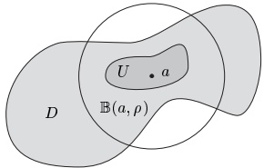
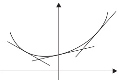

## 3 泰勒定理

在本章中我们已经看到，对于函数 $f$，在一点 $a$ 可微与在 $a$ 处近似线性是同一性质。此外，利用中值定理，我们说明了 $f'$ 如何决定 $f$ 的某些局部与全局性质。

这提出了一个显然的问题：任一光滑函数 $ f: D \to E $ 能否在点 $ a \in D $ 附近被一个多项式逼近？如果可以，这个逼近对 $ f $ 的局部与全局性质说明了什么？如果我们知道 $ f $ 在 $ a $ 处的足够多、甚至全部导数，那么关于 $ f $ 我们能说些什么？

设 $X$ 和 $E$ 为赋范向量空间，$D$ 为 $X$ 的非空子集，且 $f: D \to E$。为了描述 $f$ 在点 $a \in \overline{D}$ 处的行为，我们使用 $\mathbf{兰道}$ 符号 $o$。若 $\alpha \geq 0$，我们说“$f$ 在 $a'$ 处有 $\alpha$ 阶零点”，并写出

##### 兰道符号

\[ f(x)=o(\|x-a\|^\alpha)\ \ (x\to a)\ , \]

若

\[ \lim_{x\to a}\frac{f(x)}{\|x-a\|^\alpha}=0. \]

3.1 注 (a) 函数 $f$ 在 $a$ 处有 $\alpha$ 阶零点，当且仅当对每个 $\varepsilon>0$，存在 $a$ 在 $D$ 中的邻域 $U$，使得

\[ \left\|f(x)\right\|\leq\varepsilon\left\|x-a\right\|^{\alpha},\qquad x\in U. \]

证明 这由注 III.2.23(a) 可得。

(b) 假设 $ X = \mathbb{K} $ 且 $ r: D \to E $ 在 $ a \in D $ 处连续。则

\[ f:D\to E\;,\quad x\mapsto\big(r(x)-r(a)\big)(x-a) \]

在 a 处有 1 阶零点，即 $ f(x) = o(|x - a|) $（$ x \to a $）。

(c) 设 $ X = \mathbb{K} $。则 $ f: D \to E $ 在 $ a \in D $ 处可微，当且仅当存在某个（唯一的）$ m_a \in E $，使得

\[ f(x)-f(a)-m_{a}(x-a)=o(|x-a|)\quad(x\to a). \]

证明 这是 (b) 与定理 1.1(iii) 的推论。■

(d) 函数 $ f \colon (0, \infty) \to \mathbb{R} $，$ x \mapsto e^{-1/x} $ 在 0 处有无限阶零点，即

\[ f(x)=o(|x|^{\alpha})\ \ (x\to0)\ ,\qquad\alpha>0\ . \]

证明 设 $ \alpha > 0 $。则

\[ \lim_{x\to0}e^{-1/x}/x^{\alpha}=\lim_{y\to\infty}y^{\alpha}e^{-y}=0 \]

由命题 III.6.5(iii) 可得。

函数 $g: D \to E$ 在 $a$ 处以 $\alpha$ 阶逼近函数 $f: D \to E$，若

\[ f(x)=g(x)+o(\|x-a\|^\alpha)\quad(x\to a), \]

即，若 $f-g$ 在 $a$ 处有 $\alpha$ 阶零点。

除符号 $o$ 外，我们偶尔也会使用兰道符号 $O$。若 $a \in \overline{D}$ 且 $\alpha \geq 0$，则我们写

\[ f(x)=O(\|x-a\|^\alpha)\ \ (x\to a)\ , \]

若存在 r > 0 和 K > 0，使得

\[ \|f(x)\|\leq K\left\|x-a\right\|^{\alpha},\qquad x\in\mathbb{B}(a,r)\cap D. \]

在这种情况下，我们说“f 在 $ a' $ 处至多以 $ \alpha $ 阶递增”。特别地，$ f(x) = O(1) $（$ x \to a $）蕴含 f 在 a 的某个邻域中有界。

对本节的其余部分，$ E := (E, \|\cdot\|) $ 为巴拿赫空间，$ D $ 为 $ \mathbb{K} $ 的完全子集，且 $ f $ 为从 $ D $ 到 $ E $ 的函数。

##### 泰勒公式

我们首先考察一个必要条件，使得系数\footnote{系数在 $ E $ 中的多项式是形如 $ \sum_{k=0}^{n} c_k X^k $（$ c_k \in E $）的形式表达式。若把“未定元”$ X $ 换成域元素 $ x \in \mathbb{K} $，则得到一个完全确定的元素 $ p(x) := \sum_{k=0}^{n} c_k x^k \in E $。于是多项式函数 $ \mathbb{K} \to E $，$ x \mapsto p(x) $ 是良定义的。系数在 $ E $ 中的多项式一般不构成环！见 I.8 节。} $ c_k $ 取自 $ E $ 的“多项式” $ p = \sum_{k=0}^{n} c_k X^k $ 可以被选成 $ p $ 在 $ a \in D $ 处以 $ n $ 阶逼近函数 $ f $。

首先考虑特殊情形：$ f = \sum_{k=0}^{n} b_k X^k $ 本身就是系数取自 $ E $ 的多项式。由二项式定理我们得到

\[ f(x)=\sum_{k=0}^{n}b_{k}(x-a+a)^{k}=\sum_{k=0}^{n}b_{k}\sum_{j=0}^{k}\binom{k}{j}(x-a)^{j}a^{k-j},\qquad x\in\mathbb{K}. \]

因此 f 可以写成 x - a 的多项式，形如

\[ f(x)=\sum_{k=0}^{n}c_{k}(x-a)^{k},\qquad x\in\mathbb{K}, \]

其中

\[ c_{k}:=\sum_{\ell=k}^{n}b_{\ell}\binom{\ell}{k}a^{\ell-k},\qquad k=0,\ldots,n. \]

显然我们有

\[ f(a)=\sum_{\ell=0}^{n}b_{\ell}a^{\ell}=c_{0},\quad f^{\prime}(a)=\sum_{\ell=1}^{n}b_{\ell}\ell a^{\ell-1}=c_{1}, \]

\[ f^{\prime\prime}(a)=\sum_{\ell=2}^{n}b_{\ell}\ell(\ell-1)a^{\ell-2}=2c_{2},\quad f^{\prime\prime\prime}(a)=\sum_{\ell=3}^{n}b_{\ell}\ell(\ell-1)(\ell-2)a^{\ell-3}=6c_{3}. \]

一个简单的归纳论证表明，对 $ k = 0, \ldots, n $ 有 $ f^{(k)}(a) = k! c_k $，从而

\[ f(x)=\sum_{k=0}^{n}\frac{f^{(k)}(a)}{k!}(x-a)^{k},\qquad x\in\mathbb{K}. \]

因此，当 f 写成 x - a 的多项式时，我们得到了其系数的一个简单表达式（见命题 I.8.16）。

下面的基本定理表明，任何函数 $ f \in C^n(D, E) $ 在任意点 $ a \in D $ 处都有 $ n $ 阶的多项式逼近。

3.2 定理（泰勒定理）设 $D$ 为凸集且 $n \in \mathbb{N}^\times$。则对每个 $f \in C^n(D, E)$ 和 $a \in D$，存在函数 $R_n(f, a) \in C(D, E)$，使得

\[ f(x)=\sum_{k=0}^{n}\frac{f^{(k)}(a)}{k!}(x-a)^{k}+R_{n}(f,a)(x),\qquad x\in D. \]

余项函数 $ R_{n}(f,a) $ 满足

\[ \left\|R_{n}(f,a)(x)\right\|\leq\frac{1}{(n-1)!}\sup_{0<t<1}\left\|f^{(n)}\big(a+t(x-a)\big)-f^{(n)}(a)\right\||x-a|^{n} \]

对所有 $ x \in D $。

证明 对 $ f \in C^n(D, E) $ 和 $ a \in D $，定义

\[ R_{n}(f,a)(x):=f(x)-\sum_{k=0}^{n}\frac{f^{(k)}(a)}{k!}(x-a)^{k},\qquad x\in D. \]

则只需证明关于 $ R_n(f, a) $ 的所述估计。对 $ t \in [0,1] $ 和固定的 $ x \in D $，令

\[ h(t):=f(x)-\sum_{k=0}^{n-1}\frac{f^{(k)}\big(a+t(x-a)\big)}{k!}(x-a)^{k}(1-t)^{k}-\frac{f^{(n)}(a)}{n!}(x-a)^{n}(1-t)^{n}. \]

则 $ h(0) = R_{n}(f, a)(x) $ 且 $ h(1) = 0 $，并且

\[ h^{\prime}(t)=\left[f^{(n)}(a)-f^{(n)}\big(a+t(x-a)\big)\right]\frac{(1-t)^{n-1}}{(n-1)!}(x-a)^{n},\qquad t\in(0,1). \]

向量值函数的中值定理（定理 2.18）蕴含

\[ \begin{align*}\|R_{n}(f,a)(x)\|=\|h(1)-h(0)\|&\leq\sup_{0<t<1}\|h^{\prime}(t)\|\\&\leq\sup_{0<t<1}\frac{\left\|f^{(n)}\left(a+t(x-a)\right)-f^{(n)}(a)\right\|}{(n-1)!}\left|x-a\right|^{n},\end{align*} \]

此即所欲证。■

3.3 推论（泰勒定理的定性版本）在定理 3.2 的假设下，

\[ f(x)=\sum_{k=0}^{n}\frac{f^{(k)}(a)}{k!}(x-a)^{k}+o(|x-a|^{n})\quad(x\to a). \]

##### 泰勒多项式与泰勒级数

对 $ n \in \mathbb{N} $，$ f \in C^n(D, E) $ 和 $ a \in D $，

\[ \mathcal{T}_{n}(f,a):=\sum_{k=0}^{n}\frac{f^{(k)}(a)}{k!}(X-a)^{k} \]

是系数取自 $ E $、次数 $ \leq n $ 的多项式\footnote{按照 I.8 节的约定，我们把系数在 $ E $ 中的多项式与相应的 $ E $ 值多项式函数等同起来。}，即 $ f $ 在 $ a $ 处的第 $ n $ 个泰勒多项式，而

\[ R_{n}(f,a):=f-\mathcal{T}_{n}(f,a) \]

是 f 在 a 处的第 $ n $ 个余项函数。推论 3.3 表明，泰勒多项式 $ \mathcal{T}_{n}(f, a) $ 在 a 处以高于 n 的阶逼近函数 f。

现设 $ E := \mathbb{K} $ 且 $ f \in C^\infty(D) := C^\infty(D, \mathbb{K}) $。则形式表达式

\[ \mathcal{T}(f,a):=\sum_{k}\frac{f^{(k)}(a)}{k!}(X-a)^{k} \]

称为 f 在 a 处的泰勒级数，而所谓 $ \mathcal{T}(f,a) $ 的收敛半径，是指幂级数

\[ \sum_{k=0}^{\infty}\frac{f^{(k)}(a)}{k!}X^{k}. \]

若 $ \mathcal{T}(f,a) $ 有正的收敛半径 $ \rho $，则

\[ \mathcal{T}(f,a)\colon\mathbb{B}(a,\rho)\to\mathbb{K}~,\quad x\mapsto\sum_{k=0}^{\infty}\frac{f^{(k)}(a)}{k!}(x-a)^{k} \]

是一个良定义的函数。

正如对其他幂级数那样，我们将泰勒级数 $ \mathcal{T}(f, a) $ 与函数 (3.2) 等同起来。注意，这一等同仅在 $ \mathbb{B}(a, \rho) $ 上有意义。

3.4 注 设 $D$ 为 $\mathbb{K}$ 中的开集且 $a \in D$。

(a) 泰勒多项式 $ \mathcal{T}_n(f, a) $ 是泰勒级数 $ \mathcal{T}(f, a) $ 的第 $ n $ 个“部分和”。若泰勒级数的收敛半径为正，则 f 在 a 处以 n 阶被 $ \mathcal{T}_n(f, a) $ 逼近。这并不意味着 f 在 a 的某个邻域 U 中等于其泰勒级数。

证明 例 1.17 中的函数 $f$ 光滑，且对 $k \in \mathbb{N}$ 满足 $f^{(k)}(0) = 0$。因此 $\mathcal{T}(f,0) = 0 \neq f$。

(b) 假设函数 $f$ 的泰勒级数 $\mathcal{T}(f,a)$ 有正的收敛半径 $\rho$。则函数 $f$ 在 $a$ 的某个邻域 $U \subseteq \mathbb{B}(a,\rho) \cap D$ 中等于其泰勒级数，当且仅当对所有 $x \in U$ 有 $\lim_{n \to \infty} R_n(f,a)(x) = 0$。

3.5 例（对数的级数表示）对 $|z| < 1/2$，

\[ \log(1+z)=\sum_{k=1}^{\infty}\frac{(-1)^{k-1}}{k}z^{k}=z-\frac{z^{2}}{2}+\frac{z^{3}}{3}-\frac{z^{4}}{4}+\cdots. \]

证明 对 $ z \in \mathbb{C} \setminus \{-1\} $ 令 $ f(z) := \log(1 + z) $。则由归纳法，

\[ f^{(n)}(z)=(-1)^{n-1}\frac{(n-1)!}{(1+z)^{n}},\qquad n\in\mathbb{N}^{\times},\quad z\in\mathbb{C}\backslash(-\infty,-1]. \]

由定理 3.2 我们得到公式

\[ \log(1+z)=\sum_{k=1}^{n}\frac{(-1)^{k-1}}{k}z^{k}+R_{n}(f,0)(z),\qquad n\in\mathbb{N}^{\times},\quad z\in\mathbb{C}\backslash(-\infty,-1], \]

其中余项函数 $ R_{n}(f,0) $ 满足

\[ |R_{n}(f,0)(z)|\leq\sup_{0<t<1}\left|\frac{1}{(1+t z)^{n}}-1\right||z|^{n},\qquad n\in\mathbb{N}^{\times},\quad z\in\mathbb{C}\backslash(-\infty,-1]. \]

对 $ |z| \leq 1/2 $ 和 $ t \in [0,1] $，我们有不等式 $ |1 + tz| \geq 1 - |z| \geq 1/2 $，从而

\[ \left|\frac{1}{(1+t z)^{n}}-1\right|\leq\frac{1}{(1-|z|)^{n}}+1\leq2^{n}+1\leq2^{n+1},\qquad n\in\mathbb{N}^{\times}. \]

因此

\[ |R_{n}(f,0)(z)|\leq2(2\left|z\right|)^{n}\to0\quad(n\to\infty) \]

对所有 $ |z| < 1/2 $ 成立，结论得证。■

3.6 注 对 $ a_k := (-1)^{k-1}/k $，$ k \in \mathbb{N}^\times $，

\[ \lim_{k\to\infty}\frac{|a_{k+1}|}{|a_{k}|}=\lim_{k\to\infty}\frac{k}{k+1}=1. \]

故幂级数 $ \sum(-1)^{k-1}X^k/k $ 的收敛半径为 1。于是产生一个问题：该级数是否在整个 $ \mathbb{B}_{\mathbb{C}} $ 上等于函数 $ z \mapsto \log(1+z) $。对复 $ z $，我们在 V.3 节回答这个问题。对实情形，见应用 3.9(d)。$ \blacksquare $

##### 实情形下的余项函数

借助第二中值定理，我们可以对 $ \mathbb{K} = \mathbb{R} $ 和 $ E = \mathbb{R} $ 的情形导出余项函数 $ R_n(f, a) $ 的进一步估计。

3.7 定理（施勒米尔希余项公式）设 $ I $ 为完全区间，$ a \in I $，$ p > 0 $ 且 $ n \in \mathbb{N} $。假设 $ f \in C^n(I, \mathbb{R}) $ 且 $ f^{(n+1)} $ 在 $ \mathring{I} $ 上存在。则对每个 $ x \in I \setminus \{a\} $，存在某个 $ \xi := \xi(x) \in (x \land a, x \lor a) $，使得

\[ R_{n}(f,a)(x)=\frac{f^{(n+1)}(\xi)}{p n!}\Big(\frac{x-\xi}{x-a}\Big)^{n-p+1}(x-a)^{n+1}~. \]

证明 固定 $x \in I$ 并令 $J := (x \land a, x \lor a)$。定义

\[ g(t):=\sum_{k=0}^{n}\frac{f^{(k)}(t)}{k!}(x-t)^{k},\quad h(t):=(x-t)^{p},\qquad t\in J. \]

显然 $ g, h \in C(\overline{J}, \mathbb{R}) $，且这两个函数都在 $ J $ 上可微，且

\[ g^{\prime}(t)=f^{(n+1)}(t)\frac{(x-t)^{n}}{n!}\;,\quad h^{\prime}(t)=-p(x-t)^{p-1}\;,\qquad t\in J\;. \]

由第二中值定理（命题 2.20），存在某个 $ \xi $ 位于 $ J $ 中，使得

\[ g(x)-g(a)=\frac{g^{\prime}(\xi)}{h^{\prime}(\xi)}\big(h(x)-h(a)\big). \]

由于 $ R_{n}(f,a)(x)=g(x)-g(a) $ 且 $ h(x)-h(a)=-(x-a)^{p} $，结论得证。■

3.8 推论（拉格朗日与柯西余项公式）在定理 3.7 的假设下。

\[ R_{n}(f,a)(x)=\frac{f^{(n+1)}(\xi)}{(n+1)!}(x-a)^{n+1} \]

以及

\[ R_{n}(f,a)(x)=\frac{f^{(n+1)}(\xi)}{n!}\Big(\frac{x-\xi}{x-a}\Big)^{n}(x-a)^{n+1} \]

证明 在定理 3.7 中分别取 $p = n + 1$ 与 $p = 1$。

3.9 应用 (a)（局部极值的充分条件）设 $ I $ 为完全区间，且对某个 $ n \geq 1 $ 有 $ f \in C^n(I, \mathbb{R}) $。假设存在某个 $ a \in \mathring{I} $，使得

\[ f^{\prime}(a)=f^{\prime\prime}(a)=\cdots=f^{(n-1)}(a)=0\quad\text{ 且 }\quad f^{(n)}(a)\neq0. \]

(i) 若 n 为奇数，则 f 在 a 处无极值。

(ii) 若 $n$ 为偶数，则当 $f^{(n)}(a) > 0$ 时 $f$ 在 $a$ 处有局部极小值，当 $f^{(n)}(a) < 0$ 时 $f$ 在 $a$ 处有局部极大值。

证明 假设与泰勒定理（推论 3.3）蕴含

\[ f(x)=f(a)+\Big[\frac{f^{(n)}(a)}{n!}+\frac{o(|x-a|^{n})}{(x-a)^{n}}\Big](x-a)^{n}\quad(x\to a). \]

令 $ \gamma := |f^{(n)}(a)|/(2n!) > 0 $。则由注 3.1，存在某个 $ \delta > 0 $，使得

\[ \frac{\left|o(|x-a|^{n})\right|}{|x-a|^{n}}\leq\gamma,\qquad x\in I\cap(a-\delta,a+\delta). \]

现在区分下列情形：

（$ \alpha $）设 n 为奇数且 $ f^{(n)}(a) > 0 $。则由 (3.3) 与 (3.4)，我们有

\[ f(x)\geq f(a)+\gamma(x-a)^{n},\qquad x\in(a,a+\delta)\cap I, \]

以及

\[ f(x)\leq f(a)-\gamma(a-x)^{n},\qquad x\in(a-\delta,a)\cap I. \]

因此 f 在 a 处不能有极值。

（$ \beta $）若 n 为奇数且 $ f^{(n)}(a) < 0 $，则由 (3.3) 与 (3.4)，我们有

\[ f(x)\leq f(a)-\gamma(x-a)^{n},\qquad x\in(a,a+\delta)\cap I, \]

以及

\[ f(x)\geq f(a)+\gamma(a-x)^{n},\qquad x\in(a-\delta,a)\cap I. \]

故在此情形下 f 在 a 处也不能有极值。

（$ \gamma $）设 n 为偶数且 $ f^{(n)}(a) > 0 $。则

\[ f(x)\geq f(a)+\gamma(x-a)^{n},\qquad x\in(a-\delta,a+\delta)\cap I. \]

因此 f 在 a 处有局部极小值。

（$ \delta $）最后，若 n 为偶数且 $ f^{(n)}(a) < 0 $，则

\[ f(x)\leq f(a)-\gamma(x-a)^{n},\qquad x\in(a-\delta,a+\delta)\cap I, \]

即 f 在 a 处有局部极大值。

注 上述条件是充分的，但非必要的。例如，函数

\[ f(x):=\left\{\begin{array}{c l}{e^{-1/x}\;,}&{\quad x>0\;,}\\ {0\;,}&{\quad x\leq0\;,}\\ \end{array}\right. \]

在 0 处有全局极小值，尽管由例 1.17，f 光滑且对所有 $ n \in \mathbb{N} $ 有 $ f^{(n)}(0) = 0 $。■

(b)（指数函数的一个刻画\footnote{这就是说，$ z \mapsto ae^{bz} $ 是满足初值条件 $ f(0) = a $ 的微分方程 $ f' = bf $ 的唯一解。微分方程将在第 IX 章详细研究。}）假设 $ a, b \in \mathbb{C} $，函数 $ f: \mathbb{C} \to \mathbb{C} $ 可微，且

\[ f^{\prime}(z)=b f(z),\quad z\in\mathbb{C},\qquad f(0)=a. \]

则对所有 $ z \in \mathbb{C} $ 有 $ f(z) = ae^{bz} $。

证明 由 $f'=bf$ 与推论 1.2，我们看出 $f\in C^\infty(\mathbb{C})$ 且对所有 $k\in\mathbb{N}$ 有 $f^{(k)}=b^kf$。若再设 $f(0)=a$，则

\[ \sum_{k}\frac{f^{(k)}(0)}{k!}X^{k}=f(0)\sum_{k}\frac{b^{k}}{k!}X^{k}=a\sum_{k}\frac{b^{k}}{k!}X^{k}. \]

\[ \mathcal{T}(f,0)(z)=a e^{b z}~,\qquad z\in\mathbb{C}~. \]

为完成证明，我们需要证明该泰勒级数在 $\mathbb{C}$ 上等于 $f$，即我们必须证明余项收敛于 $0$。对 $z \in \mathbb{C}$，我们如下用定理 3.2 估计 $R_n(f, 0)(z)$：

\[ \begin{align*}\left|R_{n}(f,0)(z)\right|&\leq\sup_{0<t<1}\left|f^{(n)}(tz)-f^{(n)}(0)\right|\frac{\left|z\right|^{n}}{(n-1)!}=\frac{\left|b\right|^{n}\left|z\right|^{n}}{(n-1)!}\sup_{0<t<1}\left|f(tz)-a\right|\\&\leq M\left|bz\right|\frac{\left|bz\right|^{n-1}}{(n-1)!},\end{align*} \]

其中 $ M > 0 $ 的选取使得对所有 $ w \in \mathbb{B}(0, |z|) $ 有 $ |f(w) - a| \leq M $。由例 II.4.2(c) 现在可得，当 $ n \to \infty $ 时 $ R_n(f, 0)(z) \to 0 $。■

(c)（用函数方程刻画指数函数）若 $ f: \mathbb{C} \to \mathbb{C} $ 满足

\[ f(z+w)=f(z)f(w)~,\qquad z,w\in\mathbb{C}~, \]

以及

\[ \lim_{z\to0}\frac{f(z)-1}{z}=b\quad\text{ 对某个 } b\in\mathbb{C}~, \]

则对所有 $ z \in \mathbb{C} $ 有 $ f(z) = e^{bz} $。

证明 由 (3.6)，我们有 $ f(0) = f(0)^2 $，故 $ f(0) \in \{0,1\} $。但若 $ f(0) = 0 $，则由 (3.6)，对所有 $ z \in \mathbb{C} $ 有 $ f(z) = f(z)f(0) = 0 $，即 $ f = 0 $。这与 (3.7) 矛盾，故必有 $ f(0) = 1 $。

对每个 $ z \in \mathbb{C} $，(3.6) 蕴含

\[ \frac{f(z+h)-f(z)}{h}=f(z)\frac{f(h)-1}{h},\qquad h\in\mathbb{C}^{\times}. \]

因此，由 (3.7)，f 可微且满足 $ f' = bf $。结论现在由 (b) 可得。■

(d)（实对数函数的泰勒级数）对所有 $ x \in (-1,1] $，\footnote{另见例 3.5。}

\[ \log(1+x)=\sum_{k=1}^{\infty}\frac{(-1)^{k-1}}{k}x^{k}=x-\frac{x^{2}}{2}+\frac{x^{3}}{3}-\frac{x^{4}}{4}+\cdots. \]

特别地，交错调和级数的值为 $ \log 2 $。

证明 如例 3.5 的证明那样，对 x > -1 令 $ f(x) := \log(1 + x) $。则

\[ f^{(n+1)}(x)=(-1)^{n}\frac{n!}{(1+x)^{n+1}},\qquad x>-1, \]

以及

\[ \log(1+x)=\sum_{k=1}^{n}\frac{(-1)^{k-1}}{k}x^{k}+R_{n}(f,0)(x),\qquad x>-1. \]

为在 [0,1] 上估计余项，我们使用拉格朗日公式（推论 3.8），并对每个 $ x \in [0,1] $ 找到某个 $ \xi_n \in (0,x) $，使得

\[ |R_{n}(f,0)(x)|=\left|\frac{x^{n+1}}{(n+1)(1+\xi_{n})^{n+1}}\right|\leq\frac{1}{n+1},\qquad n\in\mathbb{N}. \]

因此泰勒级数在 [0,1] 上等于 $ \log(1+x) $。

对 $ x \in (-1,0) $ 的情形，我们使用 $ R_n(f,0) $ 的柯西公式（推论 3.8）。因此，对每个 $ n \in \mathbb{N} $，存在某个 $ \eta_n \in (x,0) $，使得

\[ |R_{n}(f,0)(x)|\leq\left|\frac{1}{1+\eta_{n}}\right|\left|\frac{x-\eta_{n}}{1+\eta_{n}}\right|^{n}. \]

对 $ \eta \in (x,0) $，我们有 $ \eta - x = \eta + 1 - (x+1) $，故

\[ \left|\frac{x-\eta}{1+\eta}\right|=\frac{\eta-x}{1+\eta}=1-\frac{1+x}{1+\eta}<-x<1. \]

因此对所有 $ x \in (-1, 0) $ 有 $ \lim_{n} R_n(f, 0)(x) = 0 $。第二个结论由在泰勒级数中取 x = 1 得到。$ \blacksquare $

(e)（凸函数的一个刻画）

设 $ I $ 为完全区间且 $ f \in C^2(I, \mathbb{R}) $。则 $ f $ 为凸函数，当且仅当 $ f $ 的图像在其所有切线的上方，即若

\[ f(y)\geq f(x)+f^{\prime}(x)(y-x) \]

对所有 $ x, y \in I $。

证明 设 $ x, y \in I $。则由定理 3.2 和 $ R_1(f, x) $ 的拉格朗日公式，存在某个 $ \xi \in I $，使得

\[ f(y)=f(x)+f^{\prime}(x)(y-x)+\frac{f^{\prime\prime}(\xi)}{2}(y-x)^{2}. \]

由于由推论 2.13 我们知道 $f$ 为凸函数当且仅当对所有 $\xi \in I$ 有 $f''(\xi) \geq 0$，这便证明了结论。

##### 多项式插值

设 $ -\infty < a \leq x_0 < x_1 < \cdots < x_m \leq b < \infty $ 且 $ f: [a, b] \to \mathbb{R} $。在命题 I.12.9 中我们证明了存在唯一的次数 $ \leq m $ 的插值多项式 $ p = p_m[f; x_0, \ldots, x_m] $，使得对所有 $ 1 \leq j \leq m $ 有 $ f(x_j) = p(x_j) $。现在我们可以估计误差函数

\[ r_{m}[f;x_{0},\ldots,x_{m}]:=f-p_{m}[f;x_{0},\ldots,x_{m}] \]

在区间 $ I := [a, b] $ 上，假设 f 足够光滑。

3.10 命题 设 $ m \in \mathbb{N} $ 且 $ f \in C^m(I) $ 使得 $ f^{(m+1)} $ 在 $ \mathring{I} $ 上存在。则存在某个 $ \xi := \xi(x, x_0, \ldots, x_m) \in (x \land x_0, x \lor x_m) $，使得

\[ r_{m}[f;x_{0},\ldots,x_{m}](x)=\frac{1}{(m+1)!}f^{(m+1)}(\xi)\prod_{j=0}^{m}(x-x_{j}),\qquad x\in I. \]

证明 若 $x$ 等于某个 $x_j$，结论显然成立。故我们假设对所有 $0 \leq j \leq m$ 有 $x \neq x_j$，并定义

\[ g(x):=\frac{f(x)-p_{m}[f;x_{0},\ldots,x_{m}](x)}{\prod_{j=0}^{m}(x-x_{j})} \]

以及

\[ \varphi(t):=f(t)-p_{m}[f;x_{0},\ldots,x_{m}](t)-g(x)\prod_{j=0}^{m}(t-x_{j}),\qquad t\in I. \]

则 $ \varphi $ 属于 $ C^{m}(I) $，$ \varphi^{(m+1)} $ 在 $ \mathring{I} $ 上存在，且

\[ \varphi^{(m+1)}(t)=f^{(m+1)}(t)-(m+1)!g(x)~,\qquad t\in\mathring{I}~. \]

此外，$\varphi$ 有 $m+2$ 个不同的零点 $x,x_0,\ldots,x_m$。由广义罗尔定理（习题 2.16），存在某个 $\xi\in(x\land x_0,x\lor x_m)$，使得 $\varphi^{(m+1)}(\xi)=0$。因此，由 (3.9)，$g(x)=f^{(m+1)}(\xi)/(m+1)!$。结论现在由 (3.8) 可得。

3.11 推论 对 $ f \in C^{m+1}(I, \mathbb{R}) $，

\[ \left|r_{m}[f;x_{0},\ldots,x_{m}](x)\right|\leq\frac{\|f^{(m+1)}\|_{\infty}}{(m+1)!}\prod_{j=0}^{m}\left|x-x_{j}\right|,\qquad x\in I. \]

##### 高阶差商

由注 I.12.10(b)，我们还可以将插值多项式 $ p_m[f; x_0, \ldots, x_m] $ 表示为牛顿形式

\[ p_{m}[f;x_{0},\ldots,x_{m}]=\sum_{j=0}^{m}f[x_{0},\ldots,x_{j}]\prod_{k=0}^{j-1}(X-x_{k}). \]

这里 $ f[x_{0}, \ldots, x_{n}] $ 是 f 的各阶差商。这些差商可用公式递归计算

\[ f[x_{0},\ldots,x_{n}]=\frac{f[x_{0},\ldots,x_{n-1}]-f[x_{1},\ldots,x_{n}]}{x_{0}-x_{n}},\qquad1\leq n\leq m, \]

（见习题 I.12.10）。由 (3.11)（取 $n=1$）与中值定理可得，对某个合适的 $\xi\in(x_0,x_1)$ 有 $f[x_0,x_1]=f'(\xi)$。下一命题表明，对高阶差商也有类似的结果。

3.12 命题 假设 $ f \in C^m(I, \mathbb{R}) $ 且 $ f^{(m+1)} $ 在 $ \mathring{I} $ 上存在。则存在某个依赖于 $ x, x_0, \ldots, x_m $ 的 $ \xi \in (x \land x_0, x \lor x_m) $，使得

\[ f[x_{0},\ldots,x_{m},x]=\frac{1}{(m+1)!}f^{(m+1)}(\xi),\qquad x\in I,\quad x\neq x_{j},\quad0\leq j\leq m. \]

证明 由 (3.10)（将 m 换成 $ m+1 $），我们有

\[ p_{m+1}[f;x_{0},\ldots,x_{m+1}]=p_{m}[f;x_{0},\ldots,x_{m}]+f[x_{0},\ldots,x_{m+1}]\prod_{j=0}^{m}(X-x_{j})~. \]

在 $x = x_{m+1}$ 处求值得到

\[ f(x_{m+1})=p_{m}[f;x_{0},\ldots,x_{m}](x_{m+1})+f[x_{0},\ldots,x_{m+1}]\prod_{j=0}^{m}(x_{m+1}-x_{j}). \]

在此方程中将 $ x_{m+1} $ 换成 x 得到

\[ f(x)-p_{m}[f;x_{0},\ldots,x_{m}](x)=f[x_{0},\ldots,x_{m},x]\prod_{j=0}^{m}(x-x_{j}). \]

按构造，此方程对所有 $ x_m < x \leq b $ 成立，且对 $ x = x_m $ 显然为真。习题 I.12.10(b) 表明差商是其变量的对称函数，故方程 (3.12) 事实上对所有 $ x \in I $ 成立。

(3.12) 的左边是误差函数 $ r_m[f; x_0, \ldots, x_m] $，故由命题 3.10 可得

\[ \frac{1}{(m+1)!}f^{(m+1)}(\xi)\prod_{j=0}^{m}(x-x_{j})=f[x_{0},\ldots,x_{m},x]\prod_{j=0}^{m}(x-x_{j}),\qquad x\in I, \]

对某个 $ \xi := \xi(x, x_0, \ldots, x_m) \in (x \land x_0, x \lor x_m) $。■

3.13 推论 设 $ f \in C^{m+1}(I, \mathbb{R}) $。则对所有 $ x \in I $，

\[ \lim_{(x_{0},\ldots,x_{m})\to(x,\ldots,x)}f[x_{0},\cdots,x_{m},x]=\frac{1}{(m+1)!}f^{(m+1)}(x), \]

只要在取极限时任何 $ x_{j} $ 都不等于 x。

此推论表明，高阶差商可用于逼近高阶导数，正如通常的差商逼近一阶导数那样。

若点 $ x_{0}, x_{1}, \ldots, x_{n} $ 等距分布，即出现一种特别简单的情形，即

\[ x_{j}:=x_{0}+j h~,\qquad0\leq j\leq n~, \]

对某个 h > 0。

3.14 命题 假设 $ f \in C^{n-1}(I, \mathbb{R}) $，$ f^{(n)} $ 在 $ \mathring{I} $ 上存在，且 $ 0 < h \leq (b - a)/n $。则存在某个 $ \xi \in (a, a + nh) $，使得

\[ \triangle_{h}^{n}f(a)=f^{(n)}(\xi). \]

证明 由 (3.10)、插值多项式的唯一性（命题 I.12.9）以及 (I.12.15)，我们有

\[ \frac{1}{n!}\triangle_{h}^{n}f(a)=f[x_{0},x_{1},\ldots,x_{n}],\qquad x_{0}:=a\;. \]

结论随后由命题 3.12 可得。■

3.15 推论 对所有 $ f \in C^n(I, \mathbb{R}) $，

\[ \lim_{h\to0+}\triangle_{h}^{n} f(x)=f^{(n)}(x),\qquad x\in I. \]

证明 这直接由 (3.13) 与推论 3.13 可得。

3.16 注 (a) 设 $ f \in C^n(I, \mathbb{R}) $。由命题 I.12.13，对 $ f $ 以及等距点 $ x_j := x_0 + jh \in I $，$ 0 \leq j \leq n $，$ h > 0 $，牛顿插值多项式具有形式

\[ N_{n}[f;x_{0};h]=\sum_{j=0}^{n}\frac{\triangle_{h}^{j}f(x_{0})}{j!}\prod_{k=0}^{j-1}(X-x_{k})~. \]

由推论 3.15，我们得到

\[ \lim_{h\to0+}N_{n}[f;x_{0};h]=\sum_{j=0}^{n}\frac{f^{(j)}(x_{0})}{j!}(X-x_{0})^{j}=\mathcal{T}_{n}(f,x_{0}). \]

这表明，在极限 $ h \to 0+ $ 下，牛顿插值多项式成为泰勒多项式。

(b) 推论 3.13 与 3.15 是数值微分的理论基础。细节与进一步发展参见例如 [WS79] 与 [IK66]，以及数值分析方面的文献。

##### 习题

1 假设 $ \alpha, \beta, R > 0 $ 且 $ p \in C^2([0, R), \mathbb{R}) $ 满足

\[ p(x)\geq\alpha~,\quad(1+\beta)\big[p^{\prime}(x)\big]^{2}\leq p^{\prime\prime}(x)p(x)~,\qquad x\geq0~. \]

证明 $ R < \infty $ 且当 $ x \to R^{-} $ 时 $ p(x) \to \infty $。

（提示：函数 $ p^{-\beta} $ 是凹的。利用 $ p^{-\beta} $ 的切线给出 $ p $ 的一个下界（见应用 3.9(e)）。）

2 设 $ a, b \in \mathbb{C} $，$ \omega \in \mathbb{R} $，且 $ f : \mathbb{C} \to \mathbb{C} $ 为满足

\[ f(z)+\omega^{2}f^{\prime\prime}(z)=0~,\quad z\in\mathbb{C}~,\qquad f(0)=a~,\qquad f^{\prime}(0)=\omega b~. \]

（a）证明 $f$ 属于 $C^{\infty}(\mathbb{C})$ 且 $f$ 由 (3.14) 唯一确定。确定 $f$。

（b）若 (3.14) 换成

\[ f(z)=\omega^{2}f^{\prime\prime}(z)~,\quad z\in\mathbb{C}~,\qquad f(0)=a~,\qquad f^{\prime}(0)=\omega b~? \]

3 确定 $ f: \mathbb{C} \to \mathbb{C} $ 在点 1 处的泰勒级数，当

（a）$ f(z) = 3z^{3} - 7z^{2} + 2z + 4 $，（b）$ f(z) = e^{z} $。

4 计算 $ \log\left((1+x)/(1-x)\right) $，$ x \in (-1,1) $，在 0 处的第 $ n $ 个泰勒多项式。

5 确定下列实函数的定义域、极值与拐点：

\[ \text{(a)}\ x^{3}/(x-1)^{2},\qquad\text{(b)}e^{\sin x},\qquad\text{(c)}x^{n}e^{-x^{2}},\qquad\text{(d)}x^{2}/\log x,\qquad\text{(e)}\sqrt[3]{(x-1)^{2}(x+1)}, \]

（f）$ (\log(3x))^2 / x $。

6 对 a > 1，证明

\[ \frac{1}{1+x}-\frac{1}{1+ax}\leq\frac{\sqrt{a}-1}{\sqrt{a}+1},\qquad x\geq1. \]

7 假设 $ s \in \mathbb{R} $ 且 $ n \in \mathbb{N} $。证明：对每个 $ x > -1 $，存在某个 $ \tau \in (0,1) $，使得

\[ (1+x)^{s}=\sum_{k=0}^{n}\binom{s}{k}x^{k}+\binom{s}{n+1}\frac{x^{n+1}}{(1+\tau x)^{n+1-s}}. \]

这里

\[ \binom{\alpha}{k}:=\left\{\begin{array}{c l}{\frac{\alpha(\alpha-1)\cdots(\alpha-k+1)}{k!}}&{,\quad}&{k\in\mathbb{N}^{\times}}\\ {1}&{,\quad}&{k=0\;,}\\ \end{array}\right. \]

表示对 $ \alpha \in \mathbb{C} $ 的（广义）二项式系数\footnote{见 V.3 节。}。

8 利用 (3.15) 逼近 $ \sqrt[5]{30} $。估计误差。（提示：$ \sqrt[5]{30} = 2\sqrt[5]{1 - (1/16)} $。）

9 证明一般幂函数的下列泰勒级数展开：\footnote{另见定理 V.3.10。}

\[ (1+x)^{s}=\sum_{k=0}^{\infty}\binom{s}{k}x^{k},\qquad x\in(-1,1). \]

（提示：为估计余项，区分 $ x \in (0,1) $ 与 $ x \in (-1,0) $ 两种情形（见应用 3.9(d)）。）

10 设 $ X \subseteq \mathbb{K} $ 为完全集，且对某个 $ n \in \mathbb{N}^\times $ 有 $ f \in C^n(X, \mathbb{K}) $。若 $ f(x_0) = \cdots = f^{(n-1)}(x_0) = 0 $ 且 $ f^{(n)}(x_0) \neq 0 $，则数 $ x_0 \in X $ 称为 $ f $ 的一个 $ n $ **重零点**。证明：若 $ X $ 为凸集，则 $ f $ 在 $ x_0 $ 处有重数 $ \geq n $ 的零点，当且仅当存在某个 $ g \in C(X, \mathbb{K}) $，使得对所有 $ x \in X $ 有 $ f(x) = (x - x_0)^n g(x) $。

11 设 $ p = X^n + a_{n-1}X^{n-1} + \cdots + a_0 $ 为系数在 $ \mathbb{R} $ 中的多项式。证明或否定：函数 $ p + \exp $ 在 $ \mathbb{R} $ 中有重数 $ \leq n $ 的零点。

12 证明下列命题：

（a）对每个 $ n \in \mathbb{N} $，$ T_n(x) := \cos(n \arccos x) $，$ x \in \mathbb{R} $，是 n 次多项式，且

\[ T_{n}(x)=x^{n}+\binom{n}{2}x^{n-2}(x^{2}-1)+\binom{n}{4}x^{n-4}(x^{2}-1)^{2}+\cdots. \]

$ T_{n} $ 称为 n 次切比雪夫多项式。

（b）这些多项式满足递推公式

\[ T_{n+1}=2X T_{n}-T_{n-1}~,\qquad n\in\mathbb{N}^{\times}~. \]

（c）对每个 $ n \in \mathbb{N}^\times $，$ T_n = 2^{n-1}X^n + p_n $，其中 $ p_n $ 为某个满足 $ \deg(p_n) < n $ 的多项式。

（d）$ T_{n} $ 在下列每个点处有单零点，即重数为 1 的零点：

\[ x_{k}:=\cos\frac{(2k-1)\pi}{2n},\qquad k=1,2,\ldots,n. \]

（e）$ T_{n} $ 在下列每个点处有极值：

\[ y_{k}:=\cos\frac{k\pi}{n},\qquad k=0,1,\ldots,n, \]

在 $ [-1,1] $ 中，且 $ T_{n}(y_{k})=(-1)^{k} $

（提示：（a）对 $ \alpha\in[0,\pi] $ 和 $ x:=\cos\alpha,\cos n\alpha+i\sin n\alpha=\left(x+i\sqrt{1-x^{2}}\right)^{n} $。

（b）余弦函数的加法定理。）

13 定义规范化切比雪夫多项式：对 $ n \in \mathbb{N}^* $ 令 $ \tilde{T}_n := 2^{1-n}T_n $，并令 $ \tilde{T}_0 := T_0 $。对 $ n \in \mathbb{N} $，设 $ \mathcal{P}_n $ 为所有满足 $ a_1, \ldots, a_n \in \mathbb{R} $ 的多项式 $ X^n + a_1X^{n-1} + \cdots + a_n $ 的集合。设 $ \|\cdot\|_\infty $ 为 $ [-1,1] $ 上的最大值范数。证明下列命题：\footnote{命题 (a) 通常称为切比雪夫定理。}

（a）在集合 $ \mathcal{P}_n $ 中，$ n $ 次规范化切比雪夫多项式是零在区间 $ [-1,1] $ 上的最佳逼近，即对每个 $ n \in \mathbb{N} $，

\[ \|\widetilde{T}_{n}\|_{\infty}\leq\|p\|_{\infty},\qquad p\in\mathcal{P}_{n}. \]

（b）对 $ -\infty < a < b < \infty $，

\[ \operatorname*{m a x}_{a\leq x\leq b}|p(x)|\geq2^{1-2n}(b-a)^{n}\;,\qquad p\in\mathcal{P}_{n}\;. \]

（c）设 $ x_0, \ldots, x_n $ 为 $ T_{n+1} $ 的零点。假设 $ f \in C^{n+1}([-1,1], \mathbb{R}) $，$ p_n $ 为次数 $ \leq n $ 的插值多项式，使得对 $ j = 0,1,\ldots,n $ 有 $ f(x_j) = p(x_j) $。则

\[ \|r_{n}[f;x_{0},\ldots,x_{n}]\|_\infty\leq\frac{\|f^{(n+1)}\|_\infty}{2^{n}(n+1)!}\;. \]

证明这个误差界是最优的。
