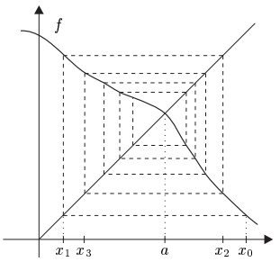
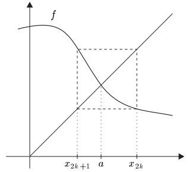
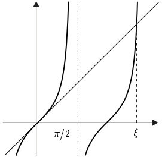
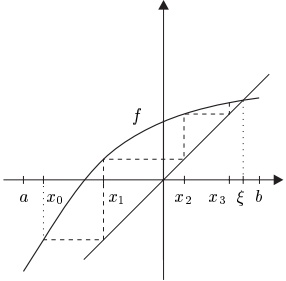
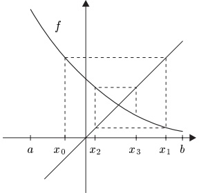
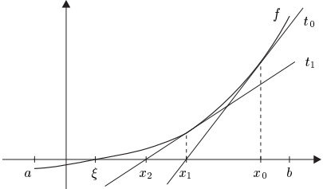
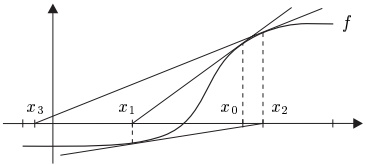

## 4 迭代法

我们已经推导出关于函数零点的各种定理。其中最突出的是代数基本定理、介值定理与罗尔定理。这些重要而深刻的结果的共同之处在于，它们预言了零点的存在，但对于如何求出这些零点却只字未提。因此，例如，我们知道实函数

 \[ x\mapsto x^{5}e^{|x|}-\frac{1}{\pi}x^{2}\sin\bigl(\log(x^{2})\bigr)+1998 \] 

至少有一个零点（为什么？），但迄今为止，我们还没有求出这个零点的算法。\footnote{见习题 9。}

在本节中，我们建立求函数零点与解方程的方法——至少是近似地。本节的核心结果，巴拿赫不动点定理，事实上其重要性远远超出本节的需要，这一点我们将在后面的章节中看到。

##### 不动点与压缩

设 $f: X \to Y$ 是集合 $X$ 与 $Y$ 之间的函数，其中 $X \subseteq Y$。满足 $f(a) = a$ 的元素 $a \in X$ 称为 $f$ 的不动点。

4.1 注（a）设 $E$ 是向量空间，$X \subseteq E$ 且 $f: X \to E$。对所有 $x \in X$ 令 $g(x) := f(x) + x$。则 $a \in X$ 是 $f$ 的零点当且仅当 $a$ 是 $g$ 的不动点。因此，确定 $f$ 的零点与确定 $g$ 的不动点是同一回事。

（b）给定函数 $ f: X \to E $，一般来说，如（a）中的函数 $ g $ 有许多种取法。例如，设 $ E = \mathbb{R} $ 且 0 是函数 $ h: \mathbb{R} \to \mathbb{R} $ 的唯一零点。对 $ x \in X $ 令 $ g(x) = h(f(x)) + x $。则 $ a \in X $ 是 $ f $ 的零点当且仅当 $ a $ 是 $ g $ 的不动点。

（c）设 $X$ 是度量空间，$a$ 是 $f: X \to Y$ 的不动点。设 $x_0 \in X$ 且序列 $(x_k)$ 可由“迭代” $x_{k+1} := f(x_k)$ 递归地定义。这当然意味着对每个 $k$ 都有 $f(x_k)$ 在 $X$ 中。若 $x_k \to a$，则我们说“$a$ 可由逐次逼近法算出”，或者说“逐次逼近法收敛到 $a$”。

下面的图说明了最简单情形下的这种方法。它们特别表明，即使 $f$ 只有一个不动点，用这种方法产生的序列也可能不收敛。

例如，考虑由 $f(x):=1-x$ 定义的函数 $f:[0,1]\to[0,1]$。它恰好有一个不动点，即 $a=1/2$。对于由 $x_{k+1}:=f(x_k)$（对所有 $k\in\mathbb{N}$）定义的序列 $(x_k)$，我们对所有 $k\in\mathbb{N}$ 都有 $x_{2k}=x_0$ 与 $x_{2k+1}=1-x_0$。因此，若 $x_0\neq1/2$，则 $(x_k)$ 发散。

两个度量空间 $X$ 与 $Y$ 之间的函数 $f: X \to Y$ 称为 $\text{压缩}$，若存在某个 $q \in (0,1)$ 使得

 \[ d\bigl(f(x),f(x^{\prime})\bigr)\leq q d(x,x^{\prime}),\qquad x,x^{\prime}\in X. \] 

此时，q 称为 f 的压缩常数。

4.2 注（a）函数 $ f: X \to Y $ 是压缩，当且仅当 f 是利普希茨连续的，且利普希茨常数小于 1。

（b）设 $E$ 是赋范向量空间，$X \subseteq \mathbb{K}$ 是凸的且完全的。设 $f: X \to E$ 可微且 $\sup_X \|f'(x)\| < 1$。则由向量值函数的中值定理（定理 2.18）可知 $f$ 是压缩。

##### 巴拿赫不动点定理

下面的定理是本节的主要结果，有着数不胜数的应用，特别是在应用数学中。

4.3 定理（压缩定理，巴拿赫不动点定理）设 X 是完备度量空间，且 $ f: X \to X $ 是压缩。

(i) f 有唯一的不动点 a。

(ii) 对任意初始值 $ x_{0} $，逐次逼近法收敛到 a。

(iii) 若 q 是 f 的压缩常数，则

 \[ d(x_{k},a)\leq\frac{q^{k}}{1-q}d(x_{1},x_{0}),\qquad k\in\mathbb{N}. \] 

证明（a）（唯一性）若 $a, b \in X$ 是 $f$ 的两个不同的不动点，则

 \[ d(a,b)=d\big(f(a),f(b)\big)\leq q d(a,b)<d(a,b), \] 

这是不可能的。

（b）（存在性与收敛性）设 $ x_0 \in X $。对所有 $ k \in \mathbb{N} $ 由 $ x_{k+1} := f(x_k) $ 递归地定义序列 $ (x_k) $。则

 \[ d(x_{n+1},x_{n})=d\bigl(f(x_{n}),f(x_{n-1})\bigr)\leq q d(x_{n},x_{n-1}),\qquad n\in\mathbb{N}^{\times}, \] 

并且，由归纳法可得

 \[ d(x_{n+1},x_{n})\leq q^{n-k}d(x_{k+1},x_{k}) \] 

对所有 $ n > k \geq 0 $ 成立。这一不等式蕴含

 \[ \begin{align*}d(x_{n},x_{k})&\leq d(x_{n},x_{n-1})+d(x_{n-1},x_{n-2})+\cdots+d(x_{k+1},x_{k})\\&\leq(q^{n-k-1}+q^{n-k-2}+\cdots+1)d(x_{k+1},x_{k})\\&=\frac{1-q^{n-k}}{1-q}d(x_{k+1},x_{k})\end{align*} \] 

对所有 $ n > k \geq 0 $ 成立。因为由 (4.1) 有 $ d(x_{k+1}, x_k) \leq q^k d(x_1, x_0) $，故由 (4.2) 可得

 \[ d(x_{n},x_{k})\leq\frac{q^{k}-q^{n}}{1-q}d(x_{1},x_{0})\leq\frac{q^{k}}{1-q}d(x_{1},x_{0}),\qquad n>k\geq0. \] 

这表明 $(x_k)$ 是柯西序列。因为 $X$ 是完备度量空间，所以存在某个 $a \in X$ 使得 $\lim x_k = a$。由 $f$ 的连续性及序列 $(x_k)$ 的定义，$a$ 是 $f$ 的不动点。

（c）（误差估计）因为序列 $ (x_n) $ 收敛到 a，我们可以在 (4.3) 中令 $ n \to \infty $ 取极限，以得到所断言的误差估计（见例 III.1.3(1)）。

4.4 注（a）除了定理 4.3(iii) 的先验误差估计之外，我们还有后验界

 \[ d(x_{k},a)\leq\frac{q}{1-q}d(x_{k},x_{k-1}),\qquad k\in\mathbb{N}. \] 

证明 在 (4.2) 中令 $ n \to \infty $ 取极限，得到

 \[ d(x_{k},a)\leq\frac{1}{1-q}d(x_{k+1},x_{k})\leq\frac{q}{1-q}d(x_{k},x_{k-1}), \] 

其中我们还用到了 (4.1)。■

（b）设 $f: X \to X$ 是压缩常数为 $q$ 的压缩，$a$ 是 $f$ 的不动点。则对于逐次逼近法，我们还有另一个误差估计：

 \[ d(x_{k+1},a)=d\bigl(f(x_{k}),f(a)\bigr)\leq q d(x_{k},a)~,\qquad k\in\mathbb{N}~. \] 

因此，人们称这个迭代过程是线性收敛的。

一般地，若 $ \alpha \geq 1 $ 且存在常数 $ n_0 $ 与 $ c $ 使得

 \[ d(x_{n+1},a)\leq c\big[d(x_{n},a)\big]^{\alpha},\qquad n\geq n_{0}. \] 

则称序列 $ (x_n) $ 以阶 $ \alpha $ 收敛到 $ a $。若 $\alpha=1$，即收敛是线性的，我们还要求 $c<1$。一般地，收敛阶越高，序列收敛得越快。例如，对于二次收敛，若 $d(x_{n_0},a)<1$ 且 $c\leq1$，则每一步都使近似值的正确小数位数加倍。在实践中，$c$ 常常大于 1，因此这一效果部分地被削弱。

（c）在应用中经常出现如下情形：设 $E$ 是巴拿赫空间，$X$ 是 $E$ 的闭子集，$f: X \to E$ 是满足 $f(X) \subseteq X$ 的压缩。则因为 $X$ 是完备度量空间（见习题 II.6.4），压缩定理的所有断言对 $f$ 都成立。

（d）（b）中的假设 $f(X) \subseteq X$ 可以减弱。若存在某个初始值 $x_0 \in X$ 使得迭代 $x_{k+1} = f(x_k)$ 能对所有 $k$ 进行，则压缩定理的断言对这个特定的 $x_0$ 成立。

借助上面的注，我们可以导出巴拿赫不动点定理的一个有用的“局部版本”。

4.5 命题 设 $E$ 是巴拿赫空间，$X := \bar{\mathbb{B}}_E(x_0, r)$，其中 $x_0 \in E$ 且 $r > 0$。设 $f: X \to E$ 是压缩常数为 $q$ 的压缩，且满足 $\|f(x_0) - x_0\| \leq (1 - q)r$。则 $f$ 有唯一的不动点，且若 $x_0$ 是初始值，则逐次逼近法收敛。

证明 因为 $X$ 是巴拿赫空间的闭子集，所以 $X$ 是完备度量空间。因此，由注 4.4(d)，只需证明 $x_{k+1}=f(x_k)$ 在每次迭代时都保持在 $X$ 中。对 $x_1=f(x_0)$，由于假设 $\|f(x_0)-x_0\|=\|x_1-x_0\|\leq(1-q)r$，这一点成立。

设 $ x_1, \ldots, x_k \in X $。由 (4.3) 可得

 \[ \left\|x_{k+1}-x_{0}\right\|\leq\frac{1-q^{k+1}}{1-q}\left\|x_{1}-x_{0}\right\|\leq(1-q^{k+1})r<r. \] 

因此，$x_{k+1}$ 也在 $X$ 中，且迭代 $x_{k+1}=f(x_k)$ 对所有 $k$ 都有定义。■

4.6 例（a）考虑在区间 $\pi/2 < \xi < 3\pi/2$ 中求方程 $\tan x = x$ 的解 $\xi$ 的问题。令 $I := (\pi/2, 3\pi/2)$，并对 $x \in I$ 令 $f(x) := \tan x$，从而 $f'(x) = 1 + f^2(x)$。由中值定理可知，$f$ 在 $\xi$ 的任何邻域上都不是压缩。

为了使用压缩定理，我们转而考虑 $f$ 的反函数，

即函数

 \[ g\colon\bigl[\tan\bigl|(\pi/2,3\pi/2)\bigr]^{-1}\colon\mathbb{R}\to(\pi/2,3\pi/2)~. \] 

因为正切函数在 $(\pi/2, 3\pi/2)$ 上严格递增，所以函数 $g$ 有良好定义，且 $g(x) = \arctan(x) + \pi$。此外，$f$ 与 $g$ 的不动点问题是等价的，即对所有 $a \in (\pi/2, 3\pi/2)$，

 \[ a=\tan a\Longleftrightarrow a=\arctan(a)+\pi. \] 

因为 $ g'(x) = 1/(1 + x^2) $（见 (IV.2.3)），压缩定理适用于 $ g $。从图中我们看到 $ \xi > \pi $。令 $ X := [\pi, \infty) \subseteq \mathbb{R} $，使得 $ g(X) \subseteq [\pi, 3\pi/2) \subseteq X $。因为对所有 $ x \in X $ 都有 $ |g'(x)| \leq 1/(1 + \pi^2) < 1 $，所以 $ g $ 在 $ X $ 上是压缩。因此由定理 4.3 可知，存在唯一的 $ \xi \in [\pi, 3\pi/2) $ 使得 $ \xi = g(\xi) $，并且以 $ x_0 := \pi $ 为初始值时，逐次逼近法收敛到 $ \xi $。

（b）设 $ -\infty < a < b < \infty $，且 $ f \in C^1([a, b], \mathbb{R}) $ 是压缩。假设对 $ x_0 \in [a, b] $ 的迭代 $ x_{k+1} = f(x_k) $ 定义了一个无限序列。由注 4.4(d)，存在唯一的 $ \xi \in [a, b] $ 使得 $ x_k \to \xi $。若对所有 $ x \in [a, b] $ 都有 $ f'(x) > 0 $，则收敛是单调的；若对所有 $ x \in [a, b] $ 都有 $ f'(x) < 0 $，则收敛是交错的，即 $ \xi $ 介于每对 $ x_k $ 与 $ x_{k+1} $ 之间。

单调收敛

交错收敛

证明 由中值定理，对每个 $ k \in \mathbb{N} $，存在某个 $ \eta_k \in (a, b) $ 使得

 \[ x_{k+1}-x_{k}=f(x_{k})-f(x_{k-1})=f^{\prime}(\eta_{k})(x_{k}-x_{k-1}). \] 

若对所有 $ k \in \mathbb{N}^\times $ 都有 $ f'(\eta_k) \geq 0 $，则

 \[ \mathrm{s i g n}(x_{k+1}-x_{k})\in\left\{\mathrm{s i g n}(x_{k}-x_{k-1}),0\right\}\;,\qquad k\in\mathbb{N}^{\times}\;, \] 

从而 $ (x_k) $ 是单调序列。若对所有 $ k \in \mathbb{N}^* $ 都有 $ f'(\eta_k) \leq 0 $，则

 \[ \mathrm{s i g n}(x_{k+1}-x_{k})\in\left\{-\mathrm{s i g n}(x_{k}-x_{k-1}),0\right\},\qquad k\in\mathbb{N}^{\times}, \] 

即收敛是交错的。■

例 4.6(a) 最重要的意义在于表明：对于具体的应用，重要的是先从理论上分析问题，并在需要时把问题改写成新的形式，以便能有效地使用逐次逼近法。

##### 牛顿法

在本节的剩余部分，我们考虑如下情形：

 \[ \begin{gathered} \text{设 } -\infty < a < b < \infty \text{，且 } f \in C^2([a, b], \mathbb{R}) \text{ 满足：对所有 } x \in [a, b] \text{ 都有 } f'(x) \neq 0\text{。} \\ \text{我们进一步假设存在某个 } \xi \in (a, b) \text{ 使得 } f(\xi) = 0\text{。} \end{gathered} \] 

利用 $f$ 的线性近似，我们将建立一种近似 $f$ 的零点 $\xi$ 的方法。从几何上看，$\xi$ 是 $f$ 的图像与 $x$ 轴的交点。

从 $\xi$ 的一个初始近似 $ x_{0} $ 出发，我们用 f 的图像在点 $ (x_{0}, f(x_{0})) $ 处的切线 $ t_{0} $ 来代替它。由假设 (4.4)，$ f' $ 在 $ [a, b] $ 上不为零，因此切线 $ t_{0} $ 与 x 轴相交于一点 $ x_{1} $，它是 $\xi$ 的一个新的近似。在点 $ (x_{0}, f(x_{0})) $ 处的切线由如下方程给出

 \[ x\mapsto f(x_{0})+f^{\prime}(x_{0})(x-x_{0}), \] 

因此 $ x_{1} $ 可由方程 $ f(x_{0}) + f'(x_{0})(x_{1} - x_{0}) = 0 $ 算出：

 \[ x_{1}=x_{0}-\frac{f(x_{0})}{f^{\prime}(x_{0})}. \] 

这一过程的迭代称为牛顿法：

 \[ x_{n+1}=x_{n}-\frac{f(x_{n})}{f^{\prime}(x_{n})},\quad n\in\mathbb{N},\qquad x_{0}\in[a,b]. \] 

(4.4) 中的假设不足以确保收敛 $ x_{n} \to \xi $，如下面的图所示：

由下式定义 $ g\colon [a,b]\to\mathbb{R} $：

 \[ g(x):=x-f(x)/f^{\prime}(x). \] 

则 $\xi$ 显然是 g 的不动点，而牛顿法正是关于函数 g 的逐次逼近法。这提示我们应用巴拿赫不动点定理，而事实上，该定理正是下面关于牛顿法的收敛性结果之证明的核心。

4.7 定理 存在某个 $\delta > 0$，使得对区间 $\left[\xi - \delta, \xi + \delta\right]$ 中的任何 $x_0$，牛顿法都收敛到 $\xi$。换句话说：若初始值充分接近零点 $\xi$，则牛顿法收敛。

证明（i）由极值定理（推论 III.3.8），存在常数 $ M_{1}, M_{2}, m > 0 $ 使得

 \[ m\leq|f^{\prime}(x)|\leq M_{1}~,\quad|f^{\prime \prime}(x)|\leq M_{2}~,\qquad x\in[a,b]~. \] 

对于 (4.5) 中定义的函数 g，我们有 $ g' = ff'' / [f']^2 $，因此

 \[ |g^{\prime}(x)|\leq\frac{M_{2}}{m^{2}}|f(x)|,\qquad x\in[a,b]. \] 

因为 $ f(\xi) = 0 $，f 的绝对值可以借助中值定理作如下估计：

 \[ |f(x)|=|f(x)-f(\xi)|\leq M_{1}\left|x-\xi\right|,\qquad x\in[a,b]. \] 

因此

 \[ |g^{\prime}(x)|\leq\frac{M_{1}M_{2}}{m^{2}}\left|x-\xi\right|,\qquad x\in[a,b]. \] 

（ii）选取 $ \delta_{1} > 0 $ 使得

 \[ I:=\left[\xi-\delta_{1},\xi+\delta_{1}\right]\subseteq\left[a,b\right]\quad\text{且}\quad\frac{M_{1}M_{2}}{m^{2}}\delta_{1}\leq\frac{1}{2}. \] 

则 $g$ 在 $I$ 上是压缩，压缩常数为 $1/2$。现在令 $r := \delta_1/2$，并选取 $\delta > 0$ 使得 $M_1\delta/m \leq r/2$。因为 $M_1 \geq m$，我们有 $\delta \leq \delta_1/4$。因此，对每个 $x_0 \in [\xi - \delta, \xi + \delta]$ 与 $x \in [x_0 - r, x_0 + r]$，我们有

 \[ \left|x-\xi\right|\leq\left|x-x_{0}\right|+\left|x_{0}-\xi\right|\leq r+\delta\leq\frac{\delta_{1}}{2}+\frac{\delta_{1}}{4}<\delta_{1}. \] 

这表明对每个 $ x_0 \in [\xi - \delta, \xi + \delta] $ 都有包含关系 $ \bar{\mathbb{B}}(x_0, r) \subseteq I $。因此 $ g $ 在 $ \bar{\mathbb{B}}(x_0, r) $ 上是压缩，压缩常数为 $ 1/2 $。

最后，由 (4.6) 与 (4.7) 可得

 \[ \left|x_{0}-g(x_{0})\right|=\left|\frac{f(x_{0})}{f^{\prime}(x_{0})}\right|\leq\frac{M_{1}}{m}\left|x_{0}-\xi\right|\leq\frac{M_{1}\delta}{m}\leq\frac{r}{2}. \] 

因此 $g$ 满足命题 4.5 的假设，且 $g$ 在 $\left[\xi-\delta,\xi+\delta\right]$ 中有唯一的不动点 $\eta$。因为 $\eta$ 是 $f$ 的零点，并且由罗尔定理，$f$ 在 $[a,b]$ 中只有一个零点，所以 $\eta=\xi$。所断言的收敛性质现在由巴拿赫不动点定理得出。

4.8 注（a）牛顿法是二次收敛的，即存在某个 c > 0 使得

 \[ \left|x_{n+1}-\xi\right|\leq c\left|x_{n}-\xi\right|^{2},\qquad n\in\mathbb{N}. \] 

证明 对每个 $ n \in \mathbb{N} $，泰勒级数的拉格朗日余项公式确保存在某个 $ \eta_n \in (\xi \wedge x_n, \xi \vee x_n) $ 使得

 \[ 0=f(\xi)=f(x_{n})+f^{\prime}(x_{n})(\xi-x_{n})+\frac{1}{2}f^{\prime\prime}(\eta_{n})(\xi-x_{n})^{2}. \] 

因此由牛顿法，我们有

 \[ \xi-x_{n+1}=\xi-x_{n}+\frac{f(x_{n})}{f^{\prime}(x_{n})}=-\frac{1}{2}\frac{f^{\prime\prime}(\eta_{n})}{f^{\prime}(x_{n})}(\xi-x_{n})^{2}. \] 

利用 (4.6) 的记号并令 $ c := M_2/(2m) $，断言即得证。■

（b）若 $f$ 是凸的且 $f(x_{0})$ 为正（或若 $f$ 是凹的且 $f(x_{0})$ 为负），则牛顿法单调收敛。

证明 这直接由应用 3.9(e) 以及定理 2.12 中凸函数与凹函数的刻画得出。

4.9 例（计算根）对 $a > 0$ 与 $n \geq 2$，我们考虑如何用牛顿法确定 $\sqrt[n]{a}$。对所有 $x \geq 0$ 令 $f(x) = x^n - a$，我们有迭代

 \[ x_{k+1}=x_{k}-\frac{x_{k}^{n}-a}{n x_{k}^{n-1}}=\Big(1-\frac{1}{n}\Big)x_{k}+\frac{a}{n x_{k}^{n-1}},\qquad k\in\mathbb{N}. \] 

设 $x_0 > \max\{1, a\}$。因为 $f(x_0) = x_0^n - a > 0$ 且 $f$ 是凸的，由注 4.8(b)，$(x_k)$ 单调收敛到 $\sqrt[n]{a}$。在特殊情形 $n = 2$ 下，(4.8) 变成

 \[ x_{k+1}=\frac{1}{2}\Big(x_{k}+\frac{a}{x_{k}}\Big)~,\quad k\in\mathbb{N}~,\qquad x_{0}=\operatorname*{m a x}\{1,a\}~, \] 

这正是习题 II.4.4 中的巴比伦算法。

##### 习题

1 设 $X$ 是完备度量空间，并且对 $f: X \to X$，设 $f^n$ 表示 $f$ 的第 $n$ 次迭代，即 $f^0 := \text{id}_X$ 且 $f^n := f \circ f^{n-1}$，$n \in \mathbb{N}^\times$。假设对每个 $n \in \mathbb{N}$，存在某个 $q_n \geq 0$ 使得

 \[ d\bigl(f^{n}(x),f^{n}(y)\bigr)\leq q_{n}d(x,y)~,\qquad x,y\in X~. \] 

证明：若 $ (q_{n}) $ 是零序列，则 f 在 X 中有不动点。

2 设 $X$ 与 $\Lambda$ 是度量空间，其中 $X$ 完备，且 $f \in C(X \times \Lambda, X)$。假设存在某个 $\alpha \in [0,1)$，并且对每个 $\lambda \in \Lambda$，存在某个 $q(\lambda) \in [0,\alpha]$ 使得

 \[ d\big(f(x,\lambda),f(y,\lambda)\big)\leq q(\lambda)d(x,y)~,\qquad x,y\in X~. \] 

由巴拿赫不动点定理，对每个 $ \lambda \in \Lambda $，$ f(\cdot, \lambda) $ 在 $ X $ 中有唯一的不动点 $ x(\lambda) $。证明 $ [\lambda \mapsto x(\lambda)] \in C(\Lambda, X) $。

3 验证函数 $ f: \mathbb{R} \to \mathbb{R} $，$ x \mapsto e^{x-1} - e^{1-x} $ 有唯一的不动点 $ x^* $。近似地计算 $ x^* $。

4 用牛顿法近似 $ X^{3} - 2X - 5 $ 的实零点。

5 数值地确定下列方程的最小正解：

 \[ x\tan x=1,\quad x^{3}+e^{-x}=2,\quad x-\cos^{2}x=0,\quad2\cos x=x^{2}. \] 

6 由习题 2.6，函数 $ f(x) = 1 + x + x^2/2! + \cdots + x^n/n! $，$ x \in \mathbb{R} $，对奇数 $ n \in \mathbb{N}^\times $ 有唯一的零点。近似地确定这些零点。

7 设 $ -\infty < a < b < \infty $，且 $ f: [a, b] \to \mathbb{R} $ 是可微的凸函数，满足

 \[ f(a)<0<f(b)\quad\text{或}\quad f(a)>0>f(b). \] 

证明递归定义的序列

 \[ x_{n+1}:=x_{n}-\frac{f(x_{n})}{f^{\prime}(x_{0})},\qquad n\in\mathbb{N}^{\times}, \] 

对任何满足 $f(x_0) > 0$ 的初始值 $x_0$ 都收敛到 $f$ 在 $[a, b]$ 中的零点。\footnote{(4.9) 中给出的迭代过程称为简化牛顿法。} 若 $f$ 是凹的，则此方法对哪些初始值收敛？

8 设 $ -\infty < a < b < \infty $，且 $ f \in C([a, b], \mathbb{R}) $ 满足 $ f(a) < 0 < f(b) $。令 $ a_0 := a $，$ b_0 := b $，并递归地定义

 \[ c_{n+1}:=a_{n}-\frac{b_{n}-a_{n}}{f(b_{n})-f(a_{n})}f(a_{n}),\qquad n\in\mathbb{N}, \] 

以及

 \[ a_{n+1}:=\left\{\begin{array}{ll}c_{n+1},&\quad f(c_{n+1})\leq0,\\a_{n}&\quad\text{其他情形},\end{array}\right.,\quad b_{n+1}:=\left\{\begin{array}{ll}b_{n},&\quad f(c_{n+1})\leq0,\\c_{n+1}&\quad\text{其他情形}.\end{array}\right. \] 

证明 $(c_n)$ 收敛到 $f$ 的某个零点。这一过程（称为 regula falsi，即试位法）的几何解释是什么？若 $f(a) > 0 > f(b)$，公式应如何修改？

9 近似地确定下式的零点

 \[ x^{5}e^{|x|}-\frac{1}{\pi}x^{2}\sin\bigl(\log(x^{2})\bigr)+1998\;. \] 

10 设 $ I $ 是紧致完全区间，$ f \in C^1(I, I) $ 是压缩，满足对所有 $ x \in I $ 都有 $ f'(x) \neq 0 $。设 $ x_0 \in I $，并用 $ x^* := \lim f^n(x_0) $ 表示 $ f $ 在 $ I $ 中的唯一不动点。最后，假设 $ x_0 \neq x^* $。证明下列结论：

(a) 对每个 $ n \in \mathbb{N}^* $ 都有 $ f^n(x_0) \neq x^* $。

(b)  $ \lim_{n \to \infty} \frac{f^{n+1}(x_0) - x^*}{f^n(x_0) - x^*} = f'(x^*) $。
