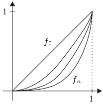
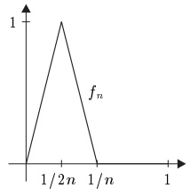
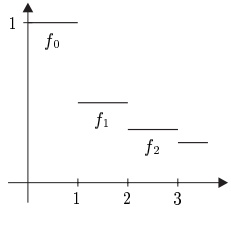

## 1 一致收敛

对于函数序列，视我们所关心的是所涉及函数的逐点行为还是“整体”行为而定，可以有若干种不同的收敛方式。在本节中，我们引入逐点收敛与一致收敛，并研究它们之间的关系。本节所得结论构成了分析学中一切更深入的研究赖以建立的基础。

贯穿本节，$X$ 是一个集合，$E := (E, |\cdot|)$ 是 $\mathbb{K}$ 上的巴拿赫空间。

##### 逐点收敛

$X$ 上的 $E$ 值函数序列就是 $E^X$ 中的一个序列 $(f_n)$。若 $X$ 与 $E$ 的选取可由上下文看出（或无关紧要），我们就简单地说 $(f_n)$ 是一个函数序列。

函数序列 $(f_n)$ 逐点收敛到 $f \in E^X$，若对每个 $x \in X$，序列 $(f_n(x))$ 在 $E$ 中收敛到 $f(x)$。在此情形下，我们记作 $f_n \xrightarrow[\text{pointw}]{}$ $f$ 或 $f_n \to f$ (pointw)，并称 $f$ 为 $(f_n)$ 的（逐点）极限或（逐点）极限函数。

1.1 注 (a) 假设 $ (f_{n}) $ 逐点收敛。则其极限函数是唯一的。

证明 这直接由推论 II.1.13 得出。

(b) 下列各命题等价：

(i)  $ f_{n} \rightarrow f $ (pointw)。

(ii) 对每个 $ x \in X $ 和 $ \varepsilon > 0 $，存在自然数 $ N = N(x, \varepsilon) $，使得对 $ n \geq N $ 有 $ |f_n(x) - f(x)| < \varepsilon $。

(iii) 对每个 $ x \in X $，$ (f_n(x)) $ 是 $ E $ 中的柯西序列。

证明 蕴含“$(i) \Rightarrow (ii) \Rightarrow (iii)$”是显然的。断言“$(iii) \Rightarrow (i)$”成立，因为 $ E $ 是完备的。■

(c) 上述定义在把 $ E $ 换成任意度量空间时仍然有意义。■

1.2 例 (a) 设 $ X := [0,1] $，$ E := \mathbb{R} $，并令 $ f_n(x) := x^{n+1} $。则 $ (f_n) $ 逐点收敛到由下式定义的函数 $ f: [0,1] \to \mathbb{R} $：

\[ f(x):=\left\{\begin{array}{l l}{0,}&{\quad x\in[0,1),}\\ {1,}&{\quad x=1.}\end{array}\right. \]

(b) 设 $ X := [0, 1] $，$ E := \mathbb{R} $ 且\footnote{这里以及类似情形中，$ 1/ab $ 表示 $ 1/(ab) $，而不是 $ (1/a)b = b/a $。}

\[ f_{n}(x):=\left\{\begin{array}{r l}{2n x~,}&{\quad x\in\left[0,1/2n\right]~,}\\ {2-2n x~,}&{\quad x\in\left[1/2n,1/n\right]~,}\\ {0~,}&{\quad x\in(1/n,1]~.}\\ \end{array}\right. \]

则 $ (f_{n}) $ 逐点收敛到 0。

(c) 设 $X := \mathbb{R}$，$E := \mathbb{R}$，且

\[ f_{n}(x):=\left\{\begin{array}{c l}{1/(n+1),}&{\quad x\in[n,n+1),}\\ {0}&{\quad\text{其他情形}.}\end{array}\right. \]

在此情形下也一样，$ (f_{n}) $ 逐点收敛到 0。■

例 (a)

例 (b)

例 (c)
 

在例 1.2(a) 中我们看到，尽管序列的所有项都无穷次可微，其极限函数却甚至不连续。因此，对于许多目的而言，逐点收敛太弱了，我们需要定义一种更强的收敛方式，以保证序列中函数的性质被极限函数所共享。

##### 一致收敛

函数序列 $ (f_n) $ 一致收敛到 $ f $，若对每个 $ \varepsilon > 0 $，存在某个 $ N = N(\varepsilon) \in \mathbb{N} $，使得

\[ |f_{n}(x)-f(x)|<\varepsilon\;,\qquad n\geq N\;,\quad x\in X\;. \]

在此情形下我们记作 $ f_{n} \xrightarrow[\mathrm{unf}]{} f $ 或 $ f_{n} \to f $ (unf)。

逐点收敛与一致收敛的本质区别在于：对一致收敛而言，$N$ 依赖于 $\varepsilon$ 而不依赖于 $x \in X$；而对逐点收敛而言，对于给定的 $\varepsilon$，$N(\varepsilon, x)$ 一般来说随点而变。对一致收敛而言，不等式 (1.1) 关于 $x \in X$ 一致地成立。

1.3 注与例 (a) 任何一致收敛的函数序列都逐点收敛，也就是说，$ f_n \to f $ (unf) 蕴含 $ f_n \to f $ (pointw)。

(b) (a) 的逆命题不成立，也就是说，存在逐点收敛但不一致收敛的函数序列。

证明 设 $ (f_n) $ 为例 1.2(b) 中的序列。对一切 $ n \in \mathbb{N}^\times $ 令 $ x_n := 1/2n $。则 $ |f_n(x_n) - f(x_n)| = 1 $。因此 $ (f_n) $ 不可能一致收敛。

(c) 例 1.2(c) 中的函数序列 $ f_{n} $ 一致收敛到 0。

(d) 设 $ X := (0, \infty) $，$ E := \mathbb{R} $，并对一切 $ n \in \mathbb{N}^\times $ 令 $ f_n(x) := 1/nx $。

(i)  $ f_{n} \rightarrow 0 $ (pointw)。

(ii) 对每个 $a>0$，$(f_{n})$ 在 $[a,\infty)$ 上一致收敛到 0。

(iii) 函数序列 $ (f_{n}) $ 不一致收敛到 0。

证明 第一个断言是显然的。

(ii) 设 $a > 0$。则

\[ |f_{n}(x)|=1/n x\leq1/n a\;,\qquad n\in\mathbb{N}^{\times}\;,\quad x\geq a\;. \]

因此 $(f_{n})$ 在 $[a,\infty)$ 上一致收敛到 0。

(iii) 对 $ \varepsilon > 0 $ 与 $ x > 0 $，$ |f_n(x)| = 1/nx < \varepsilon $ 当且仅当 $ n > 1/x\varepsilon $。因此 $ (f_n) $ 在 $ (0, \infty) $ 上不可能一致收敛到 0。■

(e) 下列各命题等价：

(i)  $ f_n \to f $ (unf)。

(ii) 在 $ B(X, E) $ 中，$ (f_n - f) \to 0 $。

(iii) 在 $ \mathbb{R} $ 中，$ \|f_n - f\|_\infty \to 0 $。

注意，即使 $ f_n $ 与 $ f $ 不属于 $ B(X, E) $，$ f_n $ 也可能一致收敛到 $ f $。例如，令 $ X := \mathbb{R} $，$ E := \mathbb{R} $，对一切 $ n \in \mathbb{N}^\times $ 令 $ f_n(x) := x + 1/n $，并令 $ f(x) := x $。则 $ (f_n) $ 一致收敛到 $ f $，但 $ f $ 与 $ f_n $ 都不属于 $ B(\mathbb{R}, \mathbb{R}) $。

(f) 若 $f_n$ 与 $f$ 属于 $B(X,E)$，则 $(f_n)$ 一致收敛到 $f$ 当且仅当 $(f_n)$ 在 $B(X,E)$ 中收敛到 $f$。

1.4 命题（一致收敛的柯西准则）下列各命题等价：

(i) 函数序列 $ (f_{n}) $ 一致收敛。

(ii) 对每个 $ \varepsilon > 0 $，存在某个 $ N := N(\varepsilon) \in \mathbb{N} $，使得

\[ \|f_{n}-f_{m}\|_{\infty}<\varepsilon\;,\qquad n,m\geq N\;. \]

证明 “$(i) \Rightarrow (ii)$” 由假设，存在某个 $ f \in E^X $ 使得 $ f_n \to f $ (unf)。因此，由注 1.3(e)，$ (f_n - f) $ 在空间 $ B(X, E) $ 中收敛到 0。此断言现由三角不等式

\[ \|f_{n}-f_{m}\|_{\infty}\leq\|f_{n}-f\|_{\infty}+\|f-f_{m}\|_{\infty}. \]

“$(ii) \Rightarrow (i)$” 对每个 $ \varepsilon > 0 $，存在某个 $ N = N(\varepsilon) $ 使得对一切 $ m, n \geq N $ 有 $ \|f_n - f_m\|_\infty < \varepsilon $。令 $ \varepsilon := 1 $ 与 $ \widehat{f} := f_{N(1)} $，我们看到，对一切 $ n \geq N(1) $，$ f_n - \widehat{f} $ 属于 $ B(X, E) $。因此 $ (f_n - \widehat{f}) $ 是 $ B(X, E) $ 中的柯西序列。由定理 II.6.6，$ B(X, E) $ 是完备的，从而存在某个 $ \widetilde{f} \in B(X, E) $ 使得在 $ B(X, E) $ 中有 $ (f_n - \widehat{f}) \to \widetilde{f} $。由注 1.3(e)，序列 $ (f_n) $ 一致收敛到 $ \widetilde{f} + \widehat{f} $。$ \blacksquare $

##### 函数级数

设 $ (f_k) $ 是 $ X $ 上的 $ E $ 值函数序列，即 $ E^X $ 中的一个序列。则

\[ s_{n}:=\sum_{k=0}^{n}f_{k}\in E^{X}~,\qquad n\in\mathbb{N}~, \]

从而我们得到 $ E^X $ 中的一个良定义的序列 $(s_n)$。与 II.7 节一样，这个序列记作 $\sum f_k$ 或 $\sum_k f_k$，并称为 $ X $ 上的 $ E $ 值函数级数，或简称为（$ X $ 上的）函数级数。此外，$s_n$ 称为该级数的第 $ n $ 部分和，$f_k$ 称为该级数的第 $ k $ 项。

级数 $ \sum f_k $ 称为

逐点收敛的：$ \Leftrightarrow \sum f_k(x) $ 在 $ E $ 中收敛，对每个 $ x \in X $，

绝对收敛的：$ \Leftrightarrow \sum |f_k(x)| < \infty $，对每个 $ x \in X $，

一致收敛的：$ \Leftrightarrow (s_n) $ 一致收敛，

依范数收敛的：$ \Leftrightarrow \sum \| f_k \|_\infty < \infty $。

1.5 注 (a) 设 $\sum f_k$ 是 $ X $ 上的逐点收敛的 $ E $ 值函数级数。则

\[ X\to E~,\quad x\mapsto\sum_{k=0}^{\infty}f_{k}(x) \]

定义了一个函数，称为级数 $\sum f_k$ 的（逐点）和或（逐点）极限函数。

(b) 设 $ (f_k) $ 是 $ B(X, E) $ 中的一个序列。则我们可以把级数 $\sum f_k$ 看作 $ B(X, E) $ 中的级数，或看作 $ X $ 上的 $ E $ 值函数级数。该函数级数的依范数收敛

于是无非是该级数 $\sum f_k$ 在巴拿赫空间 $ B(X, E) $ 中的绝对收敛\footnote{必须把函数级数 $ \sum f_k $ 的（逐点）绝对收敛与 $ \sum f_k $ 在巴拿赫空间 $ B(X, E) $ 中的绝对收敛区分开来。因此，后者称为“依范数收敛”。}。

(c) 这些收敛概念有如下关系：\footnote{$ (A \nRightarrow B) := \neg(A \Rightarrow B) $。}

(i)  $ \sum f_k $ 绝对收敛 $ \Rightarrow \sum f_k $ 逐点收敛。

(ii)  $ \sum f_k $ 一致收敛 $ \overset{\not\Leftarrow}{\nRightarrow} \sum f_k $ 绝对收敛。

(iii)  $ \sum f_k $ 依范数收敛 $ \overset{\Rightarrow}{\not\Leftarrow} \sum f_k $ 绝对且一致收敛。

证明 第一个断言由命题 II.8.1 得出。

(ii) 令 $X := \mathbb{R}$，$E := \mathbb{R}$，并对一切 $k \in \mathbb{N}^\times$ 令 $f_k(x) := (-1)^k/k$。则 $\sum f_k$ 一致收敛但不绝对收敛（见注 II.8.2(a)）。

为验证第二个断言，考虑 $ X := (0,1) $，$ E := \mathbb{R} $ 与 $ f_k(x) := x^k $，$ k \in \mathbb{N} $。则 $\sum f_k$ 绝对收敛，且其极限函数为

\[ s(x)=\sum_{k=0}^{\infty}f_{k}(x)=1/(1-x),\qquad x\in(0,1). \]

由于

\[ s(x)-s_{n}(x)=\sum_{k=n+1}^{\infty}x^{k}=x^{n+1}/(1-x),\qquad x\in(0,1),\quad n\in\mathbb{N}, \]

我们有

\[ s(x)-s_{n}(x)<\varepsilon\Longleftrightarrow\frac{x^{n+1}}{1-x}<\varepsilon \]

对一切 $ \varepsilon, x \in (0,1) $ 成立。由于右端不等式对充分靠近 1 的 $ x $ 不成立，故部分和序列 $ (s_n) $ 不一致收敛。

(iii) 设 $\sum f_k$ 依范数收敛。则对每个 $ x \in X $，有不等式 $\sum |f_k(x)| \leq \sum \|f_k\|_\infty < \infty$。因此 $\sum f_k$ 绝对收敛。进一步，由 (b) 与命题 II.8.1 可得，级数 $\sum f_k$ 在 $ B(X, E) $ 中收敛。于是 $\sum f_k$ 的一致收敛由注 1.3(f) 得出。

最后，设 $(f_k)$ 为例 1.2(c) 中的函数序列。则 $\sum f_k$ 绝对且一致收敛，但由于 $\sum \|f_k\|_\infty = \sum 1/(k+1) = \infty$，$\sum f_k$ 不依范数收敛。

##### 魏尔斯特拉斯优级数判别法

对于巴拿赫空间 $ B(X, E) $ 中的函数级数，会出现一种特别简单的情形，因为此时可以直接应用第 II 章的结果。例如，我们得到下面这个简单而重要的收敛定理。

\[ {}^{3}(A\nRightarrow B):=\neg(A\Rightarrow B). \]

1.6 定理（魏尔斯特拉斯优级数判别法）假设对一切 $ k \in \mathbb{N} $ 有 $ f_k \in B(X, E) $。若存在 $ \mathbb{R} $ 中的收敛级数 $ \sum \alpha_k $，使得对几乎所有的 $ k \in \mathbb{N} $ 有 $ \|f_k\|_\infty \leq \alpha_k $，则 $ \sum f_k $ 依范数收敛。特别地，$ \sum f_k $ 绝对且一致收敛。

证明 由于对一切 $ k \in \mathbb{N} $ 有 $\|f_k\|_\infty < \infty$，我们可以把级数 $\sum f_k$ 看作巴拿赫空间 $ B(X, E) $ 中的级数。则此断言直接由优级数判别法（定理 II.8.3）与注 1.5(c) 得出。

1.7 例 (a) 函数级数 $\sum_k \cos(kx)/k^2$ 在 $\mathbb{R}$ 上依范数收敛。

证明 对 $ x \in \mathbb{R} $ 与 $ k \in \mathbb{N}^{\times} $，

\[ |\cos(kx)/k^{2}|\leq1/k^{2}. \]

因此该断言由定理 1.6 与例 II.7.1(b) 得出。■

(b) 对每个 $ \alpha > 1 $，级数\footnote{函数 $ \zeta(z) := \sum_k 1/k^z $ 对所有 $ z \in \mathbb{C} $（$ \mathrm{Re} z > 1 $）有定义，称为（黎曼）zeta 函数。我们将在 VI.6 节详细研究这个函数。}$\sum_{k} 1/k^{z}$ 依范数收敛于

\[ X_{\alpha}:=\left\{z\in\mathbb{C}\;;\;\mathrm{R e}z\geq\alpha\right\}. \]

证明 显然

\[ |1/k^{z}|=1/k^{\mathrm{R e}z}\leq1/k^{\alpha}\;,\qquad z\in X_{\alpha}\;,\quad k\in\mathbb{N}^{\times}\;. \]

由于级数 $\sum 1/k^\alpha$ 收敛（见习题 II.7.12），此断言由定理 1.6 得出。

(c) 对每个 $ m \in \mathbb{N}^\times $，级数 $\sum_k x^{m+2} e^{-kx^2}$ 在 $\mathbb{R}$ 上依范数收敛。

证明 对一切 $ x \in \mathbb{R} $ 定义 $ f_{m,k}(x) := |x^{m+2}e^{-kx^2}| $。则 $ f_{m,k} $ 在点 $ x_M := \sqrt{(m+2)/2k} $ 处取得其绝对最大值 $ [(m+2)/2ek]^{(m+2)/2} $。换言之，$ \|f_{m,k}\|_{\infty} = c_m k^{-(m+2)/2} $，其中 $ c_m := [(m+2)/2e]^{(m+2)/2} $。由习题 II.7.12，级数 $ \sum_k k^{-(m+2)/2} $ 收敛，于是此断言再次由定理 1.6 得出。

作为魏尔斯特拉斯优级数判别法的一个重要应用，我们证明幂级数在其收敛圆盘的任何紧致子集上依范数收敛。

1.8 定理 设 $ \sum a_k Y^k $ 是收敛半径 $ \rho $ 为正的幂级数，且 $ 0 < r < \rho $。则级数\footnote{按照 I.8 节的约定，我们把单项式 $ a_k Y^k $ 与相应的“单项式”函数等同起来。}$\sum a_k Y^k$ 在 $ r\bar{\mathbb{B}}_{\mathbb{K}} $ 上依范数收敛。特别地，它绝对且一致收敛。

证明 由定理 II.9.2，任何幂级数都在其收敛圆盘的内部绝对收敛，于是，令 $ X := r\bar{\mathbb{B}}_{\mathbb{K}} $，并对一切 $ x \in X $ 与 $ k \in \mathbb{N} $ 令 $ f_k(x) := a_k x^k $，我们有

\[ \sum\Vert f_{k}\Vert_{\infty}=\sum|a_{k}|r^{k}<\infty~. \]

此断言现由定理 1.6 得出。

##### 习题

1 下列函数序列 $ (f_n) $ 中，哪些在 $ X := (0, 1) $ 上一致收敛？

(a)  $ f_n := \sqrt[n]{x} $，(b)  $ f_n := 1/(1 + nx) $，(c)  $ f_n := x/(1 + nx) $。

2 证明：由 $ f_n(x) := \sqrt{(1/n^2) + |x|^2} $ 定义的 $(f_n)$ 在 $\mathbb{K}$ 上一致收敛到绝对值函数 $x \mapsto |x|$。

3 证明或反驳：$\sum x^n / n^2$ 与 $\sum x^n$ 在 $\mathbb{B}_{\mathbb{C}}$ 上一致收敛。

4 证明或反驳：$\sum(-1)^n/nx$ 在 $(0,1]$ 上逐点收敛（或一致收敛，或绝对收敛）。

5 设 $ X := \mathbb{B}_{\mathbb{K}} $。研究下列各情形中级数 $\sum f_n$ 的依范数收敛性：

\[ (a)f_{n}:=x^{n},(b)f_{n}:=|x|^{2}/(1+|x|^{2})^{n},(c)f_{n}:=x(1-x^{2})^{n},(d)f_{n}:=\left[x(1-x^{2})\right]^{n}. \]

6 验证下列每个级数

(a)  $\sum(1 - \cos(x/n)) $，(b)  $\sum n(x/n - \sin(x/n)) $。

在 $\mathbb{R}$ 的任何紧致子区间上一致收敛。

（提示：用一阶与二阶泰勒多项式逼近这些级数的各项。）

7 设 $(f_n)$ 与 $(g_n)$ 是 $X$ 上的一致收敛的 $E$ 值函数序列，其极限函数分别为 $f$ 与 $g$。证明下列结论：

(a)  $(f_{n} + g_{n})$ 一致收敛到 $f + g$。

(b) 若 $f$ 或 $g$ 属于 $B(X,\mathbb{K})$，则 $(f_{n}g_{n})$ 一致收敛到 $fg$。

举例说明，在 (b) 中，其中一个极限函数的有界性是必要的。

8 设 $(f_n)$ 是 $X$ 上的一致收敛的 $\mathbb{K}$ 值函数序列，其极限函数为 $f$。假设存在某个 $\alpha > 0$，使得

\[ |f_{n}(x)|\geq\alpha>0\;,\qquad n\in\mathbb{N}\;,\quad x\in X\;. \]

证明 $(1/f_{n})$ 一致收敛到 $1/f$。

9 设 $(f_n)$ 是 $X$ 上的一致收敛的 $E$ 值函数序列，$F$ 是巴拿赫空间。假设对一切 $n \in \mathbb{N}$ 有 $f_n(X) \subseteq D$，且 $g: D \to F$ 一致连续。证明 $(g \circ f_n)$ 一致收敛。
