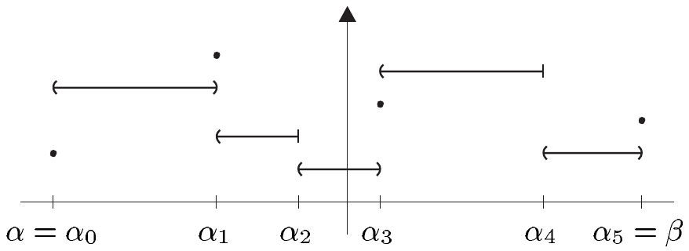
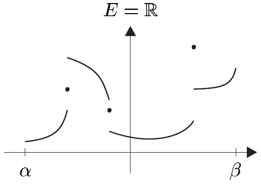
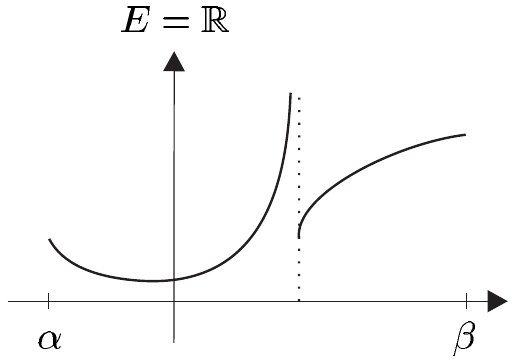
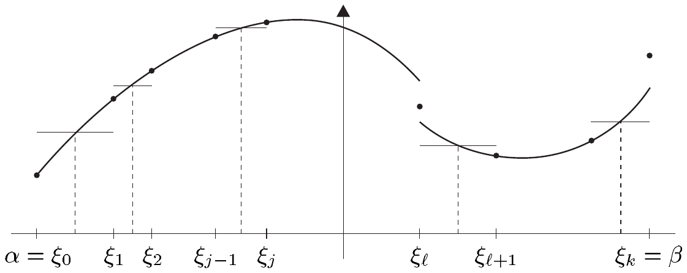

## 1 跳跃连续函数

在许多具体情形中，尤其是在积分学里，连续性的约束被证明是过于严格的。不连续函数在许多应用中自然出现，尽管这种不连续性通常并不十分病态。在本节中，我们将学习一类简单的映射，它包含连续函数，并且在一元积分学中特别有用。不过，我们稍后将会看到，跳跃连续函数空间对于一种灵活的积分理论来说仍然过于严格，而且在多维积分的情形下，我们将不得不把理论推广到一个包含连续函数的更广的类中。

在下文中，设

• $ E := (E, \|\cdot\|) $ 是一个巴拿赫空间；
  $ I := [\alpha, \beta] $ 是一个紧致完全区间。

##### 阶梯函数与跳跃连续函数

我们称 $ \mathfrak{Z} := (\alpha_0, \ldots, \alpha_n) $ 为 $ I $ 的一个**划分**，如果 $ n \in \mathbb{N}^\times $ 且

\[ \alpha = \alpha_0 < \alpha_1 < \cdots < \alpha_n = \beta. \]

如果 $ \{\alpha_0, \ldots, \alpha_n\} $ 是划分 $ \mathfrak{Z}' := (\beta_0, \ldots, \beta_k) $ 的一个子集，则称 $ \mathfrak{Z}' $ 为 $ \mathfrak{Z} $ 的一个**加细**，并记 $ \mathfrak{Z} \le \mathfrak{Z}' $。

函数 $ f : I \to E $ 称为 $ I $ 上的**阶梯函数**，如果 $ I $ 存在一个划分 $ \mathfrak{Z} := (\alpha_0, \ldots, \alpha_n) $，使得 $ f $ 在每个（开）区间 $ (\alpha_{j-1}, \alpha_j) $ 上为常数。此时我们说 $ \mathfrak{Z} $ 是 $ f $ 的一个划分，或者说 $ f $ 是划分 $ \mathfrak{Z} $ 上的一个阶梯函数。

阶梯函数

如果 $ f : I \to E $ 满足极限 $ f(\alpha + 0) $、$ f(\beta - 0) $ 以及

\[ f(x \pm 0) := \lim_{\substack{y \to x \pm 0 \\ y \ne x}} f(y) \]

对所有 $ x \in \mathring{I} $ 都存在，则称 $ f $ 为**跳跃连续**的。\footnote{注意到，一般地，$ f(x + 0) $ 与 $ f(x - 0) $ 可能不同于 $ f(x) $。} 一个跳跃连续函数如果只有有限多个不连续点（“跳跃”），则称它是**分段连续**的。最后，

我们用

\[ \mathcal{T}(I, E), \qquad \mathcal{S}(I, E), \qquad \mathcal{SC}(I, E) \]

分别记所有阶梯的、跳跃连续的以及分段连续的函数 $ f : I \to E $ 所成的集合。\footnote{如果上下文明确我们所讨论的是域 $ \mathbb{R} $ 还是 $ \mathbb{C} $，我们通常缩写为 $ \mathcal{T}(I) := \mathcal{T}(I, \mathbb{K}) $ 等等。}

分段连续函数

非跳跃连续函数

1.1 注 (a) 给定 $ I $ 的划分 $ \mathfrak{Z} := (\alpha_0, \ldots, \alpha_n) $ 与 $ \mathfrak{Z}' := (\beta_0, \ldots, \beta_m) $，并集 $ \{\alpha_0, \ldots, \alpha_n\} \cup \{\beta_0, \ldots, \beta_m\} $ 自然定义了 $ I $ 的另一个划分 $ \mathfrak{Z} \vee \mathfrak{Z}' $。显然，$ \mathfrak{Z} \le \mathfrak{Z} \vee \mathfrak{Z}' $ 且 $ \mathfrak{Z}' \le \mathfrak{Z} \vee \mathfrak{Z}' $。事实上，$ \le $ 是 $ I $ 的划分集上的一个序，且 $ \mathfrak{Z} \vee \mathfrak{Z}' $ 是 $ \{\mathfrak{Z}, \mathfrak{Z}'\} $ 中最大的一个。

(b) 如果 $ f $ 是划分 $ \mathfrak{Z} $ 上的阶梯函数，则 $ \mathfrak{Z} $ 的每个加细也都是 $ f $ 的划分。

(c) 如果 $ f : I \to E $ 是跳跃连续的，则对 $ x \in I $，$ f(x + 0) $ 与 $ f(x - 0) $ 都不必等于 $ f(x) $。

(d) $ \mathcal{S}(I, E) $ 是 $ B(I, E) $ 的一个向量子空间。

证明 单侧极限的线性性立即蕴含 $ \mathcal{S}(I, E) $ 是一个向量空间。若 $ f \in \mathcal{S}(I, E) \backslash B(I, E) $，我们可在 $ I $ 中找到一个序列 $ (x_n) $，使得

\[ \|f(x_n)\| \ge n \quad \text{对 } n \in \mathbb{N}. \tag{1.1} \]

因为 $ I $ 是紧致的，故存在 $ (x_n) $ 的子序列 $ (x_{n_k}) $ 以及 $ x \in I $，使得当 $ k \to \infty $ 时有 $ x_{n_k} \to x $。通过选取 $ (x_{n_k}) $ 的合适子序列，我们可找到一个单调收敛到 $ x $ 的序列 $ (y_n) $。\footnote{试比较习题 II.6.3。} 如果 $ f $ 是跳跃连续的，则存在 $ v \in E $，使得 $ \lim f(y_n) = v $，从而 $ \lim \|f(y_n)\| = \|v\| $（试比较例 III.1.3(j)）。因为每个收敛序列都有界，这与 (1.1) 矛盾。因此 $ \mathcal{S}(I, E) \subset B(I, E) $。■

(e) 我们有向量子空间的序列

\[ \mathcal{T}(I, E) \subset \mathcal{SC}(I, E) \subset \mathcal{S}(I, E) \qquad \text{且} \qquad C(I, E) \subset \mathcal{SC}(I, E). \]

(f) 每个单调函数 $ f : I \to \mathbb{R} $ 都是跳跃连续的。

证明 这可由命题 III.5.3 得到。■

(g) 如果 $ f $ 属于 $ \mathcal{T}(I, E) $、$ \mathcal{S}(I, E) $ 或 $ \mathcal{SC}(I, E) $，且 $ J $ 是 $ I $ 的紧致完全子区间，则 $ f|J $ 属于 $ \mathcal{T}(J, E) $、$ \mathcal{S}(J, E) $ 或 $ \mathcal{SC}(J, E) $。

(h) 如果 $ f $ 属于 $ \mathcal{T}(I, E) $、$ \mathcal{S}(I, E) $ 或 $ \mathcal{SC}(I, E) $，则 $ \|f\| $ 属于 $ \mathcal{T}(I, \mathbb{R}) $、$ \mathcal{S}(I, \mathbb{R}) $、$ \mathcal{SC}(I, \mathbb{R}) $。■

##### 跳跃连续函数的刻画

1.2 定理 函数 $ f : I \to E $ 是跳跃连续的，当且仅当存在一个一致收敛到它的阶梯函数序列。

证明 “$ \Longrightarrow $” 设 $ f \in \mathcal{S}(I, E) $ 且 $ n \in \mathbb{N}^\times $。则对每个 $ x \in I $，存在数 $ \alpha(x) $ 与 $ \beta(x) $，使得 $ \alpha(x) < x < \beta(x) $ 且

\[ \|f(s) - f(t)\| < 1/n \quad \text{对 } s, t \in (\alpha(x), x) \cap I \quad \text{或} \quad s, t \in (x, \beta(x)) \cap I. \]

因为 $ \{(\alpha(x), \beta(x)) \;;\; x \in I\} $ 是紧致区间 $ I $ 的一个开覆盖，故我们可在 $ I $ 中找到元素 $ x_0 < x_1 < \cdots < x_m $，使得 $ I \subset \bigcup_{j=0}^{m} (\alpha(x_j), \beta(x_j)) $。令 $ \eta_0 := \alpha $，对 $ j = 0, \ldots, m $ 令 $ \eta_{j+1} := x_j $，并令 $ \eta_{m+2} := \beta $，于是 $ \mathfrak{Z}_0 = (\eta_0, \ldots, \eta_{m+2}) $ 是 $ I $ 的一个划分。现在选取 $ \mathfrak{Z}_0 $ 的一个加细 $ \mathfrak{Z}_1 = (\xi_0, \ldots, \xi_k) $，使得

\[ \|f(s) - f(t)\| < 1/n \quad \text{对 } s, t \in (\xi_{j-1}, \xi_j) \text{ 且 } j = 1, \ldots, k, \]

并令

\[ f_n(x) := \begin{cases} f(x), & x \in \{\xi_0, \ldots, \xi_k\}, \\ f((\xi_{j-1} + \xi_j)/2), & x \in (\xi_{j-1}, \xi_j), \quad j = 1, \ldots, k. \end{cases} \]

于是 $ f_n $ 是一个阶梯函数，并且由构造可知

\[ \|f(x) - f_n(x)\| < 1/n \quad \text{对 } x \in I. \]

因此 $ \|f - f_n\|_\infty < 1/n $。

“$ \Longleftarrow $” 设 $ \mathcal{T}(I, E) $ 中存在一个一致收敛到 $ f $ 的序列 $ (f_n) $。该序列在 $ B(I, E) $ 中也收敛到 $ f $。设 $ \varepsilon > 0 $。则存在 $ n \in \mathbb{N} $，使得对所有 $ x \in I $ 有 $ \|f(x) - f_n(x)\| < \varepsilon/2 $。此外，对每个 $ x \in (\alpha, \beta] $，存在 $ \alpha' \in [\alpha, x) $，使得对 $ s, t \in (\alpha', x) $ 有 $ f_n(s) = f_n(t) $。因此，

\[ \|f(s) - f(t)\| \le \|f(s) - f_n(s)\| + \|f_n(s) - f_n(t)\| + \|f_n(t) - f(t)\| < \varepsilon \tag{1.2} \]

对 $ s, t \in (\alpha', x) $ 成立。

现在设 $ (s_j) $ 是 $ I $ 中从左方收敛到 $ x $ 的序列。则存在 $ N \in \mathbb{N} $，使得对 $ j \ge N $ 有 $ s_j \in (\alpha', x) $，且 (1.2) 蕴含

\[ \|f(s_j) - f(s_k)\| < \varepsilon \quad \text{对 } j, k \ge N. \]

因此 $ (f(s_j))_{j \in \mathbb{N}} $ 是巴拿赫空间 $ E $ 中的柯西序列，且存在 $ e \in E $，使得 $ \lim_j f(s_j) = e $。若 $ (t_k) $ 是 $ I $ 中另一个从左方收敛到 $ x $ 的序列，则我们可以重复上述论证，说明存在 $ e' \in E $，使得 $ \lim_k f(t_k) = e' $。此外，存在 $ M \ge N $，使得对 $ k \ge M $ 有 $ t_k \in (\alpha', x) $。因此，由 (1.2) 可得

\[ \|f(s_j) - f(t_k)\| < \varepsilon \quad \text{对 } j, k \ge M. \]

取极限 $ j \to \infty $ 与 $ k \to \infty $ 之后，我们得到 $ \|e - e'\| \le \varepsilon $。由于 $ \varepsilon > 0 $ 是任意的，故 $ e $ 与 $ e' $ 相等。因此我们证明了 $ \lim_{y \to x-0} f(y) $ 存在。交换左右，我们证明对 $ x \in [\alpha, \beta) $，右极限 $ \lim_{y \to x+0} f(y) $ 也存在。于是 $ f $ 是跳跃连续的。■

1.3 注 如果函数 $ f \in \mathcal{S}(I, \mathbb{R}) $ 是非负的，则上述证明的第一部分说明存在一个一致收敛到 $ f $ 的非负阶梯函数序列。■

##### 跳跃连续函数的巴拿赫空间

1.4 定理 跳跃连续函数集 $ \mathcal{S}(I, E) $ 是 $ B(I, E) $ 的一个闭向量子空间，且它本身是一个巴拿赫空间；$ \mathcal{T}(I, E) $ 在 $ \mathcal{S}(I, E) $ 中稠密。

证明 由注 1.1(d) 与 (e)，我们有包含关系

\[ \mathcal{T}(I, E) \subset \mathcal{S}(I, E) \subset B(I, E). \]

根据定理 1.2，我们有

\[ \overline{\mathcal{T}(I, E)} = \mathcal{S}(I, E), \tag{1.3} \]

其中闭包在 $ B(I, E) $ 中形成。因此由命题 III.2.12，$ \mathcal{S}(I, E) $ 在 $ B(I, E) $ 中是闭的。定理的最后一部分由 (1.3) 得到。■

1.5 推论

(i) 每个（分段）连续函数都是一个阶梯函数序列的一致极限。

(ii) 跳跃连续函数序列的一致极限是跳跃连续的。

(iii) 每个单调函数都是一个阶梯函数序列的一致极限。

证明 断言 (i) 直接由定理 1.2 得到；(ii) 由定理 1.4 得到，而断言 (iii) 由注 1.1(f) 得到。■

##### 习题

1 验证：关于逐点乘法，$ \mathcal{S}(I, \mathbb{K}) $ 是一个具有单位元的巴拿赫代数。

2 由下式定义 $ f : [-1, 1] \to \mathbb{R} $：

\[ f(x) := \begin{cases} \frac{1}{n+2}, & x \in \left[ -\frac{1}{n}, -\frac{1}{n+1} \right) \cup \left( \frac{1}{n+1}, \frac{1}{n} \right], \\ 0, & x = 0. \end{cases} \]

证明或否定：

(a) $ f \in \mathcal{T}([-1, 1], \mathbb{R}) $；

(b) $ f \in \mathcal{S}([-1, 1], \mathbb{R}) $。

3 证明或否定：$ \mathcal{SC}(I, E) $ 是 $ \mathcal{S}(I, E) $ 的一个闭向量子空间。

4 证明：对 $ f : I \to E $，下列陈述等价：

(i) $ f \in \mathcal{S}(I, E) $；

(ii) $ \exists\, (f_n) $ 在 $ \mathcal{T}(I, E) $ 中，使得 $ \sum_n \|f_n\|_\infty < \infty $ 且 $ f = \sum_{n=0}^\infty f_n $。

5 证明：每个跳跃连续函数至多只有可数个不连续点。

6 用 $ f : [0, 1] \to \mathbb{R} $ 表示 $ [0, 1] $ 上的狄利克雷函数。$ f $ 是否属于 $ \mathcal{S}([0, 1], \mathbb{R}) $？

7 由下式定义 $ f : [0, 1] \to \mathbb{R} $：

\[ f(x) := \begin{cases} 1/n, & x \in \mathbb{Q} \text{ 且 } x \text{ 写成既约分数 } m/n, \\ 0, & \text{其他情形}. \end{cases} \]

证明或否定：$ f \in \mathcal{S}([0, 1], \mathbb{R}) $。

8 由下式定义 $ f : [0, 1] \to \mathbb{R} $：

\[ f(x) := \begin{cases} \sin(1/x), & x \in (0, 1], \\ 0, & x = 0. \end{cases} \]

$ f $ 是否跳跃连续？

9 设 $ E_j $，$ j = 0, \ldots, n $ 是赋范向量空间，且

\[ f = (f_0, \ldots, f_n) : I \to E := E_0 \times \cdots \times E_n. \]

证明：

\[ f \in \mathcal{S}(I, E) \Longleftrightarrow f_j \in \mathcal{S}(I, E_j), \quad j = 0, \ldots, n. \]

10 设 $ E $ 与 $ F $ 是赋范向量空间，且 $ f \in \mathcal{S}(I, E) $ 与 $ \varphi : E \to F $ 都是一致连续的。证明：$ \varphi \circ f \in \mathcal{S}(I, F) $。

11 设 $ f, g \in \mathcal{S}(I, \mathbb{R}) $ 且 $ \operatorname{im}(g) \subset I $。证明或否定：$ f \circ g \in \mathcal{S}(I, \mathbb{R}) $。
