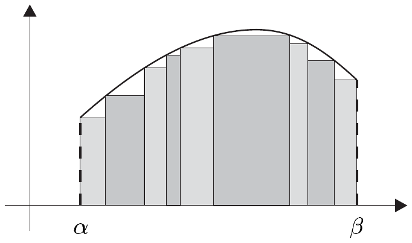
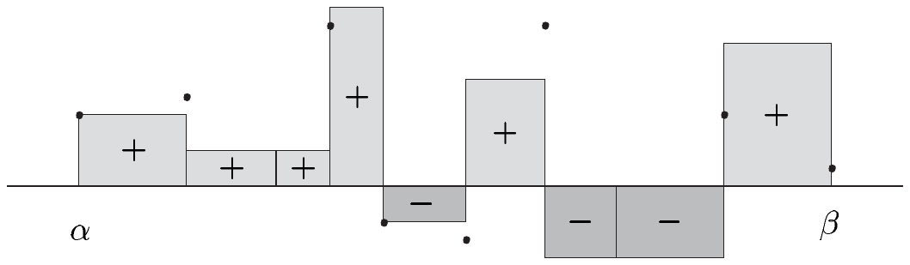
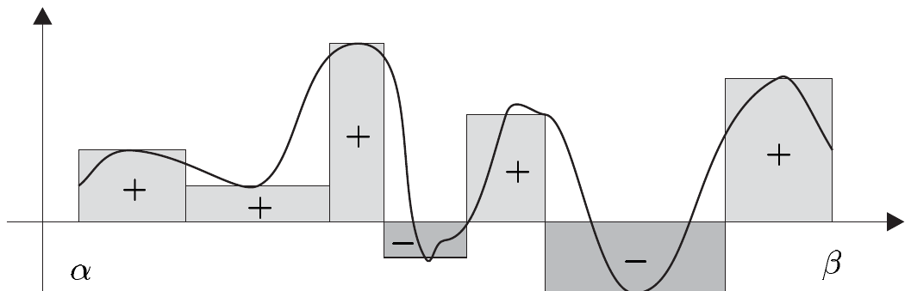

## 3 柯西–黎曼积分

确定平面几何图形的面积是数学中最古老、最突出的课题之一。为了计算实函数图像下方的面积，有必要把问题加以简化和形式化。这将有助于获得对积分的直观认识。为此，我们将首先尽可能简单地说明如何对阶梯函数积分；随后再把这一想法推广到跳跃连续函数。这些构造本质上基于本章前两节的结果。它们表达了如下想法：一个图像的面积由若干矩形面积之和构成，而这些矩形本身又是通过选取该图像对阶梯函数的最佳逼近来确定的。通过对矩形宽度的“无限加细”，我们预期这些矩形的面积之和将收敛到该图形的面积。

下文我们记

• $ E := (E, \left| \cdot \right|) $，一个巴拿赫空间；
  $ I := [\alpha, \beta] $，一个紧致完全区间。

##### 阶梯函数的积分

设 $ f : I \to E $ 是阶梯函数，且 $ \mathfrak{Z} := (\alpha_0, \ldots, \alpha_n) $ 是 $ I $ 的一个关于 $ f $ 的划分。由

\[ f(x) = e_j \quad \text{对 } x \in (\alpha_{j-1}, \alpha_j) \text{ 且 } j = 1, \ldots, n , \]

定义 $ e_j $，即 $ e_j $ 是 $ f $ 在区间 $ (\alpha_{j-1}, \alpha_j) $ 上的值。我们称

\[ \int_{(\mathfrak{Z})} f := \sum_{j=1}^{n} e_j(\alpha_j - \alpha_{j-1}) \]

为 $ f $ 关于划分 $ \mathfrak{Z} $ 的积分。显然 $ \int_{(\mathfrak{Z})} f $ 是 $ E $ 的一个元素。我们注意到该积分不依赖于 $ f $ 在其跳跃不连续点处的值。当 $ E = \mathbb{R} $ 时，我们可以把 $ \left| e_j \right| (\alpha_j - \alpha_{j-1}) $ 解释为边长分别为 $ \left| e_j \right| $ 与 $ (\alpha_j - \alpha_{j-1}) $ 的矩形的面积。于是 $ \int_{(\mathfrak{Z})} f $ 表示矩形面积的加权和，其中面积 $ \left| e_j \right| (\alpha_j - \alpha_{j-1}) $ 以 $ e_j $ 的符号为权重。换言之，那些上升到 $ x $ 轴上方的矩形以 1 加权，而那些位于下方的矩形则赋以 $ -1 $。

下面的引理表明 $ \int_{(\mathfrak{Z})} f $ 只依赖于 $ f $，而不依赖于划分 $ \mathfrak{Z} $ 的选择。

3.1 引理 若 $ f \in \mathcal{T}(I, E) $，且 $ \mathfrak{Z} $ 与 $ \mathfrak{Z}' $ 都是 $ f $ 的划分，则 $ \int_{(\mathfrak{Z})} f = \int_{(\mathfrak{Z}')} f $。

证明 (i) 首先处理 $ \mathfrak{Z}' := (\alpha_0, \ldots, \alpha_k, \gamma, \alpha_{k+1}, \ldots, \alpha_n) $ 恰比 $ \mathfrak{Z} := (\alpha_0, \ldots, \alpha_n) $ 多一个划分点的情形。此时我们计算

\[ \begin{aligned} \int_{(\mathfrak{Z})} f &= \sum_{j=1}^{n} e_j(\alpha_j - \alpha_{j-1}) \\ &= \sum_{j=1}^{k} e_j(\alpha_j - \alpha_{j-1}) + e_{k+1}(\alpha_{k+1} - \alpha_k) + \sum_{j=k+2}^{n} e_j(\alpha_j - \alpha_{j-1}) \\ &= \sum_{j=1}^{k} e_j(\alpha_j - \alpha_{j-1}) + e_{k+1}(\alpha_{k+1} - \gamma) + e_{k+1}(\gamma - \alpha_k) + \sum_{j=k+2}^{n} e_j(\alpha_j - \alpha_{j-1}) \\ &= \int_{(\mathfrak{Z}')} f . \end{aligned} \]

(ii) 若 $ \mathfrak{Z}' $ 是 $ \mathfrak{Z} $ 的任意加细，则由反复应用 (i) 中的论证可得该结论。

(iii) 最后，若 $ \mathfrak{Z} $ 与 $ \mathfrak{Z}' $ 是 $ f $ 的任意划分，则根据注 1.1(a) 与 (b)，$ \mathfrak{Z} \vee \mathfrak{Z}' $ 既是 $ \mathfrak{Z} $ 的加细又是 $ \mathfrak{Z}' $ 的加细，从而也是 $ f $ 的一个划分。于是由 (ii) 可得

\[ \int_{(\mathfrak{Z})} f = \int_{(\mathfrak{Z} \vee \mathfrak{Z}')} f = \int_{(\mathfrak{Z}')} f . ■ \]

利用引理 3.1，对 $ f \in \mathcal{T}(I, E) $，我们可以用 $ f $ 的任意划分 $ \mathfrak{Z} $ 通过

\[ \int_{I} f := \int_{\alpha}^{\beta} f := \int_{(\mathfrak{Z})} f \]

来定义 $ f $ 在 $ I $ 上的积分。显然，该积分给出一个从 $ \mathcal{T}(I, E) $ 到 $ E $ 的映射，即

\[ \int_{\alpha}^{\beta} : \mathcal{T}(I, E) \to E, \quad f \mapsto \int_{\alpha}^{\beta} f , \]

我们自然也称它为积分。接下来我们说明该映射最初的几个简单性质。

3.2 引理 若 $ f \in \mathcal{T}(I, E) $，则 $ |f| \in \mathcal{T}(I, \mathbb{R}) $，且

\[ \left| \int_{\alpha}^{\beta} f \right| \le \int_{\alpha}^{\beta} |f| \le \|f\|_{\infty} (\beta - \alpha) . \]

此外 $ \int_{\alpha}^{\beta} $ 属于 $ \mathcal{L}(\mathcal{T}(I, E), E) $，且 $ \left\| \int_{\alpha}^{\beta} \right\| = \beta - \alpha $。

证明 第一个断言是显然的。为证明该不等式，设 $ f \in \mathcal{T}(I, E) $，$ (\alpha_0, \ldots, \alpha_n) $ 是 $ f $ 的一个划分。于是

\[ \begin{aligned} \left| \int_{\alpha}^{\beta} f \right| &= \left| \sum_{j=1}^{n} e_j(\alpha_j - \alpha_{j-1}) \right| \le \sum_{j=1}^{n} |e_j| (\alpha_j - \alpha_{j-1}) = \int_{\alpha}^{\beta} |f| \\ &\le \max_{1 \le j \le n} |e_j| \sum_{j=1}^{n} (\alpha_j - \alpha_{j-1}) \le \sup_{x \in I} |f(x)| (\beta - \alpha) = (\beta - \alpha) \|f\|_{\infty} . \end{aligned} \]

$ \int_{\alpha}^{\beta} $ 的线性性由注 1.1.(e) 与 $ \int_{\alpha}^{\beta} $ 的定义可得。因此 $ \int_{\alpha}^{\beta} $ 属于 $ \mathcal{L}(\mathcal{T}(I, E), E) $，且 $ \left\| \int_{\alpha}^{\beta} \right\| \le \beta - \alpha $。对于值恒为 1 的常值函数 $ \mathbf{1} \in \mathcal{T}(I, \mathbb{R}) $，有 $ \int_{\alpha}^{\beta} \mathbf{1} = \beta - \alpha $，于是最后一个断言成立。■

##### 跳跃连续函数的积分

由定理 1.4 我们知道，当跳跃连续函数空间 $ \mathcal{S}(I, E) $ 赋以上确界范数时它是一个巴拿赫空间，且 $ \mathcal{T}(I, E) $ 是 $ \mathcal{S}(I, E) $ 的一个稠密向量子空间（见注 1.1(e)）。由引理 3.2 可得，积分 $ \int_{\alpha}^{\beta} $ 是从 $ \mathcal{T}(I, E) $ 到 $ E $ 的连续线性映射。我们可以应用延拓定理 2.6，得到 $ \int_{\alpha}^{\beta} $ 到巴拿赫空间 $ \mathcal{S}(I, E) $ 的唯一的连续线性延拓。我们用同一记号表示这个延拓，于是

\[ \int_{\alpha}^{\beta} \in \mathcal{L}(\mathcal{S}(I, E), E) . \]

由定理 2.6 可得

\[ \int_{\alpha}^{\beta} f = \lim_{n} \int_{\alpha}^{\beta} f_n \ \text{在}\ E\ \text{中} \qquad \text{对 } f \in \mathcal{S}(I, E) , \]

其中 $ (f_n) $ 是任意一个一致收敛到 $ f $ 的阶梯函数序列。$ E $ 的元素 $ \int_{\alpha}^{\beta} f $ 称为 $ f $ 的（**柯西–黎曼**）积分，或 $ f $ 在 $ I $ 上的积分，或 $ f $ 从 $ \alpha $ 到 $ \beta $ 的积分。我们称 $ f $ 为**被积函数**。

3.3 注 设 $ f \in \mathcal{S}(I, E) $。

(a) 根据定理 2.6，$ \int_{\alpha}^{\beta} f $ 是良定义的，也就是说，$ E $ 的这个元素不依赖于逼近的阶梯函数序列。在特殊情形 $ E = \mathbb{R} $ 下，我们把 $ \int_{\alpha}^{\beta} f_n $ 解释为 $ f_n $ 的图像在区间 $ I $ 上的加权（或“有向”）面积。

由于 $ f_n $ 的图像逼近 $ f $，我们可以把 $ \int_{\alpha}^{\beta} f_n $ 视为 $ f $ 的图像在区间 $ I $ 上“有向”面积的一个近似，因而可以把 $ \int_{\alpha}^{\beta} f $ 等同于这个有向面积。

(b) 对 $ \int_{\alpha}^{\beta} f $ 还有一些其他的记号，即

\[ \int f , \quad \int_{I} f , \quad \int_{\alpha}^{\beta} f(x) \, dx , \quad \int_{I} f(x) \, dx , \quad \int f(x) \, dx , \quad \int_{I} f \, dx . \]

(c) 我们有 $ \int_{\alpha}^{\beta} f \in E $，且 $ \left| \int_{\alpha}^{\beta} f \, dx \right| \le (\beta - \alpha) \|f\|_{\infty} $。

证明 这可由引理 3.2 与定理 2.6 得到。■

##### 黎曼和

若 $ \mathfrak{Z} := (\alpha_0, \ldots, \alpha_n) $ 是 $ I $ 的一个划分，我们称

\[ \Delta_{\mathfrak{Z}} := \max_{1 \le j \le n} (\alpha_j - \alpha_{j-1}) \]

为 $ \mathfrak{Z} $ 的**细度**，并称任一元素 $ \xi_j \in [\alpha_{j-1}, \alpha_j] $ 为一个**介点**。利用这套术语，我们现在证明关于 $ \int_{\alpha}^{\beta} f $ 的一个逼近结果。

3.4 定理 设 $ f \in \mathcal{S}(I, E) $。则对每个 $ \varepsilon > 0 $，存在 $ \delta > 0 $，使得

\[ \left| \int_{\alpha}^{\beta} f \, dx - \sum_{j=1}^{n} f(\xi_j)(\alpha_j - \alpha_{j-1}) \right| < \varepsilon \]

对 $ I $ 的每个满足 $ \Delta_{\mathfrak{Z}} < \delta $ 的划分 $ \mathfrak{Z} := (\alpha_0, \ldots, \alpha_n) $ 以及对介点 $ \xi_j $ 的每个取值都成立。

证明 (i) 我们首先处理阶梯函数。设 $ f \in \mathcal{T}(I, E) $，$ \varepsilon > 0 $。又设 $ \widehat{\mathfrak{Z}} := (\widehat{\alpha}_0, \ldots, \widehat{\alpha}_{\hat{n}}) $ 是 $ f $ 的一个划分，并令 $ e_j = f|(\widehat{\alpha}_{j-1}, \widehat{\alpha}_j) $，其中 $ 1 \le j \le \hat{n} $。取 $ \delta := \varepsilon/4\hat{n}\|f\|_{\infty} $，并选取 $ I $ 的一个划分 $ \mathfrak{Z} := (\alpha_0, \ldots, \alpha_n) $，使得 $ \Delta_{\mathfrak{Z}} < \delta $。再取介点 $ \xi_j \in [\alpha_{j-1}, \alpha_j] $，其中 $ 1 \le j \le n $。对 $ (\beta_0, \ldots, \beta_m) := \mathfrak{Z} \vee \widehat{\mathfrak{Z}} $，有

\[ \begin{aligned} \int_{\alpha}^{\beta} f \, dx - \sum_{j=1}^{n} f(\xi_j)(\alpha_j - \alpha_{j-1}) &= \sum_{i=1}^{\hat{n}} e_i(\widehat{\alpha}_i - \widehat{\alpha}_{i-1}) - \sum_{j=1}^{n} f(\xi_j)(\alpha_j - \alpha_{j-1}) \\ &= \sum_{k=1}^{m} e_k'(\beta_k - \beta_{k-1}) - \sum_{k=1}^{m} e_k''(\beta_k - \beta_{k-1}) \\ &= \sum_{k=1}^{m} (e_k' - e_k'')(\beta_k - \beta_{k-1}) , \end{aligned} \tag{3.1} \]

并且我们把 $ e_k' $ 与 $ e_k'' $ 具体规定为

\[ \begin{aligned} e_k' &:= f(\xi), \quad \xi \in (\beta_{k-1}, \beta_k) , \\ e_k'' &:= f(\xi_j), \quad \text{若 } [\beta_{k-1}, \beta_k] \subset [\alpha_{j-1}, \alpha_j] . \end{aligned} \]

显然，$ e_k' \ne e_k'' $ 只可能在划分点 $ \{\widehat{\alpha}_0, \ldots, \widehat{\alpha}_{\hat{n}}\} $ 处成立。因此 (3.1) 中最后的和至多有 $ 2\hat{n} $ 个非零项。对其中每一项，有

\[ |(e_k' - e_k'')(\beta_k - \beta_{k-1})| \le 2\|f\|_{\infty}\Delta_{\mathfrak{Z}} < 2\|f\|_{\infty}\delta . \]

于是由 (3.1) 以及 $ \delta $ 的取值，我们得到

\[ \left| \int_{\alpha}^{\beta} f - \sum_{j=1}^{n} f(\xi_j)(\alpha_j - \alpha_{j-1}) \right| < 2\hat{n} \cdot 2\|f\|_{\infty}\delta = \varepsilon . \]

(ii) 现设 $ f \in \mathcal{S}(I, E) $，$ \varepsilon > 0 $。则由定理 1.4，存在 $ g \in \mathcal{T}(I, E) $，使得

\[ \|f - g\|_{\infty} < \frac{\varepsilon}{3(\beta - \alpha)} . \tag{3.2} \]

由注 3.3(c)，有

\[ \left| \int_{\alpha}^{\beta} (f - g) \right| \le \|f - g\|_{\infty}(\beta - \alpha) < \varepsilon/3 . \tag{3.3} \]

由 (i)，存在 $ \delta > 0 $，使得对 $ I $ 的每个满足 $ \Delta_{\mathfrak{Z}} < \delta $ 的划分 $ \mathfrak{Z} := (\alpha_0, \ldots, \alpha_n) $ 以及每个取值 $ \xi_j \in [\alpha_{j-1}, \alpha_j] $，都有

\[ \left| \int_{\alpha}^{\beta} g \, dx - \sum_{j=1}^{n} g(\xi_j)(\alpha_j - \alpha_{j-1}) \right| < \varepsilon/3 . \tag{3.4} \]

估计式

\[ \left| \sum_{j=1}^{n} (g(\xi_j) - f(\xi_j))(\alpha_j - \alpha_{j-1}) \right| \le \|f - g\|_{\infty}(\beta - \alpha) < \varepsilon/3 \tag{3.5} \]

是显然的。综合 (3.3)–(3.5)，我们得到

\[ \begin{aligned} \left| \int_{\alpha}^{\beta} f \, dx - \sum_{j=1}^{n} f(\xi_j)(\alpha_j - \alpha_{j-1}) \right| & \\ &\le \left| \int_{\alpha}^{\beta} (f - g) \, dx \right| + \left| \int_{\alpha}^{\beta} g \, dx - \sum_{j=1}^{n} g(\xi_j)(\alpha_j - \alpha_{j-1}) \right| \\ &\quad + \left| \sum_{j=1}^{n} (g(\xi_j) - f(\xi_j))(\alpha_j - \alpha_{j-1}) \right| < \varepsilon , \end{aligned} \]

于是结论得证。■

3.5 注 (a) 函数 $ f : I \to E $ 称为**黎曼可积**的，如果存在 $ e \in E $ 具有这样的性质：对每个 $ \varepsilon > 0 $ 存在 $ \delta > 0 $，使得

\[ \left| e - \sum_{j=1}^{n} f(\xi_j)(\alpha_j - \alpha_{j-1}) \right| < \varepsilon \]

对 $ I $ 的每个满足 $ \Delta_{\mathfrak{Z}} < \delta $ 的划分 $ \mathfrak{Z} := (\alpha_0, \ldots, \alpha_n) $ 以及对每组介点 $ \xi_j \in [\alpha_{j-1}, \alpha_j] $ 都成立。

若 $ f $ 黎曼可积，则值 $ e $ 称为 $ f $ 在 $ I $ 上的**黎曼积分**，我们仍用记号 $ \int_{\alpha}^{\beta} f \, dx $ 表示它。因此，定理 3.4 可以表述为：*每个跳跃连续函数都黎曼可积，且柯西–黎曼积分与黎曼积分一致。*

(b) 可以证明 $ \mathcal{S}(I, E) $ 是黎曼可积函数集的真子集。\footnote{例如这可由如下事实得出：有界函数黎曼可积当且仅当其不连续点集的勒贝格测度为零（见第三卷定理 X.5.6）。} 因此，黎曼积分是柯西–黎曼积分的推广。

这里我们满足于柯西–黎曼积分，不打算扩大可积函数集，因为眼下并无此必要。不过，在第三卷中我们将引入一个更一般的积分——勒贝格积分，它满足严格分析的一切需求。

(c) 设 $ f : I \to E $，且 $ \mathfrak{Z} := (\alpha_0, \ldots, \alpha_n) $ 是 $ I $ 的一个带有介点 $ \xi_j \in [\alpha_{j-1}, \alpha_j] $ 的划分。我们称

\[ \sum_{j=1}^{n} f(\xi_j)(\alpha_j - \alpha_{j-1}) \in E \]

为**黎曼和**。若 $ f $ 黎曼可积，则

\[ \int_{\alpha}^{\beta} f \, dx = \lim_{\Delta_{\mathfrak{Z}} \to 0} \sum_{j=1}^{n} f(\xi_j)(\alpha_j - \alpha_{j-1}) , \]

以符号方式表示它的积分。■

##### 习题

1 设 $ [\cdot] $ 为下取整函数。对 $ n \in \mathbb{N}^{\times} $，计算下列积分

\[ \text{(i)} \int_{0}^{1} \frac{[nx]}{n} \, dx , \quad \text{(ii)} \int_{0}^{1} \frac{[nx^2]}{n^2} \, dx , \quad \text{(iii)} \int_{0}^{1} \frac{[nx^2]}{n} \, dx , \quad \text{(iv)} \int_{\alpha}^{\beta} \operatorname{sign} x \, dx . \]

2 对习题 1.2 中的函数 $ f $ 计算 $ \int_{-1}^{1} f $，并对习题 1.7 中的 $ f $ 计算 $ \int_{0}^{1} f $。

3 设 $ F $ 是巴拿赫空间，$ A \in \mathcal{L}(E, F) $。证明：对 $ f \in \mathcal{S}(I, E) $，有

\[ Af := (x \mapsto A(f(x))) \in \mathcal{S}(I, F) \]

且 $ A\int_{\alpha}^{\beta} f = \int_{\alpha}^{\beta} Af $。

4 对 $ f \in \mathcal{S}(I, E) $，根据习题 1.4，存在一个跳跃连续函数序列 $ (f_n) $，使得 $ \sum_{n} \|f_n\|_{\infty} < \infty $ 且 $ f = \sum_{n} f_n $。证明 $ \int_{I} f = \sum_{n} \int_{I} f_n $。

5 证明：对每个 $ f \in \mathcal{S}(I, \mathbb{R}) $，$ f^{+} $ 与 $ f^{-} $ 也属于 $ \mathcal{S}(I, \mathbb{R}) $，且

\[ \int_{I} f \le \int_{I} f^{+} , \quad -\int_{I} f \le \int_{I} f^{-} . \]

6 证明：若 $ f : I \to E $ 黎曼可积，则 $ f \in B(I, E) $，即*每个黎曼可积函数都是有界的*。

7 设 $ f \in B(I, \mathbb{R}) $，$ \mathfrak{Z} = (\alpha_0, \ldots, \alpha_n) $ 是 $ I $ 的一个划分。定义

\[ \overline{S}(f, I, \mathfrak{Z}) := \sum_{j=1}^{n} \sup\{f(\xi) ; \xi \in [\alpha_{j-1}, \alpha_j]\}(\alpha_j - \alpha_{j-1}) \]

与

\[ \underline{S}(f, I, \mathfrak{Z}) := \sum_{j=1}^{n} \inf\{f(\xi) ; \xi \in [\alpha_{j-1}, \alpha_j]\}(\alpha_j - \alpha_{j-1}) \]

并称它们为 $ f $ 在 $ I $ 上关于划分 $ \mathfrak{Z} $ 的上和与下和。证明：

(i) 若 $ \mathfrak{Z}' $ 是 $ \mathfrak{Z} $ 的加细，则

\[ \overline{S}(f, I, \mathfrak{Z}') \le \overline{S}(f, I, \mathfrak{Z}) , \quad \underline{S}(f, I, \mathfrak{Z}) \le \underline{S}(f, I, \mathfrak{Z}') ; \]

(ii) 若 $ \mathfrak{Z} $ 与 $ \mathfrak{Z}' $ 是 $ I $ 的划分，则

\[ \underline{S}(f, I, \mathfrak{Z}) \le \overline{S}(f, I, \mathfrak{Z}') . \]

8 设 $ f \in B(I, \mathbb{R}) $，且 $ \mathfrak{Z}' := (\beta_0, \ldots, \beta_m) $ 是 $ \mathfrak{Z} := (\alpha_0, \ldots, \alpha_n) $ 的加细。证明：

\[ \begin{aligned} \overline{S}(f, I, \mathfrak{Z}) - \overline{S}(f, I, \mathfrak{Z}') &\le 2(m - n)\|f\|_{\infty}\Delta_{\mathfrak{Z}} , \\ \underline{S}(f, I, \mathfrak{Z}') - \underline{S}(f, I, \mathfrak{Z}) &\le 2(m - n)\|f\|_{\infty}\Delta_{\mathfrak{Z}} . \end{aligned} \]

9 设 $ f \in B(I, \mathbb{R}) $。由习题 7(ii)，我们知道下列各量在 $ \mathbb{R} $ 中存在：

\[ \overline{\int_{I}} f := \inf\{\overline{S}(f, I, \mathfrak{Z}) ; \mathfrak{Z} \text{ 是 } I \text{ 的划分}\} \]

与

\[ \underline{\int_{I}} f := \sup\{\underline{S}(f, I, \mathfrak{Z}) ; \mathfrak{Z} \text{ 是 } I \text{ 的划分}\} . \]

我们称 $ \overline{\int_{I}} f $ 为 $ f $ 在 $ I $ 上的**上黎曼（–达布）积分**；同样地，我们称 $ \underline{\int_{I}} f $ 为**下黎曼积分**。

证明：

(i) $ \underline{\int_{I}} f \le \overline{\int_{I}} f $；

(ii) 对每个 $ \varepsilon > 0 $，存在 $ \delta > 0 $，使得对 $ I $ 的每个满足 $ \Delta_{\mathfrak{Z}} < \delta $ 的划分 $ \mathfrak{Z} $，有不等式

\[ 0 \le \overline{S}(f, I, \mathfrak{Z}) - \overline{\int_{I}} f < \varepsilon \quad \text{且} \quad 0 \le \underline{\int_{I}} f - \underline{S}(f, I, \mathfrak{Z}) < \varepsilon . \]

（提示：存在 $ I $ 的一个划分 $ \mathfrak{Z}' $，使得 $ \overline{S}(f, I, \mathfrak{Z}') < \overline{\int_{I}} f + \varepsilon/2 $。设 $ \mathfrak{Z} $ 是 $ I $ 的任意划分。由习题 8 可得

\[ \overline{S}(f, I, \mathfrak{Z}) \le \overline{S}(f, I, \mathfrak{Z} \vee \mathfrak{Z}') + 2m\|f\|_{\infty}\Delta_{\mathfrak{Z}} . \]

此外，习题 7(i) 给出 $ \overline{S}(f, I, \mathfrak{Z} \vee \mathfrak{Z}') \le \overline{S}(f, I, \mathfrak{Z}') $。）

10 证明：对 $ f \in B(I, \mathbb{R}) $，下列各断言等价：

(i) $ f $ 黎曼可积。

(ii) $ \overline{\int_{I}} f = \underline{\int_{I}} f $。

(iii) 对每个 $ \varepsilon > 0 $，存在 $ I $ 的一个划分 $ \mathfrak{Z} $，使得 $ \overline{S}(f, I, \mathfrak{Z}) - \underline{S}(f, I, \mathfrak{Z}) < \varepsilon $。

证明 $ \overline{\int_{I}} f = \underline{\int_{I}} f = \int_{I} f $。

（提示：“(ii)$\Leftrightarrow$(iii)”由习题 9 得出。

“(i)$\Rightarrow$(iii)” 设 $ \varepsilon > 0 $，$ e := \int_{I} f $。则存在 $ \delta > 0 $，使得

\[ e - \frac{\varepsilon}{2} < \sum_{j=1}^{n} f(\xi_j)(\alpha_j - \alpha_{j-1}) < e + \frac{\varepsilon}{2} \]

对 $ I $ 的每个满足 $ \Delta_{\mathfrak{Z}} < \delta $ 的划分 $ \mathfrak{Z} = (\alpha_0, \ldots, \alpha_n) $ 都成立。因此 $ \overline{S}(f, I, \mathfrak{Z}) \le e + \varepsilon/2 $ 且 $ \underline{S}(f, I, \mathfrak{Z}) \ge e - \varepsilon/2 $。）
