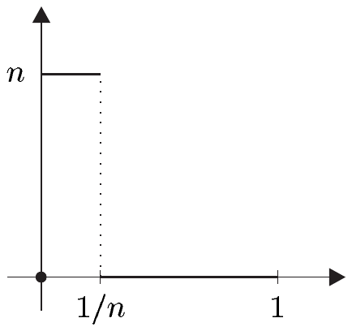
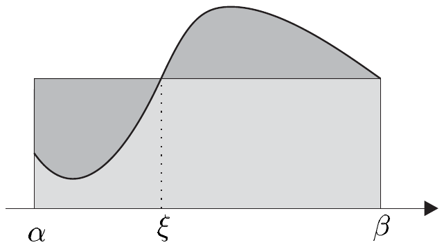
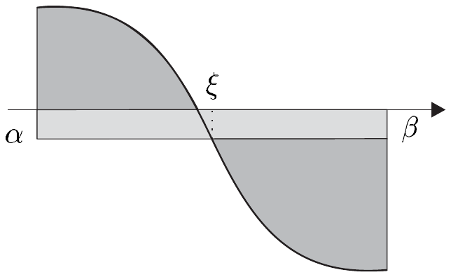

## 4 积分的性质

在本节中，我们深入研究积分最重要的性质，并特别证明微积分基本定理。该定理说的是：区间上的每个连续函数都有一个原函数，它给出了其积分的另一种形式。这一原函数在许多情形下是已知的，并且在已知时能够方便地、显式地计算该积分。

与前几节一样，我们设

• $ E = (E, \left| \cdot \right|) $ 是巴拿赫空间；$ I = [\alpha, \beta] $ 是紧致完全区间。

##### 函数序列的积分

积分的定义很容易导出下述收敛定理，其理论与实际意义将会变得清晰。

4.1 命题（函数序列与函数和的积分）设 $ (f_n) $ 是跳跃连续函数序列。

(i) 若 $ (f_n) $ 一致收敛于 $ f $，则 $ f $ 跳跃连续，且

\[ \lim_{n} \int_{\alpha}^{\beta} f_n = \int_{\alpha}^{\beta} \lim_{n} f_n = \int_{\alpha}^{\beta} f . \]

(ii) 若 $ \sum f_n $ 一致收敛，则 $ \sum_{n=0}^{\infty} f_n $ 跳跃连续，且

\[ \int_{\alpha}^{\beta} \left( \sum_{n=0}^{\infty} f_n \right) = \sum_{n=0}^{\infty} \int_{\alpha}^{\beta} f_n . \]

证明 由定理 1.4 我们知道，空间 $ \mathcal{S}(I, E) $ 赋予上确界范数后是完备的。于是定理的两个部分都由以下事实得出：$ \int_{\alpha}^{\beta} $ 是从 $ \mathcal{S}(I, E) $ 到 $ E $ 的线性映射，且一致收敛与 $ \mathcal{S}(I, E) $ 中的收敛一致。■

4.2 注 当序列 $ (f_n) $ 仅逐点收敛时，命题 4.1 的断言不成立。

证明 令 $ I = [0, 1] $，$ E := \mathbb{R} $，且

\[ f_n(x) := \begin{cases} 0, & x = 0, \\ n, & x \in (0, 1/n), \\ 0, & x \in [1/n, 1], \end{cases} \]

其中 $ n \in \mathbb{N}^{\times} $。则 $ f_n \in \mathcal{T}(I, \mathbb{R}) $，且 $ (f_n) $ 逐点收敛于 0，但不一致收敛于 0。由于对 $ n \in \mathbb{N}^{\times} $ 有 $ \int_{I} f_n = 1 $，而 $ \int_{I} 0 = 0 $，断言得证。■

作为命题 4.1 的第一个应用，我们证明引理 3.2 的重要断言——关于范数与积分的交换——对跳跃连续函数也成立。

4.3 命题 对 $ f \in \mathcal{S}(I, E) $，有 $ |f| \in \mathcal{S}(I, \mathbb{R}) $，且

\[ \left| \int_{\alpha}^{\beta} f \, dx \right| \le \int_{\alpha}^{\beta} |f| \, dx \le (\beta - \alpha)\|f\|_{\infty} . \]

证明 根据定理 1.4，存在 $ \mathcal{T}(I, E) $ 中的序列 $ (f_n) $ 一致收敛于 $ f $。此外，由**逆三角不等式**可得

\[ \left| |f_n(x)|_{E} - |f(x)|_{E} \right| \le |f_n(x) - f(x)|_{E} \le \|f_n - f\|_{\infty} \quad \text{对 } x \in I . \]

因此 $ |f_n| $ 一致收敛于 $ |f| $。因为每个 $ |f_n| $ 都属于 $ \mathcal{T}(I, \mathbb{R}) $，再次由定理 1.4 得 $ |f| \in \mathcal{S}(I, \mathbb{R}) $。

由引理 3.2，我们得到

\[ \left| \int_{\alpha}^{\beta} f_n \, dx \right| \le \int_{\alpha}^{\beta} |f_n| \, dx \le (\beta - \alpha)\|f_n\|_{\infty} . \tag{4.1} \]

因为 $ (f_n) $ 一致收敛于 $ f $ 且 $ (|f_n|) $ 同样收敛于 $ |f| $，我们可以借助命题 4.1 在 (4.1) 中令 $ n \to \infty $。所证的不等式随之得出。■

##### 定向积分

若 $ f \in \mathcal{S}(I, E) $ 且 $ \gamma, \delta \in I $，我们定义\footnote{此处及此后，若 $ J $ 是 $ I $ 的紧致完全子区间，我们就把 $ \int_{J} f|J $ 简写为 $ \int_{J} f $。}

\[ \int_{\gamma}^{\delta} f := \int_{\gamma}^{\delta} f(x) \, dx := \begin{cases} \int_{[\gamma, \delta]} f , & \gamma < \delta , \\ 0, & \gamma = \delta , \\ -\int_{[\delta, \gamma]} f , & \delta < \gamma , \end{cases} \tag{4.2} \]

并称 $ \int_{\gamma}^{\delta} f $ 为“$ f $ 从 $ \gamma $ 到 $ \delta $ 的积分”。我们把 $ \gamma $ 称为 $ f $ 的积分的**下限**，把 $ \delta $ 称为**上限**，即使当 $ \gamma > \delta $ 时也是如此。根据注 1.1(g)，$ f $ 从 $ \gamma $ 到 $ \delta $ 的积分由 (4.2) 良定义，且

\[ \int_{\gamma}^{\delta} f = -\int_{\delta}^{\gamma} f . \tag{4.3} \]

4.4 命题（积分的可加性）对 $ f \in \mathcal{S}(I, E) $ 和 $ a, b, c \in I $，有

\[ \int_{a}^{b} f = \int_{a}^{c} f + \int_{c}^{b} f . \]

证明 只需对 $ a \le b \le c $ 验证这一点。若 $ (f_n) $ 是一致收敛于 $ f $ 的阶梯函数序列，且 $ J $ 是 $ I $ 的紧致完全子区间，则

\[ f_n|J \in \mathcal{T}(J, E) \quad \text{且} \quad f_n|J \xrightarrow[\text{一致}]{} f|J . \tag{4.4} \]

阶梯函数积分的定义立即给出

\[ \int_{a}^{c} f_n = \int_{a}^{b} f_n + \int_{b}^{c} f_n . \tag{4.5} \]

利用 (4.4) 和命题 4.1，令 $ n \to \infty $ 便得到

\[ \int_{a}^{c} f = \int_{a}^{b} f + \int_{b}^{c} f . \]

于是有

\[ \int_{a}^{b} f = \int_{a}^{c} f - \int_{b}^{c} f = \int_{a}^{c} f + \int_{c}^{b} f . ■ \]

##### 积分的正性与单调性

到目前为止，我们考虑的跳跃连续函数的积分取值于任意巴拿赫空间。对于下述定理及其推论，我们将局限于实值情形，此时实数的序蕴含积分的一些附加性质。

4.5 定理 对 $ f \in \mathcal{S}(I, \mathbb{R}) $，若对所有 $ x \in I $ 有 $ f(x) \ge 0 $，则 $ \int_{\alpha}^{\beta} f \ge 0 $。

证明 根据注 1.3，存在非负阶梯函数序列 $ (f_n) $ 一致收敛于 $ f $。此时显然 $ \int f_n \ge 0 $，于是 $ \int f = \lim_{n} \int f_n \ge 0 $。■

4.6 推论 设 $ f, g \in \mathcal{S}(I, \mathbb{R}) $ 满足对所有 $ x \in I $ 有 $ f(x) \le g(x) $。则 $ \int_{\alpha}^{\beta} f \le \int_{\alpha}^{\beta} g $，也就是说，积分在实值函数上是单调的。

证明 这由积分的线性性与命题 4.5 得出。■

4.7 注 (a) 设 $ V $ 是向量空间。我们把从 $ V $ 到其域的任意线性映射称为**线性形式**或**线性泛函**。

因此在标量情形，即 $ E = \mathbb{K} $ 时，积分 $ \int_{\alpha}^{\beta} $ 是 $ \mathcal{S}(I) $ 上的连续线性形式。

(b) 设 $ V $ 是实向量空间，$ P $ 是非空集合，满足

(i) $ x, y \in P \Rightarrow x + y \in P $，

(ii) $ (x \in P, \lambda \in \mathbb{R}^{+}) \Rightarrow \lambda x \in P $，

(iii) $ x, -x \in P \Rightarrow x = 0 $。

换句话说，$ P $ 满足 $ P + P \subset P $，$ \mathbb{R}^{+}P \subset P $ 与 $ P \cap (-P) = \{0\} $。此时我们称 $ P $ 为 $ V $ 中（事实上是凸的）**锥**（顶点在 0 处）。这一称呼是合理的，因为 $ P $ 是凸的，且对每个 $ x $，它都包含“半射线” $ \mathbb{R}^{+}x $。此外，$ P $ 仅当 $ x \ne 0 $ 时才包含“直线” $ \mathbb{R}x $。

接下来我们通过

\[ x \le y :\Leftrightarrow y - x \in P , \tag{4.6} \]

定义 $ \le $，从而在 $ V $ 上得到一个序，它在 $ V $ 上是线性的（或与 $ V $ 的向量空间结构相容），也就是说，对 $ x, y, z \in V $，

\[ x \le y \Rightarrow x + z \le y + z \]

且

\[ (x \le y, \lambda \in \mathbb{R}^{+}) \Rightarrow \lambda x \le \lambda y . \]

进一步，我们称 $ (V, \le) $ 为**有序向量空间**，$ \le $ 是由 $ P $ 诱导的序。显然有

\[ P = \{x \in V ; x \ge 0\} . \tag{4.7} \]

因此我们称 $ P $ 为 $ (V, \le) $ 的**正锥**。

反之，若在 $ V $ 上给定一个线性序 $ \le $，则 (4.7) 在 $ V $ 中定义凸锥，且此锥诱导所给的序。因此，$ V $ 上的凸锥之集与 $ V $ 上的线性序之集之间存在双射。于是，当 $ P $ 是 $ V $ 中的正锥时，我们既可写 $ (V, \le) $，也可写 $ (V, P) $。

(c) 当 $ (V, P) $ 是有序向量空间且 $ \ell $ 是 $ V $ 上的线性形式时，若对所有 $ x \in P $ 有 $ \ell(x) \ge 0 $，则称 $ \ell $ 是**正的**。\footnote{注意，在此定义下零形式是正的。} 于是 $ V $ 上的线性形式是正的当且仅当它是递增的\footnote{我们也可称递增形式为单调线性形式。}。

证明 设 $ \ell : V \to \mathbb{R} $ 是线性的。因为 $ \ell(x - y) = \ell(x) - \ell(y) $，结论是显然的。■

(d) 设 $ E $ 是赋范向量空间（或巴拿赫空间），$ \le $ 是 $ E $ 上的线性序。若 $ E $ 的正锥是闭的，则称 $ E := (E, \le) $ 是**有序赋范向量空间**（或**有序巴拿赫空间**）。

设 $ E $ 是有序赋范向量空间，且 $ (x_j) $ 与 $ (y_j) $ 是 $ E $ 中的序列，满足 $ x_j \to x $ 与 $ y_j \to y $。则对几乎所有的 $ j \in \mathbb{N} $ 有 $ x_j \le y_j $，由此可得 $ x \le y $。

证明 若 $ P $ 是 $ E $ 中的正锥，则对几乎所有的 $ j \in \mathbb{N} $ 有 $ y_j - x_j \in P $。于是由命题 II.2.2 与注 II.3.1(b) 可得

\[ y - x = \lim y_j - \lim x_j = \lim(y_j - x_j) \in P , \]

从而 $ P $ 是闭的。■

(e) 设 $ X $ 是非空集合。例 I.4.4(c) 的逐点序，即

\[ f \le g :\Leftrightarrow f(x) \le g(x) \quad \text{对 } x \in X \]

且 $ f, g \in \mathbb{R}^{X} $，使 $ \mathbb{R}^{X} $ 成为有序向量空间。我们称此序为 $ \mathbb{R}^{X} $ 上的**自然序**。反过来，它在 $ \mathbb{R}^{X} $ 的每个子集 $ M $ 上诱导出 $ M $ 上的**自然序**（见例 I.4.4(a)）。除非另有说明，此后我们始终给 $ \mathbb{R}^{X} $ 及其任意向量子空间配备自然序。特别地，$ B(X, \mathbb{R}) $ 是有序巴拿赫空间，其正锥为

\[ B^{+}(X) := B(X, \mathbb{R}^{+}) := B(X, \mathbb{R}) \cap (\mathbb{R}^{+})^{X} . \]

因此 $ B(X, \mathbb{R}) $ 的每个闭向量子空间 $ \mathfrak{F}(X, \mathbb{R}) $ 都是有序巴拿赫空间，其正锥由下式给出：

\[ \mathfrak{F}^{+}(X) := \mathfrak{F}(X, \mathbb{R}) \cap B^{+}(X) = \mathfrak{F}(X, \mathbb{R}) \cap (\mathbb{R}^{+})^{X} . \]

证明 $ B^{+}(X) $ 在 $ B(X, \mathbb{R}) $ 中是闭的，这是显然的。■

(f) 由 (e) 可得，$ \mathcal{S}(I, \mathbb{R}) $ 是以 $ \mathcal{S}^{+}(I) $ 为正锥的有序巴拿赫空间，且命题 4.5 说的是积分 $ \int_{\alpha}^{\beta} $ 是 $ \mathcal{S}(I, \mathbb{R}) $ 上的连续正（**因此单调**）线性形式。■

由

\[ f(x) := \begin{cases} 1, & x = 1, \\ 0, & \text{其他情形} \end{cases} \]

定义的阶梯函数 $ f : [0, 2] \to \mathbb{R} $ 显然满足 $ \int f = 0 $。因此存在一个不恒为零但其积分为零的非负函数。下一个定理给出非负函数积分严格为正的判别准则。

4.8 命题 设 $ f \in \mathcal{S}^{+}(I) $ 且 $ a \in I $。若 $ f $ 在 $ a $ 处连续且 $ f(a) > 0 $，则

\[ \int_{\alpha}^{\beta} f > 0 . \]

证明 (i) 设 $ a $ 属于 $ \mathring{I} $。则 $ f $ 在 $ a $ 处连续且 $ f(a) > 0 $ 蕴含存在 $ \delta > 0 $，使得 $ [a - \delta, a + \delta] \subset I $ 且

\[ |f(x) - f(a)| \le \frac{1}{2}f(a) \quad \text{对 } x \in [a - \delta, a + \delta] . \]

因此有

\[ f(x) \ge \frac{1}{2}f(a) \quad \text{对 } x \in [a - \delta, a + \delta] . \]

由 $ f \ge 0 $ 与命题 4.5，得 $ \int_{\alpha}^{a-\delta} f \ge 0 $ 与 $ \int_{a+\delta}^{\beta} f \ge 0 $。现在由命题 4.4 与推论 4.6 得

\[ \int_{\alpha}^{\beta} f = \int_{\alpha}^{a-\delta} f + \int_{a-\delta}^{a+\delta} f + \int_{a+\delta}^{\beta} f \ge \int_{a-\delta}^{a+\delta} f \ge \frac{1}{2}f(a)\int_{a-\delta}^{a+\delta} \mathbf{1} = \delta f(a) > 0 . \]

(ii) 当 $ a \in \partial I $ 时，同样的结论由类似的论证得出。■

##### 逐分量积分

4.9 命题 映射 $ f = (f^{1}, \ldots, f^{n}) : I \to \mathbb{K}^{n} $ 跳跃连续当且仅当它的每个分量函数 $ f^{j} $ 都跳跃连续。此外，

\[ \int_{\alpha}^{\beta} f = \left( \int_{\alpha}^{\beta} f^{1}, \ldots, \int_{\alpha}^{\beta} f^{n} \right) . \]

证明 由定理 1.2，$ f $ 跳跃连续当且仅当存在一致收敛于它的阶梯函数序列 $ (f_k) $。容易看出，后者成立当且仅当对每个 $ j \in \{1, \ldots, n\} $，序列 $ (f_k^{j})_{k \in \mathbb{N}} $ 一致收敛于 $ f^{j} $。因为对每个 $ j $ 有 $ f^{j} \in \mathcal{S}(I, \mathbb{K}) $，定理 1.2 蕴含第一个断言。第二个断言对阶梯函数是显然的，并且在此处成立，因为命题 4.1 对 $ f \in \mathcal{S}(I, \mathbb{K}^{n}) $ 取极限时也成立。■

4.10 推论 设 $ g, h \in \mathbb{R}^{I} $ 且 $ f := g + ih $。则 $ f $ 跳跃连续当且仅当 $ g $ 与 $ h $ 都跳跃连续。此时，

\[ \int_{\alpha}^{\beta} f = \int_{\alpha}^{\beta} g + i\int_{\alpha}^{\beta} h . \]

##### 微积分第一基本定理

对 $ f \in \mathcal{S}(I, E) $，我们用积分定义映射

\[ F : I \to E , \quad x \mapsto \int_{\alpha}^{x} f(\xi) \, d\xi , \tag{4.8} \]

其性质现在我们来考察。

4.11 定理 对 $ f \in \mathcal{S}(I, E) $，有

\[ |F(x) - F(y)| \le \|f\|_{\infty}|x - y| \quad \text{对 } x, y \in I . \]

因此积分在整个区间上是利普希茨连续函数。

证明 由命题 4.4，有

\[ F(x) - F(y) = \int_{\alpha}^{x} f(\xi) \, d\xi - \int_{\alpha}^{y} f(\xi) \, d\xi = \int_{y}^{x} f(\xi) \, d\xi \quad \text{对 } x, y \in I . \]

于是结论立即由命题 4.3 得出。■

我们的下一个定理说的是：$ F $ 在 $ f $ 连续处可微。

4.12 定理（在整个区间上的可微性）设 $ f \in \mathcal{S}(I, E) $ 在所有 $ a \in I $ 处连续。则 $ F $ 在 $ a $ 处可微，且 $ F'(a) = f(a) $。

证明 对满足 $ a + h \in I $ 的 $ h \in \mathbb{R}^{\times} $，有

\[ \frac{F(a + h) - F(a)}{h} = \frac{1}{h}\left( \int_{\alpha}^{a+h} f(\xi) \, d\xi - \int_{\alpha}^{a} f(\xi) \, d\xi \right) = \frac{1}{h}\int_{a}^{a+h} f(\xi) \, d\xi . \]

我们注意到 $ hf(a) = \int_{a}^{a+h} f(a) \, d\xi $，于是

\[ \frac{F(a + h) - F(a) - f(a)h}{h} = \frac{1}{h}\int_{a}^{a+h} (f(\xi) - f(a)) \, d\xi . \]

因为 $ f $ 在 $ a $ 处连续，对每个 $ \varepsilon > 0 $ 存在 $ \delta > 0 $，使得

\[ |f(\xi) - f(a)|_{E} < \varepsilon \quad \text{对 } \xi \in I \cap (a - \delta, a + \delta) . \]

利用命题 4.3，我们有估计

\[ \left| \frac{F(a + h) - F(a) - f(a)h}{h} \right|_{E} \le \frac{1}{|h|}\left| \int_{a}^{a+h} |f(\xi) - f(a)|_{E} \, d\xi \right| < \varepsilon \]

对满足 $ 0 < |h| < \delta $ 与 $ a + h \in I $ 的 $ h $ 成立，因此 $ F $ 在 $ a $ 处可微，且 $ F'(a) = f(a) $。■

由最后的结果，我们得到一个更简单但也重要的结论。

4.13 定理（微积分第二基本定理）每个 $ f \in C(I, E) $ 都有原函数，且若 $ F $ 是这样一个原函数，则

\[ F(x) = F(\alpha) + \int_{\alpha}^{x} f(\xi) \, d\xi \quad \text{对 } x \in I . \]

证明 对 $ x \in I $，令 $ G(x) := \int_{\alpha}^{x} f(\xi) \, d\xi $。根据定理 4.12，$ G $ 可微且 $ G' = f $。因此 $ G $ 是 $ f $ 的原函数。

设 $ F $ 是 $ f $ 的原函数。由注 V.3.7(a)，存在 $ c \in E $ 使得 $ F = G + c $。因为 $ G(\alpha) = 0 $，有 $ c = F(\alpha) $。■

4.14 推论 对 $ f \in C(I, E) $ 的每个原函数 $ F $，有

\[ \int_{\alpha}^{\beta} f(x) \, dx = F(\beta) - F(\alpha) =: \left. F \right|_{\alpha}^{\beta} . \]

我们称 $ \left. F \right|_{\alpha}^{\beta} $ 为“$ F $ 在 $ \alpha $ 与 $ \beta $ 之间的取值”。

##### 不定积分

若 $ f $ 的原函数已知，推论 4.14 就把计算积分 $ \int_{\alpha}^{\beta} f $ 的问题化为平凡之差 $ F(\beta) - F(\alpha) $。该推论还表明，在某种意义下，积分是微分的逆运算。

虽然微积分基本定理保证了每个 $ f \in C(I, E) $ 都有原函数，但在一般情形下并不可能把它显式地求出来。

要根据推论 4.14 计算积分，我们必须以某种方法给出其原函数。显然，我们可以通过对已知可微函数求导来得到一批基本的原函数。利用第 IV 章与第 V 章的结果，我们将列出一批重要的原函数，并把它们放在例 4.15 之后给出。在后面的几节中，我们将看到如何利用一些简单的法则与变换得到更大一类原函数。还应当指出，存在列出成千上万原函数的详尽表格（例如见 [Ape96]、[GR81] 或 [BBM86]）。

与其费力地在纸上算出积分，不如使用 Maple 或 Mathematica 之类的软件包，它们能做“符号”积分。这些程序“认识”许多原函数，并能通过一组初等法则对其被积函数进行运算来求解许多积分。

对 $ f \in C(I, E) $，我们把 $ f $ 的原函数区间中的

\[ \int f \, dx + c, \]

称为 $ f $ 的**不定积分**。这是一种符号记法，它省略了区间 $ I $（尽管上下文应当使它清楚），并且暗示原函数只确定到差一个加法常数 $ c \in E $。换句话说：$ \int f \, dx + c $ 是 $ f $ 的原函数的等价类，其中两个原函数等价当且仅当它们只相差一个常数。下面，当我们只想谈论这个等价类时，就略去常数，只写 $ \int f \, dx $。

4.15 例 (a) 在下面这张基本不定积分表中，$ a $ 与 $ c $ 是复数，$ x $ 是 $ I $ 中的实变量。此处 $ I $ 必须位于 $ f $ 的定义域内，但除此之外是任意的。

<table>
<tr><td>$ f $</td><td>$ \int f \, dx $</td><td>$ f $</td><td>$ \int f \, dx $</td></tr>
<tr><td>$ x^{a} , \quad a \ne -1 , $</td><td>$ x^{a+1}/(a+1) $</td><td>$ \sin x $</td><td>$ -\cos x $</td></tr>
<tr><td>$ 1/x $</td><td>$ \log|x| $</td><td>$ 1/\cos^{2} x $</td><td>$ \tan x $</td></tr>
<tr><td>$ a^{x} , \quad a > 0 , \quad a \ne 1 , $</td><td>$ a^{x}/\log a $</td><td>$ -1/\sin^{2} x $</td><td>$ \cot x $</td></tr>
<tr><td>$ e^{ax} , \quad a \in \mathbb{C}^{\times} , $</td><td>$ e^{ax}/a $</td><td>$ 1/\sqrt{1-x^{2}} $</td><td>$ \arcsin x $</td></tr>
<tr><td>$ \cos x $</td><td>$ \sin x $</td><td>$ 1/(1+x^{2}) $</td><td>$ \arctan x $</td></tr>
</table>

证明 这张表的正确性由例 IV.1.13 以及 IV.2.10 的运用得出。■

(b) 设 $ a = \sum a_k X^k \in \mathbb{K}[[X]] $，其收敛半径为 $ \rho > 0 $。则有

\[ \int \left( \sum_{k=0}^{\infty} a_k x^k \right) dx = \sum_{k=0}^{\infty} \frac{a_k}{k+1} x^{k+1} \quad \text{对 } -\rho < x < \rho . \]

证明 这由注 V.3.7(b) 得出。■

(c) 设 $ f \in C^{1}(I, \mathbb{R}) $，且对所有 $ x \in I $ 有 $ f(x) \ne 0 $。则有

\[ \int \frac{f'}{f} \, dx = \log|f| . \]

证明 设对所有 $ x \in I $ 有 $ f(x) > 0 $。由链式法则可得\footnote{我们称 $ f'/f $ 为 $ f $ 的对数导数。}

\[ (\log|f|)' = (\log f)' = f'/f . \]

若对 $ x \in I $ 有 $ f(x) < 0 $，我们以类似方式得

\[ (\log|f|)' = [\log(-f)]' = (-f)'/(-f) = f'/f . \]

因此 $ \log|f| $ 是 $ f'/f $ 的原函数。■

##### 积分中值定理

这里，我们对实值连续函数的积分给出一个中值定理。

4.16 命题 设 $ f, \varphi \in C(I, \mathbb{R}) $ 且 $ \varphi \ge 0 $。则存在 $ \xi \in I $，使得

\[ \int_{\alpha}^{\beta} f(x)\varphi(x) \, dx = f(\xi)\int_{\alpha}^{\beta} \varphi(x) \, dx . \tag{4.9} \]

证明 若对所有 $ x \in I $ 有 $ \varphi(x) = 0 $，则 (4.9) 显然对每个 $ \xi \in I $ 成立。因此我们可以假设对某个 $ x \in I $ 有 $ \varphi(x) > 0 $。于是命题 4.8 蕴含不等式 $ \int_{\alpha}^{\beta} \varphi(x) \, dx > 0 $。

令 $ m := \min_{I} f $ 与 $ M := \max_{I} f $，因为 $ \varphi \ge 0 $，有 $ m\varphi \le f\varphi \le M\varphi $。于是积分的线性性与单调性蕴含不等式

\[ m\int_{\alpha}^{\beta} \varphi \, dx \le \int_{\alpha}^{\beta} f\varphi \, dx \le M\int_{\alpha}^{\beta} \varphi \, dx . \]

因此有

\[ m \le \frac{\int_{\alpha}^{\beta} f\varphi}{\int_{\alpha}^{\beta} \varphi} \le M . \]

$ m $ 与 $ M $ 的选取以及介值定理（定理 III.5.1）立即证明了该定理。■

4.17 推论 对 $ f \in C(I, \mathbb{R}) $，存在 $ \xi \in I $，使得 $ \int_{\alpha}^{\beta} f \, dx = f(\xi)(\beta - \alpha) $。

证明 在命题 4.16 中令 $ \varphi := \mathbf{1} $。■

我们注意到——与导数中值定理（定理 IV.2.4）相反——点 $ \xi $ 不必位于区间的内部。

我们用下面的图来说明推论 4.17：

选取点 $ \xi $，使函数在区间 $ I $ 上的有向面积等于以 $ \left| f(\xi) \right| $ 与 $ (\beta - \alpha) $ 为边的矩形的有向面积 $ f(\xi)(\beta - \alpha) $。
