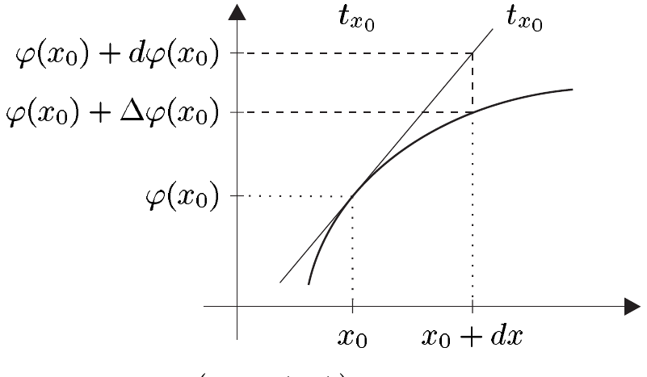
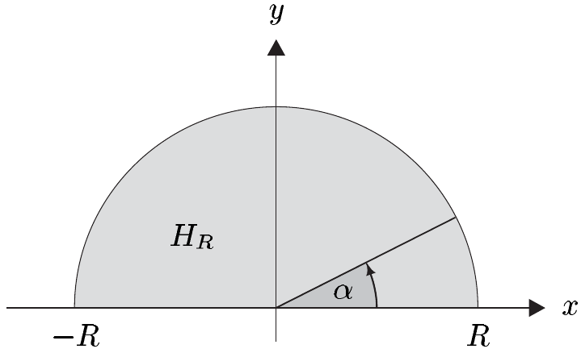

## 5 积分技巧

借助微积分基本定理，求导法则变成相应的积分法则。在本节中，我们将对链式法则和乘积法则完成这一转化，从而得到重要的换元法则和分部积分法。

在本节中，我们记
• $ I = [\alpha, \beta] $，一个紧致完全区间。

##### 变量代换

5.1 定理（换元法则）设 $ E $ 是巴拿赫空间，$ f \in C(I, E) $，又设 $ \varphi \in C^1([a, b], \mathbb{R}) $ 满足 $ -\infty < a < b < \infty $ 且 $ \varphi([a, b]) \subset I $。则
\[ \int_{a}^{b} f(\varphi(x)) \varphi'(x) \, dx = \int_{\varphi(a)}^{\varphi(b)} f(y) \, dy . \]

证明 微积分基本定理表明 $ f $ 有原函数 $ F \in C^1(I, E) $。由链式法则（定理 IV.1.7），于是存在函数 $ F \circ \varphi \in C^1([a, b], E) $ 使得
\[ (F \circ \varphi)'(x) = F'(\varphi(x)) \varphi'(x) = f(\varphi(x)) \varphi'(x) \quad \text{对 } x \in [a, b] . \]
于是推论 4.14 给出
\[ \begin{aligned} \int_{a}^{b} f(\varphi(x)) \varphi'(x) \, dx &= F \circ \varphi \big|_{a}^{b} = F(\varphi(b)) - F(\varphi(a)) \\ &= F \big|_{\varphi(a)}^{\varphi(b)} = \int_{\varphi(a)}^{\varphi(b)} f(y) \, dy . \end{aligned} \quad \blacksquare \]

在这一点上，我们应当解释符号“$ dx $”的含义，它虽然出现在记号中并且显然标明了积分变量，但除此之外尚未得到澄清。在 VIII.3 节中，我们将给出更形式的定义，随后再对其进行论证并使之精确化。这里我们满足于一种启发式的观察。

5.2 注 (a) 设 $ \varphi : I \to \mathbb{R} $ 可微。我们称\footnote{记号 $ d\varphi = \varphi' \, dx $ 这里只是一种形式表达式，其中函数被理解为可微的。特别地，$ \varphi' \, dx $ 不是独立对象的乘积。} $ d\varphi := \varphi' \, dx $ 为 $ \varphi $ 的**微分**。若取 $ \varphi $ 为恒等函数 $ \mathrm{id}_I $，则 $ d\varphi = \mathbf{1} \, dx $。

显然，符号 $ \mathbf{1} \, dx $ 也可以写成 $ dx $。因此 $ dx $ 是恒等映射 $ x \mapsto x $ 的微分。

(b) 在实际中，换元法则写成紧凑形式
\[ \int_{a}^{b} f \circ \varphi \, d\varphi = \int_{\varphi(a)}^{\varphi(b)} f \, dy . \]

(c) 设 $ \varphi : I \to \mathbb{R} $ 可微且 $ x_0 \in I $。在下面的启发式做法中，我们将在 $ x_0 $ 的一个“无穷小”邻域中考察 $ \varphi $。于是我们把 $ dx $ 视为 $ x_0 $ 与 $ x $ 之间的增量，因而把它本身看作一个实变量。

设 $ t_{x_0} $ 在点 $ (x_0, \varphi(x_0)) $ 处与 $ \varphi $ 相切：
\[ t_{x_0} : \mathbb{R} \to \mathbb{R} , \quad x \mapsto \varphi(x_0) + \varphi'(x_0)(x - x_0) . \]
此外，定义 $ \Delta\varphi(x_0) := \varphi(x_0 + dx) - \varphi(x_0) $ 为 $ \varphi $ 的增量，并定义 $ d\varphi(x_0) := \varphi'(x_0) \, dx $ 为沿切线 $ t_{x_0} $ 的增量。由 $ \varphi $ 的可微性，我们有
\[ \Delta\varphi(x_0) = d\varphi(x_0) + o(dx) \quad \text{当 } dx \to 0 . \]
对小的增量 $ dx $，$ \Delta\varphi(x_0) $ 可以通过“线性近似” $ d\varphi(x_0) = \varphi'(x_0) \, dx $ 来逼近。■

5.3 例 (a) 对 $ a \in \mathbb{R}^\times $ 与 $ b \in \mathbb{R} $，我们有
\[ \int_{\alpha}^{\beta} \cos(ax + b) \, dx = \frac{1}{a} ( \sin(a\beta + b) - \sin(a\alpha + b) ) . \]

证明 变量代换 $ y(x) := ax + b $（$ x \in \mathbb{R} $）给出 $ dy = a \, dx $。因此，由例 4.15(a) 可得
\[ \int_{\alpha}^{\beta} \cos(ax + b) \, dx = \frac{1}{a} \int_{a\alpha+b}^{a\beta+b} \cos y \, dy = \frac{1}{a} \sin \big|_{a\alpha+b}^{a\beta+b} . \quad \blacksquare \]

(b) 对 $ n \in \mathbb{N}^\times $，我们有
\[ \int_{0}^{1} x^{n-1} \sin(x^n) \, dx = \frac{1}{n} (1 - \cos 1) . \]

证明 这里令 $ y(x) := x^n $。则 $ dy = n x^{n-1} \, dx $，从而
\[ \int_{0}^{1} x^{n-1} \sin(x^n) \, dx = \frac{1}{n} \int_{0}^{1} \sin y \, dy = -\frac{\cos y}{n} \big|_{0}^{1} . \quad \blacksquare \]

##### 分部积分

第二种基本的积分技巧，即分部积分，来自乘积法则。

5.4 命题 对 $ u, v \in C^1(I, \mathbb{K}) $，我们有
\[ \int_{\alpha}^{\beta} u v' \, dx = u v \big|_{\alpha}^{\beta} - \int_{\alpha}^{\beta} u' v \, dx . \tag{5.1} \]

证明 该断言直接由乘积法则 $ (uv)' = u'v + v'u $ 与推论 4.14 得到。■

用微分表示，(5.1) 取实用形式
\[ \int_{\alpha}^{\beta} u \, dv = u v \big|_{\alpha}^{\beta} - \int_{\alpha}^{\beta} v \, du . \tag{5.2} \]

5.5 例 (a) $ \int_{\alpha}^{\beta} x \sin x \, dx = \sin \beta - \sin \alpha - \beta \cos \beta + \alpha \cos \alpha $。
证明 令 $ u(x) := x $ 且 $ v' := \sin $。则 $ u' = \mathbf{1} $ 且 $ v = -\cos $。因此
\[ \int_{\alpha}^{\beta} x \sin x \, dx = -x \cos x \big|_{\alpha}^{\beta} + \int_{\alpha}^{\beta} \cos x \, dx = (\sin x - x \cos x) \big|_{\alpha}^{\beta} . \quad \blacksquare \]

(b)（圆的面积）半径为 $ R $ 的圆面积为 $ \pi R^2 $。
证明 我们可以把直角坐标系的原点放在圆心处。半径至多为 $ R $ 的点可以表示为闭集
\[ K_R = \left\{ (x, y) \in \mathbb{R}^2 \; ; \; |(x, y)| \le R \right\} = \left\{ (x, y) \in \mathbb{R}^2 \; ; \; x^2 + y^2 \le R^2 \right\} . \]
我们也可以把 $ K_R $ 表示为（上）半圆盘
\[ H_R := \left\{ (x, y) \in \mathbb{R}^2 \; ; \; x^2 + y^2 \le R^2 , \; y \ge 0 \right\} \]
与相应的下半盘 $ -H_R $ 的并。它们交于
\[ H_R \cap (-H_R) = [-R, R] \times \{0\} = \left\{ (x, 0) \in \mathbb{R}^2 \; ; \; -R \le x \le R \right\} . \]

我们可以把 $ H_R $ 的上边界写成函数
\[ [-R, R] \to \mathbb{R} , \quad x \mapsto \sqrt{R^2 - x^2} , \]
的图像，并把 $ H_R $ 的面积，按照我们之前的解释，写成
\[ \int_{-R}^{R} \sqrt{R^2 - x^2} \, dx . \]

这里，“下边界” $ [-R, R] \times \{0\} $ 是否包含在 $ H_R $ 中是无关紧要的，因为宽度为 0 的矩形的面积按定义为 0。由对称性\footnote{在这个例子中，我们考虑的是绝对面积而非有向面积，并且我们放弃面积的精确定义，而改用启发式显然的论证。在第三卷中，我们将深入这个概念及相关问题，并为这些启发式论证提供依据。}，圆盘 $ K_R $ 的面积 $ A_R $ 就是半圆盘 $ H_R $ 面积的两倍。因此
\[ A_R = 2 \int_{-R}^{R} \sqrt{R^2 - x^2} \, dx . \]

为计算这个积分，采用极坐标是方便的。因此我们令 $ x(\alpha) := R \cos \alpha $（$ \alpha \in [0, \pi] $）。于是 $ dx = -R \sin \alpha \, d\alpha $，换元法则给出
\[ \begin{aligned} A_R &= -2R \int_{\pi}^{0} \sqrt{R^2 - R^2 \cos^2 \alpha} \sin \alpha \, d\alpha \\ &= 2R^2 \int_{0}^{\pi} \sqrt{1 - \cos^2 \alpha} \sin \alpha \, d\alpha = 2R^2 \int_{0}^{\pi} \sin^2 \alpha \, d\alpha . \end{aligned} \]

我们对 $ \int_{0}^{\pi} \sin^2 \alpha \, d\alpha $ 进行分部积分。令 $ u := \sin $ 且 $ v' := \sin $，则 $ u' = \cos $ 且 $ v = -\cos $。因此
\[ \begin{aligned} \int_{0}^{\pi} \sin^2 \alpha \, d\alpha &= -\sin \alpha \cos \alpha \big|_{0}^{\pi} + \int_{0}^{\pi} \cos^2 \alpha \, d\alpha \\ &= \int_{0}^{\pi} (1 - \sin^2 \alpha) \, d\alpha = \pi - \int_{0}^{\pi} \sin^2 \alpha \, d\alpha , \end{aligned} \]
于是得到 $ \int_{0}^{\pi} \sin^2 \alpha \, d\alpha = \pi/2 $。总之 $ A_R = R^2 \pi $。■

(c) 对 $ n \in \mathbb{N} $，设 $ I_n := \int \sin^n x \, dx $。我们于是得到**递推公式**\footnote{注意与例 4.15 的一致。}
\[ n I_n = (n-1) I_{n-2} - \cos x \sin^{n-1} x \quad \text{对 } n \ge 2 , \tag{5.3} \]
其中 $ I_0 = X $ 且 $ I_1 = -\cos $。
证明 显然 $ I_0 = X + c $ 且 $ I_1 = -\cos + c $。若 $ n \ge 2 $，则
\[ I_n = \int \sin^{n-2} x (1 - \cos^2 x) \, dx = I_{n-2} - \int \sin^{n-2} x \cos x \cos x \, dx . \]

令 $ u(x) := \cos x $ 与 $ v'(x) := \sin^{n-2} x \cos x $，我们容易求得 $ u' = -\sin $ 且 $ v = \sin^{n-1}/(n-1) $。分部积分于是完成证明。■

(d)（沃利斯乘积）它说的是\footnote{设 $ (a_k) $ 是 $ \mathbb{K} $ 中的序列，且 $ p_n := \prod_{k=0}^{n} a_k $（$ n \in \mathbb{N} $）。若序列 $ (p_n) $ 收敛，我们称其极限为 $ a_k $ 的无穷乘积，并记 $ \prod_{k=0}^{\infty} a_k := \lim_{n} \prod_{k=0}^{n} a_k $。}
\[ \begin{aligned} \frac{\pi}{2} &= \prod_{k=1}^{\infty} \frac{4k^2}{4k^2 - 1} = \lim_{n \to \infty} \prod_{k=1}^{n} \frac{4k^2}{4k^2 - 1} \\ &= \frac{2}{1} \cdot \frac{2}{3} \cdot \frac{4}{3} \cdot \frac{4}{5} \cdot \frac{6}{5} \cdot \frac{6}{7} \cdots \frac{2k}{2k-1} \cdot \frac{2k}{2k+1} \cdots . \end{aligned} \]

证明 通过在区间 $ [0, \pi/2] $ 上计算 (5.3)，我们得到所断言的乘积。令
\[ A_n := \int_{0}^{\pi/2} \sin^n x \, dx \quad \text{对 } n \in \mathbb{N} . \]
由 (5.3) 可得
\[ A_0 = \pi/2 , \quad A_1 = 1 , \quad A_n = \frac{n-1}{n} A_{n-2} \quad \text{对 } n \ge 2 . \]
简单的归纳论证给出
\[ A_{2n} = \frac{(2n-1)(2n-3) \cdots 3 \cdot 1}{2n(2n-2) \cdots 4 \cdot 2} \cdot \frac{\pi}{2} , \quad A_{2n+1} = \frac{2n(2n-2) \cdots 4 \cdot 2}{(2n+1)(2n-1) \cdots 5 \cdot 3} . \]
由此可得关系式
\[ \begin{aligned} \frac{A_{2n+1}}{A_{2n}} &= \frac{2n \cdot 2n (2n-2)(2n-2) \cdots 4 \cdot 4 \cdot 2 \cdot 2}{[(2n+1)(2n-1)][(2n-1)(2n-3)] \cdots [5 \cdot 3][3 \cdot 1]} \cdot \frac{2}{\pi} \\ &= \frac{2}{\pi} \prod_{k=1}^{n} \frac{(2k)^2}{(2k)^2 - 1} \end{aligned} \tag{5.4} \]
与
\[ \lim_{n \to \infty} \frac{A_{2n+2}}{A_{2n}} = \lim_{n \to \infty} \frac{2n+1}{2n+2} = 1 . \tag{5.5} \]
因为对 $ x \in [0, \pi/2] $ 有 $ \sin^2 x \le \sin x \le 1 $，故 $ A_{2n+2} \le A_{2n+1} \le A_{2n} $。因此
\[ \frac{A_{2n+2}}{A_{2n}} \le \frac{A_{2n+1}}{A_{2n}} \le 1 \quad \text{对 } n \in \mathbb{N} , \]
而该断言是 (5.4) 与 (5.5) 的推论。■

##### 有理函数的积分

所谓**初等函数**，是指通过取多项式、指数函数、正弦和余弦，并对它们施加加、减、乘、除四种基本运算，以及函数复合与取逆而生成的所有映射。总之，这些运算生成了一族庞大的函数。

5.6 注 (a) 初等函数类“对微分封闭”，也就是说，初等函数的导数仍是初等函数。
证明 这由定理 IV.1.6–8 以及例 IV.1.13、应用 IV.2.10 与习题 IV.2.5 得到。■

(b) 遗憾的是，初等函数的原函数一般不再是初等函数。换言之，初等函数类对积分不封闭。
证明 对每个 $ a \in (0, 1) $，函数
\[ f : [0, a] \to \mathbb{R} , \quad x \mapsto 1/\sqrt{1 - x^4} \]
连续。因此
\[ F(x) := \int_{0}^{x} \frac{dy}{\sqrt{1 - y^4}} \quad \text{对 } 0 \le x < 1 , \]
是 $ f $ 的一个良定义的原函数。因为对 $ x \in (0, 1) $ 有 $ f(x) > 0 $，$ F $ 严格递增。于是按照定理 III.5.7，$ F $ 有良定义的反函数 $ G $。已知\footnote{证明这一点以及关于 $ \widetilde{G} $ 的周期性的下述断言，大大超出了本书的范围（例如见 [FB95] 第 V 章）。} 存在 $ \mathbb{C} $ 的可数且无极限点的子集 $ M $，使得 $ G $ 在 $ \mathbb{C} \setminus M $ 上有唯一确定的解析延拓 $ \widetilde{G} $。还已知 $ \widetilde{G} $ 是**双周期的**，即存在两个 $ \mathbb{R} $-线性无关的周期 $ \omega_1, \omega_2 \in \mathbb{C} $，使得
\[ \widetilde{G}(z + \omega_1) = \widetilde{G}(z + \omega_2) = \widetilde{G}(z) \quad \text{对 } z \in \mathbb{C} \setminus M . \]
因为初等函数至多是“单周期的”，$ \widetilde{G} $ 不可能是初等函数。因此 $ F $ 也不是初等函数。于是初等函数 $ f $ 没有初等原函数。■

下面我们将证明有理函数有初等原函数。我们从简单的例子开始，这些例子随后可以推广到一般情形。

5.7 例 (a) 对 $ a \in \mathbb{C} \setminus I $，我们有
\[ \int \frac{dx}{X - a} = \begin{cases} \log |X - a| + c , & a \in \mathbb{R} , \\ \log(X - a) + c , & a \in \mathbb{C} \setminus \mathbb{R} . \end{cases} \]

证明 这由例 4.15(c) 与 IV.1.13(e) 得到。■

(b) 设 $ a \in \mathbb{C} \setminus I $ 且 $ k \in \mathbb{N} $ 满足 $ k \ge 2 $。则
\[ \int \frac{dx}{(X - a)^k} = \frac{-1}{(k-1)(X - a)^{k-1}} + c . \]

(c) 设 $ a, b \in \mathbb{R} $ 满足 $ D := a^2 - b < 0 $。则
\[ \int \frac{dx}{X^2 + 2aX + b} = \frac{1}{\sqrt{-D}} \arctan\left( \frac{X + a}{\sqrt{-D}} \right) + c . \]

证明 首先，
\[ q(X) := X^2 + 2aX + b = (X + a)^2 - D = |D| \left( 1 + \left( \frac{X + a}{\sqrt{|D|}} \right)^2 \right) . \]
然后，通过定义 $ y := |D|^{-1/2}(x + a) $，换元法则给出
\[ \int_{\alpha}^{\beta} \frac{dx}{q} = \frac{1}{\sqrt{-D}} \int_{y(\alpha)}^{y(\beta)} \frac{dy}{1 + y^2} = \frac{1}{\sqrt{-D}} \arctan \big|_{y(\alpha)}^{y(\beta)} . \quad \blacksquare \]

(d) 对满足 $ D := a^2 - b < 0 $ 的 $ a, b \in \mathbb{R} $，我们有
\[ \int \frac{X \, dX}{X^2 + 2aX + b} = \frac{1}{2} \log(X^2 + 2aX + b) - \frac{a}{\sqrt{-D}} \arctan\left( \frac{X + a}{\sqrt{-D}} \right) + c . \]

证明 用 (c) 的证明中的记号，我们求得
\[ \frac{X}{q} = \frac{1}{2} \frac{2X + 2a}{q} - \frac{a}{q} = \frac{1}{2} \frac{q'}{q} - \frac{a}{q} , \]
而该断言很快由例 4.15(c) 与 (c) 得到。■

(e) 对满足 $ D := a^2 - b = 0 $ 且 $ -a \notin I $ 的 $ a, b \in \mathbb{R} $，我们有
\[ \int \frac{dx}{X^2 + 2aX + b} = \frac{-1}{X + a} + c . \]

证明 因为 $ q = (X + a)^2 $，该断言由 (b) 得到。■

(f) 设 $ a, b \in \mathbb{R} $ 且 $ D := a^2 - b > 0 $。对 $ -a \pm \sqrt{D} \notin I $，我们有
\[ \int \frac{dx}{X^2 + 2aX + b} = \frac{1}{2\sqrt{D}} \log \left| \frac{X + a - \sqrt{D}}{X + a + \sqrt{D}} \right| + c . \]

证明 二次多项式 $ q $ 有实零点 $ z_1 := -a + \sqrt{D} $ 与 $ z_2 := -a - \sqrt{D} $。因此 $ q = (X - z_1)(X - z_2) $。这提示我们作试设
\[ \frac{1}{q} = \frac{a_1}{X - z_1} + \frac{a_2}{X - z_2} . \tag{5.6} \]
将此方程乘以 $ q $，我们求得
\[ 1 = (a_1 + a_2)X - (a_1 z_2 + a_2 z_1) . \]
因此，由多项式的唯一性定理（见注 I.8.19(c)）并比较系数，我们有 $ a_1 = -a_2 = 1/2\sqrt{D} $。该断言于是由 (a) 得到。■

在最后几个例子中，我们利用分解 (5.6) 积分了有理函数 $ 1/(X^2 + 2aX + b) $，从而把它化归为两个更简单的有理函数 $ 1/(X - z_1) $ 与 $ 1/(X - z_2) $。正如我们现在将证明的，这样的“部分分式分解”对每个有理函数都是可能的。

若一个多项式的首项系数为 1，则称它是**首一的**。由代数基本定理，每个正次数的首一多项式 $ q $ 有因式分解
\[ q = \prod_{j=1}^{n} (X - z_j)^{m_j} , \tag{5.7} \]
其中 $ z_1, \ldots, z_n $ 是 $ q $ 在 $ \mathbb{C} $ 中的零点，$ m_1, \ldots, m_n $ 是相应的重数。因此
\[ \sum_{j=1}^{n} m_j = \deg(q) \]
（见例 III.3.9(b) 与注 I.8.19(b)）。

现在设 $ p, q \in \mathbb{C}[X] $ 满足 $ q \ne 0 $。则按照命题 I.8.15，由多项式除法可得，存在唯一确定的 $ s, t \in \mathbb{C}[X] $ 使得
\[ \frac{p}{q} = s + \frac{t}{q} , \quad \text{其中 } \deg(t) < \deg(q) . \tag{5.8} \]
于是，鉴于例 4.15(b)，我们可以把证明限制于有理函数 $ r := p/q $（$ \deg(p) < \deg(q) $）的初等可积性，并且我们还可以假设 $ q $ 是首一的。证明的基础是下面关于**部分分式展开**的定理。

5.8 命题 设 $ p, q \in \mathbb{C}[X] $ 满足 $ \deg(p) < \deg(q) $，且 $ q $ 首一。则用 (5.7) 的记号，我们有
\[ \frac{p}{q} = \sum_{j=1}^{n} \sum_{k=1}^{m_j} \frac{a_{jk}}{(X - z_j)^k} \tag{5.9} \]
其中 $ a_{jk} \in \mathbb{C} $ 唯一确定。

证明 我们作试设
\[ \frac{p}{q} = \frac{a}{(X - z_1)^{m_1}} + \frac{p_1}{q_1} , \tag{5.10} \]
其中 $ a \in \mathbb{C} $，$ p_1 \in \mathbb{C}[X] $，且
\[ q_1 := \frac{q}{X - z_1} \in \mathbb{C}[X] . \]
将 (5.10) 乘以 $ q $，我们得到
\[ p = a \prod_{j=2}^{n} (X - z_j)^{m_j} + (X - z_1) p_1 , \tag{5.11} \]
由此读出\footnote{照例，$ n = 1 $ 时的“空乘积”取值为 1。}
\[ a = p(z_1) / \prod_{j=2}^{n} (z_1 - z_j)^{m_j} . \tag{5.12} \]
因此 $ a_{1 m_1} := a $ 唯一确定。由 (5.11) 可得
\[ \deg(p_1) < \left( \sum_{j=2}^{n} m_j \right) \vee \deg(p) \le \deg(q) - 1 = \deg(q_1) . \]
接下来我们可以把上述论证应用于 $ p_1/q_1 $，从而经过有限步得到该断言。■

5.9 推论 每个有理函数都有初等积分。
证明 这立即由 (5.8)、(5.9) 以及例 5.7(a)、(b) 得到。■

5.10 注 (a) 若分母的所有零点都是单重的，则部分分式展开 (5.9) 变成
\[ \frac{p}{q} = \sum_{j=1}^{n} \frac{p(z_j)}{q'(z_j)} \frac{1}{X - z_j} . \tag{5.13} \]

在一般情形，我们作 (5.9) 形式的试设，其系数 $ a_{jk} $ 待定，然后在通乘 $ q $ 之后确定这些系数（见例 5.7(f) 的证明）。

证明 断言 (5.13) 容易由 (5.12) 得到。■

(b) 设 $ s \in \mathbb{R}[X] $。$ s $ 的每个零点 $ z \in \mathbb{C} $ 都有一个具有相同重数的复共轭零点 $ \overline{z} $。
证明 由命题 I.11.3，$ \overline{s(z)} = s(\overline{z}) $。■

(c) 设 $ p, q \in \mathbb{R}[X] $，且 $ z \in \mathbb{C} \setminus \mathbb{R} $ 是 $ q $ 的重数为 $ m $ 的零点。进一步设 $ a_k $ 与 $ b_k $（$ 1 \le k \le m $）分别是展开式 (5.9) 中 $ (X - z)^{-k} $ 与 $ (X - \overline{z})^{-k} $ 的系数。则 $ b_k = \overline{a_k} $。
证明 由 (b) 我们知道 $ \overline{z} $ 也是 $ q $ 的重数为 $ m $ 的零点。因此 $ b_k $ 唯一确定。对 $ x \in \mathbb{C} \setminus \{z_1, \ldots, z_n\} $，由 (5.9) 可得
\[ \sum_{j=1}^{n} \sum_{k=1}^{m_j} \frac{a_{jk}}{(\overline{x} - z_j)^k} = \frac{p(\overline{x})}{q(\overline{x})} = \overline{\frac{p}{q}(x)} = \sum_{j=1}^{n} \sum_{k=1}^{m_j} \frac{\overline{a_{jk}}}{(\overline{x} - \overline{z_j})^k} . \]
现在该断言由命题 5.8 的唯一性结果得到。■

现在设 $ r := p/q $（$ p, q \in \mathbb{R}[X] $ 且 $ \deg(p) < \deg(q) $）是实有理函数。若 $ z \in \mathbb{C} \setminus \mathbb{R} $ 是 $ q $ 的重数为 $ m $ 的零点，则利用部分分式展开 (5.9)，按照注 5.10(c)，我们得到加项
\[ \frac{a}{X - z} + \frac{\overline{a}}{X - \overline{z}} = \frac{(a + \overline{a})X - (z\overline{a} + \overline{z}a)}{(X - z)(X - \overline{z})} = 2 \frac{\operatorname{Re}(a)X - \operatorname{Re}(\overline{z}a)}{X^2 - 2\operatorname{Re}(z)X + |z|^2} , \]
并且有 $ D := (\operatorname{Re} z)^2 - |z|^2 < 0 $。于是例 5.7(c) 与 (d) 表明
\[ \begin{aligned} &\int \left( \frac{a}{X - z} + \frac{\overline{a}}{X - \overline{z}} \right) dx \\ &= A \log(x^2 - 2\operatorname{Re}(z)x + |z|^2) + B \arctan\left( \frac{x - \operatorname{Re} z}{\sqrt{-D}} \right) + c \end{aligned} \tag{5.14} \]
对 $ x \in I $，其中系数 $ A $ 与 $ B $ 由 $ \operatorname{Re} a $、$ \operatorname{Re} z $、$ \operatorname{Re}(\overline{z}a) $ 与 $ \sqrt{-D} $ 唯一确定。

对 $ 2 \le k \le m $，由注 5.10(c) 与例 5.7(b) 可得
\[ \begin{aligned} \int \left( \frac{b}{(x - z)^k} + \frac{\overline{b}}{(x - \overline{z})^k} \right) dx &= \frac{-1}{k-1} \left( \frac{b}{(x - z)^{k-1}} + \frac{\overline{b}}{(x - \overline{z})^{k-1}} \right) + c \\ &= \frac{-2 \operatorname{Re}(b (x - \overline{z})^{k-1})}{(k-1)(x^2 - 2\operatorname{Re}(z)x + |z|^2)^{k-1}} + c \end{aligned} \tag{5.15} \]
对 $ x \in I $。因此由命题 5.8 以及 (5.14)、(5.15)，我们得到实形式的原函数。
