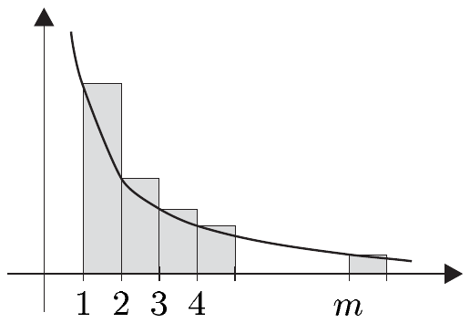
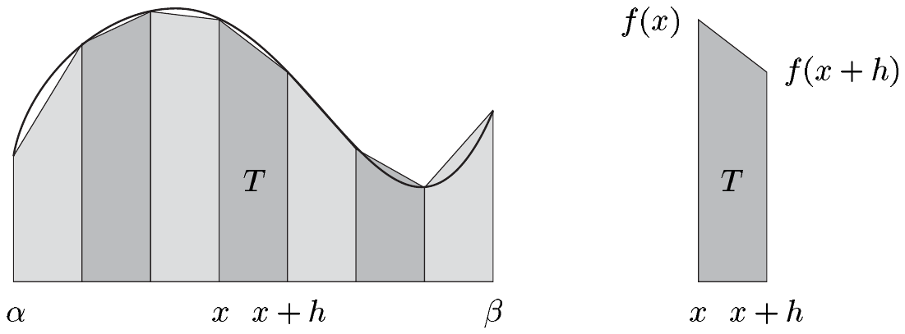

## 6 求和与积分

设 $ m, n \in \mathbb{Z} $ 且 $ m < n $，$ f : [m, n] \to E $ 连续。则
\[ \sum_{k=m+1}^{n} f(k) \]
可以解释为逼近
\[ \int_{m}^{n} f \, dx . \tag{6.1} \]
的黎曼和。

在前两节中，我们学会了计算积分的有效方法，它们都源自微积分基本定理。事实上，在许多情形下，计算积分 (6.1) 比计算它对应的和更简单。这引出一个有趣的想法：反过来利用已知的积分去逼近这个和。这种逼近和的技巧将被证明相当有用。

自然，这一想法的有效性将取决于误差
\[ \left| \int_{m}^{n} f \, dx - \sum_{k=m+1}^{n} f(k) \right| \tag{6.2} \]
能够被控制到什么程度。在这一背景下，伯努利数与伯努利多项式是有趣的，我们先转向它们。

##### 伯努利数

我们首先证明函数\footnote{关于下文，另见习题 V.3.2–4。}
\[ h : \mathbb{C} \to \mathbb{C} , \quad h(z) := \begin{cases} (e^z - 1)/z , & z \in \mathbb{C}^\times , \\ 1 , & z = 0 , \end{cases} \]
是解析的，并且有一个以 0 为心的圆盘，$ h $ 在其上不取零。\footnote{当然，存在 $ \eta > 0 $ 使得对 $ z \in \mathbb{B}(0, \eta) $ 有 $ h(z) \ne 0 $，这由 $ h(0) = 1 $ 与 $ h $ 的连续性得出。}

6.1 引理 设 $ h \in C^{\omega}(\mathbb{C}, \mathbb{C}) $ 使得对 $ z \in 2\pi\mathbb{B} $ 有 $ h(z) \ne 0 $。

证明\footnote{另见习题 V.3.3。} (i) 由命题 II.9.4，幂级数 $ g(X) = \sum (1/(k+1)!)X^k $ 有无限收敛半径；由命题 V.3.5，它是解析的。现在我们来验证 $ g $ 与 $ h $ 相等。显然 $ g(0) = h(0) $，且因此 $ z \in \mathbb{C}^\times $。于是 $ g(z) = h(z) $ 由 $ z \cdot g(z) = e^z - 1 $ 得到。

(ii) 对 $ z \in \mathbb{C} \setminus 2\pi i\mathbb{Z} $，我们有
\[ \frac{z}{e^z - 1} + \frac{z}{2} = \frac{z}{2}\frac{e^z + 1}{e^z - 1} = \frac{z}{2}\coth\frac{z}{2} . \tag{6.3} \]
因此，因为 $ h(0) = 1 $，该断言成立。■

由最后一个证明，特别地得到
\[ f : 2\pi\mathbb{B} \to \mathbb{C} , \quad z \mapsto \frac{z}{e^z - 1} \]
是良定义的。\footnote{这意味着我们可以把 $ z/(e^z - 1) $ 在 $ z = 0 $ 处解释为等于 1。} 此外，如下一定理所示，函数 $ f $ 在 0 的一个邻域内是解析的。

6.2 命题 存在 $ \rho \in (0, 2\pi) $ 使得 $ f \in C^{\omega}(\rho\mathbb{B}, \mathbb{C}) $。

证明 习题 II.9.9 的递归算法保证了存在幂级数 $ \sum b_k X^k $，它有正的收敛半径 $ \rho_0 $ 且满足性质
\[ \left( \sum \frac{1}{(k+1)!}X^k \right)\left( \sum b_k X^k \right) = 1 \in \mathbb{C}[[X]] . \]
令 $ \rho := \rho_0 \wedge 2\pi $，我们设
\[ \tilde{f} : \rho\mathbb{B} \to \mathbb{C} , \quad z \mapsto \sum_{k=0}^{\infty} b_k z^k . \]
则
\[ \frac{e^z - 1}{z}\tilde{f}(z) = \left( \sum_{k=0}^{\infty} \frac{z^k}{(k+1)!} \right)\left( \sum_{k=0}^{\infty} b_k z^k \right) = 1 \quad \text{对 } z \in \rho\mathbb{B} . \]
因此，引理 6.1 与 $ \rho $ 的选取给出
\[ \tilde{f}(z) = f(z) = \frac{z}{e^z - 1} \quad \text{对 } z \in \rho\mathbb{B} , \]
于是 $ f $ 的解析性由命题 V.3.5 得出。■

在注 VIII.5.13(c) 中，我们将不用幂级数的递归除法（习题 II.9.9）来证明 $ f $ 是解析的。

**伯努利数** $ B_k $ 对 $ k \in \mathbb{N} $ 由
\[ \frac{z}{e^z - 1} = \sum_{k=0}^{\infty}\frac{B_k}{k!}z^k \quad \text{对 } z \in \rho\mathbb{B} , \tag{6.4} \]
定义，其中 $ \rho > 0 $ 是适当选取的。由命题 6.2 并由于幂级数的唯一性定理（推论 II.9.9），$ B_k $ 由 (6.4) 唯一确定。以 $ f(z) = z/(e^z - 1) $ 给出的映射 $ f $ 称为 $ B_k $ 的**生成函数**。

##### 递推公式

由 (6.4)，我们可以利用幂级数的柯西乘积容易地导出伯努利数的递推公式。

6.3 命题 伯努利数 $ B_k $ 满足
(i) $ \sum_{k=0}^{n}\binom{n+1}{k}B_k = \begin{cases} 1 , & n = 0 , \\ 0 , & n \in \mathbb{N}^\times ; \end{cases} $
(ii) $ B_{2k+1} = 0 $ 对 $ k \in \mathbb{N}^\times $。

证明 由命题 II.9.7，对 $ z \in \rho\mathbb{B} $ 我们有
\[ \begin{aligned} z = (e^z - 1)f(z) &= z\left( \sum_{k=0}^{\infty} \frac{z^k}{(k+1)!} \right)\left( \sum_{j=0}^{\infty} \frac{B_j}{j!}z^j \right) \\ &= z\sum_{n=0}^{\infty}\left( \sum_{k=0}^{n} \frac{B_k}{k!}\frac{1}{(n+1-k)!} \right)z^n . \end{aligned} \]
幂级数的唯一性定理于是蕴含
\[ \sum_{k=0}^{n}\frac{B_k}{k!}\frac{1}{(n+1-k)!} = \begin{cases} 1 , & n = 0 , \\ 0 , & n \in \mathbb{N}^\times . \end{cases} \]
该命题于是由把这个恒等式乘以 $ (n+1)! $ 得到。

(ii) 一方面，我们求得
\[ f(z) - f(-z) = z\left( \frac{1}{e^z - 1} + \frac{1}{e^{-z} - 1} \right) = z\frac{e^{-z} - 1 + e^z - 1}{1 - e^z - e^{-z} + 1} = -z . \]
另一方面，我们有幂级数展开
\[ f(z) - f(-z) = \sum_{k=0}^{\infty}\left( \frac{B_k}{k!}z^k - \frac{B_k}{k!}(-z)^k \right) = 2\sum_{k=0}^{\infty}\frac{B_{2k+1}}{(2k+1)!}z^{2k+1} . \]
因此，由幂级数的唯一性定理，我们得到 $ B_{2k+1} = 0 $ 对 $ k \in \mathbb{N}^\times $。■

6.4 推论 对伯努利数，我们有
\[ B_0 = 1 , \quad B_1 = -1/2 , \quad B_2 = 1/6 , \quad B_4 = -1/30 , \quad B_6 = 1/42 , \quad \ldots \]

利用伯努利数，我们可以得到余切函数的级数展开，它在下一节会很有用。

6.5 应用 对充分小的\footnote{由应用 7.23(a) 的证明可得，这对 $ |z| < 1 $ 成立。} $ z \in \mathbb{C} $，我们有
\[ z\cot z = 1 + \sum_{n=1}^{\infty}(-1)^n\frac{4^n}{(2n)!}B_{2n}z^{2n} . \]

证明 利用 (6.3)、(6.4) 与命题 6.3(ii)，由 $ B_1 = -1/2 $ 我们得到
\[ \frac{z}{2}\coth\frac{z}{2} = \sum_{n=0}^{\infty} B_{2n}\frac{z^{2n}}{(2n)!} \quad \text{对 } z \in \rho\mathbb{B} . \]
把 $ z $ 换成 $ 2iz $，该断言成立。■

##### 伯努利多项式

对每个 $ x \in \mathbb{C} $，函数
\[ F_x : \rho\mathbb{B} \to \mathbb{C} , \quad z \mapsto \frac{ze^{xz}}{e^z - 1} \]
是解析的。与伯努利数类似，我们通过
\[ \frac{ze^{xz}}{e^z - 1} = \sum_{k=0}^{\infty}\frac{B_k(x)}{k!}z^k \quad \text{对 } z \in \rho\mathbb{B} \text{ 且 } x \in \mathbb{C} . \tag{6.5} \]
来定义**伯努利多项式** $ B_k(X) $。

由幂级数的唯一性定理，$ \mathbb{C} $ 上的函数 $ B_k(X) $ 由 (6.5) 唯一确定，且下一定理表明它们确实是多项式。

6.6 命题 对 $ n \in \mathbb{N} $，我们有
(i) $ B_n(X) = \sum_{k=0}^{n}\binom{n}{k}B_k X^{n-k} , $
(ii) $ B_n(0) = B_n , $
(iii) $ B'_{n+1}(X) = (n+1)B_n(X) , $
(iv) $ B_n(X + 1) - B_n(X) = nX^{n-1} , $
(v) $ B_n(1 - X) = (-1)^n B_n(X) $。

证明 第一个断言与命题 6.3 的证明一样，由利用幂级数的柯西乘积并比较系数得到。一方面，我们有

\[ \begin{aligned} F_x(z) = e^{xz}f(z) &= \left( \sum_{k=0}^{\infty}\frac{x^k z^k}{k!} \right)\left( \sum_{j=0}^{\infty}\frac{B_j}{j!}z^j \right) = \sum_{n=0}^{\infty}\left( \sum_{k=0}^{n}\frac{x^{n-k}}{(n-k)!}\frac{B_k}{k!} \right)z^n \\ &= \sum_{n=0}^{\infty}\left( \sum_{k=0}^{n}\binom{n}{k}B_k x^{n-k} \right)\frac{z^n}{n!} \end{aligned} \]
并且，另一种写法是 $ F_x(z) = \sum_n B_n(x)z^n/n! $。

断言 (ii) 立即由 (i) 得到。同样由 (i) 我们得到 (iii)，因为
\[ \begin{aligned} B'_{n+1}(X) &= \sum_{k=0}^{n}\binom{n+1}{k}B_k X^{n-k}(n+1-k) \\ &= (n+1)\sum_{k=0}^{n}\binom{n}{k}B_k X^{n-k} = (n+1)B_n(X) . \end{aligned} \]
最后，(iv) 与 (v) 由 $ F_{x+1}(z) - F_x(z) = ze^{xz} $ 与 $ F_{1-x}(z) = F_x(-z) $ 通过比较系数得到。■

6.7 推论 前四个伯努利多项式为
\[ B_0(X) = 1 , \quad B_1(X) = X - 1/2 , \]
\[ B_2(X) = X^2 - X + 1/6 , \quad B_3(X) = X^3 - 3X^2/2 + X/2 . \]

##### 欧拉–麦克劳林求和公式

伯努利多项式将有助于估计 (6.2) 中的误差。但首先，让我们证明一个有用的结果。

6.8 引理 设 $ m \in \mathbb{N}^\times $ 且 $ f \in C^{2m+1}[0, 1] $。则我们有
\[ \begin{aligned} \int_0^1 f(x)\,dx &= \frac{1}{2}[f(0) + f(1)] - \sum_{k=1}^{m}\frac{B_{2k}}{(2k)!}f^{(2k-1)}(x)\Big|_0^1 \\ &\quad - \frac{1}{(2m+1)!}\int_0^1 B_{2m+1}(x)f^{(2m+1)}(x)\,dx . \end{aligned} \]

证明 我们应用函数方程 $ B'_{n+1}(X) = (n+1)B_n(X) $ 并继续分部积分。于是设 $ u := f $ 与 $ v' := \mathbf{1} $。则 $ u' = f' $ 且 $ v = B_1(X) = X - 1/2 $。因此，

\[ \begin{aligned} \int_0^1 f(x)\,dx &= B_1(x)f(x)\big|_0^1 - \int_0^1 B_1(x)f'(x)\,dx \\ &= \frac{1}{2}[f(0) + f(1)] - \int_0^1 B_1(x)f'(x)\,dx . \end{aligned} \tag{6.6} \]

接下来我们设 $ u := f' $ 与 $ v' := B_1(X) $。因为 $ u' = f'' $ 且 $ v = B_2(X)/2 $，我们求得
\[ \int_0^1 B_1(x)f'(x)\,dx = \frac{1}{2}B_2(x)f'(x)\Big|_0^1 - \frac{1}{2}\int_0^1 B_2(x)f''(x)\,dx . \]

由此，设 $ u := f'' $ 与 $ v' := B_2(X)/2 $（因此 $ u' = f''' $ 且 $ v = B_3(X)/3! $），得到方程
\[ \int_0^1 B_1(x)f'(x)\,dx = \left[ \frac{1}{2}B_2(x)f'(x) - \frac{1}{3!}B_3(x)f''(x) \right]\Big|_0^1 + \frac{1}{3!}\int_0^1 B_3(x)f'''(x)\,dx . \]

一个简单的归纳现在给出
\[ \begin{aligned} \int_0^1 B_1(x)f'(x)\,dx &= \sum_{j=2}^{2m+1}\frac{(-1)^j}{j!}B_j(x)f^{(j-1)}(x)\Big|_0^1 \\ &\quad + \frac{1}{(2m+1)!}\int_0^1 B_{2m+1}(x)f^{(2m+1)}(x)\,dx . \end{aligned} \]

由命题 6.6，我们有 $ B_n(0) = B_n $、$ B_n(1) = (-1)^n B_n $ 以及对 $ n \in \mathbb{N}^\times $ 有 $ B_{2n+1} = 0 $，该断言成立。■

下面，我们用 $ \widetilde{B}_n $ 表示函数 $ B_n(X)|[0, 1) $ 在 $ \mathbb{R} $ 上的 1-周期延拓，即
\[ \widetilde{B}_n(x) := B_n(x - [x]) \quad \text{对 } x \in \mathbb{R} . \]

显然，$ \widetilde{B}_n $ 在 $ \mathbb{R} $ 上（即在每个紧致区间上）是跳跃连续的。对 $ n \ge 2 $，$ \widetilde{B}_n $ 实际上是连续的（见习题 4）。

6.9 定理（欧拉–麦克劳林求和公式）设 $ a, b \in \mathbb{Z} $ 且 $ a < b $，$ f $ 对某个 $ m \in \mathbb{N}^\times $ 属于 $ C^{2m+1}[a, b] $。则
\[ \begin{aligned} \sum_{k=a}^{b} f(k) &= \int_a^b f(x)\,dx + \frac{1}{2}[f(a) + f(b)] + \sum_{k=1}^{m}\frac{B_{2k}}{(2k)!}f^{(2k-1)}(x)\Big|_a^b \\ &\quad + \frac{1}{(2m+1)!}\int_a^b \widetilde{B}_{2m+1}(x)f^{(2m+1)}(x)\,dx . \end{aligned} \]

证明 我们把积分 $ \int_a^b f \,dx $ 分解成项 $ \int_{a+k}^{a+k+1} f \,dx $ 的和，并对它们应用引理 6.8。因此
\[ \int_a^b f(x)\,dx = \sum_{k=0}^{b-a-1}\int_{a+k}^{a+k+1} f(x)\,dx = \sum_{k=0}^{b-a-1}\int_0^1 f_k(y)\,dy \]
其中 $ f_k(y) := f(a + k + y) $ 对 $ y \in [0, 1] $。则
\[ \begin{aligned} \frac{1}{2}\sum_{k=0}^{b-a-1}[f_k(0) + f_k(1)] &= \frac{1}{2}\sum_{k=0}^{b-a-1}[f(a + k) + f(a + k + 1)] \\ &= \sum_{k=a}^{b} f(k) - \frac{1}{2}[f(a) + f(b)] \end{aligned} \]
且
\[ \begin{aligned} \int_0^1 B_{2m+1}(y)f_k^{(2m+1)}(y)\,dy &= \int_0^1 \widetilde{B}_{2m+1}(a + k + y)f^{(2m+1)}(a + k + y)\,dy \\ &= \int_{a+k}^{a+k+1}\widetilde{B}_{2m+1}(x)f^{(2m+1)}(x)\,dx . \end{aligned} \]
该定理于是由引理 6.8 得到。■

##### 幂和

在欧拉–麦克劳林求和公式的第一个应用中，我们取 $ f $ 为单项式 $ X^m $。该公式于是容易求出幂和 $ \sum_{k=1}^{n} k^m $，对于 $ m = 1, 2 $ 与 3，我们已在注 I.12.14(c) 中确定过它们。

6.10 例 对 $ m \in \mathbb{N} $ 且 $ m \ge 2 $，我们有
\[ \sum_{k=1}^{n} k^m = \frac{n^{m+1}}{m+1} + \frac{n^m}{2} + \sum_{2j < m+1}\binom{m}{2j-1}\frac{B_{2j}}{2j}n^{m-2j+1} . \]

特别地，
\[ \sum_{k=1}^{n} k^2 = \frac{n^3}{3} + \frac{n^2}{2} + nB_2 = \frac{n(n+1)(2n+1)}{6} , \]
\[ \sum_{k=1}^{n} k^3 = \frac{n^4}{4} + \frac{n^3}{2} + \frac{3}{2}n^2 B_2 = \frac{n^2(n+1)^2}{4} . \]

证明 对 $ f := X^m $，我们有
\[ f^{(\ell)} = \begin{cases} \binom{m}{\ell}\ell!\,X^{m-\ell} , & \ell \le m , \\ 0 , & \ell > m , \end{cases} \]
并且，对 $ 2j - 1 < m $，
\[ \frac{B_{2j}}{(2j)!}f^{(2j-1)}(n) = \frac{B_{2j}}{(2j)!}\binom{m}{2j-1}(2j-1)!\,n^{m-2j+1} = \frac{B_{2j}}{2j}\binom{m}{2j-1}n^{m-2j+1} . \]

因为 $ f^{(m)}(x)\big|_0^n = 0 $，这些公式由定理 6.9 取 $ a = 0 $ 与 $ b = n $ 得到。■

##### 渐近等价

$ \mathbb{C}^\times $ 中的序列 $ (a_k) $ 与 $ (b_k) $ 称为**渐近等价**的，如果
\[ \lim_{k}(a_k/b_k) = 1 . \]
在这种情形下，我们记 $ a_k \sim b_k $（$ k \to \infty $）或 $ (a_k) \sim (b_k) $。

6.11 注 (a) 不难验证 $ \sim $ 是 $ (\mathbb{C}^\times)^{\mathbb{N}} $ 上的一个等价关系。

(b) $ (a_k) $ 与 $ (b_k) $ 渐近等价并不蕴含 $ (a_k) $ 或 $ (b_k) $ 收敛，也不蕴含 $ (a_k - b_k) $ 是零序列。

证明 考虑 $ a_k := k^2 + k $ 与 $ b_k := k^2 $。■

(c) 若 $ (a_k) \sim (b_k) $ 且 $ b_k \to c $，则 $ a_k \to c $。

证明 这立即由 $ a_k = (a_k/b_k)\cdot b_k $ 得到。■

(d) 设 $ (a_k) $ 与 $ (b_k) $ 是 $ \mathbb{C}^\times $ 中的序列且 $ (a_k - b_k) $ 有界。若 $ |b_k| \to \infty $，则 $ (a_k) \sim (b_k) $。

证明 当 $ k \to \infty $ 时，我们有 $ |(a_k/b_k) - 1| = |(a_k - b_k)/b_k| \to 0 $。■

借助欧拉–麦克劳林求和公式，我们可以构造渐近等价序列的重要例子。为此，我们需要如下结果。

6.12 引理 设 $ z \in \mathbb{C} $ 满足 $ \operatorname{Re} z > 1 $。则极限
\[ \int_1^\infty \frac{\widetilde{B}_k(x)}{x^z}\,dx := \lim_{n}\int_1^n \frac{\widetilde{B}_k(x)}{x^z}\,dx \]
在 $ \mathbb{C} $ 中存在，且
\[ \left| \int_1^\infty \frac{\widetilde{B}_k(x)}{x^z}\,dx \right| \le \frac{\|\widetilde{B}_k\|_\infty}{\operatorname{Re} z - 1} \quad \text{对 } k \in \mathbb{N} . \]

证明 设 $ 1 \le m \le n $。则我们有
\[ \begin{aligned} \left| \int_1^n \frac{\widetilde{B}_k(x)}{x^z}\,dx - \int_1^m \frac{\widetilde{B}_k(x)}{x^z}\,dx \right| &= \left| \int_m^n \frac{\widetilde{B}_k(x)}{x^z}\,dx \right| \le \|\widetilde{B}_k\|_\infty\int_m^n x^{-\operatorname{Re} z}\,dx \\ &= \frac{\|\widetilde{B}_k\|_\infty}{\operatorname{Re} z - 1}\left( \frac{1}{m^{\operatorname{Re} z - 1}} - \frac{1}{n^{\operatorname{Re} z - 1}} \right) . \end{aligned} \]

这个估计表明 $ \left( \int_1^n (\widetilde{B}_k(x)/x^z)\,dx \right)_{n\in\mathbb{N}^\times} $ 是 $ \mathbb{C} $ 中的柯西序列，且所述极限存在。在上面的估计中，我们取 $ m = 1 $ 并令 $ n \to \infty $，从而证明了引理的第二部分。■

6.13 例 (a)（棣莫弗公式与斯特林公式）对 $ n \to \infty $，我们有
\[ n! \sim \sqrt{2\pi n}\,n^n e^{-n} . \]

证明 (i) 我们设 $ a := 1 $，$ b := n $，$ m := 1 $ 且 $ f(x) := \log x $。于是，由欧拉–麦克劳林求和公式，我们有
\[ \sum_{k=1}^{n}\log k - \int_1^n \log x\,dx = \frac{1}{2}\log n + \frac{B_2}{2}\frac{1}{x}\Big|_1^n + \frac{1}{3}\int_1^n \frac{\widetilde{B}_3(x)}{x^3}\,dx . \]

我们注意到 $ \log x = [x(\log x - 1)]' $ 与 $ B_2 = 1/6 $，它们给出
\[ \begin{aligned} \log n! - n\log n - \frac{1}{2}\log n + n &= \log(n!\,n^{-n-1/2}e^n) \\ &= 1 + \frac{1}{12}\left( \frac{1}{n} - 1 \right) + \frac{1}{3}\int_1^n \frac{\widetilde{B}_3(x)}{x^3}\,dx . \end{aligned} \]

现在引理 6.12 蕴含序列 $ (\log(n!\,n^{-n-1/2}e^n))_{n\in\mathbb{N}} $ 收敛。于是存在 $ A > 0 $ 使得当 $ n \to \infty $ 时 $ (n!\,n^{-n-1/2}e^n) \to A $。从而
\[ n! \sim A n^{n+1/2}e^{-n} \quad (n \to \infty) . \tag{6.7} \]

(ii) 为确定 $ A $ 的值，应用 $ \pi/2 $ 的沃利斯乘积表示：
\[ \prod_{k=1}^{\infty}\frac{(2k)^2}{(2k-1)(2k+1)} = \frac{\pi}{2} \]
（见例 5.5(d)）。因此我们也有
\[ \lim_{n}\left( \prod_{k=1}^{n}\frac{(2k)^2}{(2k-1)(2k+1)} \cdot \frac{\prod_{k=1}^{n}(2k)^2}{\prod_{k=1}^{n}(2k)^2} \right) = \lim_{n}\frac{2^{4n}(n!)^4}{(2n)!(2n+1)!} = \pi/2 . \tag{6.8} \]

另一方面，由 (6.7)，我们有
\[ \frac{(n!)^2}{(2n)!} \sim \frac{A^2 n^{2n+1}e^{-2n}}{A(2n)^{2n+1/2}e^{-2n}} = 2^{-2n-1}A\sqrt{2n} , \]
由此得到渐近等价
\[ \frac{2^{4n}(n!)^4}{2n[(2n)!]^2} \sim \frac{A^2}{4} \tag{6.9} \]
最后我们注意到 $ 2n[(2n)!]^2 \sim (2n)!(2n+1)! $ 与 $ A > 0 $，于是由 (6.8)、(6.9) 与注 6.11(c) 得到 $ A = \sqrt{2\pi} $。把它代入 (6.7)，我们就完成了证明。■

(b)（欧拉常数）极限
\[ C := \lim_{n\to\infty}\left[ \sum_{k=1}^{n}\frac{1}{k} - \log n \right] \]
在 $ \mathbb{R} $ 中存在，称为**欧拉常数**或**欧拉–马歇罗尼常数**。\footnote{$ C $ 的初始十进制数字是 0.577 215 664 901 \ldots} 此外，
\[ \sum_{k=1}^{n}\frac{1}{k} \sim \log n \quad (n \to \infty) . \]

证明 对 $ a := 1 $，$ b := n $，$ m := 0 $ 与 $ f(x) := 1/x $，由欧拉–麦克劳林求和公式得到
\[ \sum_{k=1}^{n}\frac{1}{k} = \int_1^n \frac{dx}{x} + \frac{1}{2}\left( 1 + \frac{1}{n} \right) - \int_1^n \frac{\widetilde{B}_1(x)}{x^2}\,dx . \]

由引理 6.12，$ C $ 在 $ \mathbb{R} $ 中。所需的渐近等价由注 6.11(d) 得到。■

##### 黎曼 $ \zeta $ 函数

我们现在把欧拉–麦克劳林求和公式应用于在素数分布理论中重要的例子。

设 $ s \in \mathbb{C} $ 满足 $ \operatorname{Re} s > 1 $，并对 $ x \in [1, \infty) $ 定义 $ f(x) := 1/x^s $。则对 $ k \in \mathbb{N}^\times $，
\[ f^{(k)}(x) = (-1)^k s(s+1)\cdot\ldots\cdot(s+k-1)x^{-s-k} = (-1)^k\binom{s+k-1}{k}k!\,x^{-s-k} \]
由欧拉–麦克劳林求和公式（取 $ a = 1 $ 与 $ b = n $），对 $ m \in \mathbb{N} $ 得到
\[ \begin{aligned} \sum_{k=1}^{n}\frac{1}{k^s} &= \int_1^n \frac{dx}{x^s} + \frac{1}{2}\left( 1 + \frac{1}{n^s} \right) - \sum_{j=1}^{m}\frac{B_{2j}}{2j}\binom{s+2j-2}{2j-1}x^{-s-2j+1}\Big|_1^n \\ &\quad - \binom{s+2m}{2m+1}\int_1^n \widetilde{B}_{2m+1}(x)\,x^{-(s+2m+1)}\,dx . \end{aligned} \tag{6.10} \]

因为当 $ n \to \infty $ 时 $ |n^{-s}| = n^{-\operatorname{Re} s} \to 0 $ 且 $ \operatorname{Re} s > 0 $，我们得到
\[ \int_1^n \frac{dx}{x^s} = \frac{1}{s-1}\left( 1 - \frac{1}{n^{s-1}} \right) \to \frac{1}{s-1} \]
以及
\[ |n^{-s-2j+1}| \to 0 \quad \text{对 } j = 1, \ldots, m , \]
当 $ n \to \infty $ 时。我们再注意到引理 6.12，于是在极限 $ n \to \infty $ 下，(6.10) 变成
\[ \begin{aligned} \sum_{n=1}^{\infty}\frac{1}{n^s} &= \frac{1}{2} + \frac{1}{s-1} + \sum_{j=1}^{m}\frac{B_{2j}}{2j}\binom{s+2j-2}{2j-1} \\ &\quad - \binom{s+2m}{2m+1}\int_1^\infty \widetilde{B}_{2m+1}(x)\,x^{-(s+2m+1)}\,dx . \end{aligned} \tag{6.11} \]

由此特别得到，级数 $ \sum 1/n^s $ 对每个满足 $ \operatorname{Re} s > 1 $ 的 $ s \in \mathbb{C} $ 收敛。\footnote{另见注 6.16(a)。}

公式 (6.11) 还允许另一个结论。为此，我们设
\[ F_m(s) := \int_1^\infty \widetilde{B}_{2m+1}(x)\,x^{-(s+2m+1)}\,dx \quad \text{对 } m \in \mathbb{N} , \]
以及 $ H_m := \{ z \in \mathbb{C} ; \operatorname{Re} z > -2m \} $。按照引理 6.12，$ F_m : H_m \to \mathbb{C} $ 是良定义的，并且不难看出 $ F_m $ 也是解析的（见习题 4）。

我们现在考虑映射
\[ G_m : H_m \to \mathbb{C} , \quad s \mapsto \sum_{j=1}^{m}\frac{B_{2j}}{2j}\binom{s+2j-2}{2j-1} - \binom{s+2m}{2m+1}F_m(s) \quad \text{对 } m \in \mathbb{N} , \]
并得到如下性质：

6.14 引理 对 $ n > m $，$ G_n $ 是 $ G_m $ 的延拓。

证明 令 $ H := \{ z \in \mathbb{C} ; \operatorname{Re} z > 1 \} $，由 (6.11) 得到
\[ G_m(s) = G_n(s) = \sum_{k=1}^{\infty}\frac{1}{k^s} - \frac{1}{2} - \frac{1}{s-1} \quad \text{对 } s \in H . \]

对每个 $ k \in \mathbb{N} $，$ F_k $ 与 $ G_k $ 都在 $ H_k $ 上解析。因此该断言由解析函数的唯一性定理（定理 V.3.13）得到。■

6.15 定理 函数
\[ \{ z \in \mathbb{C} ; \operatorname{Re} z > 1 \} \to \mathbb{C} , \quad s \mapsto \sum_{n=1}^{\infty}\frac{1}{n^s} \]
在 $ \mathbb{C} \setminus \{1\} $ 上有唯一的解析延拓 $ \zeta $，称为**黎曼 $ \zeta $ 函数**。对 $ m \in \mathbb{N} $ 与满足 $ \operatorname{Re} s > -2m $ 且 $ s \ne 1 $ 的 $ s \in \mathbb{C} $，我们有
\[ \zeta(s) = \frac{1}{2} + \frac{1}{s-1} + \sum_{j=1}^{m}\frac{B_{2j}}{2j}\binom{s+2j-2}{2j-1} - \binom{s+2m}{2m+1}F_m(s) . \]

证明 这立即由 (6.11) 与引理 6.14 得到。■

6.16 注 (a) 级数 $ \sum 1/n^s $ 对每个满足 $ \operatorname{Re} s > 1 $ 的 $ s \in \mathbb{C} $ 绝对收敛。

证明 对满足 $ \operatorname{Re} s > 1 $ 的 $ s \in \mathbb{C} $，我们有
\[ \left|\zeta(s)\right| = \left|\sum_{n=1}^{\infty}\frac{1}{n^s}\right| \le \sum_{n=1}^{\infty}\left|\frac{1}{n^s}\right| = \sum_{n=1}^{\infty}\frac{1}{n^{\operatorname{Re} s}} = \zeta(\operatorname{Re} s) , \]
该断言由优级数判别法得到。■

(b)（$ \zeta $ 函数的乘积表示）我们用 $ (p_k) $ 表示素数序列，其中 $ p_1 < p_2 < p_3 < \cdots $。则
\[ \zeta(s) = \prod_{k=1}^{\infty}\frac{1}{1 - p_k^{-s}} \quad \text{对 } \operatorname{Re} s > 1 . \]

证明 因为 $ \left|1/p_k^s\right| = 1/p_k^{\operatorname{Re} s} < 1 $，我们有（几何级数）
\[ \frac{1}{1 - p_k^{-s}} = \sum_{j=0}^{\infty}\frac{1}{p_k^{js}} \quad \text{对 } k \in \mathbb{N}^\times . \]

因此对每个 $ m \in \mathbb{N} $ 得到
\[ \prod_{k=1}^{m}\frac{1}{1 - p_k^{-s}} = \prod_{k=1}^{m}\sum_{j=0}^{\infty}\frac{1}{p_k^{js}} = {\sum}'\frac{1}{n^s} , \]
其中，在“乘开”之后，级数 $ {\sum}' $ 包含所有形如 $ 1/n^s $ 的数，其素因子分解 $ n = q_1^{\nu_1}\cdot\ldots\cdot q_\ell^{\nu_\ell} $ 不含 $ p_1, \ldots, p_m $ 之外的素数。因此 $ {\sum}'(1/n^s) $ 确实包含所有满足 $ n \le p_m $ 的 $ n \in \mathbb{N} $。级数 $ \sum_n (1/n^s) $ 的绝对收敛于是蕴含
\[ \left|\zeta(s) - \prod_{k=1}^{m}\frac{1}{1 - p_k^{-s}}\right| = \left|\sum_{n=1}^{\infty}\frac{1}{n^s} - {\sum}'\frac{1}{n^s}\right| \le \sum_{n > p_m}\frac{1}{n^{\operatorname{Re} s}} . \]

由习题 I.5.8(b)（欧几里得的一个定理）得到，当 $ m \to \infty $ 时 $ p_m \to \infty $。因此，由 (a)，剩余的级数 $ \left(\sum_{n > p_m}(1/n^{\operatorname{Re} s})\right) $ 是零序列。■

(c) 黎曼 $ \zeta $ 函数在 $ \{ z \in \mathbb{C} ; \operatorname{Re} z > 1 \} $ 中没有零点。

证明 设 $ s \in \mathbb{C} $ 满足 $ \operatorname{Re} s > 1 $ 且 $ \zeta(s) = 0 $。因为 $ \operatorname{Re} s > 1 $，我们有 $ \lim_k(1 - p_k^{-s}) = 1 $。因此存在 $ m_0 \in \mathbb{N} $ 使得 $ \log(1 - p_k^{-s}) $ 对 $ k \ge m_0 $ 是良定义的，并且我们求得
\[ \log\left( \prod_{k=m_0}^{N}\frac{1}{1 - p_k^{-s}} \right) = -\sum_{k=m_0}^{N}\log(1 - p_k^{-s}) \quad \text{对 } N \ge m_0 . \tag{6.12} \]

$ \left(\prod_{k=m_0}^{N}(1 - p_k^{-s})^{-1}\right)_{N\in\mathbb{N}} $ 的收敛性、对数的连续性以及 (6.12) 蕴含级数 $ \sum_{k\ge m_0}\log(1 - p_k^{-s}) $ 收敛。特别地，剩余项 $ \left(\sum_{k=m}^{\infty}\log(1 - p_k^{-s})\right)_{m\ge m_0} $ 构成零序列。于是由 (6.12) 得到

\[ \lim_{m\to\infty}\prod_{k=m}^{\infty}(1 - p_k^{-s})^{-1} = 1 . \]

因此存在 $ m_1 \ge m_0 $ 使得 $ \prod_{k=m_1+1}^{\infty}(1 - p_k^{-s})^{-1} \ne 0 $。现在因为 $ \prod_{k=1}^{m_1}(1 - p_k^{-s})^{-1} $ 不为零，得到

\[ 0 = \zeta(s) = \prod_{k=1}^{m_1}\frac{1}{1 - p_k^{-s}}\prod_{k=m_1+1}^{\infty}\frac{1}{1 - p_k^{-s}} \ne 0 , \]

这是不可能的。■

(d) 级数 $ \sum 1/p_k $ 发散。

证明 由 (b) 的证明中的考虑，我们有估计
\[ \prod_{p\le m}\left( 1 - \frac{1}{p} \right)^{-1} \ge \sum_{n=1}^{m}\frac{1}{n} \quad \text{对 } n \in \mathbb{N}^\times , \]
其中乘积取遍所有 $ \le m $ 的素数。现在我们把和看作黎曼和，并发现函数 $ x \mapsto 1/x $ 是递减的：

\[ \sum_{n=1}^{m}\frac{1}{n} > \int_1^m \frac{dx}{x} = \log m . \]

因为对数是单调的，得到
\[ \sum_{p\le m}\log\left( 1 - \frac{1}{p} \right)^{-1} > \log\log m \quad \text{对 } m \ge 2 . \tag{6.13} \]

当 $ |z| < 1 $ 时，我们可以利用对数的级数展开（定理 V.3.9）
\[ \log(1 - z)^{-1} = -\log(1 - z) = \sum_{k=1}^{\infty}\frac{z^k}{k} \]
得到
\[ \sum_{p\le m}\log\left( 1 - \frac{1}{p} \right)^{-1} = \sum_{p\le m}\sum_{k=1}^{\infty}\frac{1}{kp^k} \le \sum_{p\le m}\frac{1}{p} + R , \tag{6.14} \]
其中
\[ R := \sum_{p\le m}\sum_{k=2}^{\infty}\frac{1}{kp^k} \le \frac{1}{2}\sum_{p\le m}\sum_{k=2}^{\infty}\frac{1}{p^k} = \frac{1}{2}\sum_{p\le m}\frac{1}{p(p - 1)} < \frac{1}{2}\sum_{j=2}^{\infty}\frac{1}{j(j - 1)} = \frac{1}{2} . \]

现在由 (6.13) 与 (6.14) 得到
\[ \sum_{p\le m}\frac{1}{p} \ge \log\log m - \frac{1}{2} \quad \text{对 } m \ge 2 , \tag{6.15} \]
由于和取遍所有 $ \le m $ 的素数，这就证明了该断言。■

(e) 前面的陈述包含关于素数**密度**的信息。因为 $ \sum 1/p_k $ 发散（按照 (6.15)，至少与 $ \log\log m $ 一样快），序列 $ (p_k) $ 不能太快地趋于 $ \infty $。在素数分布的研究中，对 $ x \in \mathbb{R}^\times $，$ \pi(x) $ 表示 $ \le x $ 的素数个数。著名的**素数定理**说
\[ \pi(n) \sim n/\log n \quad (n \to \infty) . \]

为得到更多信息，我们可以研究相对误差
\[ r(n) := \frac{\pi(n) - n/\log n}{n/\log n} = \frac{\pi(n)}{n/\log n} - 1 \]
当 $ n \to \infty $ 时的渐近行为。可以证明
\[ r(n) = O\left( \frac{1}{\log n} \right) \quad (n \to \infty) . \]

然而，对于每个 $ \varepsilon > 0 $ 存在一个明显更好的误差估计这件事只是*猜想的*：
\[ r(n) = O\left( \frac{1}{n^{1/2-\varepsilon}} \right) \quad (n \to \infty) . \]

这个猜想等价于著名的**黎曼猜想**：

$ \zeta $ 函数没有满足 $ \operatorname{Re} s > 1/2 $ 的零点 $ s $。

由 (c) 我们知道 $ \zeta $ 在 $ \{ z \in \mathbb{C} ; \operatorname{Re} z > 1 \} $ 中没有零点。还知道 $ \zeta $ 的实部 $ \le 0 $ 的零点集对应 $ -2\mathbb{N}^\times $。把这些零点称为平凡的，由 $ \zeta $ 函数的性质可以得出结论：黎曼猜想等价于如下陈述：

黎曼 $ \zeta $ 函数的所有非平凡零点都位于直线 $ \operatorname{Re} z = 1/2 $ 上。

已知 $ \zeta $ 在这条直线上有无穷多个零点，并且对某个大的 $ K $ 值，不存在满足 $ |\operatorname{Im} s| < K $ 且 $ \operatorname{Re} s \ne 1/2 $ 的非平凡零点 $ s $。证明黎曼猜想至今仍是数学中最重大的努力之一。

关于素数定理的证明、所述的渐近误差估计以及进一步的研究，请查阅解析数论的文献，例如 [Brü95]、[Pra78]、[Sch69]。■

##### 梯形法则

在大多数实际应用中，由于没有已知的原函数，给定的积分必须数值地近似。由积分 $ \int_\alpha^\beta f\,dx $ 的定义，每个跳跃连续函数 $ f $ 都可以近似地积分为矩形上的黎曼和，这些矩形的（比方说）左上角与 $ f $ 的图像相接。这样的近似倾向于在矩形与函数之间留下空隙，而这会随着网格的减小而减慢其收敛。如果函数足够光滑，可以预期（在实值情形下）$ f $ 的图像下方的面积能被梯形更好地估计。

这里 $ h[f(x + h) + f(x)]/2 $ 是梯形 $ T $ 的（有向）面积。

下一定理表明，如果 $ f $ 是光滑的，则对小步长 $ h $ 的“梯形法则”给出 $ \int f $ 的良好近似。照例，我们取 $ -\infty < \alpha < \beta < \infty $ 且 $ E $ 为巴拿赫空间。

6.17 定理 设 $ f \in C^2([\alpha, \beta], E) $，$ n \in \mathbb{N}^\times $，且 $ h := (\beta - \alpha)/n $。则
\[ \int_\alpha^\beta f(x)\,dx = \left[ \frac{1}{2}f(\alpha) + \sum_{k=1}^{n-1} f(\alpha + kh) + \frac{1}{2}f(\beta) \right]h + R(f, h) , \]
其中
\[ \left|R(f, h)\right| \le \frac{\beta - \alpha}{12}h^2\left\|f''\right\|_\infty . \]

证明 由积分的可加性与换元法则，在定义 $ x(t) := \alpha + kh + th $ 与 $ g_k(t) := f(\alpha + kh + th) $（$ t \in [0, 1] $）之后，得到
\[ \int_\alpha^\beta f(x)\,dx = \sum_{k=0}^{n-1}\int_{\alpha+kh}^{\alpha+(k+1)h} f(x)\,dx = h\sum_{k=0}^{n-1}\int_0^1 g_k(t)\,dt . \]

公式 (6.6) 蕴含\footnote{注意，公式 (6.6) 完全是初等的，这一推导不需要伯努利多项式的理论。}
\[ \int_0^1 g_k(t)\,dt = \frac{1}{2}[g_k(0) + g_k(1)] - \int_0^1 B_1(t)g_k'(t)\,dt . \]

我们设 $ u := g_k' $ 与 $ v' := B_1(X) $，于是 $ u' = g_k'' $ 且 $ v = -X(1 - X)/2 $，以及 $ v(0) = v(1) = 0 $。分部积分，我们因此得到
\[ -\int_0^1 B_1(t)g_k'(t)\,dt = \int_0^1 v(t)g_k''(t)\,dt . \]

定义
\[ R(f, h) := h\sum_{k=0}^{n-1}\int_0^1 v(t)g_k''(t)\,dt , \]
我们得到表示
\[ \int_\alpha^\beta f(x)\,dx = h\left[ \frac{1}{2}f(\alpha) + \sum_{k=1}^{n-1} f(\alpha + kh) + \frac{1}{2}f(\beta) \right] + R(f, h) . \]

为估计余项 $ R(f, h) $，我们首先注意到
\[ \left|\int_0^1 v(t)g_k''(t)\,dt\right| \le \left\|g_k''\right\|_\infty\int_0^1\frac{t(1 - t)}{2}\,dt = \frac{1}{12}\left\|g_k''\right\|_\infty . \]

链式法则蕴含
\[ \left\|g_k''\right\|_\infty = \max_{t\in[0,1]}\left|g_k''(t)\right| = h^2\max_{\alpha+kh\le x\le\alpha+(k+1)h}\left|f''(x)\right| \le h^2\left\|f''\right\|_\infty . \]

因此，
\[ \left|R(f, h)\right| \le h\sum_{k=0}^{n-1}\left|\int_0^1 v(t)g_k''(t)\,dt\right| \le \frac{h^3}{12}\left\|f''\right\|_\infty\sum_{k=0}^{n-1}1 = \frac{\beta - \alpha}{12}h^2\left\|f''\right\|_\infty , \]
这表明了它对 $ h $ 的依赖性。■

梯形法则构成数值近似积分的最简单“求积公式”。关于进一步的探索与更有效的方法，请参见关于数值方法的讲义与书籍（另见习题 8）。
