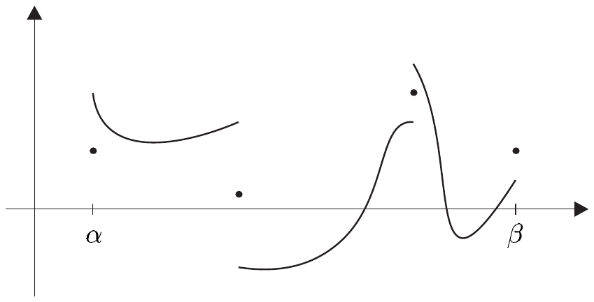
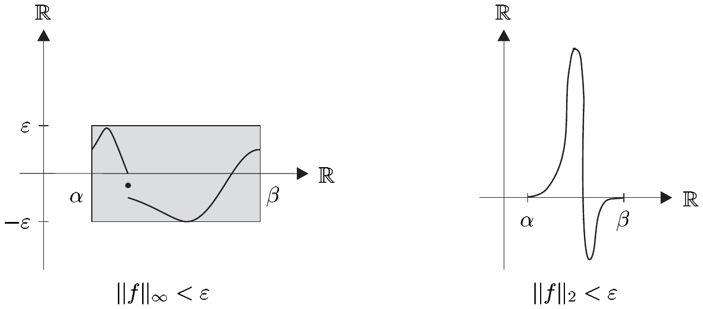
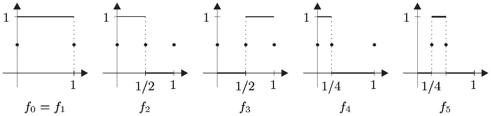
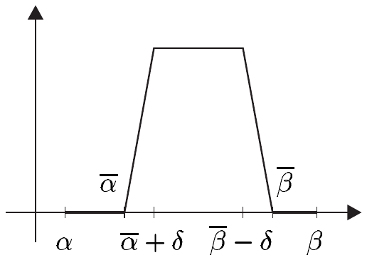
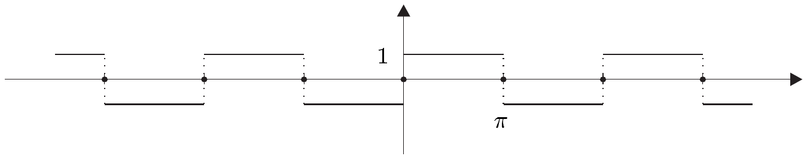
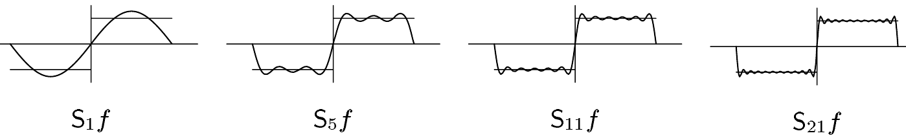
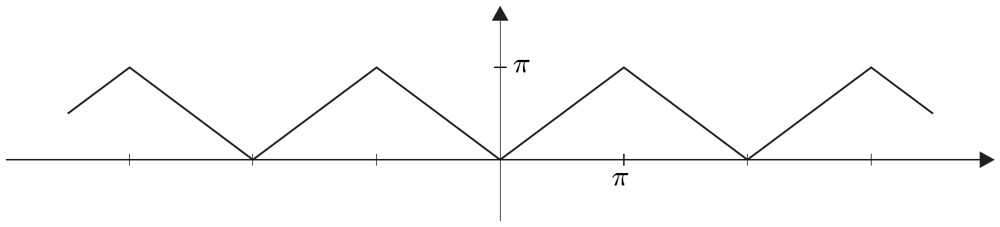
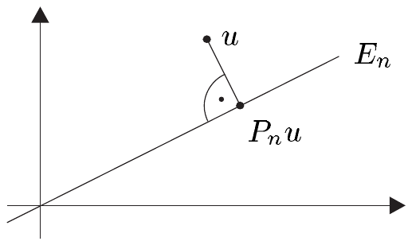
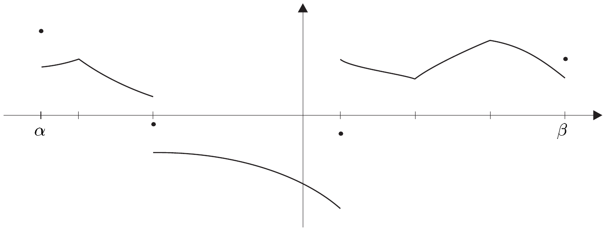

## 7 傅里叶级数

在 V.4 节的末尾，我们提出了三角级数与连续周期函数之间的联系问题。借助现已具备的积分理论，我们可以更精确地研究这一联系。在此过程中，我们将首次领略广博的*傅里叶级数理论*，其中我们只能集中于最重要的定理与技巧。为简单起见，我们只处理分段连续的 $ 2\pi $-周期函数，因为研究更一般的函数类需要用到勒贝格积分理论，而这要到第三卷才会涉及。

傅里叶级数理论与内积空间理论密切相关，特别是与 $ L_{2} $ 空间密切相关。基于这些理由，我们首先考察分段连续函数空间的 $ L_{2} $ 结构，以及内积空间的标准正交基。这些结果对于确定傅里叶级数如何收敛将具有根本的重要性。

##### $ L_{2} $ 内积

设 $ I := [\alpha, \beta] $ 是紧致完全区间。由习题 4.3 可知，对 $ f \in \mathcal{SC}(I) $，积分 $ \int_{\alpha}^{\beta} f \, dx $ 与 $ f $ 在其间断点处的取值无关。因此，为研究积分之目的，我们可以任意固定这些值。基于这些理由，我们只考虑如下所述的“规范化”函数。当

\[ f(x) = (f(x + 0) + f(x - 0))/2 \quad \text{对 } x \in \mathring{I} , \tag{7.1} \]

且

\[ f(\alpha) = f(\beta) = (f(\alpha + 0) + f(\beta - 0))/2 . \tag{7.2} \]

时，称 $ f : I \to \mathbb{C} $ 是**规范化**的。用 $ \mathcal{SC}(I) $ 表示规范化的、分段连续的函数 $ f : I \to \mathbb{C} $ 的集合。\footnote{我们自然地把 $ \mathcal{SC}([\alpha, \beta]) $ 写成 $ \mathcal{SC}[\alpha, \beta] $，把 $ C([\alpha, \beta]) $ 写成 $ C[\alpha, \beta] $，等等。}

赋值 (7.2) 的含义将在周期函数的语境中得到澄清。

7.1 命题  $ \mathcal{SC}(I) $ 是 $ \mathcal{S}(I) $ 的向量子空间，并且

\[ (f|g)_{2} := \int_{\alpha}^{\beta} f\bar{g} \, dx \quad \text{对 } f, g \in \mathcal{SC}(I) , \]

在 $ \mathcal{SC}(I) $ 上定义了一个内积 $ (\cdot|\cdot)_{2} $。

证明  第一个断言是显然的。积分的线性性蕴含 $ (\cdot|\cdot)_{2} $ 是 $ \mathcal{SC}(I) $ 上的半双线性型。推论 4.10 蕴含对 $ f, g \in \mathcal{SC}(I) $ 有 $ \overline{(f|g)_{2}} = (g|f)_{2} $。由积分的正性，我们有

\[ (f|f)_{2} = \int_{\alpha}^{\beta} |f|^{2} \, dx \ge 0 \quad \text{对 } f \in \mathcal{SC}(I) . \]

若 $ f \in \mathcal{SC}(I) $ 不是零函数，则由规范化性，存在点 $ a $，使得 $ f $，从而 $ |f|^{2} $，在该点连续，并且 $ |f(a)|^{2} > 0 $。于是由命题 4.8 可得 $ (f|f) > 0 $。因此 $ (\cdot|\cdot)_{2} $ 是 $ \mathcal{SC}(I) $ 上的内积。■

由 $ (\cdot|\cdot)_{2} $ 诱导的范数

\[ f \mapsto \|f\|_{2} := \sqrt{(f|f)_{2}} = \Big(\int_{\alpha}^{\beta}|f|^{2} \, dx\Big)^{1/2} \]

称为 **$ L_{2} $ 范数**，我们称 $ (\cdot|\cdot)_{2} $ 本身为 $ \mathcal{SC}(I) $ 上的 **$ L_{2} $ 内积**。在下文中，除非另有明确说明，我们总给 $ \mathcal{SC}(I) $ 配备这个内积，并理解为

\[ \mathcal{SC}(I) := (\mathcal{SC}(I), (\cdot|\cdot)_{2}) . \]

于是 $ \mathcal{SC}(I) $ 是一个内积空间。

7.2 注  (a) $ \mathcal{SC}(I) $ 上的 $ L_{2} $ 范数弱于\footnote{见习题 4.5。}上确界范数。精确地说，我们有

\[ \|f\|_{2} \le \sqrt{\beta - \alpha}\,\|f\|_{\infty} \quad \text{对 } f \in \mathcal{SC}(I) . \]

(b) 对 $ f \in \mathcal{SC}(I) $，不等式 $ \|f\|_{\infty} < \varepsilon $ 成立，因此 $ f $ 的整个图像都落在区间 $ I $ 上的一个“$ \varepsilon $ 带”内。另一方面，即使 $ \|f\|_{2} < \varepsilon $，$ f $ 本身也可以取到非常大的值，也就是说，该不等式只要求 $ |f|^{2} $ 的图像在 $ I $ 中的（有向）面积小于 $ \varepsilon^{2} $。我们说函数 $ f $ 在其**均方**意义上小于 $ \varepsilon $。按 $ L_{2} $ 范数的收敛也称为**均方收敛**。

(c) 虽然序列 $ (f_{n}) $ 可以在 $ \mathcal{SC}(I) $ 中——从而也在其均方意义下——收敛到零，但对 $ x \in I $，值 $ (f_{n}(x)) $ 却未必收敛到零。

证明  对 $ n \in \mathbb{N}^{\times} $，设 $ j, k \in \mathbb{N} $ 是满足 $ n = 2^{k} + j $ 且 $ j < 2^{k} $ 的唯一的一对数。于是我们通过 $ f_{0} := \mathbf{1} $ 和

\[ f_{n}(x) := \begin{cases} 1 , & x \in (j2^{-k}, (j+1)2^{-k}) , \\ 0 & \text{其他情形} . \end{cases} \]

定义 $ f_{n} \in \mathcal{SC}[0, 1] $。

因为 $ \|f_{n}\|_{2}^{2} = 2^{-k} $，$ (f_{n}) $ 在 $ \mathcal{SC}[0, 1] $ 中收敛到 $ 0 $；然而，因为 $ f $ 中的“尖峰”每次变窄时都从左到右扫过整个区间，所以对任何 $ x \in [0, 1] $，$ (f_{n}(x)) $ 都不收敛。■

##### 在均方意义下逼近

显然，$ C(I) $ 在上确界范数下在 $ \mathcal{SC}(I) $ 中不稠密。然而，在 $ L_{2} $ 范数下，情形就不同了，如下面关于均方逼近的定理所示。这里我们置

\[ C_{0}(I) := \{ u \in C(I) \;;\; u(\alpha) = u(\beta) = 0 \} . \]

$ C_{0}(I) $ 显然是 $ C(I) $（在最大值范数下）的闭向量子空间，因此它是一个巴拿赫空间。

7.3 命题  $ C_{0}(I) $ 在 $ \mathcal{SC}(I) $ 中稠密。

证明  设 $ f \in \mathcal{SC}(I) $ 且 $ \varepsilon > 0 $。由定理 1.2，存在 $ g \in \mathcal{T}(I) $ 使得 $ \|f - g\|_{\infty} < \varepsilon/2\sqrt{\beta - \alpha} $。因此\footnote{当然，$ \|u\|_{2} $ 对每个 $ u \in \mathcal{S}(I) $ 都有定义。} $ \|f - g\|_{2} < \varepsilon/2 $。于是只需找到 $ h \in C_{0}(I) $ 使得 $ \|g - h\|_{2} < \varepsilon/2 $。

因此设 $ f \in \mathcal{T}(I) $ 且 $ \varepsilon > 0 $。于是存在 $ f $ 的一个划分 $ (\alpha_{0}, \ldots, \alpha_{n}) $ 以及函数 $ g_{j} $，使得

\[ g_{j}(x) = \begin{cases} f(x) , & x \in (\alpha_{j}, \alpha_{j+1}) , \\ 0 , & x \in I \setminus(\alpha_{j}, \alpha_{j+1}) , \end{cases} \quad \text{对 } 0 \le j \le n-1 , \]

且对 $ x \ne \alpha_{j} $ 有 $ f(x) = \sum_{j=0}^{n-1} g_{j}(x) $。另一方面，由三角不等式，只需找到 $ h_{0}, \ldots, h_{n-1} \in C_{0}(I) $ 使得 $ \|g_{j} - h_{j}\|_{2} < \varepsilon/n $。

于是我们可以假定 $ f $ 是“只有一个台阶”的非平凡阶梯函数。换句话说，存在数 $ \bar{\alpha}, \bar{\beta} \in I $ 与 $ y \in \mathbb{C}^{\times} $，其中 $ \bar{\alpha} < \bar{\beta} $，它们可以选取为使得

\[ f(x) = \begin{cases} y , & x \in (\bar{\alpha}, \bar{\beta}) , \\ 0 , & x \in I \setminus[\bar{\alpha}, \bar{\beta}] , \end{cases} \]

设 $ \varepsilon > 0 $。于是我们选取 $ \delta > 0 $ 使得 $ \delta < (\bar{\beta} - \bar{\alpha})/2 \wedge \varepsilon^{2}/|y|^{2} $，并定义

\[ g(x) := \begin{cases} 0 , & x \in I \setminus(\bar{\alpha}, \bar{\beta}) , \\ y , & x \in (\bar{\alpha} + \delta, \bar{\beta} - \delta) , \\ \frac{x - \bar{\alpha}}{\delta} y , & x \in [\bar{\alpha}, \bar{\alpha} + \delta] , \\ \frac{\bar{\beta} - x}{\delta} y , & x \in [\bar{\beta} - \delta, \bar{\beta}] . \end{cases} \]

于是 $ g $ 属于 $ C_{0}(I) $，并且我们有

\[ \|f - g\|_{2}^{2} = \int_{\alpha}^{\beta} |f - g|^{2} \, dx \le \delta|y|^{2} < \varepsilon^{2} . \quad ■ \]

7.4 推论
(i) $ (C(I), (\cdot|\cdot)_{2}) $ 不是希尔伯特空间。
(ii) $ C(I) $ 上的最大值范数严格强于 $ L_{2} $ 范数。

证明  (i) 设 $ f \in \mathcal{SC}(I) \setminus C(I) $。于是由命题 7.3，存在 $ C(I) $ 中的序列 $ (f_{j}) $，它在 $ L_{2} $ 范数下收敛到 $ f $。因此，根据命题 II.6.1，$ (f_{j}) $ 是 $ \mathcal{SC}(I) $ 中的柯西序列，从而也是

$ E := (C(I), \|\cdot\|_{2}) $ 中的柯西序列。若 $ E $ 是希尔伯特空间，因而是完备的，则存在 $ g \in E $ 使得在 $ E $ 中 $ f_{j} \to g $。于是 $ (f_{j}) $ 在 $ \mathcal{SC}(I) $ 中同时收敛到 $ f $ 与 $ g $，而我们又有 $ f \ne g $，这是不可能的。因此 $ E $ 不完备。

(ii) 这由 (i) 以及注 7.2(a) 与 II.6.7(a) 得到。■

##### 标准正交系

我们现在回顾内积空间理论中的一些概念（见习题 II.3.10）。设 $ E := (E, (\cdot|\cdot)) $ 是内积空间。若 $ (u|v) = 0 $，则称 $ u, v \in E $ **正交**，我们也记作 $ u \perp v $。若 $ E $ 的子集 $ M $ 中任意两个不同的元素都正交，则称 $ M $ 是**正交系**。若此外对 $ u \in M $ 还有 $ \|u\| = 1 $，则称 $ M $ 是**标准正交系**（ONS）。

7.5 例  (a) 对 $ k \in \mathbb{Z} $，令

\[ \mathrm{e}_{k}(t) := \frac{1}{\sqrt{2\pi}}\mathrm{e}^{ikt} \quad \text{对 } t \in \mathbb{R} . \]

则 $ \{ \mathrm{e}_{k} \;;\; k \in \mathbb{Z} \} $ 是内积空间 $ \mathcal{SC}[0, 2\pi] $ 中的一个 ONS。

证明  因为指数函数是 $ 2\pi i $-周期的，我们求得

\[ (\mathrm{e}_{j}|\mathrm{e}_{k})_{2} = \int_{0}^{2\pi} \mathrm{e}_{j}\overline{\mathrm{e}_{k}} \, dt = \frac{1}{2\pi}\int_{0}^{2\pi}\mathrm{e}^{i(j-k)t} \, dt = \begin{cases} 1 , & j = k , \\ \frac{-i}{2\pi(j-k)}\mathrm{e}^{i(j-k)t}\big|_{0}^{2\pi} = 0 , & j \ne k , \end{cases} \]

这正是所要求的。■

(b) 设

\[ \mathrm{c}_{0}(t) := \frac{1}{\sqrt{2\pi}} , \quad \mathrm{c}_{k}(t) := \frac{1}{\sqrt{\pi}}\cos(kt) \]

且

\[ \mathrm{s}_{k}(t) := \frac{1}{\sqrt{\pi}}\sin(kt) \]

对 $ t \in \mathbb{R} $ 与 $ k \in \mathbb{N}^{\times} $。则 $ \{ \mathrm{c}_{0}, \mathrm{c}_{k}, \mathrm{s}_{k} \;;\; k \in \mathbb{N}^{\times} \} $ 是内积空间 $ \mathcal{SC}([0, 2\pi], \mathbb{R}) $ 中的标准正交系。

证明  欧拉公式 (III.6.1) 蕴含对 $ k \in \mathbb{N}^{\times} $ 有 $ \mathrm{e}_{k} = (\mathrm{c}_{k} + i\mathrm{s}_{k})/\sqrt{2} $。于是

\[ 2(\mathrm{e}_{j}|\mathrm{e}_{k})_{2} = (\mathrm{c}_{j}|\mathrm{c}_{k})_{2} + (\mathrm{s}_{j}|\mathrm{s}_{k})_{2} + i[(\mathrm{s}_{j}|\mathrm{c}_{k})_{2} - (\mathrm{c}_{j}|\mathrm{s}_{k})_{2}] \tag{7.3} \]

对 $ j, k \in \mathbb{N}^{\times} $。因为 $ (\mathrm{e}_{j}|\mathrm{e}_{k})_{2} $ 是实的，我们求得

\[ (\mathrm{s}_{j}|\mathrm{c}_{k})_{2} = (\mathrm{c}_{j}|\mathrm{s}_{k})_{2} \quad \text{对 } j, k \in \mathbb{N}^{\times} . \tag{7.4} \]

分部积分给出

\[ (\mathrm{s}_{j}|\mathrm{c}_{k})_{2} = \frac{1}{\pi}\int_{0}^{2\pi} \sin(jt)\cos(kt) \, dt = -\frac{j}{k}(\mathrm{c}_{j}|\mathrm{s}_{k})_{2} \]

对 $ j, k \in \mathbb{N}^{\times} $。因此结合 (7.4) 我们得到

\[ (1 + j/k)(\mathrm{s}_{j}|\mathrm{c}_{k})_{2} = 0 \quad \text{对 } j, k \in \mathbb{N}^{\times} . \]

于是我们可以断言

\[ (\mathrm{s}_{j}|\mathrm{c}_{k})_{2} = 0 \quad \text{对 } j, k \in \mathbb{N} , \]

因为对剩下的情形 $ j = 0 $ 或 $ k = 0 $，这个关系式是平凡成立的。

利用克罗内克符号，我们由 (7.3) 和 (a) 得到

\[ (\mathrm{c}_{j}|\mathrm{c}_{k})_{2} + (\mathrm{s}_{j}|\mathrm{s}_{k})_{2} = 2\delta_{jk} \quad \text{对 } j, k \in \mathbb{N}^{\times} . \tag{7.5} \]

分部积分给出

\[ (\mathrm{s}_{j}|\mathrm{s}_{k})_{2} = \frac{j}{k}(\mathrm{c}_{j}|\mathrm{c}_{k})_{2} \quad \text{对 } j, k \in \mathbb{N}^{\times} . \tag{7.6} \]

因此

\[ (1 + j/k)(\mathrm{c}_{j}|\mathrm{c}_{k})_{2} = 2\delta_{jk} \quad \text{对 } j, k \in \mathbb{N}^{\times} . \]

由此以及 (7.6)，可得

\[ (\mathrm{c}_{j}|\mathrm{c}_{k})_{2} = (\mathrm{s}_{j}|\mathrm{s}_{k})_{2} = 0 \quad \text{对 } j \ne k , \]

以及

\[ \|\mathrm{c}_{k}\|_{2}^{2} = \|\mathrm{s}_{k}\|_{2}^{2} = 1 \quad \text{对 } k \in \mathbb{N}^{\times} . \]

最后，对 $ j \in \mathbb{N}^{\times} $，$ (\mathrm{c}_{0}|\mathrm{c}_{j})_{2} = (\mathrm{c}_{0}|\mathrm{s}_{j})_{2} = 0 $ 是显然的，且 $ \|\mathrm{c}_{0}\|_{2}^{2} = 1 $。■

##### 周期函数的积分

我们现在汇集周期函数的一些初等但有用的性质。

7.6 注  设 $ f : \mathbb{R} \to \mathbb{C} $ 对某个 $ p > 0 $ 是 $ p $-周期的。

(a) 若 $ f|[0, p] $ 跳跃连续，则 $ f $ 在 $ \mathbb{R} $ 的每个紧致子区间 $ I $ 上跳跃连续。类似地，若 $ f|[0, p] $ 属于 $ \mathcal{SC}[0, p] $，则 $ f|I $ 属于 $ \mathcal{SC}(I) $。

(b) 若 $ f|[0, p] $ 跳跃连续，则我们有

\[ \int_{0}^{p} f \, dx = \int_{\alpha}^{\alpha+p} f \, dx \quad \text{对 } \alpha \in \mathbb{R} . \]

证明  由积分的可加性，我们有

\[ \int_{\alpha}^{\alpha+p} f \, dx = \int_{0}^{p} f \, dx + \int_{p}^{\alpha+p} f \, dx - \int_{0}^{\alpha} f \, dx . \]

对右端第二个积分使用代换 $ y(x) := x - p $，并利用 $ f $ 的 $ p $-周期性，我们得到

\[ \int_{p}^{\alpha+p} f \, dx = \int_{0}^{\alpha} f(y + p) \, dy = \int_{0}^{\alpha} f \, dy . \quad ■ \]

由注 V.4.12(b)，我们可以把周期函数的研究限制到情形 $ p = 2\pi $。于是我们现在取 $ I := [0, 2\pi] $，并在这个区间上定义 $ L_{2} $ 内积。

##### 傅里叶系数

考虑三角多项式

\[ T_{n} : \mathbb{R} \to \mathbb{C} , \quad t \mapsto \frac{a_{0}}{2} + \sum_{k=1}^{n}[a_{k}\cos(kt) + b_{k}\sin(kt)] , \tag{7.7} \]

对 $ 1 \le k \le n $ 利用

\[ c_{0} := a_{0}/2 , \quad c_{k} := (a_{k} - ib_{k})/2 , \quad c_{-k} := (a_{k} + ib_{k})/2 \tag{7.8} \]

我们可以把 $ T_{n} $ 写成

\[ T_{n}(t) = \sum_{k=-n}^{n} c_{k}\mathrm{e}^{ikt} \quad \text{对 } t \in \mathbb{R} , \tag{7.9} \]

（见 (V.4.5) 与 (V.4.6)）。

7.7 引理  系数 $ c_{k} $ 可以如下求得：

\[ c_{k} = \frac{1}{2\pi}\int_{0}^{2\pi} T_{n}(t)\mathrm{e}^{-ikt} \, dt = \frac{1}{\sqrt{2\pi}}(T_{n}|\mathrm{e}_{k})_{2} \quad \text{对 } -n \le k \le n . \]

证明  我们在 $ \mathcal{SC}(I) $ 中对 $ T_{n} \in C(I) $ 与 $ \mathrm{e}_{j} $ 作内积。于是由 (7.9) 和例 7.5(a) 可得

\[ (T_{n}|\mathrm{e}_{j})_{2} = \sqrt{2\pi}\sum_{k=-n}^{n} c_{k}(\mathrm{e}_{k}|\mathrm{e}_{j})_{2} = \sqrt{2\pi}c_{j} \quad \text{对 } -n \le j \le n . \quad ■ \]

现在设 $ (a_{k}) $ 与 $ (b_{k}) $ 是 $ \mathbb{C} $ 中的级数，且对 $ k \in \mathbb{Z} $ 通过 (7.8) 定义 $ c_{k} $。于是我们可以把三角级数

\[ \frac{a_{0}}{2} + \sum_{k \ge 1}[a_{k}\cos(k\cdot) + b_{k}\sin(k\cdot)] = \frac{a_{0}}{2} + \sqrt{\pi}\sum_{k \ge 1}(a_{k}\mathrm{c}_{k} + b_{k}\mathrm{s}_{k}) \]

写成

\[ \sum_{k \in \mathbb{Z}} c_{k}\mathrm{e}^{ik\cdot} = \sqrt{2\pi}\sum_{k \in \mathbb{Z}} c_{k}\mathrm{e}_{k} . \tag{7.10} \]

**约定**  在本节余下部分，我们把 $ \sum_{k \in \mathbb{Z}} g_{k} $ 理解为部分和序列 $ \big(\sum_{k=-n}^{n} g_{k}\big)_{n \in \mathbb{N}} $，而不是两个单级数 $ \sum_{k \ge 0} g_{k} $ 与 $ \sum_{k > 1} g_{-k} $ 之和的序列。

下一个定理表明，何时可以从三角级数 (7.1) 所收敛到的函数中提取出该级数的系数。

7.8 命题  若三角级数 (7.10) 在 $ \mathbb{R} $ 上一致收敛，则它收敛到一个连续的 $ 2\pi $-周期函数 $ f $，并且

\[ c_{k} = \frac{1}{2\pi}\int_{0}^{2\pi} f(t)\mathrm{e}^{-ikt} \, dt = \frac{1}{\sqrt{2\pi}}(f|\mathrm{e}_{k})_{2} \quad \text{对 } k \in \mathbb{Z} . \]

证明  因为部分和 $ T_{n} $ 连续且 $ 2\pi $-周期，第一个断言立即由定理 V.2.1 得到。因此定义

\[ f(t) := \sum_{n=-\infty}^{\infty} c_{n}\mathrm{e}^{int} := \lim_{n \to \infty} T_{n}(t) \quad \text{对 } t \in \mathbb{R} . \]

级数 $ (T_{n}\overline{\mathrm{e}_{k}})_{n \in \mathbb{N}} $ 对每个 $ k \in \mathbb{Z} $ 一致收敛，因此在 $ C(I) $ 中收敛到 $ f\overline{\mathrm{e}_{k}} $。于是我们由命题 4.1 和引理 7.7 得到

\[ (f|\mathrm{e}_{k})_{2} = \int_{0}^{2\pi} f\overline{\mathrm{e}_{k}} \, dt = \lim_{n \to \infty}\int_{0}^{2\pi} T_{n}\overline{\mathrm{e}_{k}} \, dt = \sqrt{2\pi}c_{k} \quad \text{对 } k \in \mathbb{Z} . \quad ■ \]

##### 经典傅里叶级数

我们用 $ \mathcal{SC}_{2\pi} $ 表示 $ B(\mathbb{R}) $ 的向量子空间，它包含所有满足 $ f|I \in \mathcal{SC}(I) $ 的 $ 2\pi $-周期函数 $ f : \mathbb{R} \to \mathbb{C} $，并且配备内积

\[ (f|g)_{2} := \int_{0}^{2\pi} f\bar{g} \, dx \quad \text{对 } f, g \in \mathcal{SC}_{2\pi} . \]

于是

\[ \hat{f}_{k} := \frac{1}{2\pi}\int_{0}^{2\pi} f(t)\mathrm{e}^{-ikt} \, dt = \frac{1}{\sqrt{2\pi}}(f|\mathrm{e}_{k})_{2} \tag{7.11} \]

对 $ f \in \mathcal{SC}_{2\pi} $ 与 $ k \in \mathbb{Z} $ 有良定义，并称为 $ f $ 的第 $ k $ 个**（经典）傅里叶系数**。三角级数

\[ Sf := \sum_{k \in \mathbb{Z}} \hat{f}_{k}\mathrm{e}^{ik\cdot} = \sum_{k \in \mathbb{Z}} (f|\mathrm{e}_{k})\mathrm{e}_{k} \tag{7.12} \]

是 $ f $ 的**（经典）傅里叶级数**。它的第 $ n $ 个部分和

\[ S_{n}f := \sum_{k=-n}^{n} \hat{f}_{k}\mathrm{e}^{ik\cdot} \]

是它的第 $ n $ 个**傅里叶多项式**。

7.9 注  (a) $ \mathcal{SC}_{2\pi} $ 是内积空间，且 $ C_{2\pi} $，即连续的 $ 2\pi $-周期函数\footnote{见 V.4 节。} $ f : \mathbb{R} \to \mathbb{C} $ 的空间，在 $ \mathcal{SC}_{2\pi} $ 中稠密。

证明  周期函数由其在一个周期区间上的值所确定，这可由定理 7.1 和 7.3 的证明得到。这里我们注意到 $ g \in C_{0}(I) $ 的 $ 2\pi $-周期延拓属于 $ C_{2\pi} $。■

(b) 傅里叶级数 $ Sf $ 可以表示成

\[ Sf = \frac{a_{0}}{2} + \sum_{k \ge 1}(a_{k}\cos(k\cdot) + b_{k}\sin(k\cdot)) = \frac{a_{0}}{2} + \sqrt{\pi}\sum_{k \ge 1}(a_{k}\mathrm{c}_{k} + b_{k}\mathrm{s}_{k}) , \]

其中

\[ a_{k} := a_{k}(f) := \frac{1}{\pi}\int_{0}^{2\pi} f(t)\cos(kt) \, dt = \frac{1}{\sqrt{\pi}}(f|\mathrm{c}_{k}) \]

且

\[ b_{k} := b_{k}(f) := \frac{1}{\pi}\int_{0}^{2\pi} f(t)\sin(kt) \, dt = \frac{1}{\sqrt{\pi}}(f|\mathrm{s}_{k}) \]

对 $ k \in \mathbb{N}^{\times} $。此外

\[ a_{0} := a_{0}(f) := \frac{1}{\pi}\int_{0}^{2\pi} f(t) \, dt = \sqrt{\frac{2}{\pi}}(f|\mathrm{c}_{0}) . \]

证明  这由 (7.8) 和欧拉公式 $ \sqrt{2}\mathrm{e}_{k} = \mathrm{c}_{k} + i\mathrm{s}_{k} $ 得到。■

(c) 若 $ f $ 是偶函数，则 $ Sf $ 是纯粹的**余弦级数**：

\[ Sf = \frac{a_{0}}{2} + \sum_{k \ge 1} a_{k}\cos(k\cdot) = \frac{a_{0}}{2} + \sqrt{\pi}\sum_{k \ge 1} a_{k}\mathrm{c}_{k} \]

其中

\[ a_{k} = a_{k}(f) = \frac{2}{\pi}\int_{0}^{\pi} f(t)\cos(kt) \, dt \quad \text{对 } k \in \mathbb{N} . \]

若 $ f $ 是奇函数，则 $ Sf $ 是纯粹的**正弦级数**：

\[ Sf = \sum_{k \ge 1} b_{k}\sin(k\cdot) = \sqrt{\pi}\sum_{k \ge 1} b_{k}\mathrm{s}_{k} \]

其中

\[ b_{k} = b_{k}(f) = \frac{2}{\pi}\int_{0}^{\pi} f(t)\sin(kt) \, dt \quad \text{对 } k \in \mathbb{N} . \tag{7.13} \]

证明  余弦是偶函数，正弦是奇函数。于是若 $ f $ 是偶函数，则 $ f\mathrm{c}_{k} $ 是偶函数，$ f\mathrm{s}_{k} $ 是奇函数。若 $ f $ 是奇函数，则 $ f\mathrm{c}_{k} $ 是奇函数，$ f\mathrm{s}_{k} $ 是偶函数。因此，由注 7.6(b) 和习题 4.11，

\[ a_{k} = \frac{1}{\pi}\int_{-\pi}^{\pi} f(t)\cos(kt) \, dt = \frac{2}{\pi}\int_{0}^{\pi} f(t)\cos(kt) \, dt \]

且

\[ b_{k} = \frac{1}{\pi}\int_{-\pi}^{\pi} f(t)\sin(kt) \, dt = 0 \]

若 $ f $ 是偶函数。若 $ f $ 是奇函数，则 $ a_{k} = 0 $，且 (7.13) 给出 $ b_{k} $。■

7.10 例  (a) 通过 $ f(t) = \mathrm{sign}(t) $（$ t \in (-\pi, \pi) $）定义 $ f \in \mathcal{SC}_{2\pi} $。

于是

\[ Sf = \frac{4}{\pi}\sum_{k \ge 0}\frac{\sin((2k+1)\cdot)}{2k+1} . \]

该图在 $ [-\pi, \pi] $ 中画出了一列傅里叶多项式：

（基于这些图像，我们可能会认为 $ Sf $ 逐点收敛到 $ f $。）

证明  因为 $ f $ 是奇函数，且因为

\[ \frac{2}{\pi}\int_{0}^{\pi} f(t)\sin(kt) \, dt = \frac{2}{\pi}\int_{0}^{\pi}\sin(kt) \, dt = -\frac{2}{k\pi}\cos(kt)\big|_{0}^{\pi} = \begin{cases} \frac{4}{k\pi} , & k \in 2\mathbb{N} + 1 , \\ 0 , & k \in 2\mathbb{N} , \end{cases} \]

该断言由注 7.9(c) 得到。■

(b) 设 $ f \in C_{2\pi} $ 使得对 $ |t| \le \pi $ 有 $ f(t) = |t| $。换句话说，

\[ f(t) = 2\pi\,\mathrm{zigzag}(t/2\pi) \quad \text{对 } t \in \mathbb{R} , \]

（见习题 III.1.1）。

于是

\[ Sf = \frac{\pi}{2} - \frac{4}{\pi}\sum_{k \ge 0}\frac{\cos((2k+1)\cdot)}{(2k+1)^{2}} . \]

这个级数在 $ \mathbb{R} $ 上正规收敛（即它是依范数收敛的）。

证明  因为 $ f $ 是偶函数，且因为分部积分给出

\[ a_{k} = \frac{2}{\pi}\int_{0}^{\pi} t\cos(kt) \, dt = -\frac{2}{\pi k}\int_{0}^{\pi}\sin(kt) \, dt = \frac{2}{\pi k^{2}}((-1)^{k} - 1) , \]

对 $ k \ge 1 $，第一个断言由注 7.9(c) 得到。现在，由例 II.7.1(b)，$ \sum (2k+1)^{-2} $ 是 $ \sum \mathrm{c}_{2k+1}/(2k+1)^{2} $ 的一个收敛优级数。于是第二个断言由魏尔斯特拉斯优级数判别法（定理 V.1.6）得到。■

(c) 设 $ z \in \mathbb{C} \setminus \mathbb{Z} $，且 $ f_{z} \in C_{2\pi} $ 通过对 $ |t| \le \pi $ 定义 $ f_{z}(t) := \cos(zt) $ 而给出。于是

\[ Sf_{z} = \frac{\sin(\pi z)}{\pi}\Big(\frac{1}{z} + \sum_{n \ge 1}(-1)^{n}\Big(\frac{1}{z+n} + \frac{1}{z-n}\Big)\cos(n\cdot)\Big) . \]

这个级数在 $ \mathbb{R} $ 上正规收敛。

证明  因为 $ f $ 是偶函数，$ Sf_{z} $ 是余弦级数。利用命题 III.6.3(i) 中的第一个加法定理，我们求得

\[ \begin{aligned} a_{n} &= \frac{2}{\pi}\int_{0}^{\pi}\cos(zt)\cos(nt) \, dt = \frac{1}{\pi}\int_{0}^{\pi}\big(\cos((z+n)t) + \cos((z-n)t)\big) \, dt \\ &= (-1)^{n}\frac{\sin(\pi z)}{\pi}\Big(\frac{1}{z+n} + \frac{1}{z-n}\Big) \end{aligned} \]

对 $ n \in \mathbb{N} $。因此 $ Sf_{z} $ 具有所述形式。

对 $ n > 2|z| $，我们有 $ |a_{n}| < |\sin(\pi z)||z|/|z^{2} - n^{2}| < 2|\sin(\pi z)||z|/n^{2} $。正规收敛再次由魏尔斯特拉斯优级数判别法得到。■

##### 贝塞尔不等式

设 $ (E, (\cdot|\cdot)) $ 是内积空间，且 $ \{ \varphi_{k} \;;\; k \in \mathbb{N} \} $ 是\footnote{注意，这蕴含 $ E $ 是无限维的（见习题 II.3.10(a)）。} $ E $ 中的一个 ONS。作为经典傅里叶级数的推广，我们把 $ E $ 中的级数

\[ \sum_{k}(u|\varphi_{k})\varphi_{k} \]

称为 $ u \in E $ 关于 ONS $ \{ \varphi_{k} \;;\; k \in \mathbb{N} \} $ 的**傅里叶级数**，而 $ (u|\varphi_{k}) $ 是 $ u $ 关于 $ \{ \varphi_{k} \;;\; k \in \mathbb{N} \} $ 的第 $ k $ 个**傅里叶系数**。

对 $ n \in \mathbb{N} $，令 $ E_{n} := \mathrm{span}\{\varphi_{0}, \ldots, \varphi_{n}\} $，并定义

\[ P_{n} : E \to E_{n} , \quad u \mapsto \sum_{k=0}^{n}(u|\varphi_{k})\varphi_{k} . \]

下一个定理表明，对每个 $ u \in E $，$ P_{n}u $ 给出 $ E_{n} $ 中与 $ u $ 距离最近的唯一元素，并且 $ u - P_{n}u $ 垂直于 $ E_{n} $。\footnote{见习题 II.3.12。}

7.11 命题  对 $ u \in E $ 与 $ n \in \mathbb{N} $，我们有
(i) $ u - P_{n}u \in E_{n}^{\perp} $；
(ii) $ \|u - P_{n}u\| = \min_{v \in E_{n}}\|u - v\| = \mathrm{dist}(u, E_{n}) $，并且

\[ \|u - P_{n}u\| < \|u - v\| \quad \text{对 } v \in E_{n} \text{ 且 } v \ne P_{n}u ; \]

(iii) $ \|u - P_{n}u\|^{2} = \|u\|^{2} - \sum_{k=0}^{n}|(u|\varphi_{k})|^{2} $。

证明  (i) 对 $ 0 \le j \le n $，我们求得

\[ (u - P_{n}u|\varphi_{j}) = (u|\varphi_{j}) - \sum_{k=0}^{n}(u|\varphi_{k})(\varphi_{k}|\varphi_{j}) = (u|\varphi_{j}) - (u|\varphi_{j}) = 0 , \]

因为 $ (\varphi_{k}|\varphi_{j}) = \delta_{kj} $。

(ii) 设 $ v \in E_{n} $。因为 $ P_{n}u - v \in E_{n} $，于是由 (i)（见 (II.3.7)）可得

\[ \|u - v\|^{2} = \|(u - P_{n}u) + (P_{n}u - v)\|^{2} = \|(u - P_{n}u)\|^{2} + \|(P_{n}u - v)\|^{2} . \]

因此对每个满足 $ v \ne P_{n}u $ 的 $ v \in E_{n} $，有 $ \|u - v\| > \|u - P_{n}u\| $。

(iii) 因为

\[ \|u - P_{n}u\|^{2} = \|u\|^{2} - 2\mathop{\mathrm{Re}}(u|P_{n}u) + \|P_{n}u\|^{2} , \]

该断言由 $ (\varphi_{j}|\varphi_{k}) = \delta_{jk} $ 得到。■

7.12 推论  （贝塞尔不等式）  对每个 $ u \in E $，傅里叶系数的平方级数收敛，并且

\[ \sum_{k=0}^{\infty}|(u|\varphi_{k})|^{2} \le \|u\|^{2} . \]

证明  由命题 7.11(iii)，我们得到

\[ \sum_{k=0}^{n}|(u|\varphi_{k})|^{2} \le \|u\|^{2} \quad \text{对 } n \in \mathbb{N} . \]

于是该断言由定理 II.7.7 推出。■

7.13 注  (a) 根据 (7.11)，对 $ f \in \mathcal{SC}_{2\pi} $，在 $ f $ 关于 ONS $ \{ \mathrm{e}_{k} \;;\; k \in \mathbb{Z} \} $ 的第 $ k $ 个傅里叶系数与经典的第 $ k $ 个傅里叶系数 $ \hat{f}_{k} $ 之间，关系式 $ (f|\mathrm{e}_{k})_{2} = \sqrt{2\pi}\hat{f}_{k} $ 成立。这种规范化上的差异是历史遗留的。（当然，在经典情形中，ONS 以 $ k \in \mathbb{Z} $ 而不是 $ k \in \mathbb{N} $ 为指标，这一点无关紧要。）

(b) 对 $ n \in \mathbb{N} $，我们有

\[ P_{n} \in \mathcal{L}(E) , \quad P_{n}^{2} = P_{n} , \quad \mathrm{im}(P_{n}) = E_{n} . \tag{7.14} \]

满足 $ A^{2} = A $ 的线性向量空间映射 $ A $ 称为**投影**。因此 $ P_{n} $ 是从 $ E $ 到 $ E_{n} $ 上的连续线性投影，而因为对每个 $ u \in E $，$ u - P_{n}u $ 都正交于 $ E_{n} $，所以 $ P_{n} $ 是**正交投影**。于是命题 7.11 说，每个 $ u $ 在 $ E_{n} $ 中有唯一确定的最近元素；该元素通过把 $ u $ 正交投影到 $ E_{n} $ 上而得到。

证明  我们把 (7.14) 的简单证明留给你。■

##### 完备标准正交系

若对每个 $ u \in E $，贝塞尔不等式都成为等式

\[ \|u\|^{2} = \sum_{k=0}^{\infty}|(u|\varphi_{k})|^{2} \quad \text{对 } u \in E . \tag{7.15} \]

则称 $ E $ 中的 ONS $ \{ \varphi_{k} \;;\; k \in \mathbb{N} \} $ 是**完备的**，或 $ E $ 的**标准正交基**（ONB）。这个等式称为**完备性关系**或**帕塞瓦尔定理**。

下面的定理阐明了完备标准正交系的含义。

7.14 定理  $ E $ 中的 ONS $ \{ \varphi_{k} \;;\; k \in \mathbb{N} \} $ 是完备的，当且仅当对每个 $ u \in E $，傅里叶级数 $ \sum (u_{k}|\varphi_{k})\varphi_{k} $ 都收敛到 $ u $，也就是说，若

\[ u = \sum_{k=0}^{\infty}(u|\varphi_{k})\varphi_{k} \quad \text{对 } u \in E . \]

证明  根据命题 7.11(iii)，$ P_{n}u \to u $，因而

\[ u = \lim_{n \to \infty} P_{n}u = \sum_{k=0}^{\infty}(u|\varphi_{k})\varphi_{k} \]

当且仅当帕塞瓦尔定理成立。■

在作了这些一般性的讨论之后——它们除了赋予该主题以几何解释之外，也具有理论与实际意义——我们可以回到经典的傅里叶级数理论了。

7.15 定理  函数 $ \{ \mathrm{e}_{k} \;;\; k \in \mathbb{Z} \} $ 构成 $ \mathcal{SC}_{2\pi} $ 上的一个 ONB。

证明  设 $ f \in \mathcal{SC}_{2\pi} $ 且 $ \varepsilon > 0 $。于是注 7.9(a) 提供一个 $ g \in C_{2\pi} $ 使得 $ \|f - g\|_{2} < \varepsilon/2 $。利用魏尔斯特拉斯逼近定理（推论 V.4.17），我们找到 $ n := n(\varepsilon) $ 和一个三角多项式 $ T_{n} $ 使得

\[ \|g - T_{n}\|_{\infty} < \varepsilon/2\sqrt{2\pi} . \]

由注 7.2(a) 和命题 7.11(ii)，我们于是有

\[ \|g - S_{n}g\|_{2} \le \|g - T_{n}\|_{2} < \varepsilon/2 , \]

因此

\[ \|f - S_{n}f\|_{2} \le \|f - S_{n}g\|_{2} \le \|f - g\|_{2} + \|g - S_{n}g\|_{2} < \varepsilon , \]

其中，在第二行的第一步，我们用了最小值性质，即命题 7.11(ii)。最后，命题 7.11(iii) 给出

\[ 0 \le \|f\|_{2}^{2} - \sum_{k=0}^{m}|(f|\mathrm{e}_{k})_{2}|^{2} \le \|f\|_{2}^{2} - \sum_{k=0}^{n}|(f|\mathrm{e}_{k})_{2}|^{2} = \|f - S_{n}f\|_{2}^{2} < \varepsilon \]

对 $ m \ge n $。这蕴含完备性关系对每个 $ f \in \mathcal{SC}_{2\pi} $ 成立。■

7.16 推论  对每个 $ f \in \mathcal{SC}_{2\pi} $，傅里叶级数 $ Sf $ 在均方意义下收敛到 $ f $，且帕塞瓦尔定理读作

\[ \frac{1}{2\pi}\int_{0}^{2\pi}|f|^{2} \, dt = \sum_{k=-\infty}^{\infty}|\hat{f}_{k}|^{2} . \]

7.17 注  (a) 实 ONS $ \{ \mathrm{c}_{0}, \mathrm{c}_{k}, \mathrm{s}_{k} \;;\; k \in \mathbb{N}^{\times} \} $ 是空间 $ \mathcal{SC}_{2\pi} $ 中的 ONB。用 $ a_{k} := a_{k}(f) $ 与 $ b_{k} := b_{k}(f) $ 定义傅里叶系数，则对实值的 $ f \in \mathcal{SC}_{2\pi} $，我们有

\[ \frac{1}{\pi}\int_{0}^{2\pi}|f|^{2} \, dt = \frac{a_{0}^{2}}{2} + \sum_{k=1}^{\infty}(a_{k}^{2} + b_{k}^{2}) \]

证明  例 7.5(b)、注 7.9(b) 和欧拉公式

\[ \sqrt{2}(f|\mathrm{e}_{k}) = (f|\mathrm{c}_{k}) - i(f|\mathrm{s}_{k}) , \]

蕴含

\[ 2|(f|\mathrm{e}_{k})|^{2} = (f|\mathrm{c}_{k})^{2} + (f|\mathrm{s}_{k})^{2} = \pi(a_{k}^{2} + b_{k}^{2}) \quad \text{对 } k \in \mathbb{Z}^{\times} , \]

其中我们还用到了 $ a_{-k} = a_{k} $ 与 $ b_{-k} = -b_{k} $。■

(b) （黎曼引理）  对 $ f \in \mathcal{SC}[0, 2\pi] $，我们有

\[ \int_{0}^{2\pi} f(t)\sin(kt) \, dt \to 0 \quad \text{且} \quad \int_{0}^{2\pi} f(t)\cos(kt) \, dt \to 0 \quad (k \to \infty) . \]

证明  这立即由 (a) 中级数的收敛性得到。■

(c) 设 $ \ell_{2}(\mathbb{Z}) $ 是所有满足

\[ |\boldsymbol{x}|_{2}^{2} := \sum_{k=-\infty}^{\infty}|x_{k}|^{2} < \infty . \]

的级数 $ \boldsymbol{x} := (x_{k})_{k \in \mathbb{Z}} \in \mathbb{C}^{\mathbb{Z}} $ 的集合。于是 $ \ell_{2}(\mathbb{Z}) $ 是 $ \mathbb{C}^{\mathbb{Z}} $ 的向量子空间，并在内积 $ (\boldsymbol{x}, \boldsymbol{y}) \mapsto (\boldsymbol{x}|\boldsymbol{y})_{2} := \sum_{k=-\infty}^{\infty} x_{k}\overline{y_{k}} $ 下是希尔伯特空间。于是帕塞瓦尔定理蕴含映射

\[ \mathcal{SC}_{2\pi} \to \ell_{2}(\mathbb{Z}) , \quad f \mapsto (\sqrt{2\pi}\hat{f}_{k})_{k \in \mathbb{Z}} \]

是线性等距。然而，这个等距不是满射，因而不是等距同构，这一点我们将在第三卷勒贝格积分理论的语境中看到。因此存在一个正交级数 $ \sum_{k \in \mathbb{Z}} c_{k}\mathrm{e}_{k} $，它满足 $ \sum_{k=-\infty}^{\infty}|c_{k}|^{2} < \infty $，却不收敛到 $ \mathcal{SC}_{2\pi} $ 中的任何函数 $ f $。由此也得到 $ \mathcal{SC}_{2\pi} $——从而 $ \mathcal{SC}[0, 2\pi] $——不完备，因而也不是希尔伯特空间。在第三卷中，我们将通过学会把 $ \mathcal{SC}[0, 2\pi] $ 扩张成一个完备的希尔伯特空间（称为 $ L_{2}(0, 2\pi) $）来弥补这一缺陷。

证明  我们把其中一些断言的证明留作习题 10。■

帕塞瓦尔定理可以用来计算各种级数的极限，如下面的例子所示。\footnote{另见应用 7.23(a)。}

7.18 例  (a)

\[ \frac{\pi^{2}}{8} = \sum_{k=0}^{\infty}\frac{1}{(2k+1)^{2}} = 1 + \frac{1}{3^{2}} + \frac{1}{5^{2}} + \frac{1}{7^{2}} + \cdots \]

证明  这由例 7.10(a) 和注 7.17(a) 得到。■

(b) 级数 $ \sum_{k \ge 0} 1/(2k+1)^{4} $ 的值为 $ \pi^{4}/96 $。

证明  这是例 7.10(b) 和注 7.17(a) 的推论。■

##### 分段连续可微函数

我们现在转而讨论傅里叶级数的一致收敛问题。为了得到一个简单的充分判别法，我们必须对所考虑的函数要求更多的正则性。

设 $ J := [\alpha, \beta] $ 是紧致完全区间。若存在 $ J $ 的一个划分 $ (\alpha_{0}, \alpha_{1}, \ldots, \alpha_{n}) $，使得对 $ 0 \le j \le n-1 $，$ f_{j} := f|(\alpha_{j}, \alpha_{j+1}) $ 有一致连续的导数，则称 $ f \in \mathcal{SC}(J) $ 是**分段连续可微的**（或有分段连续的导数）。

7.19 引理  函数 $ f \in \mathcal{SC}(J) $ 分段连续可微，当且仅当存在 $ J $ 的一个划分 $ (\alpha_{0}, \ldots, \alpha_{n}) $，具有以下性质：
(i) 对 $ 0 \le j \le n-1 $，$ f|(\alpha_{j}, \alpha_{j+1}) \in C^{1}(\alpha_{j}, \alpha_{j+1}) $。
(ii) 对 $ 0 \le j \le n-1 $ 与 $ 1 \le k \le n $，极限 $ f'(\alpha_{j} + 0) $ 与 $ f'(\alpha_{k} - 0) $ 存在。

证明  “$ \Longrightarrow $” 因为 $ f $ 分段连续可微，(i) 由定义得到，而 (ii) 是定理 2.1 的推论。

“$ \Longleftarrow $” 根据命题 III.2.24，若划分满足性质 (i) 与 (ii)，则 $ f'_{j} \in C(\alpha_{j}, \alpha_{j+1}) $ 在 $ [\alpha_{j}, \alpha_{j+1}] $ 上有连续延拓。因此定理 III.3.13 蕴含 $ f'_{j} $ 一致连续。■

若 $ f \in \mathcal{SC}(J) $ 分段连续可微，引理 7.19 保证存在 $ J $ 的划分 $ (\alpha_{0}, \ldots, \alpha_{n}) $ 以及唯一的规范化分段连续函数 $ f' $（我们称之为**规范化导数**），使得

\[ f'|(\alpha_{j-1}, \alpha_{j}) = [f|(\alpha_{j-1}, \alpha_{j})]' \quad \text{对 } 0 \le j \le n-1 . \]

最后，若 $ f|[0, 2\pi] $ 具有这些性质，则称 $ f \in \mathcal{SC}_{2\pi} $ **分段连续可微**。

7.20 注  (a) 若 $ f \in \mathcal{SC}_{2\pi} $ 分段连续可微，则 $ f' $ 属于 $ \mathcal{SC}_{2\pi} $。

证明  这是区间边界上规范化定义的一个直接推论。■

(b) （导数规则）  若 $ f \in C_{2\pi} $ 分段连续可微，则

\[ \hat{f}'_{k} = ik\hat{f}_{k} \quad \text{对 } k \in \mathbb{Z} , \]

其中 $ \hat{f}'_{k} := \widehat{(f')_{k}} $。

证明  设 $ 0 < \alpha_{1} < \cdots < \alpha_{n-1} < 2\pi $ 是 $ f' $ 在 $ (0, 2\pi) $ 中的所有间断点。于是由积分的可加性与分部积分（取 $ \alpha_{0} := 0 $ 与 $ \alpha_{n} := 2\pi $）可得

\[ \begin{aligned} 2\pi\hat{f}'_{k} &= \int_{0}^{2\pi} f'(t)\mathrm{e}^{-ikt} \, dt = \sum_{j=0}^{n-1}\int_{\alpha_{j}}^{\alpha_{j+1}} f'(t)\mathrm{e}^{-ikt} \, dt \\ &= \sum_{j=0}^{n-1} f(t)\mathrm{e}^{-ikt}\big|_{\alpha_{j}}^{\alpha_{j+1}} + ik\sum_{j=0}^{n-1}\int_{\alpha_{j}}^{\alpha_{j+1}} f(t)\mathrm{e}^{-ikt} \, dt \\ &= ik\int_{0}^{2\pi} f(t)\mathrm{e}^{-ikt} \, dt = 2\pi ik\hat{f}_{k} \end{aligned} \]

对 $ k \in \mathbb{Z} $，其中第三个等式中的第一个和由 $ f $ 的连续性及其 $ 2\pi $-周期性而消失。■

##### 一致收敛

我们现在可以证明傅里叶级数一致收敛与绝对收敛的如下简单判别法。

7.21 定理  设 $ f : \mathbb{R} \to \mathbb{C} $ 是 $ 2\pi $-周期、连续且分段连续可微的。则傅里叶级数 $ Sf $ 在 $ \mathbb{R} $ 上正规收敛到 $ f $。

证明  注 7.20(a) 与 (b)、级数形式的柯西-施瓦茨不等式\footnote{即 $ p = 2 $ 时的赫尔德不等式。}（来自习题 IV.2.18）以及完备性关系蕴含

\[ \sum_{\substack{k=-\infty \\ k \ne 0}}^{\infty}|\hat{f}_{k}| = \sum_{\substack{k=-\infty \\ k \ne 0}}^{\infty}\frac{1}{k}|\hat{f}'_{k}| \le \Big(2\sum_{k=1}^{\infty}\frac{1}{k^{2}}\Big)^{1/2}\Big(\sum_{k=-\infty}^{\infty}|\hat{f}'_{k}|^{2}\Big)^{1/2} \le \sqrt{\frac{1}{\pi}\sum_{k=1}^{\infty}\frac{1}{k^{2}}}\,\|f'\|_{2} . \]

因此，因为 $ \|\hat{f}_{k}\mathrm{e}^{ik\cdot}\|_{\infty} = |\hat{f}_{k}| $，$ Sf $ 有收敛优级数 $ \sum_{k \in \mathbb{Z}}|\hat{f}_{k}| $。于是定理 V.1.6 的魏尔斯特拉斯优级数判别法蕴含 $ f $ 的傅里叶级数正规收敛。我们用 $ g $ 表示 $ Sf $ 的值。于是 $ g $ 连续且 $ 2\pi $-周期，并且对 $ n \to \infty $ 有 $ \|S_{n}f - g\|_{\infty} \to 0 $。因为最大值范数强于 $ L_{2} $ 范数，我们也有 $ \lim\|S_{n}f - g\|_{2} = 0 $，即 $ Sf $ 在 $ \mathcal{SC}_{2\pi} $ 中收敛到 $ g $。根据推论 7.16，$ Sf $ 在 $ \mathcal{SC}_{2\pi} $ 中收敛到 $ f $。于是由其极限的唯一性可得 $ Sf $ 正规收敛到 $ f $。■

7.22 例  (a) 对 $ |t| \le \pi $，我们有

\[ |t| = \frac{\pi}{2} - \frac{4}{\pi}\sum_{k=0}^{\infty}\frac{\cos((2k+1)t)}{(2k+1)^{2}} , \]

并且该级数在 $ \mathbb{R} $ 上正规收敛。

证明  由上一个定理和例 7.10(b) 可得，满足对 $ |t| \le \pi $ 有 $ f(t) = |t| $ 的函数 $ f \in C_{2\pi} $ 的（规范化）导数 $ f' $ 由例 7.10(a) 的映射给出。■

(b) （余切的部分分式分解）  对 $ z \in \mathbb{C} \setminus \mathbb{Z} $，我们有

\[ \pi\cot(\pi z) = \frac{1}{z} + \sum_{n=1}^{\infty}\Big(\frac{1}{z+n} + \frac{1}{z-n}\Big) . \tag{7.16} \]

证明  由定理 7.21 和例 7.10(c) 我们得到

\[ \cos(zt) = \frac{\sin(\pi z)}{\pi}\Big(\frac{1}{z} + \sum_{n=1}^{\infty}(-1)^{n}\Big(\frac{1}{z+n} + \frac{1}{z-n}\Big)\cos(nt)\Big) \]

对 $ |t| \le \pi $。最后，取 $ t = \pi $。■

余切的部分分式分解有下面两个有趣而优美的推论，它们与部分分式分解本身一样，都可追溯到欧拉。

7.23 应用  (a) （$ \zeta(2k) $ 的欧拉公式）  对 $ k \in \mathbb{N}^{\times} $，我们有

\[ \zeta(2k) = \sum_{n=1}^{\infty}\frac{1}{n^{2k}} = \frac{(-1)^{k+1}(2\pi)^{2k}}{2(2k)!}B_{2k} . \]

特别地，我们求得

\[ \zeta(2) = \pi^{2}/6 , \quad \zeta(4) = \pi^{4}/90 , \quad \zeta(6) = \pi^{6}/945 . \]

证明  由 (7.16)，我们得到

\[ \pi z\cot(\pi z) = 1 + 2z^{2}\sum_{n=1}^{\infty}\frac{1}{z^{2} - n^{2}} \quad \text{对 } z \in \mathbb{C} \setminus \mathbb{Z} . \tag{7.17} \]

若 $ |z| \le r < 1 $，则对 $ n \in \mathbb{N}^{\times} $ 有 $ |n^{2} - z^{2}| \ge n^{2} - r^{2} > 0 $。这蕴含 (7.17) 中的级数在 $ r\mathbb{B} $ 上正规收敛。几何级数给出

\[ \frac{1}{z^{2} - n^{2}} = -\frac{1}{n^{2}}\sum_{k=0}^{\infty}\Big(\frac{z^{2}}{n^{2}}\Big)^{k} \quad \text{对 } z \in \mathbb{B} \text{ 且 } n \in \mathbb{N}^{\times} . \]

于是我们由 (7.17) 得到

\[ \pi z\cot(\pi z) = 1 - 2z^{2}\sum_{n=1}^{\infty}\frac{1}{n^{2}}\sum_{k=0}^{\infty}\Big(\frac{z^{2}}{n^{2}}\Big)^{k} = 1 - 2\sum_{k=1}^{\infty}\Big(\sum_{n=1}^{\infty}\frac{1}{n^{2k}}\Big)z^{2k} \quad \text{对 } z \in \mathbb{B} , \tag{7.18} \]

其中，在最后一步，我们交换了求和次序，这是允许的，因为二重级数定理允许这样做（你可以自行验证）。

现在由应用 6.5 并利用幂级数的唯一性定理，我们得到所述的关系式。\footnote{这验证了应用 6.5 中对 $ |z| < 1 $ 的幂级数展开。} ■

(b) （正弦的乘积表示）  对 $ z \in \mathbb{C} $，我们有

\[ \sin(\pi z) = \pi z\prod_{n=1}^{\infty}\Big(1 - \frac{z^{2}}{n^{2}}\Big) . \]

在这里取 $ z = 1/2 $ 给出沃利斯乘积（见例 5.5(d)）。

证明  我们置

\[ f(z) := \frac{\sin(\pi z)}{\pi z} \quad \text{对 } z \in \mathbb{C}^{\times} , \]

且 $ f(0) := 0 $。于是由正弦的幂级数展开可得

\[ f(z) = \sum_{k=0}^{\infty}(-1)^{k}\frac{\pi^{2k}z^{2k}}{(2k+1)!} . \tag{7.19} \]

这个幂级数的收敛半径是 $ \infty $。于是，根据命题 V.3.5，$ f $ 在 $ \mathbb{C} $ 上解析。

对于下一步，我们置

\[ g(z) := \prod_{n=1}^{\infty}\Big(1 - \frac{z^{2}}{n^{2}}\Big) \quad \text{对 } z \in \mathbb{C} . \]

我们要证明 $ g $ 在 $ \mathbb{C} $ 上也是解析的。于是我们固定 $ N \in \mathbb{N}^{\times} $ 与 $ z \in N\mathbb{B} $，然后考虑

\[ \sum_{n=2N}^{m}\log\Big(1 - \frac{z^{2}}{n^{2}}\Big) = \log\prod_{n=2N}^{m}\Big(1 - \frac{z^{2}}{n^{2}}\Big) . \tag{7.20} \]

由对数的幂级数展开（见定理 V.3.9），我们得到

\[ \Big|\log\Big(1 - \frac{z^{2}}{n^{2}}\Big)\Big| \le \sum_{k=1}^{\infty}\frac{|z|^{2k}}{kn^{2k}} \le \frac{|z|^{2}}{n^{2}}\frac{1}{1 - (z/n)^{2}} \le \frac{4}{3}\frac{N^{2}}{n^{2}} \]

对 $ z \in N\mathbb{B} $ 与 $ n \ge 2N $。因此，由魏尔斯特拉斯优级数判别法，级数

\[ \sum_{n \ge 2N}\log\Big(1 - \frac{z^{2}}{n^{2}}\Big) \]

在 $ N\mathbb{B} $ 上绝对且一致收敛。

由 (7.20) 和指数函数的连续性，我们可以断定

\[ \begin{aligned} \prod_{n=2N}^{\infty}\Big(1 - \frac{z^{2}}{n^{2}}\Big) &= \lim_{m \to \infty}\prod_{n=2N}^{m}\Big(1 - \frac{z^{2}}{n^{2}}\Big) \\ &= \lim_{m \to \infty}\exp\sum_{n=2N}^{m}\log\Big(1 - \frac{z^{2}}{n^{2}}\Big) = \exp\sum_{n=2N}^{\infty}\log\Big(1 - \frac{z^{2}}{n^{2}}\Big) , \end{aligned} \tag{7.21} \]

并且该收敛在 $ N\mathbb{B} $ 上是一致的。因此，乘积

\[ \prod_{n=1}^{\infty}\Big(1 - \frac{z^{2}}{n^{2}}\Big) = \prod_{n=1}^{2N-1}\Big(1 - \frac{z^{2}}{n^{2}}\Big)\prod_{n=2N}^{\infty}\Big(1 - \frac{z^{2}}{n^{2}}\Big) \tag{7.22} \]

在 $ N\mathbb{B} $ 上也一致收敛。注意到这对每个 $ N \in \mathbb{N}^{\times} $ 都成立，我们看到 $ g $ 在 $ \mathbb{C} $ 上有良定义，并且利用

\[ g_{m}(z) := \prod_{n=1}^{m}\Big(1 - \frac{z^{2}}{n^{2}}\Big) \quad \text{对 } z \in \mathbb{C} \text{ 且 } m \in \mathbb{N}^{\times} , \]

我们求得 $ g_{m} \to g $ 在 $ \mathbb{C} $ 上局部一致收敛。因为“部分乘积” $ g_{m} $ 在 $ \mathbb{C} $ 上解析，于是由解析函数的魏尔斯特拉斯收敛定理\footnote{自然，定理 VIII.5.27 的证明不依赖于正弦的乘积表示，所以我们可以提前使用这一步。}（定理 VIII.5.27）可知 $ g $ 在 $ \mathbb{C} $ 上也是解析的。

由于解析函数的唯一性定理，若能证明对 $ x \in J := (-1/\pi, 1/\pi) $ 有 $ f(x) = g(x) $，则证明就完成了。

由 (7.19) 以及交错级数莱布尼茨判别法的推论 II.7.9，我们得到

\[ |f(x) - 1| \le \pi^{2}x^{2}/6 < 1 \quad \text{对 } x \in J . \]

因此，由定理 V.3.9，$ \log f $ 在 $ J $ 上解析，并且我们求得

\[ (\log f)'(x) = \pi\cot(\pi x) - 1/x \quad \text{对 } x \in J \setminus\{0\} . \]

由 (7.17) 我们可以读出

\[ (\log f)'(x) = \sum_{n=1}^{\infty}\frac{2x}{x^{2} - n^{2}} \quad \text{对 } x \in J \setminus\{0\} , \tag{7.23} \]

其中右边的级数对每个 $ r \in (0, 1) $ 在 $ [-r, r] $ 上正规收敛。特别地，可得 (7.23) 对一切 $ x \in J $ 有效。

由公式 (7.21) 与 (7.22)，我们得知关系式

\[ \log g(x) = \sum_{n=1}^{\infty}\log\Big(1 - \frac{x^{2}}{n^{2}}\Big) \quad \text{对 } x \in J . \]

现在由推论 V.2.9（函数级数极限的可微性）可得 $ \log g $ 在 $ J $ 上可微，并且

\[ (\log g)'(x) = \sum_{n=1}^{\infty}\frac{2x}{x^{2} - n^{2}} \quad \text{对 } x \in J . \]

因此，在 $ J $ 上 $ (\log f)' = (\log g)' $。最后，因为 $ \log f(0) = 0 = \log g(0) $，且由原函数的唯一性定理（注 V.3.7(a)），我们得到在整个 $ J $ 上 $ \log f = \log g $。■

我们已经研究了傅里叶级数是否一致收敛或均方收敛的判别法。探究它们的逐点收敛也是很自然的。关于这一课题，经典分析中有大量结果和简单而充分的判别法。其中一些最简单的判别法在常见教材中都有介绍（例如见 [BF87]、[Bla91]、[Kön92]、[Wal92]）。例如，容易验证例 7.10(a) 的傅里叶级数收敛到所给的“方波”函数。

这里我们不再展开，因为我们已把注意力局限于单变量经典傅里叶级数的本质结果。也许更有意义的是傅里叶级数的 $ L_{2} $ 理论，如上所述，它非常一般。它在数学与物理的许多问题中都有应用——例如在单变量与多变量的微分方程理论中——并在现代分析及其应用中起着极其重要的作用。你在进一步学习分析及其应用时，很可能会遇到正交性的希尔伯特空间理论，我们也会偶尔对这一理论作进一步的考察。

