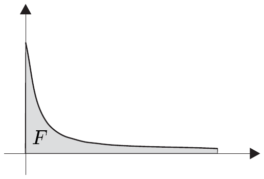
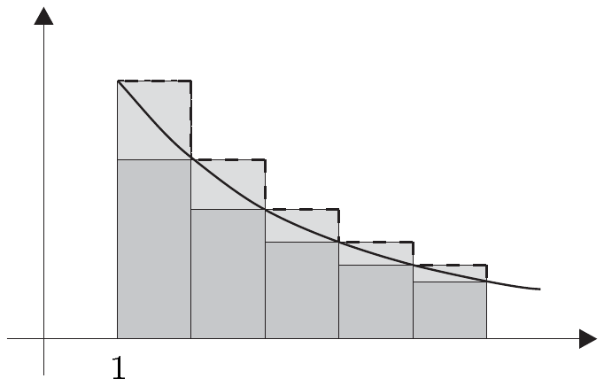

## 8 反常积分

到目前为止，我们只能对紧致区间上的跳跃连续函数进行积分。然而，我们已在引理 6.12 中看到，把积分的概念推广到定义在非紧致区间上的连续函数的情形是有意义的。考虑位于连续函数 $ f : \mathbb{R}^{+} \to \mathbb{R}^{+} $ 的图像与正半轴之间的集合 $ F $ 的面积，我们将证明：若当 $ x \to \infty $ 时 $ f $ 足够快地趋于零，则该面积是有限的。

为计算 $ F $，我们首先计算 $ F $ 在区间 $ [0, n] $ 上的面积，也就是说，我们在 $ x = n $ 处把面积截断，然后令 $ n $ 趋于 $ \infty $。下面的展开将精确化这一想法，并把积分的范围推广到定义在任意区间上的函数。\footnote{我们在本节中把论述局限于积分的一个相对初等的推广，而把完整的积分理论留到第三卷。}

本节中，我们设

• $ J $ 是一个区间，且 $ \inf J = a $，$ \sup J = b $；
  $ E := (E, \left| \cdot \right|) $ 是一个巴拿赫空间。

##### 可容许函数

映射 $ f : J \to E $ 称为**可容许**的，如果它在每一个紧致区间 $ J $ 上的限制是跳跃连续的。

8.1 例 (a) 每个 $ f \in C(J, E) $ 都是可容许的。

(b) 若 $ a $ 与 $ b $ 有限，则每个 $ f \in \mathcal{S}([a, b], E) $ 都是可容许的。

(c) 若 $ f : J \to E $ 是可容许的，则 $ \left| f \right| : J \to \mathbb{R} $ 也是可容许的。■

##### 反常积分

可容许函数 $ f : J \to E $ 称为**（反常）可积**的，如果存在 $ c \in (a, b) $，使得极限

\[ \lim_{\alpha \to a+0} \int_{\alpha}^{c} f \quad \text{且} \quad \lim_{\beta \to b-0} \int_{c}^{\beta} f \]

在 $ E $ 中存在。

8.2 引理 若 $ f : J \to E $ 反常可积，则对每个 $ c \in (a, b) $，极限

\[ \lim_{\alpha \to a+0} \int_{\alpha}^{c} f \quad \text{且} \quad \lim_{\beta \to b-0} \int_{c}^{\beta} f \]

都存在。此外，对 $ c, c' \in (a, b) $ 的任意选取，有

\[ \lim_{\alpha \to a+0} \int_{\alpha}^{c} f + \lim_{\beta \to b-0} \int_{c}^{\beta} f = \lim_{\alpha \to a+0} \int_{\alpha}^{c'} f + \lim_{\beta \to b-0} \int_{c'}^{\beta} f \]

证明 由假设，存在 $ c \in (a, b) $，使得

\[ e_{a,c} := \lim_{\alpha \to a+0} \int_{\alpha}^{c} f \quad \text{且} \quad e_{c,b} := \lim_{\beta \to b-0} \int_{c}^{\beta} f \]

在 $ E $ 中存在。现设 $ c' \in (a, b) $。由定理 4.4，对每个 $ \alpha \in (a, b) $ 有 $ \int_{\alpha}^{c'} f = \int_{\alpha}^{c} f + \int_{c}^{c'} f $。于是极限 $ e_{a,c'} := \lim_{\alpha \to a+0} \int_{\alpha}^{c'} f $ 在 $ E $ 中存在，且由 $ e_{a,c'} = e_{a,c} + \int_{c}^{c'} f $ 给出。同理可得

\[ e_{c',b} := \lim_{\beta \to b-0} \int_{c'}^{\beta} f \]

在 $ E $ 中存在，且 $ e_{c',b} = e_{c,b} + \int_{c'}^{c} f $。因此我们求得

\[ e_{a,c'} + e_{c',b} = e_{a,c} + \int_{c}^{c'} f + e_{c,b} + \int_{c'}^{c} f = e_{a,c} + e_{c,b} . ■ \]

设 $ f : J \to E $ 反常可积，且 $ c \in (a, b) $。则我们称

\[ \int_{a}^{b} f\,dx := \int_{a}^{b} f(x)\,dx := \lim_{\alpha \to a+0} \int_{\alpha}^{c} f + \lim_{\beta \to b-0} \int_{c}^{\beta} f \]

为 $ f $ 在 $ J $ 上的**（反常）积分**。我们也可以用记号

\[ \int_{a}^{b} f \quad \text{且} \quad \lim_{\substack{\alpha \to a+0 \\ \beta \to b-0}} \int_{\alpha}^{\beta} f\,dx . \]

除了说“$ f $ 反常可积”之外，我们也可以说，“积分 $ \int_{a}^{b} f\,dx $ **存在**或**收敛**”。引理 8.2 表明反常积分是良定义的，也就是说，它与 $ c \in (a, b) $ 的选取无关。

8.3 命题 对 $ -\infty < a < b < \infty $ 与 $ f \in \mathcal{S}([a, b], E) $，反常积分与柯西–黎曼积分一致。

证明 这由注 8.1(b)、积分作为其上下限的函数的连续性以及命题 4.4 得出。■

8.4 例 (a) 设 $ a > 0 $ 且 $ s \in \mathbb{C} $。则

\[ \int_{a}^{\infty} \frac{dx}{x^{s}} \text{ 存在} \Longleftrightarrow \operatorname{Re} s > 1 , \]

且

\[ \int_{a}^{\infty} \frac{dx}{x^{s}} = \frac{a^{1-s}}{s - 1} \quad \text{对 } \operatorname{Re} s > 1 . \]

证明 根据注 8.1(a)，函数 $ (a, \infty) \to \mathbb{C} $，$ x \mapsto 1/x^{s} $ 对每个 $ s \in \mathbb{C} $ 都是可容许的。

(i) 我们首先考虑 $ s \ne 1 $ 的情形。此时

\[ \int_{a}^{\beta} \frac{dx}{x^{s}} = \frac{1}{1 - s} x^{1-s} \Big|_{a}^{\beta} = \frac{1}{1 - s} \left( \frac{1}{\beta^{s-1}} - \frac{1}{a^{s-1}} \right) . \]

由 $ \left| \beta^{1-s} \right| = \beta^{1 - \operatorname{Re} s} $ 可得

\[ \frac{1}{\beta^{s-1}} \to 0 \; (\beta \to \infty) \Longleftrightarrow \operatorname{Re} s > 1 \]

且当 $ \operatorname{Re} s < 1 $ 时 $ \lim_{\beta \to \infty} 1/\beta^{s-1} $ 不存在。最后，若 $ \operatorname{Re} s = 1 $，则该极限不存在，因为 $ s = 1 + i\tau $（$ \tau \in \mathbb{R}^{\times} $）蕴含 $ \beta^{s-1} = \beta^{i\tau} = e^{i\tau\log\beta} $，又因为指数函数以 $ 2\pi i $ 为周期。

(ii) 若 $ s = 1 $，则

\[ \lim_{\beta \to \infty} \int_{a}^{\beta} \frac{dx}{x} = \lim_{\beta \to \infty} (\log\beta - \log a) = \infty . \]

因此函数 $ x \mapsto 1/x $ 在 $ (a, \infty) $ 上不可积。■

(b) 设 $ b > 0 $ 且 $ s \in \mathbb{C} $。则

\[ \int_{0}^{b} \frac{dx}{x^{s}} \text{ 存在} \Longleftrightarrow \operatorname{Re} s < 1 , \]

且对 $ \operatorname{Re} s < 1 $ 有 $ \int_{0}^{b} x^{-s}\,dx = b^{1-s}/(1 - s) $。

证明 证明与 (a) 的证明完全类似。■

(c) 对任意 $ s \in \mathbb{C} $，积分 $ \int_{0}^{\infty} x^{s}\,dx $ 都不存在。

(d) 积分

\[ \int_{-\infty}^{\infty} x\,dx = \lim_{\substack{\alpha \to -\infty \\ \beta \to \infty}} \int_{\alpha}^{\beta} x\,dx = \lim_{\substack{\alpha \to -\infty \\ \beta \to \infty}} \frac{x^{2}}{2} \Big|_{\alpha}^{\beta} \]

不存在。\footnote{注意到 $ \int_{-\infty}^{\infty} x\,dx $ 不存在，尽管 $ \lim_{\gamma \to \infty} \int_{-\gamma}^{\gamma} x\,dx = 0 $！验证一个积分的收敛性时，重要的是检查上、下限能够独立地取极限。}

(e) 我们有

\[ \int_{0}^{\infty} \frac{dx}{1 + x^{2}} = \frac{\pi}{2} \quad \text{且} \quad \int_{-1}^{1} \frac{dx}{\sqrt{1 - x^{2}}} = \pi . \]

证明 这是因为

\[ \lim_{\beta \to \infty} \arctan \Big|_{0}^{\beta} = \frac{\pi}{2} \quad \text{且} \quad \lim_{\substack{\alpha \to -1+0 \\ \beta \to 1-0}} \arcsin \Big|_{\alpha}^{\beta} = \pi , \]

其中我们用了例 4.15(a)。■

##### 级数的积分比较判别法

鉴于第 6 节，我们预期无穷级数与反常积分之间存在联系。\footnote{另见注 6.16(d) 的证明。} 下面的定理在一个重要情形下给出了这样一种联系。

8.5 命题 设 $ f : [1, \infty) \to \mathbb{R}^{+} $ 可容许且递减。则

\[ \sum_{n \ge 1} f(n) < \infty \Longleftrightarrow \int_{1}^{\infty} f(x)\,dx \text{ 存在} . \]

证明 (i) 由假设可得

\[ f(n) \le f(x) \le f(n - 1) \]

对 $ x \in [n - 1, n] $ 以及 $ n \in \mathbb{N} $ 且 $ n \ge 2 $ 成立。因此我们有

\[ f(n) \le \int_{n-1}^{n} f(x)\,dx \le f(n - 1) , \]

并且在对 $ n $ 求和之后，我们得到

\[ \sum_{n=2}^{N} f(n) \le \int_{1}^{N} f(x)\,dx \le \sum_{n=1}^{N-1} f(n) \quad \text{对 } N \ge 2 . \tag{8.1} \]

(ii) 级数 $ \sum f(n) $ 收敛。则界

\[ \int_{1}^{N} f\,dx \le \sum_{n=1}^{\infty} f(n) \quad \text{对 } N \ge 2 . \]

由 (8.1) 与 $ f \ge 0 $ 得出。因此函数 $ \beta \mapsto \int_{1}^{\beta} f(x)\,dx $ 递增且有界。从而由命题 III.5.3，$ \int_{1}^{\infty} f\,dx $ 存在。

(iii) 积分 $ \int_{1}^{\infty} f\,dx $ 收敛。则由 (8.1) 可得

\[ \sum_{n=2}^{N} f(n) \le \int_{1}^{\infty} f(x)\,dx \quad \text{对 } N \ge 2 . \]

因此定理 II.7.7 蕴含 $ \sum_{n \ge 1} f(n) $ 也存在。■

8.6 例 对 $ s \in \mathbb{R} $，级数

\[ \sum_{n \ge 2} \frac{1}{n(\log n)^{s}} \]

收敛当且仅当 $ s > 1 $。

证明 若 $ s \le 0 $，则 $ \sum 1/n $ 是一个发散的劣级数。因此只需考虑 $ s > 0 $ 的情形。因为

\[ \int_{2}^{\beta} \frac{dx}{x(\log x)^{s}} = \begin{cases} \left[ (\log\beta)^{1-s} - (\log 2)^{1-s} \right]/(1 - s) , & s \ne 1 , \\ \log(\log\beta) - \log(\log 2) , & s = 1 , \end{cases} \]

$ \int_{2}^{\infty} dx/x(\log x)^{s} $ 存在当且仅当 $ s > 1 $。于是命题 8.5 完成证明。■

##### 绝对收敛的积分

设 $ f : J \to E $ 可容许。如果积分 $ \int_{a}^{b} \left| f(x) \right|\,dx $ 在 $ \mathbb{R} $ 中存在，则称 $ f $（在 $ J $ 上）**绝对可积**。此时，我们又称 $ \int_{a}^{b} f $ **绝对收敛**。

下一个定理表明每个绝对可积函数都是（反常）可积的。

8.7 命题 若 $ f $ 绝对可积，则积分 $ \int_{a}^{b} f\,dx $ 在 $ E $ 中存在。

证明 设 $ c \in (a, b) $。因为 $ \int_{a}^{b} \left| f \right|\,dx $ 在 $ \mathbb{R} $ 中存在，故对每个 $ \varepsilon > 0 $，存在 $ \delta > 0 $，使得

\[ \left| \int_{\alpha_{1}}^{\alpha_{2}} \left| f \right| \right| = \left| \int_{\alpha_{1}}^{c} \left| f \right| - \int_{\alpha_{2}}^{c} \left| f \right| \right| < \varepsilon \quad \text{对 } \alpha_{1}, \alpha_{2} \in (a, a + \delta) . \]

于是命题 4.3 蕴含

\[ \left| \int_{\alpha_{1}}^{c} f - \int_{\alpha_{2}}^{c} f \right| = \left| \int_{\alpha_{1}}^{\alpha_{2}} f \right| \le \left| \int_{\alpha_{1}}^{\alpha_{2}} \left| f \right| \right| < \varepsilon \quad \text{对 } \alpha_{1}, \alpha_{2} \in (a, a + \delta) . \tag{8.2} \]

现设 $ (\alpha_{j}') $ 是 $ (a, c) $ 中的序列，使得 $ \lim \alpha_{j}' = a $。由 (8.2)，$ (\int_{\alpha_{j}'}^{c} f\,dx) $ 是 $ E $ 中的柯西序列。因此存在 $ e' \in E $，使得当 $ j \to \infty $ 时 $ \int_{\alpha_{j}'}^{c} f\,dx \to e' $。若 $ (\alpha_{j}'') $ 是 $ (a, c) $ 中的另一个序列，使得 $ \lim \alpha_{j}'' = a $，则类似地存在 $ e'' \in E $，使得在 $ E $ 中 $ \lim_{j} \int_{\alpha_{j}''}^{c} f\,dx = e'' $。

现在我们选取 $ N \in \mathbb{N} $，使得对 $ j \ge N $ 有 $ \alpha_{j}', \alpha_{j}'' \in (a, a + \delta) $。由 (8.2)，我们便得到对 $ j \ge N $ 有 $ \left| \int_{\alpha_{j}'}^{c} f - \int_{\alpha_{j}''}^{c} f \right| < \varepsilon $，之后令 $ j \to \infty $ 取极限便给出不等式 $ \left| e' - e'' \right| \le \varepsilon $。因为这对每个 $ \varepsilon > 0 $ 都成立，故 $ e' = e'' $，于是我们证明了 $ \lim_{\alpha \to a+0} \int_{\alpha}^{c} f\,dx $ 在 $ E $ 中存在。类似地，可证明 $ \lim_{\beta \to b-0} \int_{c}^{b} f\,dx $ 在 $ E $ 中存在。因此反常积分 $ \int_{a}^{b} f\,dx $ 在 $ E $ 中存在。■

##### 优函数判别法

与级数的情形类似，$ f $ 的可积优函数的存在保证了 $ \int_{a}^{b} f\,dx $ 的绝对收敛性。

8.8 定理 设 $ f : J \to E $ 与 $ g : J \to \mathbb{R}^{+} $ 可容许，且

\[ \left| f(x) \right| \le g(x) \quad \text{对 } x \in (a, b) . \]

若 $ g $ 可积，则 $ f $ 绝对可积。

证明 设 $ c \in (a, b) $ 且 $ \alpha_{1}, \alpha_{2} \in (a, c) $。则由推论 4.6 可得

\[ \left| \int_{\alpha_{1}}^{c} \left| f \right| - \int_{\alpha_{2}}^{c} \left| f \right| \right| = \left| \int_{\alpha_{1}}^{\alpha_{2}} \left| f \right| \right| \le \left| \int_{\alpha_{1}}^{\alpha_{2}} g \right| = \left| \int_{\alpha_{1}}^{c} g - \int_{\alpha_{2}}^{c} g \right| . \]

若 $ \int_{a}^{b} g\,dx $ 在 $ \mathbb{R} $ 中存在，则对每个 $ \varepsilon > 0 $，存在 $ \delta > 0 $，使得对 $ \alpha_{1}, \alpha_{2} \in (a, a + \delta) $ 有 $ \left| \int_{\alpha_{1}}^{c} g - \int_{\alpha_{2}}^{c} g \right| < \varepsilon $，于是我们得到

\[ \left| \int_{\alpha_{1}}^{c} \left| f \right| - \int_{\alpha_{2}}^{c} \left| f \right| \right| < \varepsilon \quad \text{对 } \alpha_{1}, \alpha_{2} \in (a, a + \delta) . \]

这一陈述使我们能够相应地重述定理 8.7 的证明，由此得出 $ \int_{a}^{b} f\,dx $ 的绝对收敛性。■

8.9 例 设 $ f : (a, b) \to E $ 可容许。

(a) 若 $ f $ 是实值的且 $ f \ge 0 $，则 $ f $ 绝对可积当且仅当 $ f $ 可积。

(b)

(i) 设 $ a > 0 $ 且 $ b = \infty $。若存在数 $ \varepsilon > 0 $，$ M > 0 $ 与 $ c > a $，使得

\[ \left| f(x) \right| \le \frac{M}{x^{1+\varepsilon}} \quad \text{对 } x \ge c , \]

则 $ \int_{c}^{\infty} f $ 绝对收敛。

(ii) 设 $ a = 0 $ 且 $ b > 0 $。若存在数 $ \varepsilon > 0 $，$ M > 0 $ 与 $ c \in (0, b) $，使得

\[ \left| f(x) \right| \le \frac{M}{x^{1-\varepsilon}} \quad \text{对 } x \in (0, c) , \]

则 $ \int_{0}^{c} f $ 绝对收敛。

证明 这由定理 8.8 与例 8.4(a)、(b) 得出。■

(c) 积分 $ \int_{0}^{\infty} \left( \sin(x)/(1 + x^{2}) \right) dx $ 绝对收敛。

证明 显然，$ x \mapsto 1/(1 + x^{2}) $ 是 $ x \mapsto \sin(x)/(1 + x^{2}) $ 的一个优函数。此外，例 8.4(e) 蕴含积分 $ \int_{0}^{\infty} dx/(1 + x^{2}) $ 存在。■

8.10 注 (a) 设 $ f_{n}, f \in \mathcal{S}([a, b], E) $ 且 $ (f_{n}) $ 一致收敛于 $ f $。则我们已在定理 4.1 中证明 $ (\int_{a}^{b} f_{n})_{n \in \mathbb{N}} $ 在 $ E $ 中收敛于 $ \int_{a}^{b} f $。对反常积分，类似的陈述不成立。

证明 我们考虑函数序列

\[ f_{n}(x) := \frac{1}{n} e^{-x/n} \quad \text{对 } x \in \mathbb{R}^{+} \text{ 且 } n \in \mathbb{N}^{\times} . \]

则每个 $ f_{n} $ 都属于 $ C(\mathbb{R}^{+}, \mathbb{R}) $。此外，序列 $ (f_{n}) $ 一致收敛于 0，因为 $ \left\| f_{n} \right\|_{\infty} = 1/n $。

另一方面，我们有

\[ \int_{0}^{\infty} f_{n}(x)\,dx = \int_{0}^{\infty} \frac{1}{n} e^{-x/n}\,dx = \lim_{\substack{\alpha \to 0+ \\ \beta \to \infty}} \left( -e^{-x/n} \right) \Big|_{\alpha}^{\beta} = 1 . \]

总之，可得 $ \lim_{n} \int_{0}^{\infty} f_{n}\,dx = 1 $，但 $ \int_{0}^{\infty} \lim_{n} f_{n}\,dx = 0 $。■

(b) 当一个函数序列同时也是反常积分中的被积函数时，人们可以追问交换相应极限的次序是否合法。我们现在不讨论这一点，而是把相应的结果留到第三卷，作为更一般的勒贝格积分理论的一部分，因为对这种分析而言，勒贝格积分理论比（更简单的）柯西–黎曼积分理论更为合适。在勒贝格理论的框架下，我们将找到关于何时可以交换取极限与积分的非常一般且灵活的判别法。■
