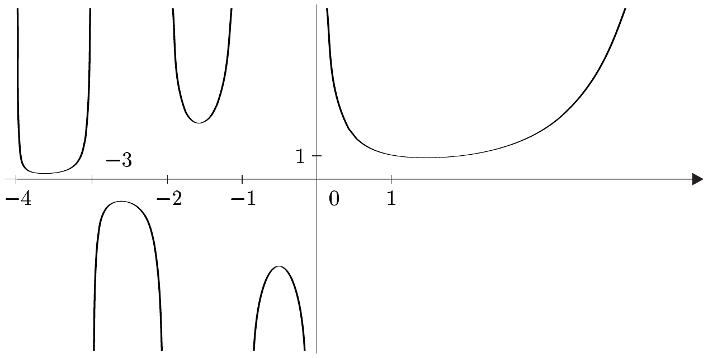

## 9 伽马函数

在本节中，我们将暂时结束积分理论，并研究数学中最重要的非初等函数之一，即伽马函数。我们将导出它的基本性质，特别地，证明它插值阶乘 $ n \mapsto n! $，也就是说，它使这个函数能够取非整数的自变量。此外，我们将证明 $ n! $ 的棣莫弗–斯特林渐近形式的一个改进，并且——作为一般理论的副产品——计算一个重要反常积分的值，即高斯误差积分。

##### 欧拉积分表示

我们通过考虑一个依赖参数的反常积分，对满足 $ \operatorname{Re} z > 0 $ 的 $ z \in \mathbb{C} $ 引入伽马函数。

9.1 引理 对满足 $ \operatorname{Re} z > 0 $ 的 $ z \in \mathbb{C} $，积分
\[ \int_{0}^{\infty} t^{z-1} e^{-t} \, dt \]
绝对收敛。

证明 首先，我们指出 $ (0, \infty) $ 上的函数 $ t \mapsto t^{z-1} e^{-t} $ 是可容许的。

(i) 我们考察积分在其下限处的情形。对 $ t \in (0, 1] $，我们有
\[ \left| t^{z-1} e^{-t} \right| = t^{\operatorname{Re} z-1} e^{-t} \le t^{\operatorname{Re} z-1} . \]
于是由例 8.9(b) 可得，$ \int_{0}^{1} t^{z-1} e^{-t} \, dt $ 绝对收敛。

(ii) 对 $ m \in \mathbb{N}^{\times} $，我们有估计
\[ \frac{t^{m}}{m!} \le \sum_{k=0}^{\infty} \frac{t^{k}}{k!} = e^{t} \quad \text{对 } t \ge 0 . \]
乘以 $ t^{\operatorname{Re} z-1} $ 之后，我们求得
\[ \left| t^{z-1} e^{-t} \right| = t^{\operatorname{Re} z-1} e^{-t} \le \frac{m!}{t^{m-\operatorname{Re} z+1}} . \]
我们选取 $ m \in \mathbb{N}^{\times} $ 使得 $ m > \operatorname{Re} z $，并由例 8.9(b) 得到 $ \int_{1}^{\infty} t^{z-1} e^{-t} \, dt $ 的绝对收敛。■

对满足 $ \operatorname{Re} z > 0 $ 的 $ z \in \mathbb{C} $，积分
\[ \Gamma(z) := \int_{0}^{\infty} t^{z-1} e^{-t} \, dt \tag{9.1} \]
称为**第二欧拉积分**或**欧拉伽马积分**，并且 (9.1) 在 $ [\operatorname{Re} z > 0] := \{\, z \in \mathbb{C} ; \ \operatorname{Re} z > 0 \,\} $ 上定义了**伽马函数**。

9.2 定理 伽马函数满足**函数方程**
\[ \Gamma(z+1) = z\Gamma(z) \quad \text{对 } \operatorname{Re} z > 0 . \]
特别地，
\[ \Gamma(n+1) = n! \quad \text{对 } n \in \mathbb{N} . \]

证明 令 $ u(t) := t^{z} $ 与 $ v'(t) := e^{-t} $ 作分部积分，得
\[ \int_{\alpha}^{\beta} t^{z} e^{-t} \, dt = -t^{z} e^{-t} \big|_{\alpha}^{\beta} + z \int_{\alpha}^{\beta} t^{z-1} e^{-t} \, dt \quad \text{对 } 0 < \alpha < \beta < \infty . \]
由命题 III.6.5(iii) 以及幂函数在 $ [0, \infty) $ 上的连续性，我们得到当 $ t \to 0 $ 以及当 $ t \to \infty $ 时 $ t^{z} e^{-t} \to 0 $。因此，我们有
\[ \Gamma(z+1) = \lim_{\substack{\alpha \to 0+ \\ \beta \to \infty}} \int_{\alpha}^{\beta} t^{z} e^{-t} \, dt = z \int_{0}^{\infty} t^{z-1} e^{-t} \, dt = z\Gamma(z) \]
从而得到所述函数方程。

最后，完成归纳，我们有
\[ \Gamma(n+1) = n\Gamma(n) = n(n-1) \cdots 1 \cdot \Gamma(1) = n! \, \Gamma(1) \quad \text{对 } n \in \mathbb{N} . \]
因为 $ \Gamma(1) = \int_{0}^{\infty} e^{-t} \, dt = -e^{-t} \big|_{0}^{\infty} = 1 $，我们便完成了证明。\footnote{自然，$ f\big|_{a}^{\infty} $ 是 $ \lim_{b \to \infty} f\big|_{a}^{b} $ 的简写。} ■

##### 在 $ \mathbb{C}\setminus(-\mathbb{N}) $ 上的伽马函数

对 $ \operatorname{Re} z > 0 $ 与 $ n \in \mathbb{N}^{\times} $，由定理 9.2 可得
\[ \Gamma(z+n) = (z+n-1)(z+n-2) \cdots (z+1)z\Gamma(z) , \]
即
\[ \Gamma(z) = \frac{\Gamma(z+n)}{z(z+1) \cdots (z+n-1)} . \tag{9.2} \]
(9.2) 的右端对每个满足 $ \operatorname{Re} z > -n $ 的 $ z \in \mathbb{C}\setminus(-\mathbb{N}) $ 都有定义。这个公式提示我们把函数 $ z \mapsto \Gamma(z) $ 延拓到 $ \mathbb{C}\setminus(-\mathbb{N}) $ 上。

9.3 定理（兼定义）对 $ z \in \mathbb{C}\setminus(-\mathbb{N}) $，
\[ \Gamma_n(z) := \frac{\Gamma(z+n)}{z(z+1) \cdots (z+n-1)} \]
当 $ n > -\operatorname{Re} z $ 时与 $ n \in \mathbb{N}^{\times} $ 无关。因此我们可以通过
\[ \Gamma(z) := \Gamma_n(z) \quad \text{对 } z \in \mathbb{C}\setminus(-\mathbb{N}) \text{ 且 } n > -\operatorname{Re} z \]
定义 (9.1) 中给出的函数在 $ \mathbb{C}\setminus(-\mathbb{N}) $ 上的一个延拓。这个延拓称为**伽马函数**。它满足函数方程
\[ \Gamma(z+1) = z\Gamma(z) \quad \text{对 } z \in \mathbb{C}\setminus(-\mathbb{N}) . \]

证明 由 (9.2)，$ \Gamma_n $ 在 $ [\operatorname{Re} z > 0] $ 上与 (9.1) 中定义的函数一致。此外，对满足 $ n > m > -\operatorname{Re} z $ 的 $ m, n \in \mathbb{N} $，我们有
\[ \Gamma(z+n) = (z+n-1) \cdots (z+m)\Gamma(z+m) . \]
因此
\[ \begin{aligned} \Gamma_n(z) &= \frac{\Gamma(z+n)}{z(z+1) \cdots (z+n-1)} \\ &= \frac{(z+n-1) \cdots (z+m)\Gamma(z+m)}{z(z+1) \cdots (z+m-1)(z+m) \cdots (z+n-1)} \\ &= \frac{\Gamma(z+m)}{z(z+1) \cdots (z+m-1)} = \Gamma_m(z) . \end{aligned} \]
于是函数 $ \Gamma_n $ 与 $ \Gamma_m $ 在它们共同有定义的地方一致。这表明伽马函数是良定义的，并且当 $ [\operatorname{Re} z > 0] $ 时与欧拉伽马积分一致。

对 $ z \in \mathbb{C}\setminus(-\mathbb{N}) $ 与满足 $ \operatorname{Re} z > -n $ 的 $ n \in \mathbb{N}^{\times} $，我们有
\[ \Gamma(z+1) = \frac{\Gamma(z+n+1)}{(z+1) \cdots (z+n)} = \frac{z(z+n)\Gamma(z+n)}{z(z+1) \cdots (z+n)} = z\Gamma(z) \]
因为 $ (z+n)\Gamma(z+n) = \Gamma(z+n+1) $。■

##### 高斯的表示公式

伽马函数还有另一种表示，它由高斯给出，并有重要的应用。

9.4 定理 对 $ z \in \mathbb{C}\setminus(-\mathbb{N}) $，我们有
\[ \Gamma(z) = \lim_{n \to \infty} \frac{n^{z} n!}{z(z+1) \cdots (z+n)} . \]

证明 (i) 我们首先考虑 $ \operatorname{Re} z > 0 $ 的情形。因为
\[ \Gamma(z) = \lim_{n \to \infty} \int_{0}^{n} t^{z-1} e^{-t} \, dt \]
并且根据定理 III.6.23，
\[ e^{-t} = \lim_{n \to \infty} \left( 1 - \frac{t}{n} \right)^{n} \quad \text{对 } t \ge 0 , \tag{9.3} \]
我们可以猜想公式
\[ \Gamma(z) = \lim_{n \to \infty} \int_{0}^{n} t^{z-1} \left( 1 - \frac{t}{n} \right)^{n} \, dt \quad \text{对 } \operatorname{Re} z > 0 . \tag{9.4} \]
我们将在下面证明它。

(ii) 设 $ \operatorname{Re} z > 0 $。我们用 $ u(t) := (1 - t/n)^{n} $ 与 $ v'(t) := t^{z-1} $ 对 (9.4) 作分部积分：
\[ \int_{0}^{n} t^{z-1} \left( 1 - \frac{t}{n} \right)^{n} dt = \frac{1}{z} \int_{0}^{n} t^{z} \left( 1 - \frac{t}{n} \right)^{n-1} dt . \]
再作一次分部积分给出
\[ \int_{0}^{n} t^{z-1} \left( 1 - \frac{t}{n} \right)^{n} dt = \frac{1}{z} \cdot \frac{n-1}{n(z+1)} \int_{0}^{n} t^{z+1} \left( 1 - \frac{t}{n} \right)^{n-2} dt , \]
并且，完成归纳，我们求得
\[ \begin{aligned} \int_{0}^{n} t^{z-1} \left( 1 - \frac{t}{n} \right)^{n} dt &= \frac{1}{z} \cdot \frac{n-1}{n(z+1)} \cdot \frac{n-2}{n(z+2)} \cdot \cdots \cdot \frac{1}{n(z+n-1)} \int_{0}^{n} t^{z+n-1} dt \\ &= \frac{1}{z} \cdot \frac{n-1}{n(z+1)} \cdot \frac{n-2}{n(z+2)} \cdot \cdots \cdot \frac{1}{n(z+n-1)} \cdot \frac{n^{z+n}}{z+n} \\ &= \frac{n! \, n^{z}}{z(z+1) \cdots (z+n)} . \end{aligned} \]
于是该断言在这种情形下由 (9.4) 得到。

(iii) 我们令
\[ \gamma_n(z) := \frac{n! \, n^{z}}{z(z+1) \cdots (z+n)} \quad \text{对 } z \in \mathbb{C}\setminus(-\mathbb{N}) . \tag{9.5} \]
于是我们有
\[ \begin{aligned} \gamma_n(z) &= \frac{1}{z(z+1) \cdots (z+k-1)} \left( 1 + \frac{z+1}{n} \right) \left( 1 + \frac{z+2}{n} \right) \cdots \\ &\quad \cdot \left( 1 + \frac{z+k}{n} \right) \gamma_n(z+k) \end{aligned} \]
对每个 $ k \in \mathbb{N}^{\times} $。现在我们选取 $ k > -\operatorname{Re} z $，于是由 (ii) 与定理 9.3 得到
\[ \lim_{n} \gamma_n(z) = \frac{\Gamma(z+k)}{z(z+1) \cdots (z+k-1)} = \Gamma(z) . \]

于是只剩下证明 (9.4)。

(iv) 为对固定的 $ z $ 证明 (9.4)，我们可以令 $ f(t) := t^{z-1} e^{-t} $ 以及
\[ f_n(t) := \begin{cases} t^{z-1} (1 - t/n)^{n} , & 0 < t \le n , \\ 0 , & t > n . \end{cases} \]
于是由 (9.3) 可得
\[ \lim_{n \to \infty} f_n(t) = f(t) \quad \text{对 } t > 0 . \tag{9.6} \]
因为序列 $ \left( (1 - t/n)^{n} \right)_{n \in \mathbb{N}} $ 对 $ t > 0 $ 单调收敛到 $ e^{-t} $（见 (v)），我们还有
\[ \left| f_n(t) \right| \le g(t) \quad \text{对 } t > 0 \text{ 且 } n \in \mathbb{N} , \tag{9.7} \]
其中我们在 $ (0, \infty) $ 上定义可积函数 $ t \mapsto g(t) := t^{\operatorname{Re} z-1} e^{-t} $。现在由 (9.6)、(9.7) 以及勒贝格收敛定理（将在第三卷中证明）可得
\[ \lim_{n \to \infty} \int_{0}^{n} t^{z-1} (1 - t/n)^{n} dt = \lim_{n \to \infty} \int_{0}^{\infty} f_n(t) \, dt = \int_{0}^{\infty} f(t) \, dt = \Gamma(z) , \]
从而得到 (9.4)。

为了避免援引勒贝格定理，我们将直接验证 (9.4)。但首先，我们必须证明 (9.3) 中的收敛是单调的且是局部一致的。

(v) 由对数的泰勒展开（应用 IV.3.9(d) 或定理 V.3.9），我们有
\[ \frac{\log(1-s)}{s} = -\frac{1}{s} \sum_{k=1}^{\infty} \frac{s^{k}}{k} = -1 - \sum_{k=1}^{\infty} \frac{s^{k}}{k+1} \quad \text{对 } s \in (0, 1) , \]
并且我们求得
\[ \frac{\log(1-s)}{s} \uparrow -1 \quad (s \to 0+) . \tag{9.8} \]
我们现在在 (9.8) 中令 $ s := t/n $ 使得 $ t > 0 $，于是
\[ n \log\left( 1 - \frac{t}{n} \right) = t \left[ \frac{n}{t} \log\left( 1 - \frac{t}{n} \right) \right] \uparrow -t \quad (n \to \infty) . \]
指数函数的单调性与连续性于是表明，序列 $ \left( [1 - t/n]^{n} \right)_{n \in \mathbb{N}} $ 对每个 $ t \ge 0 $ 都收敛到 $ e^{-t} $。

该序列在 $ \mathbb{R}^{+} $ 的紧致子区间上的一致收敛，由映射 $ s \mapsto [\log(1-s)]/s $ 在这些区间上的一致连续性得出（见习题 III.3.11）。也就是说，设 $ T > 0 $ 且 $ \varepsilon > 0 $。则存在 $ \delta > 0 $ 使得
\[ \left| \frac{\log(1-s)}{s} + 1 \right| < \varepsilon \quad \text{对 } 0 < s < \delta . \tag{9.9} \]
现在，当 $ n > T/\delta $ 且 $ t \in [0, T] $ 时，我们确实有 $ t/n < \delta $。令 $ s := t/n $，于是由 (9.9) 可得
\[ \left| n \log\left( 1 - \frac{t}{n} \right) + t \right| \le T \left| \frac{n}{t} \log\left( 1 - \frac{t}{n} \right) + 1 \right| < T\varepsilon \quad \text{对 } 0 \le t \le T . \]
于是序列 $ \left( n \log(1 - t/n) \right)_{n \in \mathbb{N}} $ 在 $ [0, T] $ 上一致收敛到 $ -t $。因为指数函数在 $ [0, T] $ 上一致连续，序列 $ \left( (1 - t/n)^{n} \right)_{n \in \mathbb{N}} $ 在 $ t \in [0, T] $ 中一致收敛到 $ e^{-t} $。

(vi) 最后，我们证明 (9.4)。于是设 $ \varepsilon > 0 $。引理 9.1 的证明表明存在 $ N_0 \in \mathbb{N} $ 使得
\[ \int_{N_0}^{\infty} t^{\operatorname{Re} z-1} e^{-t} \, dt < \varepsilon/3 . \]
因此，由 (v)，我们有
\[ \int_{N_0}^{n} t^{\operatorname{Re} z-1} \left( 1 - \frac{t}{n} \right)^{n} dt \le \int_{N_0}^{n} t^{\operatorname{Re} z-1} e^{-t} \, dt \le \int_{N_0}^{\infty} t^{\operatorname{Re} z-1} e^{-t} \, dt < \frac{\varepsilon}{3} \]
对 $ n \ge N_0 $。最后，基于与 (v) 相同的理由，存在 $ N \in \mathbb{N} $ 使得
\[ \int_{0}^{N_0} t^{\operatorname{Re} z-1} \left( e^{-t} - \left( 1 - \frac{t}{n} \right)^{n} \right) dt \le \frac{\varepsilon}{3} \quad \text{对 } n \ge N . \]
对 $ n \ge N_0 \lor N $，我们现在得到
\[ \begin{aligned} \left| \Gamma(z) - \int_{0}^{n} t^{z-1} \left( 1 - \frac{t}{n} \right)^{n} dt \right| &\le \left| \Gamma(z) - \int_{0}^{N_0} t^{z-1} e^{-t} \, dt \right| \\
&\quad + \left| \int_{0}^{N_0} t^{z-1} e^{-t} \, dt - \int_{0}^{n} t^{z-1} \left( 1 - \frac{t}{n} \right)^{n} dt \right| \\ &\le \int_{N_0}^{\infty} t^{\operatorname{Re} z-1} e^{-t} \, dt + \int_{0}^{N_0} t^{\operatorname{Re} z-1} \left( e^{-t} - \left( 1 - \frac{t}{n} \right)^{n} \right) dt \\ &\quad + \int_{N_0}^{n} t^{\operatorname{Re} z-1} \left( 1 - \frac{t}{n} \right)^{n} dt \le \varepsilon , \end{aligned} \]
这表明 (9.4) 成立。■

##### 反射公式

作为高斯乘积表示的一个应用，我们将导出伽马函数与正弦之间的一个重要关系。为此，我们首先证明 $ 1/\Gamma $ 的一个乘积形式，它由魏尔斯特拉斯给出。

9.5 命题 对 $ z \in \mathbb{C}\setminus(-\mathbb{N}) $，我们有
\[ \frac{1}{\Gamma(z)} = z e^{Cz} \prod_{k=1}^{\infty} \left( 1 + \frac{z}{k} \right) e^{-z/k} , \tag{9.10} \]
其中 $ C $ 是欧拉–马歇罗尼常数。该无穷乘积绝对且局部一致收敛。特别地，伽马函数没有零点。

证明 显然
\[ \frac{1}{\gamma_n(z)} = z\exp\left[ z \left( \sum_{k=1}^{n} \frac{1}{k} - \log n \right) \right] \prod_{k=1}^{n} \left( \frac{z+k}{k} e^{-z/k} \right) \]
对 $ z \in \mathbb{C}\setminus(-\mathbb{N}) $。定义 $ a_k(z) := (1 + z/k)e^{-z/k} $，对 $ |z| \le R $ 我们有
\[ \left| a_k(z) - 1 \right| = \left| (1 + z/k) \left[ 1 - z/k + \sum_{j=2}^{\infty} \frac{(-1)^{j}}{j!} \left( \frac{z}{k} \right)^{j} \right] - 1 \right| \le c/k^{2} , \tag{9.11} \]
其中 $ c := c(R) $ 是适当的常数。因此存在常数 $ K \in \mathbb{N}^{\times} $ 使得对 $ k \ge K $ 与 $ |z| \le R $ 有 $ |a_k(z) - 1| \le 1/2 $。由此可得
\[ \prod_{k=1}^{n} \frac{z+k}{k} e^{-z/k} = \left( \prod_{k=1}^{K} a_k(z) \right) \exp\left( \sum_{k=K+1}^{n} \log a_k(z) \right) \tag{9.12} \]
对 $ n > K $ 与 $ |z| \le R $。由对数的幂级数表示，我们得到存在常数 $ M \ge 1 $ 使得对 $ |\zeta| \le 1/2 $ 有 $ |\log(1+\zeta)| \le M|\zeta| $。于是利用 (9.11)（它改变一切），我们求得估计
\[ \sum_{k>K} \left| \log a_k(z) \right| \le M \sum_{k>K} \left| a_k(z) - 1 \right| \le cM \sum_{k} k^{-2} \]
对 $ |z| \le R $。于是级数 $ \sum_{k>K} \log a_k(z) $ 对 $ |z| \le R $ 绝对且一致收敛，这是由魏尔斯特拉斯优级数判别法得到的。由 (9.12) 与指数函数的性质，这对出现在 (9.10) 中的无穷乘积也成立。该断言现在由定理 9.4 与例 6.13(b) 得到。■

我们可以利用这个乘积表示来得到前面提到的正弦与伽马函数之间的关系。

9.6 定理（$\Gamma$ 函数的反射公式\footnote{之所以如此称呼，是因为其左端关于 $ z = -1/2 $ 为偶函数。}）对 $ z \in \mathbb{C}\setminus\mathbb{Z} $，我们有
\[ \Gamma(z)\Gamma(1-z) = \frac{\pi}{\sin(\pi z)} . \]

证明 表示 (9.10) 蕴含（见命题 II.2.4(ii)）
\[ \frac{1}{\Gamma(z)} \frac{1}{\Gamma(1-z)} = \frac{1}{-z\Gamma(z)\Gamma(-z)} = z \prod_{k=1}^{\infty} \left( 1 - \frac{z^{2}}{k^{2}} \right) \]
对 $ z \in \mathbb{C}\setminus\mathbb{Z} $。该断言现在由应用 7.23(b) 得到。■

利用反射公式，我们可以计算一些重要反常积分的值。

9.7 应用（高斯误差积分\footnote{“误差积分”这个名称来自概率论，在概率论中函数 $ x \mapsto e^{-x^{2}} $ 起着基本的作用。}）该恒等式说的是
\[ \int_{-\infty}^{\infty} e^{-x^{2}} dx = \Gamma(1/2) = \sqrt{\pi} . \]

证明 利用代换 $ x = \sqrt{t} $，我们求得\footnote{该代换在正常积分 $ \int_{\alpha}^{\beta} $ 中进行，然后取极限 $ \alpha \to 0+ $ 与 $ \beta \to \infty $。}
\[ \Gamma(1/2) = \int_{0}^{\infty} e^{-t} \frac{dt}{\sqrt{t}} = 2 \int_{0}^{\infty} e^{-x^{2}} dx = \int_{-\infty}^{\infty} e^{-x^{2}} dx , \]
因为 $ x \mapsto e^{-x^{2}} $ 是偶函数。该断言于是由反射公式得到。■

在第三卷中，我们将学习一种计算高斯误差积分的更简便方法，它使用多元积分。

##### 伽马函数的对数凸性

利用
\[ \varphi_n(z) := z \log n - \sum_{k=0}^{n} \log(z+k) + \log(n!) \quad \text{对 } n \in \mathbb{N}^{\times} , \ z \in \mathbb{C}\setminus(-\mathbb{N}) , \]
我们由 (9.5) 得到表示 $ \gamma_n = e^{\varphi_n} $。然后，通过取 $ \gamma_n $ 的对数导数 $ \gamma_n'/\gamma_n $，我们求得简单形式
\[ \psi_n(z) := \frac{\gamma_n'(z)}{\gamma_n(z)} = \log n - \sum_{k=0}^{n} \frac{1}{z+k} , \tag{9.13} \]
并且，进一步地，
\[ \psi_n'(z) = \sum_{k=0}^{n} \frac{1}{(z+k)^{2}} \tag{9.14} \]
对 $ n \in \mathbb{N}^{\times} $ 与 $ z \in \mathbb{C}\setminus(-\mathbb{N}) $。

我们现在可以证明伽马函数的前两个对数导数的如下形式。

9.8 命题 $ \Gamma \in C^{2}(\mathbb{C}\setminus(-\mathbb{N})) $。于是我们有
\[ \frac{\Gamma'(z)}{\Gamma(z)} = -C - \frac{1}{z} - \sum_{k=1}^{\infty} \left( \frac{1}{z+k} - \frac{1}{k} \right) \tag{9.15} \]
以及
\[ \left( \frac{\Gamma'}{\Gamma} \right)'(z) = \sum_{k=0}^{\infty} \frac{1}{(z+k)^{2}} \tag{9.16} \]
对 $ z \in \mathbb{C}\setminus(-\mathbb{N}) $，其中 $ C $ 是欧拉–马歇罗尼常数。

证明 我们首先必须证明 $ \mathbb{C}\setminus(-\mathbb{N}) $ 上的序列 $ (\psi_n) $ 与 $ (\psi_n') $ 局部一致收敛。于是我们考察
\[ \psi_n(z) = \left( \log n - \sum_{k=1}^{n} \frac{1}{k} \right) - \frac{1}{z} - \sum_{k=1}^{n} \left( \frac{1}{z+k} - \frac{1}{k} \right) . \]
于是，我们必须证明级数
\[ \sum_{k} \left( \frac{1}{z+k} - \frac{1}{k} \right) = \sum_{k} \frac{-z}{k(z+k)} \quad \text{且} \quad \sum_{k} (z+k)^{-2} \tag{9.17} \]
在 $ \mathbb{C}\setminus(-\mathbb{N}) $ 上局部一致收敛。

设 $ z_0 \in \mathbb{C}\setminus(-\mathbb{N}) $ 且 $ 0 < r < \operatorname{dist}(z_0, -\mathbb{N}) $。则对 $ z \in \mathbb{B}(z_0, r) $，我们有估计
\[ |z+k| \ge |z_0+k| - |z - z_0| \ge k - |z_0| - r \ge k/2 \]
对满足 $ k \ge k_0 := 2(|z_0| + r) $ 的 $ k \in \mathbb{N}^{\times} $。因此，我们求得
\[ \left| \frac{z}{k(z+k)} \right| \le \frac{k_0}{k^{2}} , \quad \frac{1}{|z+k|^{2}} \le \frac{4}{k^{2}} \]
对 $ z \in \mathbb{B}(z_0, r) $ 与 $ k \ge k_0 $。于是由魏尔斯特拉斯优级数判别法（定理 V.1.6）可得级数 (9.17) 在 $ \mathbb{B}(z_0, r) $ 上的一致收敛——从而在 $ \mathbb{C}\setminus(-\mathbb{N}) $ 上的局部一致收敛。因此我们有
\[ \psi(z) := \lim_{n \to \infty} \psi_n(z) = -C - \frac{1}{z} - \sum_{k=1}^{\infty} \left( \frac{1}{z+k} - \frac{1}{z} \right) \quad \text{对 } z \in \mathbb{C}\setminus(-\mathbb{N}) . \tag{9.18} \]

由函数级数极限的可微性定理（定理 V.2.8），进一步可得 $ \psi $ 在 $ \mathbb{C}\setminus(-\mathbb{N}) $ 上连续可微，且
\[ \psi'(z) = \lim_{n \to \infty} \psi_n'(z) = \sum_{k=0}^{\infty} \frac{1}{(z+k)^{2}} \quad \text{对 } z \in \mathbb{C}\setminus(-\mathbb{N}) . \tag{9.19} \]

对 $ z \in \mathbb{C}\setminus(-\mathbb{N}) $，我们也可以把 $ \varphi_n(z) $ 写成如下形式
\[ \varphi_n(z) = -\log z + z \left( \log n - \sum_{k=1}^{n} \frac{1}{k} \right) + \sum_{k=1}^{n} \left( \frac{z}{k} - \log\left( 1 + \frac{z}{k} \right) \right) . \]
于是
\[ \log(1 + z/k) = z/k + O\left( (z/k)^{2} \right) \quad (k \to \infty) \]
与例 6.13(b) 蕴含 $ \varphi_n(z) $ 收敛到
\[ \varphi(z) := -\log z - Cz + \sum_{k=1}^{\infty} \left( \frac{z}{k} - \log\left( 1 + \frac{z}{k} \right) \right) \]
当 $ n \to \infty $ 时。于是我们由 $ \gamma_n = e^{\varphi_n} $ 与定理 9.4 得到
\[ \Gamma(z) = e^{\varphi(z)} \quad \text{对 } z \in \mathbb{C}\setminus(-\mathbb{N}) . \tag{9.20} \]
因为 $ \varphi_n' = \psi_n $ 且序列 $ (\psi_n) $ 局部一致收敛，定理 V.2.8 于是保证 $ \varphi $ 连续可微且 $ \varphi' = \psi $。现在由 (9.20) 可得 $ \Gamma $ 也连续可微，且
\[ \Gamma' = \varphi' e^{\varphi} = \psi\Gamma . \tag{9.21} \]
于是 (9.15) 由 (9.18) 得到，而 (9.16) 是 (9.19) 的推论。最后，$ \Gamma \in C^{2}(\mathbb{C}\setminus(-\mathbb{N})) $ 由 (9.21) 与 $ \psi $ 的连续可微性得到。■

9.9 注 (a) 上述定理与定理 VIII.5.11 蕴含 $ \Gamma $ 在 $ \mathbb{C}\setminus(-\mathbb{N}) $ 上解析。

(b) 因为 $ (\Gamma'/\Gamma)' = (\Gamma''\Gamma - (\Gamma')^{2})/\Gamma^{2} $，我们由 (9.16) 得到
\[ \Gamma''(x)\Gamma(x) > \left( \Gamma'(x) \right)^{2} \ge 0 \quad \text{对 } x \in \mathbb{R}\setminus(-\mathbb{N}) . \]
因此对 $ x \in \mathbb{R}\setminus(-\mathbb{N}) $ 有 $ \operatorname{sign}(\Gamma''(x)) = \operatorname{sign}(\Gamma(x)) $。由定理 9.4 的高斯公式，我们读出
\[ \operatorname{sign}(\Gamma(x)) = \begin{cases} 1 , & x > 0 , \\ (-1)^{k} , & -k < x < -k+1 , \ k \in \mathbb{N} . \end{cases} \]
因此 $ \Gamma $ 在 $ (0, \infty) $ 以及区间 $ (-2k, -2k+1) $ 上是凸的，而在区间 $ (-2k-1, -2k) $ 上是凹的，其中 $ k \in \mathbb{N} $。

(c) 若在一个完全区间上处处严格正的函数 $ f $ 满足 $ \log f $ 是凸的，则称 $ f $ 是**对数凸**的。若 $ f $ 二次可微，则按照推论 IV.2.13，$ f $ 是对数凸的当且仅当 $ f''f - (f')^{2} \ge 0 $。因此伽马函数在 $ (0, \infty) $ 上是对数凸的。可以证明 $ \Gamma|(0, \infty) $ 是满足下列条件的唯一函数 $ f : (0, \infty) \to (0, \infty) $：

(i) $ f $ 是对数凸的，

(ii) $ f(x+1) = xf(x) $，且对 $ x > 0 $ 成立，并且

(iii) $ f(1) = 1 $。

关于基于这些性质的伽马函数理论的证明与构造，我们参考 [Art31]（另见 [Kön92] 与习题 6）。■

##### 斯特林公式

棣莫弗–斯特林公式描述了阶乘 $ n \mapsto n! $ 当 $ n \to \infty $ 时的渐近行为。例 6.13(a) 说
\[ \Gamma(n) = (n-1)! \sim \sqrt{2\pi} \, n^{n-\frac{1}{2}} e^{-n} . \tag{9.22} \]
下面的定理改进并强化了这个陈述。

9.10 定理（斯特林公式）对每个 $ x > 0 $，存在 $ \theta(x) \in (0, 1) $ 使得
\[ \Gamma(x) = \sqrt{2\pi} \, x^{x-1/2} e^{-x} e^{\theta(x)/12x} . \]

证明 对 $ \gamma_n $，我们由 (9.5) 得到
\[ \log \gamma_n(x) = \log n! + x \log n - \sum_{k=0}^{n} \log(x+k) \quad \text{对 } x > 0 . \]
对这个和，我们以 $ a := 0 $、$ b := n $ 与 $ m := 0 $ 应用欧拉–麦克劳林求和公式（定理 6.9），并求得
\[ \sum_{k=0}^{n} \log(x+k) = \int_{0}^{n} \log(x+t) \, dt + \frac{1}{2} \left[ \log x + \log(x+n) \right] + R_n(x) , \]
其中
\[ R_n(x) := \int_{0}^{n} \frac{\widetilde{B}_1(t)}{x+t} \, dt . \]
于是令 $ u(t) := \log(x+t) $ 与 $ v' = \mathbf{1} $ 作分部积分，得
\[ \int_{0}^{n} \log(x+t) \, dt = (x+t)\left[ \log(x+t) - 1 \right] \big|_{0}^{n} = (x+n)\log(x+n) - n - x\log x , \]
从而
\[ \log \gamma_n(x) = \left( x - \frac{1}{2} \right) \log x + \log n! + n + x\log n - \left( x + n + \frac{1}{2} \right) \log(x+n) - R_n(x) . \]
因为 $ \log(x+n) = \log n + \log(1 + x/n) $，可得
\[ \begin{aligned} \left( x + n + \frac{1}{2} \right) \log(x+n) &= x \log n + \log\left( n^{(n+\frac{1}{2})} \right) + \left( x + \frac{1}{2} \right) \log\left( 1 + \frac{x}{n} \right) \\ &\quad + \log\left( \left( 1 + \frac{x}{n} \right)^{n} \right) , \end{aligned} \]
并且我们得到
\[ \begin{aligned} \log \gamma_n(x) &= \left( x - \frac{1}{2} \right) \log x - \log\left( \left( 1 + \frac{x}{n} \right)^{n} \right) - \left( x + \frac{1}{2} \right) \log\left( 1 + \frac{x}{n} \right) \\ &\quad + \log\left[ \frac{n!}{n^{n+1/2} e^{-n}} \right] - R_n(x) . \end{aligned} \tag{9.23} \]

为估计 $ R_n(x) $，我们考察
\[ -R_n(x) = -\sum_{k=0}^{n-1} \int_{k}^{k+1} \frac{\widetilde{B}_1(t)}{x+t} \, dt = -\sum_{k=0}^{n-1} \int_{0}^{1} \frac{B_1(t)}{x+t+k} \, dt = \sum_{k=0}^{n-1} g(x+k) \]
其中
\[ g(x) := -\int_{0}^{1} \frac{t - 1/2}{x+t} \, dt = \left( x + \frac{1}{2} \right) \log\left( \frac{x+1}{x} \right) - 1 = \frac{1}{2y} \log\frac{1+y}{1-y} - 1 , \]
其中我们已令 $ y := 1/(2x+1) $。对 $ x > 0 $ 我们有 $ 0 < y < 1 $。因此，由
\[ \log\left( (1+y)/(1-y) \right) = \log(1+y) - \log(1-y) \]
与对数的幂级数展开
\[ \frac{1}{2} \log\frac{1+y}{1-y} = \sum_{k=0}^{\infty} \frac{y^{2k+1}}{2k+1} , \]
我们有
\[ \begin{aligned} 0 < g(x) &= \sum_{k=1}^{\infty} \frac{y^{2k}}{2k+1} < \frac{1}{3} \sum_{k=1}^{\infty} y^{2k} = \frac{1}{3} \frac{y^{2}}{1 - y^{2}} \\ &= \frac{1}{12x(x+1)} = \frac{1}{12x} - \frac{1}{12(x+1)} =: h(x) \quad \text{对 } x > 0 . \end{aligned} \]
于是 $ \sum_{k} h(x+k) $ 是级数 $ \sum_{k} g(x+k) $ 的一个收敛优级数。因此
\[ R(x) := \lim_{n \to \infty} R_n(x) = -\sum_{k=0}^{\infty} g(x+k) , \]
存在，并且我们有
\[ 0 < -R(x) < \frac{1}{12x} \quad \text{对 } x > 0 , \]
因为 $ 1/12x $ 是级数 $ \sum_{k} h(x+k) $ 的值，且对 $ x > 0 $ 有 $ g(x) < h(x) $。

现在我们在 (9.23) 中取极限 $ n \to \infty $，并由定理 9.4 求得
\[ \log \Gamma(x) = \left( x - \frac{1}{2} \right) \log x - x + \log\sqrt{2\pi} - R(x) , \]
其中我们再次利用了棣莫弗–斯特林公式 (9.22)。于是该定理以 $ \theta(x) := -12xR(x) $ 得到。■

斯特林公式允许对伽马函数作近似计算，特别地，它近似阶乘 $ n! $ 的大自变量值。若把 $ \Gamma(x) $ 近似为 $ \sqrt{2\pi} \, x^{x-1/2} e^{-x} $，则相对误差小于 $ e^{1/12x} - 1 $。当 $ x $ 变大时，这个误差迅速减小。

##### 欧拉贝塔积分

积分
\[ \int_{0}^{1} t^{p-1} (1-t)^{q-1} dt , \tag{9.24} \]
称为**第一欧拉积分**，在伽马函数的背景下起着重要作用。

9.11 命题 对 $ p, q \in [\operatorname{Re} z > 0] $，积分 (9.24) 绝对收敛。

证明 因为
\[ \int_{0}^{1} \left| t^{p-1} (1-t)^{q-1} \right| dt = \int_{0}^{1} t^{\operatorname{Re} p-1} (1-t)^{\operatorname{Re} q-1} dt , \]
只需考虑 $ p, q \in \mathbb{R} $ 的情形。

(i) 设 $ q \in \mathbb{R} $。则存在数 $ 0 < m < M $ 使得
\[ m \le (1-t)^{q-1} \le M \quad \text{对 } 0 \le t \le 1/2 . \]
因此，由例 8.9(b) 可得
\[ \int_{0}^{1/2} t^{p-1} (1-t)^{q-1} dt \ \text{存在} \Longleftrightarrow p > 0 . \]

(ii) 现在设 $ p > 0 $。则存在数 $ 0 < m' < M' $ 使得
\[ m' \le t^{p-1} \le M' \quad \text{对 } 1/2 \le t \le 1 . \]
因此 $ \int_{1/2}^{1} t^{p-1} (1-t)^{q-1} dt $ 存在当且仅当 $ \int_{1/2}^{1} (1-t)^{q-1} dt $ 存在。利用代换 $ s := 1-t $，由例 8.9(b) 可得\footnote{正如对反常积分已经指出的那样，我们在取任何趋向无穷的极限之前进行这些代换。}
\[ \int_{1/2}^{1} (1-t)^{q-1} dt = \int_{0}^{1/2} s^{q-1} ds \ \text{存在} \Longleftrightarrow q > 0 , \]
这正是所断言的。■

利用这些定理，**欧拉贝塔函数** $ \mathbf{B} $ 通过下式被良定义
\[ \mathbf{B} : [\operatorname{Re} z > 0] \times [\operatorname{Re} z > 0] \to \mathbb{C} , \quad (p, q) \mapsto \int_{0}^{1} t^{p-1} (1-t)^{q-1} dt . \]

9.12 注 (a) 伽马函数与贝塔函数由函数方程
\[ \frac{\Gamma(p)\Gamma(q)}{\Gamma(p+q)} = \mathbf{B}(p, q) \quad \text{对 } p, q \in [\operatorname{Re} z > 0] . \tag{9.25} \]
这个陈述对 $ p, q \in (0, \infty) $ 的证明在习题 12 与 13 中给出了提纲。一般情形我们将在第三卷中处理。

(b) 对 $ p, q \in [\operatorname{Re} z > 0] $，我们有
\[ \mathbf{B}(p, q) = \mathbf{B}(q, p) \quad \text{且} \quad \mathbf{B}(p+1, q) = \frac{p}{q} \mathbf{B}(p, q+1) . \]

证明 第一个断言由 (9.25) 立即推出。同样，(9.25) 与定理 9.2 蕴含
\[ \mathbf{B}(p+1, q) = \frac{p\Gamma(p)\Gamma(q)}{(p+q)\Gamma(p+q)} = \frac{p}{p+q} \mathbf{B}(p, q) , \]
然后，由对称性，还有 $ \mathbf{B}(p, q+1) = (q/(p+q))\mathbf{B}(p, q) $。■

(c) 利用函数方程 (9.25) 与伽马函数的性质，贝塔函数可以对所有满足 $ p, q, (p+q) \notin -\mathbb{N} $ 的 $ p, q \in \mathbb{C} $ 定义。■
