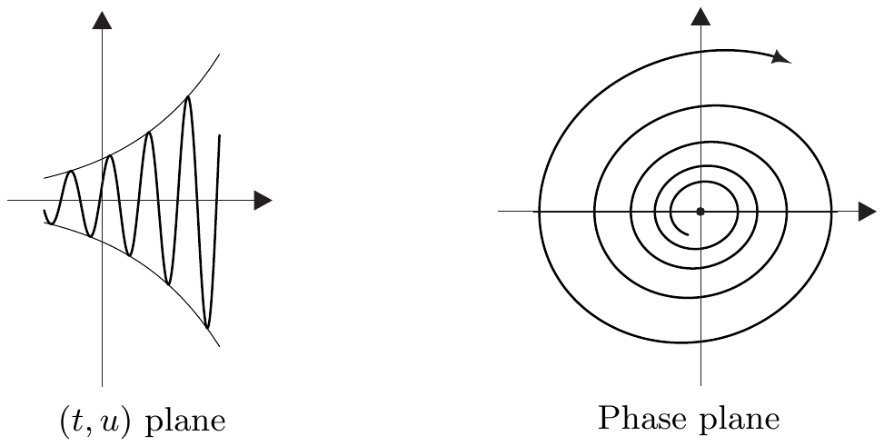
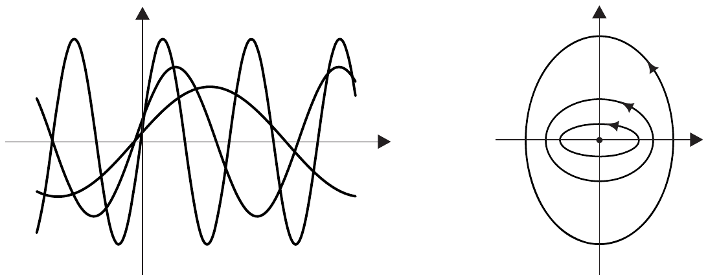
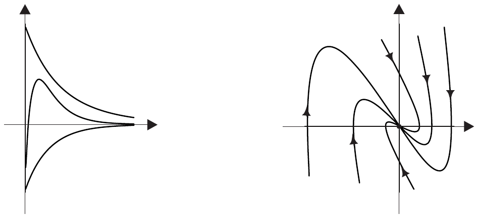
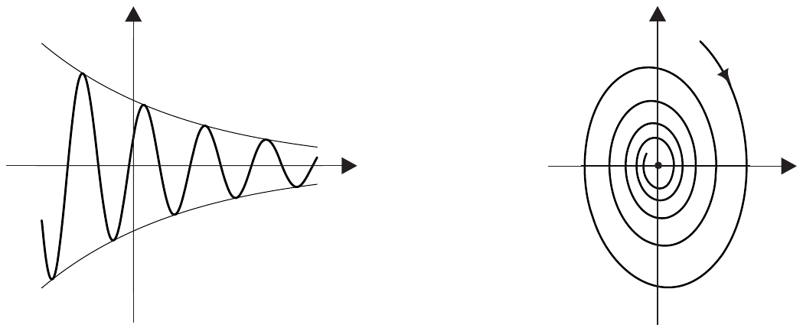
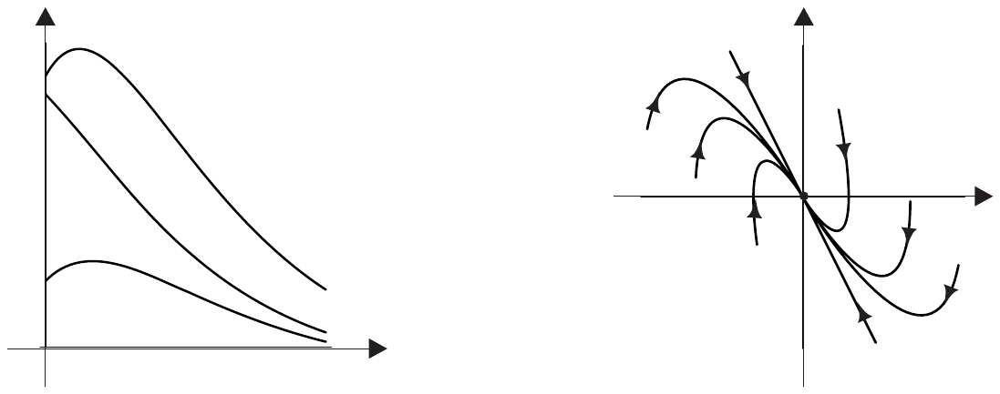

##### 常数变易公式

由命题 1.16(iii)，齐次方程 $ \dot{x} = Ax $ 的初值问题对每一个初值都有唯一解。为解非齐次方程 (1.8)，我们参照注 1.14(d)：若齐次方程 $ \dot{x} = Ax $ 的解空间 $ V $ 已知，则 (1.8) 的任一解事实上就给出全部解。

为构造这样一个**特解**，设 $ x \in C^{1}(\mathbb{R}, E) $ 解 (1.8)，且

\[ T \in C^{1}(\mathbb{R}, \mathcal{L}(E)) \quad \text{使得 } T(t) \in \mathcal{L}_{\mathrm{aut}}(E) \tag{1.11} \]

对 $ t \in \mathbb{R} $。进一步定义

\[ y(t) := T^{-1}(t)x(t) , \qquad \text{其中 } T^{-1}(t) := [T(t)]^{-1} \text{ 且 } t \in \mathbb{R} . \]

选择“变换” $ T $ 的自由度可用来寻找 $ y $ 的“尽可能简单”的微分方程。首先，乘积法则\footnote{容易验证，定理 IV.1.6(ii) 中乘积法则的证明在当前这个更一般的情形下仍然成立。另见例 4.8(b)。}以及 $ x $ 解 (1.8) 给出

\[ \begin{aligned} \dot{y}(t) &= (T^{-1})^{\cdot}(t)x(t) + T^{-1}(t)\dot{x}(t) \\ &= (T^{-1})^{\cdot}(t)x(t) + T^{-1}(t)Ax(t) + T^{-1}(t)f(t) \\ &= (T^{-1})^{\cdot}(t)T(t)y(t) + T^{-1}(t)AT(t)y(t) + T^{-1}(t)f(t) . \end{aligned} \tag{1.12} \]

接着，对恒等式

\[ T^{-1}(t)T(t) = \mathrm{id}_{E} \quad \text{对 } t \in \mathbb{R} , \]

（利用乘积法则）求导，我们得到

\[ (T^{-1})^{\cdot}(t)T(t) + T^{-1}(t)\dot{T}(t) = 0 \quad \text{对 } t \in \mathbb{R} , \]

从而

\[ (T^{-1})^{\cdot}(t) = -T^{-1}(t)\dot{T}(t)T^{-1}(t) \quad \text{对 } t \in \mathbb{R} . \]

与 (1.12) 结合，它变成

\[ \dot{y}(t) = T^{-1}(t)\left[AT(t) - \dot{T}(t)\right]y(t) + T^{-1}(t)f(t) \quad \text{对 } t \in \mathbb{R} . \tag{1.13} \]

根据定理 1.11，$ t \mapsto T(t) := e^{tA} $ 满足 $ AT - \dot{T} = 0 $ 和 (1.11)。对 $ T $ 的这一选择，由 (1.13) 可得

\[ \dot{y}(t) = T^{-1}(t)f(t) \quad \text{对 } t \in \mathbb{R} . \]

因此

\[ y(t) = y(0) + \int_{0}^{t}e^{-\tau A}f(\tau)\,d\tau \quad \text{对 } t \in \mathbb{R} . \]

因为 $ y(0) = x(0) $，我们有

\[ x(t) = e^{tA}x(0) + \int_{0}^{t}e^{(t-\tau)A}f(\tau)\,d\tau \quad \text{对 } t \in \mathbb{R} . \tag{1.14} \]

现在我们可以容易地证明 $ (1.9)_{a} $ 的存在唯一性结果。

1.17 定理 对每个 $ a \in E $ 和 $ f \in C(\mathbb{R}, E) $，存在唯一解 $ u(\cdot\,;a) $ 满足

\[ \dot{x} = Ax + f(t) \quad \text{且} \quad x(0) = a \]

它由**常数变易公式**

\[ u(t;a) = e^{tA}a + \int_{0}^{t}e^{(t-\tau)A}f(\tau)\,d\tau \quad \text{对 } t \in \mathbb{R} . \tag{1.15} \]

给出。

证明 由命题 1.16(ii)，我们只需证明 (1.15) 解 $ (1.9)_{a} $。而这可由定理 1.11 与 VI.4.12 立即推出。■

1.18 注 为阐明“常数变易公式”这一名称，我们考虑最简单的情形，即 $ \mathbb{R} $ 值方程

\[ \dot{x} = ax + f(t) \quad \text{对 } t \in \mathbb{R} . \tag{1.16} \]

若 $ a \in \mathbb{R} $，齐次方程 $ \dot{x} = ax $ 有解 $ v(t) := e^{ta} $。因此齐次方程的**通解**由 $ cv $ 给出，其中 $ c \in \mathbb{R} $ 是常数。也就是说，$ \{cv \;;\; c \in \mathbb{R}\} $ 是齐次方程的解空间。

为指定 (1.16) 的一个特解，我们“变动常数”，即做试设 $ x(t) := c(t)v(t) $，其中 $ c $ 是待定函数。因为 $ x $ 必须满足方程 (1.16)，我们有

\[ \dot{c}v + c\dot{v} = acv + f , \]

从而，由 $ c\dot{v} = c(av) $，我们有 $ \dot{c} = f/v $。于是由积分即得 (1.14)。■

##### 行列式与特征值

接下来我们汇集线性代数中的一些重要结果。

1.19 注 (a) $ [a_{k}^{j}] \in \mathbb{K}^{m\times m} $ 的**行列式** $ \det[a_{k}^{j}] $ 通过符号公式定义

\[ \det[a_{k}^{j}] := \sum_{\sigma \in S_{m}}\operatorname{sign}(\sigma)a_{\sigma(1)}^{1} \cdots\cdots a_{\sigma(m)}^{m} \]

（见 [Gab96, Chapter A3]），其中 $ \operatorname{sign} $ 是习题 I.9.6 中的符号函数。\footnote{$ \operatorname{sign}(\sigma) $ 也称为置换 $ \sigma $ 的符号。}

(b) 设 $ E $ 是有限维巴拿赫空间。**行列式函数**

\[ \det : \mathcal{L}(E) \to \mathbb{K} \]

对 $ A \in \mathcal{L}(E) $ 可表示为 $ \det(A) := \det([A]_{\mathcal{E}}) $，其中 $ \mathcal{E} $ 是 $ E $ 的一个基。于是 $ \det $ 是良定义的，即不依赖于特定的基 $ \mathcal{E} $，且我们有

\[ \det(1_{E}) = 1 \quad \text{且} \quad \det(AB) = \det(A)\det(B) \quad \text{对 } A, B \in \mathcal{L}(E) , \tag{1.17} \]

且

\[ \det(A) \ne 0 \iff A \in \mathcal{L}_{\mathrm{aut}}(E) . \tag{1.18} \]

令 $ \lambda - A := \lambda 1_{E} - A $ 且 $ m := \dim(E) $，我们有

\[ \det(\lambda - A) = \sum_{k=0}^{m}(-1)^{k}\alpha_{m-k}\lambda^{m-k} \quad \text{对 } \lambda \in \mathbb{C} , \tag{1.19} \]

其中 $ \alpha_{k} \in \mathbb{C} $ 且

\[ \alpha_{m} = 1 , \quad \alpha_{m-1} = \operatorname{tr}(A) , \quad \alpha_{0} = \det(A) . \tag{1.20} \]

**特征多项式** (1.19) 的零点是 $ A $ 的**特征值**，而所有特征值之集就是 $ A $ 的**谱** $ \sigma(A) $。

数 $ \lambda \in \mathbb{K} $ 是 $ A $ 的特征值当且仅当**特征值方程**

\[ Ax = \lambda x \tag{1.21} \]

有非平凡解 $ x \in E \setminus \{0\} $，即若 $ \ker(\lambda - A) \ne \{0\} $。对\footnote{注意，若 $ E $ 是实巴拿赫空间，则 $ A $ 的谱也是 $ \mathbb{C} $ 的子集。若 $ \mathbb{K} = \mathbb{R} $ 且 $ \lambda $ 属于 $ \sigma(A)\setminus\mathbb{R} $，则方程 (1.21) 无意义。此时我们必须允许 $ E $ 与 $ A $ 的复化，从而使 $ \lambda $ 可以作为特征值方程的解（例如见 [Ama95, § 12]）。于是在每种情形下 $ \lambda \in \sigma(A) $ 的几何重数都有定义。} $ \lambda \in \sigma(A) \cap \mathbb{K} $，$ \lambda $ 的**几何重数**由 $ \dim(\ker(\lambda - A)) $ 给出，且每个 $ x \in \ker(\lambda - A)\setminus\{0\} $ 是 $ A $ 的以 $ \lambda $ 为**特征值**的**特征向量**。$ \lambda $ 作为特征多项式的零点出现的次数就是 $ \lambda $ 的**代数重数**。几何重数不大于代数重数。最后，若 $ \lambda $ 的代数重数为 1，从而 $ \lambda $ 是特征多项式的单零点，则 $ \lambda $ 是 $ A $ 的**单特征值**。若几何重数与代数重数相等，则 $ \lambda $ 是**半单的**。

每个 $ A \in \mathcal{L}(E) $ 恰有 $ m $ 个特征值 $ \lambda_{1},\ldots,\lambda_{m} $（若按（代数）重数计数）。$ A $ 的特征多项式的系数 $ \alpha_{k} $ 是 $ \lambda_{1},\ldots,\lambda_{m} $ 的初等对称函数。特别地，

\[ \operatorname{tr}(A) = \lambda_{1} + \cdots + \lambda_{m} \quad \text{且} \quad \det(A) = \lambda_{1}\cdots\cdots\lambda_{m} . \tag{1.22} \]

若 $ \mathcal{E} $ 是 $ E $ 的一个基，使得 $ [A]_{\mathcal{E}} $ 是（上）三角矩阵，

\[ [A]_{\mathcal{E}} = \begin{bmatrix} a_{1}^{1} & a_{2}^{1} & \cdots & a_{m}^{1} \\ & a_{2}^{2} & \cdots & a_{m}^{2} \\ & & \ddots & \vdots \\ 0 & & & a_{m}^{m} \end{bmatrix} , \tag{1.23} \]

即 $ a_{k}^{j} = 0 $（$ k < j $），则 $ A $ 的特征值连同其代数重数沿对角线出现。

证明 方阵行列式的性质 (1.17)–(1.20) 是线性代数中的标准结果，我们假定读者已了解。

若 $ \mathcal{F} $ 是 $ E $ 的另一个基，则存在可逆矩阵 $ T \in \mathbb{K}^{m\times m} $ 使得

\[ [A]_{\mathcal{F}} = T[A]_{\mathcal{E}}T^{-1} \]

（例如 [Koe83, Chapter 9.3.2]）。因此由矩阵法则 (1.17) 可得 $ \det([A]_{\mathcal{F}}) = \det([A]_{\mathcal{E}}) $。这表明 $ \det(A) $ 对 $ A \in \mathcal{L}(E) $ 是良定义的。现在显然 (1.17)–(1.20) 对 $ A \in \mathcal{L}(E) $ 成立。

$ A $ 的特征值的存在性，以及 $ A $ 按代数重数计数时恰有 $ m $ 个特征值的断言，都由代数基本定理（见例 III.3.9(b)）推出。■

(c) 设 $ p \in K[X] $ 是域 $ K $ 上的 $ n \ge 1 $ 次多项式。若存在 $ k, \nu_{1},\ldots,\nu_{k} \in \mathbb{N}^{\times} $ 以及 $ a, \lambda_{1},\ldots,\lambda_{k} \in K $ 使得

\[ p = a\prod_{j=1}^{k}(X - \lambda_{j})^{\nu_{j}} , \]

则 $ p $ 在 $ K $ 中**分裂**。代数基本定理蕴含每个非常数多项式 $ p \in \mathbb{C}[X] $ 都在 $ \mathbb{C} $ 中分裂（见例 III.3.9(b)）。一般地，多项式未必分裂。例如，若 $ K $ 是有序域，则 $ X^{2} + 1 $ 在 $ K $ 中不分裂。

(d) 设 $ \lambda \in \mathbb{K} $ 且 $ p \in \mathbb{N}^{\times} $。则由

\[ J(\lambda,1) := [\lambda] \quad \text{且} \quad J(\lambda,p) := \begin{bmatrix} \lambda & 1 & & & 0 \\ & \ddots & \ddots & & \\ & & \ddots & \ddots & \\ & & & \ddots & 1 \\ 0 & & & & \lambda \end{bmatrix} \]

定义的 $ J(\lambda,p) \in \mathbb{K}^{p\times p} $（$ p \ge 2 $）称为 $ \lambda $ 的 $ p $ 阶**初等若尔当矩阵**。

对满足 $ \alpha \in \mathbb{R} $ 且 $ \omega > 0 $ 的 $ \mu = \alpha + i\omega \in \mathbb{C} $，令

\[ A_{2}(\mu) := \begin{bmatrix} \alpha & -\omega \\ \omega & \alpha \end{bmatrix} \in \mathbb{R}^{2\times 2} , \]

并令 $ 1_{2} $ 表示 $ \mathbb{R}^{2\times 2} $ 中的单位元。则我们把由

\[ \widetilde{J}(\mu,1) := A_{2}(\mu) \quad \text{且} \quad \widetilde{J}(\mu,p) := \begin{bmatrix} A_{2}(\mu) & 1_{2} & & & 0 \\ & \ddots & \ddots & & \\ & & \ddots & \ddots & \\ & & & \ddots & 1_{2} \\ 0 & & & & A_{2}(\mu) \end{bmatrix} \]

定义的 $ \widetilde{J}(\mu,p) \in \mathbb{R}^{2p\times 2p} $（$ p \ge 2 $）称为 $ \mu $ 的 $ 2p $ 阶**扩展若尔当矩阵**。

(e) 设 $ E $ 是 $ \mathbb{K} $ 上的有限维巴拿赫空间且 $ A \in \mathcal{L}(E) $。又设 $ A $ 的特征多项式在 $ \mathbb{K} $ 中分裂。在线性代数中可证，此时存在 $ E $ 的一个基 $ \mathcal{E} $ 以及 $ p_{1},\ldots,p_{r} \in \mathbb{N}^{\times} $ 使得

\[ [A]_{\mathcal{E}} = \begin{bmatrix} J(\lambda_{1},p_{1}) & & 0 \\ & \ddots & \\ 0 & & J(\lambda_{r},p_{r}) \end{bmatrix} \in \mathbb{K}^{n\times n} , \tag{1.24} \]

其中 $ \{\lambda_{1},\ldots,\lambda_{r}\} = \sigma(A) $。(1.24) 称为 $ A $ 的**若尔当标准形**。它在分块 $ J(\lambda_{j},p_{j}) $ 的排列顺序意义上唯一。基 $ \mathcal{E} $ 称为 $ E $ 关于 $ A $ 的**若尔当基**。若 $ A $ 只有半单特征值，则 $ r = \dim(E) $ 且 $ p_{j} = 1 $（$ j = 1,\ldots,r $）。这样的 $ A $ 称为**可对角化的**。

(f) 矩阵

\[ A = \begin{bmatrix} 0 & 1 & 0 \\ -1 & 0 & 0 \\ 0 & 0 & 1 \end{bmatrix} \in \mathbb{R}^{3\times 3} \]

的特征多项式为

\[ p = X^{3} - X^{2} + X - 1 = (X - 1)(X^{2} + 1) . \]

因此 $ p $ 在 $ \mathbb{R} $ 中不分裂，且 $ \sigma(A) = \{1, i, -i\} $。

此时 $ A $ 不能化为 (1.24) 的形式。但它可以化为扩展若尔当标准形。

(g) 设 $ E $ 是有限维实巴拿赫空间，且 $ A \in \mathcal{L}(E) $ 的特征多项式 $ p $ 在 $ \mathbb{R} $ 中不分裂。则 $ A $ 有一个非实特征值 $ \mu $。因为特征多项式 $ p = \sum_{k=0}^{n}a_{k}X^{k} $ 只有实系数，由

\[ 0 = \bar{0} = \overline{p(\mu)} = \sum_{k=0}^{n}a_{k}\mu^{k} = \sum_{k=0}^{n}a_{k}\bar{\mu}^{k} = p(\bar{\mu}) \]

可得 $ \bar{\mu} $ 也是 $ A $ 的特征值。

现在设

\[ \sigma := \{\mu_{1},\bar{\mu}_{1},\ldots,\mu_{\ell},\bar{\mu}_{\ell}\} \subset \sigma(A) \quad \text{对 } \ell \ge 1 , \]

是 $ A $ 的全部非实特征值之集，其中，不失一般性，我们可设 $ \mu_{j} = \alpha_{j} + i\omega_{j} $，其中 $ \alpha_{j} \in \mathbb{R} $ 且 $ \omega_{j} > 0 $。若 $ A $ 还有实特征值，我们用 $ \lambda_{1},\ldots,\lambda_{k} $ 记它们。

则存在 $ E $ 的一个基 $ \mathcal{E} $ 以及 $ p_{1},\ldots,p_{r},q_{1},\ldots,q_{s} \in \mathbb{N}^{\times} $ 使得

\[ [A]_{\mathcal{E}} = \begin{bmatrix} J(\lambda_{1},p_{1}) & & & & & 0 \\ & \ddots & & & & \\ & & J(\lambda_{r},p_{r}) & & & \\ & & & \widetilde{J}(\mu_{1},q_{1}) & & \\ & & & & \ddots & \\ 0 & & & & & \widetilde{J}(\mu_{s},q_{s}) \end{bmatrix} \in \mathbb{R}^{n\times n} . \tag{1.25} \]

这里，$ \lambda_{j} \in \sigma(A)\setminus\sigma $（$ j = 1,\ldots,r $）且 $ \mu_{k} \in \sigma $（$ k = 1,\ldots,s $）。我们把 (1.25) 称为 $ A $ 的**扩展若尔当标准形**。它在各组成矩阵的排列顺序意义上唯一。（见 [Gab96, Chapter A5]。）■

##### 基本解矩阵

设 $ E $ 是 $ \mathbb{K} $ 上的 $ n $ 维向量空间且 $ A \in \mathcal{L}(E) $。又用 $ V \subset C^{1}(\mathbb{R}, E) $ 表示齐次线性微分方程 $ \dot{x} = Ax $ 的解空间。由命题 1.16(iv)，$ V $ 与 $ E $ 同构，特别地有相同维数。我们把 $ V $ 的每个基称为 $ \dot{x} = Ax $ 的**基本解组**。

1.20 例 (a) 令

\[ A := \begin{bmatrix} a & b \\ 0 & c \end{bmatrix} \in \mathbb{K}^{2\times 2} . \]

为求 $ \dot{x} = Ax $ 的一个基本解组，我们先解初值问题

\[ \begin{aligned} \dot{x}^{1} &= ax^{1} + bx^{2} , & x^{1}(0) &= 1 , \\ \dot{x}^{2} &= cx^{2} , & x^{2}(0) &= 0 . \end{aligned} \tag{1.26} \]

由应用 IV.3.9(b) 可得 $ x^{2} = 0 $ 且 $ x^{1}(t) = e^{at} $（$ t \in \mathbb{R} $）。因此 $ x_{1} := (t \mapsto (e^{at},0)) $ 是 (1.26) 的解。我们通过解

\[ \begin{aligned} \dot{x}^{1} &= ax^{1} + bx^{2} , & x^{1}(0) &= 0 , \\ \dot{x}^{2} &= cx^{2} , & x^{2}(0) &= 1 . \end{aligned} \]

得到与 $ x_{1} $ 线性无关的第二个解 $ x_{2} $。此时我们有 $ x_{2}^{2}(t) = e^{ct} $（$ t \in \mathbb{R} $），而常数变易公式给出

\[ \begin{aligned} x_{2}^{1}(t) &= \int_{0}^{t}e^{a(t-\tau)}be^{c\tau}\,d\tau = be^{at}\int_{0}^{t}e^{\tau(c-a)}\,d\tau \\ &= \begin{cases} b(e^{ct} - e^{at})/(c - a) , & a \ne c , \\ bte^{ct} , & a = c . \end{cases} \end{aligned} \]

因此

\[ x_{1}(t) = (e^{at},0) , \quad x_{2}(t) = \begin{cases} \left( b(e^{ct} - e^{at})/(c - a), e^{ct} \right) , & a \ne c , \\ (bte^{at}, e^{at}) , & a = c , \end{cases} \]

（其中 $ t \in \mathbb{R} $）是 $ \dot{x} = Ax $ 的一个基本解组。

(b) 设 $ \omega > 0 $ 且

\[ A := \begin{bmatrix} 0 & -\omega \\ \omega & 0 \end{bmatrix} \in \mathbb{K}^{2\times 2} . \]

由

\[ \dot{x}^{1} = -\omega x^{2} \quad \text{且} \quad \dot{x}^{2} = \omega x^{1} \]

可得 $ \ddot{x}^{j} + \omega^{2}x^{j} = 0 $（$ j = 0,1 $）。习题 IV.3.2(a) 表明

\[ x_{1}(t) = (\cos(\omega t),\sin(\omega t)) \quad \text{且} \quad x_{2}(t) = (-\sin(\omega t),\cos(\omega t)) \quad \text{对 } t \in \mathbb{R} , \]

是 $ \dot{x} = Ax $ 的一个基本解组。■

若 $ A \in \mathbb{K}^{n\times n} $ 且 $ \{x_{1},\ldots,x_{n}\} $ 是 $ \dot{x} = Ax $ 的一个基本解组，则我们把映射

\[ X : \mathbb{R} \to \mathbb{K}^{n\times n} , \quad t \mapsto [x_{1}(t),\ldots,x_{n}(t)] = \begin{bmatrix} x_{1}^{1}(t) & \cdots & x_{n}^{1}(t) \\ \vdots & & \vdots \\ x_{1}^{n}(t) & \cdots & x_{n}^{n}(t) \end{bmatrix} \]

称为 $ \dot{x} = Ax $ 的**基本解矩阵**。若 $ X(0) = 1_{n} $，则我们把 $ X $ 称为**主基本解矩阵**。

1.21 注 设 $ A \in \mathbb{K}^{n\times n} $。

(a) 映射

\[ \mathbb{K}^{n\times n} \to \mathbb{K}^{n\times n} , \quad X \mapsto AX \]

是线性的。因此，除 $ \mathbb{K}^{n} $ 中的线性微分方程 $ \dot{x} = Ax $ 之外，我们还可考虑 $ \mathbb{K}^{n\times n} $ 中的线性微分方程 $ \dot{X} = AX $，它可由 $ \dot{x} = Ax $ 的任一基本解矩阵来解。

(b) 设 $ X $ 是 $ \dot{x} = Ax $ 的一个基本解矩阵且 $ t \in \mathbb{R} $。则

(i) $ X(t) \in \mathcal{L}_{\mathrm{aut}}(\mathbb{K}^{n}) $；

(ii) $ X(t) = e^{tA}X(0) $。

证明 (i) 是命题 1.16(v) 的推论。(ii) 由 (a)、定理 1.11 与命题 1.16(iii) 推出。■

(c) 映射 $ t \mapsto e^{tA} $ 是 $ \dot{x} = Ax $ 的唯一主基本解矩阵。

证明 这由 (b) 推出。■

(d) 对 $ s, t \in \mathbb{R} $，我们有

\[ e^{(t-s)A} = X(t)X^{-1}(s) . \]

证明 这也由 (b) 推出。■

(e) 利用若尔当标准形和例 1.13(b)–(e)，我们可以计算 $ e^{tA} $。我们就 $ n = 2 $ 的情形加以演示。

矩阵

\[ A := \begin{bmatrix} a & b \\ c & d \end{bmatrix} \in \mathbb{R}^{2\times 2} \]

的特征多项式给出 $ \det(\lambda - A) = \lambda^{2} - \lambda(a + d) + ad - bc $，且其零点为

\[ \lambda_{1,2} = \left( a + d \pm \sqrt{D} \right)/2 , \quad \text{其中} \quad D := (a - d)^{2} + 4bc . \]

**情形 1：** $ \mathbb{K} = \mathbb{C} $，$ D < 0 $。此时 $ A $ 有两个单的、互为共轭的复特征值 $ \lambda := \lambda_{1} $ 和 $ \bar{\lambda} = \lambda_{2} $。根据注 1.19(e)，存在 $ \mathbb{C}^{2} $ 的一个基 $ \mathcal{B} $ 使得 $ [A]_{\mathcal{B}} = \mathrm{diag}[\lambda,\bar{\lambda}] $，且由例 1.13(e) 可得

\[ e^{t[A]_{\mathcal{B}}} = \mathrm{diag}[e^{\lambda t}, e^{\bar{\lambda} t}] \quad \text{对 } t \in \mathbb{R} . \]

用 $ T \in \mathcal{L}_{\mathrm{aut}}(\mathbb{C}^{2}) $ 表示从标准基到 $ \mathcal{B} $ 的基变换。则利用定理 1.9，我们有

\[ [A]_{\mathcal{B}} = [TAT^{-1}] = [T]A[T]^{-1} . \]

因此，由习题 11，我们得到

\[ e^{t[A]_{\mathcal{B}}} = [T]e^{tA}[T]^{-1} , \]

并求得

\[ e^{tA} = [T]^{-1}\mathrm{diag}[e^{\lambda t}, e^{\bar{\lambda} t}][T] \quad \text{对 } t \in \mathbb{R} . \]

**情形 2：** $ \mathbb{K} = \mathbb{C} $ 或 $ \mathbb{K} = \mathbb{R} $，$ D > 0 $。则 $ A $ 有两个单的实特征值 $ \lambda_{1} $ 和 $ \lambda_{2} $，同情形 1 一样可得

\[ e^{tA} = [T]^{-1}\mathrm{diag}[e^{\lambda_{1}t}, e^{\lambda_{2}t}][T] \quad \text{对 } t \in \mathbb{R} . \]

**情形 3：** $ \mathbb{K} = \mathbb{C} $ 或 $ \mathbb{K} = \mathbb{R} $，$ D = 0 $。此时 $ A $ 有代数重数为 2 的特征值 $ \lambda := (a + d)/2 $。因此，根据注 1.19(e)，存在 $ \mathbb{K}^{2} $ 的一个基 $ \mathcal{B} $ 使得

\[ [A]_{\mathcal{B}} = \begin{bmatrix} \lambda & 1 \\ 0 & \lambda \end{bmatrix} . \]

因为矩阵

\[ \begin{bmatrix} \lambda & 0 \\ 0 & \lambda \end{bmatrix} \quad \text{且} \quad \begin{bmatrix} 0 & 1 \\ 0 & 0 \end{bmatrix} \]

可交换，由习题 11 和例 1.13(e) 可得

\[ e^{t[A]_{\mathcal{B}}} = e^{\lambda t}\exp\left( t\begin{bmatrix} 0 & 1 \\ 0 & 0 \end{bmatrix} \right) = e^{\lambda t}\left( 1_{2} + t\begin{bmatrix} 0 & 1 \\ 0 & 0 \end{bmatrix} \right) = e^{\lambda t}\begin{bmatrix} 1 & t \\ 0 & 1 \end{bmatrix} . \]

于是我们得到

\[ e^{tA} = e^{\lambda t}[T]^{-1}\begin{bmatrix} 1 & t \\ 0 & 1 \end{bmatrix}[T] \quad \text{对 } t \in \mathbb{R} . \]

**情形 4：** $ \mathbb{K} = \mathbb{R} $，$ D < 0 $。$ A $ 有两个互为共轭的复特征值 $ \lambda := \alpha + i\omega $ 和 $ \bar{\lambda} $，其中 $ \alpha := (a + d)/2 $ 且 $ \omega := \sqrt{-D}/2 $。由注 1.19(g)，存在 $ \mathbb{R}^{2} $ 的一个基 $ \mathcal{B} $ 使得

\[ [A]_{\mathcal{B}} = \begin{bmatrix} \alpha & -\omega \\ \omega & \alpha \end{bmatrix} . \]

矩阵

\[ \begin{bmatrix} \alpha & 0 \\ 0 & \alpha \end{bmatrix} \quad \text{且} \quad \begin{bmatrix} 0 & -\omega \\ \omega & 0 \end{bmatrix} \]

可交换。于是由例 1.13(f) 我们有

\[ \exp\left( t\begin{bmatrix} \alpha & -\omega \\ \omega & \alpha \end{bmatrix} \right) = e^{t\alpha}\exp\left( t\omega\begin{bmatrix} 0 & -1 \\ 1 & 0 \end{bmatrix} \right) = e^{t\alpha}\begin{bmatrix} \cos(\omega t) & -\sin(\omega t) \\ \sin(\omega t) & \cos(\omega t) \end{bmatrix} . \]

由此我们推出

\[ e^{tA} = e^{\alpha t}[T]^{-1}\begin{bmatrix} \cos(\omega t) & -\sin(\omega t) \\ \sin(\omega t) & \cos(\omega t) \end{bmatrix}[T] \quad \text{对 } t \in \mathbb{R} , \]

其中 $ T $ 是从标准基到 $ \mathcal{B} $ 的基变换（见例 1.13(f)）。■

##### 二阶线性微分方程

迄今为止，我们只考虑了一阶线性微分方程，其中待求函数与其导数之间是线性关系。然而许多应用需要高阶微分方程。二阶的情形经常出现，我们现在就集中考虑这种情形。\footnote{对更高阶的微分方程，可查阅常微分方程的文献，例如 [Ama95]。}

下面，设

• $ b, c \in \mathbb{R} $ 且 $ g \in C(\mathbb{R}, \mathbb{K}) $。

对由下式给出的**常系数二阶线性微分方程**

\[ \ddot{u} + b\dot{u} + cu = g(t) \quad \text{对 } t \in \mathbb{R} , \tag{1.27} \]

我们说 $ u \in C^{2}(\mathbb{R}, \mathbb{K}) $ 是一个**解**，若它逐点满足 (1.27)。下面的结果表明，(1.27) 等价于 $ (u,\dot{u}) $ 平面（称为**相平面**）中形如 (1.8) 的一阶微分方程。

1.22 引理

(i) 若 $ u \in C^{2}(\mathbb{R}, \mathbb{K}) $ 解 (1.27)，则 $ (u,\dot{u}) \in C^{1}(\mathbb{R}, \mathbb{K}^{2}) $ 解方程

\[ \dot{x} = Ax + f(t) \tag{1.28} \]

（在 $ \mathbb{K}^{2} $ 中），其中

\[ A := \begin{bmatrix} 0 & 1 \\ -c & -b \end{bmatrix} \quad \text{且} \quad f := (0,g) . \tag{1.29} \]

(ii) 若 $ x \in C^{1}(\mathbb{R}, \mathbb{K}^{2}) $ 解 (1.28)，则 $ u := \mathrm{pr}_{1}x $ 解 (1.27)。

证明 (i) 令 $ x := (u,\dot{u}) $，由 (1.27) 得

\[ \dot{x} = \begin{bmatrix} \dot{u} \\ \ddot{u} \end{bmatrix} = \begin{bmatrix} \dot{u} \\ -cu - b\dot{u} + g(t) \end{bmatrix} = Ax + f(t) . \]

(ii) 设 $ x = (u,v) \in C^{1}(\mathbb{R}, \mathbb{K}^{2}) $ 解 (1.28)。则

\[ \dot{u} = v , \quad \dot{v} = -cu - bv + g(t) . \tag{1.30} \]

第一个方程表明 $ u $ 属于 $ C^{2}(\mathbb{R}, \mathbb{K}) $，而这两个方程合在一起蕴含 $ u $ 解微分方程 (1.27)。■

引理 1.22 使我们可以把关于一阶微分方程的知识应用到 (1.27) 上。我们需要 $ A $ 的特征值。由 $ \det(\lambda - A) = \lambda(\lambda + b) + c $，我们发现 $ A $ 的特征值 $ \lambda_{1} $ 和 $ \lambda_{2} $ 是多项式 $ X^{2} + bX + c $（称为 $ \ddot{u} + b\dot{u} + cu = 0 $ 的**特征多项式**）的零点，且我们得到

\[ \lambda_{1,2} = \left( -b \pm \sqrt{D} \right)/2 , \quad \text{其中} \quad D = b^{2} - 4c . \]

现在我们考虑初值问题

\[ \ddot{u} + b\dot{u} + cu = g(t) \text{ 对 } t \in \mathbb{R} , \quad \text{满足} \quad u(0) = a_{1} , \quad \dot{u}(0) = a_{2} , \tag{1.31} \]

其中 $ (a_{1},a_{2}) \in \mathbb{K}^{2} $。由以上，我们可以容易地证明一个基本定理。

1.23 定理

(i) 对每个 $ (a_{1},a_{2}) \in \mathbb{K}^{2} $，初值问题 (1.31) 存在唯一解 $ u \in C^{2}(\mathbb{R}, \mathbb{K}) $。

(ii) $ \ddot{u} + b\dot{u} + cu = 0 $ 的解集通过

\[ \begin{cases} \{e^{\lambda_{1}t}, e^{\lambda_{2}t}\} & \text{若 } D > 0 \text{ 或 } (D < 0 \text{ 且 } \mathbb{K} = \mathbb{C}) , \\ \{e^{\alpha t}, te^{\alpha t}\} & \text{若 } D = 0 , \\ \{e^{\alpha t}\cos(\omega t), e^{\alpha t}\sin(\omega t)\} & \text{若 } D < 0 \text{ 且 } \mathbb{K} = \mathbb{R} , \end{cases} \]

张成 $ C^{2}(\mathbb{R}, \mathbb{K}) $ 的二维向量子空间 $ V $，其中 $ \alpha := -b/2 $ 且 $ \omega := \sqrt{-D}/2 $。

(iii) (1.27) 的解集构成 $ C^{2}(\mathbb{R}, \mathbb{K}) $ 的二维仿射子空间 $ v + V $，其中 $ v $ 是 (1.27) 的任一解。

(iv) 设方程 $ \ddot{u} + b\dot{u} + cu = 0 $ 和 $ w := u_{1}\dot{u}_{2} - \dot{u}_{1}u_{2} $ 有线性无关的解 $ u_{1}, u_{2} \in V $。则

\[ v(t) := \int_{0}^{t}\frac{u_{1}(\tau)g(\tau)}{w(\tau)}\,d\tau\,u_{2}(t) - \int_{0}^{t}\frac{u_{2}(\tau)g(\tau)}{w(\tau)}\,d\tau\,u_{1}(t) \quad \text{对 } t \in \mathbb{R} \]

解 (1.27)。

证明 (i) 这由引理 1.22 与定理 1.17 立即可得。

(ii) 和 (iii) 这些由引理 1.22、命题 1.16(iv) 以及注 1.14(d) 和 1.21(e) 蕴含。

(iv) 设 $ A $ 和 $ f $ 如 (1.29) 所示。则由引理 1.22 和注 1.21(a)，

\[ X := \begin{bmatrix} u_{1} & u_{2} \\ \dot{u}_{1} & \dot{u}_{2} \end{bmatrix} \]

是 $ \dot{x} = Ax $ 的一个基本解矩阵。因为

\[ e^{(t-\tau)A} = X(t)X^{-1}(\tau) \quad \text{对 } t, \tau \in \mathbb{R} \]

（见注 1.21(d)），由定理 1.17 的常数变易公式可得

\[ y(t) = X(t)\int_{0}^{t}X^{-1}(\tau)f(\tau)\,d\tau \quad \text{对 } t \in \mathbb{R} , \tag{1.32} \]

解 $ \dot{x} = Ax + f(t) $。因为 $ \det(X) = w $，我们有

\[ X^{-1} = \frac{1}{w}\begin{bmatrix} \dot{u}_{2} & -u_{2} \\ -\dot{u}_{1} & u_{1} \end{bmatrix} , \]

其中函数 $ w $ 无零点，这是由命题 1.16(v) 得到的。因此我们断定 $ X^{-1}f = (-u_{2}g/w, u_{1}g/w) $。于是由引理 1.22 和 (1.32) 即得本定理。■

1.24 例 (a) 方程

\[ \ddot{u} - 2\dot{u} + 10u = 0 \]

的特征多项式 $ X^{2} - 2X + 10 $ 有零点 $ 1 \pm 3i $。因此 $ \{e^{t}\cos(3t), e^{t}\sin(3t)\} $ 是一个基本解组。\footnote{与一阶线性微分方程一样，我们把解空间的任一基称为基本解组。}因此通解为

\[ u(t) = e^{t}\left( a_{1}\cos(3t) + a_{2}\sin(3t) \right) \quad \text{对 } t \in \mathbb{R} , \]

其中 $ a_{1}, a_{2} \in \mathbb{R} $。

(b) 为解初值问题

\[ \ddot{u} - 2\dot{u} + u = e^{t} , \quad u(0) = 0 , \quad \dot{u}(0) = 1 , \tag{1.33} \]

我们先求齐次方程 $ \ddot{u} - 2\dot{u} + u = 0 $ 的一个基本解组。相应的特征多项式为

\[ X^{2} - 2X + 1 = (X - 1)^{2} . \]

则由定理 1.23(iii)，$ u_{1}(t) := e^{t} $ 和 $ u_{1}(t) := te^{t} $（$ t \in \mathbb{R} $）构成一个基本解组。因为

\[ w(\tau) = u_{1}(\tau)\dot{u}_{2}(\tau) - \dot{u}_{1}(\tau)u_{2}(\tau) = e^{2\tau} \quad \text{对 } \tau \in \mathbb{R} , \]

方程

\[ v(t) = \int_{0}^{t}\frac{u_{1}g}{w}\,d\tau\,u_{2}(t) - \int_{0}^{t}\frac{u_{2}g}{w}\,d\tau\,u_{1}(t) = \frac{t^{2}}{2}e^{t} \quad \text{对 } t \in \mathbb{R} , \]

是 (1.33) 的一个特解。因此通解为

\[ x(t) = a_{1}e^{t} + a_{2}te^{t} + \frac{t^{2}}{2}e^{t} \quad \text{对 } t \in \mathbb{R} \text{ 且 } a_{1}, a_{2} \in \mathbb{R} . \]

因为 $ x(0) = a_{1} $ 且 $ \dot{x}(0) = a_{1} + a_{2} $，我们最终求得 (1.33) 的唯一解为

\[ u(t) = (t + t^{2}/2)e^{t} \quad \text{对 } t \in \mathbb{R} . \]

(c) **谐波振子**（或**无阻尼振子**）的微分方程为

\[ \ddot{u} + \omega_{0}^{2}u = 0 , \]

其中 $ \omega_{0} > 0 $ 是（角）**频率**。由定理 1.23，通解具有形式

\[ u(t) = a_{1}\cos(\omega_{0}t) + a_{2}\sin(\omega_{0}t) \quad \text{对 } t \in \mathbb{R} , \]

其中 $ a_{1}, a_{2} \in \mathbb{R} $。显然，所有解都以 $ 2\pi/\omega_{0} $ 为周期，且它们绕相平面的中心旋转。

(d) **阻尼振子**的微分方程为

\[ \ddot{u} + 2\alpha\dot{u} + \omega_{0}^{2}u = 0 . \]

这里，$ \alpha > 0 $ 是**阻尼常数**，$ \omega_{0} > 0 $ 是无阻尼振子的频率。特征多项式的零点为

\[ \lambda_{1,2} = -\alpha \pm \sqrt{\alpha^{2} - \omega_{0}^{2}} . \]

(i) （强阻尼：$ \alpha > \omega_{0} $）此时有两个负特征值 $ \lambda_{1} < \lambda_{2} < 0 $，通解为

\[ u(t) = a_{1}e^{\lambda_{1}t} + a_{2}e^{\lambda_{2}t} \quad \text{对 } t \in \mathbb{R} \text{ 且 } a_{1}, a_{2} \in \mathbb{R} . \]

因此所有解都指数式衰减。在相平面中，原点处有一个“稳定结点”。

(ii) （弱阻尼：$ \alpha < \omega_{0} $）此时特征多项式有两个互为共轭的复特征值 $ \lambda_{1,2} = -\alpha \pm i\omega $，其中 $ \omega := \sqrt{\omega_{0}^{2} - \alpha^{2}} $。因此根据定理 1.22，通解为

\[ u(t) = e^{-\alpha t}\left( a_{1}\cos(\omega t) + a_{2}\sin(\omega t) \right) \quad \text{对 } t \in \mathbb{R} \text{ 且 } a_{1}, a_{2} \in \mathbb{R} . \]

此时解也指数式阻尼衰减，且相平面的原点是“稳定涡旋”。

(iii) （临界阻尼：$ \alpha = \omega_{0} $）这里，$ \lambda = -\alpha $ 是特征多项式的代数重数为 2 的特征值。因此通解为

\[ u(t) = e^{-\alpha t}(a_{1} + a_{2}t) \quad \text{对 } t \in \mathbb{R} \text{ 且 } a_{1}, a_{2} \in \mathbb{R} . \]

相平面的原点现在称为“稳定虚结点”。■

