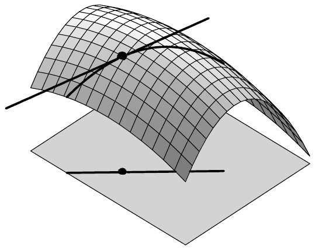
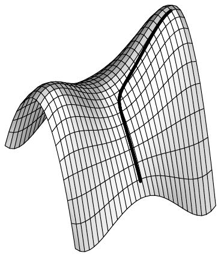
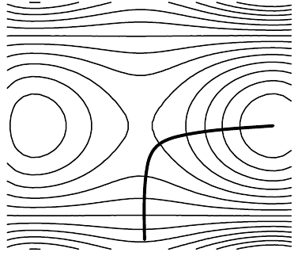

## 2 可微性

在本节中，我们解释函数\footnote{记号 $ f : X \subset E \to F $ 是 $ X \subset E $ 与 $ f : X \to F $ 的简写。} $ f : X \subset E \to F $ 的“可微性”“导数”与“方向导数”等核心概念。这里 $ E $ 与 $ F $ 是巴拿赫空间，$ X $ 是 $ E $ 的子集。此后，我们将通过对空间 $ E $ 与 $ F $ 作具体假设来展示这些概念的威力与灵活性。

若 $ E = \mathbb{R}^n $，我们解释偏导数的概念，并研究可微性与偏导数的存在性之间的联系。

在应用中，$ E = \mathbb{R}^n $ 且 $ F = \mathbb{R} $ 的情形尤为重要。这里我们引入梯度的概念，并借助里斯表示定理阐明导数与梯度之间的关系。

在 $ E = F = \mathbb{C} $ 的情形，我们导出重要的柯西–黎曼方程。它们把 $ f = u + iv : \mathbb{C} \to \mathbb{C} $ 的复可微性与 $ (u, v) : \mathbb{R}^2 \to \mathbb{R}^2 $ 的可微性联系起来。

最后，我们证明这些新概念与第 IV.1 节中业已确立的 $ E = \mathbb{K} $ 情形相一致。

在下文中，设

• $ E = (E, \|\cdot\|) $ 与 $ F = (F, \|\cdot\|) $ 是域 $ \mathbb{K} $ 上的巴拿赫空间；$ X $ 是 $ E $ 的开子集。

##### 定义

函数 $ f : X \to F $ 在 $ x_0 \in X $ 处**可微**，如果存在 $ A_{x_0} \in \mathcal{L}(E, F) $ 使得

\[ \lim_{x \to x_0} \frac{f(x) - f(x_0) - A_{x_0}(x - x_0)}{\|x - x_0\|} = 0 . \tag{2.1} \]

下一个定理重新表述了这个定义，并给出可微函数的最初几条性质。

2.1 命题 设 $ f : X \to F $ 且 $ x_0 \in X $。

(i) 下列陈述等价：

(α) $ f $ 在 $ x_0 $ 处可微。

(β) 存在 $ A_{x_0} \in \mathcal{L}(E, F) $ 与 $ r_{x_0} : X \to F $，其中 $ r_{x_0} $ 在 $ x_0 $ 处连续且满足 $ r_{x_0}(x_0) = 0 $，使得

\[ f(x) = f(x_0) + A_{x_0}(x - x_0) + r_{x_0}(x) \|x - x_0\| \quad \text{对 } x \in X . \]

(γ) 存在 $ A_{x_0} \in \mathcal{L}(E, F) $ 使得

\[ f(x) = f(x_0) + A_{x_0}(x - x_0) + o(\|x - x_0\|) \quad (x \to x_0) . \tag{2.2} \]

(ii) 若 $ f $ 在 $ x_0 $ 处可微，则 $ f $ 在 $ x_0 $ 处连续。

(iii) 设 $ f $ 在 $ x_0 $ 处可微。则来自 (2.1) 的线性算子 $ A_{x_0} \in \mathcal{L}(E, F) $ 被唯一确定。

证明 (i) 证明与定理 IV.1.1 的证明相同，留给你来完成。

(ii) 若 $ f $ 在 $ x_0 $ 处可微，则它在 $ x_0 $ 处的连续性直接由 (i$ \beta $) 得出。

(iii) 设 $ B \in \mathcal{L}(E, F) $，且

\[ f(x) = f(x_0) + B(x - x_0) + o(\|x - x_0\|) \quad (x \to x_0) . \tag{2.3} \]

从 (2.2) 中减去 (2.3)，并把结果除以 $ \|x - x_0\| $，我们得到

\[ \lim_{x \to x_0} (A_{x_0} - B)\left( \frac{x - x_0}{\|x - x_0\|} \right) = 0 . \]

设 $ y \in E $ 满足 $ \|y\| = 1 $，且对 $ n \in \mathbb{N}^{\times} $ 令 $ x_n := x_0 + y/n $。则因为 $ \lim x_n = x_0 $ 且 $ (x_n - x_0)/\|x_n - x_0\| = y $，我们得到

\[ (A_{x_0} - B)y = \lim_n (A_{x_0} - B)\left( \frac{x_n - x_0}{\|x_n - x_0\|} \right) = 0 . \]

由于这对每个 $ y \in \partial\mathbb{B}_E $ 都成立，由此得 $ A_{x_0} = B $。■

##### 导数

设 $ f : X \to F $ 在 $ x_0 \in X $ 处可微。则我们用 $ \partial f(x_0) $ 表示由命题 2.1 唯一确定的线性算子 $ A_{x_0} \in \mathcal{L}(E, F) $。它称为 $ f $ 在 $ x_0 $ 处的**导数**，也写作

\[ Df(x_0) \quad \text{或} \quad f'(x_0) . \]

因此 $ \partial f(x_0) \in \mathcal{L}(E, F) $，且

\[ \lim_{x \to x_0} \frac{f(x) - f(x_0) - \partial f(x_0)(x - x_0)}{\|x - x_0\|} = 0 . \]

若 $ f : X \to F $ 在每一点 $ x \in X $ 都可微，我们称 $ f $ **可微**，并称映射\footnote{为了清楚地区分在一点 $ x_0 $ 处的导数 $ \partial f(x_0) \in \mathcal{L}(E, F) $ 与导数 $ \partial f : X \to \mathcal{L}(E, F) $，我们也可以说导函数 $ \partial f : X \to \mathcal{L}(E, F) $。}

\[ \partial f : X \to \mathcal{L}(E, F) , \quad x \mapsto \partial f(x) \]

为 $ f $ 的**导数**。

当 $ \mathcal{L}(E, F) $ 是巴拿赫空间时，我们可以有意义地谈论导数的连续性。若 $ \partial f $ 连续，即 $ \partial f \in C(X, \mathcal{L}(E, F)) $，我们称 $ f $ **连续可微**。我们令

\[ C^1(X, F) := \{ f : X \to F ; f \text{ 是连续可微的} \} . \]

2.2 注 (a) 下列陈述等价：

(i) $ f : X \to F $ 在 $ x_0 \in X $ 处可微。

(ii) 存在 $ \partial f(x_0) \in \mathcal{L}(E, F) $ 使得

\[ f(x) = f(x_0) + \partial f(x_0)(x - x_0) + o(\|x - x_0\|) \quad (x \to x_0) . \]

(iii) 存在 $ \partial f(x_0) \in \mathcal{L}(E, F) $ 与 $ r_{x_0} : X \to F $，其中 $ r_{x_0} $ 在 $ x_0 $ 处连续且满足 $ r_{x_0}(x_0) = 0 $，使得

\[ f(x) = f(x_0) + \partial f(x_0)(x - x_0) + r_{x_0}(x) \|x - x_0\| \quad \text{对 } x \in X . \]

(b) 由 (a) 得，$ f $ 在 $ x_0 $ 处可微，当且仅当 $ f $ 在 $ x_0 $ 处被仿射映射

\[ g : E \to F , \quad x \mapsto f(x_0) + \partial f(x_0)(x - x_0) \]

逼近，使得误差比 $ x $ 趋于 $ x_0 $ 更快地趋于零，即

\[ \lim_{x \to x_0} \frac{\|f(x) - g(x)\|}{\|x - x_0\|} = 0 . \]

因此，映射 $ f $ 在 $ x_0 $ 处可微，当且仅当它在 $ x_0 $ 处近似线性（见推论 IV.1.3）。

(c) “可微性”与“导数”的概念不依赖于 $ E $ 与 $ F $ 中等价范数的选取。

证明 例如，这由注 II.3.13(d) 得出。■

(d) 有时我们不说“可微”，而说“全可微”或“弗雷歇可微”。

(e)（$ E = \mathbb{K} $ 的情形）在注 1.3(a) 中我们看到，映射 $ \mathcal{L}(\mathbb{K}, F) \to F $，$ A \mapsto A1 $ 是等距同构，借此我们在典范意义下把 $ \mathcal{L}(\mathbb{K}, F) $ 与 $ F $ 等同起来。这个等同表明，若 $ E = \mathbb{K} $，则可微性与导数的新定义与第 IV.1 节中的定义一致。

(f) $ C^1(X, F) \subset C(X, F) $，即每个连续可微函数也是连续的。■

2.3 例 (a) 对 $ A \in \mathcal{L}(E, F) $，函数 $ A = (x \mapsto Ax) $ 是连续可微的，且对 $ x \in E $ 有 $ \partial A(x) = A $。

证明 因为 $ Ax = Ax_0 + A(x - x_0) $，结论由注 2.2(a) 得出。■

(b) 设 $ y_0 \in F $。则常值映射 $ k_{y_0} : E \to F $，$ x \mapsto y_0 $ 是连续可微的，且 $ \partial k_{y_0} = 0 $。

证明 这是显然的，因为对 $ x, x_0 \in E $ 有 $ k_{y_0}(x) = k_{y_0}(x_0) $。■

(c) 设 $ H $ 是希尔伯特空间，定义 $ b : H \to \mathbb{K} $，$ x \mapsto \|x\|^2 $。则 $ b $ 是连续可微的，且

\[ \partial b(x) = 2 \operatorname{Re}(x|\cdot) \quad \text{对 } x \in H . \]

证明 对任意满足 $ x \ne x_0 $ 的 $ x, x_0 \in H $，我们有

\[ \|x\|^2 - \|x_0\|^2 = \|x - x_0 + x_0\|^2 - \|x_0\|^2 = \|x - x_0\|^2 + 2 \operatorname{Re}(x_0 | x - x_0) \]

从而

\[ \frac{b(x) - b(x_0) - 2 \operatorname{Re}(x_0 | x - x_0)}{\|x - x_0\|} = \|x - x_0\| . \]

这蕴含对 $ h \in H $ 有 $ \partial b(x_0)h = 2 \operatorname{Re}(x_0 | h) $。■

##### 方向导数

设 $ f : X \to F $，$ x_0 \in X $ 且 $ v \in E \backslash \{0\} $。因为 $ X $ 是开集，存在 $ \varepsilon > 0 $ 使得对 $ |t| < \varepsilon $ 有 $ x_0 + tv \in X $。因此函数

\[ (-\varepsilon, \varepsilon) \to F , \quad t \mapsto f(x_0 + tv) \]

是有定义的。当这个函数在点 $ 0 $ 处可微时，我们称它的导数为 $ f $ 在点 $ x_0 $ 处沿方向 $ v $ 的**方向导数**，并记作 $ D_v f(x_0) $。于是

\[ D_v f(x_0) = \lim_{t \to 0} \frac{f(x_0 + tv) - f(x_0)}{t} . \]

2.4 注 函数

\[ f_{v,x_0} : (-\varepsilon, \varepsilon) \to F , \quad t \mapsto f(x_0 + tv) \]

可看作 $ E \times F $ 中的一条“曲线”，它位于“$ f $ 的图像上”。则当 $ \|v\| = 1 $ 时，$ D_v f(x_0) $ 表示这条曲线在点 $ (x_0, f(x_0)) $ 处切线的斜率（见注 IV.1.4(a)）。■

下一个结果说的是，若 $ f $ 在 $ x_0 $ 处可微，则 $ f $ 在 $ x_0 $ 处沿每个方向都有方向导数。

2.5 命题 设 $ f : X \to F $ 在 $ x_0 \in X $ 处可微。则对每个 $ v \in E \backslash \{0\} $，$ D_v f(x_0) $ 存在，且 $ D_v f(x_0) = \partial f(x_0)v $。

证明 对 $ v \in E \backslash \{0\} $，由注 2.2(a) 得

\[ f(x_0 + tv) = f(x_0) + \partial f(x_0)(tv) + o(\|tv\|) = f(x_0) + t \partial f(x_0)v + o(|t|) \]

（当 $ t \to 0 $ 时）。定理现在由注 IV.3.1(c) 得出。■

2.6 注 命题 2.5 的逆命题不成立，也就是说，在每一方向都有方向导数的函数未必可微。

证明 我们考虑由下式定义的函数 $ f : \mathbb{R}^2 \to \mathbb{R} $：

\[ f(x,y) := \begin{cases} \frac{x^2 y}{x^2 + y^2} , & (x,y) \ne (0,0) , \\ 0 , & (x,y) = (0,0) . \end{cases} \]

对每个 $ v = (\xi, \eta) \in \mathbb{R}^2 \backslash \{(0,0)\} $，我们有

\[ f(tv) = \frac{t^3 \xi^2 \eta}{t^2(\xi^2 + \eta^2)} = t f(v) . \]

于是

\[ D_v f(0) = \lim_{t \to 0} f(tv)/t = f(v) . \]

若 $ f $ 在 $ 0 $ 处可微，则命题 2.5 将蕴含对每个 $ v \in \mathbb{R}^2 \backslash \{(0,0)\} $ 有 $ \partial f(0)v = D_v f(0) = f(v) $。因为 $ v \mapsto \partial f(0)v $ 是线性的，而 $ f $ 不是，这是不可能的。因此 $ f $ 在 $ 0 $ 处不可微。■

##### 偏导数

若 $ E = \mathbb{R}^n $，则出于实用与历史原因，沿坐标轴方向的方向导数尤为重要。为它们引入专门的记号是方便的。因此我们用 $ \partial_k $ 或 $ \partial/\partial x^k $ 表示沿标准基向量\footnote{偶尔我们也把 $ \partial/\partial x^k $ 写成 $ \partial_{x^k} $。} $ e_k $（$ k = 1, \ldots, n $）方向的方向导数。于是

\[ \partial_k f(x_0) := \frac{\partial f}{\partial x^k}(x_0) := D_{e_k} f(x_0) = \lim_{t \to 0} \frac{f(x_0 + te_k) - f(x_0)}{t} \quad \text{对 } 1 \le k \le n , \]

且 $ \partial_k f(x_0) $ 称为 $ f $ 在 $ x_0 $ 处关于 $ x^k $ 的**偏导数**。函数 $ f $ 称为在 $ x_0 $ 处偏可微的，如果所有 $ \partial_1 f(x_0), \ldots, \partial_n f(x_0) $ 都存在；函数称为**[连续]偏可微的**，如果它在 $ X $ 的每一点偏可微[如果 $ \partial_k f : X \to F $ 对 $ 1 \le k \le n $ 连续]。

2.7 注 (a) 当第 $ k $ 个偏导数在 $ x_0 \in X $ 处存在时，我们有

\[ \partial_k f(x_0) = \lim_{h \to 0} \frac{f(x_0^1, \ldots, x_0^{k-1}, x_0^k + h, x_0^{k+1}, \ldots, x_0^n) - f(x_0)}{h} \quad \text{对 } 1 \le k \le n . \]

因此 $ f $ 在 $ x_0 $ 处关于第 $ k $ 个坐标偏可微，当且仅当单实变量函数 $ t \mapsto f(x_0^1, \ldots, x_0^{k-1}, t, x_0^{k+1}, \ldots, x_0^n) $ 在 $ x_0^k $ 处可微。

(b) 若 $ x_0^k $ 是集合

\[ \{ \xi \in \mathbb{R} ; (x_0^1, \ldots, x_0^{k-1}, \xi, x_0^{k+1}, \ldots, x_0^n) \in X \} . \]

的聚点，则偏导数 $ \partial_k f(x_0) $ 可以定义。特别地，$ X $ 必须不是开集。

(c) 若 $ f $ 在 $ x_0 $ 处可微，则 $ f $ 在 $ x_0 $ 处偏可微。

证明 这是命题 2.5 的特殊情形。■

(d) 若 $ f $ 在 $ x_0 $ 处偏可微，并不能推出 $ f $ 在 $ x_0 $ 处可微。

证明 见注 2.6。■

(e) $ f $ 在 $ x_0 $ 处偏可微并不意味着它在该点连续。

证明 我们考虑 $ f : \mathbb{R}^2 \to \mathbb{R} $，其中

\[ f(x,y) := \begin{cases} \frac{xy}{(x^2 + y^2)^2} , & (x,y) \ne (0,0) , \\ 0 , & (x,y) = (0,0) . \end{cases} \]

则对一切 $ h \in \mathbb{R} $ 有 $ f(h,0) = f(0,h) = 0 $。因此 $ \partial_1 f(0,0) = \partial_2 f(0,0) = 0 $。于是 $ f $ 在 $ (0,0) $ 处偏可微。

因为对 $ n \in \mathbb{N}^{\times} $ 有 $ f(0,0) = 0 $ 与 $ f(1/n, 1/n) = n^2/4 $，我们看到 $ f $ 在 $ (0,0) $ 处不连续。■

(f) 为了清楚地区分“可微性”与“偏可微性”，我们有时也说 $ f $ **全可微**[在 $ x_0 $ 处]，如果 $ f $ 可微[在 $ x_0 $ 处]。■

接下来，我们寻求当 $ E = \mathbb{R}^n $ 或 $ F = \mathbb{R}^m $ 时 $ \partial f(x_0) $ 的具体表示。这些表示将使我们能够显式地计算偏导数。

2.8 定理

(i) 设 $ E = \mathbb{R}^n $ 且 $ f : X \to F $ 在 $ x_0 $ 处可微。则

\[ \partial f(x_0)h = \sum_{k=1}^{n} \partial_k f(x_0) h^k \quad \text{对 } h = (h^1, \ldots, h^n) \in \mathbb{R}^n . \]

(ii) 设 $ E $ 是巴拿赫空间且 $ f = (f^1, \ldots, f^m) : X \to \mathbb{K}^m $。则 $ f $ 在 $ x_0 $ 处可微，当且仅当所有坐标函数 $ f^j $（$ 1 \le j \le m $）都在 $ x_0 $ 处可微。此时

\[ \partial f(x_0) = (\partial f^1(x_0), \ldots, \partial f^m(x_0)) , \]

即向量被逐分量地求导。

证明 (i) 因为对 $ h = (h^1, \ldots, h^n) \in \mathbb{R}^n $ 有 $ h = \sum_k h^k e_k $，由 $ \partial f(x_0) $ 的线性性与命题 2.5 得

\[ \partial f(x_0)h = \sum_{k=1}^{n} h^k \partial f(x_0)e_k = \sum_{k=1}^{n} \partial_k f(x_0) h^k . \]

(ii) 对 $ A = (A^1, \ldots, A^m) \in \operatorname{Hom}(E, \mathbb{K}^m) $，我们有

\[ A \in \mathcal{L}(E, \mathbb{K}^m) \iff A^j \in \mathcal{L}(E, \mathbb{K}) \quad \text{对 } 1 \le j \le m , \]

（见习题 1.1）。现在由命题 II.3.14 与命题 2.1(iii) 得

\[ \lim_{x \to x_0} \frac{f(x) - f(x_0) - \partial f(x_0)(x - x_0)}{\|x - x_0\|} = 0 \]

等价于

\[ \lim_{x \to x_0} \frac{f^j(x) - f^j(x_0) - \partial f^j(x_0)(x - x_0)}{\|x - x_0\|} = 0 \quad \text{对 } 1 \le j \le m , \]

正如定理所要求。■

##### 雅可比矩阵

设 $ X $ 是 $ \mathbb{R}^n $ 中的开集，$ f = (f^1, \ldots, f^m) : X \to \mathbb{R}^m $ 在 $ x_0 $ 处偏可微。则我们称

\[ [\partial_k f^j(x_0)] = \begin{bmatrix} \partial_1 f^1(x_0) & \cdots & \partial_n f^1(x_0) \\ \vdots & & \vdots \\ \partial_1 f^m(x_0) & \cdots & \partial_n f^m(x_0) \end{bmatrix} \]

为 $ f $ 在 $ x_0 $ 处的**雅可比矩阵**。

2.9 推论 若 $ f $ 在 $ x_0 $ 处可微，则每个坐标函数 $ f^j $ 都在 $ x_0 $ 处偏可微，且

\[ [\partial f(x_0)] = [\partial_k f^j(x_0)] = \begin{bmatrix} \partial_1 f^1(x_0) & \cdots & \partial_n f^1(x_0) \\ \vdots & & \vdots \\ \partial_1 f^m(x_0) & \cdots & \partial_n f^m(x_0) \end{bmatrix} , \]

即 $ f $ 的导数的表示矩阵（在标准基下）就是 $ f $ 的雅可比矩阵。

证明 对 $ k = 1, \ldots, n $，我们有 $ \partial f(x_0)e_k = \sum_{j=1}^{m} a_k^j e_j $，其中 $ a_k^j \in \mathbb{R} $ 唯一确定。由 $ \partial f(x_0) $ 的线性性与命题 2.8 得

\[ \partial f(x_0)e_k = (\partial f^1(x_0)e_k, \ldots, \partial f^m(x_0)e_k) = (\partial_k f^1(x_0), \ldots, \partial_k f^m(x_0)) = \sum_{j=1}^{m} \partial_k f^j(x_0) e_j . \]

因此 $ a_k^j = \partial_k f^j $。■

##### 一个可微性判别准则

注 2.6 表明，一个函数所有偏导数的存在性并不蕴含其全可微性。为保证可微性，需要额外的假设。其中一个假设就是偏导数连续。正如下一个定理——基本可微性判别准则——所示，这意味着该映射实际上是连续可微的。

2.10 定理 设 $ X $ 是 $ \mathbb{R}^n $ 中的开集，$ F $ 是巴拿赫空间。则 $ f : X \to F $ 连续可微，当且仅当 $ f $ 有连续的偏导数。

证明 “$ \Rightarrow $” 由命题 2.5 很容易得出。

“$ \Leftarrow $” 设 $ x \in X $。我们通过下式定义线性映射 $ A(x) : \mathbb{R}^n \to F $：

\[ h := (h^1, \ldots, h^n) \mapsto A(x)h := \sum_{k=1}^{n} \partial_k f(x) h^k . \]

定理 1.6 表明 $ A(x) $ 属于 $ \mathcal{L}(\mathbb{R}^n, F) $。我们的目标是证明 $ \partial f(x) = A(x) $，即

\[ \lim_{h \to 0} \frac{f(x + h) - f(x) - A(x)h}{|h|} = 0 . \]

我们选取 $ \varepsilon > 0 $ 使得 $ \mathbb{B}(x, \varepsilon) \subset X $，并对 $ 1 \le k \le n $ 与 $ h = (h^1, \ldots, h^n) \in \mathbb{B}(x, \varepsilon) $ 令 $ x_0 := x $ 与 $ x_k := x_0 + \sum_{j=1}^{k} h^j e_j $。则我们得到

\[ f(x + h) - f(x) = \sum_{k=1}^{n} (f(x_k) - f(x_{k-1})) , \]

而微积分基本定理蕴含

\[ f(x + h) - f(x) = \sum_{k=1}^{n} h^k \int_0^1 \partial_k f(x_{k-1} + th^k e_k) \, dt . \]

由此我们得到表示

\[ f(x + h) - f(x) - A(x)h = \sum_{k=1}^{n} h^k \int_0^1 (\partial_k f(x_{k-1} + th^k e_k) - \partial_k f(x)) \, dt , \]

它给出估计

\[ \|f(x + h) - f(x) - A(x)h\|_F \le |h|_\infty \sum_{k=1}^{n} \sup_{|y - x|_\infty \le |h|_\infty} \|\partial_k f(y) - \partial_k f(x)\|_F . \]

$ \partial_k f $ 的连续性蕴含

\[ \lim_{h \to 0} \left( \sum_{k=1}^{n} \sup_{|y - x|_\infty \le |h|_\infty} \|\partial_k f(y) - \partial_k f(x)\|_F \right) = 0 . \]

因此

\[ f(x + h) - f(x) - A(x)h = o(|h|_\infty) \quad (h \to 0) . \]

于是，由注 2.2(a) 与 2.2(c)，$ f $ 在 $ x $ 处可微，且 $ \partial f(x) = A(x) $。利用

\[ \|(\partial f(x) - \partial f(y))h\|_F \le \sum_{k=1}^{n} \|\partial_k f(x) - \partial_k f(y)\|_F |h^k| \le \left( \sum_{k=1}^{n} \|\partial_k f(x) - \partial_k f(y)\|_F \right) |h|_\infty \]

以及 $ \mathbb{R}^n $ 的范数的等价性，$ \partial f $ 的连续性由 $ \partial_k f $（$ 1 \le k \le n $）的连续性推出。■

2.11 推论 设 $ X $ 是 $ \mathbb{R}^n $ 中的开集。则 $ f : X \to \mathbb{R}^m $ 连续可微，当且仅当每个坐标函数 $ f^j : X \to \mathbb{R} $ 都有连续的偏导数，此时

\[ [\partial f(x)] = [\partial_k f^j(x)] \in \mathbb{R}^{m \times n} . \]

2.12 例 函数

\[ f : \mathbb{R}^3 \to \mathbb{R}^2 , \quad (x,y,z) \mapsto (e^x \cos y, \sin(xz)) \]

是连续可微的，且

\[ [\partial f(x,y,z)] = \begin{bmatrix} e^x \cos y & -e^x \sin y & 0 \\ z \cos(xz) & 0 & x \cos(xz) \end{bmatrix} \]

对 $ (x,y,z) \in \mathbb{R}^3 $。■

多实变量的实值函数的导数有一个重要的几何解释，我们接下来为之做准备。

##### 里斯表示定理

设 $ E $ 是 $ \mathbb{K} $ 上的赋范向量空间。我们称 $ E' := \mathcal{L}(E, \mathbb{K}) $ 为 $ E $ 的（连续）**对偶空间**。$ E' $ 的元素是 $ E $ 上的**连续线性形式**。

2.13 注 (a) 按约定，我们给 $ E' $ 以 $ \mathcal{L}(E, \mathbb{K}) $ 上的算子范数，即

\[ \|f\| := \sup_{\|x\| \le 1} |f(x)| \quad \text{对 } f \in E' . \]

则推论 1.2 保证 $ E' := (E', \|\cdot\|) $ 是巴拿赫空间。我们也说 $ E' $ 的范数是 $ E $ 的范数的**对偶**（或简称为对偶范数）。

(b) 设 $ (E, (\cdot|\cdot)) $ 是内积空间。对 $ y \in E $，令

\[ f_y(x) := (x|y) \quad \text{对 } x \in E . \]

则 $ f_y $ 是 $ E $ 上的连续线性形式，且 $ \|f_y\|_{E'} = \|y\|_E $。

证明 因为内积关于第一个变量是线性的，我们有 $ f_y \in \operatorname{Hom}(E, \mathbb{K}) $。因为 $ f_0 = 0 $，只需考虑 $ y \in E \backslash \{0\} $ 的情形。

由柯西–施瓦茨不等式，我们得到

\[ |f_y(x)| = |(x|y)| \le \|x\| \, \|y\| \quad \text{对 } x \in E . \]

因此 $ f_y \in \mathcal{L}(E, \mathbb{K}) = E' $ 且 $ \|f_y\| \le \|y\| $。由 $ f_y(y/\|y\|) = (y/\|y\| | y) = \|y\| $ 得

\[ \|f_y\| = \sup_{\|x\| \le 1} |f_y(x)| \ge |f_y(y/\|y\|)| = \|y\| . \]

总起来，我们得到 $ \|f_y\| = \|y\| $。■

(c) 设 $ (E, (\cdot|\cdot)) $ 是内积空间。则映射

\[ T : E \to E' , \quad y \mapsto f_y := (\cdot|y) \]

是共轭线性的，并且是等距。

证明 这由 $ T(y + \lambda z) = (\cdot | y + \lambda z) = (\cdot | y) + \bar{\lambda}(\cdot | z) = Ty + \bar{\lambda}Tz $ 以及 (b) 得出。■

根据注 2.13(b)，每个 $ y \in E $ 都对应着 $ E $ 上的一个连续线性形式 $ f_y $。下一个定理表明，对于有限维希尔伯特空间，不存在其他连续线性形式。\footnote{由定理 1.6 我们知道，有限维希尔伯特空间上的每个线性形式都是连续的。此外，推论 1.5 保证每个有限维内积空间都是希尔伯特空间。}换句话说，每个 $ f \in E' $ 都确定唯一的 $ y \in E $ 使得 $ f = f_y $。

2.14 定理（里斯表示定理）设 $ (E, (\cdot|\cdot)) $ 是有限维希尔伯特空间。则对每个 $ f \in E' $，存在唯一的 $ y \in E $ 使得对所有 $ x \in E $ 有 $ f(x) = (x|y) $。因此

\[ T : E \to E' , \quad y \mapsto (\cdot|y) \]

是双射的共轭线性等距。

证明 由注 2.13(c)，我们知道 $ T : E \to E' $ 是共轭线性等距。特别地，$ T $ 是单射。令 $ n := \dim(E) $，由定理 1.9 与命题 1.8(ii) 得

\[ E' = \mathcal{L}(E, \mathbb{K}) \cong \mathbb{K}^{1 \times n} \cong \mathbb{K}^n , \]

从而 $ \dim(E') = \dim(E) $。线性代数的**秩公式**，即

\[ \dim(\ker(T)) + \dim(\operatorname{im}(T)) = \dim E \tag{2.4} \]

（例如见 [Gab96, ????? D.5.4]），现在蕴含 $ T $ 的满射性。■

2.15 注 (a) 采用定理 2.14 的记号，令

\[ [\cdot|\cdot] : E' \times E' \to \mathbb{K} , \quad [f|g] := (T^{-1}g | T^{-1}f) . \]

则 $ (E', [\cdot|\cdot]) $ 是希尔伯特空间。

证明 我们把简单的验证留给你。■

(b) 设 $ (E, (\cdot|\cdot)) $ 是实有限维希尔伯特空间。则映射 $ E \to E' $，$ y \mapsto (\cdot|y) $ 是等距同构。特别地，$ (\mathbb{R}^m)' $ 通过**典范同构**等距同构于 $ \mathbb{R}^m $，其中 $ (\cdot|\cdot) $ 表示 $ \mathbb{R}^m $ 上的欧几里得内积。人们经常利用这个同构等同空间 $ \mathbb{R}^m $ 与 $ (\mathbb{R}^m)' $。

(c) 里斯表示定理对无限维希尔伯特空间也成立。对于完全一般性的证明，我们建议你查阅泛函分析的文献，或鼓励你选修这门课程。■

##### 梯度

设 $ X $ 是 $ \mathbb{R}^n $ 中的开集，$ f : X \to \mathbb{R} $ 在 $ x_0 \in X $ 处可微。则我们也把导数 $ \partial f(x_0) $ 称为 $ f $ 在 $ x_0 $ 处的**微分**，并把它写成\footnote{在第 VIII.3 节中，我们将阐明这个记号与注 VI.5.2 中关于诱导微分的同一记号之间的关系。} $ df(x_0) $。因此 $ f $ 在 $ x_0 $ 处的微分是 $ \mathbb{R}^n $ 上的一个（连续）线性形式。利用里斯表示定理，存在唯一的 $ y \in \mathbb{R}^n $ 使得

\[ df(x_0)h = (h|y) = (y|h) \quad \text{对 } h \in \mathbb{R}^n . \]

这个由 $ f $ 与 $ x_0 $ 唯一确定的 $ y \in \mathbb{R}^n $ 称为 $ f $ 在 $ x_0 $ 处的**梯度**。我们把它记作 $ \nabla f(x_0) $ 或 $ \operatorname{grad} f(x_0) $。因此 $ f $ 在 $ x_0 $ 处的微分与梯度由基本关系式联系起来

\[ df(x_0)h = (\nabla f(x_0)|h) \quad \text{对 } h \in \mathbb{R}^n . \]

注意，微分 $ df(x_0) $ 是 $ \mathbb{R}^n $ 上的线性形式，而梯度 $ \nabla f(x_0) $ 是 $ \mathbb{R}^n $ 中的向量。

2.16 命题 我们有

\[ \nabla f(x_0) = (\partial_1 f(x_0), \ldots, \partial_n f(x_0)) \in \mathbb{R}^n . \]

证明 由命题 2.5，对 $ k = 1, \ldots, n $ 有 $ df(x_0)e_k = \partial_k f(x_0) $。现在由此得

\[ (\nabla f(x_0)|h) = df(x_0)h = df(x_0) \sum_{k=1}^{n} h^k e_k = \sum_{k=1}^{n} \partial_k f(x_0) h^k = (y|h) \]

对 $ h = (h^1, \ldots, h^n) \in \mathbb{R}^n $，其中 $ y := (\partial_1 f(x_0), \ldots, \partial_n f(x_0)) \in \mathbb{R}^n $。因为这对每个 $ h \in \mathbb{R}^n $ 都成立，故定理得证。■

2.17 注 (a) 若 $ \nabla f(x_0) = 0 $，我们称点 $ x_0 $ 为 $ f $ 的**临界点**。

(b) 设 $ x_0 $ 不是 $ f $ 的临界点。令 $ h_0 := \nabla f(x_0)/|\nabla f(x_0)| $。注 2.13(b) 的证明则表明

\[ df(x_0)h_0 = |\nabla f(x_0)| = \max_{\substack{h \in \mathbb{R}^n \\ |h| \le 1}} df(x_0)h . \]

因为 $ df(x_0)h $ 是 $ f $ 在 $ x_0 $ 处沿方向 $ h $ 的方向导数，我们有

\[ f(x_0 + th_0) = f(x_0) + t\,df(x_0)h_0 + o(t) = f(x_0) + t \max_{|h| = 1} df(x_0)h + o(t) \]

（当 $ t \to 0 $ 时），即向量 $ \nabla f(x_0) $ 指向 $ f $ 有最大方向导数 $ f $ 的方向，即 $ f $ 的**最速上升**方向。

若 $ n = 2 $，则 $ f $ 的图像

\[ M := \{ (x, f(x)) ; x \in X \} \subset \mathbb{R}^2 \times \mathbb{R} \cong \mathbb{R}^3 , \]

可以解释为 $ \mathbb{R}^3 $ 中的一个曲面。\footnote{见推论 8.9。}我们现在按如下方式设想在 $ M $ 中的一条路径上取一点 $ m $：我们从一点 $ (x_0, f(x_0)) \in M $ 出发，其中 $ x_0 $ 不是 $ f $ 的临界点。然后移动 $ m $，使其“速度向量”的投影始终沿 $ f $ 的梯度方向。$ m $ 以这种方式移动所走的路径称为**最速上升曲线**。如果我们让 $ m $ 沿梯度的反方向移动，它的路径就称为最速下降曲线。

(c) 上面的注表明，$ \nabla f(x_0) $ 获得了不依赖于坐标或内积的特殊选取的几何解释。然而，$ \nabla f(x_0) $ 的表示确实依赖于内积的选取。特别地，命题 2.16 的表示只在 $ \mathbb{R}^n $ 被赋予欧几里得内积时才成立。

证明 设 $ [g_{jk}] \in \mathbb{R}^{n \times n} $ 是对称正定矩阵，即对 $ 1 \le j, k \le n $ 有 $ g_{jk} = g_{kj} $，且存在 $ \gamma > 0 $ 使得

\[ \sum_{j,k=1}^{n} g_{jk} \xi^j \xi^k \ge \gamma |\xi|^2 \quad \text{对 } \xi \in \mathbb{R}^n . \]

则

\[ (x|y)^g := \sum_{j,k=1}^{n} g_{jk} x^j y^k \quad \text{对 } x, y \in \mathbb{R}^n \]

在 $ \mathbb{R}^n $ 上定义了一个内积（见习题 1.8）。\footnote{其逆命题也成立：$ \mathbb{R}^n $ 上的每个内积都具有 $ (\cdot|\cdot)^g $ 的形式（例如见 [Art93, Section VII.1]）。}于是定理 2.14 表明，存在唯一的 $ y \in \mathbb{R}^n $ 使得对 $ h \in \mathbb{R}^n $ 有 $ df(x_0)h = (y|h)^g $。我们称 $ \nabla^g f(x_0) := y $ 为 $ f $ 在 $ x_0 $ 处关于内积 $ (\cdot|\cdot)^g $ 的梯度。为确定它的分量，我们考虑

\[ \sum_{j=1}^{n} \partial_j f(x_0) h^j = df(x_0)h = (y|h)^g = \sum_{j,k=1}^{n} g_{jk} y^k h^j \quad \text{对 } h \in \mathbb{R}^n . \]

因此，

\[ \sum_{k=1}^{n} g_{jk} y^k = \partial_j f(x_0) \quad \text{对 } j = 1, \ldots, n . \tag{2.5} \]

由假设，矩阵 $ g $ 可逆，且其逆也是对称正定的。\footnote{见习题 5.18。}我们用 $ g^{jk} $ 表示逆矩阵 $ [g_{jk}] $ 的元素，即 $ [g^{jk}] = [g_{jk}]^{-1} $。于是由 (2.5) 得

\[ y^k = \sum_{j=1}^{n} g^{kj} \partial_j f(x_0) \quad \text{对 } k = 1, \ldots, n . \]

这意味着

\[ \nabla^g f(x_0) = \left( \sum_{k=1}^{n} g^{1k} \partial_k f(x_0), \ldots, \sum_{k=1}^{n} g^{nk} \partial_k f(x_0) \right) \tag{2.6} \]

是 $ f $ 关于由 $ g = [g_{jk}] $ 诱导的内积的梯度。■

##### 复可微性

借助等同 $ \mathcal{L}(\mathbb{C}) = \mathbb{C} $ 与 $ \mathbb{C}^{1 \times 1} = \mathbb{C} $，我们可以把 $ A \in \mathcal{L}(\mathbb{C}) $ 与其矩阵表示等同起来。因此，对 $ z \in \mathbb{C} $ 与某个 $ a \in \mathbb{C} $ 有 $ Az = a \cdot z $。照例，我们把 $ \mathbb{C} = \mathbb{R} + i\mathbb{R} $ 与 $ \mathbb{R}^2 $ 等同起来：

\[ \mathbb{C} = \mathbb{R} + i\mathbb{R} \ni z = x + iy \leftrightarrow (x,y) \in \mathbb{R}^2 , \quad \text{其中 } x = \operatorname{Re} z \text{ 且 } y = \operatorname{Im} z . \]

至于 $ A $ 在这个等同下的作用，通过等同 $ a = \alpha + i\beta \leftrightarrow (\alpha, \beta) $，我们得到

\[ Az = a \cdot z = (\alpha + i\beta)(x + iy) = (\alpha x - \beta y) + i(\beta x + \alpha y) , \]

因此

\[ Az \leftrightarrow \begin{bmatrix} \alpha & -\beta \\ \beta & \alpha \end{bmatrix} \begin{bmatrix} x \\ y \end{bmatrix} . \tag{2.7} \]

设 $ X $ 是 $ \mathbb{C} $ 中的开集。对 $ f : X \to \mathbb{C} $，令 $ u := \operatorname{Re} f $ 与 $ v := \operatorname{Im} f $。则

\[ \mathbb{C}^X \ni f = u + iv \leftrightarrow (u,v) =: F \in (\mathbb{R}^2)^X , \]

其中在最后一项中，$ X $ 被理解为 $ \mathbb{R}^2 $ 的子集。在这个记号下，下面的基本定理给出了复\footnote{回忆，$ f $ 在一点 $ z_0 $ 处复可微，当且仅当 $ h $ 在 $ \mathbb{C} $ 中趋于 $ 0 $ 时 $ (f(z_0 + h) - f(z_0))/h $ 在 $ \mathbb{C} $ 中有极限。}可微性与全可微性之间的联系。

2.18 定理 函数 $ f $ 在 $ z_0 = x_0 + iy_0 $ 处复可微，当且仅当 $ F := (u,v) $ 在 $ (x_0, y_0) $ 处全可微，且满足**柯西–黎曼方程**\footnote{对于两个或三个实变量的函数 $ f $，常用的记号是 $ f_x := \partial_1 f $、$ f_y := \partial_2 f $ 与 $ f_z := \partial_3 f $。}

\[ u_x = v_y , \quad u_y = -v_x , \]

在 $ (x_0, y_0) $ 处。此时

\[ f'(z_0) = u_x(x_0, y_0) + i v_x(x_0, y_0) . \]

证明 (i) 设 $ f $ 在 $ z_0 $ 处复可微。令

\[ A := \begin{bmatrix} \alpha & -\beta \\ \beta & \alpha \end{bmatrix} , \]

其中 $ \alpha := \operatorname{Re} f'(z_0) $ 与 $ \beta := \operatorname{Im} f'(z_0) $。则对 $ h = \xi + i\eta \leftrightarrow (\xi, \eta) $，我们有

\[ \begin{aligned} \lim_{(\xi,\eta) \to (0,0)} \frac{|F(x_0 + \xi, y_0 + \eta) - F(x_0, y_0) - A(\xi, \eta)|}{|(\xi, \eta)|} &= \lim_{h \to 0} \left| \frac{f(z_0 + h) - f(z_0) - f'(z_0)h}{h} \right| \\ &= 0 . \end{aligned} \]

因此 $ F $ 在 $ (x_0, y_0) $ 处全可微（见注 II.2.1(a)），且

\[ [\partial F(x_0, y_0)] = \begin{bmatrix} \partial_1 u(x_0, y_0) & \partial_2 u(x_0, y_0) \\ \partial_1 v(x_0, y_0) & \partial_2 v(x_0, y_0) \end{bmatrix} = \begin{bmatrix} \alpha & -\beta \\ \beta & \alpha \end{bmatrix} . \]

于是我们得到柯西–黎曼方程

\[ \partial_1 u(x_0, y_0) = \partial_2 v(x_0, y_0) , \quad \partial_2 u(x_0, y_0) = -\partial_1 v(x_0, y_0) . \tag{2.8} \]

(ii) 若 $ F $ 在 $ (x_0, y_0) $ 处全可微且 (2.8) 成立，我们可以令

\[ a := \partial_1 u(x_0, y_0) + i \partial_1 v(x_0, y_0) . \]

则由于 (2.7)，我们有

\[ \begin{aligned} \lim_{h \to 0} \left| \frac{f(z_0 + h) - f(z_0) - ah}{h} \right| &= \lim_{(\xi,\eta) \to (0,0)} \frac{|F(x_0 + \xi, y_0 + \eta) - F(x_0, y_0) - \partial F(x_0, y_0)(\xi, \eta)|}{|(\xi, \eta)|} \\ &= 0 . \end{aligned} \]

从而 $ f $ 在 $ z_0 $ 处复可微，且 $ f'(z_0) = a $。■

2.19 例 (a) 根据例 IV.1.13(b)，$ f : \mathbb{C} \to \mathbb{C} $，$ z \mapsto z^2 $ 处处复可微，且 $ f'(z) = 2z $。因为

\[ f(x + iy) = (x + iy)^2 = x^2 - y^2 + i(2xy) \leftrightarrow (u(x,y), v(x,y)) , \]

我们有

\[ u_x = v_y = 2x \quad \text{且} \quad u_y = -v_x = -2y . \]

因此柯西–黎曼方程被满足（正如它们必须被满足），且 $ f'(z) = f'(x + iy) = 2x + i2y = 2(x + iy) = 2z $。

(b) 映射 $ f : \mathbb{C} \to \mathbb{C} $，$ z \mapsto \bar{z} $ 处处复不可微，\footnote{见习题 IV.1.4。}因为，其中

\[ f(x + iy) = x - iy \leftrightarrow (u(x,y), v(x,y)) , \]

柯西–黎曼方程从不满足：

\[ u_x = 1 , \quad u_y = 0 , \quad v_x = 0 , \quad v_y = -1 . \]

上面的映射给出了一个单复变量的连续但处处不可微的复值函数的一个非常简单的例子。不过要注意，“同一个”函数

\[ F = (u,v) : \mathbb{R}^2 \to \mathbb{R}^2 , \quad (x,y) \mapsto (x,-y) \]

处处全可微，且有常值导数

\[ [\partial F(x_0, y_0)] = \begin{bmatrix} 1 & 0 \\ 0 & -1 \end{bmatrix} \]

对 $ (x_0, y_0) \in \mathbb{R}^2 $。因此 $ F $ 实际上是连续可微的。■
