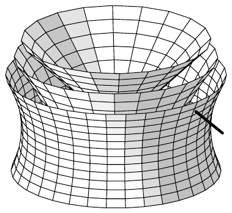
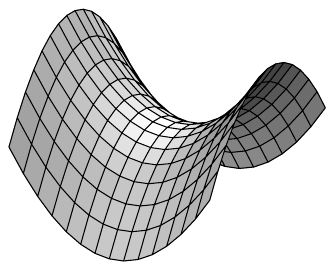

## 3 多元微分法则

我们在此汇集多元微分最重要的法则。照例，我们假设

• $ E $ 与 $ F $ 是域 $ \mathbb{K} $ 上的巴拿赫空间；$ X $ 是 $ E $ 的开子集。

##### 线性

下一个定理表明，与一元情形一样，微分是线性的。

3.1 命题 设 $ f, g : X \to F $ 在 $ x_0 $ 处可微，且 $ \alpha \in \mathbb{K} $。则 $ f + \alpha g $ 也在 $ x_0 $ 处可微，并且

\[ \partial(f + \alpha g)(x_0) = \partial f(x_0) + \alpha\partial g(x_0) . \]

证明 由假设，我们可以写出

\[ \begin{aligned} f(x) &= f(x_0) + \partial f(x_0)(x - x_0) + r_{x_0}(x)\|x - x_0\| , \\ g(x) &= g(x_0) + \partial g(x_0)(x - x_0) + s_{x_0}(x)\|x - x_0\| , \end{aligned} \]

其中函数 $ r_{x_0}, s_{x_0} : X \to F $ 连续且在 $ x_0 $ 处取值为零。于是，

\[ (f + \alpha g)(x) = (f + \alpha g)(x_0) + [\partial f(x_0) + \alpha\partial g(x_0)](x - x_0) + t_{x_0}(x)\|x - x_0\| \]

其中 $ t_{x_0} := r_{x_0} + \alpha s_{x_0} $。命题 2.1 于是推出该定理。■

3.2 推论 $ C^1(X, F) $ 是 $ C(X, F) $ 的向量子空间，并且

\[ \partial : C^1(X, F) \to C(X, \mathcal{L}(E, F)) , \quad f \mapsto \partial f \]

是线性的。

##### 链式法则

在第 IV 章中，我们看到了链式法则对一元函数的巨大重要性，而正如我们在此将看到的，多元情形也是如此。

3.3 定理（链式法则）设 $ Y $ 是 $ F $ 中的开集，$ G $ 是巴拿赫空间。又设 $ f : X \to F $ 在 $ x_0 $ 处可微，$ g : Y \to G $ 在 $ y_0 := f(x_0) $ 处可微，并且 $ f(X) \subset Y $。则 $ g \circ f : X \to G $ 在 $ x_0 $ 处可微，其导数由下式给出

\[ \partial(g \circ f)(x_0) = \partial g(f(x_0))\partial f(x_0) . \]

证明\footnote{参见定理 IV.1.7 的证明。} 若 $ A := \partial g(f(x_0))\partial f(x_0) $，则 $ A \in \mathcal{L}(E, G) $。命题 2.1 蕴含

\[ \begin{aligned} f(x) &= f(x_0) + \partial f(x_0)(x - x_0) + r(x)\|x - x_0\| \qquad \text{对 } x \in X , \\ g(y) &= g(y_0) + \partial g(y_0)(y - y_0) + s(y)\|y - y_0\| \qquad \text{对 } y \in Y , \end{aligned} \tag{3.1} \]

其中 $ r : X \to F $ 与 $ s : Y \to G $ 分别在 $ x_0 $ 处与 $ y_0 $ 处连续，并且 $ r(x_0) = 0 $ 且 $ s(y_0) = 0 $。我们通过 $ t(x_0) := 0 $ 以及下式定义 $ t : X \to G $：

\[ t(x) := \partial g(f(x_0))r(x) + s(f(x))\left\|\partial f(x_0)\frac{x - x_0}{\|x - x_0\|} + r(x)\right\| \qquad \text{对 } x \ne x_0 . \]

则 $ t $ 在 $ x_0 $ 处连续。由 (3.1)，并取 $ y := f(x) $，我们推出关系式

\[ \begin{aligned} (g \circ f)(x) &= g(f(x_0)) + A(x - x_0) + \partial g(f(x_0))r(x)\|x - x_0\| \\ &\quad + s(f(x))\left\|\partial f(x_0)(x - x_0) + r(x)\|x - x_0\|\right\| \\ &= (g \circ f)(x_0) + A(x - x_0) + t(x)\|x - x_0\| . \end{aligned} \]

于是该定理由命题 2.1 推出。■

3.4 推论（坐标形式下的链式法则）设 $ X $ 是 $ \mathbb{R}^n $ 中的开集，$ Y $ 是 $ \mathbb{R}^m $ 中的开集。又设 $ f : X \to \mathbb{R}^m $ 在 $ x_0 $ 处可微，$ g : Y \to \mathbb{R}^\ell $ 在 $ y_0 := f(x_0) $ 处可微，并且 $ f(X) \subset Y $。则 $ h := g \circ f : X \to \mathbb{R}^\ell $ 在 $ x_0 $ 处可微，并且

\[ [\partial h(x_0)] = [\partial g(f(x_0))][\partial f(x_0)] , \tag{3.2} \]

也就是说，复合映射 $ h = g \circ f $ 的 雅可比矩阵是 $ g $ 与 $ f $ 的 雅可比矩阵之积。

证明 这由定理 3.3、推论 2.9 与定理 1.9(ii) 推出。■

3.5 注 采用推论 3.4 的记号，$ h $ 的 雅可比矩阵的各个元素为

\[ \frac{\partial h^j(x_0)}{\partial x^k} = \sum_{i=1}^{m} \frac{\partial g^j(f(x_0))}{\partial y^i}\frac{\partial f^i(x_0)}{\partial x^k} \qquad \text{对 } 1 \le j \le \ell \text{ 且 } 1 \le k \le n . \]

利用这个基本公式，我们可以在许多具体情形中计算复合函数的偏导数。

证明 利用矩阵乘法法则，这立即由 (3.2) 推出。■

3.6 例 (a) 我们考虑映射

\[ \begin{aligned} f : \mathbb{R}^2 \to \mathbb{R}^3 , &\quad (x, y) \mapsto (x^2, xy, xy^2) , \\ g : \mathbb{R}^3 \to \mathbb{R}^2 , &\quad (\xi, \eta, \zeta) \mapsto (\sin \xi, \cos(\xi \eta \zeta)) . \end{aligned} \]

对于 $ h := g \circ f : \mathbb{R}^2 \to \mathbb{R}^2 $，我们于是有 $ h(x, y) = (\sin x^2, \cos(x^4y^3)) $。因此 $ h $ 连续可微，并且

\[ [\partial h(x, y)] = \begin{bmatrix} 2x\cos x^2 & 0 \\ -4x^3y^3\sin(x^4y^3) & -3x^4y^2\sin(x^4y^3) \end{bmatrix} . \tag{3.3} \]

至于 $ g $ 与 $ f $ 的 雅可比矩阵，我们分别求得

\[ \begin{bmatrix} \cos \xi & 0 & 0 \\ -\eta\zeta\sin(\xi \eta \zeta) & -\xi\zeta\sin(\xi \eta \zeta) & -\xi\eta\sin(\xi \eta \zeta) \end{bmatrix} \quad \text{与} \quad \begin{bmatrix} 2x & 0 \\ y & x \\ y^2 & 2xy \end{bmatrix} . \]

现在我们可以容易地验证：这两个矩阵的乘积在位置 $ (\xi, \eta, \zeta) = f(x, y) $ 处与 (3.3) 一致。

(b) 设 $ X $ 是 $ \mathbb{R}^n $ 中的开集，$ f \in C^1(X, \mathbb{R}) $。又令 $ I $ 是 $ \mathbb{R} $ 中的开区间，并设 $ \varphi \in C^1(I, \mathbb{R}^n) $ 满足 $ \varphi(I) \subset X $。则 $ f \circ \varphi $ 属于 $ C^1(I, \mathbb{R}) $，并且

\[ (f \circ \varphi)'(t) = (\nabla f(\varphi(t)) \mid \dot\varphi(t)) \qquad \text{对 } t \in I . \]

证明 由链式法则，我们得到

\[ (f \circ \varphi)'(t) = df(\varphi(t))\dot\varphi(t) = (\nabla f(\varphi(t)) \mid \dot\varphi(t)) \qquad \text{对 } t \in I . ■ \]

(c) 我们沿用上述记号，考虑一条道路 $ \varphi : I \to X $，它保持在 $ f $ 的一个“水平集”之内，即存在 $ y \in \mathrm{im}(f) $，使得对每个 $ t \in I $ 有 $ f(\varphi(t)) = y $。由 (b) 于是可得

\[ (\nabla f(\varphi(t)) \mid \dot\varphi(t)) = 0 \]

对 $ t \in I $ 成立。这表明梯度 $ \nabla f(x) $ 在点 $ x = \varphi(t) $ 处与道路 $ \varphi $ 正交，从而也与 $ \varphi $ 过 $ (t, \varphi(t)) $ 的切线正交（参见注 IV.1.4(a)）。稍微不严格地说，我们说“梯度正交于水平集”。■

函数 $ (x, y, z) \mapsto x^2 + y^2 - z^2 $ 的水平集

##### 乘积法则

实值函数的乘积法则是链式法则的又一应用。\footnote{另见例 4.8(b)。}

3.7 命题 设 $ f, g \in C^1(X, \mathbb{R}) $。则 $ fg $ 也属于 $ C^1(X, \mathbb{R}) $，且乘积法则给出

\[ \partial(fg) = g\partial f + f\partial g . \tag{3.4} \]

证明 对于

\[ m : \mathbb{R}^2 \to \mathbb{R} , \quad (\alpha, \beta) \mapsto \alpha\beta \]

我们有 $ m \in C^1(\mathbb{R}^2, \mathbb{R}) $ 且 $ \nabla m(\alpha, \beta) = (\beta, \alpha) $。令 $ F := m \circ (f, g) $，我们得到对 $ x \in X $ 有 $ F(x) = f(x)g(x) $。由链式法则可得 $ F \in C^1(X, \mathbb{R}) $，并且

\[ \partial F(x) = \partial m(f(x), g(x)) \circ (\partial f(x), \partial g(x)) = g(x)\partial f(x) + f(x)\partial g(x) . ■ \]

3.8 推论 在 $ E = \mathbb{R}^n $ 的情形下，我们有

\[ d(fg) = g\,df + f\,dg \quad \text{与} \quad \nabla(fg) = g\nabla f + f\nabla g . \]

证明 第一个公式是 (3.4) 的另一种写法。因为

\[ \begin{aligned} (\nabla(fg)(x) \mid h) &= d(fg)(x)h = f(x)dg(x)h + g(x)df(x)h \\ &= (f(x)\nabla g(x) + g(x)\nabla f(x) \mid h) \end{aligned} \]

对 $ x \in X $ 与 $ h \in \mathbb{R}^n $，第二个公式也成立。■

##### 中值定理

与一元情形一样，多元情形也有中值定理，这意味着我们可以利用导数来估计函数值之差。

在下文中，我们用第 III.4 节引入的记号 $ \llbracket x, y \rrbracket $ 表示点 $ x, y \in E $ 之间的直线道路 $ \{x + t(y - x) ; t \in [0, 1]\} $。

3.9 定理（中值定理）设 $ f : X \to F $ 可微。则

\[ \|f(x) - f(y)\| \le \sup_{0 \le t \le 1}\|\partial f(x + t(y - x))\|\|y - x\| \tag{3.5} \]

对满足 $ \llbracket x, y \rrbracket \subset X $ 的所有 $ x, y \in X $ 成立。

证明 对 $ t \in [0, 1] $ 我们令 $ \varphi(t) := f(x + t(y - x)) $。因为 $ \llbracket x, y \rrbracket \subset X $，我们知道 $ \varphi $ 有定义。链式法则表明 $ \varphi $ 可微，并且

\[ \dot\varphi(t) = \partial f(x + t(y - x))(y - x) . \]

由定理 IV.2.18（一元向量值函数的中值定理）可得

\[ \|f(y) - f(x)\| = \|\varphi(1) - \varphi(0)\| \le \sup_{0 \le t \le 1}\|\dot\varphi(t)\| . \]

我们再考虑下式即可完成定理的证明：

\[ \|\dot\varphi(t)\| \le \|\partial f(x + t(y - x))\|\|y - x\| \qquad \text{对 } t \in [0, 1] . ■ \]

3.10 定理（积分形式的中值定理）设 $ f \in C^1(X, F) $。则我们有

\[ f(y) - f(x) = \int_0^1 \partial f(x + t(y - x))(y - x)\,dt \tag{3.6} \]

对满足 $ \llbracket x, y \rrbracket \subset X $ 的 $ x, y \in X $ 成立。

证明 前一证明中的辅助函数 $ \varphi $ 现在是连续可微的。因此我们可以应用微积分基本定理（推论 VI.4.14），它给出

\[ f(y) - f(x) = \varphi(1) - \varphi(0) = \int_0^1 \dot\varphi(t)\,dt = \int_0^1 \partial f(x + t(y - x))(y - x)\,dt . ■ \]

3.11 注 设 $ f : X \to F $ 可微。

(a) 若 $ \partial f $ 连续，则表示式 (3.6) 给出估计 (3.5)。

证明 应用命题 VI.4.3 与算子范数的定义即可。■

(b) 若 $ X $ 是凸集且 $ \partial f : X \to \mathcal{L}(E, F) $ 有界，则 $ f $ 利普希茨连续。

证明 令 $ \alpha := \sup_{x \in X}\|\partial f(x)\| $。则由定理 3.9，我们得到

\[ \|f(y) - f(x)\| \le \alpha\|y - x\| \qquad \text{对 } x, y \in X . ■ \tag{3.7} \]

(c) 若 $ X $ 连通且 $ \partial f = 0 $，则 $ f $ 是常值函数。

证明 设 $ x_0 \in X $ 且 $ r > 0 $ 满足 $ \mathbb{B}(x_0, r) \subset X $。令 $ y_0 := f(x_0) $，则由 (3.7) 可得对一切 $ x \in \mathbb{B}(x_0, r) $ 有 $ f(x) = y_0 $。因为 $ x_0 $ 是任意的，$ f $ 局部常值。因此 $ f^{-1}(y_0) $ 非空且在 $ X $ 中开。另外，由命题 2.1(ii) 与例 III.2.22(a)，$ f^{-1}(y_0) $ 在 $ X $ 中闭。于是该断言由注 III.4.3 推出。■

##### 函数序列的极限的可微性

函数序列的极限的可微性定理（定理 V.2.8）现在可以容易地推广到一般情形。

3.12 定理 设对 $ k \in \mathbb{N} $ 有 $ f_k \in C^1(X, F) $。又假设存在函数 $ f \in F^X $ 与 $ g : X \to \mathcal{L}(E, F) $，使得

(i) $ (f_k) $ 逐点收敛于 $ f $；

(ii) $ (\partial f_k) $ 局部一致收敛于 $ g $。

则 $ f $ 属于 $ C^1(X, F) $，且我们有 $ \partial f = g $。

证明 在应用定理 3.9 之下，定理 V.2.8 的证明逐字逐句仍然成立。■

##### 局部极值的必要条件

在重要的定理 IV.2.1 中，我们对一元实变量函数的局部极值的存在性给出了一个必要判据。利用这里建立的方法，我们现在可以处理多个变量。

3.13 定理 设映射 $ f : X \to \mathbb{R} $ 在 $ x_0 $ 处有局部极值点，且其所有方向导数在该点都存在。则

\[ D_vf(x_0) = 0 \qquad \text{对 } v \in E\setminus\{0\} . \]

证明 设 $ v \in E\setminus\{0\} $。我们选取 $ r > 0 $，使得对 $ t \in (-r, r) $ 有 $ x_0 + tv \in X $，并考虑一个一元实变量函数：

\[ \varphi : (-r, r) \to \mathbb{R} , \quad t \mapsto f(x_0 + tv) . \]

则 $ \varphi $ 在 $ 0 $ 处可微且在 $ 0 $ 处有局部极值。由定理 IV.2.1，我们有 $ \dot\varphi(0) = D_vf(x_0) = 0 $。■

3.14 注 (a) 设 $ f : X \to \mathbb{R} $ 在 $ x_0 $ 处可微。则若 $ df(x_0) = 0 $，称 $ x_0 $ 为 $ f $ 的**临界点**。若 $ f $ 在 $ x_0 $ 处有局部极值，则 $ x_0 $ 是临界点。当 $ E = \mathbb{R}^n $ 时，此定义与注 2.17(a) 的定义一致。

证明 这由命题 2.5 与定理 3.13 推出。■

(b) 临界点 $ x_0 $ *未必*是局部极值点。\footnote{另请与注 IV.2.2(c) 比较。}

证明 考虑

\[ f : \mathbb{R}^2 \to \mathbb{R} , \quad (x, y) \mapsto x^2 - y^2 . \]

则 $ \nabla f(0, 0) = 0 $，但 $ (0, 0) $ 不是 $ f $ 的极值点。它反而是“鞍点”。■

