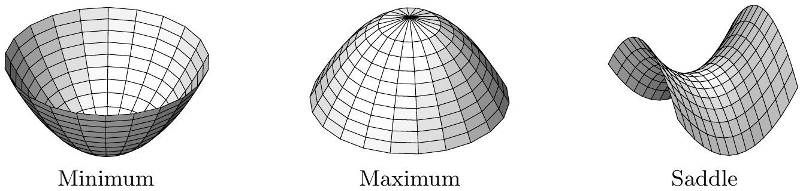
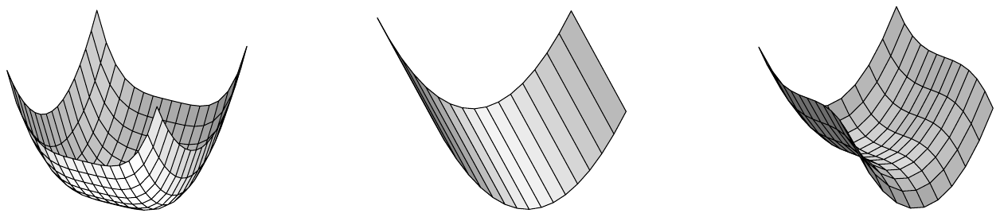

## 5 高阶导数

现在我们可以定义高阶导数。我们将看到，如果一个函数连续可微，那么它的高阶导数就是对称多重线性映射。

本节主要把泰勒展开推广到多于一个变量的函数。作为它的一个推论，它将像一元情形那样给出局部极值存在性的一个充分判据。

在下文中，假设

• $ E $ 与 $ F $ 是巴拿赫空间，$ X $ 是 $ E $ 的开子集。

##### 定义

如前所述，我们将像一元情形那样归纳地定义高阶导数。

设 $ f : X \to F $ 且 $ x_{0} \in X $。我们令 $ \partial^{0}f := f $。因此 $ \partial^{0}f(x_{0}) $ 属于 $ F = \mathcal{L}^{0}(E, F) $。现在设 $ m \in \mathbb{N}^{\times} $ 且 $ \partial^{m-1}f : X \to \mathcal{L}^{m-1}(E, F) $ 已有定义。若

\[ \partial^{m}f(x_{0}) := \partial(\partial^{m-1}f)(x_{0}) \in \mathcal{L}\left( E, \mathcal{L}^{m-1}(E, F) \right) = \mathcal{L}^{m}(E, F) \]

存在，我们称 $ \partial^{m}f(x_{0}) $ 为 $ f $ 在 $ x_{0} $ 处的 $ m $ 阶导数，并称 $ f $ 在 $ x_{0} $ 处 $ m $ 次可微。当 $ \partial^{m}f(x) $ 对每个 $ x \in X $ 都存在时，我们称

\[ \partial^{m}f : X \to \mathcal{L}^{m}(E, F) \]

为 $ f $ 的 $ m $ 阶导数，并说 $ f $ 是 $ m $ 次可微的。如果 $ \partial^{m}f $ 还连续，我们说 $ f $ 是 $ m $ 次连续可微的。我们令

\[ C^{m}(X, F) := \{ f : X \to F ;\ f \text{ 是 } m\text{ 次连续可微的} \} \]

以及

\[ C^{\infty}(X, F) := \bigcap_{m \in \mathbb{N}}C^{m}(X, F) . \]

显然 $ C^{0}(X, F) = C(X, F) $，并且若 $ f $ 属于 $ C^{\infty}(X, F) $，则 $ f $ 是**光滑的**或**无穷次连续可微的**。

除 $ \partial^{m}f $ 之外，我们有时也写 $ D^{m}f $ 或 $ f^{(m)} $；我们也令 $ f' := f^{(1)} $、$ f'' := f^{(2)} $、$ f''' := f^{(3)} $ 等等。

5.1 注 设 $ m \in \mathbb{N} $。

(a) $ m $ 阶导数是线性的，即

\[ \partial^{m}(f + \alpha g)(x_{0}) = \partial^{m}f(x_{0}) + \alpha\partial^{m}g(x_{0}) \]

对 $ \alpha \in \mathbb{K} $ 以及满足 $ f $ 与 $ g $ 在 $ x_{0} $ 处 $ m $ 次可微的 $ f, g : X \to F $ 成立。

证明 这由命题 3.1 用归纳法推出。■

(b) $ C^{m}(X, F) = \left\{ f : X \to F ;\ \partial^{j}f \in C\left( X, \mathcal{L}^{j}(E, F) \right),\ 0 \le j \le m \right\} $。

证明 这由命题 2.1(ii) 与 $ m $ 阶导数的定义推出。■

(c) 现在容易验证 $ C^{m+1}(X, F) $ 是 $ C^{m}(X, F) $ 的向量子空间。$ C^{\infty}(X, F) $ 也是 $ C^{m}(X, F) $ 的向量子空间。特别地，我们有包含链

\[ C^{\infty}(X, F) \subset \cdots \subset C^{m+1}(X, F) \subset C^{m}(X, F) \subset \cdots \subset C(X, F) . \]

此外，对 $ k \in \mathbb{N} $，映射

\[ \partial^{k} : C^{m+k}(X, F) \to C^{m}(X, F) \]

有定义且是线性的。

证明 我们把简单的验证留给你。■

5.2 定理 设 $ f \in C^{2}(X, F) $。则

\[ \partial^{2}f(x) \in \mathcal{L}^{2}_{\mathrm{sym}}(E, F) \quad \text{对 } x \in X , \]

也就是说，\footnote{为了清楚起见，我们把多重线性映射的各个自变量用方括号括了起来。}

\[ \partial^{2}f(x)[h, k] = \partial^{2}f(x)[k, h] \quad \text{对 } x \in X \text{ 且 } h, k \in E . \]

证明 (i) 设 $ x \in X $ 且 $ r > 0 $ 满足 $ \mathbb{B}(x, 2r) \subset X $，并设 $ h, k \in r\mathbb{B} $。我们令 $ g(y) := f(y + h) - f(y) $ 以及

\[ r(h, k) := \int_{0}^{1}\left[ \int_{0}^{1}\left\{ \partial^{2}f(x + sh + tk) - \partial^{2}f(x) \right\}h\, ds \right]k\, dt . \]

由中值定理（定理 3.10）与导数的线性性，我们得到

\[ \begin{aligned} f(x + h + k) - f(x + k) - f(x + h) + f(x) &= g(x + k) - g(x) \\ &= \int_{0}^{1}\partial g(x + tk)k\, dt \\ &= \int_{0}^{1}\left( \partial f(x + h + tk) - \partial f(x + tk) \right)k\, dt \\ &= \int_{0}^{1}\left( \int_{0}^{1}\partial^{2}f(x + sh + tk)h\, ds \right)k\, dt \\ &= \partial^{2}f(x)[h, k] + r(h, k) , \end{aligned} \]

因为对 $ s, t \in [0, 1] $ 有 $ x + sh + tk $ 属于 $ \mathbb{B}(x, 2r) $。

(ii) 令 $ \tilde{g}(y) := f(y + k) - f(y) $ 以及

\[ \tilde{r}(k, h) := \int_{0}^{1}\left( \int_{0}^{1}\left\{ \partial^{2}f(x + sk + th) - \partial^{2}f(x) \right\}k\, ds \right)h\, dt , \]

类似地可得

\[ f(x + h + k) - f(x + h) - f(x + k) + f(x) = \partial^{2}f(x)[k, h] + \tilde{r}(k, h) . \]

于是我们得到

\[ \partial^{2}f(x)[h, k] - \partial^{2}f(x)[k, h] = \tilde{r}(k, h) - r(h, k) . \]

再注意到估计

\[ \|\tilde{r}(k, h)\| \vee \|r(h, k)\| \le \sup_{0 \le s,t \le 1}\|\partial^{2}f(x + sh + tk) - \partial^{2}f(x)\|\,\|h\|\,\|k\| , \]

我们得到

\[ \|\partial^{2}f(x)[h, k] - \partial^{2}f(x)[k, h]\| \le 2\sup_{0 \le s,t \le 1}\|\partial^{2}f(x + sh + tk) - \partial^{2}f(x)\|\,\|h\|\,\|k\| . \]

在这个不等式中，我们可以用 $ \tau h $ 与 $ \tau k $（其中 $ \tau \in (0, 1] $）替换 $ h $ 与 $ k $。于是我们有

\[ \|\partial^{2}f(x)[h, k] - \partial^{2}f(x)[k, h]\| \le 2\sup_{0 \le s,t \le 1}\left\|\partial^{2}f\left( x + \tau(sh + tk) \right) - \partial^{2}f(x)\right\|\,\|h\|\,\|k\| . \]

最后，$ \partial^{2}f $ 的连续性蕴含

\[ \sup_{0 \le s,t \le 1}\left\|\partial^{2}f\left( x + \tau(sh + tk) \right) - \partial^{2}f(x)\right\| \to 0 \quad (\tau \to 0) . \]

因此对 $ h, k \in r\mathbb{B} $ 有 $ \partial^{2}f(x)[h, k] = \partial^{2}f(x)[k, h] $，证明完成。■

5.3 推论 对满足 $ m \ge 2 $ 的 $ f \in C^{m}(X, F) $，我们有

\[ \partial^{m}f(x) \in \mathcal{L}^{m}_{\mathrm{sym}}(E, F) \quad \text{对 } x \in X . \]

证明 仿照定理 5.2，我们现在构造一个关于 $ m $ 的归纳证明。归纳步骤 $ m \to m + 1 $ 如下。因为 $ \mathcal{L}^{m}_{\mathrm{sym}}(E, F) $ 是闭向量子空间或 $ \mathcal{L}(E, F) $，由归纳假设得

\[ \partial^{m+1}f(x)h_{1} \in \mathcal{L}^{m}_{\mathrm{sym}}(E, F) \quad \text{对 } h_{1} \in E , \]

（参见习题 4.2）。特别地，我们得到

\[ \partial^{m+1}f(x)[h_{1}, h_{\sigma(2)}, h_{\sigma(3)}, \ldots, h_{\sigma(m+1)}] = \partial^{m+1}f(x)[h_{1}, h_{2}, h_{3}, \ldots, h_{m+1}] \]

对每个 $ (h_{1}, \ldots, h_{m+1}) \in E^{m+1} $ 与 $ \{2, \ldots, m+1\} $ 的每个置换 $ \sigma $ 成立。因为每个 $ \tau \in \mathrm{S}_{m+1} $ 都可表示成对换的复合，只需验证

\[ \partial^{m+1}f(x)[h_{1}, h_{2}, h_{3}, \ldots, h_{m+1}] = \partial^{m+1}f(x)[h_{2}, h_{1}, h_{3}, \ldots, h_{m+1}] . \]

因为 $ \partial^{m+1}f(x) = \partial^{2}(\partial^{m-1}f)(x) $，这由定理 5.2 推出。■

##### 高阶偏导数

我们首先考虑 $ E = \mathbb{R}^{n} $ 且 $ n \ge 2 $ 的情形。

对 $ q \in \mathbb{N}^{\times} $ 与指标 $ j_{1}, \ldots, j_{q} \in \{1, \ldots, n\} $，我们称

\[ \frac{\partial^{q}f(x)}{\partial x^{j_{1}}\partial x^{j_{2}}\cdots\partial x^{j_{q}}} := \partial_{j_{1}}\partial_{j_{2}}\cdots\partial_{j_{q}}f(x) \quad \text{对 } x \in X , \]

为 $ f : X \to F $ 在 $ x $ 处的 $ q $ 阶偏导数\footnote{在一个显然的记号下，我们把对同一变量的多个相继导数简写为，例如 $ \frac{\partial^{3}f}{\partial x^{1}\partial x^{4}\partial x^{4}} = \frac{\partial^{3}f}{\partial x^{1}(\partial x^{4})^{2}} $、$ \frac{\partial^{4}f}{\partial x^{2}\partial x^{3}\partial x^{3}\partial x^{2}} = \frac{\partial^{4}f}{\partial x^{2}(\partial x^{3})^{2}\partial x^{2}} $ 等等。不过要注意，一般仍应保持不同变量之间的求导次序，因为一般有 $ \frac{\partial^{2}f}{\partial x^{1}\partial x^{2}} \ne \frac{\partial^{2}f}{\partial x^{2}\partial x^{1}} $（参见注 5.6）。}。映射 $ f $ 称为 $ q $ 次[连续]偏可微的，如果它直到 $ q $ 阶（含 $ q $ 阶）的导数存在[且连续]。

5.4 定理 设 $ X $ 是 $ \mathbb{R}^{n} $ 中的开集，$ f : X \to F $，且 $ m \in \mathbb{N}^{\times} $。则下列陈述成立：

(i) $ f $ 属于 $ C^{m}(X, F) $，当且仅当 $ f $ 是 $ m $ 次连续偏可微的。

(ii) 对 $ f \in C^{m}(X, F) $，我们有

\[ \frac{\partial^{q}f}{\partial x^{j_{1}}\cdots\partial x^{j_{q}}} = \frac{\partial^{q}f}{\partial x^{j_{\sigma(1)}}\cdots\partial x^{j_{\sigma(q)}}} \quad \text{对 } 1 \le q \le m , \]

对每个置换 $ \sigma \in \mathrm{S}_{q} $ 成立，也就是说，偏导数与求导次序无关。\footnote{可以证明，当 $ f : X \subset \mathbb{R}^{n} \to F $ 是 $ m $ 次全可微时，偏导数已经与该次序无关（参见习题 17）。一般地，当 $ f $ 只是 $ m $ 次偏可微时，偏导数的先后次序不能交换（参见注 5.6）。}

证明 首先，我们注意到，对满足 $ q \le m $ 的 $ h_{1}, \ldots, h_{q} \in \mathbb{R}^{n} $，我们有

\[ \partial^{q}f(x)[h_{1}, \ldots, h_{q}] = \partial(\cdots\partial(\partial f(x)h_{1})h_{2}\cdots)h_{q} \quad \text{对 } x \in X . \]

特别地，由此得

\[ \partial^{q}f(x)[e_{j_{1}}, \ldots, e_{j_{q}}] = \partial_{j_{q}}\partial_{j_{q-1}}\cdots\partial_{j_{1}}f(x) \quad \text{对 } x \in X . \tag{5.1} \]

于是，我们得到

\[ \partial^{q}f(x)[h_{1}, \ldots, h_{q}] = \sum_{j_{1},\ldots,j_{q}=1}^{n}\partial_{j_{q}}\partial_{j_{q-1}}\cdots\partial_{j_{1}}f(x)h_{1}^{j_{1}}\cdots h_{q}^{j_{q}} \tag{5.2} \]

对 $ x \in X $ 以及满足 $ 1 \le i \le q $ 的 $ h_{i} = (h_{i}^{1}, \ldots, h_{i}^{n}) \in \mathbb{R}^{n} $ 成立。

(i) 公式 (5.1) 立即蕴含 $ C^{m}(X, F) $ 的每个元素都是 $ m $ 次连续偏可微的。

反之，设 $ f $ 是 $ m $ 次连续偏可微的。在 $ m = 1 $ 的情形，由定理 2.10 我们知道 $ f $ 属于 $ C^{1}(X, F) $。我们假设该陈述对 $ m-1 \ge 1 $ 成立。由该假设与 (5.2)，我们看到 $ \partial_{j}(\partial^{m-1}f) $ 对 $ j \in \{1, \ldots, n\} $ 存在且连续。于是定理 2.10 说

\[ \partial(\partial^{m-1}f) : X \to \mathcal{L}\left( \mathbb{R}^{n}, \mathcal{L}^{m-1}(\mathbb{R}^{n}, F) \right) = \mathcal{L}^{m}(\mathbb{R}^{n}, F) \]

存在且连续。因此 $ f \in C^{m}(X, F) $。

(ii) 这立即由推论 5.3 与 (5.1) 推出。■

5.5 推论 设 $ f : X \subset \mathbb{R}^{n} \to \mathbb{K} $。则有：

(i) $ f $ 属于 $ C^{2}(X, \mathbb{K}) $，当且仅当

\[ f, \partial_{j}f, \partial_{j}\partial_{k}f \in C(X, \mathbb{K}) \quad \text{对 } 1 \le j, k \le n . \]

(ii)（施瓦茨定理）若 $ f $ 属于 $ C^{2}(X, \mathbb{K}) $，则

\[ \partial_{j}\partial_{k}f(x) = \partial_{k}\partial_{j}f(x) \quad \text{对 } x \in X , \quad 1 \le j, k \le n . \]

5.6 注 当 $ f $ 只是两次偏可微时，施瓦茨定理不成立。

证明 我们考虑 $ f : \mathbb{R}^{2} \to \mathbb{R} $，其中

\[ f(x, y) := \begin{cases} \frac{xy(x^{2} - y^{2})}{x^{2} + y^{2}} , & (x, y) \ne (0, 0) , \\ 0 , & (x, y) = (0, 0) . \end{cases} \]

于是我们有

\[ \partial_{1}f(x, y) = \begin{cases} \frac{y(x^{4} + 4x^{2}y^{2} - y^{4})}{(x^{2} + y^{2})^{2}} , & (x, y) \ne (0, 0) , \\ 0 , & (x, y) = (0, 0) , \end{cases} \]

并且由此得

\[ \partial_{2}\partial_{1}f(0, 0) = \lim_{h \to 0}\frac{\partial_{1}f(0, h) - \partial_{1}f(0, 0)}{h} = -1 . \]

利用 $ f(y, x) = -f(x, y) $，我们得到

\[ \partial_{2}f(y, x) = \lim_{h \to 0}\frac{f(y, x + h) - f(y, x)}{h} = -\lim_{h \to 0}\frac{f(x + h, y) - f(x, y)}{h} = -\partial_{1}f(x, y) . \]

因此对 $ (x, y) \in \mathbb{R}^{2} $ 有 $ \partial_{1}\partial_{2}f(y, x) = -\partial_{2}\partial_{1}f(x, y) $。于是 $ \partial_{2}\partial_{1}f(0, 0) \ne 0 $ 给出 $ \partial_{1}\partial_{2}f(0, 0) \ne -\partial_{2}\partial_{1}f(0, 0) $。■

##### 链式法则

链式法则对高阶导数也很重要，尽管复合函数的高阶导数一般没有简单的表示。

5.7 定理（链式法则）设 $ Y $ 是 $ F $ 中的开集，$ G $ 是巴拿赫空间。又设 $ m \in \mathbb{N}^{\times} $ 与 $ f \in C^{m}(X, F) $ 满足 $ f(X) \subset Y $，并设 $ g \in C^{m}(Y, G) $。则我们有 $ g \circ f \in C^{m}(X, G) $。

证明 利用定理 3.3，该陈述由关于 $ m $ 的归纳法推出。我们把细节留给你作为练习。■

##### 泰勒公式

我们现在把泰勒定理推广到多元函数。为此，我们使用下面的记号：

\[ \partial^{k}f(x)[h]^{k} := \begin{cases} \partial^{k}f(x)[\underbrace{h, \ldots, h}_{k\text{ 次}}] , & 1 \le k \le q , \\ f(x) , & k = 0 , \end{cases} \]

对 $ x \in X $、$ h \in E $ 与 $ f \in C^{q}(X, F) $ 成立。

5.8 定理（泰勒公式）设 $ X $ 是 $ E $ 中的开集，$ q \in \mathbb{N}^{\times} $，且 $ f $ 属于 $ C^{q}(X, F) $。则

\[ f(x + h) = \sum_{k=0}^{q}\frac{1}{k!}\partial^{k}f(x)[h]^{k} + R_{q}(f, x; h) \]

对满足 $ \llbracket x, x + h \rrbracket \subset X $ 的 $ x \in X $ 与 $ h \in E $ 成立。这里

\[ R_{q}(f, x; h) := \int_{0}^{1}\frac{(1 - t)^{q-1}}{(q - 1)!}\left[ \partial^{q}f(x + th) - \partial^{q}f(x) \right][h]^{q}\, dt \in F \]

是 $ f $ 在点 $ x $ 处的 $ q $ 阶余项。

证明 当 $ q = 1 $ 时，该公式化为积分形式的中值定理（定理 3.10）：

\[ \begin{aligned} f(x + h) &= f(x) + \int_{0}^{1}\partial f(x + th)h\, dt \\ &= f(x) + \partial f(x)h + \int_{0}^{1}\left[ \partial f(x + th) - \partial f(x) \right]h\, dt . \end{aligned} \]

现在设 $ q = 2 $。令 $ u(t) := \partial f(x + th)h $ 与 $ v(t) := t - 1 $（$ t \in [0, 1] $），我们有 $ u'(t) = \partial^{2}f(x + th)[h]^{2} $ 且 $ v' = 1 $。因此，由广义乘积法则（例 4.8(b)）并对上式积分，我们得到\footnote{参见命题 VI.5.4 的证明。}

\[ \begin{aligned} f(x + h) &= f(x) + \partial f(x)h + \int_{0}^{1}(1 - t)\partial^{2}f(x + th)[h]^{2}\, dt \\ &= \sum_{k=0}^{2}\frac{1}{k!}\partial^{k}f(x)[h]^{k} + R_{2}(f, x; h) . \end{aligned} \]

对 $ q = 3 $，我们令 $ u(t) := \partial^{2}f(x + th)[h]^{2} $ 与 $ v(t) := -(1 - t)^{2}/2 $。于是类似地得到

\[ f(x + h) = f(x) + \partial f(x)h + \frac{1}{2}\partial^{2}f(x)[h]^{2} + \int_{0}^{1}\frac{(1 - t)^{2}}{2}\partial^{3}f(x + th)[h]^{3}\, dt . \]

在一般情形 $ q > 3 $，该断言用简单的归纳论证推出。■

5.9 注 对 $ f \in C^{q}(X, F) $ 以及满足 $ \llbracket x, x + h \rrbracket \subset X $ 的 $ x, h \in E $，我们有

\[ \|R_{q}(f, x; h)\| \le \frac{1}{q!}\max_{0 \le t \le 1}\|\partial^{q}f(x + th) - \partial^{q}f(x)\|\,\|h\|^{q} . \]

特别地，我们得到

\[ R_{q}(f, x; h) = o(\|h\|^{q}) \quad (h \to 0) . \]

证明 这由命题 VI.4.3 与 $ \partial^{q}f $ 的连续性推出。■

5.10 推论 设 $ f \in C^{q}(X, F) $，其中 $ q \in \mathbb{N}^{\times} $，且 $ x \in X $。则我们有\footnote{对充分小的 $ h $，$ \llbracket x, x + h \rrbracket $ 落在 $ X $ 中。}

\[ f(x + h) = \sum_{k=0}^{q}\frac{1}{k!}\partial^{k}f(x)[h]^{k} + o(\|h\|^{q}) \quad (h \to 0) . \]

##### $ m $ 个变量的函数

在本节余下部分，我们考虑 $ m $ 个实变量的函数，即令 $ E = \mathbb{R}^{m} $。在这种情形，用多重指标表示偏导数是方便的。

设 $ \alpha = (\alpha_{1}, \ldots, \alpha_{m}) \in \mathbb{N}^{m} $ 是长度为\footnote{参见第 I.8 节。} $ |\alpha| = \sum_{j=1}^{m}\alpha_{j} $ 的多重指标，并设 $ f \in C^{|\alpha|}(X, F) $。则我们写

\[ \partial^{\alpha}f := \partial_{1}^{\alpha_{1}}\partial_{2}^{\alpha_{2}}\cdots\partial_{m}^{\alpha_{m}}f = \frac{\partial^{|\alpha|}f}{(\partial x^{1})^{\alpha_{1}}(\partial x^{2})^{\alpha_{2}}\cdots(\partial x^{m})^{\alpha_{m}}} \quad \text{对 } \alpha \ne 0 \]

以及 $ \partial^{0}f := f $。

5.11 定理（泰勒定理）设 $ f \in C^{q}(X, F) $，其中 $ q \in \mathbb{N}^{\times} $，且 $ x \in X $。则

\[ f(y) = \sum_{|\alpha| \le q}\frac{\partial^{\alpha}f(x)}{\alpha!}(y - x)^{\alpha} + o(|x - y|^{q}) \quad (x \to y) . \]

证明 我们令 $ h := y - x $ 并写 $ h = \sum_{j=1}^{m}h_{j}e_{j} $。则

\[ \begin{aligned} \partial^{k}f(x)[h]^{k} &= \partial^{k}f(x)\left[ \sum_{j_{1}=1}^{m}h_{j_{1}}e_{j_{1}}, \ldots, \sum_{j_{k}=1}^{m}h_{j_{k}}e_{j_{k}} \right] \\ &= \sum_{j_{1}=1}^{m}\cdots\sum_{j_{k}=1}^{m}\partial^{k}f(x)[e_{j_{1}}, \ldots, e_{j_{k}}]h_{j_{1}}\cdots h_{j_{k}} \end{aligned} \tag{5.3} \]

对 $ 1 \le k \le q $ 成立。使得所有数 $ \ell \in \{1, \ldots, m\} $ 都恰好出现 $ \alpha_{\ell} $ 次的 $ k $ 元组 $ (j_{1}, \ldots, j_{k}) $（其中 $ 1 \le j_{i} \le m $）的个数等于

\[ \frac{k!}{(\alpha_{1})!(\alpha_{2})!\cdots(\alpha_{m})!} = \frac{k!}{\alpha!} . \tag{5.4} \]

由 (5.1) 与推论 5.3，该断言由

\[ \partial^{k}f(x)[e_{j_{1}}, e_{j_{2}}, \ldots, e_{j_{k}}] = \partial_{m}^{\alpha_{m}}\partial_{m-1}^{\alpha_{m-1}}\cdots\partial_{1}^{\alpha_{1}}f(x) = \partial^{\alpha}f(x) . \tag{5.5} \]

推出。综合起来，由 (5.3)–(5.5) 我们得到

\[ \partial^{k}f(x)[h]^{k} = \sum_{|\alpha| = k}\frac{k!}{\alpha!}\partial^{\alpha}f(x)h^{\alpha} \quad \text{对 } |\alpha| = k , \]

于是该定理由推论 5.10 推出。■

5.12 注 设 $ f \in C^{q}(X, \mathbb{R}) $，其中 $ q \in \mathbb{N}^{\times} $。

(a) 若 $ q = 1 $，我们有

\[ f(y) = f(x) + df(x)(y - x) + o(|y - x|) = f(x) + (\nabla f(x)|y - x) + o(|y - x|) \]

当 $ y \to x $ 时。

(b) 若 $ q = 2 $，我们有

\[ \begin{aligned} f(y) &= f(x) + df(x)(y - x) + \frac{1}{2}\partial^{2}f(x)[y - x]^{2} + o(|y - x|^{2}) \\ &= f(x) + (\nabla f(x)|y - x) + \frac{1}{2}(H_{f}(x)(y - x)|y - x) + o(|y - x|^{2}) \end{aligned} \]

当 $ y \to x $ 时。这里，\footnote{我们用 $ \mathbb{R}^{m\times m}_{\mathrm{sym}} $ 表示 $ \mathbb{R}^{m\times m} $ 中由所有对称 $ (m \times m) $ 矩阵组成的向量子空间。}

\[ H_{f}(x) := [\partial_{j}\partial_{k}f(x)] \in \mathbb{R}^{m\times m}_{\mathrm{sym}} \]

表示 $ f $ 在 $ x $ 处的**海森矩阵**。换句话说，$ H_{f}(x) $ 是由双线性型 $ \partial^{2}f(x)[\,\cdot\,\cdot\,] $ 在 $ \mathbb{R}^{m} $ 上诱导的线性算子的表示矩阵（参见习题 4.1）。■

##### 局部极值的充分判据

在下面的注中，我们汇集线性代数的几个结果。

5.13 注 (a) 设 $ H := (H, (\cdot|\cdot)) $ 是有限维实希尔伯特空间。双线性型 $ b \in \mathcal{L}^{2}(H, \mathbb{R}) $ 称为**[半]正定**的，如果它对称且

\[ b(x, x) > 0 \quad [b(x, x) \ge 0] \quad \text{对 } x \in H\setminus\{0\} . \]

它称为**[半]负定**的，如果 $ -b $ 是**[半]正定**的。如果 $ b $ 既不是半正定的也不是半负定的，则 $ b $ 是**不定**的。型 $ b $ 诱导出线性算子\footnote{参见习题 4.1。} $ B \in \mathcal{L}(H) $，满足对 $ x, y \in H $ 有 $ (Bx|y) = b(x, y) $；当 $ b $ 具有相应性质时，称该算子为**正定的**或**[半]负定**的。

设 $ A \in \mathcal{L}(H) $。则下列陈述等价：

(i) $ A $ 是[半]正定的。

(ii) $ A = A^{*} $，且对 $ x \in H\setminus\{0\} $ 有 $ (Ax|x) > 0 $ [$ \ge 0 $]。

(iii) $ A = A^{*} $，且存在 $ \alpha > 0 $ [$ \alpha \ge 0 $]，使得对 $ x \in H $ 有 $ (Ax|x) \ge \alpha|x|^{2} $。

证明 这由习题 4.1 与 III.4.11 推出。■

(b) 设 $ H = (H, (\cdot|\cdot)) $ 是维数为 $ m $ 的希尔伯特空间，且 $ A \in \mathcal{L}(H) $ 是自伴的，即 $ A = A^{*} $。则 $ A $ 的所有特征值都是实的且半单的。此外，存在特征向量 $ h_{1}, \ldots, h_{m} $ 的一个标准正交基，它给出 $ A $ 的**谱表示**

\[ A = \sum_{j=1}^{m}\lambda_{j}(\cdot|h_{j})h_{j} , \tag{5.6} \]

其中，在 $ \lambda_{1}, \ldots, \lambda_{m} $ 中，$ A $ 的特征值按其重数出现，且对 $ 1 \le j \le m $ 有 $ Ah_{j} = \lambda_{j}h_{j} $。这特别意味着 $ A $ 在此基下的矩阵是对角的，即 $ [A] = \operatorname{diag}(\lambda_{1}, \ldots, \lambda_{m}) $。

最后，$ A $ 是正定的当且仅当它的所有特征值都是正的；$ A $ 是半正定的当且仅当它的特征值中没有负的。

证明 $ \sigma(A) \subset \mathbb{R} $ 以及谱表示存在这两个陈述在线性代数中是标准的（例如，[Art93, Section VII.5]）。\footnote{另参见例 10.17(b)。}

由 (5.6)，我们读出

\[ (Ax|x) = \sum_{j=1}^{m}\lambda_{j}|(x|h_{j})|^{2} \quad \text{对 } x \in H . \]

现在，所断言的 $ A $ 的刻画是所假设的特征值的[半]正定性的一个容易的推论。■

我们现在可以导出——作为应用 IV.3.9 的结果的一个（部分）推广——多个实变量的实值函数的极大值与极小值的一个充分判据。

5.14 定理 设 $ X $ 是 $ \mathbb{R}^{m} $ 中的开集，且 $ x_{0} \in X $ 是 $ f \in C^{2}(X, \mathbb{R}) $ 的临界点。则

(i) 若 $ \partial^{2}f(x_{0}) $ 正定，则 $ f $ 在 $ x_{0} $ 处有孤立局部极小值；

(ii) 若 $ \partial^{2}f(x_{0}) $ 负定，则 $ f $ 在 $ x_{0} $ 处有孤立局部极大值；

(iii) 若 $ \partial^{2}f(x_{0}) $ 不定，则 $ f $ 在 $ x_{0} $ 处没有局部极值。

证明 因为 $ x_{0} $ 是 $ f $ 的临界点，根据注 5.12(b)，我们有

\[ f(x_{0} + \xi) = f(x_{0}) + \frac{1}{2}\partial^{2}f(x_{0})[\xi]^{2} + o(|\xi|^{2}) \quad (\xi \to 0) . \]

(i) 因为 $ \partial^{2}f(x_{0}) $ 正定，存在 $ \alpha > 0 $ 使得

\[ \partial^{2}f(x_{0})[\xi]^{2} \ge \alpha|\xi|^{2} \quad \text{对 } \xi \in \mathbb{R}^{m} . \]

我们取定一个 $ \delta > 0 $，使得对 $ \xi \in \bar{\mathbb{B}}^{m}(0, \delta) $ 有 $ |o(|\xi|^{2})| \le \alpha|\xi|^{2}/4 $，然后得到估计

\[ f(x_{0} + \xi) \ge f(x_{0}) + \frac{\alpha}{2}|\xi|^{2} - \frac{\alpha}{4}|\xi|^{2} = f(x_{0}) + \frac{\alpha}{4}|\xi|^{2} \quad \text{对 } |\xi| \le \delta . \]

因此 $ f $ 在 $ x_{0} $ 处有局部极小值。

(ii) 把 (i) 应用于 $ -f $ 即得该陈述。

(iii) 因为 $ \partial^{2}f(x_{0}) $ 不定，存在 $ \xi_{1}, \xi_{2} \in \mathbb{R}^{m}\setminus\{0\} $ 使得

\[ \alpha := \partial^{2}f(x_{0})[\xi_{1}]^{2} > 0 \quad \text{且} \quad \beta := \partial^{2}f(x_{0})[\xi_{2}]^{2} < 0 . \]

此外，我们找到 $ t_{j} > 0 $ 使得 $ \llbracket x_{0}, x_{0} + t_{j}\xi_{j} \rrbracket \subset X $ 且

\[ \frac{\alpha}{2} + \frac{o(t^{2}|\xi_{1}|^{2})}{t^{2}|\xi_{1}|^{2}}|\xi_{1}|^{2} > 0 \quad \text{且} \quad \frac{\beta}{2} + \frac{o(t^{2}|\xi_{2}|^{2})}{t^{2}|\xi_{2}|^{2}}|\xi_{2}|^{2} < 0 \]

分别对 $ 0 < t < t_{1} $ 与 $ 0 < t < t_{2} $ 成立。于是，

\[ f(x_{0} + t\xi_{1}) = f(x_{0}) + t^{2}\left( \frac{\alpha}{2} + \frac{o(t^{2}|\xi_{1}|^{2})}{t^{2}|\xi_{1}|^{2}}|\xi_{1}|^{2} \right) > f(x_{0}) \quad \text{对 } 0 < t < t_{1} , \]

且

\[ f(x_{0} + t\xi_{2}) = f(x_{0}) + t^{2}\left( \frac{\beta}{2} + \frac{o(t^{2}|\xi_{2}|^{2})}{t^{2}|\xi_{2}|^{2}}|\xi_{2}|^{2} \right) < f(x_{0}) \quad \text{对 } 0 < t < t_{2} . \]

因此 $ x_{0} $ 不是 $ f $ 的局部极值点。■

5.15 例 我们考虑

\[ f : \mathbb{R}^{2} \to \mathbb{R} , \quad (x, y) \mapsto c + \delta x^{2} + \varepsilon y^{2} \]

其中 $ c \in \mathbb{R} $ 且 $ \delta, \varepsilon \in \{-1, 1\} $。则

\[ \nabla f(x, y) = 2(\delta x, \varepsilon y) \quad \text{且} \quad H_{f}(x, y) = 2\begin{bmatrix} \delta & 0 \\ 0 & \varepsilon \end{bmatrix} . \]

于是 $ (0, 0) $ 是 $ f $ 的唯一临界点。

(a) 取 $ f(x, y) = c + x^{2} + y^{2} $ 使得 $ \delta = \varepsilon = 1 $，我们得到 $ H_{f}(0, 0) $ 正定。于是 $ f $ 在 $ (0, 0) $ 处有孤立（绝对）极小值。

(b) 取 $ f(x, y) = c - x^{2} - y^{2} $，我们得到 $ H_{f}(0, 0) $ 负定，且 $ f $ 在 $ (0, 0) $ 处有孤立（绝对）极大值。

(c) 取 $ f(x, y) = c + x^{2} - y^{2} $ 使得 $ H_{f}(0, 0) $ 不定。因此 $ f $ 在 $ (0, 0) $ 处没有极值；更确切地说，$ (0, 0) $ 是一个“鞍点”。

(d) 当 $ \partial^{2}f $ 在 $ f $ 的临界点处半定时，研究二阶导数不能给我们提供更多信息。例如，考虑映射 $ f_{j} : \mathbb{R}^{2} \to \mathbb{R} $（$ j = 1, 2, 3 $），其中

\[ f_{1}(x, y) := x^{2} + y^{4} , \quad f_{2}(x, y) := x^{2} , \quad f_{3}(x, y) := x^{2} + y^{3} . \]

在每种情形，$ (0, 0) $ 都是 $ f_{j} $ 的临界点，且海森矩阵 $ H_{f_{j}}(0, 0) $ 是半正定的。

然而，我们容易看出，$ (0, 0) $ 是 $ f_{1} $ 的孤立极小值点，不是 $ f_{2} $ 的孤立极小值点，也不是 $ f_{3} $ 的局部极值点。■
