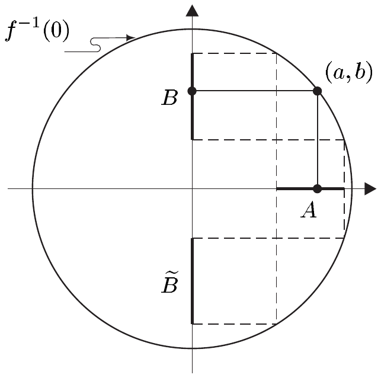
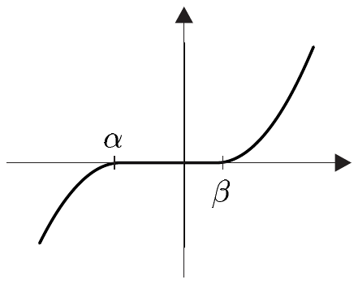
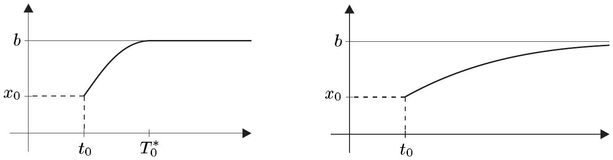
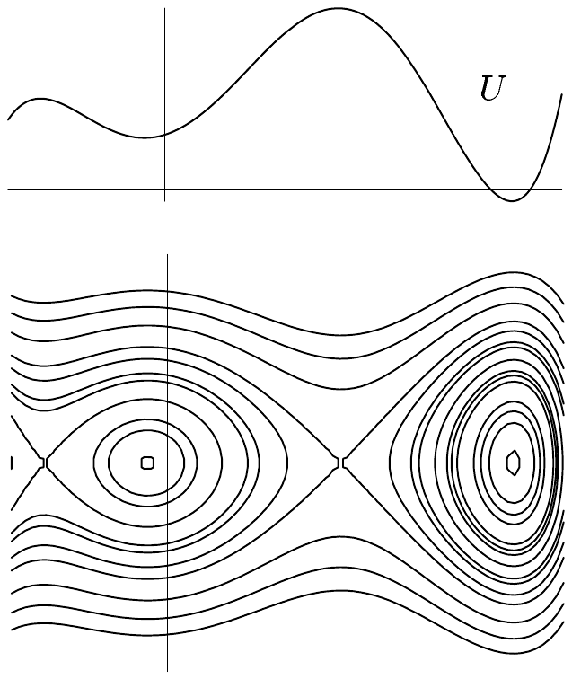

## 8 隐函数

在前几节中，我们（在有限维情形下）研究了非线性方程组的可解性。我们集中于方程个数等于变量个数的情形。现在，我们探讨未知量多于方程的非线性系统的可解性。

我们将证明主要结果——隐函数定理，而不去为在一般巴拿赫空间上证明它所需的本质上是辅助性的考虑所困扰。为说明这一基本定理，我们证明常微分方程的基本存在性与连续性定理。隐函数定理的有限维应用将在随后两节中处理。

作为动机，我们考虑函数 $ f:\mathbb{R}^{2}\to\mathbb{R} $，$ (x,y)\mapsto x^{2}+y^{2}-1 $。设 $ (a,b)\in\mathbb{R}^{2} $，其中 $ a\ne\pm 1 $，$ b>0 $ 且 $ f(a,b)=0 $。则存在开区间 $ A $ 与 $ B $，$ a\in A $、$ b\in B $，使得对每个 $ x\in A $ 恰存在一个 $ y\in B $ 满足 $ f(x,y)=0 $。通过对应 $ x\mapsto y $，我们定义映射 $ g:A\to B $，满足对 $ x\in A $ 有 $ f(x,g(x))=0 $。显然，我们有 $ g(x)=\sqrt{1-x^{2}} $。此外，存在开区间 $ \widetilde{B} $ 使得 $ -b\in\widetilde{B} $，以及一个 $ \widetilde{g}:A\to\widetilde{B} $ 使得对 $ x\in A $ 有 $ f(x,\widetilde{g}(x))=0 $。这里，我们有 $ \widetilde{g}(x)=-\sqrt{1-x^{2}} $。函数 $ g $ 在 $ A $ 上由 $ f $ 与 $ (a,b) $ 唯一确定，而函数 $ \widetilde{g} $ 由 $ f $ 与 $ (a,-b) $ 定义。因此我们说 $ g $ 与 $ \widetilde{g} $ 分别在 $ (a,b) $ 与 $ (a,-b) $ 附近由 $ f $ 隐式定义。函数 $ g $ 与 $ \widetilde{g} $ 分别是方程 $ f(x,y)=0 $ 在 $ (a,b) $ 与 $ (a,-b) $ 附近关于 $ y $（作为 $ x $ 的函数）的**解**。我们说 $ f(x,y)=0 $ 在 $ (a,b) $ 附近**隐式地**定义了 $ g $。

这样的解显然不能在 $ (1,0) $ 或 $ (-1,0) $ 的邻域中给出。为提示障碍所在，我们注意到，对 $ a=\pm 1 $，有 $ \partial_{2}f(a,b)=0 $；而对 $ a\ne\pm 1 $，这一量不消失，因为 $ \partial_{2}f(a,b)=2b $。

##### 积空间上的可微映射

这里，设

- $ E_{1} $、$ E_{2} $ 与 $ F $ 是 $ \mathbb{K} $ 上的巴拿赫空间；
  $ q\in\mathbb{N}^{\times}\cup\{\infty\} $。

设 $ X_{j} $ 在 $ E_{j} $ 中开，$ j=1,2 $，且 $ f:X_{1}\times X_{2}\to F $ 在 $ (a,b) $ 处可微。则函数 $ f(\cdot,b):X_{1}\to F $ 与 $ f(a,\cdot):X_{2}\to F $ 也分别在 $ a $ 与 $ b $ 处可微。为避免与标准偏导数混淆，我们用 $ D_{1}f(a,b) $ 记 $ f(\cdot,b) $ 在 $ a $ 处的导数，用 $ D_{2}f(a,b) $ 记 $ f(a,\cdot) $ 在 $ b $ 处的导数，

8.1 注 (a) 显然 $ D_{j}f:X_{1}\times X_{2}\to\mathcal{L}(E_{j},F) $，$ j=1,2 $。

(b) 陈述

(i) $ f\in C^{q}(X_{1}\times X_{2},F) $ 且

(ii) $ D_{j}f\in C^{q-1}(X_{1}\times X_{2},\mathcal{L}(E_{j},F)) $，$ j=1,2 $

是等价的。据此，我们有

\[ \partial f(a,b)(h,k)=D_{1}f(a,b)h+D_{2}f(a,b)k \]

对 $ (a,b)\in X_{1}\times X_{2} $ 与 $ (h,k)\in E_{1}\times E_{2} $（见定理 5.4 与命题 2.8）。

证明 “(i)$ \Rightarrow $(ii)” 这一蕴含是显然的。

“(ii)$ \Rightarrow $(i)” 设 $ (a,b)\in X_{1}\times X_{2} $ 且

\[ A(h,k):=D_{1}f(a,b)h+D_{2}f(a,b)k\qquad\text{对 }(h,k)\in E_{1}\times E_{2} \ . \]

容易验证 $ A $ 属于 $ \mathcal{L}(E_{1}\times E_{2},F) $。积分形式的中值定理（定理 3.10）给出

\[ \begin{aligned} f(a+h,b+k)-f(a,b)-A(h,k)&=f(a+h,b+k)-f(a,b+k)\\ &\quad{}+f(a,b+k)-f(a,b)-A(h,k)\\ &=\int_{0}^{1}\left[D_{1}f(a+th,b+k)-D_{1}f(a,b)\right]h\,dt\\ &\qquad{}+f(a,b+k)-f(a,b)-D_{2}f(a,b)k\end{aligned} \]

只要 $ \max\{\|h\|,\|k\|\} $ 足够小。由此，我们得到估计

\[ \|f(a+h,b+k)-f(a,b)-A(h,k)\|\le\varphi(h,k)\max\{\|h\|,\|k\|\} \]

其中

\[ \varphi(h,k):=\max_{0\le t\le 1}\|D_{1}f(a+th,b+k)-D_{1}f(a,b)\|+\frac{\|f(a,b+k)-f(a,b)-D_{2}f(a,b)k\|}{\|k\|}\ . \]

现在 $ D_{1}f $ 的连续性给出，当 $ (h,k)\to(0,0) $ 时 $ \varphi(h,k)\to 0 $。于是我们看到

\[ f(a+h,b+k)-f(a,b)-A(h,k)=o(\|(h,k)\|)\qquad((h,k)\to(0,0)) \ . \]

因此 $ f $ 在 $ (a,b) $ 处可微，且 $ \partial f(a,b)=A $。最后，对 $ D_{j}f $ 的正则性假设与 $ A $ 的定义蕴含 $ \partial f\in C^{q-1}(X_{1}\times X_{2},F) $，从而 $ f\in C^{q}(X_{1}\times X_{2},F) $。■

(c) 在特殊情形 $ E_{1}=\mathbb{R}^{m} $、$ E_{2}=\mathbb{R}^{n} $、$ F=\mathbb{R}^{\ell} $ 下，我们有

\[ [D_{1}f]=\begin{bmatrix}\partial_{1}f^{1} & \cdots & \partial_{m}f^{1}\\ \vdots & & \vdots\\ \partial_{1}f^{\ell} & \cdots & \partial_{m}f^{\ell}\end{bmatrix}\ ,\qquad[D_{2}f]=\begin{bmatrix}\partial_{m+1}f^{1} & \cdots & \partial_{m+n}f^{1}\\ \vdots & & \vdots\\ \partial_{m+1}f^{\ell} & \cdots & \partial_{m+n}f^{\ell}\end{bmatrix} \]

其中 $ f=(f^{1},\ldots,f^{\ell}) $。

证明 这由 (b) 与推论 2.9 推出。■

##### 隐函数定理

借助我们刚学到的内容，我们可以转而研究非线性方程的可解性。这一结果是基本的。

8.2 定理（隐函数） 设 $ W $ 在 $ E_{1}\times E_{2} $ 中开且 $ f\in C^{q}(W,F) $。进一步，设 $ (x_{0},y_{0})\in W $ 使得

\[ f(x_{0},y_{0})=0\quad\text{且}\quad D_{2}f(x_{0},y_{0})\in\operatorname{Lis}(E_{2},F) \ . \]

则存在开邻域 $ U\in\mathfrak{U}_{W}(x_{0},y_{0}) $ 与 $ V\in\mathfrak{U}_{E_{1}}(x_{0}) $，以及唯一的 $ g\in C^{q}(V,E_{2}) $，使得

\[ \left((x,y)\in U\text{ 且 }f(x,y)=0\right)\iff\left(x\in V\text{ 且 }y=g(x)\right) \ .\tag{8.1} \]

此外，

\[ \partial g(x)=-\left[D_{2}f(x,g(x))\right]^{-1}D_{1}f(x,g(x))\qquad\text{对 }x\in V \ .\tag{8.2} \]

证明 (i) 令 $ A:=D_{2}f(x_{0},y_{0})\in\operatorname{Lis}(E_{2},F) $ 且 $ \widetilde{f}:=A^{-1}f\in C^{q}(W,E_{2}) $。则

\[ \widetilde{f}(x_{0},y_{0})=0\quad\text{且}\quad D_{2}\widetilde{f}(x_{0},y_{0})=I_{E_{2}} \ . \]

于是，根据习题 5.1，我们不失一般性地考虑情形 $ F=E_{2} $ 且 $ D_{2}f(x_{0},y_{0})=I_{E_{2}} $。此外，对开邻域 $ W_{1}\in\mathfrak{U}_{E_{1}}(x_{0}) $ 与 $ W_{2}\in\mathfrak{U}_{E_{2}}(y_{0}) $，我们可以假设 $ W=W_{1}\times W_{2} $。

(ii) 对映射

\[ \varphi:W_{1}\times W_{2}\to E_{1}\times E_{2}\ ,\quad(x,y)\mapsto(x,f(x,y)) \]

我们有 $ \varphi\in C^{q}(W_{1}\times W_{2},E_{1}\times E_{2}) $，且\footnote{此处及类似情形下，我们使用自然的矩阵记号。}

\[ \partial\varphi(x_{0},y_{0})=\begin{bmatrix}I_{E_{1}} & 0\\ D_{1}f(x_{0},y_{0}) & I_{E_{2}}\end{bmatrix}\in\mathcal{L}(E_{1}\times E_{2}) \ . \]

我们立即验证

\[ \begin{bmatrix}I_{E_{1}} & 0\\ -D_{1}f(x_{0},y_{0}) & I_{E_{2}}\end{bmatrix}\in\mathcal{L}(E_{1}\times E_{2}) \]

是 $ \partial\varphi(x_{0},y_{0}) $ 的逆。因此，我们有 $ \partial\varphi(x_{0},y_{0})\in\operatorname{Laut}(E_{1}\times E_{2}) $，又因为 $ \varphi(x_{0},y_{0})=(x_{0},0) $，反函数定理（定理 7.3）保证存在开邻域 $ U\in\mathfrak{U}_{E_{1}\times E_{2}}(x_{0},y_{0}) $ 与 $ X\in\mathfrak{U}_{E_{1}\times E_{2}}(x_{0},0) $，使得 $ \varphi|U\in\operatorname{Diff}^{q}(U,X) $。我们令 $ \psi:=(\varphi|U)^{-1}\in\operatorname{Diff}^{q}(X,U) $，并把 $ \psi $ 写成

\[ \psi(\xi,\eta)=(\psi_{1}(\xi,\eta),\psi_{2}(\xi,\eta))\qquad\text{对 }(\xi,\eta)\in X \ . \]

则 $ \psi_{j}\in C^{q}(X,E_{2}) $，$ j=1,2 $，而 $ \varphi $ 的定义表明

\[ (\xi,\eta)=\varphi(\psi(\xi,\eta))=(\psi_{1}(\xi,\eta),f(\psi_{1}(\xi,\eta),\psi_{2}(\xi,\eta)))\qquad\text{对 }(\xi,\eta)\in X \ . \]

因此，我们识别出

\[ \psi_{1}(\xi,\eta)=\xi\quad\text{且}\quad\eta=f(\xi,\psi_{2}(\xi,\eta))\qquad\text{对 }(\xi,\eta)\in X \ .\tag{8.3} \]

此外，$ V:=\{x\in E_{1};(x,0)\in X\} $ 是 $ x_{0} $ 在 $ E_{1} $ 中的开邻域，且对 $ g(x):=\psi_{2}(x,0) $（$ x\in V $），我们有 $ g\in C^{q}(V,E_{2}) $ 且

\[ \begin{aligned}(x,f(x,g(x)))&=(\psi_{1}(x,0),f(\psi_{1}(x,0),\psi_{2}(x,0)))\\ &=\varphi(\psi_{1}(x,0),\psi_{2}(x,0))=\varphi\circ\psi(x,0)=(x,0)\end{aligned} \]

对 $ x\in V $。这与 (8.3) 一起蕴含 (8.1)。$ g $ 的唯一性是显然的。

(iii) 我们令 $ h(x):=f(x,g(x)) $，$ x\in V $。则 $ h=0 $，且链式法则与注 8.1(b) 一起蕴含

\[ \partial h(x)=D_{1}f(x,g(x))I_{E_{1}}+D_{2}f(x,g(x))\partial g(x)=0\qquad\text{对 }x\in V \ .\tag{8.4} \]

由 $ q\ge 1 $ 可得

\[ D_{2}f\in C^{q-1}(U,\mathcal{L}(E_{2}))\subset C(U,\mathcal{L}(E_{2})) \ . \]

根据命题 7.2(i)，$ \operatorname{Laut}(E_{2}) $ 在 $ \mathcal{L}(E_{2}) $ 中开。因此

\[ \left((D_{2}f)^{-1}(\operatorname{Laut}(E_{2}))\right)\cap U=\{(x,y)\in U;D_{2}f(x,y)\in\operatorname{Laut}(E_{2})\} \]

是 $ (x_{0},y_{0}) $ 在 $ U $ 中的开邻域。通过缩小 $ U $，我们因此可以假设对 $ (x,y)\in U $ 有 $ D_{2}f(x,y)\in\operatorname{Laut}(E_{2}) $。于是由 (8.4) 得到 (8.2)。■

8.3 注 定理 8.2 说的是，在 $ (x_{0},y_{0}) $ 附近，纤维 $ f^{-1}(0) $ 是一个 $ C^{q} $ 函数的图像。■

通过在特殊情形 $ E_{1}=\mathbb{R}^{m} $ 与 $ E_{2}=F=\mathbb{R}^{n} $ 下表述隐函数定理，我们得到关于“依赖于参数的非线性方程组的局部可解性”的陈述。

8.4 推论 设 $ W $ 在 $ \mathbb{R}^{m+n} $ 中开且 $ f\in C^{q}(W,\mathbb{R}^{n}) $。又设 $ (a,b)\in W $ 使得 $ f(a,b)=0 $，即

\[ \begin{array}{c}f^{1}(a^{1},\ldots,a^{m},b^{1},\ldots,b^{n})=0\ ,\\ \vdots\\ f^{n}(a^{1},\ldots,a^{m},b^{1},\ldots,b^{n})=0\ .\end{array} \]

则若

\[ \frac{\partial(f^{1},\ldots,f^{n})}{\partial(x^{m+1},\ldots,x^{m+n})}(a,b):=\det\left[\partial_{m+k}f^{j}(a,b)\right]_{1\le j,k\le n}\ne 0\ , \]

则存在 $ (a,b) $ 在 $ W $ 中的开邻域 $ U $、$ a $ 在 $ \mathbb{R}^{m} $ 中的开邻域 $ V $，以及 $ g\in C^{q}(V,\mathbb{R}^{n}) $，使得

\[ \left((x,y)\in U\text{ 且 }f(x,y)=0\right)\iff\left(x\in V\text{ 且 }y=g(x)\right) \ . \]

也就是说，存在 $ a $ 在 $ \mathbb{R}^{m} $ 中的邻域 $ V $，使得方程组

\[ \begin{array}{c}f^{1}(x^{1},\ldots,x^{m},y^{1},\ldots,y^{n})=0\ ,\\ \vdots\\ f^{n}(x^{1},\ldots,x^{m},y^{1},\ldots,y^{n})=0\end{array} \]

在 $ b=(b^{1},\ldots,b^{n}) $ 附近，对每个 $ m $ 元组 $ (x^{1},\ldots,x^{m})\in V $ 恰有一个解

\[ \begin{array}{c}y^{1}=g^{1}(x^{1},\ldots,x^{m})\ ,\\ \vdots\\ y^{n}=g^{n}(x^{1},\ldots,x^{m})\end{array} \]

此外，解 $ g^{1},\ldots,g^{n} $ 是来自 $ V $ 的“参数” $ (x^{1},\ldots,x^{m}) $ 的 $ C^{q} $ 函数，且

\[ [\partial g(x)]=-\begin{bmatrix}\partial_{m+1}f^{1} & \cdots & \partial_{m+n}f^{1}\\ \vdots & & \vdots\\ \partial_{m+1}f^{n} & \cdots & \partial_{m+n}f^{n}\end{bmatrix}^{-1}\begin{bmatrix}\partial_{1}f^{1} & \cdots & \partial_{m}f^{1}\\ \vdots & & \vdots\\ \partial_{1}f^{n} & \cdots & \partial_{m}f^{n}\end{bmatrix} \]

对 $ x\in V $，其中导数 $ \partial_{k}f^{j} $ 在 $ (x,g(x)) $ 处取值。

证明 因为 $ D_{2}f(x,y) $ 属于 $ \operatorname{Laut}(\mathbb{R}^{n}) $ 当且仅当

\[ \frac{\partial(f^{1},\ldots,f^{n})}{\partial(x^{m+1},\ldots,x^{m+n})}(x,y)\ne 0\ , \]

所以由定理 8.2 与注 8.1(c) 验证所有断言。■

##### 正则值

设 $ X $ 在 $ \mathbb{R}^{m} $ 中开，且 $ f:X\to\mathbb{R}^{n} $ 可微。若 $ \partial f(x)\in\mathcal{L}(\mathbb{R}^{m},\mathbb{R}^{n}) $ 是满射，则称 $ x\in X $ 为 $ f $ 的**正则点**。若 $ X $ 中每一点都正则，则称该映射**正则**或为**淹没**。最后，若纤维 $ f^{-1}(y) $ 只由正则点组成，则称 $ y\in\mathbb{R}^{n} $ 为 $ f $ 的**正则值**。

8.5 注 (a) 若 $ m<n $，则 $ f $ 没有正则点。

证明 这由 $ \operatorname{rank}(\partial f(x))\le m $ 推出。■

(b) 若 $ n\le m $，则 $ x\in X $ 是 $ f $ 的正则点当且仅当 $ \partial f(x) $ 的秩\footnote{设 $ E $ 与 $ F $ 是有限维巴拿赫空间，且 $ A\in\mathcal{L}(E,F) $。则 $ A $ 的秩定义为 $ \operatorname{rank}(A):=\dim(\operatorname{im}(A)) $。显然，$ \operatorname{rank}(A) $ 与表示矩阵 $ [A]_{\mathcal{E},\mathcal{F}} $ 在 $ E $ 的任意基 $ \mathcal{E} $ 与 $ F $ 的任意基 $ \mathcal{F} $ 下的线性代数秩相同。}为 $ n $。

(c) 若 $ n=1 $，则 $ x $ 是 $ f $ 的正则点当且仅当 $ \nabla f(x)\ne 0 $。

(d) 每个 $ y\in\mathbb{R}^{n}\setminus\operatorname{im}(f) $ 都是 $ f $ 的正则值。

(e) 设 $ x_{0}\in X $ 是 $ f $ 的正则点，且 $ f(x_{0})=0 $。则存在 $ n $ 个变量，它们唯一地解出方程组

\[ \begin{array}{c}f^{1}(x^{1},\ldots,x^{m})=0\ ,\\ \vdots\\ f^{n}(x^{1},\ldots,x^{m})=0\end{array} \]

在 $ x_{0} $ 的邻域内作为其余 $ m-n $ 个变量的函数。当 $ f $ 属于 $ C^{q} $ 类时，这些解也是 $ C^{q} $ 函数。

证明 由 (a)，我们有 $ m\ge n $。此外，我们可以通过适当地置换 $ \mathbb{R}^{m} $ 中的坐标，即通过 $ \mathbb{R}^{m} $ 的一个适当的正交变换，使得

\[ \frac{\partial(f^{1},\ldots,f^{n})}{\partial(x^{m-n+1},\ldots,x^{m})}(x_{0})\ne 0 \]

于是该注由推论 8.4 推出。■

(f) 设 $ 0\in\operatorname{im}(f) $ 是 $ f\in C^{q}(X,\mathbb{R}^{n}) $ 的正则值。则对每个 $ x_{0}\in f^{-1}(0) $，存在 $ \mathbb{R}^{m} $ 中的邻域 $ U $，使得 $ f^{-1}(0)\cap U $ 是 $ m-n $ 个变量的一个 $ C^{q} $ 函数的图像。

证明 这由 (e) 与注 8.3 推出。■

##### 常微分方程

在第 1 节中，我们利用指数映射来处理*线性*微分方程的存在性与唯一性问题。接下来，我们处理形如 $ \dot{x}=f(t,x) $ 的微分方程，其中 $ f $ 现在可以是非线性的。

在本节其余部分，设

- $ J $ 是 $ \mathbb{R} $ 中的开区间；
  $ E $ 是巴拿赫空间；
  $ D $ 是 $ E $ 的开子集；
  $ f\in C(J\times D,E) $。

函数 $ u:J_{u}\to D $ 称为 $ E $ 中微分方程 $ \dot{x}=f(t,x) $ 的**解**，如果 $ J_{u} $ 是 $ J $ 的完全子区间，$ u\in C^{1}(J_{u},D) $，且

\[ \dot{u}(t)=f(t,u(t))\qquad\text{对 }t\in J_{u} \ . \]

给定 $ (t_{0},x_{0})\in J\times D $，则这一对

\[ \dot{x}=f(t,x)\text{ 且 }x(t_{0})=x_{0}\tag{8.5;(t_0,x_0)} \]

成为 $ \dot{x}=f(t,x) $ 的一个**初值问题**。若 $ u $ 满足微分方程 $ \dot{x}=f(t,x) $ 且 $ u(t_{0})=x_{0} $，则映射 $ u:J_{u}\to D $ 是 $ (8.5)_{(t_{0},x_{0})} $ 的一个**解**。如果没有 $ (8.5)_{(t_{0},x_{0})} $ 的解 $ v:J_{v}\to D $ 使得 $ v\supset u $ 且 $ v\ne u $，则它是**不可延拓的**（或**极大的**）。此时 $ J_{u} $ 是 $ (8.5)_{(t_{0},x_{0})} $ 的一个**最大存在区间**。当 $ J_{u}=J $ 时，我们称 $ u $ 是 $ (8.5)_{(t_{0},x_{0})} $ 的一个**全局**解。

8.6 注 (a) 全局解是不可延拓的。

(b) 设 $ J_{u} $ 是 $ J $ 的完全子区间。则 $ u\in C(J_{u},D) $ 是 $ (8.5)_{(t_{0},x_{0})} $ 的解当且仅当 $ u $ 满足积分方程

\[ u(t)=x_{0}+\int_{t_{0}}^{t}f(s,u(s))\,ds\qquad\text{对 }t\in J_{u} \ . \]

证明 因为 $ s\mapsto f(s,u(s)) $ 连续，该注由微积分基本定理容易推出。■

(c) 设 $ A\in\mathcal{L}(E) $ 且 $ g\in C(\mathbb{R},E) $。则初值问题

\[ \dot{x}=Ax+g(t)\text{ 且 }x(t_{0})=x_{0} \]

有唯一的全局解

\[ u(t)=e^{(t-t_{0})A}x_{0}+\int_{t_{0}}^{t}e^{(t-s)A}g(s)\,ds\qquad\text{对 }t\in\mathbb{R} \ . \]

证明 这是定理 1.17 的推论。■

(d) 当 $ E=\mathbb{R} $ 时，称 $ \dot{x}=f(t,x) $ 为**标量**微分方程。

(e) 初值问题

\[ \dot{x}=x^{2}\text{ 且 }x(t_{0})=x_{0}\tag{8.6} \]

对 $ (t_{0},x_{0})\in\mathbb{R}^{2} $ 至多有一个解。

证明 设 $ u\in C^{1}(J_{u},\mathbb{R}) $ 与 $ v\in C^{1}(J_{v},\mathbb{R}) $ 是 (8.6) 的解。对 $ t\in J_{u}\cap J_{v} $，令 $ w(t):=u(t)-v(t) $，并设 $ I $ 是 $ J_{u}\cap J_{v} $ 的紧致子区间，且 $ t_{0}\in I $。则只需验证 $ w $ 在 $ I $ 上消失。由 (b)，我们有

\[ w(t)=u(t)-v(t)=\int_{t_{0}}^{t}\left(u^{2}(s)-v^{2}(s)\right)ds=\int_{t_{0}}^{t}(u(s)+v(s))w(s)\,ds\qquad\text{对 }t\in I \ . \]

令 $ \alpha:=\max_{s\in I}|u(s)+v(s)| $，可得

\[ |w(t)|\le\alpha\left|\int_{t_{0}}^{t}|w(s)|\,ds\right|\qquad\text{对 }t\in I\ , \]

而该断言由格朗沃尔引理推出。■

(f) 初值问题 (8.6) 对 $ x_{0}\ne 0 $ 没有全局解。

证明 设 $ u\in C^{1}(J_{u},\mathbb{R}) $ 是 (8.6) 的满足 $ x_{0}\ne 0 $ 的解。因为 0 是初值 $ (t_{0},0) $ 的唯一全局解，由 (e) 可得对 $ t\in J_{u} $ 有 $ u(t)\ne 0 $。因此 (8.6) 蕴含

\[ \frac{\dot{u}}{u^{2}}=\left(-\frac{1}{u}\right)^{\cdot}=1 \]

在 $ J_{u} $ 上。通过积分，我们得到

\[ \frac{1}{x_{0}}-\frac{1}{u(t)}=t-t_{0}\qquad\text{对 }t\in J_{u}\ , \]

因此

\[ u(t)=1/(t_{0}-t+1/x_{0})\qquad\text{对 }t\in J_{u} \ . \]

于是我们得到 $ J_{u}\ne J=\mathbb{R} $。■

(g) 初值问题 (8.6) 对每个 $ (t_{0},x_{0})\in\mathbb{R}^{2} $ 有唯一的不可延拓解 $ u(\cdot,t_{0},x_{0})\in C^{1}(J(t_{0},x_{0}),\mathbb{R}) $，其中

\[ J(t_{0},x_{0})=\begin{cases}(t_{0}+1/x_{0},\infty)\ , & x_{0}<0\ ,\\ \mathbb{R}\ , & x_{0}=0\ ,\\ (-\infty,t_{0}+1/x_{0})\ , & x_{0}>0\ ,\end{cases} \]

且

\[ u(t,t_{0},x_{0})=\begin{cases}0\ , & x_{0}=0\ ,\\ 1/(t_{0}-t+1/x_{0})\ , & x_{0}\ne 0\ .\end{cases} \]

证明 这由 (e) 与 (f) 的证明推出。■

(h) 标量初值问题

\[ \dot{x}=2\sqrt{|x|}\ ,\quad x(0)=0\tag{8.7} \]

有不可数多个全局解。

证明 显然 $ u_{0}\equiv 0 $ 是一个全局解。对 $ \alpha<0<\beta $，令

\[ u_{\alpha,\beta}(t):=\begin{cases}-(t-\alpha)^{2}\ , & t\in(-\infty,\alpha]\ ,\\ 0\ , & t\in(\alpha,\beta)\ ,\\ (t-\beta)^{2}\ , & t\in[\beta,\infty)\ .\end{cases} \]

容易验证 $ u_{\alpha,\beta} $ 是 (8.7) 的一个全局解。■

##### 分离变量法

一般不可能“显式地”解出给定的微分方程。不过，对某些标量微分方程，可以借助隐函数定理给出初值问题的唯一局部解。

函数 $ \Phi:J\times D\to\mathbb{R} $ 称为 $ \dot{x}=f(t,x) $ 的**首次积分**，如果对 $ \dot{x}=f(t,x) $ 的每个解 $ u:J_{u}\to D $，映射

\[ J_{u}\to\mathbb{R}\ ,\quad t\mapsto\Phi(t,u(t)) \]

是常值。若此外

\[ \Phi\in C^{1}(J\times D,\mathbb{R})\quad\text{且}\quad\partial_{2}\Phi(t,x)\ne 0\qquad\text{对 }(t,x)\in J\times D\ , \]

则 $ \Phi $ 是**正则首次积分**。

8.7 命题 设 $ \Phi $ 是标量微分方程 $ \dot{x}=f(t,x) $ 的正则首次积分，且

\[ f(t,x)=-\partial_{1}\Phi(t,x)/\partial_{2}\Phi(t,x)\qquad\text{对 }(t,x)\in J\times D \ . \]

则对每个 $ (t_{0},x_{0})\in J\times D $，存在 $ J $ 的开区间 $ I $ 与 $ D $ 中的 $ U $，$ (t_{0},x_{0})\in I\times U $，使得初值问题

\[ \dot{x}=f(t,x)\ ,\quad x(t_{0})=x_{0} \]

在 $ I $ 上恰有一个满足 $ u(I)\subset U $ 的解 $ u $。这通过对 $ x $ 解方程 $ \Phi(t,x)=\Phi(t_{0},x_{0}) $ 得到。

证明 这由定理 8.2 立即推出。■

通过适当地选取 $ \Phi $，我们得到一类重要的具有“分离变量”的标量微分方程。如下一推论所示，我们可以用求积法解这些方程。

8.8 命题 设 $ g\in C(J,\mathbb{R}) $ 且 $ h\in C(D,\mathbb{R}) $，对 $ x\in D $ 有 $ h(x)\ne 0 $。又设 $ G\in C^{1}(J,\mathbb{R}) $ 与 $ H\in C^{1}(D,\mathbb{R}) $ 分别是 $ g $ 与 $ h $ 的原函数。则

\[ \Phi(t,x):=G(t)-H(x)\qquad\text{对 }(t,x)\in J\times D\ , \]

是 $ \dot{x}=g(t)/h(x) $ 的正则首次积分。

证明 显然 $ \Phi $ 属于 $ C^{1}(J\times D,\mathbb{R}) $，且 $ \partial_{2}\Phi(t,x)=-h(x)\ne 0 $。现在设 $ u\in C^{1}(J_{u},D) $ 是 $ \dot{x}=g(t)/h(x) $ 的解。则由链式法则可得

\[ \begin{aligned}\left[\Phi(t,u(t))\right]^{\cdot}&=\partial_{1}\Phi(t,u(t))+\partial_{2}\Phi(t,u(t))\dot{u}(t)\\ &=g(t)-h(u(t))\cdot\frac{g(t)}{h(u(t))}=0\ .\end{aligned} \]

因此 $ t\mapsto\Phi(t,u(t)) $ 在 $ J_{u} $ 上常值。■

8.9 推论（分离变量法） 设 $ g\in C(J,\mathbb{R}) $ 且 $ h\in C(D,\mathbb{R}) $，对 $ x\in D $ 有 $ h(x)\ne 0 $。则初值问题

\[ \dot{x}=g(t)/h(x)\ ,\quad x(t_{0})=x_{0} \]

对每个 $ (t_{0},x_{0})\in J\times D $ 有唯一的局部解。该解可通过解方程

\[ \int_{x_{0}}^{x}h(\xi)\,d\xi=\int_{t_{0}}^{t}g(\tau)\,d\tau\tag{8.8} \]

关于 $ x $ 得到。

证明 这是定理 8.7 与 8.8 的直接推论。■

8.10 注 在推论 8.9 的假设下，

\[ \frac{dx}{dt}=\frac{g(t)}{h(x)}\ ,\quad x(t_{0})=x_{0} \]

形式上蕴含 $ h(x)\,dx=g(t)\,dt $，即“分离变量方程”。形式积分然后给出 (8.8)。■

8.11 例 (a) 我们考虑初值问题

\[ \dot{x}=1+x^{2}\ ,\quad x(t_{0})=x_{0}\ .\tag{8.9} \]

令 $ g:=1 $ 与 $ h:=1/(1+X^{2}) $，由推论 8.9 可得

\[ \arctan x-\arctan x_{0}=\int_{x_{0}}^{x}\frac{d\xi}{1+\xi^{2}}=\int_{t_{0}}^{t}d\tau=t-t_{0} \ . \]

因此

\[ x(t)=\tan(t-\alpha)\qquad\text{对 }t\in(\alpha-\pi/2,\alpha+\pi/2) \]

且 $ \alpha:=t_{0}-\arctan x_{0} $ 是 (8.9) 的唯一极大解。特别地，(8.9) 没有全局解。

(b) 设 $ \alpha>0 $，$ D:=(0,\infty) $ 且 $ x_{0}>0 $。对

\[ \dot{x}=x^{1+\alpha}\ ,\quad x(0)=x_{0}\ ,\tag{8.10} \]

推论 8.9 蕴含

\[ \int_{x_{0}}^{x}\xi^{-1-\alpha}\,d\xi=t \ . \]

因此

\[ x(t)=(x_{0}^{-\alpha}-\alpha t)^{-1/\alpha}\qquad\text{对 }-\infty<t<x_{0}^{-\alpha}/\alpha \]

是 (8.10) 的唯一极大解，因此它不是全局可解的。

(c) 在 $ D:=(1,\infty) $ 上，我们考虑初值问题

\[ \dot{x}=x\log x\ ,\quad x(0)=x_{0}\ .\tag{8.11} \]

因为 $ \log\circ\log $ 是 $ x\mapsto 1/(x\log x) $ 在 $ D $ 上的原函数，由推论 8.9 我们得到

\[ \log(\log x)-\log(\log x_{0})=\int_{x_{0}}^{x}\frac{d\xi}{\xi\log\xi}=\int_{0}^{t}d\tau=t \ . \]

由此我们导出

\[ x(t)=x_{0}^{(e^{t})}\qquad\text{对 }t\in\mathbb{R}\ , \]

是 (8.11) 的唯一全局解。

(d) 设 $ -\infty<a<b<\infty $ 且 $ f\in C((a,\infty),\mathbb{R}) $，使得对 $ x\in(a,b) $ 有 $ f(x)>0 $ 且 $ f(b)=0 $。对 $ x_{0}\in(a,b) $ 与 $ t_{0}\in\mathbb{R} $，我们考虑初值问题

\[ \dot{x}=f(x)\ ,\quad x(t_{0})=x_{0} \ . \]

根据推论 8.9，我们通过解

\[ t=t_{0}+\int_{x_{0}}^{x}\frac{d\xi}{f(\xi)}=:H(x) \]

关于 $ x $ 得到唯一局部解 $ u:J_{u}\to(a,b) $。因为 $ H'=1/f $，$ H $ 严格递增。因此 $ u=H^{-1} $，且 $ J_{u} $ 与 $ H((a,b)) $ 一致。此外

\[ T^{*}:=\lim_{x\to b-0}H(x)=\sup J_{u} \]

在 $ \overline{\mathbb{R}} $ 中存在，且

\[ T^{*}<\infty\iff\int_{x_{0}}^{b}\frac{d\xi}{f(\xi)}<\infty \ . \]

现在 $ \lim_{t\to T^{*}-0}u(t)=b $ 蕴含

\[ \lim_{t\to T^{*}-0}\dot{u}(t)=\lim_{t\to T^{*}-0}f(u(t))=0 \ . \]

在 $ T^{*}<\infty $ 的情形下，则由命题 IV.1.16 可得

\[ v(t):=\begin{cases}u(t)\ , & t\in J_{u}\ ,\\ b\ , & t\in[T^{*},\infty)\ ,\end{cases} \]

给出 $ u $ 的一个延拓。对

\[ T_{*}:=\lim_{x\to a+0}H(x)=\inf J_{u} \]

的类似考虑留给你。

(e) 对 $ a\in C(J,\mathbb{R}) $ 与 $ (t_{0},x_{0})\in J\times\mathbb{R} $，我们考虑初值问题

\[ \dot{x}=a(t)x\ ,\quad x(t_{0})=x_{0}\tag{8.12} \]

对**标量线性齐次微分方程** $ \dot{x}=a(t)x $，其**时变系数**为 $ a $。因此 (8.12) 有唯一的全局解

\[ x(t)=x_{0}e^{\int_{t_{0}}^{t}a(\tau)\,d\tau}\qquad\text{对 }t\in J \ . \]

证明 由格朗沃尔引理可得，(8.12) 至多有一个解。若 $ u\in C^{1}(J_{u},\mathbb{R}) $ 是一个解，且存在 $ t_{1}\in J_{u} $ 使得 $ u(t_{1})=0 $，则初值问题 $ \dot{x}=a(t)x $，$ x(t_{1})=0 $ 的唯一性结果蕴含 $ u=0 $。

因此设 $ x_{0}\ne 0 $。则由分离变量法我们得到

\[ \log|x|-\log|x_{0}|=\int_{x_{0}}^{x}\frac{d\xi}{\xi}=\int_{t_{0}}^{t}a(\tau)\,d\tau \]

从而

\[ |x(t)|=|x_{0}|e^{\int_{t_{0}}^{t}a(\tau)\,d\tau}\qquad\text{对 }t\in J \ . \]

因为对 $ t\in J $ 有 $ x(t)\ne 0 $，断言得证。■

##### 利普希茨连续性与唯一性

注 8.6(h) 表明，初值问题 $ (8.5)_{(t_{0},x_{0})} $ 一般不是唯一可解的。下面我们将看到，如果要求 $ f $ 比仅仅连续稍微正则一些，就能保证唯一性。

设 $ E $ 与 $ F $ 是巴拿赫空间，$ X\subset E $ 且 $ I\subset\mathbb{R} $。则称 $ f\in C(I\times X,F) $ 在 $ x\in X $ 中**局部利普希茨连续**，如果 $ I\times X $ 中的每个 $ (t_{0},x_{0}) $ 有邻域 $ U\times V $，使得

\[ \|f(t,x)-f(t,y)\|\le L\|x-y\|\qquad\text{对 }t\in U\text{ 且 }x,y\in V \]

对某个 $ L\ge 0 $。我们令

\[ C^{0,1-}(I\times X,F):=\{f\in C(I\times X,F);f\text{ 在 }x\in X\text{ 中局部利普希茨连续}\} \ . \]

如果 $ I $ 是单点，从而 $ f $ 有形式 $ f:X\to F $，我们称 $ f $ **局部利普希茨连续**，且

\[ C^{1-}(X,F):=\{f:X\to F;f\text{ 局部利普希茨连续}\} \ . \]

8.12 注 (a) 显然，我们有 $ C^{0,1-}(I\times X,F)\subset C(I\times X,F) $。

(b) 设 $ X $ 在 $ E $ 中开，且 $ f\in C(I\times X,F) $。假设 $ \partial_{2}f $ 存在且属于 $ C(I\times X,\mathcal{L}(E,F)) $。则 $ f\in C^{0,1-}(I\times X,F) $。

证明 设 $ (t_{0},x_{0})\in I\times X $。因为 $ \partial_{2}f $ 属于 $ C(I\times X,\mathcal{L}(E,F)) $ 且 $ X $ 在 $ E $ 中开，存在 $ \varepsilon>0 $ 使得 $ \mathbb{B}(x_{0},\varepsilon)\subset X $ 且

\[ \|\partial_{2}f(t_{0},x_{0})-\partial_{2}f(t,x)\|\le 1\qquad\text{对 }(t,x)\in U\times V\ ,\tag{8.13} \]

其中我们令 $ U:=(t_{0}-\varepsilon,t_{0}+\varepsilon)\cap I $ 与 $ V:=\mathbb{B}(x_{0},\varepsilon) $。令 $ L:=1+\|\partial_{2}f(t_{0},x_{0})\| $，由中值定理（定理 3.9）与 (8.13) 可得

\[ \|f(t,x)-f(t,y)\|\le\sup_{0\le s\le 1}\|\partial_{2}f(t,x+s(y-x))\|\,\|x-y\|\le L\|x-y\| \]

对 $ (t,x),(t,y)\in U\times V $。因此 $ f $ 在 $ x $ 中局部利普希茨连续。■

(c) 次数 $ \ge 2 $ 的多项式是局部利普希茨连续的，但不是利普希茨连续的。

(d) 设 $ I\times X $ 紧致且 $ f\in C^{0,1-}(I\times X,F) $。则 $ f $ 在 $ x\in X $ 中**一致利普希茨连续**，即存在 $ L\ge 0 $ 使得

\[ \|f(t,x)-f(t,y)\|\le L\|x-y\|\qquad\text{对 }x,y\in X\text{ 且 }t\in I \ . \]

证明 对每个 $ (t,x)\in I\times X $，存在 $ \varepsilon_{t}>0 $、$ \varepsilon_{x}>0 $ 与 $ L(t,x)\ge 0 $，使得

\[ \|f(s,y)-f(s,z)\|\le L(t,x)\|y-z\|\qquad\text{对 }(s,y),(s,z)\in\mathbb{B}(t,\varepsilon_{t})\times\mathbb{B}(x,\varepsilon_{x}) \ . \]

因为 $ I\times X $ 紧致，存在 $ (t_{0},x_{0}),\ldots,(t_{m},x_{m})\in I\times X $，使得

\[ I\times X\subset\bigcup_{j=0}^{m}\mathbb{B}(t_{j},\varepsilon_{t_{j}})\times\mathbb{B}(x_{j},\varepsilon_{x_{j}}/2) \ . \]

因为 $ f(I\times X) $ 紧致，存在 $ R>0 $ 使得 $ f(I\times X)\subset R\mathbb{B} $。我们令

\[ \delta:=\min\{\varepsilon_{x_{0}},\ldots,\varepsilon_{x_{m}}\}/2>0 \]

且

\[ L:=\max\{L(t_{0},x_{0}),\ldots,L(t_{m},x_{m}),2R/\delta\}>0 \ . \]

现在设 $ (t,x),(t,y)\in I\times X $。则存在 $ k\in\{0,\ldots,m\} $ 使得

\[ (t,x)\in\mathbb{B}(t_{k},\varepsilon_{t_{k}})\times\mathbb{B}(x_{k},\varepsilon_{x_{k}}/2) \ . \]

若 $ \|x-y\|<\delta $，我们发现 $ (t,y) $ 位于 $ \mathbb{B}(t_{k},\varepsilon_{t_{k}})\times\mathbb{B}(x_{k},\varepsilon_{x_{k}}) $ 中，且得到

\[ \|f(t,x)-f(t,y)\|\le L(t_{k},x_{k})\|x-y\|\le L\|x-y\| \ . \]

另一方面，若 $ \|x-y\|\ge\delta $，则可得

\[ \|f(t,x)-f(t,y)\|\le\frac{2R}{\delta}\cdot\delta\le L\|x-y\| \ . \]

因此 $ f $ 在 $ x\in X $ 中一致利普希茨连续。■

(e) 设 $ X $ 在 $ E $ 中紧致且 $ f\in C^{1-}(X,F) $。则 $ f $ 是利普希茨连续的。

证明 这是 (d) 的特殊情形。■

8.13 定理 设 $ f\in C^{0,1-}(J\times D,E) $，并设 $ u:J_{u}\to D $ 与 $ v:J_{v}\to D $ 是 $ \dot{x}=f(t,x) $ 的解，且对某个 $ t_{0}\in J_{u}\cap J_{v} $ 有 $ u(t_{0})=v(t_{0}) $。则对每个 $ t\in J_{u}\cap J_{v} $ 有 $ u(t)=v(t) $。

证明 设 $ I\subset J_{u}\cap J_{v} $ 是紧致区间，$ t_{0}\in I $，且 $ w:=u-v $。只需验证 $ w|I=0 $。

因为 $ K:=u(I)\cup v(I)\subset D $ 紧致，注 8.12(d) 保证存在 $ L\ge 0 $ 使得

\[ \|f(s,u(s))-f(s,v(s))\|\le L\|u(s)-v(s)\|=L\|w(s)\|\qquad\text{对 }s\in I \ . \]

因此，由

\[ w(t)=u(t)-v(t)=\int_{t_{0}}^{t}\left(f(s,u(s))-f(s,v(s))\right)ds\qquad\text{对 }t\in J_{u}\cap J_{v}\ , \]

（见注 8.6(b)）不等式

\[ \|w(t)\|\le L\left|\int_{t_{0}}^{t}\|w(s)\|\,ds\right|\qquad\text{对 }t\in I \]

成立，且格朗沃尔引理蕴含 $ w|I=0 $。■

##### 皮卡–林德勒夫定理

在下文中，设

- $ J\subset\mathbb{R} $ 是开区间；
  $ E $ 是有限维巴拿赫空间；
  $ D $ 在 $ E $ 中开；
  $ f\in C^{0,1-}(J\times D,E) $。

我们现在证明常微分方程的基本局部存在性与唯一性定理。

8.14 定理（皮卡–林德勒夫） 设 $ (t_{0},x_{0})\in J\times D $。则存在 $ \alpha>0 $，使得初值问题

\[ \dot{x}=f(t,x)\ ,\quad x(t_{0})=x_{0}\tag{8.14} \]

在 $ I:=[t_{0}-\alpha,t_{0}+\alpha] $ 上有唯一解。

证明 (i) 因为 $ J\times D\subset\mathbb{R}\times E $ 开，存在 $ a,b>0 $ 使得

\[ R:=[t_{0}-a,t_{0}+a]\times\overline{\mathbb{B}}(x_{0},b)\subset J\times D \ . \]

由 $ f $ 在 $ x $ 中的局部利普希茨连续性，我们找到 $ L>0 $ 使得

\[ \|f(t,x)-f(t,y)\|\le L\|x-y\|\qquad\text{对 }(t,x),(t,y)\in R \ . \]

最后，由 $ R $ 的紧致性与注 8.12(a) 可得，存在 $ M>0 $ 使得

\[ \|f(t,x)\|\le M\qquad\text{对 }(t,x)\in R \ . \]

(ii) 设 $ \alpha:=\min\{a,b/M,1/(2L)\}>0 $ 且 $ I:=[t_{0}-\alpha,t_{0}+\alpha] $。我们令

\[ T(y)(t):=x_{0}+\int_{t_{0}}^{t}f(\tau,y(\tau))\,d\tau\qquad\text{对 }y\in C(I,D)\ ,\quad t\in I \ . \]

如果我们能证明映射 $ T:C(I,D)\to C(I,E) $ 恰有一个不动点 $ u $，则由注 8.6(b) 可得 $ u $ 是 (8.14) 的唯一解。

(iii) 令

\[ X:=\{y\in C(I,E);y(t_{0})=x_{0},\max_{t\in I}\|y(t)-x_{0}\|\le b\} \ . \]

则 $ X $ 是巴拿赫空间 $ C(I,E) $ 的闭子集，因此是完备度量空间（见习题 II.6.4）。

对 $ y\in X $，对 $ t\in I $ 有 $ y(t)\in\overline{\mathbb{B}}(x_{0},b)\subset D $。因此 $ T(y) $ 有定义，且 $ T(y)(t_{0})=x_{0} $。此外

\[ \|T(y)(t)-x_{0}\|=\left\|\int_{t_{0}}^{t}f(\tau,y(\tau))\,d\tau\right\|\le\alpha\sup_{(t,\xi)\in R}\|f(t,\xi)\|\le\frac{b}{M}\cdot M=b \ . \]

这表明 $ T $ 把空间 $ X $ 映入自身。

(iv) 对 $ y,z\in X $，我们得到

\[ \begin{aligned}\|T(y)(t)-T(z)(t)\|&=\left\|\int_{t_{0}}^{t}\left(f(\tau,y(\tau))-f(\tau,z(\tau))\right)d\tau\right\|\\ &\le\alpha\max_{t\in I}\|f(t,y(t))-f(t,z(t))\|\le\alpha L\max_{t\in I}\|y(t)-z(t)\|\end{aligned} \]

对 $ t\in I $。利用 $ \alpha $ 的定义可得

\[ \|T(y)-T(z)\|_{C(I,E)}\le\frac{1}{2}\|y-z\|_{C(I,E)} \ . \]

因此 $ T:X\to X $ 是压缩映射。于是压缩定理（定理 IV.4.3）给出 $ X $ 中的唯一不动点 $ u $。■

8.15 注 (a) (8.14) 在 $ I $ 上的解可以用逐次逼近法（或迭代地）通过令

\[ u_{m+1}(t):=x_{0}+\int_{t_{0}}^{t}f(\tau,u_{m}(\tau))\,d\tau\qquad\text{对 }m\in\mathbb{N}\text{ 且 }t\in I\ , \]

来计算，其中对 $ t\in I $ 有 $ u_{0}(t)=x_{0} $。序列 $ (u_{m}) $ 在 $ I $ 上一致收敛到 $ u $，且我们有误差估计

\[ \|u_{m}-u\|_{C(I,E)}\le\alpha M/2^{m-1}\qquad\text{对 }m\in\mathbb{N}^{\times} \ .\tag{8.15} \]

证明 第一个断言由上一证明与定理 IV.4.3(ii) 立即推出。该定理的断言 (iii) 还给出误差估计

\[ \|u_{m}-u\|_{C(I,E)}\le 2^{-m+1}\|u_{1}-u_{0}\|_{C(I,E)} \ . \]

现在该断言成立，因为对 $ t\in I $ 我们有

\[ \|u_{1}(t)-u_{0}(t)\|=\left\|\int_{t_{0}}^{t}f(\tau,u_{0}(\tau))\,d\tau\right\|\le\alpha M \ . ■ \]

(b) 误差估计 (8.15) 可改进为

\[ \|u_{m}-u\|_{C(I,E)}<\frac{M\alpha\sqrt{e}}{2^{m}(m+1)!}\qquad\text{对 }m\in\mathbb{N}\ , \]

（见习题 11）。

(c) $ E $ 有限维的假设只用于证明 $ f(R) $ 上界 $ M $ 的存在性。因此，若把“$ E $ 有限维”的假设换成“$ f $ 在有界集上有界”，则定理 8.14 及其证明仍然正确。

(d) 虽然 $ f $ 的连续性不足以保证解 (8.14) 的唯一性，但它足以证明解的存在性（见 [Ama95, 定理 II.7.3]）。■

最后我们证明，定理 8.14 的局部解可以延拓为唯一的不可延拓解。

8.16 定理 对每个 $ (t_{0},x_{0})\in J\times D $，初值问题

\[ \dot{x}=f(t,x)\ ,\quad x(t_{0})=x_{0} \ . \]

恰有一个不可延拓解 $ u(\cdot,t_{0},x_{0}):J(t_{0},x_{0})\to D $。最大存在区间是开的，即 $ J(t_{0},x_{0})=(t^{-}(t_{0},x_{0}),t^{+}(t_{0},x_{0})) $。

证明 设 $ (t_{0},x_{0})\in J\times D $。根据定理 8.14，存在 $ \alpha_{0} $ 与 $ (8.5)_{(t_{0},x_{0})} $ 在 $ I_{0}:=[t_{0}-\alpha_{0},t_{0}+\alpha_{0}] $ 上的唯一解 $ u $。我们令 $ x_{1}:=u(t_{0}+\alpha_{0}) $ 与 $ t_{1}:=t_{0}+\alpha_{0} $，并把定理 8.14 应用于初值问题 $ (8.5)_{(t_{1},x_{1})} $。则存在 $ \alpha_{1}>0 $ 与 $ (8.5)_{(t_{1},x_{1})} $ 在 $ I_{1}:=[t_{1}-\alpha_{1},t_{1}+\alpha_{1}] $ 上的唯一解 $ v $。定理 8.13 表明对 $ t\in I_{0}\cap I_{1} $ 有 $ u(t)=v(t) $。因此

\[ u_{1}(t):=\begin{cases}u(t)\ , & t\in I_{0}\ ,\\ v(t)\ , & t\in I_{1}\ ,\end{cases} \]

是 $ (8.5)_{(t_{0},x_{0})} $ 在 $ I_{0}\cup I_{1} $ 上的解。类似的论证表明 $ u $ 可以向左延拓越过 $ t_{0}-\alpha_{0} $。现在设

\[ t^{+}:=t^{+}(t_{0},x_{0}):=\sup\{\beta\in\mathbb{R};(8.5)_{(t_{0},x_{0})}\text{ 在 }[t_{0},\beta]\text{ 上有解}\} \]

且

\[ t^{-}:=t^{-}(t_{0},x_{0}):=\inf\{\gamma\in\mathbb{R};(8.5)_{(t_{0},x_{0})}\text{ 在 }[\gamma,t_{0}]\text{ 上有解}\} \ . \]

上面的考虑表明 $ t^{+}\in(t_{0},\infty] $ 与 $ t^{-}\in[-\infty,t_{0}) $ 有良好定义，且 $ (8.5)_{(t_{0},x_{0})} $ 在 $ (t^{-},t^{+}) $ 上有不可延拓解 $ u $。现在由定理 8.13 可得 $ u $ 是唯一的。■

8.17 例 (a)（$ m $ 阶常微分方程） 设 $ E:=\mathbb{R}^{m} $ 且 $ g\in C^{0,1-}(J\times D,\mathbb{R}) $。则

\[ x^{(m)}=g(t,x,\dot{x},\ldots,x^{(m-1)})\tag{8.16} \]

是 **$ m $ 阶常微分方程**。函数 $ u:J_{u}\to\mathbb{R} $ 是 (8.14) 的**解**，如果 $ J_{u}\subset J $ 是完全区间，$ u $ 属于 $ C^{m}(J_{u},\mathbb{R}) $，

\[ \left(u(t),\dot{u}(t),\ldots,u^{(m-1)}(t)\right)\in D\qquad\text{对 }t\in J_{u}\ , \]

且

\[ u^{(m)}(t)=g\left(t,u(t),\dot{u}(t),\ldots,u^{(m-1)}(t)\right)\qquad\text{对 }t\in J_{u} \ . \]

对 $ t_{0}\in J $ 与 $ x_{0}:=(x_{0}^{0},\ldots,x_{0}^{m-1})\in D $，对

\[ \begin{array}{l}x^{(m)}=g\left(t,x,\dot{x},\ldots,x^{(m-1)}\right)\\ x(t_{0})=x_{0}^{0},\ldots,x^{(m-1)}(t_{0})=x_{0}^{m-1}\end{array}\tag{8.17;(t_0,x_0)} \]

称为 (8.16) 的具有初值 $ x_{0} $ 与初时刻 $ t_{0} $ 的**初值问题**。

在这种语言下我们有：对每个 $ (t_{0},x_{0})\in J\times D $，存在 $ (8.17)_{(t_{0},x_{0})} $ 的唯一极大解 $ u:J(t_{0},x_{0})\to\mathbb{R} $。最大存在区间 $ J(t_{0},x_{0}) $ 是开的。

证明 我们通过

\[ f(t,y):=\left(y^{2},y^{3},\ldots,y^{m},g(t,y)\right)\qquad\text{对 }t\in J\text{ 且 }y=(y^{1},\ldots,y^{m})\in D \ .\tag{8.18} \]

来定义 $ f:J\times D\to\mathbb{R}^{m} $。则 $ f $ 属于 $ C^{0,1-}(J\times D,\mathbb{R}^{m}) $。利用定理 8.16，存在 $ (8.5)_{(t_{0},x_{0})} $ 的唯一不可延拓解 $ z:J(t_{0},x_{0})\to\mathbb{R}^{m} $。然后可以容易验证 $ u:=\operatorname{pr}_{1}\circ z:J(t_{0},x_{0})\to\mathbb{R} $ 是 $ (8.17)_{(t_{0},x_{0})} $ 的解。

反之，若 $ v:J(t_{0},x_{0})\to\mathbb{R} $ 是 $ (8.17)_{(t_{0},x_{0})} $ 的解，则向量函数 $ (v,\dot{v},\ldots,v^{(m-1)}) $ 在 $ J(t_{0},x_{0}) $ 上解出初值问题 $ (8.5)_{(t_{0},x_{0})} $，其中 $ f $ 由 (8.18) 定义。由此可得 $ v=u $。类似的论证表明 $ u $ 不可延拓。■

(b)（一维牛顿运动方程） 设 $ V $ 在 $ \mathbb{R} $ 中开且 $ f\in C^{1}(V,\mathbb{R}) $。对某个 $ x_{0}\in V $，设

\[ U(x):=\int_{x_{0}}^{x}f(\xi)\,d\xi\text{ 对 }x\in V\qquad\text{且}\qquad T(y):=y^{2}/2\text{ 对 }y\in\mathbb{R} \ . \]

最后令 $ D:=V\times\mathbb{R} $ 与 $ L:=T-U $。根据例 6.14(a)，微分方程

\[ -\ddot{x}=f(x)\tag{8.19} \]

是受保守力 $ -\nabla U=f $ 作用的质点的（一维）运动的牛顿运动方程。由 (a)，我们知道 (8.19) 等价于系统

\[ \dot{x}=y\ ,\quad\dot{y}=-f(x)\tag{8.20} \]

因此等价于一阶微分方程

\[ \dot{u}=F(u)\ ,\tag{8.21} \]

其中对 $ u=(x,y)\in D $ 有 $ F(u):=(y,-f(x)) $。

函数 $ E:=T+U:D\to\mathbb{R} $，称为**总能量**，是 (8.21) 的首次积分。这意味着质点的运动**能量守恒**\footnote{见习题 6.12。}，即 (8.21) 的每个解 $ x\in C^{2}(J,V) $ 对每个 $ t\in J $ 与 $ t_{0}\in J $ 都满足 $ E(x(t),\dot{x}(t))=E(x(t_{0}),\dot{x}(t_{0})) $。

证明 显然 $ E $ 属于 $ C^{1}(D,\mathbb{R}) $。(8.20) 的每个解 $ u:J_{u}\to D $ 都有

\[ \left[E(u(t))\right]^{\cdot}=\left[y^{2}(t)/2+U(x(t))\right]^{\cdot}=y(t)\dot{y}(t)+f(x(t))\dot{x}(t)=0\qquad\text{对 }t\in J_{u} \ . \]

因此 $ E(u) $ 是常值。■

(c) 由 (b)，(8.20) 的每个解都位于总能量的一个水平集 $ E^{-1}(c) $ 中。

反之，存在性断言 (a) 意味着对 $ E $ 的某个水平集上的每一点 $ (x_{0},y_{0}) $，存在 (8.20) 的满足 $ u(0)=(x_{0},y_{0}) $ 的解。因此，$ E $ 的水平集的全体与 (8.20) 的所有（极大）解曲线之集相同；这一集合称为 (8.19) 的**相图**。

相图具有以下性质：

(i) $ E $ 的临界点恰是满足 $ f(x)=0 $ 的点 $ (x,0)\in D $。这意味着 (8.20) 的驻点位于 $ x $ 轴上，且恰是势 $ U $ 的临界点。

(ii) 每个水平集关于 $ x $ 轴对称。

(iii) 若 $ c $ 是 $ E $ 的正则值，则 $ E^{-1}(c) $ 可局部表示为某个 $ C^{2} $ 函数的图像。更精确地，对每个 $ u_{0}\in E^{-1}(c) $，存在正数 $ b $ 与 $ \varepsilon $ 以及 $ \varphi\in C^{2}((-\varepsilon,\varepsilon),\mathbb{R}) $，$ \varphi(0)=0 $，使得

\[ E^{-1}(c)\cap\mathbb{B}(u_{0},b)=\operatorname{tr}(g)\ ,\tag{8.22} \]

其中 $ g\in C^{2}((-\varepsilon,\varepsilon),\mathbb{R}^{2}) $ 定义为

\[ g(s):=\begin{cases}(s,\varphi(s))+u_{0}\ , & \partial_{2}E(u_{0})\ne 0\ ,\\ (\varphi(s),s)+u_{0}\ , & \partial_{1}E(u_{0})\ne 0\ .\end{cases} \]

(iv) 设 $ (x_{0},0) $ 是 $ E $ 的正则点且 $ c:=U(x_{0}) $。则水平集 $ E^{-1}(c) $ 与 $ x $ 轴正交相交。

证明 (i) 这由 $ \nabla E(x,y)=(y,f(x)) $ 推出。

(ii) 该陈述是 $ E(x,-y)=E(x,y) $（$ (x,y)\in D $）的推论。

(iii) 这由注 8.4(e) 与 (f) 推出。

(iv) 我们沿用 (iii) 的记号。因为

\[ \nabla E(x_{0},0)=(f(x_{0}),0)\ne(0,0)\ , \]

我们看到 (8.22) 对 $ u_{0}:=(x_{0},0) $ 与 $ g(s):=(\varphi(s)+x_{0},s) $（$ s\in(-\varepsilon,\varepsilon) $）成立。此外，由例 3.6(c) 可得

\[ 0=\left(\nabla E(x_{0},0)\,\middle|\,\dot{g}(0)\right)=\left((f(x_{0}),0)\,\middle|\,(\dot{\varphi}(0),1)\right)=f(x_{0})\dot{\varphi}(0) \ . \]

因此 $ \dot{\varphi}(0)=0 $，即 $ E^{-1}(c) $ 在 $ (x_{0},0) $ 处的切线与 $ y $ 轴平行（见注 IV.1.4(a)）。■
