## 9 流形

从注 8.5(e) 我们知道，非线性方程组在正则点附近的解集可以用图像来描述。在本节中，我们将更精确地研究 $ \mathbb{R}^{n} $ 中可局部地通过图像表示的子集；即，我们研究 $ \mathbb{R}^{n} $ 的子流形。我们引入正则参数化与局部坐标卡这两个重要概念，它们使我们能够用函数局部地表示子流形。

• 在本节全节中，$ q $ 属于 $ \mathbb{N}^{\times} \cup \{\infty\} $。

##### $ \mathbb{R}^{n} $ 的子流形

$ \mathbb{R}^{n} $ 的子集 $ M $ 称为 $ \mathbb{R}^{n} $ 的 **$ m $ 维 $ C^{q} $ 子流形**，如果对每个 $ x_{0} \in M $，在 $ \mathbb{R}^{n} $ 中存在 $ x_{0} $ 的开邻域 $ U $、$ \mathbb{R}^{n} $ 中的开集 $ V $ 以及 $ \varphi \in \operatorname{Diff}^{q}(U, V) $，使得 $ \varphi(U \cap M) = V \cap (\mathbb{R}^{m} \times \{0\}) $。

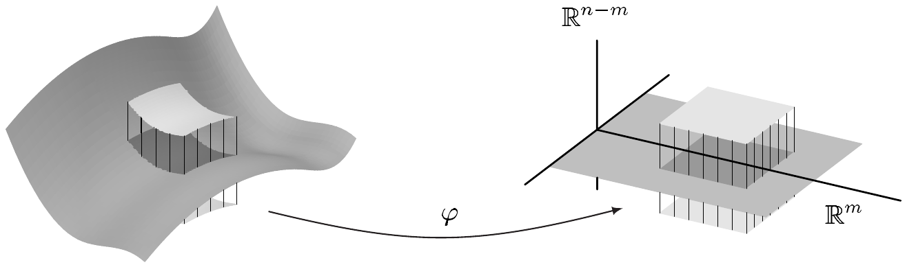

$ \mathbb{R}^{n} $ 的一维与二维子流形分别称为 $ \mathbb{R}^{n} $ 中的（**嵌入**）**曲线**与（**嵌入**）**曲面**。$ \mathbb{R}^{n} $ 的 $ n - 1 $ 维（或**余维数** 1 的）子流形称为（嵌入）**超曲面**（在 $ \mathbb{R}^{n} $ 中）。代替“$ \mathbb{R}^{n} $ 的 $ C^{q} $ 子流形”这一说法，我们常——尤其当“环绕空间” $ \mathbb{R}^{n} $ 不重要时——简单地说 $ C^{q} $ 流形。\footnote{注意到空集是每个维数 $ \le n $ 的流形。非空流形的维数是唯一确定的，正如注 9.16(a) 将表明的那样。}

$ \mathbb{R}^{n} $ 的 $ m $ 维子流形是在 $ \mathbb{R}^{n} $ 中局部定义的，即用开邻域来定义。至多相差一个小的形变，每个这样的邻域在 $ \mathbb{R}^{n} $ 中的位置，与 $ \mathbb{R}^{m} $ 作为向量子空间含于 $ \mathbb{R}^{n} $ 中时相同。

9.1 例 (a) $ \mathbb{R}^{n} $ 的子集 $ X $ 是 $ \mathbb{R}^{n} $ 的 $ n $ 维 $ C^{\infty} $ 子流形当且仅当 $ X $ 在 $ \mathbb{R}^{n} $ 中开。

证明 如果 $ X $ 是 $ \mathbb{R}^{n} $ 的 $ n $ 维 $ C^{\infty} $ 子流形且 $ x_{0} \in X $，则存在 $ x_{0} $ 的开邻域 $ U $、$ \mathbb{R}^{n} $ 中的开集 $ V $ 以及 $ \varphi \in \operatorname{Diff}^{\infty}(U, V) $，使得 $ \varphi(U \cap X) = V $。因此 $ U \cap X = \varphi^{-1}(V) = U $。于是 $ U $ 属于 $ X $，这表明 $ X $ 是开集。

现在设 $ X $ 在 $ \mathbb{R}^{n} $ 中开。我们令 $ U := X $、$ V := X $ 且 $ \varphi := \operatorname{id}_{X} $。于是我们看到 $ X $ 是 $ \mathbb{R}^{n} $ 的 $ n $ 维 $ C^{\infty} $ 子流形。 ■

(b) 设 $ M := \{x_{0}, \ldots, x_{k}\} \subset \mathbb{R}^{n} $。则 $ M $ 是 $ \mathbb{R}^{n} $ 的 0 维 $ C^{\infty} $ 子流形。

证明 我们令 $ \alpha := \min\{|x_{i} - x_{j}| ; \ 0 \le i, j \le k, \ i \ne j\} $ 并选取 $ y \in M $。则 $ \mathbb{B}(y, \alpha) $ 是 $ y $ 在 $ \mathbb{R}^{n} $ 中的开邻域，且对满足 $ x \in \mathbb{B}(y, \alpha) $ 的 $ \varphi(x) := x - y $，我们有 $ \varphi \in \operatorname{Diff}^{\infty}(\mathbb{B}(y, \alpha), \alpha\mathbb{B}) $ 且 $ \varphi(\mathbb{B}(y, \alpha) \cap M) = \{0\} $。 ■

(c) 设 $ \psi \in \operatorname{Diff}^{q}(\mathbb{R}^{n}, \mathbb{R}^{n}) $ 且 $ M $ 是 $ \mathbb{R}^{n} $ 的 $ m $ 维 $ C^{q} $ 子流形。则 $ \psi(M) $ 是 $ \mathbb{R}^{n} $ 的 $ m $ 维 $ C^{q} $ 子流形。

证明 我们把这留给你作为习题。 ■

(d) $ \mathbb{R}^{n} $ 的每个 $ C^{q} $ 子流形对 $ 1 \le r \le q $ 也是 $ \mathbb{R}^{n} $ 的 $ C^{r} $ 子流形。 ■

(e) 上述定义中的微分同胚 $ \varphi $ 与 $ \mathbb{R}^{n} $ 的开集 $ V $ 可以这样选取，使得 $ \varphi(x_{0}) = 0 $。

证明 只需把给定的 $ \varphi $ 与 $ C^{\infty} $ 微分同胚 $ y \mapsto y - \varphi(x_{0}) $ 复合即可。 ■

##### 图像

下一个定理表明图像是流形，从而给出了一大类例子。

9.2 命题 设 $ X $ 在 $ \mathbb{R}^{m} $ 中开且 $ f \in C^{q}(X, \mathbb{R}^{n}) $。则 $ \operatorname{graph}(f) $ 是 $ \mathbb{R}^{m+n} $ 的 $ m $ 维 $ C^{q} $ 子流形。

证明 我们令 $ U := X \times \mathbb{R}^{n} $ 并考虑

\[ \varphi : U \to \mathbb{R}^{m+n} = \mathbb{R}^{m} \times \mathbb{R}^{n} , \quad (x, y) \mapsto (x, y - f(x)) . \]

于是我们有 $ \varphi \in C^{q}(U, \mathbb{R}^{m} \times \mathbb{R}^{n}) $，且 $ \operatorname{im}(\varphi) = U $。此外，$ \varphi : U \to U $ 是双射，且 $ \varphi^{-1}(x, z) = (x, z + f(x)) $。因此 $ \varphi $ 是 $ U $ 到自身的 $ C^{q} $ 微分同胚，且 $ \varphi(U \cap \operatorname{graph}(f)) = X \times \{0\} = U \cap (\mathbb{R}^{m} \times \{0\}) $。 ■

##### 正则值定理

下一个定理给出注 8.5(f) 的新解释。它提供了理解子流形的最自然的方式之一。

9.3 定理（正则值）设 $ X $ 在 $ \mathbb{R}^{m} $ 中开且 $ c $ 是 $ f \in C^{q}(X, \mathbb{R}^{n}) $ 的正则值。则 $ f^{-1}(c) $ 是 $ \mathbb{R}^{m} $ 的 $ (m - n) $ 维 $ C^{q} $ 子流形。

证明 这由注 8.5(f) 与命题 9.2 立即得到。 ■

9.4 推论 设 $ X $ 在 $ \mathbb{R}^{n} $ 中开且 $ f \in C^{q}(X, \mathbb{R}) $。如果对 $ x \in f^{-1}(c) $ 有 $ \nabla f(x) \ne 0 $，则 $ f $ 的**水平集** $ f^{-1}(c) $ 是 $ \mathbb{R}^{n} $ 的 $ C^{q} $ 超平面。

证明 见注 8.5(c)。 ■

9.5 例 (a) 函数

\[ f : \mathbb{R}^{2} \to \mathbb{R} , \quad (x, y) \mapsto x^{2} - y^{2} \]

以 $ (0, 0) $ 为其唯一的临界点。其水平集是双曲线。

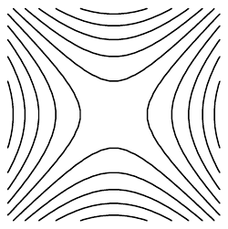

(b) （欧几里得）$ n $ 球面 $ S^{n} := \{x \in \mathbb{R}^{n+1} ; \ |x| = 1\} $ 是 $ \mathbb{R}^{n+1} $ 中的 $ n $ 维 $ C^{\infty} $ 超曲面。

证明 函数 $ f : \mathbb{R}^{n+1} \to \mathbb{R} $，$ x \mapsto |x|^{2} $ 是光滑的，且 $ S^{n} = f^{-1}(1) $。因为 $ \nabla f(x) = 2x $，我们知道 1 是 $ f $ 的正则值。于是结论由推论 9.4 得到 ■

(c) **正交群**\footnote{这里 $ 1_{n} $ 表示 $ \mathbb{R}^{n \times n} $ 中的单位矩阵。关于 $ O(n) $ 的更多内容，另见习题 1 与 2。} $ O(n) := \{A \in \mathbb{R}^{n \times n} ; \ A^{\top}A = 1_{n}\} $ 是 $ \mathbb{R}^{n \times n} $ 的 $ n(n - 1)/2 $ 维 $ C^{\infty} $ 子流形。

证明 (i) 由习题 1.5 我们知道（因为 $ A^{\top} = A^{*} $）对每个 $ A \in \mathbb{R}^{n \times n} $，$ A^{\top}A $ 是对称的。容易验证 $ \mathbb{R}^{n \times n}_{\mathrm{sym}} $ 的维数为 $ n(n + 1)/2 $（即 $ (n \times n) $ 矩阵对角线及其上方的元素个数）。对映射

\[ f : \mathbb{R}^{n \times n} \to \mathbb{R}^{n \times n}_{\mathrm{sym}} , \quad A \mapsto A^{\top}A , \]

我们有 $ O(n) = f^{-1}(1_{n}) $。首先，我们观察到

\[ g : \mathbb{R}^{n \times n} \times \mathbb{R}^{n \times n} \to \mathbb{R}^{n \times n} , \quad (A, B) \mapsto A^{\top}B \]

是双线性的，从而光滑。于是，因为 $ f(A) = g(A, A) $，映射 $ f $ 也光滑。此外，我们有（见命题 4.6）

\[ \partial f(A)B = A^{\top}B + B^{\top}A \qquad \text{对 } A, B \in \mathbb{R}^{n \times n} . \]

(ii) 设 $ A \in f^{-1}(1_{n}) = O(n) $ 且 $ S \in \mathbb{R}^{n \times n}_{\mathrm{sym}} $。对 $ B := AS/2 $，我们则有

\[ \partial f(A)B = \frac{1}{2}A^{\top}AS + \frac{1}{2}SA^{\top}A = S \]

因为 $ A^{\top}A = 1_{n} $。因此对每个 $ A \in f^{-1}(1_{n}) $，$ \partial f(A) $ 是满射。于是 $ 1_{n} $ 是 $ f $ 的正则值。因为 $ \dim(\mathbb{R}^{n \times n}) = n^{2} $ 且 $ n^{2} - n(n + 1)/2 = n(n - 1)/2 $，结论由定理 9.3 得到。 ■

##### 浸入定理

设 $ X $ 在 $ \mathbb{R}^{m} $ 中开。如果对每个 $ x \in X $，$ \partial f(x) \in \mathcal{L}(\mathbb{R}^{m}, \mathbb{R}^{n}) $ 是单射，则称映射 $ f \in C^{1}(X, \mathbb{R}^{n}) $ 为（$ X $ 在 $ \mathbb{R}^{n} $ 中的）**浸入**。于是 $ f $ 是 $ F := f(X) $ 的**正则参数化**。最后，$ F $ 是 $ m $ 维（正则）参数化超曲面，而 $ X $ 是其**参数域**。一维或二维的参数化超曲面分别是（**正则**）**参数化曲线**或（**正则**）**参数化曲面**。

9.6 注与例 (a) 如果 $ f \in C^{1}(X, \mathbb{R}^{n}) $ 是浸入，则 $ m \le n $。

证明 对 $ n < m $，不存在单射 $ A \in \mathcal{L}(\mathbb{R}^{m}, \mathbb{R}^{n}) $ 这一点由秩公式 (2.4) 立即得到。 ■

(b) 对每个 $ \ell \in \mathbb{N}^{\times} $，$ \mathbb{R} \to \mathbb{R}^{2} $，$ t \mapsto (\cos(\ell t), \sin(\ell t)) $ 在 $ (0, 2\pi) $ 上的限制是 $ C^{\infty} $ 浸入。$ [0, 2\pi) $ 的像是单位圆 $ S^{1} $，它被遍历 $ \ell $ 次。

(c) 映射 $ (-\pi, \pi) \to \mathbb{R}^{2} $，$ t \mapsto (1 + 2\cos t)(\cos t, \sin t) $ 是光滑浸入。其像的闭包称为**帕斯卡蜗线**。

(d) 容易看出 $ (-\pi/4, \pi/2) \to \mathbb{R}^{2} $，$ t \mapsto \sin 2t(-\sin t, \cos t) $ 是单射的 $ C^{\infty} $ 浸入。 ■

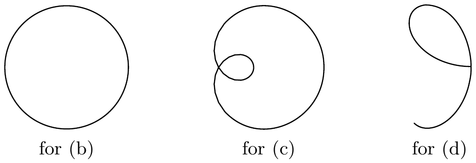

下一个定理表明 $ m $ 维参数化超曲面可局部地用流形表示。

9.7 定理（浸入）设 $ X $ 在 $ \mathbb{R}^{m} $ 中开且 $ f \in C^{q}(X, \mathbb{R}^{n}) $ 是浸入。则对每个 $ x_{0} \in X $，存在 $ X $ 中的开邻域 $ X_{0} $，使得 $ f(X_{0}) $ 是 $ \mathbb{R}^{n} $ 的 $ m $ 维 $ C^{q} $ 子流形。

证明 (i) 通过置换坐标，我们可以不失一般性地假设雅可比矩阵 $ [\partial f(x_{0})] $ 的前 $ m $ 行线性无关。因此

\[ \frac{\partial(f^{1}, \ldots, f^{m})}{\partial(x^{1}, \ldots, x^{m})}(x_{0}) \ne 0 . \]

(ii) 我们考虑 $ \mathbb{R}^{n} $ 中的开集 $ X \times \mathbb{R}^{n-m} $ 以及映射

\[ \psi : X \times \mathbb{R}^{n-m} \to \mathbb{R}^{n} , \quad (x, y) \mapsto f(x) + (0, y) . \]

显然，$ \psi $ 属于 $ C^{q} $ 类，且 $ \partial\psi(x_{0}, 0) $ 有矩阵

\[ [\partial\psi(x_{0}, 0)] = \begin{bmatrix} A & 0 \\ B & 1_{n-m} \end{bmatrix} \]

其中

\[ A := \begin{bmatrix} \partial_{1}f^{1} & \cdots & \partial_{m}f^{1} \\ \vdots & & \vdots \\ \partial_{1}f^{m} & \cdots & \partial_{m}f^{m} \end{bmatrix}(x_{0}) \quad \text{且} \quad B := \begin{bmatrix} \partial_{1}f^{m+1} & \cdots & \partial_{m}f^{m+1} \\ \vdots & & \vdots \\ \partial_{1}f^{n} & \cdots & \partial_{m}f^{n} \end{bmatrix}(x_{0}) . \]

因此 $ \partial\psi(x_{0}, 0) $ 属于 $ \mathcal{L}\mathrm{aut}(\mathbb{R}^{n}) $，从而

\[ \det[\partial\psi(x_{0}, 0)] = \det A = \frac{\partial(f^{1}, \ldots, f^{m})}{\partial(x^{1}, \ldots, x^{m})}(x_{0}) \ne 0 . \]

于是反函数定理（定理 7.3）表明存在开邻域 $ V \in \mathfrak{U}_{\mathbb{R}^{n}}(x_{0}, 0) $ 与 $ U \in \mathfrak{U}_{\mathbb{R}^{n}}(\psi(x_{0}, 0)) $，满足 $ \psi|V \in \operatorname{Diff}^{q}(V, U) $。

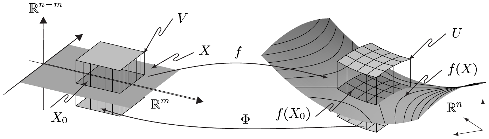

我们现在令 $ \Phi := (\psi|V)^{-1} \in \operatorname{Diff}^{q}(U, V) $ 且 $ X_{0} := \{x \in \mathbb{R}^{m} ; \ (x, 0) \in V\} $。则 $ X_{0} $ 是 $ x_{0} $ 在 $ \mathbb{R}^{m} $ 中的开邻域，且

\[ \Phi(U \cap f(X_{0})) = \Phi(\psi(X_{0} \times \{0\})) = X_{0} \times \{0\} = V \cap (\mathbb{R}^{m} \times \{0\}) . ■ \]

9.8 推论 设 $ I $ 是开区间且 $ \gamma \in C^{q}(I, \mathbb{R}^{n}) $。又设 $ t_{0} \in I $ 且 $ \dot{\gamma}(t_{0}) \ne 0 $。则存在 $ I $ 的含 $ t_{0} $ 的开子区间 $ I_{0} $，使得 $ \gamma|I_{0} $ 的迹是 $ \mathbb{R}^{n} $ 中的嵌入 $ C^{q} $ 曲线。

证明 这立即由定理 9.7 得到。 ■

9.9 注 (a) 光滑道路

\[ \gamma : \mathbb{R} \to \mathbb{R}^{2} , \quad t \mapsto (t^{3}, t^{2}) \]

对 $ t \ne 0 $ 满足 $ \dot{\gamma}(t) \ne 0 $。在 $ t = 0 $ 处，$ \gamma $ 的导数消失。$ \gamma $ 的迹，即**尼尔抛物线**，在那里“不光滑”，而是缩成一点。

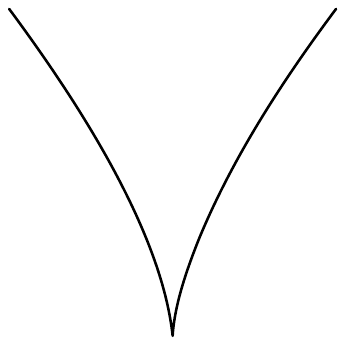

(b) 设 $ f \in C^{q}(X, \mathbb{R}^{n}) $ 是浸入。则 $ f(X) $ 一般不是 $ \mathbb{R}^{n} $ 的 $ C^{q} $ 子流形，因为 $ f(X) $ 可以有“自交”；见例 9.6(c)。

(c) 例 9.6(c) 中给出的浸入不是单射。而且，单射浸入的像一般也不是子流形；见例 9.6(d) 与习题 16。另一方面，例 9.6(b) 表明非单射浸入的像确实可以是子流形。

(d) 设 $ X $ 在 $ \mathbb{R}^{m} = \mathbb{R}^{m} \times \{0\} \subset \mathbb{R}^{n} $ 中开，且 $ f \in C^{q}(X, \mathbb{R}^{n}) $ 是浸入。则对每个 $ x_{0} \in X $，存在 $ (x_{0}, 0) $ 在

$ \mathbb{R}^{n} $ 中的开邻域 $ V $、$ \mathbb{R}^{n} $ 中的开集 $ U $ 以及 $ \psi \in \operatorname{Diff}^{q}(V, U) $，使得对满足 $ (x, 0) \in V $ 的 $ x \in X $ 有 $ \psi(x, 0) = f(x) $。

证明 这立即由定理 9.7 的证明得到。 ■

##### 嵌入

设 $ g : I \to \mathbb{R}^{2} $ 是例 9.6(d) 的单射 $ C^{\infty} $ 浸入。我们已经确定 $ S = \operatorname{im}(g) $ 表示 $ \mathbb{R}^{2} $ 中的嵌入曲线。这就提出了问题：单射浸入还必须具有哪些其他性质，其像才是子流形？如果分析上面的例子，容易看出 $ g^{-1} : S \to I $ 不连续。因此映射 $ g : I \to S $ 不是拓扑映射。事实上，下一个定理表明，如果单射浸入有连续逆映射，则其像是子流形。如果 $ f : X \to f(X) $ 是拓扑映射，我们称（$ C^{q} $）浸入 $ f : X \to \mathbb{R}^{n} $ 为 $ X $ 在 $ \mathbb{R}^{n} $ 中的（$ C^{q} $）**嵌入**。\footnote{自然，$ f(X) $ 带有从 $ \mathbb{R}^{n} $ 诱导的拓扑。如果上下文使 $ X $ 与 $ \mathbb{R}^{n} $ 的含义无歧义，我们就简称为嵌入。}

9.10 命题 设 $ X $ 在 $ \mathbb{R}^{m} $ 中开且 $ f \in C^{q}(X, \mathbb{R}^{n}) $ 是嵌入。则 $ f(X) $ 是 $ \mathbb{R}^{n} $ 的 $ m $ 维 $ C^{q} $ 子流形。

证明 我们令 $ M := f(X) $ 并选取 $ y_{0} \in M $。根据定理 9.7，$ x_{0} := f^{-1}(y_{0}) $ 在 $ X $ 中有开邻域 $ X_{0} $，使得 $ M_{0} := f(X_{0}) $ 是 $ \mathbb{R}^{n} $ 的 $ m $ 维子流形。

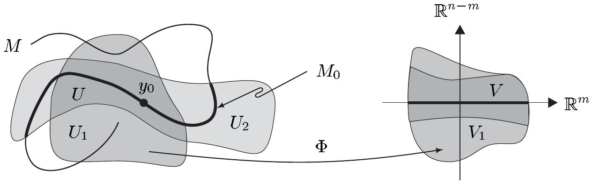

因此存在 $ y_{0} $ 的开邻域 $ U_{1} $ 与 0 在 $ \mathbb{R}^{n} $ 中的开邻域 $ V_{1} $，以及从 $ U_{1} $ 到 $ V_{1} $ 的 $ C^{q} $ 微分同胚 $ \Phi $，使得 $ \Phi(M_{0} \cap U_{1}) = V_{1} \cap (\mathbb{R}^{m} \times \{0\}) $。因为 $ f $ 是拓扑映射，$ M_{0} $ 在 $ M $ 中开。因此存在 $ \mathbb{R}^{n} $ 中的开集 $ U_{2} $，使得 $ M_{0} = M \cap U_{2} $（见命题 III.2.26）。因此 $ U := U_{1} \cap U_{2} $ 是 $ y_{0} $ 在 $ \mathbb{R}^{n} $ 中的开邻域，且 $ V := \Phi(U) $ 是 0 在 $ \mathbb{R}^{n} $ 中的开邻域，满足 $ \Phi(M \cap U) = V \cap (\mathbb{R}^{m} \times \{0\}) $。因为这对每个 $ y_{0} \in M $ 都成立，结论得证。 ■

9.11 例 (a)（球坐标）
设

\[ f_{3} : \mathbb{R}^{3} \to \mathbb{R}^{3} , \quad (r, \varphi, \vartheta) \mapsto (x, y, z) \]

由

\[ \begin{aligned} x &= r\cos\varphi\sin\vartheta , \\ y &= r\sin\varphi\sin\vartheta , \\ z &= r\cos\vartheta , \end{aligned} \tag{9.1} \]

定义，并设 $ V_{3} := (0, \infty) \times (0, 2\pi) \times (0, \pi) $。则 $ g_{3} := f_{3}|V_{3} $ 是 $ V_{3} $ 在 $ \mathbb{R}^{3} $ 中的 $ C^{\infty} $ 嵌入，且 $ F_{3} = g_{3}(V_{3}) = \mathbb{R}^{3} \setminus H_{3} $，其中 $ H_{3} $ 表示闭半平面 $ \mathbb{R}^{+} \times \{0\} \times \mathbb{R} $。

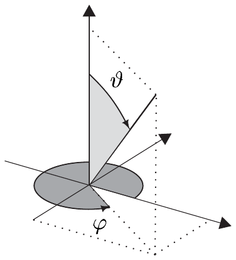

如果把 $ (r, \varphi, \vartheta) $ 限制到 $ V_{3} $ 的如下形式的子集

\[ (r_{0}, r_{1}) \times (\varphi_{0}, \varphi_{1}) \times (\vartheta_{0}, \vartheta_{1}) , \]

就得到“球壳”的正则参数化。

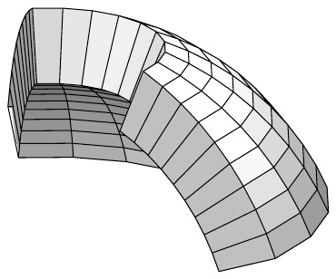

考虑 $ f_{3}(\overline{V_{3}}) = \mathbb{R}^{3} $。我们还有，对 $ W_{3} := (0, \infty) \times [0, 2\pi) \times (0, \pi) $ 有 $ f_{3}(W_{3}) = \mathbb{R}^{3} \setminus (\{0\} \times \{0\} \times \mathbb{R}) $，且 $ f_{3} $ 把 $ W_{3} $ 双射地映到 $ \mathbb{R}^{3} \setminus (\{0\} \times \{0\} \times \mathbb{R}) $ 上。于是，凭借 (9.1)，每个点 $ (x, y, z) \in \mathbb{R}^{3} \setminus (\{0\} \times \{0\} \times \mathbb{R}) $ 都可以用**球坐标** $ (r, \varphi, \vartheta) \in W_{3} $ 唯一地描述。换句话说，$ f_{3}|W_{3} $ 是 $ \mathbb{R}^{3} $ 除去 $ z $ 轴的参数化。然而，$ W_{3} $ 在 $ \mathbb{R}^{3} $ 中不开。

证明 显然 $ f_{3} \in C^{\infty}(\mathbb{R}^{3}, \mathbb{R}^{3}) $，且 $ g_{3} : V_{3} \to F_{3} $ 是拓扑映射（见习题 11）。我们也求出

\[ [\partial f_{3}(r, \varphi, \vartheta)] = \begin{bmatrix} \cos\varphi\sin\vartheta & -r\sin\varphi\sin\vartheta & r\cos\varphi\cos\vartheta \\ \sin\varphi\sin\vartheta & r\cos\varphi\sin\vartheta & r\sin\varphi\cos\vartheta \\ \cos\vartheta & 0 & -r\sin\vartheta \end{bmatrix} . \]

$ \partial f_{3} $ 的行列式可沿最后一行展开来计算，对 $ (r, \varphi, \vartheta) \in V_{3} $ 给出值 $ -r^{2}\sin\vartheta \ne 0 $。因此 $ g_{3} $ 是浸入，从而是嵌入。其余论断是显然的。 ■

(b) （球坐标\footnote{注意此处对该术语的再次使用。}）
我们定义

\[ f_{2} : \mathbb{R}^{2} \to \mathbb{R}^{3} , \quad (\varphi, \vartheta) \mapsto (x, y, z) \]

由

\[ \begin{aligned} x &= \cos\varphi\sin\vartheta , \\ y &= \sin\varphi\sin\vartheta , \\ z &= \cos\vartheta \end{aligned} \tag{9.2} \]

并设 $ V_{2} := (0, 2\pi) \times (0, \pi) $。则限制 $ g_{2} := f_{2}|V_{2} $ 是 $ V_{2} $ 在 $ \mathbb{R}^{3} $ 中的 $ C^{\infty} $ 嵌入，且 $ F_{2} := g_{2}(V_{2}) = S^{2} \setminus H_{3} $。换句话说，$ F_{2} $ 是从 $ S^{2} $ 中去掉半平面 $ H_{3} $ 与 $ S^{2} $ 相交所得的半圆得到的。把 $ (\varphi, \vartheta) $ 限制到 $ V_{2} $ 的如下形式的子集 $ (\varphi_{0}, \varphi_{1}) \times (\vartheta_{0}, \vartheta_{1}) $，就得到 $ S^{2} $ 的一个截段的正则参数化，这意味着矩形 $ \overline{V_{2}} $ 被 $ f_{2} $ “弯成（部分）球面”。还注意到，对 $ W_{2} := [0, 2\pi) \times (0, \pi) $，我们有 $ f_{2}(W_{2}) = S^{2}\setminus\{\pm e_{3}\} $，其中 $ e_{3} $ 是**北极**，$ -e_{3} $ 是**南极**。$ f_{2} $ 也把参数域 $ W_{2} $ 双射地映到 $ S^{2}\setminus\{\pm e_{3}\} $ 上。利用 (9.2)，$ S^{2}\setminus\{\pm e_{3}\} $ 因此可以通过**球坐标** $ (\varphi, \vartheta) \in W_{2} $ 来描述，尽管 $ f_{2}|W_{2} $ 不是 $ S^{2} \setminus \{\pm e_{3}\} $ 的正则参数化，因为 $ W_{2} $ 在 $ \mathbb{R}^{2} $ 中不开。

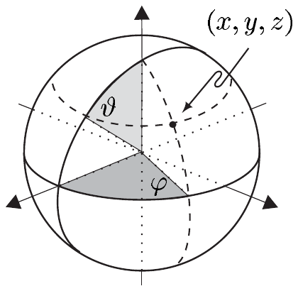

证明 显然 $ f_{2} = f_{3}(1, \cdot, \cdot) \in C^{\infty}(\mathbb{R}^{2}, \mathbb{R}^{3}) $ 且 $ F_{2} = S^{2} \cap F_{3} $。因为 $ F_{3} $ 在 $ \mathbb{R}^{3} $ 中开，由此可得 $ F_{2} $ 在 $ S^{2} $ 中开。此外，$ g_{2} = g_{3}(1, \cdot, \cdot) $ 把 $ V_{2} $ 双射地映到 $ F_{2} $ 上，且 $ g_{2}^{-1} = g_{3}^{-1}|F_{2} $。因此 $ g_{2}^{-1} : F_{2} \to V_{2} $ 连续。因为

\[ [\partial f_{2}(\varphi, \vartheta)] = \begin{bmatrix} -\sin\varphi\sin\vartheta & \cos\varphi\cos\vartheta \\ \cos\varphi\sin\vartheta & \sin\varphi\cos\vartheta \\ 0 & -\sin\vartheta \end{bmatrix} \tag{9.3} \]

由正则矩阵 $ [\partial f_{3}(1, \varphi, \vartheta)] $ 的最后两列组成，我们看到对 $ (\varphi, \vartheta) \in V_{2} $，$ \partial g_{2}(\varphi, \vartheta) $ 是单射。于是 $ g_{2} $ 是正则 $ C^{\infty} $ 参数化。 ■

(c) （柱坐标）定义

\[ f : \mathbb{R}^{3} \to \mathbb{R}^{3} , \quad (r, \varphi, z) \mapsto (x, y, z) \]

由

\[ \begin{aligned} x &= r\cos\varphi , \\ y &= r\sin\varphi , \\ z &= z , \end{aligned} \tag{9.4} \]

并设 $ V := (0, \infty) \times (0, 2\pi) \times \mathbb{R} $。则 $ g := f|V $ 是 $ V $ 在 $ \mathbb{R}^{3} $ 中的 $ C^{\infty} $ 嵌入，且 $ g(V) = F_{3} = \mathbb{R}^{3} \setminus H_{3} $。进一步把 $ g $ 限制到 $ V $ 的如下形式的子集

$ R := (r_{0}, r_{1}) \times (\varphi_{0}, \varphi_{1}) \times (z_{0}, z_{1}) $ 上，就得到“柱壳片段”的正则参数化。换句话说，$ f $ 把矩形体 $ R $ “弯成”这个形状。

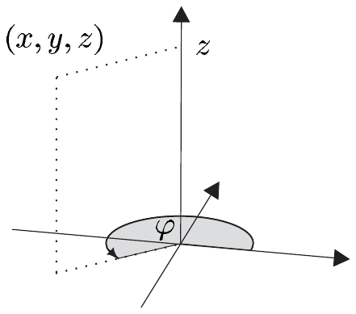

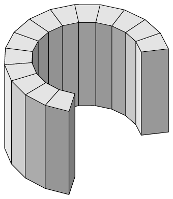

我们还有 $ f(\overline{V}) = \mathbb{R}^{3} $，且对 $ W := (0, \infty) \times [0, 2\pi) \times \mathbb{R} $ 有 $ f(W) = \mathbb{R}^{3} \setminus (\{0\} \times \{0\} \times \mathbb{R}) =: Z $，并且 $ f|W $ 把 $ W $ 双射地映到 $ Z $ 上，即 $ \mathbb{R}^{3} $ 除去 $ z $ 轴。因此 (9.4) 通过**柱坐标**描述 $ Z $，尽管 $ f|W $ 不是 $ Z $ 的正则参数化，因为 $ W $ 不开。

证明 显然 $ g $ 双射地映到 $ F_{3} $ 上，且容易看出 $ g^{-1} $ 是光滑的（见习题 12）。我们也有

\[ [\partial f(r, \varphi, z)] = \begin{bmatrix} \cos\varphi & -r\sin\varphi & 0 \\ \sin\varphi & r\cos\varphi & 0 \\ 0 & 0 & 1 \end{bmatrix} , \]

这由 $ \det\partial f(r, \varphi, z) = r $ 得到。因此 $ f|(0, \infty) \times \mathbb{R} \times \mathbb{R} $ 是开半空间 $ (0, \infty) \times \mathbb{R} \times \mathbb{R} $ 在 $ \mathbb{R}^{3} $ 中的 $ C^{\infty} $ 浸入，且 $ g $ 是 $ V $ 在 $ \mathbb{R}^{3} $ 中的 $ C^{\infty} $ 嵌入。其余论断也是直截了当的。 ■

(d) （柱坐标）
我们在 (9.4) 中令 $ r = 1 $。则 $ g(1, \cdot, \cdot) $ 是 $ (0, 2\pi) \times \mathbb{R} $ 在 $ \mathbb{R}^{3} $ 中的 $ C^{\infty} $ 嵌入，对它有 (c) 的显然类比。

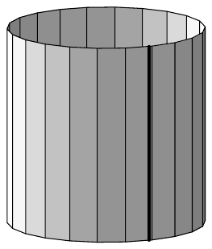

(e) （旋转曲面）设 $ J $ 是 $ \mathbb{R} $ 中的开区间，$ \rho, \sigma \in C^{q}(J, \mathbb{R}) $ 满足对 $ t \in J $ 有 $ \rho(t) > 0 $ 且 $ (\dot{\rho}(t), \dot{\sigma}(t)) \ne (0, 0) $。则

\[ r : J \times \mathbb{R} \to \mathbb{R}^{3} , \quad (t, \varphi) \mapsto (\rho(t)\cos\varphi, \rho(t)\sin\varphi, \sigma(t)) \]

是 $ J \times \mathbb{R} $ 在 $ \mathbb{R}^{3} $ 中的 $ C^{q} $ 浸入。

映射

\[ \gamma : J \to \mathbb{R}^{3} , \quad t \mapsto (\rho(t), 0, \sigma(t)) \]

是 $ J $ 在 $ \mathbb{R}^{3} $ 中的 $ C^{q} $ 浸入。$ \gamma $ 的像 $ \Gamma $ 是位于 $ x $-$ z $ 平面中的正则参数化曲线，且 $ R := r(J \times \mathbb{R}) $ 由 $ \Gamma $ 绕 $ z $ 轴旋转生成。于是 $ R $ 称为**旋转曲面**，而 $ \Gamma $ 是 $ R $ 的**子午线**。如果 $ \gamma $ 不是单射，则 $ R $ 含有平行于 $ x $-$ y $ 轴的平面中的圆，在这些圆处 $ R $ 自交。

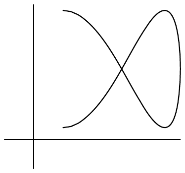

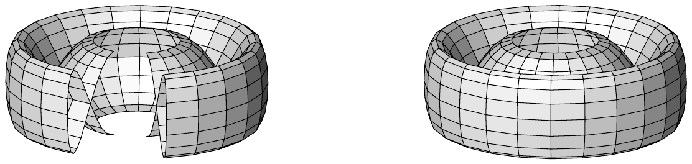

设 $ I $ 是 $ J $ 的开子区间，使得 $ \gamma|I $ 是嵌入，且 $ K $ 是 $ [0, 2\pi] $ 的开子区间。则 $ r|I \times K $ 也是嵌入。

证明 $ r $ 的雅可比矩阵是

\[ \begin{bmatrix} \dot{\rho}(t)\cos\varphi & -\rho(t)\sin\varphi \\ \dot{\rho}(t)\sin\varphi & \rho(t)\cos\varphi \\ \dot{\sigma}(t) & 0 \end{bmatrix} . \tag{9.5} \]

划去最后一行所得的 $ (2 \times 2) $ 矩阵的行列式为 $ \rho(t)\dot{\rho}(t) $。因此，如果 $ \dot{\rho}(t) \ne 0 $，矩阵 (9.5) 的秩为 2。如果 $ \dot{\rho}(t) = 0 $，则 $ \dot{\sigma}(t) \ne 0 $，且由 (9.5) 划去第一行或第二行所得的两个行列式中至少有一个不等于 0。这证明了 $ r $ 是浸入。我们把其余论断留给你。 ■

(f) （环面）设 $ 0 < r < a $。方程 $ (x - a)^{2} + z^{2} = r^{2} $ 定义 $ x $-$ z $ 平面中的一个圆，并且，通过把它绕 $ z $ 轴旋转，我们得到一个 (2-)环面 $ \mathrm{T}^{2}_{a,r} $。

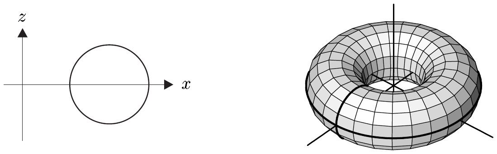

对由

\[ \tau_{2}(t, \varphi) := ((a + r\cos t)\cos\varphi, (a + r\cos t)\sin\varphi, r\sin t) , \]

定义的 $ \tau_{2} \in C^{\infty}(\mathbb{R}^{2}, \mathbb{R}^{3}) $，我们求出 $ \tau_{2}([0, 2\pi]^{2}) = \mathrm{T}^{2}_{a,r} $，且 $ \tau_{2}|(0, 2\pi)^{2} $ 是嵌入。开正方形 $ (0, 2\pi)^{2} $ 在 $ \tau_{2} $ 下的像是从 2-环面上“剪去”两个圆所得的曲面：第一个是 $ x $-$ y $ 平面中的 $ x^{2} + y^{2} = (r + a)^{2} $，第二个是 $ x $-$ z $ 平面中的 $ (x - a)^{2} + z^{2} = r^{2} $。

$ \tau_{2} $ 的像也可以描述如下：正方形 $ [0, 2\pi]^{2} $ 先通过“粘合”其两条对边做成一个管子。然后，在把这个管子扭转成一个环之后，其两个圆形端面也被粘合。

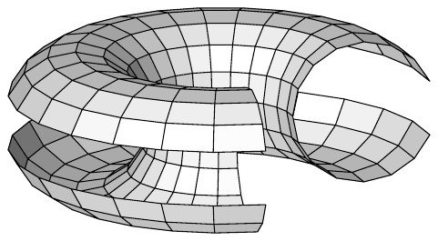

证明 映射 $ t \mapsto (a + r\cos t, 0, r\sin t) $ 是 $ \mathbb{R} $ 在 $ \mathbb{R}^{3} $ 中的 $ C^{\infty} $ 浸入，其像是由 $ (x - a)^{2} + z^{2} = r^{2} $ 描述的圆。因此结论由 (e) 取 $ \rho(t) := a + r\cos t $ 与 $ \sigma(t) := r\sin t $ 容易得到。 ■

命题 9.10 的如下逆命题表明每个子流形局部地都是某个嵌入的像。

9.12 定理 设 $ M $ 是 $ \mathbb{R}^{n} $ 的 $ m $ 维 $ C^{q} $ 子流形。则 $ M $ 的每个点 $ p $ 在 $ M $ 中有邻域 $ U $，使得 $ U $ 是 $ \mathbb{R}^{m} $ 中开集在 $ C^{q} $ 嵌入下的像。

证明 对每个 $ p \in M $，存在 $ p $ 与 0 在 $ \mathbb{R}^{n} $ 中的开邻域 $ \tilde{U} $ 与 $ \tilde{V} $，以及 $ C^{q} $ 微分同胚 $ \Phi : \tilde{U} \to \tilde{V} $，使得 $ \Phi(M \cap \tilde{U}) = \tilde{V} \cap (\mathbb{R}^{m} \times \{0\}) $。我们令 $ U := M \cap \tilde{U} $，$ V := \{x \in \mathbb{R}^{m} ; \ (x, 0) \in \tilde{V}\} $，以及

\[ g : V \to \mathbb{R}^{n} , \quad x \mapsto \Phi^{-1}((x, 0)) . \]

则 $ U $ 在 $ M $ 中开，$ V $ 在 $ \mathbb{R}^{m} $ 中开；且 $ g $ 属于 $ C^{q}(V, \mathbb{R}^{n}) $。此外，$ g $ 把集合 $ V $ 双射地映到 $ U $ 上，且对 $ x \in V $ 有 $ \operatorname{rank}\partial g(x) = m $，因为 $ [\partial g(x)] $ 由正则矩阵 $ [\partial\Phi^{-1}((x, 0))] $ 的前 $ m $ 列组成。因为 $ g^{-1} = \Phi|U $，我们清楚地看到，把 $ g $ 解释为 $ \mathbb{R}^{n} $ 的拓扑子空间 $ U $ 中的映射，它是从 $ V $ 到 $ U $ 的拓扑映射。 ■

##### 局部坐标卡与参数化

我们现在利用已建立的内容，用 $ M $ 与 $ \mathbb{R}^{m} $ 的开子集之间的映射来局部地描述 $ \mathbb{R}^{n} $ 的 $ m $ 维子流形 $ M $。在第 III 卷中，我们将学会——借助局部坐标卡——如何描述不（先验地）嵌入欧几里得空间的“抽象”流形。这种描述在很大程度上与“环绕空间”无关。

设 $ M $ 是 $ \mathbb{R}^{n} $ 的子集且 $ p \in M $。我们用

\[ i_{M} : M \to \mathbb{R}^{n} , \quad x \mapsto x \]

表示 $ M $ 到 $ \mathbb{R}^{n} $ 的典范单射。映射 $ \varphi $ 称为 $ M $ 在 $ p $ 附近的 $ m $ 维（局部）$ C^{q} $ 坐标卡，如果

• $ U := \operatorname{dom}(\varphi) $ 是 $ p $ 在 $ M $ 中的开邻域；

• $ \varphi $ 是 $ U $ 到 $ \mathbb{R}^{m} $ 的开集 $ V := \varphi(U) $ 上的同胚；

• $ g := i_{M} \circ \varphi^{-1} $ 是 $ C^{q} $ 浸入。

集合 $ U $ 是 $ \varphi $ 的**坐标卡覆盖的区域**，$ V $ 是**参数值域**，而 $ g $ 是 $ U $ 在 $ \varphi $ 中的**参数化**。偶尔，我们用 $ (\varphi, U) $ 记 $ \varphi $，用 $ (g, V) $ 记 $ g $。$ M $ 的 $ m $ 维 $ C^{q} $ 图册是 $ M $ 的 $ m $ 维 $ C^{q} $ 坐标卡族 $ \{\varphi_{\alpha} ; \ \alpha \in A\} $，其坐标卡覆盖的区域 $ U_{\alpha} := \operatorname{dom}(\varphi_{\alpha}) $ 覆盖集合 $ M $，即 $ M = \bigcup_{\alpha} U_{\alpha} $。最后，$ (x^{1}, \ldots, x^{m}) := \varphi(p) $ 是 $ p \in U $ 在坐标卡 $ \varphi $ 中的**局部坐标**。

下一个定理表明流形可以通过坐标卡来描述。这特别意味着 $ \mathbb{R}^{n} $ 的 $ m $ 维子流形局部地“看起来像 $ \mathbb{R}^{m} $”，即它局部同胚于 $ \mathbb{R}^{m} $ 的开子集。

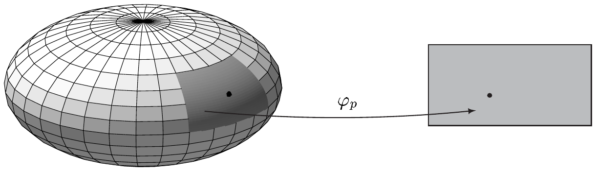

9.13 定理 设 $ M $ 是 $ \mathbb{R}^{n} $ 的 $ m $ 维 $ C^{q} $ 子流形。则对每个 $ p \in M $，存在 $ M $ 在 $ p $ 附近的 $ m $ 维 $ C^{q} $ 坐标卡。因此 $ M $ 有 $ m $ 维 $ C^{q} $ 图册。如果 $ M $ 紧致，则 $ M $ 有有限图册。

证明 定理 9.12 保证每个 $ p \in M $ 在其附近有 $ m $ 维 $ C^{q} $ 坐标卡 $ \varphi_{p} $。因此 $ \{\varphi_{p} ; \ p \in M\} $ 是图册。因为这个图册的坐标卡覆盖的区域形成 $ M $ 的开覆盖，最后的论断由紧致性的定义得到。 ■

9.14 例 (a) 设 $ X $ 在 $ \mathbb{R}^{n} $ 中开。则 $ X $ 有只含一个坐标卡的 $ C^{\infty} $ 图册，即**平凡坐标卡** $ \operatorname{id}_{X} $。

(b) 设 $ X $ 在 $ \mathbb{R}^{m} $ 中开且 $ f \in C^{q}(X, \mathbb{R}^{n}) $。则根据命题 9.2，$ \operatorname{graph}(f) $ 是 $ \mathbb{R}^{m+n} $ 的 $ m $ 维 $ C^{q} $ 子流形，且它有只由坐标卡 $ \varphi $ 组成的图册，其中对 $ x \in X $ 有 $ \varphi((x, f(x))) = x $。

(c) 球面 $ S^{2} $ 有恰含两个坐标卡的 $ C^{\infty} $ 图册。

证明 在例 9.11(b) 的记号下，令 $ U_{2} := g_{2}(V_{2}) $ 与 $ \varphi_{2} : U_{2} \to V_{2} $，并令 $ (x, y, z) \mapsto (\varphi, \vartheta) $ 为 $ g_{2} $ 的逆映射。则 $ \varphi_{2} $ 是 $ S^{2} $ 的 $ C^{\infty} $ 坐标卡。

现在我们通过 $ \tilde{V}_{2} := (\pi, 3\pi) \times (0, \pi) $ 与

\[ \tilde{g}_{2}(\varphi, \vartheta) := (\cos\varphi\sin\vartheta, \cos\vartheta, \sin\varphi\sin\vartheta) . \]

定义 $ \tilde{g}_{2} : \tilde{V}_{2} \to S^{2} $。则 $ \tilde{g}_{2}(\tilde{V}_{2}) $ 是从 $ S^{2} $ 中去掉它与坐标半平面 $ (-\mathbb{R}^{+}) \times \mathbb{R} \times \{0\} $ 相交所得的半圆得到的。显然 $ U_{2} \cup \tilde{U}_{2} = S^{2} $，其中 $ \tilde{U}_{2} := \tilde{g}_{2}(\tilde{V}_{2}) $，且例 9.11(b) 的证明表明 $ \tilde{\varphi}_{2} := g_{2}^{-1} $ 是 $ S^{2} $ 的 $ C^{\infty} $ 坐标卡。 ■

(d) 对每个 $ n \in \mathbb{N} $，$ n $ 球面 $ S^{n} $ 有恰含两个光滑坐标卡的图册。对 $ n \ge 1 $，这些坐标卡是**球极投影** $ \varphi_{\pm} $，其中 $ \varphi_{+} $ [$ \varphi_{-} $] 把每个 $ p \in S^{n}\setminus\{e_{n+1}\} $ [$ p \in S^{n}\setminus\{-e_{n+1}\} $] 映到“穿刺点”，即连接**北极** $ e_{n+1} $ [**南极** $ -e_{n+1} $] 与 $ p $ 的直线与**赤道超平面** $ \mathbb{R}^{n} \times \{0\} $ 相交的点。

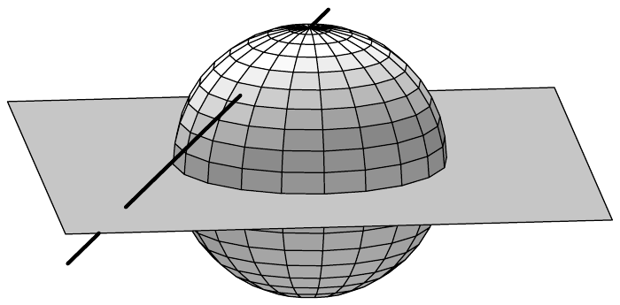

证明 由例 9.5(b) 我们知道 $ S^{n} $ 是 $ \mathbb{R}^{n} $ 的 $ n $ 维 $ C^{\infty} $ 子流形。当 $ n = 0 $ 时，$ S^{n} $ 只由 $ \mathbb{R} $ 中的两个点 $ \pm 1 $ 组成，命题是平凡的。

因此设 $ n \in \mathbb{N}^{\times} $。经过 $ p $ 与 $ \pm e_{n+1} \in S^{n} $ 的直线 $ t \mapsto tp \pm (1 - t)e_{n+1} $ 在 $ t = 1/(1 \mp p^{n+1}) $ 时与超平面 $ x^{n+1} = 0 $ 相交。因此穿刺点的坐标为 $ x = p'/(1 \mp p^{n+1}) \in \mathbb{R}^{n} $，其中 $ p = (p', p^{n+1}) \in \mathbb{R}^{n} \times \mathbb{R} $。这些定义了映射 $ \varphi_{\pm} : S^{n}\setminus\{\pm e_{n+1}\} \to \mathbb{R}^{n} $，$ p \mapsto x $，它们显然连续。

为了计算其逆映射，我们考虑直线

\[ t \mapsto t(x, 0) \pm (1 - t)e_{n+1} \]

经过 $ (x, 0) \in \mathbb{R}^{n} \times \mathbb{R} $ 与 $ \pm e_{n+1} \in S^{n} $。它们当 $ t > 0 $ 且 $ t^{2}|x|^{2} + (1 - t)^{2} = 1 $ 时与 $ S^{n}\setminus\{\pm e_{n+1}\} $ 相交，因此当 $ t = 2/(1 + |x|^{2}) $ 时相交。由此我们得到

\[ \varphi_{\pm}^{-1}(x) = \frac{(2x, \pm(|x|^{2} - 1))}{1 + |x|^{2}} \qquad \text{对 } x \in \mathbb{R}^{n} . \]

于是 $ g_{\pm} := i_{S^{n}} \circ \varphi_{\pm}^{-1} $ 属于 $ C^{\infty}(\mathbb{R}^{n}, \mathbb{R}^{n+1}) $。对 $ x \in \mathbb{R}^{n} $ 有 $ \operatorname{rank}\partial g_{\pm}(x) = n $ 这一点容易验证。 ■

(e) 环面 $ \mathrm{T}^{2}_{a,r} $ 是 $ \mathbb{R}^{3} $ 中的 $ C^{\infty} $ 超曲面，且它有含三个坐标卡的图册。

证明 设 $ X := \mathbb{R}^{3}\setminus\{0\} \times \{0\} \times \mathbb{R} $ 且

\[ f : X \to \mathbb{R} , \quad (x, y, z) \mapsto \left(\sqrt{x^{2} + y^{2}} - a\right)^{2} + z^{2} - r^{2} . \]

则 $ f \in C^{\infty}(X, \mathbb{R}) $，且 0 是 $ f $ 的正则值。容易验证 $ f^{-1}(0) = \mathrm{T}^{2}_{a,r} $。因此，根据定理 9.3，$ \mathrm{T}^{2}_{a,r} $ 是 $ \mathbb{R}^{3} $ 中的光滑曲面。把

$ \tau_{2}|(0, 2\pi)^{2} $ 求逆的映射 $ \varphi $ 是 $ \mathrm{T}^{2}_{a,r} $ 的二维 $ C^{\infty} $ 坐标卡。第二个这样的坐标卡 $ \tilde{\varphi} $ 作为 $ \tau_{2}|(\pi, 3\pi)^{2} $ 的逆映射。最后，我们定义第三个坐标卡 $ \hat{\varphi} $ 为 $ \tau_{2}|(\pi/2, 5\pi/2)^{2} $ 的逆映射，于是 $ \{\varphi, \tilde{\varphi}, \hat{\varphi}\} $ 是 $ \mathrm{T}^{2}_{a,r} $ 的图册。 ■

##### 坐标卡的更换

曲线或曲面（一般地，$ \mathbb{R}^{n} $ 的子流形）的局部几何意义与它通过局部坐标卡的描述无关。对于具体计算，必须使用特定坐标卡。当我们在流形上移动时，计算可能把我们带到所用坐标卡的边界，迫使“更换坐标卡”。因此，我们应该理解这是如何进行的。除了这一实践上的理由之外，理解坐标卡的更换将帮助我们理解流形的局部描述是如何“拼接”成整体描述的。

设 $ \{(\varphi_{\alpha}, U_{\alpha}) ; \ \alpha \in A\} $ 是 $ M \subset \mathbb{R}^{n} $ 的 $ m $ 维 $ C^{q} $ 图册。我们称映射\footnote{此处及邻近各处，当我们使用过渡函数 $ \varphi_{\beta} \circ \varphi_{\alpha}^{-1} $ 时，总假设 $ U_{\alpha} \cap U_{\beta} \ne \varnothing $。}

\[ \varphi_{\beta} \circ \varphi_{\alpha}^{-1} : \varphi_{\alpha}(U_{\alpha} \cap U_{\beta}) \to \varphi_{\beta}(U_{\alpha} \cap U_{\beta}) \quad \text{对 } \alpha, \beta \in A , \]

为**过渡函数**。它们规定图册 $ \{\varphi_{\alpha} ; \ \alpha \in A\} $ 中的坐标卡如何“缝合在一起”。

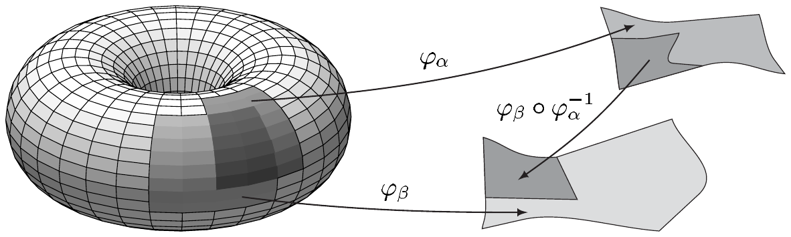

9.15 命题 如果 $ (\varphi_{\alpha}, U_{\alpha}) $ 与 $ (\varphi_{\beta}, U_{\beta}) $ 是 $ m $ 维 $ C^{q} $ 流形的 $ m $ 维 $ C^{q} $ 坐标卡，则

\[ \varphi_{\beta} \circ \varphi_{\alpha}^{-1} \in \operatorname{Diff}^{q}\left(\varphi_{\alpha}(U_{\alpha} \cap U_{\beta}), \varphi_{\beta}(U_{\alpha} \cap U_{\beta})\right) , \]

其中 $ (\varphi_{\beta} \circ \varphi_{\alpha}^{-1})^{-1} = \varphi_{\alpha} \circ \varphi_{\beta}^{-1} $。

证明 (i) 显然 $ \varphi_{\beta} \circ \varphi_{\alpha}^{-1} $ 是双射，其逆映射是 $ \varphi_{\alpha} \circ \varphi_{\beta}^{-1} $。因此只需验证 $ \varphi_{\beta} \circ \varphi_{\alpha}^{-1} $ 属于 $ C^{q}(\varphi_{\alpha}(U_{\alpha} \cap U_{\beta}), \mathbb{R}^{m}) $。

(ii) 我们令 $ V_{\gamma} := \varphi_{\gamma}(U_{\gamma}) $，且 $ g_{\gamma} $ 是 $ \gamma \in \{\alpha, \beta\} $ 时属于 $ (\varphi_{\gamma}, U_{\gamma}) $ 的参数化。又设 $ x_{\gamma} \in \varphi_{\gamma}(U_{\alpha} \cap U_{\beta}) $ 满足 $ g_{\alpha}(x_{\alpha}) = g_{\beta}(x_{\beta}) =: p $。因为 $ g_{\gamma} $ 是单射 $ C^{q} $ 浸入，注 9.9(d) 给出 $ p $ 的开邻域

$ \tilde{U}_{\gamma} $ 与 $ (x_{\gamma}, 0) $ 在 $ \mathbb{R}^{n} $ 中的开邻域 $ \tilde{V}_{\gamma} $，以及 $ \psi_{\gamma} \in \operatorname{Diff}^{q}(\tilde{V}_{\gamma}, \tilde{U}_{\gamma}) $，使得对所有满足 $ (y, 0) \in \tilde{V}_{\gamma} $ 的 $ y \in V_{\gamma} $ 有 $ \psi_{\gamma}(y, 0) = g_{\gamma}(y) $。我们现在令

\[ V := \{x \in V_{\alpha} ; \ (x, 0) \in \tilde{V}_{\alpha}\} \cap \varphi_{\alpha}(U_{\alpha} \cap U_{\beta}) . \]

显然 $ V $ 是 $ x_{\alpha} $ 在 $ \mathbb{R}^{m} $ 中的开邻域。利用 $ g_{\alpha} $ 的连续性，我们可以（必要时通过缩小 $ V $）假设 $ g_{\alpha}(V) $ 含于 $ \tilde{U}_{\beta} $。因此

\[ \varphi_{\beta} \circ \varphi_{\alpha}^{-1}(x) = \psi_{\beta}^{-1} \circ g_{\alpha}(x) \qquad \text{对 } x \in V . \]

因为 $ g_{\alpha} \in C^{q}(V_{\alpha}, \mathbb{R}^{n}) $，链式法则表明 $ \psi_{\beta}^{-1} \circ g_{\alpha} $ 属于 $ C^{q}(V, \mathbb{R}^{n}) $。\footnote{此处及其他各处，我们常对映射及其到定义域子集上的限制使用同一个记号。} 因此由此可得 $ \varphi_{\beta} \circ \varphi_{\alpha}^{-1} \in C^{q}(V, \mathbb{R}^{m}) $，因为 $ \psi_{\beta}^{-1} \circ g_{\alpha} $ 的像与 $ \varphi_{\beta} \circ \varphi_{\alpha}^{-1} $ 的像重合，从而位于 $ \mathbb{R}^{m} $ 中。因为这对每个 $ x_{\alpha} \in \varphi_{\alpha}(U_{\alpha} \cap U_{\beta}) $ 都成立，且属于 $ C^{q} $ 类是局部性质，命题得证。 ■

9.16 注 (a) $ \mathbb{R}^{n} $ 的子流形的维数是唯一的。因此对给定的 $ m $ 维流形，简单地谈论其“坐标卡”而不是“$ m $ 维坐标卡”是有意义的。

证明 设 $ M $ 是 $ \mathbb{R}^{n} $ 的 $ m $ 维 $ C^{q} $ 子流形且 $ p \in M $。则根据定理 9.13，存在 $ p $ 附近的 $ m $ 维 $ C^{q} $ 坐标卡 $ (\varphi, U) $。设 $ (\psi, V) $ 是 $ p $ 附近的 $ m' $ 维 $ C^{q} $ 坐标卡。则命题 9.15 的证明表明

\[ \psi \circ \varphi^{-1} \in \operatorname{Diff}^{q}\left(\varphi(U \cap V), \psi(U \cap V)\right) , \]

其中 $ \varphi(U \cap V) $ 在 $ \mathbb{R}^{m} $ 中开，$ \psi(U \cap V) $ 在 $ \mathbb{R}^{m'} $ 中开。这蕴含着 $ m = m' $（见 (7.2)），正如所求。 ■

(b) 通过坐标卡 $ (\varphi_{1}, U_{1}) $，坐标卡覆盖的区域 $ U_{1} $ 可以用局部坐标 $ (x^{1}, \ldots, x^{m}) = \varphi_{1}(q) \in \mathbb{R}^{m} $（对 $ q \in U $）来描述。如果 $ (\varphi_{2}, U_{2}) $ 是第二个坐标卡，则 $ U_{2} $ 有其自己的局部坐标 $ (y^{1}, \ldots, y^{m}) = \varphi_{2}(q) \in \mathbb{R}^{m} $。于是 $ U_{1} \cap U_{2} $ 在两个坐标系 $ (x^{1}, \ldots, x^{m}) $ 与 $ (y^{1}, \ldots, y^{m}) $ 中有描述。过渡函数 $ \varphi_{2} \circ \varphi_{1}^{-1} $ 正是把坐标 $ x $ 转换成坐标 $ y $ 的**坐标变换** $ (x^{1}, \ldots, x^{m}) \mapsto (y^{1}, \ldots, y^{m}) $。\footnote{坐标变换将在第 III 卷中详细讨论。} ■
