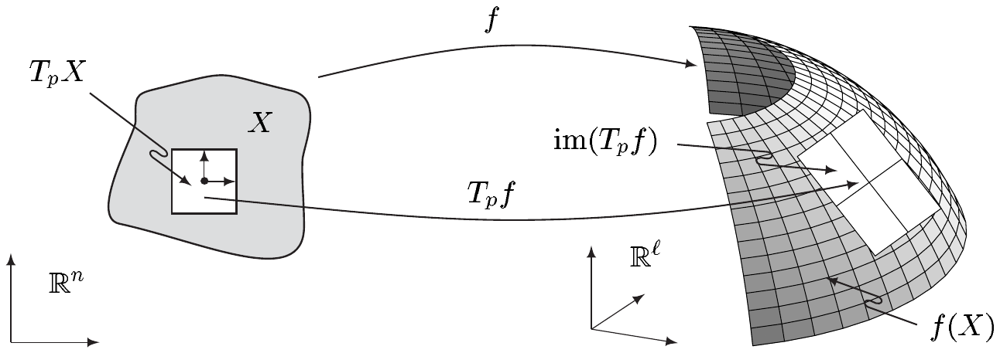
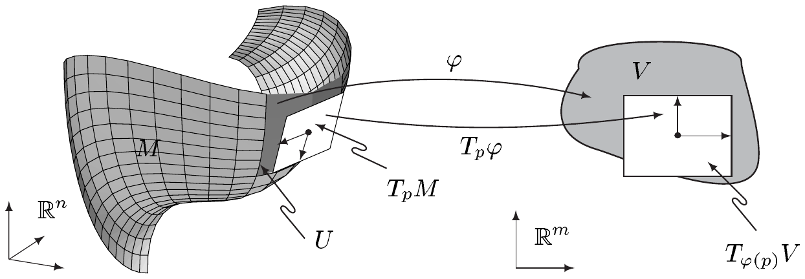
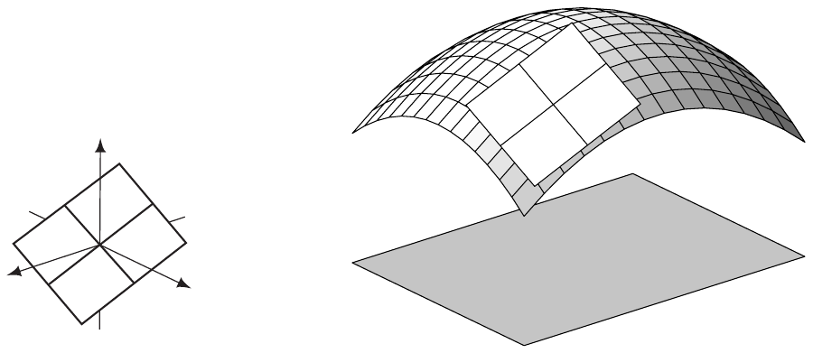
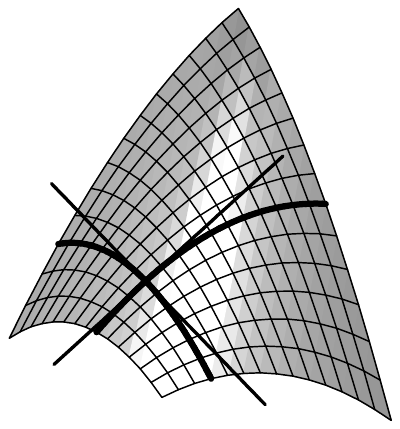
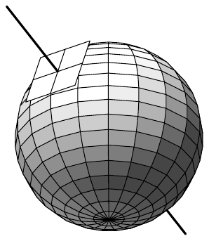
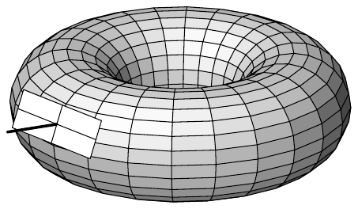
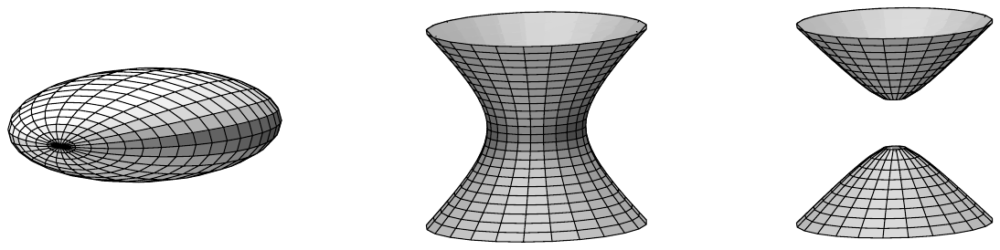
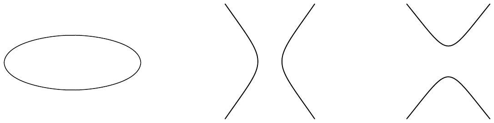

## 10 切线与法向

我们现在引入线性结构，这些结构使我们能够给子流形之间的映射赋予导数。这些结构将用局部坐标来描述，而局部坐标在具体计算中当然非常有用。

为了说明为什么需要这样的结构，我们考虑 $ \mathbb{R}^{3} $ 中单位球面 $ S^{2} $ 上的实值函数 $ f : S^{2} \to \mathbb{R} $。通过差商极限来定义 $ f $ 的导数的朴素尝试注定立即失败：对 $ p \in S^{2} $ 以及满足 $ h \ne 0 $ 的 $ h \in \mathbb{R}^{3} $，$ p + h $ 一般并不落在 $ S^{2} $ 中，因此 $ f $ 的“增量” $ f(p + h) - f(p) $ 甚至在点 $ p $ 处根本没有定义。

##### $ \mathbb{R}^{n} $ 中的切向

我们从 $ \mathbb{R}^{n} $ 的 $ n $ 维子流形这一简单情形开始（见例 9.1(a)）。设 $ X $ 在 $ \mathbb{R}^{n} $ 中开，且 $ p \in X $。$ X $ 在点 $ p $ 处的**切向空间** $ T_{p}X $ 是集合 $ \{p\}\times\mathbb{R}^{n} $，并赋以 $ \mathbb{R}^{n} = (\mathbb{R}^{n}, (\cdot|\cdot)) $ 的诱导欧几里得向量空间结构，即

\[ (p,v) + \lambda(p,w) := (p, v + \lambda w) \quad \text{且} \quad ((p,v)|(p,w))_{p} := (v|w) \]

对 $ (p,v), (p,w) \in T_{p}X $ 和 $ \lambda \in \mathbb{R} $。$ T_{p}X $ 中的元素 $ (p,v) $ 称为 $ X $ 在 $ p $ 处的一个**切向向量**，也记作 $ (v)_{p} $。我们称 $ v $ 为 $ (v)_{p} $ 的**切部分**。\footnote{我们区分“切向的”与“切的”：切向向量含有“基点” $ p $，而其切部分不含。}

10.1 注 切向空间 $ T_{p}X $ 与 $ \mathbb{R}^{n} $ 是等距同构的希尔伯特空间。把 $ \mathbb{R}^{n} $“附着”到点 $ p \in X $ 上，可以清楚地表达这个等距同构。■

设 $ Y $ 在 $ \mathbb{R}^{\ell} $ 中开，且 $ f \in C^{1}(X,Y) $。则线性映射

\[ T_{p}f : T_{p}X \to T_{f(p)}Y , \quad (p,v) \mapsto (f(p), \partial f(p)v) \]

称为 $ f $ 在点 $ p $ 处的**切向**。

10.2 注 (a) 显然

\[ T_{p}f \in \mathcal{L}(T_{p}X, T_{f(p)}Y) . \]

因为当 $ v $ 在 $ \mathbb{R}^{n} $ 的零邻域中时，映射 $ v \mapsto f(p) + \partial f(p)v $ 在点 $ p $ 处（直到一阶）逼近映射 $ f $，所以我们知道 $ \operatorname{im}(T_{p}f) $ 是 $ T_{f(p)}Y $ 的向量子空间，它在点 $ f(p) $ 处（直到一阶）逼近 $ f(X) $。

(b) 若 $ Z $ 在 $ \mathbb{R}^{s} $ 中开且 $ g \in C^{1}(Y,Z) $，则**链式法则**为

\[ T_{p}(g\circ f) = T_{f(p)}g\circ T_{p}f . \]

换言之，下面是交换图。

\[ \begin{array}{ccc} X & \xrightarrow{f} & Y \\ g\circ f \searrow & & \swarrow g \\ & Z & \end{array} \qquad \begin{array}{ccc} T_{p}X & \xrightarrow{T_{p}f} & T_{f(p)}Y \\ T_{p}(g\circ f) \searrow & & \swarrow T_{f(p)}g \\ & T_{g(f(p))} & \end{array} \]

证明 这由 $ C^{1} $ 映射的链式法则（见定理 3.3）推出。■

(c) 对 $ f \in \operatorname{Diff}^{1}(X,Y) $，有

\[ T_{p}f \in \mathcal{L}\mathrm{is}(T_{p}X, T_{f(p)}Y) \quad \text{且} \quad (T_{p}f)^{-1} = T_{f(p)}f^{-1} \quad \text{对 } p \in X . \]

证明 这是 (b) 的推论。■

##### 切向空间

在本节余下部分，设

• $ M $ 是 $ \mathbb{R}^{n} $ 的 $ m $ 维 $ C^{q} $ 子流形；
$ q \in \mathbb{N}^{\times} \cup \{\infty\} $；
$ p \in M $，且 $ (\varphi,U) $ 是 $ M $ 在 $ p $ 附近的一个坐标卡；
$ (g,V) $ 是属于 $ (\varphi,U) $ 的参数化。

$ M $ 在点 $ p $ 处的**切向空间** $ T_{p}M $ 是 $ T_{\varphi(p)}V $ 在 $ T_{\varphi(p)}g $ 下的像，因此 $ T_{p}M = \operatorname{im}(T_{\varphi(p)}g) $。$ T_{p}M $ 的元素称为 $ M $ 在 $ p $ 处的**切向向量**，而 $ TM := \bigcup_{p\in M}T_{p}M $ 是 $ M $ 的**切向丛**\footnote{对 $ p \in M $，有包含关系 $ T_{p}M \subset M\times\mathbb{R}^{n} $。因此 $ TM $ 是 $ M\times\mathbb{R}^{n} $ 的子集。这里我们用更简单的词“切”，因为它更标准，且无需“切部分之丛”。}。

10.3 注 (a) $ T_{p}M $ 是良定义的，也就是说，它与所选的坐标卡 $ (\varphi,U) $ 无关。

证明 设 $ (\tilde{\varphi},\tilde{U}) $ 是 $ M $ 在 $ p $ 附近的另一个坐标卡，其相应的参数化为 $ (\tilde{g},\tilde{V}) $。不失一般性，我们可以假设坐标卡覆盖的区域 $ U $ 与 $ \tilde{U} $ 重合。否则考虑 $ U\cap\tilde{U} $。由链式法则（注 10.2(b)），图

\[ \begin{array}{ccc} & T_{p}\mathbb{R}^{n} & \\ T_{\varphi(p)}g \nearrow & & \nwarrow T_{\tilde{\varphi}(p)}\tilde{g} \\ T_{\varphi(p)}V & \xrightarrow{\ T_{\varphi(p)}(\tilde{\varphi}\circ\varphi^{-1})\ } & T_{\tilde{\varphi}(p)}\tilde{V} \end{array} \]

交换。由命题 9.15 与注 10.2(c)，$ T_{\varphi(p)}(\tilde{\varphi}\circ\varphi^{-1}) $ 是同构，由此立即得到断言。■

(b) 若 $ M $ 是 $ \mathbb{R}^{n} $ 的子集，则上述 $ T_{p}M $ 的定义与注 10.1 中的定义一致。特别地，有 $ TM = M\times\mathbb{R}^{n} $。

(c) 切向空间 $ T_{p}M $ 是 $ T_{p}\mathbb{R}^{n} $ 的 $ m $ 维向量子空间，因而是一个 $ m $ 维希尔伯特空间，其内积 $ (\cdot|\cdot)_{p} $ 由 $ T_{p}\mathbb{R}^{n} $ 诱导。

证明 令 $ x_{0} := \varphi(p) $。对 $ (v)_{x_{0}} \in T_{x_{0}}V $，有 $ (T_{x_{0}}g)(v)_{x_{0}} = (p, \partial g(x_{0})v) $。因此可得

\[ \operatorname{rank}T_{x_{0}}g = \operatorname{rank}\partial g(x_{0}) = m , \]

从而证得断言。■

(d) 因为 $ T_{\varphi(p)}g : T_{\varphi(p)}V \to T_{p}\mathbb{R}^{n} $ 是单射且 $ T_{p}M = \operatorname{im}(T_{\varphi(p)}g) $，所以恰有一个 $ A \in \mathcal{L}\mathrm{is}(T_{p}M, T_{\varphi(p)}V) $ 使得 $ (T_{\varphi(p)}g)(A) = i_{T_{p}M} $，其中 $ i_{T_{p}M} $ 是 $ T_{p}M $ 到 $ T_{p}\mathbb{R}^{n} $ 的典范单射。换言之，当把 $ T_{\varphi(p)}g $ 理解为 $ T_{\varphi(p)}V $ 到其像 $ T_{p}M $ 上的映射时，$ A $ 是 $ T_{\varphi(p)}g $ 的逆。我们称 $ T_{p}\varphi := A $ 为坐标卡 $ \varphi $ 在点 $ p $ 处的**切向**。此外，$ (T_{p}\varphi)v \in T_{\varphi(p)}V $ 是切向向量 $ v \in T_{p}M $ 在 $ \varphi $ 诱导的**局部坐标**下的**表示**。若 $ (\tilde{\varphi},\tilde{U}) $ 是 $ M $ 在 $ p $ 附近的另一个坐标卡，则图

\[ \begin{array}{ccc} & T_{p}M & \\ T_{p}\varphi \swarrow & \cong & \searrow T_{p}\tilde{\varphi} \\ T_{\varphi(p)}\varphi(U) & \xrightarrow[\cong]{\ T_{\varphi(p)}(\tilde{\varphi}\circ\varphi^{-1})\ } & T_{\tilde{\varphi}(p)}\tilde{\varphi}(\tilde{U}) \end{array} \]

交换，其中 $ \cong $ 表示“同构”。

证明 不失一般性，假设 $ U = \tilde{U} $。对 $ \tilde{g} := i_{M}\circ\tilde{\varphi}^{-1} $，由 $ \tilde{g} = (i_{M}\circ\varphi^{-1})\circ(\varphi\circ\tilde{\varphi}^{-1}) = g\circ(\varphi\circ\tilde{\varphi}^{-1}) $ 与注 10.2(b) 的链式法则可得

\[ T_{\tilde{\varphi}(p)}\tilde{g} = T_{\varphi(p)}g\,T_{\tilde{\varphi}(p)}(\varphi\circ\tilde{\varphi}^{-1}) . \]

由此，$ T_{p}\varphi $ 与 $ T_{p}\tilde{\varphi} $ 的定义、注 10.2(c) 以及命题 9.15 给出关系

\[ T_{p}\tilde{\varphi} = \left(T_{\tilde{\varphi}(p)}(\varphi\circ\tilde{\varphi}^{-1})\right)^{-1}T_{p}\varphi = T_{\varphi(p)}(\tilde{\varphi}\circ\varphi^{-1})\,T_{p}\varphi , \]

从而证得断言。■

(e)（局部坐标中的内积）设 $ x_{0} := \varphi(p) $，且

\[ g_{jk}(x_{0}) := \left(\partial_{j}g(x_{0})\big|\partial_{k}g(x_{0})\right) \quad \text{对 } 1 \le j,k \le m . \]

则 $ [g_{jk}] \in \mathbb{R}^{m\times m}_{\mathrm{sym}} $ 称为 $ M $ 关于坐标卡 $ \varphi $（或参数化 $ g $）在 $ p $ 处（即 $ x_{0} $ 处）的**（第一）基本矩阵**。它是正定的。

对 $ v,w \in T_{p}M $，有\footnote{另见注 2.17(c)。}

\[ (v|w)_{p} = \sum_{j,k=1}^{m}g_{jk}(x_{0})v^{j}w^{k} , \tag{10.1} \]

其中 $ v^{j} $ 与 $ w^{k} $ 分别是 $ (T_{p}\varphi)v $ 与 $ (T_{p}\varphi)w $ 的切部分关于标准基的局部表示的分量。

证明 对 $ \xi,\eta \in \mathbb{R}^{m} $，有

\[ \sum_{j,k=1}^{m}g_{jk}(x_{0})\xi^{j}\eta^{k} = \left(\partial g(x_{0})\xi\big|\partial g(x_{0})\eta\right) . \tag{10.2} \]

特别地，因为 $ \partial g(x_{0}) $ 是单射，有

\[ \left([g_{jk}](x_{0})\xi\big|\xi\right) = |\partial g(x_{0})\xi|^{2} > 0 \quad \text{对 } \xi \in \mathbb{R}^{m}\setminus\{0\} . \]

因此基本矩阵是正定的。

因为 $ v = T_{x_{0}}g\,(T_{p}\varphi)v $ 且 $ (T_{p}\varphi)v = \sum_{j=1}^{m}v^{j}e_{j} $，由 $ (\cdot|\cdot)_{p} $ 的定义可得

\[ (v|w)_{p} = \left((T_{x_{0}}g)(T_{p}\varphi)v\big|(T_{x_{0}}g)(T_{p}\varphi)w\right)_{p} = \left(\partial g(x_{0})\sum_{j=1}^{m}v^{j}e_{j}\Big|\partial g(x_{0})\sum_{k=1}^{m}w^{k}e_{k}\right) . \]

从而 (10.1) 蕴含 (10.2)。■

10.4 例（图像的切向空间）设 $ X $ 在 $ \mathbb{R}^{m} $ 中开，并令 $ f \in C^{q}(X,\mathbb{R}^{\ell}) $。由命题 9.2，$ M := \operatorname{graph}(f) $ 是 $ \mathbb{R}^{m}\times\mathbb{R}^{\ell} = \mathbb{R}^{m+\ell} $ 的 $ m $ 维 $ C^{q} $ 子流形。则对 $ x \in X $ 令 $ g(x) := (x, f(x)) $，$ g $ 是 $ M $ 的一个 $ C^{q} $ 参数化，且对 $ p = (x_{0}, f(x_{0})) \in M $，有

\[ (T_{x_{0}}g)(v)_{x_{0}} = \left(p, (v, \partial f(x_{0})v)\right) \quad \text{对 } (v)_{x_{0}} \in T_{x_{0}}X . \]

因此，我们得到

\[ T_{p}M = \left\{ \left(p, (v, \partial f(x_{0})v)\right) ;\ v \in \mathbb{R}^{m} \right\} , \]

也就是说，$ T_{p}M $ 是“附着于点 $ p = (x_{0}, f(x_{0})) $”的 $ \partial f(x_{0}) $ 的图像。

对 $ n = m + \ell $，$ T_{p}M $ 在 $ \mathbb{R}^{n} $ 中的表示是通过把 $ (\eta)_{p} = (p,\eta) \in T_{p}\mathbb{R}^{n} $ 等同于 $ p + \eta \in \mathbb{R}^{n} $ 而得到的。由此可得

\[ \begin{aligned} T_{p}M \ni &\left((x_{0}, f(x_{0})), (v, \partial f(x_{0})v)\right) \\ &= \left(x_{0} + v, f(x_{0}) + \partial f(x_{0})v\right) \in \mathbb{R}^{m}\times\mathbb{R}^{\ell} = \mathbb{R}^{n} , \end{aligned} \]

并且我们得到

\[ \begin{aligned} T_{p}M &= \left\{ \left(x, f(x_{0}) + \partial f(x_{0})(x - x_{0})\right) ;\ x \in \mathbb{R}^{m} \right\} \\ &= \operatorname{graph}\left(x \mapsto f(x_{0}) + \partial f(x_{0})(x - x_{0})\right) . \end{aligned} \]

这一表示再次表明 $ T_{p}M $ 是曲线切线概念的高维推广（见注 IV.1.4）。■

设 $ \varepsilon > 0 $，使得对 $ t \in (-\varepsilon,\varepsilon) $ 和 $ j \in \{1,\ldots,m\} $ 有 $ \varphi(p) + te_{j} \in V $。则

\[ \gamma_{j}(t) := g\left(\varphi(p) + te_{j}\right) \quad \text{对 } t \in (-\varepsilon,\varepsilon) , \]

称为过 $ p $ 的第 $ j $ 条**坐标道路**。

10.5 注 对 $ x_{0} := \varphi(p) $，有

\[ T_{p}M = \operatorname{span}\left\{ \left(\partial_{1}g(x_{0})\right)_{p}, \ldots, \left(\partial_{m}g(x_{0})\right)_{p} \right\} , \]

也就是说，$ p $ 处在坐标道路 $ \gamma_{j} $ 上的切向向量构成 $ T_{p}M $ 的一组基。

证明 对 $ [\partial g(x_{0})] $ 的第 $ j $ 列，有

\[ \partial_{j}g(x_{0}) = \partial g(x_{0})e_{j} = \dot{\gamma}_{j}(0) . \]

该注成立，因为 $ g $ 是浸入，从而 $ [\partial g(x_{0})] $ 的列向量线性无关，且 $ \dim T_{p}M = m $。■

##### 切向空间的刻画

$ M $ 在 $ p $ 处的切向向量可以描述为 $ M $ 中正则道路的切向向量。下一个定理给出切向空间的几何解释。

10.6 定理 对每个 $ p \in M $，有

\[ \begin{aligned} T_{p}M = \left\{ (v)_{p} \in T_{p}\mathbb{R}^{n} ;\ \exists\,\varepsilon > 0,\ \exists\,\gamma \in C^{1}\left((-\varepsilon,\varepsilon),\mathbb{R}^{n}\right) \text{ 使得 } \right. \\ \left. \operatorname{im}(\gamma) \subset M,\ \gamma(0) = p,\ \dot{\gamma}(0) = v \right\} . \end{aligned} \]

换言之，对每个 $ (v)_{p} \in T_{p}M \subset T_{p}\mathbb{R}^{n} $，存在 $ \mathbb{R}^{n} $ 中过 $ p $ 的一条 $ C^{1} $ 道路，它整个包含在 $ M $ 中，且以 $ (v)_{p} $ 作为它在 $ p $ 处的切向向量。这种道路的每个切向向量都属于 $ T_{p}M $。

证明 (i) 设 $ (v)_{p} \in T_{p}M $ 且 $ x_{0} := \varphi(p) $。则存在 $ \xi \in \mathbb{R}^{m} $ 使得 $ v = \partial g(x_{0})\xi $。因为 $ V = \varphi(U) $ 在 $ \mathbb{R}^{m} $ 中开，所以存在 $ \varepsilon > 0 $ 使得对 $ t \in (-\varepsilon,\varepsilon) $ 有 $ x_{0} + t\xi \in V $。现在对 $ t \in (-\varepsilon,\varepsilon) $ 令 $ \gamma(t) := g(x_{0} + t\xi) $，于是 $ \gamma $ 是 $ M $ 中的一条 $ C^{1} $ 道路，满足 $ \gamma(0) = p $ 且 $ \dot{\gamma}(0) = \partial g(x_{0})\xi = v $。

(ii) 设 $ \gamma \in C^{1}\left((-\varepsilon,\varepsilon),\mathbb{R}^{n}\right) $，其中 $ \operatorname{im}(\gamma) \subset M $ 且 $ \gamma(0) = p $。由注 9.9(d)，存在 $ (x_{0},0) $ 在 $ \mathbb{R}^{n} $ 中的开邻域 $ \tilde{V} $、$ \mathbb{R}^{n} $ 中的开邻域 $ \tilde{U} $，以及一个 $ \psi \in \operatorname{Diff}^{q}(\tilde{V},\tilde{U}) $ 使得对 $ x \in V $ 有 $ \psi(x,0) = g(x) $。通过缩小 $ \varepsilon $，可以假设 $ \operatorname{im}(\gamma) \subset U\cap\tilde{U} $。由此可得

\[ \gamma(t) = (g\circ\varphi\circ\gamma)(t) = (g\circ\operatorname{pr}_{\mathbb{R}^{m}}\circ\psi^{-1}\circ\gamma)(t) , \]

并由链式法则得到

\[ \dot{\gamma}(0) = \partial g(x_{0})\left(\operatorname{pr}_{\mathbb{R}^{m}}\circ\psi^{-1}\circ\gamma\right)^{\cdot}(0) . \]

对 $ \xi := \left(\operatorname{pr}_{\mathbb{R}^{m}}\circ\psi^{-1}\circ\gamma\right)^{\cdot}(0) \in \mathbb{R}^{m} $ 和 $ v := \partial g(x_{0})\xi \in \mathbb{R}^{n} $，有 $ (v)_{p} \in T_{p}M $，证毕。■

若 $ X $ 在 $ \mathbb{R}^{n} $ 中开，且点 $ c \in \mathbb{R}^{\ell} $ 是 $ f \in C^{q}(X,\mathbb{R}^{\ell}) $ 的正则值，则由定理 9.3 我们知道 $ M = f^{-1}(c) $ 是 $ \mathbb{R}^{n} $ 的 $ (n-\ell) $ 维 $ C^{q} $ 子流形。在下一个定理中，我们证明“线性化”也有类似的结论，即

\[ T_{p}M = (T_{p}f)^{-1}(c) = \ker(T_{p}f) . \]

10.7 定理（正则值）设 $ X $ 在 $ \mathbb{R}^{n} $ 中开，且 $ c \in \mathbb{R}^{\ell} $ 是 $ f \in C^{q}(X,\mathbb{R}^{\ell}) $ 的正则值。对 $ \mathbb{R}^{n} $ 的 $ (n-\ell) $ 维 $ C^{q} $ 子流形 $ M := f^{-1}(c) $，则对 $ p \in M $ 有 $ T_{p}M = \ker(T_{p}f) $。

证明 设 $ (v)_{p} \in T_{p}M \subset T_{p}\mathbb{R}^{n} $。由定理 10.6，存在 $ \varepsilon > 0 $ 和一条道路 $ \gamma \in C^{1}\left((-\varepsilon,\varepsilon),\mathbb{R}^{n}\right) $ 使得 $ \operatorname{im}(\gamma) \subset M $，且 $ \gamma(0) = p $、$ \dot{\gamma}(0) = v $。特别地，对每个 $ t \in (-\varepsilon,\varepsilon) $ 有 $ f\left(\gamma(t)\right) = c $，对此关系求导可得

\[ \partial f\left(\gamma(0)\right)\dot{\gamma}(0) = \partial f(p)v = 0 . \]

由此可得 $ T_{p}M \subset \ker(T_{p}f) $。

因为 $ p $ 是 $ f $ 的正则点，有

\[ \dim\left(\operatorname{im}(T_{p}f)\right) = \dim\left(\operatorname{im}(\partial f(p))\right) = \ell . \]

因此，秩公式 (2.4) 给出

\[ \dim\left(\ker(T_{p}f)\right) = n - \ell = \dim(T_{p}M) . \]

所以 $ T_{p}M $ 不是 $ \ker(T_{p}f) $ 的真向量子空间。■

##### 可微映射

设 $ N $ 是 $ \mathbb{R}^{\ell} $ 的 $ C^{r} $ 子流形，且 $ 1 \le s \le \min\{q,r\} $。又设 $ f \in C(M,N) $，$ (\psi,W) $ 是 $ N $ 在 $ f(p) $ 附近的一个坐标卡。则 $ U\cap f^{-1}(W) $ 是 $ p $ 在 $ M $ 中的开邻域。因此通过缩小 $ U $，可以不失一般性地假设 $ f(U) \subset W $。若映射

\[ f_{\varphi,\psi} := \psi\circ f\circ\varphi^{-1} : \varphi(U) \to \psi(W) \]

在点 $ \varphi(p) $ 处是（$ s $ 次）[连续]可微的，则称函数 $ f $ 在 $ p $ 处（$ s $ 次）[连续]可微。

若 $ f $ 在 $ M $ 的每一点处都（$ s $ 次）[连续]可微，则称映射 $ f \in C(M,N) $（$ s $ 次）[连续]可微。我们用 $ C^{s}(M,N) $ 表示从 $ M $ 到 $ N $ 的所有 $ s $ 次连续可微函数之集，而

\[ \operatorname{Diff}^{s}(M,N) := \left\{ f \in C^{s}(M,N) ;\ f \text{ 是双射},\ f^{-1} \in C^{s}(N,M) \right\} \]

是从 $ M $ 到 $ N $ 的所有 $ C^{s} $ 微分同胚之集。最后，若 $ \operatorname{Diff}^{s}(M,N) $ 非空，则称 $ M $ 与 $ N $ $ C^{s} $-微分同胚。

10.8 注 (a) 上述定义与坐标卡的选择无关。

证明 若 $ (\tilde{\varphi},\tilde{U}) $ 与 $ (\tilde{\psi},\tilde{W}) $ 分别是 $ M $ 在 $ p $ 附近和 $ N $ 在 $ f(p) $ 附近的另一些坐标卡，使得 $ f(\tilde{U}) \subset \tilde{W} $，则

\[ f_{\tilde{\varphi},\tilde{\psi}} = \tilde{\psi}\circ f\circ\tilde{\varphi}^{-1} = (\tilde{\psi}\circ\psi^{-1})\circ f_{\varphi,\psi}\circ(\varphi\circ\tilde{\varphi}^{-1}) . \tag{10.3} \]

由此，结合命题 9.15 与链式法则，即得本定理。■

(b) 若 $ M $ 与 $ N $ 的维数分别为 $ n $ 与 $ \ell $，即 $ M $ 在 $ \mathbb{R}^{n} $ 中开、$ N $ 在 $ \mathbb{R}^{\ell} $ 中开，则上述定义与第 5 节中的定义一致。

(c) 函数 $ f_{\varphi,\psi} $ 是 $ f $ 在坐标卡 $ \varphi $ 与 $ \psi $ 下的**局部表示**，或**局部坐标表示**。与映射于“弯曲集合” $ M $ 与 $ N $ 之间的函数 $ f $ 不同，$ f_{\varphi,\psi} $ 是欧几里得空间开子集之间的映射。

(d) 若 $ s > \min\{q,r\} $，则一般不可能合理地定义一个与坐标无关的 $ M $ 到 $ N $ 的 $ C^{s} $ 映射概念。

证明 这由 (10.3) 推出，因为过渡函数只分别属于 $ C^{q} $ 或 $ C^{r} $。■

设 $ f : M \to N $ 在 $ p $ 处可微，且 $ (\psi,W) $ 是 $ N $ 在 $ f(p) $ 附近使得 $ f(U) \subset W $ 的坐标卡。则图

\[ \begin{array}{ccc} M \supset U & \xrightarrow{f} & W \subset N \\ \varphi \downarrow \cong & & \cong \downarrow \psi \\ \mathbb{R}^{m} \supset \varphi(U) & \xrightarrow{f_{\varphi,\psi}} & \psi(W) \subset \mathbb{R}^{\bar{n}} \end{array} \tag{10.4} \]

交换，其中 $ \cong $ 表示 $ C^{1} $-微分同胚\footnote{注意局部表示 $ \varphi_{\varphi,\operatorname{id}} = \operatorname{id}_{\varphi(U)} $。}，$ \bar{n} $ 是 $ N $ 的维数。我们

现在通过要求图

\[ \begin{array}{ccc} T_{p}M & \xrightarrow{T_{p}f} & T_{f(p)}N \\ T_{p}\varphi \downarrow \cong & & \cong \downarrow T_{f(p)}\psi \\ T_{\varphi(p)}\varphi(U) & \xrightarrow{T_{\varphi(p)}f_{\varphi,\psi}} & T_{\psi(f(p))}\psi(W) \end{array} \tag{10.5} \]

交换来定义 $ f $ 在 $ p $ 处的**切向** $ T_{p}f $，这里 $ \cong $ 表示“同构”。

10.9 注 (a) 切向 $ T_{p}f $ 与坐标无关，且 $ T_{p}f \in \mathcal{L}(T_{p}M, T_{f(p)}N) $。

证明 设 $ (\tilde{\varphi},\tilde{U}) $ 是 $ M $ 在 $ p $ 附近的坐标卡，$ (\tilde{\psi},\tilde{W}) $ 是 $ f(p) $ 附近使得 $ f(\tilde{U}) \subset \tilde{W} $ 的坐标卡。则 (10.3) 与注 10.2(b) 的链式法则给出

\[ \begin{aligned} T_{\tilde{\varphi}(p)}f_{\tilde{\varphi},\tilde{\psi}} &= T_{\tilde{\varphi}(p)}\left((\tilde{\psi}\circ\psi^{-1})\circ f_{\varphi,\psi}\circ(\varphi\circ\tilde{\varphi}^{-1})\right) \\ &= T_{\psi(f(p))}(\tilde{\psi}\circ\psi^{-1})\circ T_{\varphi(p)}f_{\varphi,\psi}\circ T_{\tilde{\varphi}(p)}(\varphi\circ\tilde{\varphi}^{-1}) . \end{aligned} \]

于是该注由注 10.3(d) 推出。■

(b) 设 $ O $ 是另一个流形，且 $ g : N \to O $ 在 $ f(p) $ 处可微。则有**链式法则**

\[ T_{p}(g\circ f) = T_{f(p)}g\,T_{p}f \tag{10.6} \]

以及

\[ T_{p}\operatorname{id}_{M} = \operatorname{id}_{T_{p}M} . \tag{10.7} \]

若 $ f $ 属于 $ \operatorname{Diff}^{1}(M,N) $，则

\[ T_{p}f \in \mathcal{L}\mathrm{is}(T_{p}M, T_{f(p)}N) \quad \text{且} \quad (T_{p}f)^{-1} = T_{f(p)}f^{-1} \quad \text{对 } p \in M . \]

证明 陈述 (10.6) 与 (10.7) 由 (10.5) 图的交换性以及注 10.2(b) 的链式法则易得。其余断言是 (10.6) 与 (10.7) 的直接推论。■

10.10 例 (a) $ M $ 到 $ \mathbb{R}^{n} $ 的典范单射 $ i_{M} $ 属于 $ C^{q}(M,\mathbb{R}^{n}) $，且对 $ \psi := \operatorname{id}_{\mathbb{R}^{n}} $，有

\[ T_{\varphi(p)}(i_{M})_{\varphi,\psi} = T_{\varphi(p)}g . \]

因此 $ T_{p}i_{M} $ 是 $ T_{p}M $ 到 $ T_{p}\mathbb{R}^{n} $ 的典范单射。

证明 这显然由 $ (i_{M})_{\varphi,\psi} = i_{M}\circ\varphi^{-1} = g $ 推出。■

(b) 设 $ X $ 是 $ M $ 的开邻域，且 $ \tilde{f} \in C^{s}(X,\mathbb{R}^{\ell}) $。又设 $ \tilde{f}(M) \subset N $。则 $ f := \tilde{f}|M $ 属于 $ C^{s}(M,N) $，且

\[ T_{f(p)}i_{N}\,T_{p}f = T_{p}\tilde{f}\,T_{p}i_{M} \quad \text{对 } p \in M , \]

也就是说，图

\[ \begin{array}{ccc} M & \xrightarrow{i_{M}} & X \\ f \downarrow & & \downarrow \tilde{f} \\ N & \xrightarrow{i_{N}} & \mathbb{R}^{\ell} \end{array} \qquad \begin{array}{ccc} T_{p}M & \xrightarrow{T_{p}i_{M}} & T_{p}X \\ T_{p}f \downarrow & & \downarrow T_{p}\tilde{f} \\ T_{f(p)}N & \xrightarrow{T_{f(p)}i_{N}} & T_{f(p)}\mathbb{R}^{\ell} \end{array} \]

交换。

证明 因为 $ N $ 是 $ \mathbb{R}^{\ell} $ 的 $ C^{r} $ 子流形，我们（可能通过缩小 $ W $）可以假设存在 $ W $ 在 $ \mathbb{R}^{\ell} $ 中的开邻域 $ \bar{W} $，以及 $ \bar{W} $ 到 $ \mathbb{R}^{\ell} $ 的某个开子集上的 $ C^{r} $ 微分同胚 $ \Psi $，使得 $ \Psi \supset \psi $。于是我们得到

\[ f_{\varphi,\psi} = \psi\circ f\circ\varphi^{-1} = \Psi\circ\tilde{f}\circ g \in C^{s}(V,\mathbb{R}^{\ell}) . \]

因为这对 $ M $ 的每个坐标卡 $ (\varphi,U) $ 与 $ N $ 的每个使得 $ f(U) \subset W $ 的坐标卡 $ (\psi,W) $ 都成立，所以可以断定 $ f $ 属于 $ C^{s}(M,N) $。因为 $ i_{N}\circ f = \tilde{f}\circ i_{M} $，断言的最后部分是链式法则的推论。■

(c) 设 $ X $ 在 $ \mathbb{R}^{n} $ 中开，$ Y $ 在 $ \mathbb{R}^{\ell} $ 中开，且 $ f \in C^{q}(X,\mathbb{R}^{\ell}) $ 满足 $ f(X) \subset Y $。则 $ f $ 属于 $ C^{q}(X,Y) $，其中 $ X $ 与 $ Y $ 分别理解为 $ \mathbb{R}^{n} $ 与 $ \mathbb{R}^{\ell} $ 的 $ n $ 维与 $ \ell $ 维子流形。此外，有

\[ T_{p}f = (f(p), \partial f(p)) \quad \text{对 } p \in X . \]

证明 这是 (b) 的特例。■

##### 微分与梯度

若 $ f : M \to \mathbb{R} $ 在 $ p $ 处可微，则

\[ T_{p}f : T_{p}M \to T_{f(p)}\mathbb{R} = \{f(p)\}\times\mathbb{R} \subset \mathbb{R}\times\mathbb{R} . \]

利用到第二个因子的典范投影 $ \operatorname{pr}_{2} : \mathbb{R}\times\mathbb{R} \to \mathbb{R} $，令

\[ d_{p}f := \operatorname{pr}_{2}\circ T_{p}f \in \mathcal{L}(T_{p}M,\mathbb{R}) = (T_{p}M)' , \]

并称 $ d_{p}f $ 为 $ f $ 在点 $ p $ 处的**微分**。因此 $ d_{p}f $ 是 $ T_{p}M $ 上的连续线性形式。因为切向空间是 $ m $ 维希尔伯特空间，由里斯表示定理，存在唯一的向量 $ \nabla_{p}f := \nabla_{p}^{M}f \in T_{p}M $ 使得

\[ (d_{p}f)v = (\nabla_{p}f|v)_{p} \quad \text{对 } v \in T_{p}M , \]

我们称之为 $ f $ 在点 $ p $ 处的**梯度**。

10.11 注 (a) 设 $ X $ 在 $ \mathbb{R}^{n} $ 中开且 $ f \in C^{1}(X,\mathbb{R}) $。则

\[ \nabla_{p}f = (p, \nabla f(p)) \quad \text{对 } p \in X , \]

其中 $ \nabla f(p) $ 是 $ f $ 在点 $ p $ 处的梯度，如第 2 节所定义。因此 $ \nabla_{p}f $ 与 $ \nabla f(p) $ 这两个定义是一致的。

证明 我们用平凡坐标卡 $ (\operatorname{id}_{X}, X) $ 来描述流形 $ X $。则 $ d_{p}f $ 的局部表示与 $ \partial f(p) $ 一致。于是断言由 $ (\cdot|\cdot)_{p} $ 与梯度的定义推出。■

(b)（局部坐标表示）设 $ f \in C^{1}(M,\mathbb{R}) $，且 $ f_{\varphi} := f\circ\varphi^{-1} $ 是 $ f $ 在 $ M $ 的坐标卡 $ \varphi $ 与 $ \mathbb{R} $ 的坐标卡 $ \operatorname{id}_{\mathbb{R}} $ 下的局部表示，即 $ f_{\varphi} = f_{\varphi,\operatorname{id}_{\mathbb{R}}} $。又设 $ [g^{jk}] $ 是基本矩阵 $ [g_{jk}] $ 关于 $ \varphi $ 在 $ p $ 处的逆。则在 $ \varphi $ 诱导的局部坐标下，梯度 $ \nabla_{p}f \in T_{p}M $\footnote{将此与公式 (2.6) 比较。} 的局部表示 $ (T_{p}\varphi)\nabla_{p}f $ 有切部分

\[ \left(\sum_{k=1}^{m}g^{1k}(x_{0})\partial_{k}f_{\varphi}(x_{0}), \ldots, \sum_{k=1}^{m}g^{mk}(x_{0})\partial_{k}f_{\varphi}(x_{0})\right) \]

其中 $ x_{0} := \varphi(p) $。

证明 利用 $ \nabla_{p}f $ 与 $ d_{p}f $ 的定义，由命题 2.8(i) 可得

\[ (\nabla_{p}f|v)_{p} = (d_{p}f)v = \partial(f\circ\varphi^{-1})(x_{0})(T_{p}\varphi)v = \sum_{j=1}^{m}\partial_{j}f_{\varphi}(x_{0})v^{j} \tag{10.8} \]

对 $ v \in T_{p}M $ 与 $ (T_{p}\varphi)v = \sum_{j=1}^{m}v^{j}e_{j} $。对 $ (T_{p}\varphi)\nabla_{p}f = \sum_{j=1}^{m}w^{j}e_{j} $，利用注 10.3(e) 得到

\[ (\nabla_{p}f|v)_{p} = \sum_{j,k=1}^{m}g_{jk}(x_{0})w^{j}v^{k} \quad \text{对 } v \in T_{p}M . \tag{10.9} \]

现在 (10.8)、(10.9) 与 $ [g_{jk}] $ 的对称性蕴含

\[ \sum_{k=1}^{m}g_{jk}(x_{0})w^{k} = \partial_{j}f_{\varphi}(x_{0}) \quad \text{对 } 1 \le j \le m , \]

因此乘以 $ [g_{jk}]^{-1} = [g^{jk}] $ 后即得结论。■

下一个定理给出 $ p \in M $ 是 $ M $ 上可微实值函数极值点的必要条件。它推广了定理 3.13。

10.12 定理 若 $ p \in M $ 是 $ f \in C^{1}(M,\mathbb{R}) $ 的局部极值点，则 $ \nabla_{p}f = 0 $。

证明 因为 $ f_{\varphi} \in C^{1}(V,\mathbb{R}) $ 在 $ x_{0} = \varphi(p) $ 处有局部极值，所以 $ \partial f_{\varphi}(x_{0}) = 0 $（见命题 2.5 与定理 3.13）。因此，对 $ v \in T_{p}M $ 以及 $ (T_{p}\varphi)v $ 的切部分 $ \xi $，有

\[ (\nabla_{p}f|v)_{p} = (d_{p}f)v = \partial f_{\varphi}(x_{0})\xi = 0 . ■ \]

##### 法向

$ T_{p}M $ 在 $ T_{p}\mathbb{R}^{n} $ 中的正交补称为 $ M $ 在 $ p $ 处的**法空间**，记作 $ T_{p}^{\perp}M $。$ T_{p}^{\perp}M $ 中的向量是 $ M $ 在 $ p $ 处的**法向量**，而 $ T^{\perp}M := \bigcup_{p\in M}T_{p}^{\perp}M $ 是 $ M $ 的**法丛**。

10.13 命题 设 $ X $ 在 $ \mathbb{R}^{n} $ 中开，且 $ c $ 是 $ f \in C^{q}(X,\mathbb{R}^{\ell}) $ 的正则值。若 $ M := f^{-1}(c) $ 非空，则 $ \{\nabla_{p}f^{1}, \ldots, \nabla_{p}f^{\ell}\} $ 是 $ T_{p}^{\perp}M $ 的一组基。

证明 (i) 由注 10.11(a)，$ \nabla_{p}f^{j} $ 有切部分 $ \nabla f^{j}(p) $。由 $ \partial f(p) $ 的满射性可得，$ \mathbb{R}^{n} $ 中的向量 $ \nabla f^{1}(p), \ldots, \nabla f^{\ell}(p) $——从而 $ T_{p}\mathbb{R}^{n} $ 中的 $ \nabla_{p}f^{1}, \ldots, \nabla_{p}f^{\ell} $——线性无关。

(ii) 设 $ v \in T_{p}M $。由定理 10.6，我们知道存在 $ \varepsilon > 0 $ 和一条 $ \gamma \in C^{1}\left((-\varepsilon,\varepsilon),\mathbb{R}^{n}\right) $ 使得 $ \operatorname{im}(\gamma) \subset M $，$ \gamma(0) = p $，且 $ \gamma(0) = v $。因为对 $ t \in (-\varepsilon,\varepsilon) $ 有 $ f^{j}\left(\gamma(t)\right) = c^{j} $，可得

\[ 0 = (f^{j}\circ\gamma)'(0) = \left(\nabla f^{j}(\gamma(0))\big|\dot{\gamma}(0)\right) = (\nabla_{p}f^{j}|v)_{p} \quad \text{对 } 1 \le j \le \ell . \]

因为这对每个 $ v \in T_{p}M $ 都成立，我们看到 $ \nabla_{p}f^{1}, \ldots, \nabla_{p}f^{\ell} $ 属于 $ T_{p}^{\perp}M $。于是 $ \dim(T_{p}^{\perp}M) = n - \dim(T_{p}M) = \ell $。■

10.14 例
(a) 对 $ \mathbb{R}^{n} $ 中的球面 $ S^{n-1} $，当

\[ f : \mathbb{R}^{n} \to \mathbb{R} , \quad x \mapsto |x|^{2} . \]

时有 $ S^{n-1} = f^{-1}(1) $。因为 $ \nabla_{p}f = (p, 2p) $，有

\[ T_{p}^{\perp}S^{n-1} = (p, \mathbb{R}p) . \]

(b) 对 $ X := \mathbb{R}^{3}\setminus\left(\{0\}\times\{0\}\times\mathbb{R}\right) $ 和

\[ f(x_{1},x_{2},x_{3}) := \left(\sqrt{x_{1}^{2} + x_{2}^{2}} - 2\right)^{2} + x_{3}^{2} , \]

有 $ f \in C^{\infty}(X,\mathbb{R}) $，且\footnote{见例 9.11(f)。} $ f^{-1}(1) = \mathbb{T}_{2,1}^{2} $。则在点 $ p = (p_{1},p_{2},p_{3}) $ 处的法向量由 $ \nabla_{p}f = (p, 2(p - k)) $ 给出，其中

\[ k := \left(\frac{2p_{1}}{\sqrt{p_{1}^{2} + p_{2}^{2}}}, \frac{2p_{2}}{\sqrt{p_{1}^{2} + p_{2}^{2}}}, 0\right) . \]

证明 这由例 9.14(e) 与重算得到。■

(c) 设 $ X $ 在 $ \mathbb{R}^{n} $ 中开且 $ f \in C^{q}(X,\mathbb{R}) $。则一个**单位法向量**，即长度为 1 的法向量，在 $ M := \operatorname{graph}(f) $ 上的 $ p := (x, f(x)) $ 处由 $ \nu_{p} := (p, \nu(x)) \in T_{p}\mathbb{R}^{n+1} $ 给出，其中

\[ \nu(x) := \frac{(-\nabla f(x), 1)}{\sqrt{1 + |\nabla f(x)|^{2}}} \in \mathbb{R}^{n+1} . \]

证明 对由 $ g(x) := (x, f(x)) $（$ x \in X $）定义的参数化 $ g $，有

\[ \partial_{j}g(x) := (e_{j}, \partial_{j}f(x)) \quad \text{对 } x \in X , \quad 1 \le j \le n . \]

显然 $ \nu(x) $ 是 $ \mathbb{R}^{n+1} $ 中长度为 1 的向量，且与每个向量 $ \partial_{j}g(x) $ 正交。因此断言由注 10.5 推出。■

##### 约束极值

在许多应用中，我们寻求在某种约束下函数 $ F : \mathbb{R}^{n} \to \mathbb{R} $ 的极值点。换言之，约束意味着并非 $ \mathbb{R}^{n} $ 的每个点都允许使 $ F $ 取极值，相反所求的点必须属于某个子集 $ M $。这些约束常常由形如 $ h^{1}(p) = 0, \ldots, h^{\ell}(p) = 0 $ 的方程来描述，而这些方程的解集是一个子流形，即集合 $ M $。若 $ F|M $ 在 $ p \in M $ 处有局部极值，则称 $ p $ 是 $ F $ **在约束** $ h^{1}(p) = 0, \ldots, h^{\ell}(p) = 0 $ **下的极值点**。

下一个在实践中很重要的定理给出了一个点是约束极值点的必要条件。

10.15 定理（拉格朗日乘子）设 $ X $ 在 $ \mathbb{R}^{n} $ 中开，并给定函数 $ F, h^{1}, \ldots, h^{\ell} \in C^{1}(X,\mathbb{R}) $，其中 $ \ell < n $。又设 0 是映射 $ h := (h^{1}, \ldots, h^{\ell}) $ 的正则值，且设 $ M := h^{-1}(0) $ 非空。若 $ p \in M $ 是 $ F $ 在约束 $ h^{1}(p) = 0, \ldots, h^{\ell}(p) = 0 $ 下的极值点，则存在唯一的实数 $ \lambda_{1}, \ldots, \lambda_{\ell} $，即**拉格朗日乘子**，使得 $ p $ 是下述函数的临界点：

\[ F - \sum_{j=1}^{\ell}\lambda_{j}h^{j} \in C^{1}(X,\mathbb{R}) \]

证明 由正则值定理，我们知道 $ M $ 是 $ \mathbb{R}^{n} $ 的 $ (n-\ell) $ 维 $ C^{1} $ 子流形。由例 10.10(b)，$ f := F|M $ 属于 $ C^{1}(M,\mathbb{R}) $，且因为 $ i_{\mathbb{R}} = \operatorname{id}_{\mathbb{R}} $，有 $ T_{p}f = T_{p}F\,T_{p}i_{M} $。由此可得 $ d_{p}f = d_{p}F\,T_{p}i_{M} $，从而

\[ \left(\nabla_{p}f\big|(v)_{p}\right)_{p} = d_{p}F\,T_{p}i_{M}(v)_{p} = \left(\nabla_{p}F\big|T_{p}i_{M}(v)_{p}\right)_{p} = \left(\nabla F(p)\big|v\right) \tag{10.10} \]

对 $ (v)_{p} \in T_{p}M \subset T_{p}\mathbb{R}^{n} $。

若 $ p $ 是 $ f $ 的临界点，定理 10.12 断言 $ \nabla_{p}f = 0 $。现在由 (10.10) 可得 $ \nabla F(p) \in T_{p}^{\perp}M $。因此命题 10.13 表明存在唯一的实数 $ \lambda_{1}, \ldots, \lambda_{\ell} $ 使得

\[ \nabla F(p) = \sum_{j=1}^{\ell}\lambda_{j}\nabla h^{j}(p) , \]

由于注 3.14(a)，这就完成了证明。■

10.16 注 拉格朗日乘子法把在约束 $ h^{1}(p) = 0, \ldots, h^{\ell}(p) = 0 $ 下求 $ F $ 极值的问题转化为求函数

\[ F - \sum_{j=1}^{\ell}\lambda_{j}h^{j} \in C^{1}(X,\mathbb{R}) \]

（无约束）临界点的问题。我们通过求解关于 $ n + \ell $ 个未知量 $ p_{1}, \ldots, p_{n}, \lambda_{1}, \ldots, \lambda_{\ell} $ 的 $ \ell + n $ 个方程

\[ \begin{aligned} h^{j}(p) &= 0 && \text{对 } 1 \le j \le \ell , \\ \partial_{k}\left(F - \sum_{j=1}^{\ell}\lambda_{j}h^{j}\right)(p) &= 0 && \text{对 } 1 \le k \le n , \end{aligned} \]

来确定临界点与拉格朗日乘子，其中 $ p = (p^{1}, \ldots, p^{n}) $。随后，我们必须确定这些临界点中哪些实际上是极值点。■

##### 拉格朗日乘子的应用

在下面这些具有独立意义的例子中，我们演示拉格朗日乘子的一些非平凡应用。特别地，我们给出主轴变换定理的一个简短证明，该定理在线性代数中是用其他方法证明的。

10.17 例 (a) 给定任意向量 $ a_{j} \in \mathbb{R}^{n} $（$ 1 \le j \le n $），**阿达马不等式**断言

\[ \left|\det[a_{1}, \ldots, a_{n}]\right| \le \prod_{j=1}^{n}|a_{j}| . \]

证明

(i) 由线性代数可知，行列式是列向量的 $ n $ 重线性函数。因此只需验证

\[ -1 \le \det[a_{1}, \ldots, a_{n}] \le 1 \quad \text{对 } a_{j} \in S^{n-1} \text{ 且 } 1 \le j \le n . \]

(ii) 令

\[ F(x) := \det[x_{1}, \ldots, x_{n}] \quad \text{对 } h^{j}(x) := |x_{j}|^{2} - 1 , \quad h = (h^{1}, \ldots, h^{n}) , \]

且 $ x = (x_{1}, \ldots, x_{n}) \in \mathbb{R}^{n}\times\cdots\times\mathbb{R}^{n} = \mathbb{R}^{n^{2}} $。则 $ F $ 属于 $ C^{\infty}(\mathbb{R}^{n^{2}},\mathbb{R}) $，$ h $ 属于 $ C^{\infty}(\mathbb{R}^{n^{2}},\mathbb{R}^{n}) $，且\footnote{$ x_{j}^{\top} $ 表示将 $ x_{j} $ 理解为行向量。}

\[ [\partial h(x)] = 2\begin{bmatrix} x_{1}^{\top} & & & & 0 \\ & x_{2}^{\top} & & & \\ & & \ddots & & \\ & & & x_{n-1}^{\top} & \\ 0 & & & & x_{n}^{\top} \end{bmatrix} \in \mathbb{R}^{n\times n^{2}} . \]

显然对每个 $ x \in h^{-1}(0) $，$ \partial h(x) $ 的秩都是极大的。因此 0 是 $ h $ 的正则值，且 $ M := h^{-1}(0) $ 是 $ \mathbb{R}^{n^{2}} $ 的 $ n(n-1) $ 维 $ C^{\infty} $ 子流形。此外，因为 $ M = S^{n-1}\times\cdots\times S^{n-1} $，$ M $ 是紧致的。因此 $ f := F|M \in C^{\infty}(M,\mathbb{R}) $ 取到最小值与最大值。

(iii) 设 $ p = (p_{1}, \ldots, p_{n}) \in M $ 是 $ f $ 的极值点。利用拉格朗日乘子，存在 $ \lambda_{1}, \ldots, \lambda_{n} \in \mathbb{R} $ 使得

\[ \begin{aligned} \nabla F(p) &= \sum_{j=1}^{n}\lambda_{j}\nabla h^{j}(p) = 2\sum_{j=1}^{n}\lambda_{j}(0, \ldots, 0, p_{j}, 0, \ldots, 0) \\ &= 2(\lambda_{1}p_{1}, \ldots, \lambda_{n}p_{n}) \in \mathbb{R}^{n^{2}} . \end{aligned} \tag{10.11} \]

此外，例 4.8(a) 蕴含

\[ \frac{\partial F}{\partial x_{j}^{k}}(p) = \det[p_{1}, \ldots, p_{j-1}, e_{k}, p_{j+1}, \ldots, p_{n}] \quad \text{对 } 1 \le j,k \le n . \tag{10.12} \]

令 $ B := [p_{1}, \ldots, p_{n}] $，并用 $ B^{\sharp} := [b_{jk}^{\sharp}]_{1\le j,k\le n} $ 表示 $ B $ 的**余因子矩阵**，其元素为 $ b_{jk}^{\sharp} := (-1)^{j+k}\det B_{jk} $，其中 $ B_{jk} $ 是从 $ B $ 中删去第 $ k $ 行与第 $ j $ 列得到的（见 [Gab96, § A.3.7]）。则 (10.11) 与 (10.12) 给出

\[ \frac{\partial F}{\partial x_{j}^{k}}(p) = b_{jk}^{\sharp} = 2\lambda_{j}p_{j}^{k} . \]

因为 $ B^{\sharp}B = (\det B)1_{n} $，有

\[ \delta_{ij}\det B = \sum_{k=1}^{n}b_{ik}^{\sharp}p_{j}^{k} = 2\lambda_{i}(p_{i}|p_{j}) \quad \text{对 } 1 \le i,j \le n . \tag{10.13} \]

在 (10.13) 中取 $ i = j $，得到

\[ 2\lambda_{1} = \cdots = 2\lambda_{n} = \det B . \tag{10.14} \]

在 $ \det B = 0 $ 的情形，断言显然成立。若 $ \det B \ne 0 $，则 (10.13) 与 (10.14) 表明对 $ i \ne j $，$ p_{i} $ 与 $ p_{j} $ 正交。因此 $ B $ 属于 $ O(n) $，且得到 $ |\det B| = 1 $（见习题 9.2）。现在断言成立，因为 $ F(p) = \det B $。■

(b)（主轴变换）设 $ A \in \mathcal{L}_{\mathrm{sym}}(\mathbb{R}^{n}) $。则存在实数 $ \lambda_{1} \ge \lambda_{2} \ge \cdots \ge \lambda_{n} $ 和 $ x_{1}, \ldots, x_{n} \in S^{n-1} $ 使得对 $ 1 \le k \le n $ 有 $ Ax_{k} = \lambda_{k}x_{k} $，也就是说，$ x_{k} $ 是以 $ \lambda_{k} $ 为特征值的特征向量。$ x_{1}, \ldots, x_{n} $ 构成 $ \mathbb{R}^{n} $ 的一个标准正交基。在这个基下，$ A $ 有矩阵 $ [A] = \operatorname{diag}(\lambda_{1}, \ldots, \lambda_{n}) $。我们还有

\[ \lambda_{k} = \max\left\{ (Ax|x) ;\ x \in S^{n-1}\cap E_{k} \right\} \quad \text{对 } k = 1, \ldots, n , \]

其中 $ E_{1} := \mathbb{R}^{n} $，且对 $ k = 2, \ldots, n $ 有 $ E_{k} := \left(\operatorname{span}\{x_{1}, \ldots, x_{k-1}\}\right)^{\perp} $。

证明 (i) 对 $ x \in \mathbb{R}^{n} $，令 $ h^{0}(x) := |x|^{2} - 1 $ 与 $ F(x) := (Ax|x) $。则 0 是 $ h^{0} \in C^{\infty}(\mathbb{R}^{n},\mathbb{R}) $ 的正则值，且 $ F $ 在 $ S^{n-1} = h^{-1}(0) $ 上取到最大值。设 $ x_{1} \in S^{n-1} $ 是 $ f := F|S^{n-1} $ 的最大点。利用拉格朗日乘子，存在 $ \lambda_{1} \in \mathbb{R} $ 使得 $ \nabla F(x_{1}) = 2Ax_{1} = 2\lambda_{1}x_{1} $（见习题 4.5）。因此 $ x_{1} $ 是 $ A $ 的以 $ \lambda_{1} $ 为特征值的特征向量。因为 $ x_{1} \in S^{n-1} $，我们还有

\[ \lambda_{1} = \lambda_{1}(x_{1}|x_{1}) = (Ax_{1}|x_{1}) = f(x_{1}) . \]

(ii) 现在我们递归地构造 $ x_{2}, \ldots, x_{n} $。假设对 $ k \ge 2 $ 已知道 $ x_{1}, \ldots, x_{k-1} $，令 $ h := (h^{0}, h^{1}, \ldots, h^{k-1}) $，其中对 $ 1 \le j \le k-1 $ 有 $ h^{j}(x) := 2(x_{j}|x) $。则 $ h^{-1}(0) = S^{n-1}\cap E_{k} $ 是紧致的，且存在 $ x_{k} \in S^{n-1}\cap E_{k} $ 使得对 $ x \in S^{n-1}\cap E_{k} $ 有 $ f(x) \le f(x_{k}) $。此外，（因为对 $ B \in \mathbb{R}^{k\times n} $ 有 $ \operatorname{rank} B = \operatorname{rank} B^{\top} $）可以验证

\[ \operatorname{rank}\partial h(x) = \operatorname{rank}[x, x_{1}, \ldots, x_{k-1}] = k \quad \text{对 } x \in S^{n-1}\cap E_{k} . \]

因此 0 是 $ h $ 的正则值，我们利用定理 10.15 找到实数 $ \mu_{0}, \ldots, \mu_{k-1} $ 使得

\[ 2Ax_{k} = \nabla F(x_{k}) = \sum_{j=0}^{k-1}\mu_{j}\nabla h^{j}(x_{k}) = 2\mu_{0}x_{k} + 2\sum_{j=1}^{k-1}\mu_{j}x_{j} . \tag{10.15} \]

因为对 $ 1 \le j \le k-1 $ 有 $ (x_{k}|x_{j}) = 0 $，有

\[ (Ax_{k}|x_{j}) = (x_{k}|Ax_{j}) = \lambda_{j}(x_{k}|x_{j}) = 0 \quad \text{对 } 1 \le j \le k-1 . \]

因此由 (10.15) 可得

\[ 0 = (Ax_{k}|x_{j}) = \mu_{j} \quad \text{对 } j = 1, \ldots, k-1 . \]

由 (10.15) 还看到 $ x_{k} $ 是 $ A $ 的以 $ \mu_{0} $ 为特征值的特征向量。最后得到

\[ \mu_{0} = \mu_{0}(x_{k}|x_{k}) = (Ax_{k}|x_{k}) = f(x_{k}) . \]

于是我们完成了证明（见注 5.13(b)）。■

10.18 注 设 $ A \in \mathcal{L}_{\mathrm{sym}}(\mathbb{R}^{n}) $ 满足 $ n \ge 2 $，并令 $ \lambda_{1} \ge \lambda_{2} \ge \cdots \ge \lambda_{n} $ 为 $ A $ 的特征值。又设 $ x_{1}, \ldots, x_{n} $ 是 $ \mathbb{R}^{n} $ 的一个标准正交基，其中 $ x_{k} $ 是 $ A $ 的以 $ \lambda_{k} $ 为特征值的特征向量。则对 $ x = \sum_{j=1}^{n}\xi^{j}x_{j} \in \mathbb{R}^{n} $，有

\[ (Ax|x) = \sum_{j=1}^{n}\lambda_{j}(\xi^{j})^{2} . \tag{10.16} \]

现在假设对某个 $ k \in \{0, \ldots, m\} $ 有

\[ \lambda_{1} \ge \cdots \ge \lambda_{k} > 0 > \lambda_{k+1} \ge \cdots \ge \lambda_{m} \]

则 $ \gamma \in \{-1,1\} $ 是 $ C^{\infty} $ 映射

\[ a : \mathbb{R}^{n} \to \mathbb{R} , \quad x \mapsto (Ax|x) \]

的正则值（见习题 4.5）。因此，由正则值定理，

\[ a^{-1}(\gamma) = \left\{ x \in \mathbb{R}^{n} ;\ (Ax|x) = \gamma \right\} \]

是 $ \mathbb{R}^{n} $ 中的 $ C^{\infty} $ 超曲面。令 $ \alpha_{j} := 1/\sqrt{|\lambda_{j}|} $，由 (10.16) 可得，对 $ x = \sum_{j=1}^{n}\xi^{j}x_{j} \in a^{-1}(\gamma) $ 有

\[ \sum_{j=1}^{k}\left(\frac{\xi^{j}}{\alpha_{j}}\right)^{2} - \sum_{j=k+1}^{n}\left(\frac{\xi^{j}}{\alpha_{j}}\right)^{2} = \gamma \tag{10.17} \]

若 $ A $ 正定，则由注 5.13(b) 可得 $ \lambda_{1} \ge \cdots \ge \lambda_{n} > 0 $。此时，由 (10.17) 读出 $ a^{-1}(1) $ 是一个 $ (n-1) $ 维**椭球**，其**主轴**为 $ \alpha_{1}x_{1}, \ldots, \alpha_{n}x_{n} $。若 $ A $ 不定，则 (10.17) 表明 $ a^{-1}(\pm 1) $（一般地）是一个**双曲面**，其**主轴**为 $ \alpha_{1}x_{1}, \ldots, \alpha_{n}x_{n} $。

这就把已知的偶维情形推广到了更高维。

这些考虑阐明了“主轴变换”这一名称。若 $ A $ 的一个或多个特征值为零，则 $ a^{-1}(\gamma) $ 是一个具有椭球形或双曲面形截面的柱面。■
