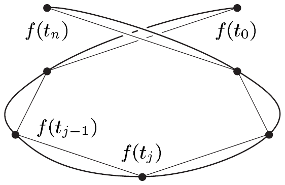
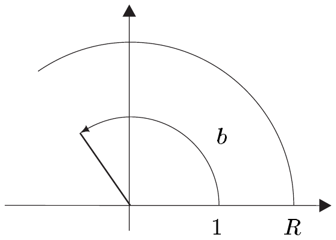
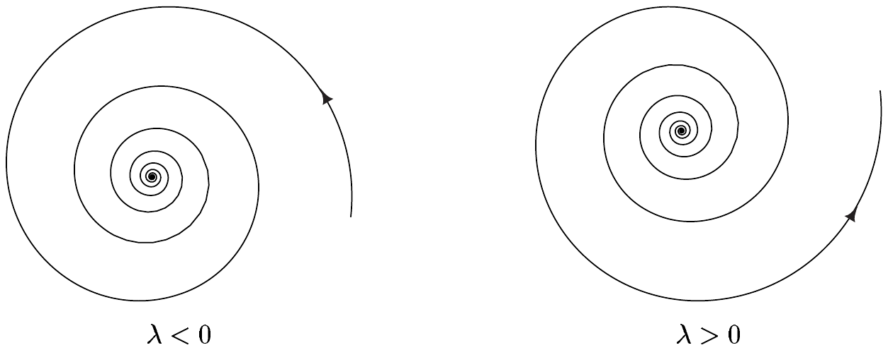
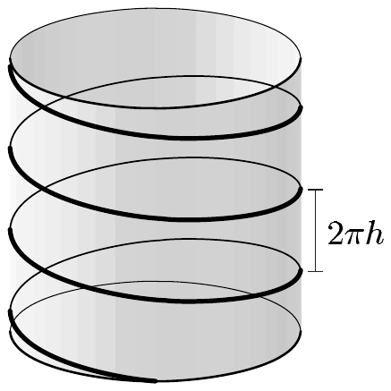

## 1 曲线及其长度

本节主要证明，连续可微的紧致曲线 $ \Gamma $ 具有由下式给出的有限长度 $ L(\Gamma) $：

\[ L(\Gamma) = \int_a^b |\dot{\gamma}(t)|\,dt . \]

这里 $ \gamma $ 是 $ \Gamma $ 的任意参数化。

在下文中，设

• $ E = (E,|\cdot|) $ 是域 $ \mathbb{K} $ 上的巴拿赫空间，且 $ I = [a,b] $ 是紧致区间。

##### 全变差

设 $ f : I \to E $，且 $ \mathfrak{Z} := (t_0,\ldots,t_n) $ 是 $ I $ 的一个划分。则

\[ L_{\mathfrak{Z}}(f) := \sum_{j=1}^{n}|f(t_j) - f(t_{j-1})| \]

是 $ E $ 中 $ (f(t_0),\ldots,f(t_n)) $ 这条**分段直线道路的长度**，而

\[ \operatorname{Var}(f,I) := \sup\{ L_{\mathfrak{Z}}(f) \;;\; \mathfrak{Z} = (t_0,\ldots,t_n) \text{ 是 } I \text{ 的划分} \} \]

称为 $ f $ 在 $ I $ 上的**全变差**（或简称**变差**）。若 $ \operatorname{Var}(f,I) < \infty $，则称 $ f $ 是**有界变差**的。

1.1 引理 对 $ f : [a,b] \to E $ 与 $ c \in [a,b] $，有

\[ \operatorname{Var}(f,[a,b]) = \operatorname{Var}(f,[a,c]) + \operatorname{Var}(f,[c,b]) . \tag{1.1} \]

证明 (i) 设 $ c \in [a,b] $。不失一般性，可设 $ \operatorname{Var}(f,[a,c]) $ 与 $ \operatorname{Var}(f,[c,b]) $ 均有限，否则函数 $ f : [a,b] \to E $ 就不是有界变差的，结论显然成立。

(ii) 设 $ \mathfrak{Z} $ 是 $ [a,b] $ 的一个划分，$ \tilde{\mathfrak{Z}} $ 是 $ \mathfrak{Z} $ 的含有 $ c $ 点的加细。此外，令 $ \tilde{\mathfrak{Z}}_1 := \tilde{\mathfrak{Z}} \cap [a,c] $ 与 $ \tilde{\mathfrak{Z}}_2 := \tilde{\mathfrak{Z}} \cap [c,b] $。则

\[ L_{\mathfrak{Z}}(f) \le L_{\tilde{\mathfrak{Z}}}(f) = L_{\tilde{\mathfrak{Z}}_1}(f) + L_{\tilde{\mathfrak{Z}}_2}(f) \le \operatorname{Var}(f,[a,c]) + \operatorname{Var}(f,[c,b]) . \]

对 $ \mathfrak{Z} $ 取上确界，得

\[ \operatorname{Var}(f,[a,b]) \le \operatorname{Var}(f,[a,c]) + \operatorname{Var}(f,[c,b]) . \]

(iii) 对 $ \varepsilon > 0 $，存在 $ [a,c] $ 的划分 $ \mathfrak{Z}_1 $ 与 $ [c,b] $ 的划分 $ \mathfrak{Z}_2 $，使得

\[ L_{\mathfrak{Z}_1}(f) \ge \operatorname{Var}(f,[a,c]) - \varepsilon/2 \quad \text{且}\quad L_{\mathfrak{Z}_2}(f) \ge \operatorname{Var}(f,[c,b]) - \varepsilon/2 . \]

对 $ \mathfrak{Z} := \mathfrak{Z}_1 \vee \mathfrak{Z}_2 $，有

\[ L_{\mathfrak{Z}_1}(f) + L_{\mathfrak{Z}_2}(f) = L_{\mathfrak{Z}}(f) \le \operatorname{Var}(f,[a,b]) , \]

从而

\[ \operatorname{Var}(f,[a,c]) + \operatorname{Var}(f,[c,b]) \le L_{\mathfrak{Z}_1}(f) + L_{\mathfrak{Z}_2}(f) + \varepsilon \le \operatorname{Var}(f,[a,b]) + \varepsilon . \]

结论现在由 (ii) 推出。■

##### 可求长道路

把 $ \gamma \in C(I,E) $ 理解为 $ E $ 中的连续道路，我们也称 $ \operatorname{Var}(\gamma,I) $ 为 $ \gamma $ 的**长度**（或**弧长**），并记为 $ L(\gamma) $。若 $ L(\gamma) < \infty $，即 $ \gamma $ 具有有限长度，则称 $ \gamma $ 是**可求长**的。

1.2 注 (a) 存在不可求长的连续道路。\footnote{还可以证明，$ \mathbb{R}^{2} $ 中存在连续道路，其像填满整个单位圆盘 $ \mathbb{B} $（见习题 8）。这类“填满空间”的道路称为\textbf{皮亚诺曲线}。}

证明 考虑 $ \gamma : [0,1] \to \mathbb{R} $，其中 $ \gamma(0) := 0 $，且对 $ t \in (0,1] $ 有 $ \gamma(t) := t\cos^{2}(\pi/2t) $。则 $ \gamma $ 连续（见命题 III.2.24）。对 $ n \in \mathbb{N}^\times $，设 $ \mathfrak{Z}_n = (t_0,\ldots,t_{2n}) $ 是 $ [0,1] $ 的满足 $ t_0 = 0 $ 且对 $ 1 \le j \le 2n $ 有 $ t_j = 2/(2n + 1 - j) $ 的划分。因为

\[ \gamma(t_j) = \begin{cases} 0, & j = 2k,\quad 0 \le k \le n, \\ t_j, & j = 2k + 1,\quad 0 \le k < n, \end{cases} \]

有

\[ L_{\mathfrak{Z}_n}(\gamma) = \sum_{j=1}^{2n}|\gamma(t_j) - \gamma(t_{j-1})| = \sum_{k=0}^{n-1} t_{2k+1} = \frac{1}{2}\sum_{k=1}^{n}\frac{1}{k} \to \infty \]

当 $ n \to \infty $ 时。因此 $ \gamma $ 不可求长。■

(b) 设 $ \gamma : [a,b] \to E $ 是利普希茨连续的，其利普希茨常数为 $ \lambda $。则 $ \gamma $ 可求长，且 $ L(\gamma) \le \lambda(b - a) $。

证明 对 $ [a,b] $ 的每个划分 $ \mathfrak{Z} = (t_0,\ldots,t_n) $，有

\[ L_{\mathfrak{Z}}(\gamma) = \sum_{j=1}^{n}|\gamma(t_j) - \gamma(t_{j-1})| \le \lambda\sum_{j=1}^{n}|t_j - t_{j-1}| = \lambda(b - a) . \quad \blacksquare \]

(c) 当然，道路 $ \gamma $ 的长度依赖于 $ E $ 上的范数。然而，当换成另一个不同但等价的范数时，其可求长性并不改变。■

注 1.2(a) 中所考虑的道路确实连续，但在 0 处不可微。下面的结果表明，连续可微的道路总是可求长的。

1.3 定理 设 $ \gamma \in C^{1}(I,E) $。则 $ \gamma $ 可求长，且

\[ L(\gamma) = \int_a^b |\dot{\gamma}(t)|\,dt . \]

证明 (i) 只需考虑 $ a < b $ 的情形，此时 $ I $ 不只是一个单点。

(ii) $ \gamma $ 的可求长性直接由微积分基本定理得到。即，若 $ \mathfrak{Z} = (t_0,\ldots,t_n) $ 是 $ [a,b] $ 的划分，则

\[ \begin{aligned} L_{\mathfrak{Z}}(\gamma) &= \sum_{j=1}^{n}|\gamma(t_j) - \gamma(t_{j-1})| = \sum_{j=1}^{n}\left|\int_{t_{j-1}}^{t_j}\dot{\gamma}(t)\,dt\right| \\ &\le \sum_{j=1}^{n}\int_{t_{j-1}}^{t_j}|\dot{\gamma}(t)|\,dt = \int_a^b |\dot{\gamma}(t)|\,dt . \end{aligned} \]

因此

\[ L(\gamma) = \operatorname{Var}(\gamma,[a,b]) \le \int_a^b |\dot{\gamma}(t)|\,dt . \tag{1.2} \]

(iii) 现在设 $ s_0 \in [a,b) $。由引理 1.1 可知，对每个 $ s \in (s_0,b) $ 有

\[ \operatorname{Var}(\gamma,[a,s]) - \operatorname{Var}(\gamma,[a,s_0]) = \operatorname{Var}(\gamma,[s_0,s]) . \]

我们还得到

\[ |\gamma(s) - \gamma(s_0)| \le \operatorname{Var}(\gamma,[s_0,s]) \le \int_{s_0}^{s}|\dot{\gamma}(t)|\,dt . \]

这里第一个不等式成立是因为 $ (s_0,s) $ 是 $ [s_0,s] $ 的一个划分，第二个来自 (1.2)。

于是，由于 $ s_0 < s $，有

\[ \left|\frac{\gamma(s) - \gamma(s_0)}{s - s_0}\right| \le \frac{\operatorname{Var}(\gamma,[a,s]) - \operatorname{Var}(\gamma,[a,s_0])}{s - s_0} \le \frac{1}{s - s_0}\int_{s_0}^{s}|\dot{\gamma}(t)|\,dt . \tag{1.3} \]

因为 $ \gamma $ 有连续导数，由积分形式的中值定理与定理 VI.4.12 可得

\[ |\dot{\gamma}(s_0)| = \lim_{s \to s_0}\left|\frac{\gamma(s) - \gamma(s_0)}{s - s_0}\right| \le \lim_{s \to s_0}\left[\frac{1}{s - s_0}\int_{s_0}^{s}|\dot{\gamma}(t)|\,dt\right] = |\dot{\gamma}(s_0)| . \]

于是，(1.3) 以及关于 $ s < s_0 $ 的类似考虑表明 $ s \mapsto \operatorname{Var}(\gamma,[a,s]) $ 可微，且

\[ \frac{d}{ds}\operatorname{Var}(\gamma,[a,s]) = |\dot{\gamma}(s)| \qquad \text{对 } s \in [a,b] . \]

因此 $ s \mapsto \operatorname{Var}(\gamma,[a,s]) $ 属于 $ C^{1}(I,\mathbb{R}) $。此外，微积分基本定理给出

\[ \operatorname{Var}(\gamma,[a,b]) = \int_a^b |\dot{\gamma}(t)|\,dt \]

因为 $ \operatorname{Var}(\gamma,[a,a]) = 0 $。■

1.4 推论 对 $ \gamma = (\gamma_1,\ldots,\gamma_n) \in C^{1}(I,\mathbb{R}^n) $，有

\[ L(\gamma) = \int_a^b\sqrt{\left(\dot{\gamma}_1(t)\right)^{2} + \cdots + \left(\dot{\gamma}_n(t)\right)^{2}}\,dt . \]

##### 可微曲线

道路的像是 $ E $ 中不依赖于用来描述它的特定函数的点集。换言之，它具有独立于任何特定参数化的几何意义。为精确地理解这一点，我们必须明确哪些参数变换保持这个像不变。

设 $ J_1 $ 与 $ J_2 $ 是区间，且 $ q \in \mathbb{N} \cup \{\infty\} $。若 $ \varphi $ 属于\footnote{此外，若 $ J_1 $ 与 $ J_2 $ 不是开的，则这意味着 $ \varphi : J_1 \to J_2 $ 是双射，且 $ \varphi $ 与 $ \varphi^{-1} $ 属于 $ C^{q} $ 类。特别地，$ \operatorname{Diff}^{0}(J_1,J_2) $ 是 $ J_1 $ 到 $ J_2 $ 的所有拓扑映射（同胚）之集。} $ \operatorname{Diff}^{q}(J_1,J_2) $ 且严格递增，则称映射 $ \varphi : J_1 \to J_2 $ 是一个**（保持定向的）** $ C^{q} $ **参数变换**。若对 $ j = 1,2 $ 有 $ \gamma_j \in C^{q}(J_j,E) $，且存在 $ C^{q} $ 参数变换 $ \varphi $ 使得 $ \gamma_1 = \gamma_2 \circ \varphi $，则称 $ \gamma_1 $ 是 $ \gamma_2 $ 的一个**（保持定向的）** $ C^{q} $ **重新参数化**。

1.5 注 (a) 当 $ \varphi \in \operatorname{Diff}^{q}(J_1,J_2) $ 严格递减时，我们称 $ \varphi $ 是一个**反转定向的** $ C^{q} $ **参数变换**。不过，在下文中，我们总是取保持定向的参数变换。

(b) 映射 $ \varphi : J_1 \to J_2 $ 是 $ C^{q} $ 参数变换，当且仅当 $ \varphi $ 属于 $ C^{q}(J_1,J_2) $、是满射，且对 $ t \in J_1 $ 满足 $ \dot{\varphi}(t) > 0 $。

证明 这由定理 III.5.7 与 IV.2.8 得到。■

(c) 设 $ I_1 $ 与 $ I_2 $ 是紧致区间，且设 $ \gamma_1 \in C(I_1,E) $ 是 $ \gamma_2 \in C(I_2,E) $ 的连续重新参数化。则

\[ \operatorname{Var}(\gamma_1,I_1) = \operatorname{Var}(\gamma_2,I_2) . \]

证明 设 $ \varphi \in \operatorname{Diff}^{0}(I_1,I_2) $ 是满足 $ \gamma_1 = \gamma_2 \circ \varphi $ 的参数变换。若 $ \mathfrak{Z} = (t_0,\ldots,t_n) $ 是 $ I_1 $ 的一个划分，则 $ \varphi(\mathfrak{Z}) := (\varphi(t_0),\ldots,\varphi(t_n)) $ 是 $ I_2 $ 的一个划分，且

\[ L_{\mathfrak{Z}}(\gamma_1,I_1) = L_{\mathfrak{Z}}(\gamma_2 \circ \varphi,I_1) = L_{\varphi(\mathfrak{Z})}(\gamma_2,I_2) \le \operatorname{Var}(\gamma_2,I_2) . \]

于是有关系

\[ \operatorname{Var}(\gamma_1,I_1) = \operatorname{Var}(\gamma_2 \circ \varphi,I_1) \le \operatorname{Var}(\gamma_2,I_2) . \tag{1.4} \]

注意到 $ \gamma_2 = (\gamma_2 \circ \varphi) \circ \varphi^{-1} $，由 (1.4)（把 $ \gamma_2 $ 换成 $ \gamma_2 \circ \varphi $、把 $ \varphi $ 换成 $ \varphi^{-1} $）可得

\[ \operatorname{Var}(\gamma_2,I_2) = \operatorname{Var}((\gamma_2 \circ \varphi) \circ \varphi^{-1},I_2) \le \operatorname{Var}(\gamma_2 \circ \varphi,I_1) = \operatorname{Var}(\gamma_1,I_1) . \quad \blacksquare \]

在 $ E $ 中所有 $ C^{q} $ 道路的集合上，我们定义关系 $ \sim $ 如下

\[ \gamma_1 \sim \gamma_2 :\Longleftrightarrow \gamma_1 \text{ 是 } \gamma_2 \text{ 的一个 } C^{q} \text{ 重新参数化} . \]

不难看出 $ \sim $ 是等价关系（见习题 5）。相应的等价类称为 $ E $ 中的 **$ C^{q} $ 曲线**。$ C^{q} $ 曲线 $ \Gamma $ 的每个代表元都是 $ \Gamma $ 的一个 **$ C^{q} $ 参数化**。我们可以说 $ C^{0} $ 曲线是**连续的**、$ C^{1} $ 曲线是**连续可微的**、$ C^{\infty} $ 曲线是**光滑的**。若曲线 $ \Gamma $ 有定义在紧致定义域（或紧致**参数区间**）上的参数化，则称该曲线是**紧致的**，且由定理 III.3.6，$ \Gamma $ 的像也是紧致的。若对 $ t \in \operatorname{dom}(\gamma) $ 有 $ \dot{\gamma}(t) \ne 0 $，则称 $ \Gamma $ 的参数化 $ \gamma $ 是**正则的**。当 $ \Gamma $ 有正则参数化时，称 $ \Gamma $ 为**正则曲线**。有时我们写 $ \Gamma = [\gamma] $，以强调 $ \Gamma $ 是含有 $ \gamma $ 的参数化等价类。

1.6 注 (a) 若 $ \Gamma $ 是紧致曲线，则它的每个参数化都有紧致定义域。若 $ \Gamma $ 是正则 $ C^{1} $ 曲线，则它的每个参数化都是正则的。

证明 设 $ \gamma \in C^{q}(J,E) $ 是 $ \Gamma $ 的一个参数化，$ \gamma_1 \in C^{q}(J_1,E) $ 是 $ \gamma $ 的一个重新参数化。则存在 $ \varphi \in \operatorname{Diff}^{q}(J_1,J) $，使得 $ \gamma_1 = \gamma \circ \varphi $。当 $ J $ 紧致时，对 $ J_1 = \varphi^{-1}(J) $ 也成立，因为紧致集的连续像也是紧致的（定理 III.3.6）。由链式法则，对 $ q \ge 1 $ 得

\[ \dot{\gamma}_1(t) = \dot{\gamma}(\varphi(t))\dot{\varphi}(t) \qquad \text{对 } t \in J_1 . \]

因此，由于对 $ s \in J $ 有 $ \dot{\gamma}(s) \ne 0 $、对 $ t \in J_1 $ 有 $ \dot{\varphi}(t) \ne 0 $，故对 $ t \in J_1 $ 也有 $ \dot{\gamma}_1(t) \ne 0 $。■

(b) 正则曲线可以有非正则的参数化，但它与其正则参数化不等价。

证明 考虑由函数

\[ [-1,1] \to \mathbb{R}^{2} , \quad t \mapsto \gamma(t) := (t,t) . \]

参数化的正则光滑曲线 $ \Gamma $。再考虑光滑道路 $ \tilde{\gamma} : [-1,1] \to \mathbb{R}^{2} $，其中 $ \tilde{\gamma}(t) := (t^{3},t^{3}) $。则 $ \operatorname{im}(\gamma) = \operatorname{im}(\tilde{\gamma}) $，但 $ \dot{\tilde{\gamma}}(0) = (0,0) $。因此 $ \tilde{\gamma} $ 不是 $ \gamma $ 的 $ C^{1} $ 重新参数化。■

(c) 设 $ I \to E $, $ t \mapsto \gamma(t) $ 是曲线 $ \Gamma $ 的正则 $ C^{1} $ 参数化。则

\[ \dot{\gamma}(t) = \lim_{s \to t}\frac{\gamma(s) - \gamma(t)}{s - t} \qquad \text{对 } t \in I \]

可解释为曲线 $ \Gamma $ 在点 $ \gamma(t) $ 处的“瞬时速度”。■

设 $ \Gamma $ 是 $ E $ 中的连续曲线，且设 $ \gamma $ 与 $ \gamma_1 $ 是 $ \Gamma $ 的（等价）参数化。则显然 $ \operatorname{im}(\gamma) = \operatorname{im}(\gamma_1) $。因此 $ \Gamma $ 的**像**由下式良定义

\[ \operatorname{im}(\Gamma) := \operatorname{im}(\gamma) . \]

若 $ \Gamma $ 紧致，$ \operatorname{dom}(\gamma) = [a,b] $，$ \operatorname{dom}(\gamma_1) = [a_1,b_1] $，则有关系

\[ \gamma(a) = \gamma_1(a_1) \quad \text{且}\quad \gamma(b) = \gamma_1(b_1) . \]

因此，对紧致曲线，**起点** $ A_{\Gamma} := \gamma(a) $ 与**终点** $ E_{\Gamma} := \gamma(b) $ 良定义。

若 $ A_{\Gamma} $ 与 $ E_{\Gamma} $ 重合，则 $ \Gamma $ 是**闭的**，或是一个**环**。最后，我们常简单地用 $ p \in \Gamma $ 表示 $ p \in \operatorname{im}(\Gamma) $。

##### 可求长曲线

设 $ \Gamma $ 是 $ E $ 中的连续曲线，$ \gamma \in C(J,E) $ 是 $ \Gamma $ 的一个参数化。又设 $ \alpha := \inf J $ 与 $ \beta := \sup J $。则对 $ \alpha < a < b < \beta $，$ \operatorname{Var}(\gamma,[a,b]) $ 有定义。于是引理 1.1 蕴含，对每个 $ c \in (\alpha,\beta) $，函数

\[ [c,\beta) \to \overline{\mathbb{R}} , \quad b \mapsto \operatorname{Var}(\gamma,[c,b]) \]

递增，而映射

\[ (\alpha,c] \to \overline{\mathbb{R}} , \quad a \mapsto \operatorname{Var}(\gamma,[a,c]) \]

递减。于是由 (1.1)，极限

\[ \operatorname{Var}(\gamma,J) := \lim_{\substack{a \downarrow \alpha \\ b \uparrow \beta}}\operatorname{Var}(\gamma,[a,b]) \tag{1.5} \]

在 $ \overline{\mathbb{R}} $ 中存在，我们称之为 $ \gamma $ 在 $ J $ 上的（**全**）**变差**。若 $ \gamma_1 \in C(J_1,E) $ 是 $ \gamma $ 的重新参数化，则由注 1.5(c) 得 $ \operatorname{Var}(\gamma,J) = \operatorname{Var}(\gamma_1,J_1) $。因此 $ \Gamma $ 的**全变差**或**长度**（或**弧长**）由下式良定义

\[ L(\Gamma) := \operatorname{Var}(\Gamma) := \operatorname{Var}(\gamma,J) . \]

若曲线 $ \Gamma $ 具有有限长度，即 $ L(\Gamma) < \infty $，则称其为**可求长**的。

1.7 定理 设 $ \gamma \in C^{1}(J,E) $ 是 $ C^{1} $ 曲线 $ \Gamma $ 的一个参数化。则

\[ L(\Gamma) = \int_J |\dot{\gamma}(t)|\,dt . \tag{1.6} \]

若 $ \Gamma $ 紧致，则 $ \Gamma $ 可求长。

证明 这直接由 (1.5)、定理 1.3 与反常积分的定义得到。■

1.8 注 (a) 定理 1.7 特别表明，$ L(\Gamma) $，因而 (1.6) 中的积分，不依赖于特定的参数化 $ \gamma $。

(b) 设 $ \tilde{\Gamma} $ 是按 VII.8 节所述方式嵌入 $ \mathbb{R}^{n} $ 中的 $ C^{q} $ 曲线。又设 $ (\varphi,U) $ 是 $ \tilde{\Gamma} $ 的一个坐标卡，$ (g,V) $ 是其相应的参数化。则\footnote{这里以及在不易引起混淆的其他情形中，我们简单地用 $ \Gamma $ 表示 $ \operatorname{im}(\Gamma) $。} $ \Gamma := \tilde{\Gamma} \cap U $ 是正则 $ C^{q} $ 曲线，且 $ g $ 是 $ \Gamma $ 的正则 $ C^{q} $ 参数化。

(c) 正则 $ C^{q} $ 曲线一般不是嵌入 $ C^{q} $ 曲线。

证明 这由例 VII.9.6(c) 得到。■

(d) 由于我们只允许保持定向的参数变换，我们的曲线都是**定向的**，即它们按固定方向“穿过”。■

1.9 例 (a)（实值函数的图像）设 $ f \in C^{q}(J,\mathbb{R}) $，$ \Gamma := \operatorname{graph}(f) $。则 $ \Gamma $ 是 $ \mathbb{R}^{2} $ 中的正则 $ C^{q} $ 曲线，且映射 $ J \to \mathbb{R}^{2} $, $ t \mapsto (t,f(t)) $ 是 $ \Gamma $ 的正则 $ C^{q} $ 参数化。此外

\[ L(\Gamma) = \int_J\sqrt{1 + [f'(t)]^{2}}\,dt . \]

(b)（极坐标下的平面曲线）设 $ r,\varphi \in C^{q}(J,\mathbb{R}) $，且对 $ t \in J $ 有 $ r(t) \ge 0 $。又设

\[ \gamma(t) := r(t)(\cos(\varphi(t)),\sin(\varphi(t))) \qquad \text{对 } t \in J . \]

将 $ \mathbb{R}^{2} $ 与 $ \mathbb{C} $ 等同起来，得到 $ \gamma $ 的表示

\[ \gamma(t) = r(t)e^{i\varphi(t)} \qquad \text{对 } t \in J . \]

若 $ [\dot{r}(t)]^{2} + [r(t)\dot{\varphi}(t)]^{2} > 0 $，则 $ \gamma $ 是曲线 $ \Gamma $ 的正则 $ C^{q} $ 参数化，且

\[ L(\Gamma) = \int_J\sqrt{[\dot{r}(t)]^{2} + [r(t)\dot{\varphi}(t)]^{2}}\,dt . \]

证明 有

\[ \dot{\gamma}(t) := (\dot{r}(t) + ir(t)\dot{\varphi}(t))e^{i\varphi(t)} , \]

从而 $ |\dot{\gamma}(t)|^{2} = [\dot{r}(t)]^{2} + [r(t)\dot{\varphi}(t)]^{2} $，由此得证。■

(c) 设 $ 0 < b \le 2\pi $。对由

\[ \gamma : [0,b] \to \mathbb{R}^{2} , \quad t \mapsto R(\cos t,\sin t) \]

参数化的圆弧，或经由

\[ \gamma : [0,b] \to \mathbb{C} , \quad t \mapsto Re^{it} , \]

得到的等价圆弧，将 $ \mathbb{R}^{2} $ 与 $ \mathbb{C} $ 等同起来给出\footnote{见习题 III.6.12。} $ L(\Gamma) = bR $。

证明 这由 (b) 得到。■

(d)（对数螺线）对 $ \lambda < 0 $ 与 $ a \in \mathbb{R} $，

\[ \gamma_{a,\infty} : [a,\infty) \to \mathbb{R}^{2} , \quad t \mapsto e^{\lambda t}(\cos t,\sin t) \]

是曲线 $ \Gamma_{a,\infty} := [\gamma_{a,\infty}] $ 的光滑正则参数化。它具有有限长度 $ e^{\lambda a}\sqrt{1 + \lambda^{2}}/|\lambda| $。

当 $ \lambda > 0 $ 时，类似地有

\[ \gamma_{-\infty,a} : (-\infty,a] \to \mathbb{R}^{2} , \quad t \mapsto e^{\lambda t}(\cos t,\sin t) \]

是曲线 $ \Gamma_{-\infty,a} := [\gamma_{-\infty,a}] $ 的光滑正则参数化，其有限长度为 $ e^{\lambda a}\sqrt{1 + \lambda^{2}}/\lambda $。对 $ \lambda \ne 0 $，映射

\[ \mathbb{R} \to \mathbb{R}^{2} , \quad t \mapsto e^{\lambda t}(\cos t,\sin t) \]

是**对数螺线**的光滑正则参数化。其长度无穷。当 $ \lambda > 0 $ [或 $ \lambda < 0 $] 时，它向外[或向内]盘旋。将 $ \mathbb{R}^{2} $ 与 $ \mathbb{C} $ 等同起来，给对数螺线以简单的参数化 $ t \mapsto e^{(\lambda+i)t} $。

证明 设 $ \lambda < 0 $。对 $ t \in [a,\infty) $，令 $ r(t) = e^{\lambda t} $ 与 $ \varphi(t) = t $。据 (b)，有

\[ L(\Gamma_{a,\infty}) = \lim_{b \to \infty}\int_a^b\sqrt{1 + \lambda^{2}}\,e^{\lambda t}\,dt = \frac{\sqrt{1 + \lambda^{2}}}{\lambda}\lim_{b \to \infty}(e^{\lambda b} - e^{\lambda a}) = \frac{\sqrt{1 + \lambda^{2}}}{|\lambda|}e^{\lambda a} . \]

$ \lambda > 0 $ 的情形类似地处理。■

(e) 对 $ R > 0 $ 与 $ h > 0 $，由

\[ \gamma : \mathbb{R} \to \mathbb{R}^{3} , \quad t \mapsto (R\cos t, R\sin t, ht) \tag{1.7} \]

参数化的正则光滑曲线 $ \Gamma $ 是半径为 $ R $、螺距为 $ 2\pi h $ 的**螺旋线**。通过将\footnote{作为度量空间} $ \mathbb{R}^{2} $ 与 $ \mathbb{C} $ 等同起来，从而将 $ \mathbb{R}^{3} $ 与 $ \mathbb{C} \times \mathbb{R} $ 等同起来，我们把 (1.7) 写成形式 $ t \mapsto (Re^{it},ht) $。有

\[ L(\gamma|[a,b]) = (b - a)\sqrt{R^{2} + h^{2}} \]

其中 $ -\infty < a < b < \infty $。曲线 $ \Gamma $ 位于半径为 $ R $、轴为 $ z $ 轴的柱面上。每旋转一周，它沿轴向上升 $ 2\pi h $。

证明 因为 $ |\dot{\gamma}(t)|^{2} = R^{2} + h^{2} $，结论由定理 1.7 得到。■

