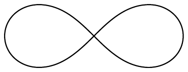

##### 习题

1  一个圆盘沿一条直线无滑动地滚动。求圆盘上固定的任一点（或圆盘“外”的一点）所描出的道路的一个参数化。确定圆盘转动一周时这条道路的弧长。

2  设 $ -\infty < \alpha < \beta < \infty $。计算这些道路的长度：

\[ \begin{aligned} &[0, \pi] \to \mathbb{R}^{2}, && t \mapsto (\cos t + t\sin t, \sin t - t\cos t)\ ; \\ &[1, \infty) \to \mathbb{R}^{2}, && t \mapsto t^{-2}(\cos t, \sin t)\ ; \\ &[\alpha, \beta] \to \mathbb{R}^{2}, && t \mapsto (t^{3}, 3t^{2}/2)\ ; \\ &[\alpha, \beta] \to \mathbb{R}^{2}, && t \mapsto (t, t^{2}/2)\ . \end{aligned} \]

3  逼近（例如，用梯形法则）帕斯卡蜗线的长度（见例 VII.9.1(c)）。

4  画出空间曲线 $ \Gamma = [\gamma] $ 的草图，其中

\[ \gamma : [-3\pi, 3\pi] \to \mathbb{R}^{3} , \quad t \mapsto t(\cos t, \sin t, 1) , \]

并计算其弧长。

5  设 $ \mathfrak{Z} = (\alpha_{0}, \ldots, \alpha_{m}) $（其中 $ m \in \mathbb{N}^{\times} $）是紧致区间 $ I $ 的一个划分，且 $ q \in \mathbb{N}^{\times} \cup \{\infty\} $。若对 $ j = 1, \ldots, m $ 有 $ \gamma_{j} := \gamma|[\alpha_{j-1}, \alpha_{j}] \in C^{q}([\alpha_{j-1}, \alpha_{j}], E) $，则连续道路 $ \gamma \in C(I, E) $ 是 $ E $ 中的**分段 $ C^{q} $ 道路**（关于 $ \mathfrak{Z} $）。若存在 $ C^{q} $ 参数变换 $ \varphi_{j} \in \operatorname{Diff}^{q}([\alpha_{j-1}, \alpha_{j}], [\beta_{j-1}, \beta_{j}]) $ 使得对 $ j = 1, \ldots, m $ 有 $ \gamma_{j} := \eta_{j} \circ \varphi_{j} $，则称在 $ J $ 的划分 $ \mathfrak{Z}' = (\beta_{0}, \ldots, \beta_{m}) $ 上分段 $ C^{q} $ 的道路 $ \eta \in C(J, E) $ 为 $ \gamma $ 的一个 **$ C^{q} $ 重新参数化**。在所有 $ E $ 中的分段 $ C^{q} $ 道路组成的集合上，我们通过下式定义 $ \sim $：

\[ \gamma \sim \eta :\Longleftrightarrow \eta \text{ 是 } \gamma \text{ 的重新参数化} . \]

(a) 证明 $ \sim $ 是一个等价关系。相应的等价类称为 $ E $ 中的**分段 $ C^{q} $ 曲线**。分段 $ C^{q} $ 曲线 $ \Gamma $ 的每个代表元都是 $ \Gamma $ 的一个**分段 $ C^{q} $ 参数化**。当 $ \gamma \in C(I, E) $ 是 $ \Gamma $ 的一个分段 $ C^{q} $ 参数化时，我们符号化地写成 $ \Gamma = \sum_{j=1}^{m}\Gamma_{j} $，其中 $ \Gamma_{j} := [\gamma_{j}] $，$ j = 1, \ldots, m $。

(b) 设 $ \Gamma $ 是 $ E $ 中的曲线，其参数化 $ \gamma \in C(I, E) $ 在划分 $ \mathfrak{Z} = (\alpha_{0}, \ldots, \alpha_{m}) $ 上分段 $ C^{q} $。通过下式定义 $ \Gamma $ 的**长度**（或**弧长**）：

\[ L(\Gamma) := \operatorname{Var}(\gamma, I) . \]

证明 $ L(\Gamma) $ 是良定义的，并且

\[ L(\Gamma) = \sum_{j=1}^{m}L(\Gamma_{j}) = \sum_{j=1}^{m}\int_{\alpha_{j-1}}^{\alpha_{j}}\left|\dot{\gamma}_{j}(t)\right|\,dt . \]

（提示：注 1.5(c) 与引理 1.1。）

6  若 $ \Gamma = [\gamma] $ 是平面闭分段 $ C^{q} $ 曲线，且 $ (\alpha_{0}, \ldots, \alpha_{m}) $ 是 $ \gamma $ 的一个划分，则

\[ A(\Gamma) := \frac{1}{2}\sum_{j=1}^{m}\int_{\alpha_{j-1}}^{\alpha_{j}}\det\left[\gamma_{j}(t), \dot{\gamma}_{j}(t)\right]\,dt \]

是 $ \Gamma $ 所含的**有向面积**。

(a) 证明 $ A(\Gamma) $ 是良定义的。

(b) 设 $ -\infty < \alpha < \beta < \infty $，并假设 $ f \in C^{1}([\alpha, \beta], \mathbb{R}) $ 满足 $ f(\alpha) = f(\beta) = 0 $。令 $ a := \alpha $ 与 $ b := 2\beta - \alpha $，并按如下方式定义 $ \gamma : [a, b] \to \mathbb{R}^{2} $：

\[ \gamma(t) := \begin{cases} (\alpha + \beta - t, f(\alpha + \beta - t)) , & t \in [a, \beta] , \\ (\alpha - \beta + t, 0) , & t \in [\beta, b] . \end{cases} \]

证明

(α) $ \Gamma := [\gamma] $ 是闭分段 $ C^{q} $ 曲线（画出它的草图）。

(β) $ A(\Gamma) = \int_{\alpha}^{\beta}f(t)\,dt $，即有向面积 $ A(\Gamma) $ 等于 $ f $ 的图像与 $ [\alpha, \beta] $ 之间的有向面积（见注 VI.3.3(a)）。

(c) 求半轴为 $ a, b > 0 $ 的椭圆的有向面积。使用参数化 $ [0, 2\pi] \to \mathbb{R}^{2} $，$ t \mapsto (a\cos t, b\sin t) $。

(d) 道路 $ \gamma : [-\pi/4, 3\pi/4] \to \mathbb{R}^{2} $，其中

\[ t \mapsto \begin{cases} \sqrt{\cos(2t)}\,(\cos t, \sin t) , & t \in [-\pi/4, \pi/4] , \\ \sqrt{\left|\cos(2t)\right|}\,(-\sin t, -\cos t) , & t \in [\pi/4, 3\pi/4] \end{cases} \]

参数化了**双纽线**。验证 $ \Gamma = [\gamma] $ 是平面分段 $ C^{\infty} $ 曲线，并求 $ A(\Gamma) $。

7  若 $ \Gamma $ 是一个正方形的边界，求 $ A(\Gamma) $。

8  设 $ f : \mathbb{R} \to [0, 1] $ 是连续且 2 周期的，其中

\[ f(t) = \begin{cases} 0 , & t \in [0, 1/3] , \\ 1 , & t \in [2/3, 1] . \end{cases} \]

又设

\[ r(t) := \sum_{k=1}^{\infty}2^{-k}f(3^{2k}t) \quad \text{且} \quad \alpha(t) := 2\pi\sum_{k=1}^{\infty}2^{-k}f(3^{2k-1}t) \quad \text{对 } t \in \mathbb{R} . \]

证明

(a) $ \gamma : \mathbb{R} \to \mathbb{R}^{2} $，$ t \mapsto r(t)(\cos\alpha(t), \sin\alpha(t)) $ 是连续的；

(b) $ \gamma([0, 1]) = \mathbb{B} $。

（提示：设 $ (r_{0}, \alpha_{0}) \in [0, 1]\times[0, 2\pi] $ 是 $ (x_{0}, y_{0}) \in \mathbb{B}\setminus\{0, 0\} $ 的极坐标。又设 $ \sum_{k=1}^{\infty}g_{k}2^{-k} $ 与 $ \sum_{k=1}^{\infty}h_{k}2^{-k} $ 分别是 $ r_{0} $ 与 $ \alpha_{0}/2\pi $ 作为二进制小数的展开。对于

\[ a_{n} := \begin{cases} g_{k} , & n = 2k , \\ h_{k} , & n = 2k - 1 , \end{cases} \]

证明 $ t_{0} := 2\sum_{n=1}^{\infty}a_{n}3^{-n-1} \in [0, 1] $，对 $ n \in \mathbb{N} $ 有 $ f(3^{n}t_{0}) = a_{n} $，且 $ \gamma(t_{0}) = (x_{0}, y_{0}) $。）
