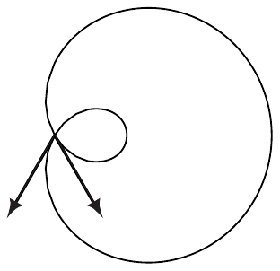
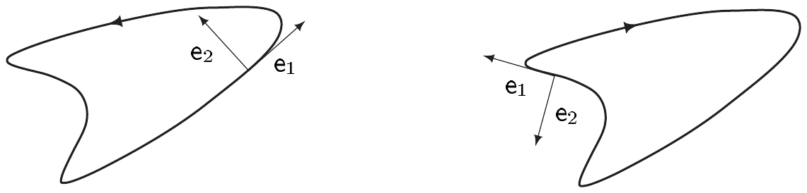

## 2 $ \mathbb{R}^{n} $ 中的曲线

在第 VII.6 节中，我们曾允许曲线穿过无穷维向量空间。然而，有限维的情形从经典（微分几何）来看无疑更为熟悉，并且从 $ \mathbb{R}^n $ 的欧几里得结构中获得了额外的结构。现在我们来考察 $ \mathbb{R}^n $ 中曲线的局部性质。

在下文中，设

• $ n \ge 2 $ 且 $ \gamma \in C^1(J, \mathbb{R}^n) $ 是曲线 $ \Gamma $ 的一个正则参数化。

##### 单位切向量

对 $ t \in J $，

\[ \mathbf{t}(t) := \mathbf{t}_{\gamma}(t) := (\gamma(t), \dot\gamma(t)/|\dot\gamma(t)|) \in T_{\gamma(t)}\mathbb{R}^n \]

是 $ \mathbb{R}^n $ 中长度为 $ 1 $ 的一个切向量，称为 $ \Gamma $ 在点 $ \gamma(t) $ 处的**单位切向量**。

\[ \mathbb{R}\mathbf{t}(t) := (\gamma(t), \mathbb{R}\dot\gamma(t)) \subset T_{\gamma(t)}\mathbb{R}^n \]

的任一元素都是 $ \Gamma $ 在 $ \gamma(t) $ 处的一条**切线**。

2.1 注 (a) 单位切向量 $ \mathbf{t} $ 在参数变换下不变。确切地说，若 $ \zeta = \gamma \circ \varphi $ 是 $ \gamma $ 的一个重新参数化，则对 $ t = \varphi(s) $ 有 $ \mathbf{t}_{\gamma}(t) = \mathbf{t}_{\zeta}(s) $。因此，谈论 $ \Gamma $ 的单位切向量是有意义的。

证明 这由链式法则和 $ \dot\varphi(s) $ 的正性立即推出。■

(b) 根据推论 VII.9.8，每个 $ t_0 \in \mathring{J} $ 都有一个环绕它的 $ J $ 的开子区间 $ J_0 $，使得 $ \Gamma_0 := \operatorname{im}(\gamma_0) $（其中 $ \gamma_0 := \gamma|J_0 $）是 $ \mathbb{R}^n $ 的一维 $ C^1 $ 子流形。通过缩小 $ J_0 $，我们可以假设 $ \Gamma_0 $ 由单个坐标卡 $ (U_0, \varphi_0) $ 描述，其中 $ \gamma_0 = i_{\Gamma_0} \circ \varphi_0^{-1} $。于是曲线 $ \Gamma_0 $ 在 $ p := \gamma(t_0) $ 处的切线显然与*流形* $ \Gamma_0 $ 在点 $ p $ 处的切空间一致，即 $ T_p\Gamma_0 = \mathbb{R}\mathbf{t}(t_0) $。

现在可能出现存在 $ \mathring{J} $ 中的一个 $ t_1 \ne t_0 $ 使得 $ \gamma(t_1) = p = \gamma(t_0) $ 的情况。于是存在一个环绕 $ t_1 $ 的开区间 $ J_1 $，使得 $ \Gamma_1 := \operatorname{im}(\gamma_1) $（其中 $ \gamma_1 := \gamma|J_1 $）是 $ \mathbb{R}^n $ 的一个 $ C^1 $ 子流形，并且满足 $ T_p\Gamma_1 = \mathbb{R}\mathbf{t}(t_1) $。因此，一般地 $ T_p\Gamma_0 = T_p\Gamma_1 $ 不成立，也就是说，一般地 $ \mathbf{t}(t_0) \ne \pm\mathbf{t}(t_1) $。这表明 $ \Gamma $ 可以有多条这样的“二重点”切线。在这种情况下，$ \Gamma $ 不是 $ \mathbb{R}^n $ 的子流形，尽管它的足够小的“片段”是子流形；这里“足够小”是在参数区间中衡量的。

例 VII.9.6(c) 中的帕斯卡蜗线给出一个具体的例子。设 $ \Gamma $ 是 $ \mathbb{R}^2 $ 中由下式参数化的紧致正则曲线

\[ \gamma : [-\pi, \pi] \to (1 + 2\cos t)(\cos t, \sin t) . \]

令 $ t_0 := \arccos(-1/2) $ 和 $ t_1 := -t_0 $，我们有 $ \gamma(t_0) = \gamma(t_1) = (0, 0) \in \Gamma $。对于相应的单位切向量，我们得到

\[ \mathbf{t}(t_j) = ((0, 0), ((-1)^j, -\sqrt{3})/2) \quad \text{对 } j = 0, 1 . \]

因此 $ \mathbf{t}(t_0) \ne \mathbf{t}(t_1) $。■

##### 弧长参数化

如果 $ \gamma : J \to \mathbb{R}^n $ 是 $ \Gamma $ 的一个参数化，使得对每个 $ t \in J $ 都有 $ |\dot\gamma(t)| = 1 $，那么显然 $ L(\Gamma) = \int_J dt $，且区间 $ J $ 的长度等于 $ \Gamma $ 的长度。我们说 $ \gamma $ **按弧长参数化 $ \Gamma $**。

2.2 命题 $ \mathbb{R}^n $ 中每条正则 $ C^1 $ 曲线都可以按弧长参数化。这种参数化在形如 $ s \mapsto s + \mathrm{const} $ 的重新参数化下是唯一的。若 $ \eta : I \to \mathbb{R}^n $ 是一个按弧长的参数化，则对 $ s \in I $ 有 $ \mathbf{t}_{\eta}(s) = (\eta(s), \dot\eta(s)) $。

证明 设 $ \gamma \in C^1(J, \mathbb{R}^n) $ 是 $ \Gamma $ 的一个正则参数化。固定一个 $ a \in J $ 并令

\[ \varphi(t) := \int_a^t |\dot\gamma(\tau)| \, d\tau \quad \text{对 } t \in J \text{ 且 } I := \varphi(J) . \]

$ \gamma $ 的正则性以及 $ |\cdot| \in C(\mathbb{R}^n \setminus \{0\}, \mathbb{R}) $ 表明 $ \varphi $ 属于 $ C^1(J, \mathbb{R}^n) $。此外，$ \dot\varphi(t) = |\dot\gamma(t)| > 0 $。由注 1.5(b)，$ \varphi $ 是从 $ J $ 到 $ I := \varphi(J) $ 的一个 $ C^1 $ 参数变换。令 $ \eta := \gamma \circ \varphi^{-1} $，由此可得

\[ |\dot\eta(s)| = |\dot\gamma(\varphi^{-1}(s))(\varphi^{-1})^{\cdot}(s)| = \frac{|\dot\gamma(\varphi^{-1}(s))|}{|\dot\varphi(\varphi^{-1}(s))|} = \frac{|\dot\gamma(\varphi^{-1}(s))|}{|\dot\gamma(\varphi^{-1}(s))|} = 1 \]

对 $ s \in I $。因此 $ \eta $ 按弧长参数化 $ \Gamma $。

再设 $ \tilde\eta \in C^1(\tilde{I}, \mathbb{R}^n) $ 也按弧长参数化 $ \Gamma $，且 $ \psi \in \operatorname{Diff}^1(I, \tilde{I}) $ 满足 $ \eta = \tilde\eta \circ \psi $。则

\[ 1 = |\dot\eta(s)| = |\dot{\tilde\eta}(\psi(s))\dot\psi(s)| = \dot\psi(s) \quad \text{对 } s \in I , \]

并且我们得到 $ \psi(s) = s + \mathrm{const} $。■

2.3 注 (a) 设 $ \Gamma $ 是一条正则 $ C^2 $ 曲线，且 $ \gamma : I \to \mathbb{R}^n $ 按弧长参数化它。则对 $ s \in I $ 有 $ (\dot\gamma(s)|\ddot\gamma(s)) = 0 $。因此，向量 $ (\gamma(s), \ddot\gamma(s)) \subset T_{\gamma(s)}\mathbb{R}^n $ 正交于切线 $ \mathbb{R}\mathbf{t}(s) \subset T_{\gamma(s)}\mathbb{R}^n $。

证明 由 $ |\dot\gamma(s)|^2 = 1 $，我们得到对 $ s \in I $ 有 $ (|\dot\gamma|^2)^{\cdot}(s) = 2(\dot\gamma(s)|\ddot\gamma(s)) = 0 $。■

(b) 按弧长参数化曲线是许多理论工作中的一个便捷手段；例如参见命题 2.12 的证明。然而，对于任何具体的例子，进行这样的参数化都要付出计算弧长积分的代价，而且所得的新参数化可能不是初等函数。

证明 我们考虑正则参数化

\[ \gamma : [0, 2\pi] \to \mathbb{R}^2 , \quad t \mapsto (a\cos t, b\sin t) . \]

它的像是椭圆 $ (x/a)^2 + (y/b)^2 = 1 $，其中 $ a, b > 0 $。命题 2.2 的证明表明，把 $ \gamma $ 变为弧长参数化的每一个重新参数化都具有如下形式

\[ \varphi(t) := \int_0^t \sqrt{a^2\sin^2 s + b^2\cos^2 s} \, ds + \mathrm{const} \quad \text{对 } 0 \le t \le 2\pi . \]

可以证明 $ \varphi $ 不是初等函数。\footnote{这个 $ \varphi $ 事实上由\textbf{椭圆积分}给出。相关理论参见例如 [FB95]。} ■

##### 定向基

设 $ \mathcal{B} = (b_1, \ldots, b_n) $ 和 $ \mathcal{C} = (c_1, \ldots, c_n) $ 是维数为 $ n $ 的实向量空间 $ E $ 的两个有序基。也用 $ T_{\mathcal{B},\mathcal{C}} = [t_{jk}] $ 表示从 $ \mathcal{B} $ 到 $ \mathcal{C} $ 的变换矩阵，即对 $ 1 \le j \le n $ 有 $ c_j = \sum_{k=1}^{n} t_{jk}b_k $。我们说 $ \mathcal{B} $ 和 $ \mathcal{C} $ 是**同向**[或反向]**定向的**，如果 $ \det T_{\mathcal{B},\mathcal{C}} $ 为正[或为负]。

2.4 注 (a) 在 $ E $ 的有序基的集合上，指派

\[ \mathcal{B} \sim \mathcal{C} :\Longleftrightarrow \mathcal{B} \text{ 与 } \mathcal{C} \text{ 同向定向} \]

定义一个等价关系。恰有两个等价类，即 $ E $ 的两个**定向**。通过选取第一个类并称之为 $ \mathcal{O}r $，我们说 $ (E, \mathcal{O}r) $ 是**定向的**。这个定向中的每个基都是**正向定向的**，而相反定向（我们称之为 $ -\mathcal{O}r $）中的每个基都是**负向定向的**。

(b) 一个 $ n $ 维内积空间的两个有序标准正交基 $ \mathcal{B} $ 和 $ \mathcal{C} $ 同向定向，当且仅当 $ T_{\mathcal{B},\mathcal{C}} $ 属于 $ SO(n) $。\footnote{参见习题 VII.9.2 和 VII.9.10。}

(c) $ SO(2) $ 中的元素也称为**旋转矩阵**，因为对每个 $ T \in SO(2) $，存在唯一的**旋转角** $ \alpha \in [0, 2\pi) $，使得 $ T $ 有表示

\[ T = \begin{bmatrix} \cos\alpha & -\sin\alpha \\ \sin\alpha & \cos\alpha \end{bmatrix} \]

（见习题 10）。因此，一个二维内积空间的任意两个同向定向的基都通过一个旋转相联系。

(d) 若 $ E $ 是一个内积空间且 $ \mathcal{B} $ 是一个标准正交基，则 $ T_{\mathcal{B},\mathcal{C}} = [(c_j|b_k)] $。

证明 这由 $ T_{\mathcal{B},\mathcal{C}} $ 的定义立即推出。■

(e) $ \mathbb{R}^n $ 的一个定向基是**正向定向的**，如果它的定向与典范基的定向相同。■

##### Frenet $ n $-标架

在下文中，我们将对 $ \Gamma $ 施加稍强的可微性假设，并始终假设 $ \Gamma $ 是 $ \mathbb{R}^n $ 中 $ n \ge 2 $ 的一条正则 $ C^n $ 曲线。照常，设 $ \gamma \in C^n(J, \mathbb{R}^n) $ 是 $ \Gamma $ 的一个参数化。我们说 $ \Gamma $ 是**完备的**，如果对每个 $ t \in J $，向量 $ \dot\gamma(t), \ldots, \gamma^{(n-1)}(t) $ 都线性无关。

设 $ \Gamma $ 是 $ \mathbb{R}^n $ 中的一条完备曲线。函数 $ J \to \mathbb{R}^n $ 的一个 $ n $ 元组 $ \mathbf{e} = (\mathbf{e}_1, \ldots, \mathbf{e}_n) $ 称为 $ \Gamma $ 的**活动 $ n $-标架**或 **Frenet $ n $-标架**，如果

(FB$ {}_{1} $) 对 $ 1 \le j \le n $ 有 $ \mathbf{e}_j \in C^1(J, \mathbb{R}^n) $；

(FB$ {}_{2} $) 对 $ t \in J $，$ \mathbf{e}(t) $ 是 $ \mathbb{R}^n $ 的一个正向标准正交基；

(FB$ {}_{3} $) 对 $ 1 \le k \le n - 1 $ 和 $ t \in J $ 有 $ \gamma^{(k)}(t) \in \operatorname{span}\{\mathbf{e}_1(t), \ldots, \mathbf{e}_k(t)\} $；

(FB$ {}_{4} $) 对 $ t \in J $ 和 $ k \in \{1, \ldots, n - 1\} $，$ (\dot\gamma(t), \ldots, \gamma^{(k)}(t)) $ 与 $ (\mathbf{e}_1(t), \ldots, \mathbf{e}_k(t)) $ 具有相同的定向（作为 $ \operatorname{span}\{\mathbf{e}_1(t), \ldots, \mathbf{e}_k(t)\} $ 的基）。

2.5 注 (a) 由链式法则容易推出这个概念是良定义的，也就是说，在下述意义上与 $ \Gamma $ 的特殊参数化无关：若 $ \tilde\gamma := \gamma \circ \varphi $ 是 $ \gamma $ 的一个重新参数化，且 $ \tilde{\mathbf{e}} $ 是 $ \Gamma $ 的一个活动 $ n $-标架，它在将 $ \gamma $ 替换为 $ \tilde\gamma $ 后满足 (FB$ {}_{3} $) 和 (FB$ {}_{4} $)，则对 $ t = \varphi(s) $ 有 $ \tilde{\mathbf{e}}(s) = \mathbf{e}(t) $。

(b) $ \mathbb{R}^2 $ 中的一条 $ C^2 $ 曲线完备当且仅当它是正则的。

(c) 设 $ \Gamma = [\gamma] $ 是 $ \mathbb{R}^2 $ 中的一条正则 $ C^2 $ 曲线。又设 $ \mathbf{e}_1 := \dot\gamma/|\dot\gamma| =: (\mathbf{e}_1^1, \mathbf{e}_1^2) $ 和 $ \mathbf{e}_2 := (-\mathbf{e}_1^2, \mathbf{e}_1^1) $。则 $ (\mathbf{e}_1, \mathbf{e}_2) $ 是 $ \Gamma $ 的一个 Frenet 二标架。

（在这些以及类似的图中，我们把 $ \mathbf{e}_j(t) \in \mathbb{R}^2 $ 等同于 $ (\gamma(t), \mathbf{e}_j(t)) \in T_{\gamma(t)}\Gamma $ 的切部分。）

证明 显然 $ (\mathbf{e}_1(t), \mathbf{e}_2(t)) $ 是 $ \mathbb{R}^2 $ 的一个标准正交基，并且是正向的，因为

\[ \det[\mathbf{e}_1, \mathbf{e}_2] = (\mathbf{e}_1^1)^2 + (\mathbf{e}_1^2)^2 = |\mathbf{e}_1|^2 = 1 . ■ \]

2.6 定理 $ \mathbb{R}^n $ 中每条完备 $ C^n $ 曲线都有唯一的活动 $ n $-标架。

证明 (i) 设 $ \Gamma = [\gamma] $ 是 $ \mathbb{R}^n $ 中的一条完备 $ C^n $ 曲线。可以用格拉姆–施密特正交化过程建立 Frenet $ n $-标架的存在性（例如参见 [Art93, VII.1.22]）。事实上，作为完备曲线，$ \Gamma $ 是正则的。因此对 $ t \in I $，$ \mathbf{e}_1(t) := \dot\gamma(t)/|\dot\gamma(t)| $ 有定义。对 $ k \in \{2, \ldots, n - 1\} $，我们递归地定义 $ \mathbf{e}_k $。利用已经构造好的 $ \mathbf{e}_1, \ldots, \mathbf{e}_{k-1} $，我们令

\[ \widetilde{\mathbf{e}}_k := \gamma^{(k)} - \sum_{j=1}^{k-1}(\gamma^{(k)}|\mathbf{e}_j)\mathbf{e}_j \quad \text{且} \quad \mathbf{e}_k := \widetilde{\mathbf{e}}_k/|\widetilde{\mathbf{e}}_k| . \tag{2.1} \]

因为

\[ \operatorname{span}(\dot\gamma(t), \ldots, \gamma^{(k-1)}(t)) = \operatorname{span}(\mathbf{e}_1(t), \ldots, \mathbf{e}_{k-1}(t)) \tag{2.2} \]

且 $ \gamma^{(k)}(t) \notin \operatorname{span}(\dot\gamma(t), \ldots, \gamma^{(k-1)}(t)) $，所以对 $ t \in J $ 有 $ \widetilde{\mathbf{e}}_k(t) \ne 0 $，从而 $ \mathbf{e}_k $ 是良定义的。此外，我们有

\[ (\mathbf{e}_j(t)|\mathbf{e}_k(t)) = \delta_{jk} \quad \text{且} \quad \gamma^{(k)}(t) \in \operatorname{span}(\mathbf{e}_1(t), \ldots, \mathbf{e}_k(t)) \tag{2.3} \]

对 $ 1 \le j, k \le n - 1 $ 和 $ t \in J $。

(ii) 现在设 $ T_k(t) $ 是从 $ (\dot\gamma(t), \ldots, \gamma^{(k)}(t)) $ 到 $ (\mathbf{e}_1(t), \ldots, \mathbf{e}_k(t)) $ 的变换矩阵。由 (2.1)，对 $ k \in \{2, \ldots, n - 1\} $ 我们有递推公式

\[ T_1(t) = |\dot\gamma(t)|^{-1} \quad \text{且} \quad T_k(t) = \begin{bmatrix} T_{k-1}(t) & 0 \\ * & |\widetilde{\mathbf{e}}_k(t)|^{-1} \end{bmatrix} . \]

因此 $ \det T_k(t) > 0 $，这表明 $ (\dot\gamma(t), \ldots, \gamma^{(k)}(t)) $ 与 $ (\mathbf{e}_1(t), \ldots, \mathbf{e}_k(t)) $ 具有相同的定向。

(iii) 最后，对 $ t \in J $，我们通过解线性方程组

\[ (\mathbf{e}_j(t)|x) = 0 \quad \text{对 } j = 1, \ldots, n - 1 \quad \text{且} \quad \det[\mathbf{e}_1(t), \ldots \mathbf{e}_{n-1}(t), x] = 1 \tag{2.4} \]

（关于 $ x \in \mathbb{R}^n $）来定义 $ \mathbf{e}_n(t) $。因为 $ \{\mathbf{e}_1(t), \ldots \mathbf{e}_{n-1}(t)\}^{\perp} $ 是一维的，所以 (2.4) 有唯一解。由 (2.3) 和 (2.4)，现在容易推出 $ \mathbf{e} = (\mathbf{e}_1, \ldots, \mathbf{e}_n) $ 满足条件 (FB$ {}_{2} $)–(FB$ {}_{4} $)。

(iv) 剩下要验证 (FB$ {}_{1} $)。由 (2.1) 容易推出对 $ k = 1, \ldots, n - 1 $ 有 $ \mathbf{e}_k \in C^1(J, \mathbb{R}^n) $。于是 (2.4) 和克莱姆法则（参见 [Art93, § I.5]）表明 $ \mathbf{e}_n $ 也属于 $ C^1(J, \mathbb{R}^n) $。总之，我们已经证明了 $ \mathbf{e} $ 是 $ \Gamma $ 的一个 Frenet $ n $-标架。

(v) 为了检验 $ \mathbf{e} $ 的唯一性，设 $ (\delta_1, \ldots, \delta_n) $ 是 $ \Gamma $ 的另一个 Frenet $ n $-标架。那么显然有 $ \mathbf{e}_1 = \delta_1 = \dot\gamma/|\dot\gamma| $。此外，由 (FB$ {}_{2} $) 和 (FB$ {}_{3} $) 推出，对每个 $ k \in \{1, \ldots, n - 1\} $，$ \gamma^{(k)} $ 有展开式

\[ \gamma^{(k)} = \sum_{j=1}^{k}(\gamma^{(k)}|\delta_j)\delta_j \]

于是对 $ 1 \le j \le k - 1 $ 和 $ k \in \{2, \ldots, n - 1\} $ 有 $ \mathbf{e}_j = \delta_j $，所以 (2.1) 蕴含 $ (\gamma^{(k)}|\delta_k)\delta_k = \mathbf{e}_k|\widetilde{\mathbf{e}}_k| $。因此，对每个 $ t \in J $，存在一个实数 $ \alpha(t) $ 使得 $ |\alpha(t)| = 1 $ 且 $ \delta_k(t) = \alpha(t)\mathbf{e}_k(t) $。由于 $ (\delta_1(t), \ldots, \delta_k(t)) $ 与 $ (\mathbf{e}_1(t), \ldots, \mathbf{e}_k(t)) $ 同向定向，可得 $ \alpha(t) = 1 $。于是 $ (\mathbf{e}_1, \ldots, \mathbf{e}_{n-1}) $ 从而 $ \mathbf{e}_n $ 也被唯一确定。■

2.7 推论 设 $ \Gamma = [\gamma] $ 是 $ \mathbb{R}^n $ 中的一条完备 $ C^n $ 曲线，且 $ \mathbf{e} = (\mathbf{e}_1, \ldots, \mathbf{e}_n) $ 是 $ \Gamma $ 的一个 Frenet $ n $-标架。则我们有 **Frenet 导数公式**

\[ \dot{\mathbf{e}}_j = \sum_{k=1}^{n}(\dot{\mathbf{e}}_j|\mathbf{e}_k)\mathbf{e}_k \quad \text{对 } j = 1, \ldots, n . \tag{2.5} \]

我们还有关系式

\[ (\dot{\mathbf{e}}_j|\mathbf{e}_k) = -(\mathbf{e}_j|\dot{\mathbf{e}}_k) \quad \text{对 } 1 \le j, k \le n \quad \text{且} \quad (\dot{\mathbf{e}}_j|\mathbf{e}_k) = 0 \quad \text{对 } |k - j| > 1 . \]

证明 因为对每个 $ t \in J $，$ (\mathbf{e}_1(t), \ldots, \mathbf{e}_n(t)) $ 都是 $ \mathbb{R}^n $ 的一个标准正交基，所以我们得到 (2.5)。对 $ (\mathbf{e}_j|\mathbf{e}_k) = \delta_{jk} $ 求导蕴含 $ (\dot{\mathbf{e}}_j|\mathbf{e}_k) = -(\mathbf{e}_j|\dot{\mathbf{e}}_k) $。最后，(2.1) 和 (2.2) 表明对 $ 1 \le j < n $，$ \mathbf{e}_j(t) $ 属于 $ \operatorname{span}(\dot\gamma(t), \ldots, \gamma^{(j)}(t)) $。因此，

\[ \dot{\mathbf{e}}_j(t) \in \operatorname{span}(\dot\gamma(t), \ldots, \gamma^{(j+1)}(t)) = \operatorname{span}(\mathbf{e}_1(t), \ldots, \mathbf{e}_{j+1}(t)) \quad \text{对 } t \in J \]

且 $ 1 \le j < n - 1 $，于是我们得到对 $ k > j + 1 $ 从而对 $ |k - j| > 1 $ 有 $ (\dot{\mathbf{e}}_j|\mathbf{e}_k) = 0 $。■

2.8 注 设 $ \Gamma = [\gamma] $ 是 $ \mathbb{R}^n $ 中的一条完备 $ C^n $ 曲线。

(a) 曲率

\[ \kappa_j := (\dot{\mathbf{e}}_j|\mathbf{e}_{j+1})/|\dot\gamma| \in C(J) \quad \text{满足 } 1 \le j \le n - 1 , \]

是良定义的，也就是说，它与参数化 $ \gamma $ 无关。

证明 这是注 2.5(a) 和链式法则的一个简单推论。■

(b) 令 $ \omega_{jk} := (\dot{\mathbf{e}}_j|\mathbf{e}_k) $，则 Frenet 导数公式读作

\[ \dot{\mathbf{e}}_j = \sum_{k=1}^{n}\omega_{jk}\mathbf{e}_k \quad \text{对 } 1 \le j \le n , \]

其中矩阵 $ [\omega_{jk}] $ 为

\[ \left|\dot\gamma\right| \begin{bmatrix} 0 & \kappa_1 & & & & \\ -\kappa_1 & 0 & \kappa_2 & & & \\ & -\kappa_2 & 0 & \kappa_3 & & 0 \\ & & \ddots & \ddots & \ddots & \\ 0 & & & -\kappa_{n-2} & 0 & \kappa_{n-1} \\ & & & & -\kappa_{n-1} & 0 \end{bmatrix} . \]

证明 这由推论 2.7 和 (a) 推出。■

在本节的剩余部分，我们将更详细地讨论定理 2.6 和推论 2.7 对平面曲线和空间曲线的意义。
