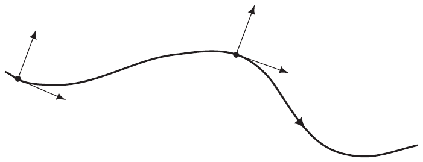
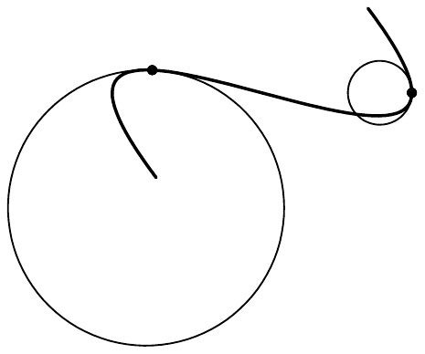
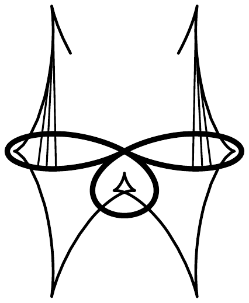
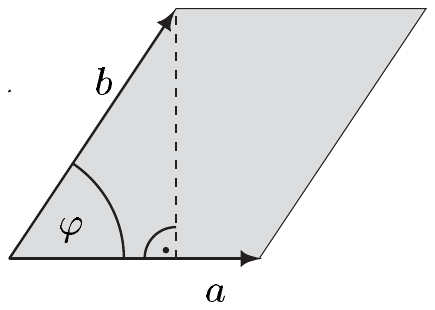
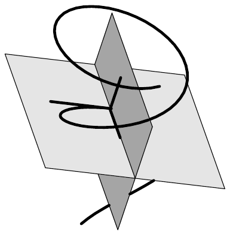

##### 平面曲线的曲率

在下文中，$ \Gamma = [\gamma] $ 是一条平面正则 $ C^{2} $ 曲线，$ (\mathrm{e}_{1}, \mathrm{e}_{2}) $ 是其相伴的活动二标架。于是 $ \mathrm{e}_{1} $ 与单位切向量 $ \mathrm{t} = (\gamma, \dot{\gamma}/|\dot{\gamma}|) $ 的切部分重合。对每个 $ t \in J $，

\[ \mathrm{n}(t) := (\gamma(t), \mathrm{e}_{2}(t)) \in T_{\gamma(t)}\mathbb{R}^{2} \]

是 $ \Gamma $ 在点 $ \gamma(t) $ 处的**单位法向量**。在平面情形，只有 $ \kappa_{1} $ 有定义，并称之为曲线 $ \Gamma $ 的**曲率** $ \kappa $。因此

\[ \kappa = (\dot{\mathrm{e}}_{1}|\mathrm{e}_{2})/|\dot{\gamma}| . \tag{2.6} \]

2.9 注 (a) Frenet 导数公式为\footnote{自然地，$ \dot{\mathrm{t}}(t) $ 应理解为向量 $ (\gamma(t), \dot{\mathrm{e}}_{1}(t)) \in T_{\gamma(t)}\mathbb{R}^{2} $，等等。}

\[ \dot{\mathrm{t}} = |\dot{\gamma}|\kappa\mathrm{n} \quad \text{且} \quad \dot{\mathrm{n}} = -|\dot{\gamma}|\kappa\mathrm{t} . \tag{2.7} \]

若 $ \eta \in C^{2}(I, \mathbb{R}^{2}) $ 按弧长参数化 $ \Gamma $，则方程 (2.7) 取如下简单形式

\[ \dot{\mathrm{t}} = \kappa\mathrm{n} \quad \text{且} \quad \dot{\mathrm{n}} = -\kappa\mathrm{t} . \tag{2.8} \]

此外，此时还有

\[ \kappa(s) = (\dot{\mathrm{e}}_{1}(s)|\mathrm{e}_{2}(s)) = (\dot{\mathrm{t}}(s)|\mathrm{n}(s))_{\eta(s)} \qquad \text{对 } s \in I . \]

由 (2.8) 得 $ \ddot{\eta}(s) = \kappa(s)\mathrm{e}_{2}(s) $，从而对 $ s \in I $ 有 $ |\ddot{\eta}(s)| = |\kappa(s)| $。据此，$ \kappa(s)\mathrm{n}(s) \in T_{\eta(s)}\mathbb{R}^{2} $ 称为 $ \Gamma $ 在点 $ \eta(s) $ 处的**曲率向量**。

在 $ \kappa(s) > 0 $ [或 $ \kappa(s) < 0 $] 的情形，单位切向量 $ \mathrm{t}(s) $ 沿正 [或负] 方向旋转（因为 $ (\dot{\mathrm{t}}(s)|\mathrm{n}(s))_{\eta(s)} $ 是 $ \mathrm{t}(s) $ 的瞬时变化在法向量上的投影）。我们说单位法向量 $ \mathrm{n}(s) $ 指向 $ \Gamma $ 的**凸** [或**凹**] **侧**。

(b) 当 $ \eta : I \to \mathbb{R}^{2} $，$ s \mapsto (x(s), y(s)) $ 按弧长参数化 $ \Gamma $ 时，$ \mathrm{e}_{2} = (-\dot{y}, \dot{x}) $ 且

\[ \kappa = \dot{x}\ddot{y} - \dot{y}\ddot{x} = \det[\dot{\eta}, \ddot{\eta}] . \]

证明 这由注 2.5(c) 和 (2.6) 得出。■

对具体计算而言，知道在给定任意正则参数化时如何求曲率是有用的。

2.10 命题 当 $ \gamma : J \to \mathbb{R}^{2} $，$ t \mapsto (x(t), y(t)) $ 是一条平面 $ C^{2} $ 曲线的正则参数化时，

\[ \kappa = \frac{\dot{x}\ddot{y} - \dot{y}\ddot{x}}{\left((\dot{x})^{2} + (\dot{y})^{2}\right)^{3/2}} = \frac{\det[\dot{\gamma}, \ddot{\gamma}]}{|\dot{\gamma}|^{3}} . \]

证明 由 $ \mathrm{e}_{1} = \dot{\gamma}/|\dot{\gamma}| $ 得

\[ \dot{\mathrm{e}}_{1} = \frac{\ddot{\gamma}}{|\dot{\gamma}|} - \frac{\dot{x}\ddot{x} + \dot{y}\ddot{y}}{|\dot{\gamma}|^{2}}\,\frac{\dot{\gamma}}{|\dot{\gamma}|} = \frac{\ddot{\gamma}}{|\dot{\gamma}|} - \frac{\dot{x}\ddot{x} + \dot{y}\ddot{y}}{|\dot{\gamma}|^{2}}\mathrm{e}_{1} . \]

根据注 2.5(c)，有 $ \mathrm{e}_{2} = (-\dot{y}, \dot{x})/|\dot{\gamma}| $，于是定理由 (2.6) 得出。■

2.11 例（图像的曲率）设 $ f \in C^{2}(J, \mathbb{R}) $。则对按 $ J \to \mathbb{R}^{2} $，$ x \mapsto (x, f(x)) $ 参数化的曲线，曲率为

\[ \kappa = \frac{f''}{\left(1 + (f')^{2}\right)^{3/2}} . \]

证明 这立即由命题 2.10 得出。■

由推论 IV.2.13 对凸函数的刻画及上述公式可知，$ \operatorname{graph}(f) $ 在点 $ (x, f(x)) $ 处曲率为正当且仅当 $ f $ 在 $ x $ 附近是凸的。因为根据注 2.9(b)，$ \operatorname{graph}(f) $ 上的单位法向量具有正的第二分量，这就解释了注 2.9(a) 中所采用的约定，该约定定义了凸与凹的概念。

##### 直线与圆的识别

下面，我们应用 Frenet 公式来证明线段与圆弧可由其曲率刻画。

2.12 命题 设 $ \Gamma = [\gamma] $ 是一条平面正则 $ C^{2} $ 曲线。则

(i) $ \Gamma $ 是线段当且仅当对 $ t \in J $ 有 $ \kappa(t) = 0 $；

(ii) $ \Gamma $ 是半径为 $ r $ 的圆弧当且仅当对 $ t \in J $ 有 $ |\kappa(t)| = 1/r $。

证明 (i) 显然曲率在每条线段上都为零（见命题 2.10）。

反之，设 $ \kappa = 0 $。我们可以不失一般性地假设 $ \Gamma $ 有弧长参数化 $ \eta $。由注 2.9(a) 得对 $ s \in J $ 有 $ \ddot{\eta}(s) = 0 $。于是定理 IV.3.2 的泰勒公式蕴含存在 $ a, b \in \mathbb{R}^{2} $ 使得 $ \eta(s) = a + bs $。

(ii) 设 $ \Gamma $ 是半径为 $ r $ 的圆弧。则存在 $ m \in \mathbb{R}^{2} = \mathbb{C} $ 及一个区间 $ J $ 使得 $ \Gamma $ 由 $ J \to \mathbb{C} $，$ t \mapsto re^{it} + m $ 或 $ t \mapsto re^{-it} + m $ 参数化。断言现在由命题 2.10 得出。

反之，设 $ \kappa = \delta/r $，其中 $ \delta = 1 $ 或 $ \delta = -1 $。我们可以再次假设 $ \eta $ 按弧长参数化 $ \Gamma $。以 $ (\mathrm{e}_{1}, \mathrm{e}_{2}) $ 记 $ \Gamma $ 的活动二标架，由 Frenet 公式 (2.8) 得

\[ \dot{\eta} = \mathrm{e}_{1} , \quad \dot{\mathrm{e}}_{1} = (\delta/r)\mathrm{e}_{2} , \quad \dot{\mathrm{e}}_{2} = -(\delta/r)\mathrm{e}_{1} . \]

由此得

\[ \left(\eta(s) + (r/\delta)\mathrm{e}_{2}\right)^{\cdot} = \dot{\eta}(s) + (r/\delta)\dot{\mathrm{e}}_{2}(s) = 0 \qquad \text{对 } s \in I . \]

因此存在 $ m \in \mathbb{R}^{2} $ 使得对 $ s \in I $ 有 $ \eta(s) + (r/\delta)\mathrm{e}_{2}(s) = m $。于是我们得到

\[ |\eta(s) - m| = |r\mathrm{e}_{2}(s)| = r \qquad \text{对 } s \in I , \]

这证明 $ \eta $ 参数化了一条半径为 $ r $ 的圆弧。■

##### 沿曲线的瞬时圆

设 $ \Gamma = [\gamma] $ 是一条平面正则 $ C^{2} $ 曲线。若在 $ t_{0} \in J $ 处 $ \kappa(t_{0}) \ne 0 $，我们称

\[ r(t_{0}) := 1/|\kappa(t_{0})| \]

为 $ \Gamma $ 在点 $ \gamma(t_{0}) $ 处的**瞬时半径**，并称

\[ m(t_{0}) := \gamma(t_{0}) + r(t_{0})\mathrm{e}_{2}(t_{0}) \in \mathbb{R}^{2} \]

为 $ \Gamma $ 在点 $ \gamma(t_{0}) $ 处的**瞬时中心**。$ \mathbb{R}^{2} $ 中以 $ m(t_{0}) $ 为心、以 $ r(t_{0}) $ 为半径的圆是 $ \Gamma $ 在 $ \gamma(t_{0}) $ 处的**瞬时密切圆**。

2.13 注 (a) 密切圆在 $ \gamma(t_{0}) $ 处有参数化

\[ [0, 2\pi] \to \mathbb{R}^{2} , \quad t \mapsto m(t_{0}) + |\kappa(t_{0})|^{-1}(\cos t, \sin t) . \]

(b) 密切圆是唯一在 $ \gamma(t_{0}) $ 处至少二阶与 $ \Gamma $ 相切的圆。

证明 我们可以假设 $ \eta $ 是 $ \Gamma $ 的弧长参数化且 $ \eta(s_{0}) = \gamma(t_{0}) $。再假设 $ (a, b) $ 是 $ \mathbb{R}^{2} $ 的正定向的规范正交基。最后，令

\[ \tilde{\gamma} : [s_{0}, s_{0} + 2\pi r] \to \mathbb{R}^{2} , \quad s \mapsto \tilde{\gamma}(s) \]

其中

\[ \tilde{\gamma}(s) := m + r\cos\left((s - s_{0})/r\right)a + r\sin\left((s - s_{0})/r\right)b \]

按弧长参数化以 $ m $ 为心、以 $ r $ 为半径的圆 $ K $。则当对 $ 0 \le j \le 2 $ 有 $ \eta^{(j)}(s_{0}) = \tilde{\gamma}^{(j)}(s_{0}) $ 时，或等价地，当诸方程

\[ \eta(s_{0}) = m + ra , \quad \dot{\eta}(s_{0}) = b , \quad \ddot{\eta}(s_{0}) = -a/r \]

成立时，$ \Gamma $ 与 $ K $ 在 $ \eta(s_{0}) $ 处至少二阶相切。因为 $ \mathrm{e}_{1} = \dot{\eta} $，第一个 Frenet 公式蕴含 $ \kappa(s_{0})\mathrm{e}_{2}(s_{0}) = -a/r $。因为规范正交基 $ \left(-\mathrm{e}_{2}(s_{0}), \mathrm{e}_{1}(s_{0})\right) $ 是正定向的，我们得到 $ |\kappa(s_{0})| = 1/r $ 且 $ (a, b) = \left(-\mathrm{e}_{2}(s_{0}), \mathrm{e}_{1}(s_{0})\right) $ 且 $ m = \eta(s_{0}) + r\mathrm{e}_{2}(s_{0}) = \gamma(t_{0}) + [\kappa(t_{0})]^{-1}\mathrm{e}_{2}(t_{0}) $。■

(c) 当对 $ t \in J $ 有 $ \kappa(t) \ne 0 $ 时，

\[ t \mapsto m(t) := \gamma(t) + \mathrm{e}_{2}(t)/\kappa(t) \]

是一条平面曲线——$ \Gamma $ 的**渐屈线**——的连续参数化。■

##### 向量积

在线性代数中，$ \mathbb{R}^{3} $ 中除内积外还有“另一种积”。它把另一个向量 $ a \times b $ 指派给两个向量 $ a $ 与 $ b $，即 $ a $ 与 $ b $ 的向量积或叉积。为完整起见，我们回顾其定义方式并汇集其最重要的性质。

对 $ a, b \in \mathbb{R}^{3} $，

\[ \mathbb{R}^{3} \to \mathbb{R} , \quad c \mapsto \det[a, b, c] \]

是 $ \mathbb{R}^{3} $ 上的一个（连续）线性形式。因此，由里斯表示定理，恰有一个向量，记作 $ a \times b $，使得

\[ (a \times b|c) = \det[a, b, c] \qquad \text{对 } c \in \mathbb{R}^{3} . \tag{2.9} \]

由此我们定义了**向量积**或**叉积**。

\[ \times : \mathbb{R}^{3} \times \mathbb{R}^{3} \to \mathbb{R}^{3} , \quad (a, b) \mapsto a \times b . \]

2.14 注 (a) 叉积是一个**交错的**双线性映射，即 $ \times $ 是双线性的且斜对称的：

\[ a \times b = -b \times a \qquad \text{对 } a, b \in \mathbb{R}^{3} . \]

证明 这易由 (2.9) 得出，因为行列式是一个交错的\footnote{若交换一个 $ m $ 线性映射的两个自变量便使其乘以 $ -1 $，则该映射是\textbf{交错的}。}三线性形式。■

(b) 对 $ a, b \in \mathbb{R}^{3} $，$ a \times b \ne 0 $ 当且仅当 $ a $ 与 $ b $ 线性无关。若它们线性无关，则 $ (a, b, a \times b) $ 是 $ \mathbb{R}^{3} $ 的一个正定向基。

证明 由 (2.9)，$ a \times b = 0 $ 当且仅当对每个 $ c \in \mathbb{R}^{3} $ 的选择 $ \det[a, b, c] $ 都为零。若 $ a $ 与 $ b $ 线性无关，则通过选取 $ c $ 使得 $ a, b $ 与 $ c $ 线性无关，我们会有 $ \det[a, b, c] \ne 0 $，而由 (2.9) 这与假设 $ a \times b = 0 $ 矛盾。这蕴含第一个断言。第二个断言由 (2.9) 给出

\[ \det[a, b, a \times b] = |a \times b|^{2} \ge 0 . ■ \]

(c) 对 $ a, b \in \mathbb{R}^{3} $，向量 $ a \times b $ 垂直于 $ a $ 与 $ b $。

证明 这由 (2.9) 得出，因为对 $ c \in \{a, b\} $，行列式有两列相同。■

(d) 对 $ a, b \in \mathbb{R}^{3} $，叉积具有显式形式

\[ a \times b = (a_{2}b_{3} - a_{3}b_{2}, a_{3}b_{1} - a_{1}b_{3}, a_{1}b_{2} - a_{2}b_{1}) . \]

证明 这同样由 (2.9) 按最后一列展开行列式得出。■

(e) 对 $ a, b \in \mathbb{R}^{3}\setminus\{0\} $，$ a $ 与 $ b $ 之间的（无向）**夹角** $ \varphi := \angle(a, b) \in [0, \pi] $ 由 $ \cos\varphi := (a|b)/|a|\,|b| $\footnote{这个角可以在任何内积空间而不只是在 $ \mathbb{R}^{3} $ 中定义。还有 $ \angle(a, b) = \angle(b, a) $。}定义。于是我们有

\[ |a \times b| = \sqrt{|a|^{2}|b|^{2} - (a|b)^{2}} = |a|\,|b|\sin\varphi . \]

这意味着 $ |a \times b| $ 恰是 $ a $ 与 $ b $ 张成的平行四边形的（无向）面积。

证明 由于柯西-施瓦茨不等式，$ \angle(a, b) \in [0, \pi] $ 是良定义的。第一个等式可直接由 (d) 验证，第二个等式由 $ \cos^{2}\varphi + \sin^{2}\varphi = 1 $ 与 $ \sin\varphi \ge 0 $ 得出。■

(f) 当 $ a $ 与 $ b $ 是 $ \mathbb{R}^{3} $ 中的规范正交向量时，（有序）组 $ (a, b, a \times b) $ 是 $ \mathbb{R}^{3} $ 上的一个正定向的规范正交基。

证明 这由 (b) 与 (e) 得出。■

##### 空间曲线的曲率与挠率

现在在三维中工作，设 $ \Gamma = [\gamma] $ 是 $ \mathbb{R}^{3} $ 中一条完备的 $ C^{3} $ 曲线。则 $ \Gamma $ 有两个曲率 $ \kappa_{1} $ 与 $ \kappa_{2} $。我们称 $ \kappa := \kappa_{1} $ 为**曲率**，称 $ \tau := \kappa_{2} $ 为**挠率**。因此

\[ \kappa = (\dot{\mathrm{e}}_{1}|\mathrm{e}_{2})/|\dot{\gamma}| \quad \text{且} \quad \tau = (\dot{\mathrm{e}}_{2}|\mathrm{e}_{3})/|\dot{\gamma}| . \tag{2.10} \]

这里我们也称

\[ \mathrm{n}(t) := (\gamma(t), \mathrm{e}_{2}(t)) \in T_{\gamma(t)}\mathbb{R}^{3} \]

为**单位法向量**，而

\[ \mathrm{b}(t) := (\gamma(t), \mathrm{e}_{3}(t)) \in T_{\gamma(t)}\mathbb{R}^{3} \]

是 $ \Gamma $ 在点 $ \gamma(t) $ 处的**单位副法向量**。向量 $ \mathrm{t}(t) $ 与 $ \mathrm{n}(t) $ 张成 $ \Gamma $ 在点 $ \gamma(t) $ 处的**密切平面**。由 $ \mathrm{n}(t) $ 与 $ \mathrm{b}(t) $ 张成的平面是 $ \Gamma $ 在 $ \gamma(t) $ 处的**法平面**。

2.15 注 (a) 我们有 $ \mathrm{e}_{3} = \mathrm{e}_{1} \times \mathrm{e}_{2} $，即 $ \mathrm{b} = \mathrm{t} \times \mathrm{n} $。

(b) 当 $ \Gamma $ 按弧长参数化时，Frenet 公式给出

\[ \dot{\mathrm{e}}_{1} = \kappa\mathrm{e}_{2} , \quad \dot{\mathrm{e}}_{2} = -\kappa\mathrm{e}_{1} + \tau\mathrm{e}_{3} , \quad \dot{\mathrm{e}}_{3} = -\tau\mathrm{e}_{2} , \]

且因此

\[ \dot{\mathrm{t}} = \kappa\mathrm{n} , \quad \dot{\mathrm{n}} = -\kappa\mathrm{t} + \tau\mathrm{b} , \quad \dot{\mathrm{b}} = -\tau\mathrm{n} . \]

(c) 完备曲线的曲率恒为正。当 $ \eta $ 是弧长参数化时，

\[ \kappa = |\ddot{\eta}| = |\dot{\eta} \times \ddot{\eta}| . \]

证明 因为 $ \mathrm{e}_{1} = \dot{\eta} $ 且因为 (2.1) 与注 2.3(a) 蕴含 $ \mathrm{e}_{2} = \ddot{\eta}/|\ddot{\eta}| $，我们得到

\[ \kappa = (\dot{\mathrm{e}}_{1}|\mathrm{e}_{2}) = (\ddot{\eta}|\ddot{\eta}/|\ddot{\eta}|) = |\ddot{\eta}| > 0 . \]

所断言的第二个等式现在由注 2.14(e) 得出。■

(d) 当 $ \eta $ 是 $ \Gamma $ 的弧长参数化时，我们有 $ \tau = \det[\dot{\eta}, \ddot{\eta}, \dddot{\eta}]/\kappa^{2} $。

证明 因为 $ \ddot{\eta} = \mathrm{e}_{2}|\ddot{\eta}| = \kappa\mathrm{e}_{2} $，且由 $ \mathrm{e}_{2} $ 的 Frenet 导数公式，我们得到 $ \dddot{\eta} = \dot{\kappa}\mathrm{e}_{2} - \kappa^{2}\mathrm{e}_{1} + \kappa\tau\mathrm{e}_{3} $。因此 $ \det[\dot{\eta}, \ddot{\eta}, \dddot{\eta}] = \det[\mathrm{e}_{1}, \kappa\mathrm{e}_{2}, \kappa\tau\mathrm{e}_{3}] = \kappa^{2}\tau $。注意到 (c) 连同 $ \Gamma $ 的完备性蕴含 $ \kappa $ 处处非零，证明便告完成。■

挠率 $ \tau(t) $ 度量了曲线 $ \Gamma = [\gamma] $ 在 $ \gamma(t) $ 附近“绕出”密切平面的程度，密切平面在右侧以较浅的灰色示出。事实上，平面曲线由挠率为零来刻画，如以下定理所示。

2.16 命题 一条完备曲线位于一个平面中当且仅当其挠率处处为零。

证明 我们可以假设 $ \eta $ 按弧长参数化 $ \Gamma $。若对每个 $ s \in I $，$ \eta(s) $ 都位于一个平面中，则 $ \dot{\eta}(s) $、$ \ddot{\eta}(s) $ 与 $ \dddot{\eta}(s) $ 也如此。由注 2.15(d)，这蕴含 $ \tau = \det[\dot{\eta}, \ddot{\eta}, \dddot{\eta}]/\kappa^{2} = 0 $。反之，若 $ \tau = 0 $，则第三个 Frenet 导数公式给出对每个 $ s \in I $ 及某个 $ \alpha \in I $ 有 $ \mathrm{e}_{3}(s) = \mathrm{e}_{3}(\alpha) $。因为 $ \mathrm{e}_{1}(s) \perp \mathrm{e}_{3}(s) $，

\[ \left(\eta(s)|\mathrm{e}_{3}(\alpha)\right)^{\cdot} = (\dot{\eta}(s)|\mathrm{e}_{3}(\alpha)) = (\mathrm{e}_{1}(s)|\mathrm{e}_{3}(s)) = 0 \qquad \text{对 } s \in I . \]

因此 $ (\eta(\cdot)|\mathrm{e}_{3}(\alpha)) $ 在 $ I $ 上为常数，这意味着 $ \eta(s) $ 到直线 $ \mathbb{R}\mathrm{e}_{3}(\alpha) $ 上的正交投影与 $ s \in I $ 无关。因此 $ \Gamma $ 位于与 $ \mathrm{e}_{3}(\alpha) $ 正交的平面中。■
