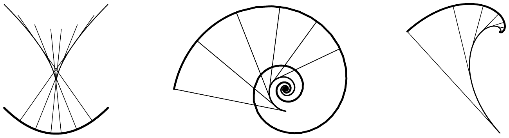
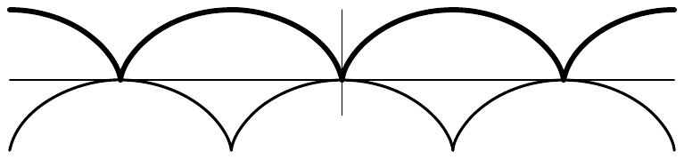

##### 习题

1 设 $ r \in C^{2}(J, \mathbb{R}^{+}) $ 满足对 $ t \in J $ 有 $ [r(t)]^{2} + [\dot r(t)]^{2} > 0 $，且 $ \gamma(t) := r(t)(\cos t, \sin t) $。证明由 $ \gamma $ 参数化的曲线具有曲率

\[ \kappa = \frac{2[\dot r]^{2} - r\ddot r + r^{2}}{(r^{2} + [\dot r]^{2})^{3/2}} . \]

2 计算下列曲线的曲率

\[ \begin{aligned} \text{帕斯卡蜗线}\quad &[-\pi,\pi] \to \mathbb{R}^{2} , & t &\mapsto (1+2\cos t)(\cos t,\sin t) ; \\ \text{对数螺线}\quad &\mathbb{R} \to \mathbb{R}^{2} , & t &\mapsto e^{\lambda t}(\cos t,\sin t) ; \\ \text{摆线}\quad &[0,2\pi] \to \mathbb{R}^{2} , & t &\mapsto R(t-\sin t,1-\cos t) . \end{aligned} \]

3 设 $ \gamma : J \to \mathbb{R}^{3} $, $ t \mapsto (x(t), y(t)) $ 是平面曲线 $ \Gamma $ 的正则 $ C^{2} $ 参数化，且对 $ t \in J $ 有 $ \kappa(t) \ne 0 $。证明 $ \Gamma $ 的渐屈线由 $ t \mapsto m(t) $ 参数化，其中

\[ m := \left( x - \frac{\dot x^{2} + \dot y^{2}}{\dot x\ddot y - \ddot x\dot y}\dot y ,\ y + \frac{\dot x^{2} + \dot y^{2}}{\dot x\ddot y - \ddot x\dot x}\dot x \right) . \]

4 证明

(a) 抛物线 $ y = x^{2}/2 $ 的渐屈线是尼尔抛物线，即半立方抛物线 $ \mathbb{R} \to \mathbb{R}^{2} $, $ t \mapsto (-t^{3}, 1 + 3t^{2}/2) $；

(b) 对数螺线 $ \mathbb{R} \to \mathbb{R}^{2} $, $ t \mapsto e^{\lambda t}(\cos t, \sin t) $ 的渐屈线是对数螺线 $ \mathbb{R} \to \mathbb{R}^{2} $, $ t \mapsto \lambda e^{\lambda(t-\pi/2)}(\cos t, \sin t) $；

(c) 摆线 $ \mathbb{R} \to \mathbb{R}^{2} $, $ t \mapsto (t - \sin t, 1 - \cos t) $ 的渐屈线是摆线 $ \mathbb{R} \to \mathbb{R}^{2} $, $ t \mapsto (t + \sin t, \cos t - 1) $。

5 设 $ \gamma \in C^{3}(J, \mathbb{R}^{2}) $ 是平面曲线 $ \Gamma $ 的正则参数化，并假设对 $ t \in J $ 有 $ \kappa(t)\dot\kappa(t) \ne 0 $。用 $ m $ 表示注 2.13(c) 中给出的 $ \Gamma $ 的渐屈线 $ M $ 的参数化。证明

(a) $ M $ 是正则 $ C^{1} $ 曲线；

(b) $ \Gamma $ 在 $ \gamma(t) $ 处的切线与 $ M $ 在 $ m(t) $ 处的切线垂直；

(c) $ M $ 的弧长由下式给出

\[ L(M) = \int_{J} |\dot\kappa_{\gamma}|\,\kappa_{\gamma}^{-2}\,dt . \]

（(b) 与 (c) 的提示：Frenet 导数公式。）

6 证明对数螺线 $ \Gamma $ 以常角穿过从原点出发的直线，即沿螺线的任一点处，$ \Gamma $ 的切线与从原点出发的直线之间的夹角都相同。

7 计算曲率与挠率

(a) 对于**椭圆螺旋线** $ \mathbb{R} \to \mathbb{R}^{3} $, $ t \mapsto (a\cos t, b\sin t, ct) $，其中 $ a, b, c \in \mathbb{R} $ 满足 $ ab \ne 0 $；

(b) 对于曲线 $ \mathbb{R} \to \mathbb{R}^{3} $, $ t \mapsto t(\cos t, \sin t, 1) $。

8 设 $ \Gamma $ 是平面上的正则闭 $ C^{1} $ 曲线。证明**等周不等式**

\[ 4\pi A(\Gamma) \le [L(\Gamma)]^{2} \]

（参见习题 1.6）。

（提示：(i) 将 $ \mathbb{R}^{2} $ 与 $ \mathbb{C} $ 等同起来，先考虑 $ L(\Gamma) = 2\pi $ 的情形。然后不失一般性，设 $ \gamma \in C^{1}([0,2\pi], \mathbb{C}) $ 按弧长参数化 $ \Gamma $。利用帕塞瓦尔方程（推论 VI.7.16）与注 VI.7.20(b)，证明

\[ 1 = \frac{1}{2\pi}\int_{0}^{2\pi}|\dot\gamma|^{2}\,dt = \sum_{k=-\infty}^{\infty} k^{2}|\hat\gamma_{k}|^{2} . \]

进一步证明

\[ A(\Gamma) = \frac{1}{2}\int_{0}^{2\pi} \operatorname{Im}\bar\gamma\dot\gamma\,dt . \]

于是由习题 VI.7.11 与注 VI.7.20(b)，可见

\[ A(\Gamma) = \pi \sum_{k=-\infty}^{\infty} k|\hat\gamma_{k}|^{2} , \]

从而

\[ A(\Gamma) \le \pi \sum_{k=-\infty}^{\infty} k^{2}|\hat\gamma_{k}|^{2} = \pi = [L(\Gamma)]^{2}/4\pi . \]

(ii) $ L(\Gamma) \ne 2\pi $ 的情形通过变换 $ \gamma \to 2\pi\gamma/L(\Gamma) $ 化归为 (i)。）

9 设 $ I $ 与 $ J $ 是紧致区间，$ U $ 是 $ I \times J $ 在 $ \mathbb{R}^{2} $ 中的开邻域。进一步假设 $ \gamma \in C^{3}(U, \mathbb{R}^{2}) $ 满足条件

(i) 对每个 $ \lambda \in I $，函数 $ \gamma_{\lambda} := \gamma(\lambda,\cdot)|J : J \to \mathbb{R}^{2} $ 是 $ C^{3} $ 曲线 $ \Gamma_{\lambda} $ 的正则参数化；

(ii) 对 $ (\lambda,t) \in I \times J $ 有 $ \partial_{1}\gamma(\lambda,t) = \kappa_{\Gamma_{\lambda}}(t)\mathbf{n}_{\Gamma_{\lambda}}(t) $。

证明函数

\[ \ell : I \to \mathbb{R} ,\quad \lambda \mapsto L(\Gamma_{\lambda}) \]

有连续导数，并且

\[ \ell'(\lambda) = -\int_{0}^{\ell(\lambda)} [\kappa(s(\lambda))]^{2}ds(\lambda) \quad \text{对 } \lambda \in I , \]

其中对 $ \lambda \in I $，$ s(\lambda) $ 是 $ \Gamma_{\lambda} $ 的弧长参数。

（提示：定义 $ v : I \times J \to \mathbb{R} $, $ (\lambda,t) \mapsto |\partial_{1}\gamma(\lambda,t)| $。利用 Frenet 公式与 (ii)，推出 $ \partial_{1}v = -\kappa^{2}v $。）

10 证明对每个 $ T \in SO(2) $，存在唯一的 $ \alpha \in [0, 2\pi) $，使得

\[ T = \begin{bmatrix} \cos\alpha & -\sin\alpha \\ \sin\alpha & \cos\alpha \end{bmatrix} . \]

（提示：习题 VII.9.2。）
