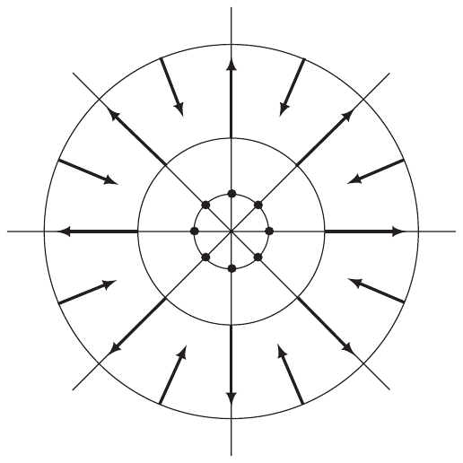
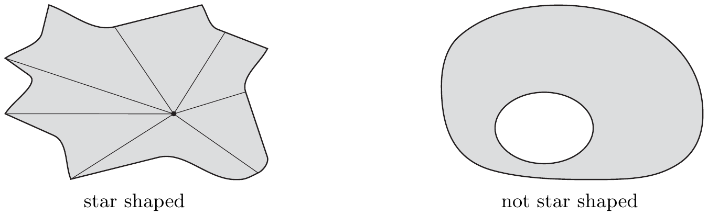

## 3 普法夫形式

在第 VI.5 节中，我们以一种特设的方式引入了微分，以便能够更简单地表示积分法则。现在，我们将为使用这些此前只是形式化的对象发展出一套演算。这套演算会自然地容纳之前那些简单的计算法则，同时也会带来更多的清晰与理解。与此同时，这一发展将把积分的概念从在区间上进行的某种运算，扩展到可以在曲线上进行的某种运算。

在下面，设

• $ X $ 是 $ \mathbb{R}^{n} $ 中非空的开集；并设 $ q \in \mathbb{N} \cup \{\infty\} $。

##### 向量场与普法夫形式

满足对 $ p \in X $ 有 $ \boldsymbol{v}(p) \in T_{p}X $ 的映射 $ \boldsymbol{v} : X \to TX $ 称为 $ X $ 上的**向量场**。对每个向量场 $ \boldsymbol{v} $，对应唯一一个函数 $ v : X \to \mathbb{R}^{n} $，即 $ \boldsymbol{v} $ 的**切部分**，使得 $ \boldsymbol{v}(p) = (p,v(p)) $。借助自然投影

\[ \mathrm{pr}_{2} : TX = X \times \mathbb{R}^{n} \to \mathbb{R}^{n} , \quad (p,\xi) \mapsto \xi , \]

有 $ v = \mathrm{pr}_{2} \circ \boldsymbol{v} $。

若 $ v \in C^{q}(X,\mathbb{R}^{n}) $，则称向量场 $ \boldsymbol{v} $ 属于类 $ C^{q} $。我们用 $ \mathcal{V}^{q}(X) $ 表示 $ X $ 上所有类 $ C^{q} $ 的向量场之集。

设 $ E $ 是 $ \mathbb{K} $ 上的巴拿赫空间，$ E' := \mathcal{L}(E,\mathbb{K}) $ 是其对偶空间。映射

\[ \langle\cdot,\cdot\rangle : E' \times E \to \mathbb{K} , \quad (e',e) \mapsto \langle e',e\rangle := e'(e) , \]

把每个二元组 $ (e',e) \in E' \times E $ 映为 $ e' $ 在位置 $ e $ 处的值，称为 $ E $ 与 $ E' $ 之间的**对偶配对**。

现在我们来考虑与 $ X $ 的切空间对偶的空间。对 $ p \in X $，与 $ T_{p}X $ 对偶的空间是 $ X $ 在点 $ p $ 处的**余切空间**，记为 $ T_{p}^{*}X $。又

\[ T^{*}X := \bigcup_{p \in X}T_{p}^{*}X \]

是 $ X $ 的**余切丛**。因此，$ T_{p}^{*}X $ 的元素，即 $ p $ 处的**余切向量**，是 $ X $ 在 $ p $ 处的切空间上的线性形式。相应的对偶配对记为

\[ \langle\cdot,\cdot\rangle_{p} : T_{p}^{*}X \times T_{p}X \to \mathbb{R} . \]

每个满足对 $ p \in X $ 有 $ \boldsymbol{\alpha}(p) \in T_{p}^{*}X $ 的映射 $ \boldsymbol{\alpha} : X \to T^{*}X $ 称为 $ X $ 上的**普法夫形式**。有时我们也称 $ \boldsymbol{\alpha} $ 为** 1 次微分形式**或 **1-形式**。

3.1 注 (a) 若 $ E $ 是 $ \mathbb{K} $ 上的巴拿赫空间，则 $ \langle\cdot,\cdot\rangle \in \mathcal{L}(E',E;\mathbb{K}) $。

证明 显然对偶配对是双线性的。此外，结论 VI.2.4(a) 给出估计

\[ |\langle e',e\rangle| = |e'(e)| \le \|e'\|_{E'}\|e\|_{E} \quad \text{对 } (e',e) \in E' \times E . \]

因此，命题 VII.4.1 表明 $ \langle\cdot,\cdot\rangle $ 属于 $ \mathcal{L}(E',E;\mathbb{K}) $。■

(b) 对 $ (p,e') \in \{p\} \times (\mathbb{R}^{n})' $，通过

\[ \langle J(p,e'),(p,e)\rangle_{p} = \langle e',e\rangle \quad \text{对 } e \in \mathbb{R}^{n} , \tag{3.1} \]

定义 $ J(p,e') \in T_{p}^{*}X $，其中 $ \langle\cdot,\cdot\rangle $ 表示 $ \mathbb{R}^{n} $ 与 $ (\mathbb{R}^{n})' $ 之间的对偶配对。则 $ J $ 是 $ \{p\} \times (\mathbb{R}^{n})' $ 到 $ T_{p}^{*}X $ 上的等距同构。利用这个同构，我们把 $ T_{p}^{*}X $ 与 $ \{p\} \times (\mathbb{R}^{n})' $ 等同。

证明 显然 $ J $ 是线性的。若对某个 $ (p,e') \in \{p\} \times (\mathbb{R}^{n})' $ 有 $ J(p,e') = 0 $，则由 (3.1) 得 $ e' = 0 $。因此 $ J $ 是单射。因为

\[ \dim\left(\{p\} \times (\mathbb{R}^{n})'\right) = \dim\left(\{p\} \times \mathbb{R}^{n}\right) = \dim(T_{p}X) = \dim(T_{p}^{*}X) , \]

$ J $ 也是满射。于是该断言由定理 VII.1.6 得出。■

因为 $ T_{p}^{*}X = \{p\} \times (\mathbb{R}^{n})' $，所以对每个普法夫形式 $ \boldsymbol{\alpha} $ 存在唯一一个映射 $ \alpha : X \to (\mathbb{R}^{n})' $，即 $ \boldsymbol{\alpha} $ 的**余切部分**，使得 $ \boldsymbol{\alpha}(p) = (p,\alpha(p)) $。若 $ \alpha \in C^{q}\left(X,(\mathbb{R}^{n})'\right) $，则称 1-形式 $ \boldsymbol{\alpha} $ 属于**类** $ C^{q} $。我们用 $ \Omega_{(q)}(X) $ 表示 $ X $ 上所有类 $ C^{q} $ 的 1-形式之集。

在 $ \mathcal{V}^{q}(X) $ 上，我们用 $ C^{q}(X) $ 中的函数定义乘法，即

\[ C^{q}(X) \times \mathcal{V}^{q}(X) \to \mathcal{V}^{q}(X) , \quad (a,\boldsymbol{v}) \mapsto a\boldsymbol{v} \]

其中乘法按逐点方式定义：$ (a\boldsymbol{v})(p) := a(p)\boldsymbol{v}(p) $（$ p \in X $）。同样，在 $ \Omega_{(q)}(X) $ 上，我们用 $ C^{q}(X) $ 中的函数定义乘法，即

\[ C^{q}(X) \times \Omega_{(q)}(X) \to \Omega_{(q)}(X) , \quad (a,\boldsymbol{\alpha}) \mapsto a\boldsymbol{\alpha} \]

其中乘法按逐点方式定义：$ (a\boldsymbol{\alpha})(p) := a(p)\boldsymbol{\alpha}(p) $（$ p \in X $）。

于是容易验证，$ \mathcal{V}^{q}(X) $ 和 $ \Omega_{(q)}(X) $ 是（交换）环 $ C^{q}(X) $ 上的模\footnote{为完备起见，我们把与模有关的事实放在本节末尾。}。因为 $ C^{q}(X) $ 自然地把 $ \mathbb{R} $ 作为子环包含在内（利用 $ \lambda \in \mathbb{R} $ 与 $ \lambda\mathbf{1} \in C^{q}(X) $ 的等同），所以特别地，$ \mathcal{V}^{q}(X) $ 和 $ \Omega_{(q)}(X) $ 是实向量空间。

3.2 注 (a) 对 $ \boldsymbol{\alpha} \in \Omega_{(q)}(X) $ 和 $ \boldsymbol{v} \in \mathcal{V}^{q}(X) $，

\[ \left(p \mapsto \langle\boldsymbol{\alpha}(p),\boldsymbol{v}(p)\rangle_{p} = \langle\boldsymbol{\alpha}(p),\boldsymbol{v}(p)\rangle\right) \in C^{q}(X) . \]

(b) 在不会引起混淆时，我们把 $ \boldsymbol{\alpha} \in \Omega_{(q)}(X) $ 与其余切部分 $ \alpha = \mathrm{pr}_{2} \circ \boldsymbol{\alpha} $ 等同，并把 $ \boldsymbol{v} \in \mathcal{V}^{q}(X) $ 与其切部分 $ v = \mathrm{pr}_{2} \circ \boldsymbol{v} $ 等同。则

\[ \mathcal{V}^{q}(X) = C^{q}(X,\mathbb{R}^{n}) \quad \text{且} \quad \Omega_{(q)}(X) = C^{q}\left(X,(\mathbb{R}^{n})'\right) . \]

(c) 设 $ f \in C^{q+1}(X) $，且

\[ d_{p}f = \mathrm{pr}_{2} \circ T_{p}f \quad \text{对 } p \in X , \]

是 $ f $ 的微分（见第 VII.10 节）。则映射 $ df := (p \mapsto d_{p}f) $ 属于 $ \Omega_{(q)}(X) $，且有 $ d_{p}f = \partial f(p) $。从现在起，我们用 $ df(p) $ 表示 $ d_{p}f $。■

##### 典范基

下面，设 $ (e_{1},\ldots,e_{n}) $ 是 $ \mathbb{R}^{n} $ 的标准基，$ (\varepsilon^{1},\ldots,\varepsilon^{n}) $ 是 $ (\mathbb{R}^{n})' $ 中相应的对偶基\footnote{对偶基的存在性是线性代数的标准结果。}，即\footnote{$ \delta_{k}^{j} := \delta^{jk} := \delta_{jk} $ 是克罗内克符号。}

\[ \langle\varepsilon^{j},e_{k}\rangle = \delta_{k}^{j} \quad \text{对 } j,k \in \{1,\ldots,n\} . \]

我们还设

\[ dx^{j} := d(\mathrm{pr}_{j}) \in \Omega_{(\infty)}(X) \quad \text{对 } j = 1,\ldots,n , \]

其中用到第 $ j $ 个投影 $ \mathrm{pr}_{j} : \mathbb{R}^{n} \to \mathbb{R} $，$ x = (x^{1},\ldots,x^{n}) \mapsto x^{j} $。

3.3 注 (a) 由注 3.1(b)，对每个 $ j = 1,\ldots,n $，$ (\varepsilon^{j})_{p} = (p,\varepsilon^{j}) $ 属于 $ T_{p}^{*}X $，且 $ \left((\varepsilon^{1})_{p},\ldots,(\varepsilon^{n})_{p}\right) $ 是与 $ T_{p}X $ 的典范基 $ \left((e_{1})_{p},\ldots,(e_{n})_{p}\right) $ 对偶的基。

(b) 有

\[ dx^{j}(p) = (p,\varepsilon^{j}) \quad \text{对 } p \in X \text{ 且 } j = 1,\ldots,n . \]

证明 该断言由命题 VII.2.8 得出，后者给出

\[ \langle dx^{j}(p),(e_{k})_{p}\rangle_{p} = \langle\partial(\mathrm{pr}_{j})(p),e_{k}\rangle = \partial_{k}\mathrm{pr}_{j}(p) = \delta_{jk} . ■ \]

(c) 对 $ 1 \le j \le n $ 和 $ p \in X $，我们设 $ e_{j}(p) := (p,e_{j}) $。则 $ (e_{1},\ldots,e_{n}) $ 是 $ \mathcal{V}^{q}(X) $ 的模基，$ (dx^{1},\ldots,dx^{n}) $ 是 $ \Omega_{(q)}(X) $ 的模基。此外，有

\[ \langle dx^{j}(p),e_{k}(p)\rangle_{p} = \delta_{k}^{j} \quad \text{对 } 1 \le j,k \le n \text{ 且 } p \in X , \tag{3.2} \]

且 $ (e_{1},\ldots,e_{n}) $ 是 $ \mathcal{V}^{q}(X) $ 的**典范基**。同样，$ (dx^{1},\ldots,dx^{n}) $ 是 $ \Omega_{(q)}(X) $ 的典范基。\footnote{这两组基在模对偶的意义下互为对偶（见 [SS88, § 70]）。}

最后，我们定义

\[ \langle\boldsymbol{\alpha},\boldsymbol{v}\rangle : \Omega_{(q)}(X) \times \mathcal{V}^{q}(X) \to C^{q}(X) \]

如下

\[ \langle\boldsymbol{\alpha},\boldsymbol{v}\rangle(p) := \langle\boldsymbol{\alpha}(p),\boldsymbol{v}(p)\rangle_{p} \quad \text{对 } p \in X . \]

则 (3.2) 取如下形式

\[ \langle dx^{j},e_{k}\rangle = \delta_{k}^{j} \quad \text{对 } 1 \le j,k \le n . \]

证明 设 $ \boldsymbol{\alpha} \in \Omega_{(q)}(X) $。我们设

\[ a_{j}(p) := \langle\boldsymbol{\alpha}(p),e_{j}(p)\rangle_{p} \quad \text{对 } p \in X . \]

于是，由注 3.2(a)，$ a_{j} $ 属于 $ C^{q}(X) $，因此 $ \boldsymbol{\beta} := \sum a_{j}dx^{j} $ 属于 $ \Omega_{(q)}(X) $。此外，

\[ \langle\boldsymbol{\beta}(p),e_{k}(p)\rangle_{p} = \sum_{j=1}^{n}a_{j}(p)\langle dx^{j}(p),e_{k}(p)\rangle_{p} = a_{k}(p) = \langle\boldsymbol{\alpha}(p),e_{k}(p)\rangle_{p} \quad \text{对 } p \in X \]

且 $ k = 1,\ldots,n $。因此 $ \boldsymbol{\alpha} = \boldsymbol{\beta} $，这表明 $ (e_{1},\ldots e_{n}) $ 与 $ (dx^{1},\ldots,dx^{n}) $ 是模基，且 (3.2) 成立。■

(d) 每个 $ \boldsymbol{\alpha} \in \Omega_{(q)}(X) $ 有**典范基表示**

\[ \boldsymbol{\alpha} = \sum_{j=1}^{n}\langle\boldsymbol{\alpha},e_{j}\rangle dx^{j} . \]

(e) 对 $ f \in C^{q+1}(X) $，

\[ df = \partial_{1}f\,dx^{1} + \cdots + \partial_{n}f\,dx^{n} . \]

映射 $ d : C^{q+1}(X) \to \Omega_{(q)}(X) $ 是 $ \mathbb{R} $-线性的。

证明 因为

\[ \langle df(p),e_{j}(p)\rangle_{p} = \partial_{j}f(p) \quad \text{对 } p \in X , \]

第一个断言由 (d) 得出。第二个断言是显然的。■

(f) $ \mathcal{V}^{q}(X) $ 和 $ \Omega_{(q)}(X) $ 是 $ \mathbb{R} $ 上的无穷维向量空间。

证明 我们考虑 $ X = \mathbb{R} $，一般情形留给读者。由代数基本定理容易得出，$ \mathcal{V}^{q}(\mathbb{R}) = C^{q}(\mathbb{R}) $ 中的单项式 $ \{X^{m} \;;\; m \in \mathbb{N}\} $ 在 $ \mathbb{R} $ 上线性无关。因此 $ \mathcal{V}^{q}(\mathbb{R}) $ 是无穷维向量空间。我们已经知道 $ \Omega_{(q)}(\mathbb{R}) $ 是 $ \mathbb{R} $-向量空间。与 $ \mathcal{V}^{q}(\mathbb{R}) $ 的情形一样，我们看出 $ \{X^{m}dx \;;\; m \in \mathbb{N}\} \subset \Omega_{(q)}(\mathbb{R}) $ 是 $ \mathbb{R} $ 上的线性无关集。因此 $ \Omega_{(q)}(\mathbb{R}) $ 也是无穷维 $ \mathbb{R} $-向量空间。■

(g) $ C^{q}(X) $-模 $ \mathcal{V}^{q}(X) $ 与 $ \Omega_{(q)}(X) $ 同构。我们如下定义一个模同构，即**典范同构**：

\[ \Theta : \mathcal{V}^{q}(X) \to \Omega_{(q)}(X) , \quad \sum_{j=1}^{n}a_{j}e_{j} \mapsto \sum_{j=1}^{n}a_{j}dx^{j} . \]

证明 这由 (c) 和 (d) 得出。■

(h) 对 $ f \in C^{q+1}(X) $，有 $ \Theta^{-1}df = \mathrm{grad}\,f $，即，图\footnote{与记号 $ df $ 类似，我们用 $ \mathrm{grad}\,f $ 或 $ \nabla f $ 表示映射 $ p \mapsto \nabla_{p}f $（见第 VII.10 节）。在每一种具体情形中，从上下文可以清楚地看出 $ \mathrm{grad}\,f(p) $ 是指这个函数在点 $ p $ 处的值，还是指 $ \nabla_{p}f $ 的切部分。}

\[ \begin{array}{ccc} & \xrightarrow{\hspace{1.2em} d \hspace{1.2em}} & \Omega_{(q)}(X) \\[0.3ex] C^{q+1}(X) & & \cong\uparrow\ \Theta \\[0.3ex] & \xrightarrow{\hspace{1em}\mathrm{grad}\hspace{1em}} & \mathcal{V}^{q}(X) \end{array} \]

是交换的。

证明 由 (e)，有

\[ \Theta^{-1}df = \Theta^{-1}\left(\sum_{j=1}^{n}\partial_{j}f\,dx^{j}\right) = \sum_{j=1}^{n}\partial_{j}f\,e_{j} = \mathrm{grad}\,f \quad \text{对 } f \in C^{q+1}(X) . ■ \]

##### 恰当形式与梯度场

我们已经看到，每个函数 $ f \in C^{q+1}(X) $ 都诱导出普法夫形式 $ df $。现在我们要问，是否每个普法夫形式都是这样诱导出来的。

设 $ \alpha \in \Omega_{(q)}(X) $，下面我们使用注 3.2(b) 的等同规则。若存在 $ f \in C^{q+1}(X) $ 使得 $ df = \alpha $，则称 $ \alpha $ 是**恰当的**，$ f $ 是 $ \alpha $ 的一个**原函数**。

3.4 注 (a) 设 $ X $ 是区域，$ \alpha \in \Omega_{(0)}(X) $ 是恰当的。若 $ f $ 和 $ g $ 是 $ \alpha $ 的原函数，则 $ f - g $ 是常数。

证明 首先，$ \alpha = df = dg $ 蕴含 $ d(f - g) = 0 $。然后应用注 VII.3.11(c)。■

(b) 设 $ \alpha = \sum_{j=1}^{n}a_{j}dx^{j} \in \Omega_{(1)}(X) $ 是恰当的。则它满足**可积性条件**

\[ \partial_{k}a_{j} = \partial_{j}a_{k} \quad \text{对 } 1 \le j,k \le n . \]

证明 设 $ f \in C^{2}(X) $ 满足 $ df = \alpha $。由注 3.3(d) 和 (e)，有 $ a_{j} = \partial_{j}f $。于是由施瓦茨定理（推论 VII.5.5(ii)）可得

\[ \partial_{k}a_{j} = \partial_{k}\partial_{j}f = \partial_{j}\partial_{k}f = \partial_{j}a_{k} \quad \text{对 } 1 \le j,k \le n . ■ \]

(c) 若 $ X \subset \mathbb{R} $，则每个形式 $ \alpha \in \Omega_{(q)}(X) $ 都是恰当的。

证明 因为 $ X $ 是开区间的无交并（见习题 III.4.6），故只需考虑 $ a < b $ 时 $ X = (a,b) $ 的情形。由注 3.3(c)，对每个 $ \alpha \in \Omega_{(q)}(X) $ 存在 $ a \in C^{q}(X) $ 使得 $ \alpha = a\,dx $。设 $ p_{0} \in (a,b) $，且

\[ f(p) := \int_{p_{0}}^{p}a(x)\,dx \quad \text{对 } p \in (a,b) . \]

则 $ f $ 属于 $ C^{q+1}(X) $，且 $ f' = a $。因此由注 3.3(e) 得 $ df = a\,dx = \alpha $。■

借助典范同构 $ \Theta : \mathcal{V}^{q}(X) \to \Omega_{(q)}(X) $，普法夫形式的性质可以转移到向量场上。于是我们引入如下记号：若存在 $ f \in C^{q+1}(X) $ 使得 $ v = \nabla f $，则称向量场 $ v \in \mathcal{V}^{q}(X) $ 为**梯度场**。在此语境下，称 $ f $ 为 $ v $ 的一个**势**。

注 3.3 和 3.4 直接蕴含下面关于梯度场的事实。

3.5 注 (a) 若 $ X $ 是区域，则其上任何梯度场的两个势至多相差一个常数。

(b) 若 $ v = (v_{1},\ldots,v_{n}) \in \mathcal{V}^{1}(X) $ 是梯度场，则可积性条件 $ \partial_{k}v_{j} = \partial_{j}v_{k} $ 对 $ 1 \le j,k \le n $ 成立。

(c) 普法夫形式 $ \alpha \in \Omega_{(q)}(X) $ 是恰当的当且仅当 $ \Theta^{-1}\alpha \in \mathcal{V}^{q}(X) $ 是梯度场。■

3.6 例 (a)（中心场）设 $ X := \mathbb{R}^{n}\setminus\{0\} $，且普法夫形式

\[ \alpha = \sum_{j=1}^{n}a_{j}dx^{j} \in \Omega_{(q)}(X) \]

的分量有表示 $ a_{j}(x) := x^{j}\varphi(|x|) $，其中 $ x = (x^{1},\ldots,x^{n}) $，$ 1 \le j \le n $，且 $ \varphi \in C^{q}((0,\infty),\mathbb{R}) $。则 $ \alpha $ 是恰当的。原函数 $ f $ 由 $ f(x) := \Phi(|x|) $ 给出，其中

\[ \Phi(r) := \int_{r_{0}}^{r}t\varphi(t)\,dt \quad \text{对 } r > 0 , \]

其中 $ r_{0} $ 是严格正数。因此向量场 $ v := \sum_{j=1}^{n}a_{j}e_{j} = \Theta^{-1}\alpha $ 是梯度场，其中对每个 $ x \in X $，向量 $ v(x) \in T_{x}(X) $ 都落在过 $ x $ 和 $ 0 $ 的直线上。**等势面**，即 $ f $ 的水平集，是 $ r > 0 $ 时的球面 $ rS^{n-1} $；这些球面与梯度场垂直（见例 VII.3.6(c)）。

证明 显然 $ \Phi $ 属于 $ C^{q+1}((0,\infty),\mathbb{R}) $，且 $ \Phi'(r) = r\varphi(r) $。于是由链式法则可得

\[ \partial_{j}f(x) = \Phi'(|x|)x^{j}/|x| = x^{j}\varphi(|x|) = a_{j}(x) \quad \text{对 } j = 1,\ldots,n \text{ 且 } x \in X . \]

其余的断言是显然的。■

(b) 中心场 $ x \mapsto cx/|x|^{n} $，其中 $ c \in \mathbb{R}^{\times} $，$ n \ge 2 $，是梯度场。势 $ U $ 由下式给出：

\[ U(x) := \left\{\begin{array}{ll}c\log|x| , & n = 2 , \\ c|x|^{2-n}/(2-n) , & n > 2 ,\end{array}\right. \]

对 $ x \ne 0 $。这个势在物理学中起着重要作用。\footnote{“势”这一名称来源于物理学。}视具体的物理情境而定，它可以是**牛顿势**，也可以是**库仑势**。

证明 这是 (a) 的特殊情形。■

##### 庞加莱引理

恰当 1-形式是一类特别重要的微分形式。我们已经知道，每个恰当 1-形式都满足可积性条件。另一方面，存在一些 1-形式，它们不恰当却仍满足可积性条件。因此，寻找这样的条件是有用的：除了已经必要的可积性条件之外，这些条件还能保证原函数的存在。我们现在将看到——也许令人惊讶——这种存在性依赖于其所在区域的拓扑性质。

若连续可微的普法夫形式满足可积性条件，则称它是**闭的**。若 $ \mathbb{R}^{n} $ 的子集 $ M $（关于 $ x_{0} \in M $）满足：存在 $ x_{0} \in M $，使得对每个 $ x \in M $，从 $ x_{0} $ 到 $ x $ 的直线道路 $ [[x_{0},x]] $ 都落在 $ M $ 中，则称 $ M $ 是**星形的**。

3.7 注 (a) 每个恰当的、连续可微的 1-形式都是闭的。

(b) 若 $ M $ 是星形的，则 $ M $ 连通。

证明 这由命题 III.4.8 得出。■

(c) 每个凸集关于其任何一点都是星形的。■

设 $ X $ 关于 $ 0 $ 星形，且 $ f \in C^{1}(X) $ 是 $ \alpha = \sum_{j=1}^{n}a_{j}dx^{j} $ 的原函数。则 $ a_{j} = \partial_{j}f $，且注 3.3(c) 给出

\[ \langle\alpha(tx),e_{j}\rangle = a_{j}(tx) = \partial_{j}f(tx) = (\nabla f(tx)|e_{j}) \quad \text{对 } j = 1,\ldots,n . \]

因此对 $ x \in X $ 有 $ \langle\alpha(tx),x\rangle = (\nabla f(tx)|x) $，且积分形式的中值定理（定理 VII.3.10）给出表示

\[ f(x) - f(0) = \int_{0}^{1}(\nabla f(tx)|x)\,dt = \int_{0}^{1}\langle\alpha(tx),x\rangle\,dt , \tag{3.3} \]

它是下一个定理的关键。

3.8 定理（庞加莱引理）设 $ X $ 是星形的，$ q \ge 1 $。若 $ \alpha \in \Omega_{(q)}(X) $ 是闭的，则 $ \alpha $ 是恰当的。

证明 设 $ X $ 关于 $ 0 $ 星形，$ \alpha = \sum_{j=1}^{n}a_{j}dx^{j} $。因为对 $ x \in X $，线段 $ [[0,x]] $ 落在 $ X $ 中，所以

\[ f(x) := \int_{0}^{1}\langle\alpha(tx),x\rangle\,dt = \sum_{k=1}^{n}\int_{0}^{1}a_{k}(tx)x^{k}\,dt \quad \text{对 } x \in X \tag{3.4} \]

定义良好。此外

\[ [(t,x) \mapsto \langle\alpha(tx),x\rangle] \in C^{q}([0,1] \times X) , \]

且由可积性条件 $ \partial_{j}a_{k} = \partial_{k}a_{j} $，我们得到

\[ \frac{\partial}{\partial x^{j}}\langle\alpha(tx),x\rangle = a_{j}(tx) + \sum_{k=1}^{n}tx^{k}\partial_{k}a_{j}(tx) . \]

于是命题 VII.6.7 蕴含 $ f $ 属于 $ C^{q}(X) $，且

\[ \partial_{j}f(x) = \int_{0}^{1}a_{j}(tx)\,dt + \int_{0}^{1}t\left(\sum_{k=1}^{n}x^{k}\partial_{k}a_{j}(tx)\right)dt . \]

对第二个积分分部积分，取 $ u(t) := t $ 和 $ v_{j}(t) := a_{j}(tx) $，得

\[ \partial_{j}f(x) = \int_{0}^{1}a_{j}(tx)\,dt + ta_{j}(tx)|_{0}^{1} - \int_{0}^{1}a_{j}(tx)\,dt = a_{j}(x) \quad \text{对 } x \in X . \]

最后，因为对 $ j = 1,\ldots,n $，$ \partial_{j}f = a_{j} $ 属于 $ C^{q}(X) $，所以我们得到 $ f \in C^{q+1}(X) $ 和 $ df = \alpha $（见注 3.3(e)）。

$ X $ 关于点 $ x_{0} \in X $ 星形的情形，显然可以通过平移 $ x \mapsto x - x_{0} $ 化归为上面的情形。■

3.9 注 (a) 例 3.6(a) 的中心场表明，为使势（或原函数）存在，区域不必是星形的。

(b) 定理 3.8 的证明是构造性的，也就是说，公式 (3.4) 给出了一个原函数。■

到目前为止，在 $ \Omega_{(q)}(X) $ 中我们只用由 1-形式 $ dx^{1},\ldots,dx^{n} $ 组成的典范模基。如果我们在 $ \mathcal{V}^{q}(X) $ 中使用典范基 $ (e_{1},\ldots,e_{n}) $（见注 3.3(c)），则这种选择是自然的。换言之，如果我们把 $ X $ 理解为 $ \mathbb{R}^{n} $ 的子流形，则模基 $ (dx^{1},\ldots,dx^{n}) $ 适应于平凡坐标卡 $ \varphi = \mathrm{id}_{X} $。如果我们用另一个坐标卡 $ \psi $ 来描述 $ X $，则可以预期，$ \alpha \in \Omega_{(q)}(X) $ 在适应于 $ \psi $ 的模基中能更好地表示。\footnote{在第 III 卷研究流形上的微分形式时，我们将对这一问题有更好的理解。}为了从一种表示过渡到另一种表示，我们必须研究普法夫形式在坐标卡变换下如何变换。

##### 对偶算子

作为矩阵转置的推广，我们首先引入线性算子的“转置”或“对偶”的概念。

设 $ E $ 和 $ F $ 是巴拿赫空间。则对每个 $ A \in \mathcal{L}(E,F) $，我们如下定义一个**对偶**算子或**转置**算子：

\[ A^{\top} : F' \to E' , \quad f' \mapsto f' \circ A . \]

3.10 注 (a) $ A $ 的对偶算子是线性的且连续的，即 $ A^{\top} \in \mathcal{L}(F',E') $。此外\footnote{在泛函分析中已证明，$ A^{\top} $ 由 (3.5) 刻画，且 (3.6) 中等号成立。}

\[ \langle A^{\top}f',e\rangle = \langle f',Ae\rangle \quad \text{对 } e \in E \text{ 且 } f' \in F' , \tag{3.5} \]

且

\[ \|A^{\top}\|_{\mathcal{L}(F',E')} \le \|A\|_{\mathcal{L}(E,F)} \quad \text{对 } A \in \mathcal{L}(E,F) . \tag{3.6} \]

证明 由 $ A \in \mathcal{L}(E,F) $ 可知，对 $ f' \in F' $，$ A^{\top}f' $ 属于 $ E' $。显然 $ A^{\top} : F' \to E' $ 是线性的，且 (3.5) 成立。后者蕴含

\[ |\langle A^{\top}f',e\rangle| = |\langle f',Ae\rangle| \le \|f'\|\,\|Ae\| \le \|f'\|\,\|A\|\,\|e\| \quad \text{对 } e \in E \text{ 且 } f' \in F' . \]

由此我们读出（见注 VII.2.13(a)）不等式

\[ \|A^{\top}f'\| \le \|A\|\,\|f'\| \quad \text{对 } f' \in F' . \]

因此由算子范数的定义（见第 VI.2 节）我们得到 (3.6)。现在定理 VI.2.5 保证 $ A^{\top} $ 连续。■

(b) 若 $ \mathcal{E} = (e_{1},\ldots,e_{n}) $ 和 $ \mathcal{F} = (f_{1},\ldots,f_{m}) $ 分别是有限维巴拿赫空间 $ E $ 和 $ F $ 的基，则 $ [A^{\top}]_{\mathcal{E}',\mathcal{F}'} = \left([A]_{\mathcal{E},\mathcal{F}}\right)^{\top} $，其中 $ M^{\top} \in \mathbb{K}^{n \times m} $ 表示与 $ M \in \mathbb{K}^{m \times n} $ 对偶的矩阵，$ \mathcal{E}' $ 和 $ \mathcal{F}' $ 是与 $ \mathcal{E} $ 和 $ \mathcal{F} $ 对偶的基。

证明 这容易由表示矩阵的定义（见第 VII.1 节）以及把 $ f' $ 在与 $ \mathcal{F} $ 对偶的基中展开得出。■

(c) 若 $ G $ 是另一个巴拿赫空间，

\[ (BA)^{\top} = A^{\top}B^{\top} \quad \text{对 } A \in \mathcal{L}(E,F) \text{ 且 } B \in \mathcal{L}(F,G) , \]

且 $ (1_{E})^{\top} = 1_{E'} $。

(d) 对 $ A \in \mathcal{L}\mathrm{is}(E,F) $，$ A^{\top} $ 属于 $ \mathcal{L}\mathrm{is}(F',E') $，且 $ (A^{\top})^{-1} = (A^{-1})^{\top} $。

证明 这直接由 (c) 得出。■
