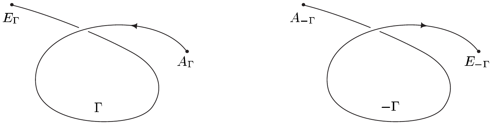
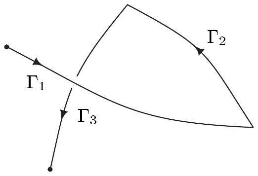
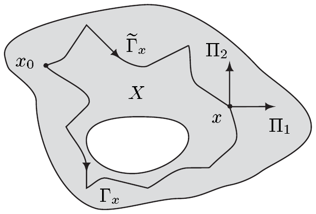

## 4 线积分

在第 VI 章，我们建立了在区间上对实变量函数积分的理论。若把这些区间看作特别简单的曲线，我们也许会问，积分这一概念能否推广到任意曲线。本节正是要这样做。当然，我们已经能对道路的函数积分，所以要建立一种只依赖于曲线的新积分方式，就必须保证它与参数化无关。结果会是，我们必须对普法夫形式而非函数积分。

在这些节中，设

• $ X $ 是 $ \mathbb{R}^{n} $ 中的开集；$ I $ 与 $ I_1 $ 是紧致完全区间。

此外，我们总是分别把向量场和普法夫形式与其切部分和余切部分等同起来。

##### 定义

我们现在来处理积分的换元法则。设 $ I $ 与 $ J $ 是紧致区间且 $ \varphi \in C^1(I, J) $。再设 $ a \in C(J) $ 且 $ \alpha = a\,dy $ 是 $ J $ 上的连续 1-形式。则根据 3.14(d) 与定义 (3.10)，换元法则具有如下形式

\[ \int_{\varphi(I)}\alpha=\int_I\varphi^{*}\alpha=\int_I(a\circ\varphi)\dot{\varphi}\,dt . \tag{4.1} \]

因为 $ \Omega_{(0)}(J) $ 是一维 $ C(J) $-模，所以每个 $ \alpha \in \Omega_{(0)}(J) $ 有唯一表示 $ \alpha = a\,dy $ 使得 $ a \in C(J) $。因此 (4.1) 对每个 $ \alpha \in \Omega_{(0)}(J) $ 都有定义。最后一个被积函数也可写成如下形式

\[ \langle\alpha(\varphi(t)),\dot{\varphi}(t)\rangle\,dt=\langle\alpha(\varphi(t)),\dot{\varphi}(t)1\rangle\,dt . \]

这一观察是定义 1-形式的线积分所需的基本结果。

对 $ \alpha \in \Omega_{(0)}(X) $ 与 $ \gamma \in C^1(I, X) $

\[ \int_{\gamma}\alpha:=\int_I\gamma^{*}\alpha=\int_I\langle\alpha(\gamma(t)),\dot{\gamma}(t)\rangle\,dt \]

称为 **$ \alpha $ 沿道路 $ \gamma $ 的积分**。

4.1 注 (a) 在基表示 $ \alpha=\sum_{j=1}^{n}a_j\,dx^{j} $ 中，我们有

\[ \int_{\gamma}\alpha=\sum_{j=1}^{n}\int_I(a_j\circ\gamma)\dot{\gamma}^{j}\,dt . \]

证明 这直接由例 3.14(b) 推出。■

(b) 设 $ \varphi \in C^1(I_1, I) $ 且 $ \gamma_1 := \gamma\circ\varphi $。则

\[ \int_{\gamma}\alpha=\int_{\gamma_1}\alpha\quad\text{对 }\alpha\in\Omega_{(0)}(X) . \]

证明 命题 3.12(i) 与换元法则 (3.9) 给出

\[ \int_{\gamma_1}\alpha=\int_{I_1}(\gamma\circ\varphi)^{*}\alpha=\int_{I_1}\varphi^{*}(\gamma^{*}\alpha)=\int_I\gamma^{*}\alpha=\int_{\gamma}\alpha\quad\text{对 }\alpha\in\Omega_{(0)}(X) . \quad \blacksquare \]

这一结果表明 $ \alpha $ 沿 $ \gamma $ 的积分在参数化改变下不变。于是，对 $ X $ 中每条紧致 $ C^1 $ 曲线 $ \Gamma $ 及每个 $ \alpha \in \Omega_{(0)}(X) $，**$ \alpha $ 沿 $ \Gamma $ 的线积分**

\[ \int_{\Gamma}\alpha:=\int_{\gamma}\alpha \]

是良定义的，其中 $ \gamma $ 是 $ \Gamma $ 的任意 $ C^1 $ 参数化。

4.2 例 (a) 设 $ \Gamma $ 是由 $ \gamma : [0, 2\pi]\to\mathbb{R}^{2} $，$ t\mapsto R(\cos t, \sin t) $ 参数化的圆。则

\[ \int_{\Gamma}X\,dy-Y\,dx=2\pi R^{2} . \]

证明 由

\[ \gamma^{*}dx=d\gamma^{1}=-(R\sin)\,dt\quad\text{且}\quad\gamma^{*}dy=d\gamma^{2}=(R\cos)\,dt \]

可得 $ \gamma^{*}(X\,dy-Y\,dx)=R^{2}\,dt $，断言得证。■

(b) 设 $ \alpha \in \Omega_{(0)}(X) $ 是恰当的。若 $ f \in C^1(X) $ 是一个原函数，\footnote{这一陈述是推论 VI.4.14 的推广。}

\[ \int_{\Gamma}\alpha=\int_{\Gamma}df=f(E_{\Gamma})-f(A_{\Gamma}) , \]

其中 $ A_{\Gamma} $ 与 $ E_{\Gamma} $ 分别是 $ \Gamma $ 的起点与终点。

证明 我们取定 $ \Gamma $ 的一个 $ C^1 $ 参数化 $ \gamma : [a, b]\to X $。则由命题 3.12(iii) 可得

\[ \gamma^{*}df=d(\gamma^{*}f)=d(f\circ\gamma)=(f\circ\gamma)^{\cdot}\,dt . \]

因此我们得到

\[ \int_{\Gamma}\alpha=\int_{\Gamma}df=\int_a^b\gamma^{*}df=\int_a^b(f\circ\gamma)^{\cdot}\,dt=f\circ\gamma\big|_a^b=f(E_{\Gamma})-f(A_{\Gamma}) \]

因为 $ E_{\Gamma}=\gamma(b) $ 且 $ A_{\Gamma}=\gamma(a) $。■

(c) 恰当普法夫形式沿 $ C^1 $ 曲线 $ \Gamma $ 的积分只依赖于起点与终点，而不依赖于它们之间的道路。若 $ \Gamma $ 是闭的，则该积分等于 0。

证明 这直接由 (b) 推出。■

(d) 存在不是恰当的闭 1-形式。

证明 设 $ X:=\mathbb{R}^{2}\setminus\{(0, 0)\} $ 且 $ \alpha \in \Omega_{(\infty)}(X) $ 满足

\[ \alpha(x, y):=\frac{x\,dy-y\,dx}{x^{2}+y^{2}}\quad\text{对 }(x, y)\in X . \]

容易验证 $ \alpha $ 是闭的。圆 $ \Gamma $ 的参数化 $ \gamma : [0, 2\pi]\to X $，$ t\mapsto(\cos t, \sin t) $ 给出 $ \gamma^{*}\alpha=dt $，因此

\[ \int_{\Gamma}\alpha=\int_0^{2\pi}dt=2\pi\ne 0 . \]

于是 (c) 表明 $ \alpha $ 不是恰当的。■

(e) 设 $ x_0 \in X $ 且 $ \gamma_{x_0} : I\to X $，$ t\mapsto x_0 $。这意味着 $ \gamma_{x_0} $ 参数化**点曲线** $ \Gamma $，其像恰为 $ \{x_0\} $。则

\[ \int_{\gamma_{x_0}}\alpha=0\quad\text{对 }\alpha\in\Omega_{(0)}(X) . \]

证明 这是显然的，因为 $ \dot{\gamma}_{x_0}=0 $。■

##### 基本性质

设 $ I = [a, b] $ 且 $ \gamma \in C(I, X) $。则

\[ \gamma^{-}:I\to X ,\quad t\mapsto\gamma(a+b-t) \]

称为 $ \gamma $ 的**道路逆**，而 $ -\Gamma:=[\gamma^{-}] $ 是 $ \Gamma:=[\gamma] $ 的**曲线逆**。（注意 $ \Gamma $ 与 $ -\Gamma $ 有相同的像但定向相反）。

现在设 $ q \in \mathbb{N}^{\times}\cup\{\infty\} $。再设 $ \gamma \in C(I, X) $ 且 $ (t_0,\ldots,t_m) $ 是 $ I $ 的一个划分。若\footnote{见习题 1.5 及第 VI.7 节中分段连续可微函数的定义。这里我们还假设 $ \gamma $ 是连续的。}

\[ \gamma_j:=\gamma|_{[t_{j-1},t_j]}\in C^{q}\left([t_{j-1},t_j], X\right)\quad\text{对 }1\le j\le m , \]

则称 $ \gamma $ 是 $ X $ 中的**分段 $ C^{q} $ 道路**，或称其为 $ C^{q} $ 道路 $ \gamma_j $ 的**和**。由 $ \gamma $ 参数化的曲线 $ \Gamma=[\gamma] $ 称为 $ X $ 中的**分段 $ C^{q} $ 曲线**，我们记 $ \Gamma:=\Gamma_1+\cdots+\Gamma_m $，其中 $ \Gamma_j:=[\gamma_j] $。给定 $ X $ 中的分段 $ C^1 $ 曲线 $ \Gamma=\Gamma_1+\cdots+\Gamma_m $ 与 $ \alpha \in \Omega_{(0)}(X) $，我们定义 **$ \alpha $ 沿 $ \Gamma $ 的线积分**为

\[ \int_{\Gamma}\alpha:=\sum_{j=1}^{m}\int_{\Gamma_j}\alpha . \]

最后，我们也可以把分段 $ C^{q} $ 曲线连接起来。于是设 $ \Gamma:=\sum_{j=1}^{m}\Gamma_j $ 与 $ \tilde{\Gamma}:=\sum_{j=1}^{\tilde{m}}\tilde{\Gamma}_j $ 是满足 $ E_{\Gamma}=A_{\tilde{\Gamma}} $ 的分段 $ C^{q} $ 曲线。则 $ \Sigma=\Sigma_1+\cdots+\Sigma_{m+\tilde{m}} $，其中

\[ \Sigma_j:=\begin{cases}\Gamma_j , & 1\le j\le m ,\\ \tilde{\Gamma}_{j-m} , & m+1\le j\le m+\tilde{m} ,\end{cases} \]

是一条分段 $ C^{q} $ 曲线，即 $ \Gamma $ 与 $ \tilde{\Gamma} $ 的**和**\footnote{注意，对两条分段 $ C^{q} $ 曲线 $ \Gamma $ 与 $ \tilde{\Gamma} $，和 $ \Gamma+\tilde{\Gamma} $ 仅在 $ \Gamma $ 的终点是 $ \tilde{\Gamma} $ 的起点时才有定义。}。此时我们记 $ \Gamma+\tilde{\Gamma}:=\Sigma $ 并令

\[ \int_{\Gamma+\tilde{\Gamma}}\alpha:=\int_{\Sigma}\alpha\quad\text{对 }\alpha\in\Omega_{(0)}(X) . \]

显然，这些记号与此前关于分段 $ C^{q} $ 曲线的记号 $ \Gamma=\Gamma_1+\cdots+\Gamma_m $ 以及线积分的记号 $ \int_{\Gamma}\alpha=\int_{\Gamma_1+\cdots+\Gamma_m}\alpha $ 是一致的。

下一个定理列举了线积分的一些基本性质。

4.3 命题 设 $ \Gamma $、$ \Gamma_1 $ 与 $ \Gamma_2 $ 是分段 $ C^1 $ 曲线，且 $ \alpha, \alpha_1, \alpha_2 \in \Omega_{(0)}(X) $。则

(i) $ \int_{\Gamma}(\lambda_1\alpha_1+\lambda_2\alpha_2)=\lambda_1\int_{\Gamma}\alpha_1+\lambda_2\int_{\Gamma}\alpha_2 $，$ \lambda_1, \lambda_2 \in \mathbb{R} $，即 $ \int_{\Gamma} : \Omega_{(0)}(X)\to\mathbb{R} $ 是向量空间同态；

(ii) $ \int_{-\Gamma}\alpha=-\int_{\Gamma}\alpha $，即线积分是定向的；

(iii) 若 $ \Gamma_1+\Gamma_2 $ 有定义，则我们有

\[ \int_{\Gamma_1+\Gamma_2}\alpha=\int_{\Gamma_1}\alpha+\int_{\Gamma_2}\alpha , \]

即线积分关于其所积分的曲线是可加的；

(iv) 对 $ \alpha=\sum_{j=1}^{n}a_j\,dx^{j} $ 与 $ a:=\Theta^{-1}\alpha=\sum_{j=1}^{n}a_j e_j=(a_1,\ldots,a_n)\in\mathcal{V}^{0}(X) $，我们有

\[ \left|\int_{\Gamma}\alpha\right|\le\max_{x\in\Gamma}|a(x)|\,L(\Gamma) . \]

证明 断言 (i) 与 (iii) 是显然的。

(ii) 由 (iii)，只需考虑 $ \Gamma $ 是 $ C^{q} $ 曲线的情形。

设 $ \gamma \in C^1([a, b], X) $ 参数化 $ \Gamma $。则我们把 $ \gamma^{-} $ 写成 $ \gamma^{-}=\gamma\circ\varphi $，其中对 $ t \in [a, b] $ 有 $ \varphi(t):=a+b-t $。因为 $ \varphi(a)=b $ 且 $ \varphi(b)=a $，由命题 3.12(i) 与 (3.9) 可得

\[ \int_{-\Gamma}\alpha=\int_a^b(\gamma^{-})^{*}\alpha=\int_a^b(\gamma\circ\varphi)^{*}\alpha=\int_a^b\varphi^{*}(\gamma^{*}\alpha)=\int_b^a\gamma^{*}\alpha=-\int_a^b\gamma^{*}\alpha \]

\[ =-\int_{\Gamma}\alpha . \]

(iv) 分段 $ C^1 $ 曲线 $ \Gamma=\Gamma_1+\cdots+\Gamma_m $ 的长度显然等于其各段\footnote{见习题 1.5。} $ \Gamma_j $ 的长度之和。因此只需对一条 $ C^1 $ 曲线 $ \Gamma:=[\gamma] $ 证明该断言。借助柯西-施瓦茨不等式与命题 VI.4.3，可得

\[ \left|\int_{\Gamma}\alpha\right|=\left|\int_I\gamma^{*}\alpha\right|=\left|\int_I\langle\alpha(\gamma(t)),\dot{\gamma}(t)\rangle\,dt\right|=\left|\int_I(a(\gamma(t))\,|\dot{\gamma}(t)|)\,dt\right| \]

\[ \le\int_I|a(\gamma(t))|\,|\dot{\gamma}(t)|\,dt\le\max_{x\in\Gamma}|a(x)|\int_I|\dot{\gamma}(t)|\,dt \]

\[ =\max_{x\in\Gamma}|a(x)|\,L(\Gamma) , \]

其中我们把 $ (\mathbb{R}^{n})' $ 与 $ \mathbb{R}^{n} $ 等同，且在最后一步应用了定理 1.3。■

##### 线积分基本定理

4.4 定理 设 $ X\subset\mathbb{R}^{n} $ 是一个区域且 $ \alpha \in \Omega_{(0)}(X) $。则下列断言等价：

(i) $ \alpha $ 是恰当的；

(ii) 对 $ X $ 中每条闭的分段 $ C^1 $ 曲线都有 $ \int_{\Gamma}\alpha=0 $。

证明 “(i)$ \Rightarrow $(ii)”这一情形由例 4.2(b) 与命题 4.3(iii) 推出。

“(ii)$ \Rightarrow $(i)” 设 $ x_0 \in X $。根据定理 III.4.10，对每个 $ x \in X $，存在 $ X $ 中一条从 $ x_0 $ 通向 $ x $ 的连续、分段直线道路。于是对每个 $ x \in X $，存在 $ X $ 中以 $ x_0 $ 为起点、以 $ x $ 为终点的分段 $ C^1 $ 曲线 $ \Gamma_x $。我们令

\[ f : X\to\mathbb{R} ,\quad x\mapsto\int_{\Gamma_x}\alpha . \]

为验证 $ f $ 是良定义的，即不依赖于特殊的曲线 $ \Gamma_x $，我们取 $ X $ 中另一条有相同端点的分段 $ C^1 $ 曲线 $ \tilde{\Gamma}_x $。则 $ \Sigma:=\Gamma_x+(-\tilde{\Gamma}_x) $ 是 $ X $ 中的一条闭的分段 $ C^1 $ 曲线。由假设我们有 $ \int_{\Sigma}\alpha=0 $，并且由命题 4.3 我们推出 $ 0=\int_{\Gamma_x}\alpha-\int_{\tilde{\Gamma}_x}\alpha $。因此 $ f $ 是良定义的。

现在设 $ h \in \mathbb{R}^{+} $ 满足 $ \overline{\mathbb{B}}(x, h)\subset X $，且 $ \Pi_j:=[\pi_j] $，其中

\[ \pi_j : [0, 1]\to X ,\quad t\mapsto x+t\,h\,e_j\quad\text{对 }j=1,\ldots,n . \]

则 $ \Gamma_x+\Pi_j $ 与 $ \Pi_j=(-\Gamma_x)+(\Gamma_x+\Pi_j) $ 是 $ X $ 中的曲线。因为 $ \Gamma_x $ 与 $ \Gamma_x+\Pi_j $ 有相同的起点 $ x_0 $，

\[ f(x+he_j)-f(x)=\int_{\Gamma_x+\Pi_j}\alpha-\int_{\Gamma_x}\alpha=\int_{\Pi_j}\alpha . \]

令 $ a_j:=\langle\alpha, e_j\rangle $，我们得到

\[ \int_{\Pi_j}\alpha=\int_0^1\pi_j^{*}\alpha=\int_0^1\langle\alpha(x+the_j), he_j\rangle\,dt=h\int_0^1 a_j(x+the_j)\,dt . \]

因此

\[ f(x+he_j)-f(x)-a_j(x)h=h\int_0^1\left[a_j(x+the_j)-a_j(x)\right]dt=o(h) \]

当 $ h\to 0 $ 时。于是 $ f $ 对 $ j=1,\ldots,n $ 有连续偏导数 $ \partial_j f=a_j $。现在推论 VII.2.11 表明 $ f $ 属于 $ C^1(X) $，而注 3.3(e) 给出 $ df=\alpha $。■

4.5 推论 设 $ X $ 是 $ \mathbb{R}^{n} $ 中的开集且是星形的，并设 $ x_0 \in X $。再设 $ q \in \mathbb{N}^{\times}\cup\{\infty\} $ 且 $ \alpha \in \Omega_{(q)}(X) $ 是闭的。令

\[ f(x):=\int_{\Gamma_x}\alpha\quad\text{对 }x\in X , \]

其中 $ \Gamma_x $ 是 $ X $ 中以 $ x_0 $ 为起点、以 $ x $ 为终点的分段 $ C^1 $ 曲线。这个函数满足 $ f \in C^{q+1}(X) $ 且 $ df=\alpha $。

证明 庞加莱引理（定理 3.8）与定理 4.4 的证明保证 $ f \in C^1(X) $ 且 $ df=\alpha $。因为对 $ j=1,\ldots,n $ 有 $ \partial_j f=a_j \in C^{q}(X) $，由定理 VII.5.4 可得 $ f $ 属于 $ C^{q+1}(X) $。■

这个推论给出了在星形区域上构造闭普法夫形式原函数的办法。在具体计算中，人们选择使所得积分最容易计算的曲线 $ \Gamma_x $（见习题 7）。
