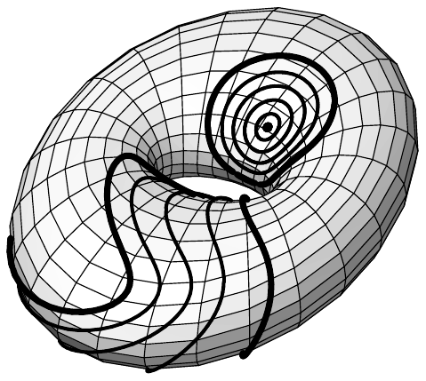
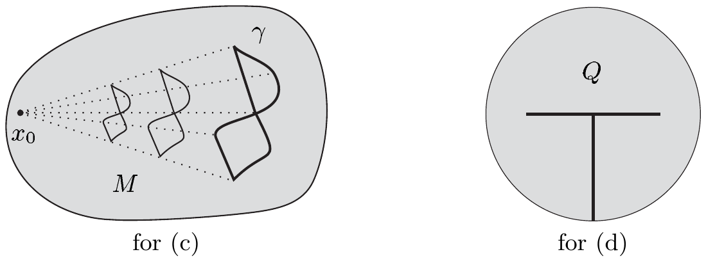
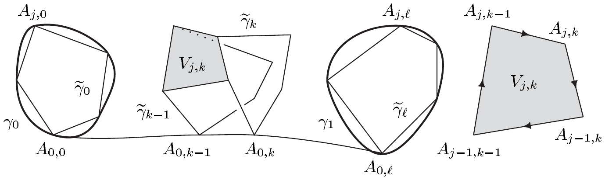

##### 单连通集

下文中，$ M \subset \mathbb{R}^{n} $ 表示一个非空的道路连通集。$ M $ 中的每条闭连续道路都称为 $ M $ 中的一条**闭路**。两条闭路\footnote{容易看出，不失一般性，我们可以把 $ \gamma_{0} $ 与 $ \gamma_{1} $ 定义在同一个参数区间上。特别地，可以取 $ I = [0,1] $。} $ \gamma_{0},\gamma_{1} \in C(I,M) $ 称为**同伦的**，若存在 $ H \in C(I\times[0,1],M) $（一个**（闭路）同伦**），使得
(i) $ H(\cdot,0) = \gamma_{0} $ 且 $ H(\cdot,1) = \gamma_{1} $；
(ii) $ \gamma_{s} := H(\cdot,s) $ 对每个 $ s \in (0,1) $ 都是 $ M $ 中的闭路。

当两条闭路 $ \gamma_{0} $ 与 $ \gamma_{1} $ 同伦时，我们写作 $ \gamma_{0} \sim \gamma_{1} $。对 $ x_{0} \in M $，我们用 $ \gamma_{x_{0}} $ 表示**常值闭路** $ [t \mapsto x_{0}] $。$ M $ 中与常值闭路同伦的每条闭路都是**零伦的**。最后，若 $ M $ 中的每条闭路都是零伦的，则称 $ M $ 是**单连通的**。

4.6 注 (a) 在 $ M $ 中所有闭路之集上，$ \sim $ 是等价关系。

证明 显然每条闭路都与自身同伦，即关系 $ \sim $ 是自反的。
(ii) 设 $ H $ 是从 $ \gamma_{0} $ 到 $ \gamma_{1} $ 的同伦，且

\[ H^{-}(t,s) := H(t,1-s) \quad \text{对 } (t,s) \in I\times[0,1] . \]

则 $ H^{-} $ 是从 $ \gamma_{1} $ 到 $ \gamma_{0} $ 的同伦。因此关系 $ \sim $ 是对称的。
(iii) 最后，设 $ H_{0} $ 是从 $ \gamma_{0} $ 到 $ \gamma_{1} $ 的同伦，设 $ H_{1} $ 是从 $ \gamma_{1} $ 到 $ \gamma_{2} $ 的同伦。我们令

\[ H(t,s) := \begin{cases} H_{0}(t,2s) , & (t,s) \in I\times[0,1/2] ,\\ H_{1}(t,2s-1) , & (t,s) \in I\times[1/2,1] . \end{cases} \]

不难验证 $ H $ 属于 $ C(I\times[0,1],M) $；见习题 III.2.13。又，$ H(\cdot,0) = \gamma_{0} $ 且 $ H(\cdot,1) = \gamma_{2} $，且每个 $ H(\cdot,s) $ 都是 $ M $ 中的闭路。■

(b) 设 $ \gamma $ 是 $ M $ 中的闭路。下列陈述等价：
(i) $ \gamma $ 是零伦的；
(ii) 对某个 $ x_{0} \in M $，$ \gamma \sim \gamma_{x_{0}} $；
(iii) 对每个 $ x \in M $，$ \gamma \sim \gamma_{x} $。

证明 只需验证蕴含“(ii)$ \Rightarrow $(iii)”。为此，设 $ \gamma \in C(I,M) $ 是满足对某个 $ x_{0} \in M $ 有 $ \gamma \sim \gamma_{x_{0}} $ 的闭路。又设 $ x \in M $。因 $ M $ 是道路连通的，存在连接 $ x_{0} $ 与 $ x $ 的连续道路 $ w \in C(I,M) $。我们令

\[ H(t,s) := w(s) \quad \text{对 } (t,s) \in I\times[0,1] , \]

由此我们看到 $ \gamma_{x_{0}} $ 与 $ \gamma_{x} $ 是同伦的。于是由 (a) 即得结论。■

(c) 每个星形集都是单连通的。

证明 设 $ M $ 关于 $ x_{0} $ 星形，且 $ \gamma \in C(I,M) $ 是 $ M $ 中的闭路。我们令

\[ H(t,s) := x_{0} + s\left(\gamma(t) - x_{0}\right) \quad \text{对 } (t,s) \in I\times[0,1] . \]

则 $ H $ 是从 $ \gamma_{x_{0}} $ 到 $ \gamma $ 的同伦。■

(d) 集合 $ Q := \mathbb{B}_{2}\setminus T $，其中 $ T := \left((-1/2,1/2)\times\{0\}\right)\cup\left(\{0\}\times(-1,0)\right) $，是单连通的，但不是星形的。

##### 线积分的同伦不变性

闭普法夫形式的线积分在闭路同伦下不变：

4.7 命题 设 $ \alpha \in \Omega_{(1)}(X) $ 是闭的。设 $ \gamma_{0} $ 与 $ \gamma_{1} $ 是 $ X $ 中同伦的分段 $ C^{1} $ 闭路。则 $ \int_{\gamma_{0}}\alpha = \int_{\gamma_{1}}\alpha $。

证明 (i) 设 $ H \in C(I\times[0,1],X) $ 是从 $ \gamma_{0} $ 到 $ \gamma_{1} $ 的同伦。因 $ I\times[0,1] $ 是紧致的，由定理 III.3.6 知 $ K := H(I\times[0,1]) $ 是紧致的。因 $ X^{c} $ 是闭集且 $ X^{c}\cap K = \varnothing $，根据例 III.3.9(c)，存在 $ \varepsilon > 0 $，使得

\[ |H(t,s) - y| \ge \varepsilon \quad \text{对 } (t,s) \in I\times[0,1] \text{ 且 } y \in X^{c} . \]

定理 III.3.13 保证 $ H $ 是一致连续的。因此存在 $ \delta > 0 $，使得

\[ |H(t,s) - H(\tau,\sigma)| < \varepsilon \quad \text{对 } |t - \tau| < \delta , \quad |s - \sigma| < \delta . \]

(ii) 现在取 $ I $ 的一个划分 $ (t_{0},\ldots,t_{m}) $ 与 $ [0,1] $ 的一个划分 $ (s_{0},\ldots,s_{\ell}) $，二者的细度都 $ < \delta $。令 $ A_{j,k} := H(t_{j},s_{k}) $，我们设

\[ \tilde{\gamma}_{k}(t) := A_{j-1,k} + \frac{t - t_{j-1}}{t_{j} - t_{j-1}}\left(A_{j,k} - A_{j-1,k}\right) \quad \text{对 } t_{j-1} \le t \le t_{j} , \]

$ 1 \le j \le m $，$ 0 \le k \le \ell $。

显然每个 $ \tilde{\gamma}_{k} $ 都是 $ X $ 中的分段 $ C^{1} $ 闭路。$ \delta $ 的选取表明，我们可以在各点 $ A_{j-1,k-1} $ 的凸邻域 $ \mathbb{B}(A_{j-1,k-1},\varepsilon) $ 中应用庞加莱引理。于是由定理 4.4 得

\[ \int_{\partial V_{j,k}}\alpha = 0 \quad \text{对 } 1 \le j \le m \text{ 且 } 1 \le k \le \ell , \]

其中 $ \partial V_{j,k} $ 表示从 $ A_{j-1,k-1} $ 经 $ A_{j,k-1} $、$ A_{j,k} $、$ A_{j-1,k} $ 再回到 $ A_{j-1,k-1} $ 的闭分段直线曲线。因此

\[ \int_{\tilde{\gamma}_{k-1}}\alpha = \int_{\tilde{\gamma}_{k}}\alpha \quad \text{对 } 1 \le k \le \ell , \]

因为积分在 $ \tilde{\gamma}_{k-1} $ 与 $ \tilde{\gamma}_{k} $ 之间的“连接段”上相互抵消。同理，用庞加莱引理我们得到 $ \int_{\tilde{\gamma}_{0}}\alpha = \int_{\gamma_{0}}\alpha $ 与 $ \int_{\tilde{\gamma}_{\ell}}\alpha = \int_{\gamma_{\ell}}\alpha $，这正是命题所要求的。■

作为同伦不变性定理的一个应用，我们现在得到庞加莱引理的一个影响深远的推广。

4.8 定理 设 $ X $ 是 $ \mathbb{R}^{n} $ 中的开集且单连通。若 $ \alpha \in \Omega_{(1)}(X) $ 是闭的，则 $ \alpha $ 是恰当的。

证明 设 $ \gamma $ 是 $ X $ 中的分段 $ C^{1} $ 闭路，且 $ x_{0} \in X $。根据注 4.6(b)，$ \gamma $ 与 $ \gamma_{x_{0}} $ 同伦。于是命题 4.7 与例 4.2(e) 给出 $ \int_{\gamma}\alpha = \int_{\gamma_{x_{0}}}\alpha = 0 $，再由定理 4.4 即得结论。■

4.9 例 (a) “穿孔平面” $ \mathbb{R}^{2}\setminus\{(0,0)\} $ 不是单连通的。

证明 这由定理 4.8 与例 4.2(d) 推出。■

(b) 对 $ n \ge 3 $，集合 $ \mathbb{R}^{n}\setminus\{0\} $ 是单连通的。

证明 见习题 12。■

4.10 注 (a) 设 $ X $ 是 $ \mathbb{R}^{n} $ 中的开集且单连通。又设向量场 $ v = (v_{1},\ldots,v_{n}) \in \mathcal{V}^{1}(X) $ 满足可积性条件 $ \partial_{j}v_{k} = \partial_{k}v_{j} $ 对 $ 1 \le j,k \le n $ 成立。则 $ v $ 有势 $ U $，即 $ v $ 是梯度场。若 $ x_{0} $ 是 $ X $ 中任一点，则 $ U $ 可通过下式计算

\[ U(x) := \int_{0}^{1}\left(v(\gamma_{x}(t))\mid\dot{\gamma}_{x}(t)\right)dt \quad \text{对 } x \in X , \]

其中 $ \gamma_{x} : [0,1] \to X $ 是 $ X $ 中满足 $ \gamma_{x}(0) = x_{0} $ 与 $ \gamma_{x}(1) = x $ 的分段 $ C^{1} $ 道路。

证明 注 3.3(g) 中定义的典范同构 $ \Theta $ 把普法夫形式 $ \alpha := \Theta v \in \Omega_{(1)}(X) $ 赋给 $ v $。因 $ v $ 满足可积性条件，$ \alpha $ 是闭的，从而由定理 4.8 是恰当的。因在推论 4.5 的证明中，我们可以用定理 4.8 取代庞加莱引理，于是，令 $ \Gamma_{x} := [\gamma_{x}] $，

\[ U(x) := \int_{\Gamma_{x}}\alpha \quad \text{对 } x \in X , \]

为 $ \alpha $ 定义了一个势。■

(b) 设 $ \boldsymbol{\alpha} = \sum_{j=1}^{n}a_{j}\,dx^{j} \in \Omega_{(0)}(X) $，令 $ \boldsymbol{a} := \Theta^{-1}\boldsymbol{\alpha} = (\alpha_{1},\ldots,\alpha_{n}) \in \mathcal{V}^{0}(X) $ 为相应的向量场。习惯上把 $ \boldsymbol{\alpha} $ 象征性地写成内积

\[ \boldsymbol{\alpha} = \boldsymbol{a}\cdot ds \]

其中用到了**向量线元** $ ds := (dx^{1},\ldots,dx^{n}) $。于是，根据注 3.3(g)，线积分

\[ \int_{\Gamma}\boldsymbol{a}\cdot ds := \int_{\Gamma}\Theta\boldsymbol{a} \]

对每个向量场 $ \boldsymbol{a} \in \mathcal{V}(X) $ 与 $ X $ 中每条分段 $ C^{1} $ 曲线 $ \Gamma $ 都是良定义的。

(c) 设 $ \boldsymbol{F} $ 是（三维欧几里得）空间的开子集 $ X $ 中的连续力场（例如静电场或引力场）。若一个（小的）试探粒子沿分段 $ C^{1} $ 曲线 $ \Gamma = [\gamma] $ 运动，则 $ \boldsymbol{F} $ 沿 $ \Gamma $ 所做的**功**由线积分给出

\[ \int_{\Gamma}\boldsymbol{F}\cdot ds . \]

特别地，若 $ \gamma $ 是 $ \Gamma $ 的一个分段 $ C^{1} $ 参数化，则

\[ A := \int_{\Gamma}\boldsymbol{F}\cdot ds = \int_{I}\left(F(\gamma(t))\mid\dot{\gamma}(t)\right)dt \]

是柯西–黎曼积分。因此它由黎曼和近似

\[ \sum_{j=1}^{n}F(\gamma(t_{j-1}))\cdot\dot{\gamma}(t_{j-1})(t_{j} - t_{j-1}) , \]

其中 $ \mathfrak{Z} := (t_{0},\ldots,t_{n}) $ 是 $ I $ 的一个适当的划分。因为

\[ \gamma(t_{j}) - \gamma(t_{j-1}) = \dot{\gamma}(t_{j-1})(t_{j} - t_{j-1}) + o(\triangle_{\mathfrak{Z}}) , \]

其中 $ \triangle_{\mathfrak{Z}} $ 是 $ \mathfrak{Z} $ 的细度，而和

\[ \sum_{j=1}^{n}F(\gamma(t_{j-1}))\cdot\left(\gamma(t_{j}) - \gamma(t_{j-1})\right) \]

对细度足够小的划分而言，表示 $ A $ 的一个好的近似，它通过取极限 $ \triangle_{\mathfrak{Z}} \to 0 $ 收敛到 $ A $（见定理 VI.3.4）。内积

\[ F(\gamma(t_{j-1}))\cdot\left(\gamma(t_{j}) - \gamma(t_{j-1})\right) \]

是（常）力 $ F(\gamma(t_{j-1})) $ 对沿从 $ \gamma(t_{j-1}) $ 到 $ \gamma(t_{j}) $ 的直线段移动的粒子所做的功（“功 = 力 $ \times $ 距离”，或更精确地说，“功 = 力 $ \times $ 沿力的方向的位移”）。

若一个力场 $ \boldsymbol{F} $ 有势，则称它是**保守的**。此时，根据例 4.2(c)，功是“与路径无关的”，只依赖于初末位置。若 $ X $ 是单连通的（例如 $ X $ 是全空间）且 $ F $ 有连续导数，则根据 (a) 与定理 4.8，$ \boldsymbol{F} $ 保守当且仅当可积性条件成立。若后者成立，则称该力场是**无旋的**。\footnote{我们将在第 III 卷中澄清这一用语。} ■
