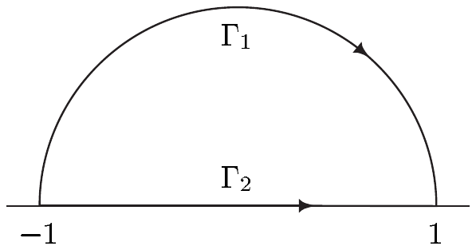

## 5 全纯函数

线积分在复分析——即复函数的理论——中变得尤为有用。借助上一节的结果，我们几乎毫不费力地就能推出（全局的）柯西积分定理与柯西积分公式。这些定理构成复分析的核心，并具有深远而广泛的影响，其中一部分我们将在本节与下一节中看到。

此处，设

• $ U $ 是 $ \mathbb{C} $ 中的集合，且 $ f : U \to \mathbb{C} $ 连续。

同样在本节中，我们常把 $ z \in U $ 与 $ f $ 分解为实部与虚部，即写作

\[ z = x + iy \in \mathbb{R} + i\mathbb{R} \quad \text{且} \quad f(z) = u(x,y) + iv(x,y) \in \mathbb{R} + i\mathbb{R} . \]

##### 复线积分

设 $ I \subset \mathbb{R} $ 是紧致区间，且设 $ \Gamma $ 是 $ U $ 中由

\[ I \to U , \quad t \mapsto z(t) = x(t) + iy(t) . \]

参数化的分段 $ C^{1} $ 曲线。则

\[ \int_{\Gamma} f\,dz := \int_{\Gamma} f(z)\,dz := \int_{\Gamma} u\,dx - v\,dy + i\int_{\Gamma} u\,dy + v\,dx \]

称为 $ f $ 沿 $ \Gamma $ 的**复线积分**。\footnote{在此语境下，曲线 $ \Gamma $ 也可称为\textbf{围道}。}

5.1 注 (a) 我们以 $ \Omega(U,\mathbb{C}) $ 表示**连续复 1-形式**的空间，并将其定义如下：

在乘积群 $ (\Omega_{(0)}(U)\times\Omega_{(0)}(U),+) $ 上，我们定义一个外乘法

\[ C(U,\mathbb{C})\times\left[\Omega_{(0)}(U)\times\Omega_{(0)}(U)\right] \to \Omega_{(0)}(U)\times\Omega_{(0)}(U) , \quad (f,\alpha) \mapsto f\alpha , \]

其中

\[ f\alpha := \left((ua_{1} - vb_{1})\,dx + (ua_{2} - vb_{2})\,dy, (ub_{1} + va_{1})\,dx + (va_{2} + ub_{2})\,dy\right) \]

对 $ \alpha = (a_{1}\,dx + a_{2}\,dy, b_{1}\,dx + b_{2}\,dy) $。于是立刻可验证

\[ \Omega(U,\mathbb{C}) := (\Omega_{(0)}(U)\times\Omega_{(0)}(U),+,\cdot) \]

是 $ C(U,\mathbb{C}) $ 上的自由模。此外，我们有

\[ \begin{aligned} 1(a_{1}\,dx + a_{2}\,dy,0) &= (a_{1}\,dx + a_{2}\,dy,0) , \\ i(a_{1}\,dx + a_{2}\,dy,0) &= (0, a_{1}\,dx + a_{2}\,dy) \end{aligned} \]

对 $ a_{1}\,dx + a_{2}\,dy \in \Omega_{(0)}(U) $。因此我们可将 $ \Omega_{(0)}(U) $ 等同于 $ \Omega(U,\mathbb{C}) $ 中的 $ \Omega_{(0)}(U)\times\{0\} $，并把 $ (a_{1}\,dx + a_{2}\,dy, b_{1}\,dx + b_{2}\,dy) \in \Omega(U,\mathbb{C}) $ 唯一地表示成

\[ a_{1}\,dx + a_{2}\,dy + i(b_{1}\,dx + b_{2}\,dy) , \]

我们通过记号

\[ \Omega(U,\mathbb{C}) = \Omega_{(0)}(U) + i\Omega_{(0)}(U) . \]

来表示。最后，我们有

\[ \begin{aligned} (a_{1} + ib_{1})(dx,0) &= (a_{1}\,dx, b_{1}\,dx) , \\ (a_{2} + ib_{2})(dy,0) &= (a_{2}\,dy, b_{2}\,dy) , \end{aligned} \]

从而

\[ (a_{1} + ib_{1})(dx,0) + (a_{2} + ib_{2})(dy,0) = (a_{1}\,dx + a_{2}\,dy, b_{1}\,dx + b_{2}\,dy) . \]

这意味着我们也可以把 $ (a_{1}\,dx + a_{2}\,dy, b_{1}\,dx + b_{2}\,dy) \in \Omega(U,\mathbb{C}) $ 唯一地写成

\[ (a_{1} + ib_{1})\,dx + (a_{2} + ib_{2})\,dy , \]

即

\[ \Omega(U,\mathbb{C}) = \{\, a\,dx + b\,dy ;\ a,b \in C(U,\mathbb{C}) \,\} . \]

(b) 令 $ u_{x} := \partial_{1}u $ 等，我们把

\[ df := (u_{x} + iv_{x})\,dx + (u_{y} + iv_{y})\,dy \in \Omega(U,\mathbb{C}) \]

称为 $ f $ 的**复微分**。显然，$ dz = dx + i\,dy $，且我们得到\footnote{将 (5.1) 与 $ f $ 的复线积分的定义相比较。}

\[ f\,dz = (u + iv)(dx + i\,dy) = u\,dx - v\,dy + i(u\,dy + v\,dx) \tag{5.1} \]

对 $ f = u + iv \in C(U,\mathbb{C}) $。■

5.2 命题 设 $ \Gamma $ 是由 $ I \to U $，$ t \mapsto z(t) $ 参数化的分段 $ C^{1} $ 曲线。则

(i) $ \int_{\Gamma}f(z)\,dz = \int_{I}f(z(t))\dot{z}(t)\,dt $；

(ii) $ \left|\int_{\Gamma}f(z)\,dz\right| \le \max_{z\in\Gamma}|f(z)|\,L(\Gamma) $。

证明 (i) 对分段 $ C^{1} $ 道路 $ \gamma : I \to \mathbb{R}^{2} $，$ t \mapsto (x(t),y(t)) $，我们有

\[ \begin{aligned} \int_{\Gamma} f\,dz &= \int_{I}\gamma^{*}(u\,dx - v\,dy) + i\int_{I}\gamma^{*}(u\,dy + v\,dx) \\ &= \int_{I}\left[(u\circ\gamma)\dot{x} - (v\circ\gamma)\dot{y}\right]dt + i\int_{I}\left[(u\circ\gamma)\dot{y} + (v\circ\gamma)\dot{x}\right]dt \\ &= \int_{I}(u\circ\gamma + iv\circ\gamma)(\dot{x} + i\dot{y})\,dt \\ &= \int_{I}f(z(t))\dot{z}(t)\,dt . \end{aligned} \]

(ii) 该断言由 (i) 推出：利用定理 1.3 与命题 VI.4.3 估计最后一个积分。■

5.3 例 (a) 设 $ z_{0} \in \mathbb{C} $ 且 $ r > 0 $，并令 $ z(t) := z_{0} + re^{it} $ 对 $ t \in [0,2\pi] $。则对 $ \Gamma := [z] $，我们有

\[ \int_{\Gamma}(z - z_{0})^{m}\,dz = \begin{cases} 0 , & m \in \mathbb{Z}\setminus\{-1\} , \\ 2\pi i , & m = -1 . \end{cases} \]

证明 因为

\[ \int_{\Gamma}(z - z_{0})^{m}\,dz = \int_{0}^{2\pi}r^{m}e^{itm}ire^{it}\,dt = ir^{m+1}\int_{0}^{2\pi}e^{i(m+1)t}\,dt , \]

该断言由指数函数的 $ 2\pi i $-周期性推出。■

(b) 设 $ \Gamma $ 同 (a) 中一样，取 $ z_{0} = 0 $。则对 $ z \in \mathbb{C} $，我们有

\[ \frac{1}{2\pi i}\int_{\Gamma}\lambda^{-k-1}e^{\lambda z}\,d\lambda = \frac{z^{k}}{k!} \quad \text{对 } k \in \mathbb{N} . \]

证明 由习题 4.9 可得

\[ \int_{\Gamma}\lambda^{-k-1}e^{\lambda z}\,d\lambda = \sum_{n=0}^{\infty}\frac{z^{n}}{n!}\int_{\Gamma}\lambda^{n-k-1}\,d\lambda , \]

而该断言由 (a) 推出。■

(c) 设 $ \Gamma $ 是 $ \mathbb{R} $ 中由 $ I \to \mathbb{C} $，$ t \mapsto t $ 参数化的曲线。则

\[ \int_{\Gamma}f(z)\,dz = \int_{I}f(t)\,dt , \]

即在此情形下复线积分与第 VI 章的柯西–黎曼积分一致。

证明 这由命题 5.2(i) 推出。■

(d) 对分别由

\[ [0,\pi] \to \mathbb{C} , \quad t \mapsto e^{i(\pi - t)} , \]

与

\[ [-1,1] \to \mathbb{C} , \quad t \mapsto t , \]

参数化的曲线 $ \Gamma_{1} $ 与 $ \Gamma_{2} $，

我们有

\[ \int_{\Gamma_{1}}|z|\,dz = -i\int_{0}^{\pi}e^{i(\pi - t)}\,dt = e^{i(\pi - t)}\big|_{0}^{\pi} = 2 \]

且

\[ \int_{\Gamma_{2}}|z|\,dz = \int_{-1}^{1}|t|\,dt = 1 . \]

因此复线积分一般依赖于积分路径，而不仅依赖于起点与终点。■

##### 全纯性

**全纯**函数 $ f $ 是具有连续复导数的函数，即 $ f \in C^{1}(U,\mathbb{C}) $。若

\[ U \to \mathbb{R}^{2} , \quad (x,y) \mapsto (u(x,y),v(x,y)) \]

属于 $ C^{1}(U,\mathbb{R}^{2}) $（见节 VII.2），则我们称 $ f $ **连续实可微**。

5.4 注 (a) 在本节末尾我们将证明连续复导数这一假设是不必要的，即每个复可微函数都有连续导数，从而都是全纯的。这里我们采用更强的连续复可微假设，是因为它能让我们更快地到达**复分析**——即复变量的复值函数理论——的基本定理。

(b) 函数 $ f $ 全纯，当且仅当它连续实可微且满足柯西–黎曼方程

\[ u_{x} = v_{y} \quad \text{且} \quad u_{y} = -v_{x} . \]

在此情形下，$ f' = u_{x} + iv_{x} $。

证明 这是定理 VII.2.18 的重新表述。■

(c) 根据注 5.1(b)，我们有

\[ f\,dz = u\,dx - v\,dy + i(u\,dy + v\,dx) . \]

若 $ f $ 全纯，则柯西–黎曼方程表明 1-形式 $ u\,dx - v\,dy $ 与 $ u\,dy + v\,dx $ 都是闭的。

(d) 设 $ U $ 是区域且 $ f $ 全纯。则 $ f $ 为常数当且仅当满足下列条件：\footnote{见习题 V.3.5。}

(i) $ u = \mathrm{const} $；

(ii) $ v = \mathrm{const} $；

(iii) $ \overline{f} $ 全纯；

(iv) $ |f| = \mathrm{const} $。

证明 若 $ f $ 为常数，则 (i)–(iv) 显然成立。

因为 $ f' = u_{x} + iv_{x} $，由柯西–黎曼方程与注 VII.3.11(c) 可得 (i) 或 (ii) 蕴含 $ f $ 为常数。

(iii) 若 $ f $ 与 $ \overline{f} $ 全纯，则 $ u = (f + \overline{f})/2 $ 也全纯。由于 $ \operatorname{Im}(u) = 0 $，由 (ii) 可得 $ u $ 为常数，于是由 (i) 可得 $ f $ 也为常数。

(iv) 只需考虑 $ f \ne 0 $ 的情形。因为 $ |f| $ 为常数，$ f $ 处处不为零。因此 $ 1/f $ 在 $ U $ 上有定义且全纯。于是 $ \overline{f} = |f|^{2}/f $ 在 $ U $ 中也全纯，而该断言由 (iii) 推出。■

##### 柯西积分定理

我们在例 5.3(d) 中已经看到，复线积分一般依赖的不只是积分路径的起点与终点。然而，在被积函数全纯的情形下，前面各节的定理给出下列关于路径无关性的重要结果。

5.5 定理（柯西积分定理）设 $ U $ 单连通且 $ f $ 全纯。则对 $ U $ 中每条闭的分段 $ C^{1} $ 曲线 $ \Gamma $，

\[ \int_{\Gamma}f\,dz = 0 . \]

证明 根据注 5.4(c)，1-形式 $ \alpha_{1} := u\,dx - v\,dy $ 与 $ \alpha_{2} := u\,dy + v\,dx $ 都是闭的。因为 $ U $ 单连通，由定理 4.8 可得 $ \alpha_{1} $ 与 $ \alpha_{2} $ 是恰当的。于是定理 4.4 蕴含

\[ \int_{\Gamma}f\,dz = \int_{\Gamma}\alpha_{1} + i\int_{\Gamma}\alpha_{2} = 0 \]

对 $ U $ 中每条闭的分段 $ C^{1} $ 曲线 $ \Gamma $。■

5.6 定理 设 $ U $ 单连通且 $ f $ 全纯。则 $ f $ 有全纯原函数。$ f $ 的每个原函数 $ \varphi $ 满足

\[ \int_{\Gamma}f\,dz = \varphi(E_{\Gamma}) - \varphi(A_{\Gamma}) \]

对 $ U $ 中每条分段 $ C^{1} $ 曲线 $ \Gamma $。

证明 我们沿用前面证明中的记号。因为 $ \alpha_{1} $ 与 $ \alpha_{2} $ 是恰当的，存在 $ h_{1}, h_{2} \in C^{2}(U,\mathbb{R}) $ 使得 $ dh_{1} = \alpha_{1} $ 且 $ dh_{2} = \alpha_{2} $。由此我们读出

\[ (h_{1})_{x} = u , \quad (h_{1})_{y} = -v , \quad (h_{2})_{x} = v , \quad (h_{2})_{y} = u . \]

因此 $ \varphi := h_{1} + ih_{2} $ 满足柯西–黎曼方程。于是 $ \varphi $ 全纯，且

\[ \varphi' = (h_{1})_{x} + i(h_{2})_{x} = u + iv = f . \]

这表明 $ \varphi $ 是 $ f $ 的原函数。第二个断言由例 4.2(b) 推出。■

5.7 命题 设 $ f $ 全纯，且 $ \gamma_{1} $ 与 $ \gamma_{2} $ 是 $ U $ 中同伦的分段 $ C^{1} $ 闭路。则

\[ \int_{\gamma_{1}}f\,dz = \int_{\gamma_{2}}f\,dz . \]

证明 这由注 5.4(c) 与命题 4.7 推出（也可参见定理 5.5 的证明）。■

##### 圆周的定向

5.8 注 我们回忆记号 $ \mathbb{D}(a,r) = a + r\mathbb{D} $ 表示 $ \mathbb{C} $ 中以 $ a \in \mathbb{C} $ 为圆心、$ r > 0 $ 为半径的开圆盘。下文中，我们以 $ \partial\mathbb{D}(a,r) = a + r\partial\mathbb{D} $ 表示以 $ a $ 为圆心、$ r $ 为半径的**正向圆周**。这意味着 $ \partial\mathbb{D}(a,r) $ 是曲线 $ \Gamma = [\gamma] $，其中 $ \gamma : [0,2\pi] \to \mathbb{C} $，$ t \mapsto a + re^{it} $。在这个定向下，圆周被这样遍历：圆盘 $ \mathbb{D}(a,r) $ 保持在左侧，或者说它被逆时针遍历。这等价于说负单位法向量 $ -\mathbf{n} $ 总是指向外部。

证明 由注 2.5(c) 与 $ \mathbb{C} $ 与 $ \mathbb{R}^{2} $ 的典范等同，可得 Frenet 二标架由 $ \mathbf{e}_{1} = (-\sin,\cos) $ 与 $ \mathbf{e}_{2} = (-\cos,-\sin) $ 给出。令 $ x(t) = a + r(\cos t,\sin t) \in \partial\mathbb{D}(a,r) $，我们有关系式

\[ x(t) + re_{2}(t) = a \quad \text{对 } 0 \le t \le 2\pi . \]

于是 $ e_{2}(t) $ 沿 $ \partial\mathbb{D}(a,r) $ 指向内部，而其负向量指向外部。■

##### 柯西积分公式

全纯函数有引人注目的积分表示，我们在下一个定理中给出。这一公式的含义将在后面的应用中进一步探讨。

5.9 定理（柯西积分公式）设 $ f $ 全纯且 $ \overline{\mathbb{D}}(z_{0},r) \subset U $。则

\[ f(z) = \frac{1}{2\pi i}\int_{\partial\mathbb{D}(z_{0},r)}\frac{f(\zeta)}{\zeta - z}\,d\zeta \quad \text{对 } z \in \mathbb{D}(z_{0},r) . \]

证明 设 $ z \in \mathbb{D}(z_{0},r) $ 且 $ \varepsilon > 0 $。则存在 $ \delta > 0 $ 使得 $ \overline{\mathbb{D}}(z,\delta) \subset U $ 且

\[ |f(\zeta) - f(z)| \le \varepsilon \quad \text{对 } \zeta \in \overline{\mathbb{D}}(z,\delta) . \tag{5.2} \]

我们令 $ \Gamma_{\delta} := \partial\mathbb{D}(z,\delta) $ 且 $ \Gamma := \partial\mathbb{D}(z_{0},r) $。习题 6 表明 $ \Gamma_{\delta} $ 与 $ \Gamma $ 在 $ U\setminus\{z\} $ 中同伦。此外，

\[ U\setminus\{z\} \to \mathbb{C} , \quad \zeta \mapsto 1/(\zeta - z) \]

全纯。因此由命题 5.7 与例 5.3(a) 可得

\[ \int_{\Gamma}\frac{d\zeta}{\zeta - z} = \int_{\Gamma_{\delta}}\frac{d\zeta}{\zeta - z} = 2\pi i . \tag{5.3} \]

因为

\[ U\setminus\{z\} \to \mathbb{C} , \quad \zeta \mapsto (f(\zeta) - f(z))/(\zeta - z) \]

也全纯，由命题 5.7 我们知道

\[ \int_{\Gamma}\frac{f(\zeta) - f(z)}{\zeta - z}\,d\zeta = \int_{\Gamma_{\delta}}\frac{f(\zeta) - f(z)}{\zeta - z}\,d\zeta . \tag{5.4} \]

将 (5.3) 与 (5.4) 结合，我们得到

\[ \begin{aligned} \frac{1}{2\pi i}\int_{\Gamma}\frac{f(\zeta)}{\zeta - z}\,d\zeta &= \frac{1}{2\pi i}\int_{\Gamma}\frac{f(z)}{\zeta - z}\,d\zeta + \frac{1}{2\pi i}\int_{\Gamma}\frac{f(\zeta) - f(z)}{\zeta - z}\,d\zeta \\ &= f(z) + \frac{1}{2\pi i}\int_{\Gamma_{\delta}}\frac{f(\zeta) - f(z)}{\zeta - z}\,d\zeta . \end{aligned} \]

然后命题 5.2(ii) 与 (5.2) 蕴含估计

\[ \left|\frac{1}{2\pi i}\int_{\Gamma_{\delta}}\frac{f(\zeta) - f(z)}{\zeta - z}\,d\zeta\right| \le \frac{\varepsilon}{2\pi\delta}2\pi\delta = \varepsilon , \]

并且我们得到

\[ \left|\frac{1}{2\pi i}\int_{\Gamma}\frac{f(\zeta)}{\zeta - z}\,d\zeta - f(z)\right| \le \varepsilon . \]

因为 $ \varepsilon > 0 $ 是任意的，该断言得证。■

5.10 注 (a) 在定理 5.9 的假设下，我们有

\[ f(z) = \frac{r}{2\pi}\int_{0}^{2\pi}\frac{f(z_{0} + re^{it})}{z_{0} + re^{it} - z}e^{it}\,dt \quad \text{对 } z \in \mathbb{D}(z_{0},r) \]

特别地，

\[ f(z_{0}) = \frac{1}{2\pi}\int_{0}^{2\pi}f(z_{0} + re^{it})\,dt . \]

(b) 若对每个 $ z_{0} \in U $ 都存在 $ r_{0} > 0 $ 使得

\[ f(z_{0}) = \frac{1}{2\pi}\int_{0}^{2\pi}f(z_{0} + re^{it})\,dt \quad \text{对 } r \in [0,r_{0}] , \]

则函数 $ f $ 具有**平均值性质**。

由 (a) 可得全纯函数具有平均值性质。

(c) 若 $ f $ 具有平均值性质，则 $ \operatorname{Re} f $、$ \operatorname{Im} f $、$ \overline{f} $ 以及 $ \lambda f $（$ \lambda \in \mathbb{C} $）也具有平均值性质。若 $ g \in C(U,\mathbb{C}) $ 也具有平均值性质，则 $ f + g $ 也具有平均值性质。

证明 这由定理 III.1.5 与 III.1.10 以及推论 VI.4.10 推出。■

(d) 柯西积分公式对本质上一般的曲线也成立，我们将在下一节证明。■
