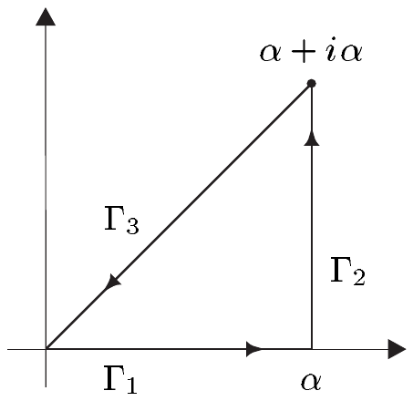

##### 解析函数

作为柯西积分公式的另一推论，我们现在证明基本定理，即全纯函数都是解析的。我们如下进行：设 $ z_{0} \in U $ 且 $ r > 0 $ 满足 $ \overline{\mathbb{D}}(z_{0},r) \subset U $。则函数

\[ \mathbb{D}(z_{0},r) \to \mathbb{C} , \quad z \mapsto f(\zeta)/(\zeta - z) \]

对每个 $ \zeta \in \partial\mathbb{D}(z_{0},r) $ 都是解析的，且可作幂级数展开。借助柯西积分公式，我们可以把这个展开转移到 $ f $ 上。

5.11 定理 函数 $ f $ 是全纯的当且仅当它是解析的。因此

\[ C^{1}(U,\mathbb{C}) = C^{\omega}(U,\mathbb{C}) . \]

证明 (i) 设 $ f $ 是全纯的。令 $ z_{0} \in U $ 且 $ r > 0 $ 满足 $ \overline{\mathbb{D}}(z_{0},r) \subset U $。取 $ z \in \mathbb{D}(z_{0},r) $ 并令 $ r_{0} := |z - z_{0}| $。则 $ r_{0} < r $，且

\[ \frac{|z - z_{0}|}{|\zeta - z_{0}|} = \frac{r_{0}}{r} < 1 \quad \text{对 } \zeta \in \Gamma := \partial\mathbb{D}(z_{0},r) . \]

因此几何级数 $ \sum a^{k} $（其中 $ a := (z - z_{0})/(\zeta - z_{0}) $）收敛，其值为

\[ \sum_{k=0}^{\infty}\left(\frac{z - z_{0}}{\zeta - z_{0}}\right)^{k} = \frac{1}{1 - (z - z_{0})/(\zeta - z_{0})} = \frac{\zeta - z_{0}}{\zeta - z} . \]

于是

\[ \frac{f(\zeta)}{\zeta - z} = \frac{f(\zeta)}{\zeta - z_{0}}\sum_{k=0}^{\infty}\left(\frac{z - z_{0}}{\zeta - z_{0}}\right)^{k} = \sum_{k=0}^{\infty}\frac{f(\zeta)}{(\zeta - z_{0})^{k+1}}(z - z_{0})^{k} . \tag{5.5} \]

因为 $ \Gamma $ 是紧致的，存在 $ M \ge 0 $ 使得对 $ \zeta \in \Gamma $ 有 $ |f(\zeta)| \le M $。由此可得

\[ \left|\frac{f(\zeta)}{(\zeta - z_{0})^{k+1}}(z - z_{0})^{k}\right| \le \frac{M}{r^{k+1}}r_{0}^{k} = \frac{M}{r}\left(\frac{r_{0}}{r}\right)^{k} \quad \text{对 } \zeta \in \Gamma . \]

因为 $ r_{0}/r < 1 $，魏尔斯特拉斯优级数判别法（定理 V.1.6）表明 (5.5) 中的级数关于 $ \zeta \in \Gamma $ 一致收敛。令

\[ a_{k} := \frac{1}{2\pi i}\int_{\Gamma}\frac{f(\zeta)}{(\zeta - z_{0})^{k+1}}\,d\zeta \quad \text{对 } k \in \mathbb{N} , \tag{5.6} \]

由命题 VI.4.1 可得\footnote{另见习题 4.9。}

\[ \begin{aligned} f(z) &= \frac{1}{2\pi i}\int_{\Gamma}\frac{f(\zeta)}{\zeta - z}\,d\zeta = \frac{1}{2\pi i}\int_{\Gamma}\sum_{k=0}^{\infty}\frac{f(\zeta)}{(\zeta - z_{0})^{k+1}}(z - z_{0})^{k}\,d\zeta \\ &= \sum_{k=0}^{\infty}\left[\frac{1}{2\pi i}\int_{\Gamma}\frac{f(\zeta)}{(\zeta - z_{0})^{k+1}}\,d\zeta\right](z - z_{0})^{k} = \sum_{k=0}^{\infty}a_{k}(z - z_{0})^{k} . \end{aligned} \]

因为这对每个 $ z_{0} \in U $ 都成立，我们发现 $ f $ 可在 $ U $ 中每点的邻域内展成收敛幂级数。因此 $ f $ 是解析的。

(ii) 当 $ f $ 是解析的时，它具有连续复导数，从而是全纯的。■

5.12 推论（柯西导数公式）设 $ f $ 是全纯的，$ z \in U $，且 $ r > 0 $ 满足 $ \overline{\mathbb{D}}(z,r) \subset U $。则

\[ f^{(n)}(z) = \frac{n!}{2\pi i}\int_{\partial\mathbb{D}(z,r)}\frac{f(\zeta)}{(\zeta - z)^{n+1}}\,d\zeta \quad \text{对 } n \in \mathbb{N} . \]

证明 由定理 5.11、注 V.3.4(b) 以及解析函数的唯一性定理可得，$ f $ 在 $ \mathbb{D}(z,r) $ 中由它的泰勒级数表示，即 $ f = \mathcal{T}(f,z) $。结论现在由 (5.6) 和幂级数的唯一性定理推出。■

5.13 注 (a) 设 $ f $ 是全纯的，$ z \in U $。则上面的证明表明泰勒级数 $ \mathcal{T}(f,z) $ 至少在完全落在 $ U $ 内的最大圆盘上重现函数 $ f $。

(b) 若 $ f $ 是全纯的，则 $ u $ 与 $ v $ 属于 $ C^{\infty}(U,\mathbb{R}) $。

证明 这由定理 5.11 推出。■

(c) 若 $ f $ 是解析的，则 $ 1/f $ 也是（在 $ U\setminus f^{-1}(0) $ 中）。

证明 由商法则，$ 1/f $ 在 $ U\setminus f^{-1}(0) $ 中有连续导数，因此是全纯的。于是结论由定理 5.11 推出。■

(d) 设 $ V $ 是 $ \mathbb{C} $ 中的开集。若 $ f : U \to \mathbb{C} $ 与 $ g : V \to \mathbb{C} $ 是解析的且 $ f(U) \subset V $，则复合 $ g \circ f : U \to \mathbb{C} $ 也是解析的。

证明 这由链式法则和定理 5.11 推出。■

##### 刘维尔定理

在全部 $ \mathbb{C} $ 上全纯的函数称为**整函数**。

5.14 定理（刘维尔）每个有界整函数都是常值函数。

证明 根据注 5.13(a)，我们有

\[ f(z) = \sum_{k=0}^{\infty}\frac{f^{(k)}(0)}{k!}z^{k} \quad \text{对 } z \in \mathbb{C} . \]

由假设，存在 $ M < \infty $ 使得对 $ z \in \mathbb{C} $ 有 $ |f(z)| \le M $。于是由命题 5.2(ii) 和推论 5.12 可得

\[ \left|\frac{f^{(k)}(0)}{k!}\right| \le \frac{M}{r^{k}} \quad \text{对 } r > 0 . \]

对 $ k \ge 1 $，令 $ r \to \infty $ 取极限即得 $ f^{(k)}(0) = 0 $。因此对每个 $ z \in \mathbb{C} $，$ f(z) $ 等于 $ f(0) $。■

5.15 应用 刘维尔定理给出代数基本定理的一个简单证明，即 $ \mathbb{C}[X] $ 上的每个非常值多项式都有零点。

证明 我们把 $ p \in \mathbb{C}[X] $ 写成 $ p(z) = \sum_{k=0}^{n}a_{k}z^{k} $ 的形式，其中 $ n \ge 1 $ 且 $ a_{n} \ne 0 $。因为

\[ p(z) = z^{n}\left(a_{n} + \frac{a_{n-1}}{z} + \cdots + \frac{a_{0}}{z^{n}}\right) , \]

当 $ |z| \to \infty $ 时有 $ |p(z)| \to \infty $。于是存在 $ R > 0 $ 使得对 $ z \notin R\overline{\mathbb{D}} $ 有 $ |p(z)| \ge 1 $。我们假设 $ p $ 在 $ R\overline{\mathbb{D}} $ 中没有零点。因为 $ R\overline{\mathbb{D}} $ 是紧致的，由极值定理（推论 III.3.8）可得存在正数 $ \varepsilon $ 使得 $ |p(z)| \ge \varepsilon $。因此 $ 1/p $ 是整函数，且对 $ z \in \mathbb{C} $ 满足 $ |1/p(z)| \le \max\{1,1/\varepsilon\} $。刘维尔定理现在推出 $ 1/p $ 是常值的，从而 $ p $ 也是常值的，矛盾。■

##### 菲涅耳积分

柯西积分定理也可用来计算被积函数与全纯函数相关的实积分。我们可以把具有实积分限的积分看作实路径上的复线积分。于是，柯西积分定理所保证的选择积分曲线的更大自由，将使我们能够计算出许多新的积分。

下一个定理展示这一方法，我们将在后续各节中推广这些技巧。从习题中还可以学到更多。

5.16 命题 下列反常菲涅耳积分收敛，并且

\[ \int_{0}^{\infty}\cos(t^{2})\,dt = \int_{0}^{\infty}\sin(t^{2})\,dt = \frac{\sqrt{2\pi}}{4} . \]

证明 这些积分的收敛性由习题 VI.8.7 推出。

考虑整函数 $ z \mapsto e^{-z^{2}} $ 沿闭分段 $ C^{1} $ 曲线 $ \Gamma = \Gamma_{1} + \Gamma_{2} + \Gamma_{3} $ 的积分，该曲线沿直线段从 0 到 $ \alpha > 0 $，再到 $ \alpha + i\alpha $，最后回到 0。

由柯西积分定理，我们有

\[ -\int_{\Gamma_{3}}e^{-z^{2}}\,dz = \int_{\Gamma_{1}}e^{-z^{2}}\,dz + \int_{\Gamma_{2}}e^{-z^{2}}\,dz . \]

应用 VI.9.7 表明

\[ \int_{\Gamma_{1}}e^{-z^{2}}\,dz = \int_{0}^{\alpha}e^{-t^{2}}\,dt \to \int_{0}^{\infty}e^{-t^{2}}\,dt = \frac{\sqrt{\pi}}{2} \quad (\alpha \to \infty) . \]

沿 $ \Gamma_{2} $ 的积分可估计为

\[ \left|\int_{\Gamma_{2}}e^{-z^{2}}\,dz\right| = \left|\int_{0}^{\alpha}e^{-(\alpha + it)^{2}}i\,dt\right| \le \int_{0}^{\alpha}e^{-\operatorname{Re}(\alpha + it)^{2}}\,dt = e^{-\alpha^{2}}\int_{0}^{\alpha}e^{t^{2}}\,dt . \]

注意到

\[ \int_{0}^{\alpha}e^{t^{2}}\,dt \le \int_{0}^{\alpha}e^{\alpha t}\,dt = \frac{1}{\alpha}(e^{\alpha^{2}} - 1) , \]

我们发现

\[ \left|\int_{\Gamma_{2}}e^{-z^{2}}\,dz\right| \le \frac{1}{\alpha}(1 - e^{-\alpha^{2}}) \to 0 \quad (\alpha \to \infty) . \]

于是我们得到

\[ \lim_{\alpha\to\infty}\left(-\int_{\Gamma_{3}}e^{-z^{2}}\,dz\right) = \frac{\sqrt{\pi}}{2} . \tag{5.7} \]

用 $ -\Gamma_{3} $ 的参数化 $ t \mapsto t + it $，我们有

\[ \begin{aligned} -\int_{\Gamma_{3}}e^{-z^{2}}\,dz &= \int_{0}^{\alpha}e^{-(1+i)^{2}t^{2}}(1+i)\,dt = (1+i)\int_{0}^{\alpha}e^{-2it^{2}}\,dt \\ &= (1+i)\left(\int_{0}^{\alpha}\cos(2t^{2})\,dt - i\int_{0}^{\alpha}\sin(2t^{2})\,dt\right) . \end{aligned} \]

由代换 $ \sqrt{2}\,t = \tau $ 和极限 $ \alpha \to \infty $，利用 (5.7) 我们发现

\[ \int_{0}^{\infty}\cos(\tau^{2})\,d\tau - i\int_{0}^{\infty}\sin(\tau^{2})\,d\tau = \frac{\sqrt{2}\sqrt{\pi}}{2(1+i)} = \frac{\sqrt{2\pi}}{4}(1 - i) . ■ \]

##### 最大模原理

我们已经在注 5.10(b) 中看到全纯函数具有平均值性质。特别地，全纯函数 $ f $ 在圆盘中心的绝对值不可能大于 $ f $ 在边界上的最大绝对值。

5.17 定理（广义最大模原理）设函数 $ f $ 具有平均值性质。若 $ |f| $ 在 $ z_{0} \in U $ 处有局部极大值，则 $ f $ 在 $ z_{0} $ 的一个邻域内是常值的。

证明 (i) 情形 $ f(z_{0}) = 0 $ 是显然的。因为 $ f(z_{0}) \ne 0 $，存在 $ c $ 使得 $ |c| = 1 $ 且 $ cf(z_{0}) > 0 $。因为 $ cf $ 也具有平均值性质，我们可以不失一般性地假设 $ f(z_{0}) $ 是正实数。由假设，存在 $ r_{0} > 0 $ 使得 $ \overline{\mathbb{D}}(z_{0},r_{0}) \subset U $ 且对 $ z \in \overline{\mathbb{D}}(z_{0},r_{0}) $ 有 $ |f(z)| \le f(z_{0}) $。此外

\[ f(z_{0}) = \frac{1}{2\pi}\int_{0}^{2\pi}f(z_{0} + re^{it})\,dt \quad \text{对 } r \in [0,r_{0}] . \]

(ii) 函数 $ h : U \to \mathbb{R} $，$ z \mapsto \operatorname{Re} f(z) - f(z_{0}) $ 满足 $ h(z_{0}) = 0 $ 且

\[ h(z) \le |f(z)| - f(z_{0}) \le 0 \quad \text{对 } z \in \mathbb{D}(z_{0},r_{0}) . \]

根据注 5.10(c)，$ h $ 也具有平均值性质。因此

\[ 0 = h(z_{0}) = \frac{1}{2\pi}\int_{0}^{2\pi}h(z_{0} + re^{it})\,dt \quad \text{对 } 0 \le r \le r_{0} . \tag{5.8} \]

因为对 $ r \in [0,r_{0}] $ 和 $ t \in [0,2\pi] $ 有 $ h(z_{0} + re^{it}) \le 0 $，命题 VI.4.8 和 (5.8) 推出 $ h $ 在 $ \mathbb{D}(z_{0},r_{0}) $ 上恒等于零。因此对 $ z \in \mathbb{D}(z_{0},r_{0}) $ 有 $ \operatorname{Re} f(z) = f(z_{0}) $。现在由 $ |f(z)| \le |f(z_{0})| = \operatorname{Re} f(z_{0}) $ 可得 $ \operatorname{Im}(f(z)) = 0 $，因此对每个 $ z \in \mathbb{D}(z_{0},r_{0}) $，$ f(z) $ 等于 $ f(z_{0}) $。■

5.18 推论（最大模原理）设 $ U $ 是连通的，且 $ f $ 具有平均值性质。

(i) 若 $ |f| $ 在 $ z_{0} \in U $ 处有局部极大值，则 $ f $ 是常值的。

(ii) 若 $ U $ 是有界的且 $ f \in C(\overline{U},\mathbb{C}) $，则 $ |f| $ 在 $ \partial U $ 上取到其最大值，即存在 $ z_{0} \in \partial U $ 使得 $ |f(z_{0})| = \max_{z\in\overline{U}}|f(z)| $。

证明 (i) 设 $ f(z_{0}) = w_{0} $ 且 $ M := f^{-1}(w_{0}) $。$ f $ 的连续性表明 $ M $ 在 $ U $ 中是闭的（见例 III.2.22(a)）。根据定理 5.17，每个 $ z_{1} \in M $ 都有一个邻域 $ V $ 使得对 $ z \in V $ 有 $ f(z) = f(z_{0}) = w_{0} $。因此 $ M $ 在 $ U $ 中是开的。于是由注 III.4.3 可得 $ M $ 与 $ U $ 重合。因此对每个 $ z \in U $ 有 $ f(z) = w_{0} $。

(ii) 因为 $ f $ 在紧致集 $ \overline{U} $ 上连续，我们知道 $ |f| $ 在某个点 $ z_{0} \in \overline{U} $ 处取到其最大值。若 $ z_{0} $ 属于 $ \partial U $，则无须证明。若 $ z_{0} $ 落在 $ U $ 内部，则结论由 (i) 推出。■
