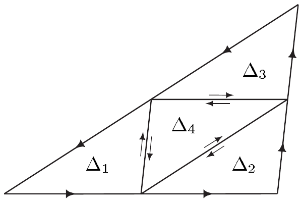

##### 调和函数

设 $ X $ 是 $ \mathbb{R}^{n} $ 中的开集且非空。线性映射

\[ \Delta : C^{2}(X,\mathbb{K}) \to C(X,\mathbb{K}) , \quad f \mapsto \sum_{j=1}^{n}\partial_{j}^{2}f \]

称为 $ X $ 上的**拉普拉斯算子**（**Laplacian**）。若 $ \Delta g = 0 $，则称函数 $ g \in C^{2}(X,\mathbb{K}) $ 在 $ X $ 上**调和**。我们用 $ \mathcal{H}\mathrm{arm}(X,\mathbb{K}) $ 表示 $ X $ 上全体调和函数构成的集合。

5.19 注 (a) 我们有 $ \Delta \in \operatorname{Hom}\left(C^{2}(X,\mathbb{K}),C(X,\mathbb{K})\right) $，且

\[ \mathcal{H}\mathrm{arm}(X,\mathbb{K}) = \Delta^{-1}(0) . \]

因此调和函数构成 $ C^{2}(X,\mathbb{K}) $ 的向量子空间。

(b) 对 $ f \in C^{2}(X,\mathbb{C}) $，我们有

\[ f \in \mathcal{H}\mathrm{arm}(X,\mathbb{C}) \iff \operatorname{Re} f, \operatorname{Im} f \in \mathcal{H}\mathrm{arm}(X,\mathbb{R}) . \]

(c) $ U $ 中每个全纯函数都是调和的，即 $ C^{\omega}(U,\mathbb{C}) \subset \mathcal{H}\mathrm{arm}(U,\mathbb{C}) $。

证明 若 $ f $ 全纯，则由柯西–黎曼方程得

\[ \partial_{x}^{2}f = \partial_{x}\partial_{y}v - i\,\partial_{x}\partial_{y}u , \quad \partial_{y}^{2}f = -\partial_{y}\partial_{x}v + i\,\partial_{y}\partial_{x}u . \]

因此由推论 VII.5.5(ii) 得 $ \Delta f = 0 $。■

(d) $ \mathcal{H}\mathrm{arm}(U,\mathbb{C}) \ne C^{\omega}(U,\mathbb{C}) $。

证明 函数 $ U \to \mathbb{C} $，$ x + iy \mapsto x $ 是调和的但不是全纯的（见注 5.4(b)）。■

前面的讨论表明全纯函数的实部是调和的。下一个定理表明，在单连通区域上，每个调和实值函数都是某个全纯函数的实部。

5.20 命题 设 $ u : U \to \mathbb{R} $ 调和。则我们有如下结论：

(i) 设 $ V := \mathbb{D}(z_{0},r) \subset U $ 对某个 $ (z_{0},r) \in U\times(0,\infty) $ 成立。则存在 $ V $ 中的全纯函数 $ g $ 使得 $ u = \operatorname{Re} g $。

(ii) 若 $ U $ 单连通，则存在 $ g \in C^{\omega}(U,\mathbb{C}) $ 使得 $ u = \operatorname{Re} g $。

证明 由于 $ u $ 调和，1-形式 $ \alpha := -u_{y}\,dx + u_{x}\,dy $ 满足可积性条件。因此 $ \alpha $ 是闭的。

(i) 由于 $ V $ 单连通，定理 4.8 给出存在 $ v \in C^{1}(V,\mathbb{R}) $ 使得 $ dv = \alpha|V $。因此 $ v_{x} = -u_{y}|V $ 且 $ v_{y} = u_{x}|V $。令 $ g(z) := u(x,y) + i\,v(x,y) $，由注 5.4(b) 与定理 5.11 得 $ g $ 属于 $ C^{\omega}(V,\mathbb{C}) $。

(ii) 此时，我们可以把 (i) 的证明中的圆盘 $ V $ 换成 $ U $。■

5.21 推论 设 $ u : U \to \mathbb{R} $ 调和。则

(i) $ u \in C^{\infty}(U,\mathbb{R}) $；

(ii) $ u $ 具有平均值性质；

(iii) 若 $ U $ 是区域且存在 $ U $ 的非空子集 $ V $ 使得 $ u|V = 0 $，则 $ u = 0 $。

证明 (i) 与 (ii) 设 $ V := \mathbb{D}(z_{0},r) \subset U $ 对某个 $ r > 0 $ 成立。由于可微性与平均值性质都是局部性质，只需在 $ V $ 上考虑 $ u $。利用命题 5.20，我们找到 $ g \in C^{\omega}(V,\mathbb{C}) $ 使得 $ \operatorname{Re} g = u|V $，而结论由注 5.13(b) 以及注 5.10(b)、(c) 推出。

(iii) 设 $ M $ 是 $ U $ 中所有这样的 $ z $ 的集合：存在邻域 $ V $ 使得 $ u|V = 0 $。则 $ M $ 是开集，且由假设非空。设 $ z_{0} \in U $ 是 $ M $ 的聚点。由命题 5.20，存在 $ r > 0 $ 与 $ g \in C^{\omega}\left(\mathbb{D}(z_{0},r),\mathbb{C}\right) $ 使得 $ \operatorname{Re} g = u|\mathbb{D}(z_{0},r) $。进一步，由于 $ z_{0} $ 是 $ M $ 的聚点，$ M\cap\mathbb{D}(z_{0},r) $ 非空。对 $ z_{1} \in M\cap\mathbb{D}(z_{0},r) $，存在 $ z_{1} $ 在 $ U $ 中的邻域 $ V $ 使得 $ u|V = 0 $。因此由注 5.4(d) 得 $ g $ 在 $ V\cap\mathbb{D}(z_{0},r) $ 上为常值。于是解析函数的唯一性定理（定理 V.3.13）表明 $ g $ 在 $ \mathbb{D}(z_{0},r) $ 上为常值。因此 $ u = 0 $ 在 $ \mathbb{D}(z_{0},r) $ 上成立，即 $ z_{0} $ 属于 $ M $。从而 $ M $ 在 $ U $ 中闭，而注 III.4.3 给出 $ M = U $。■

5.22 推论（调和函数的极大值极小值原理）设 $ U $ 是区域且 $ u : U \to \mathbb{R} $ 调和。则

(i) 若 $ u $ 在 $ U $ 中有局部极值，则 $ u $ 为常值；

(ii) 若 $ U $ 有界且 $ u \in C(\overline{U},\mathbb{R}) $，则 $ u $ 在 $ \partial U $ 上取到其最大值与最小值。

证明 根据推论 5.21(ii)，$ u $ 具有平均值性质。

(i) 设 $ z_{0} \in U $ 是 $ u $ 的局部极值点。当 $ u(z_{0}) $ 是 $ u $ 的正的极大值时，结论由定理 5.17 与推论 5.18、5.21(iii) 推出。若 $ u(z_{0}) $ 是 $ u $ 的正的极小值，则 $ z \mapsto \left[2u(z_{0}) - u(z)\right] $ 在 $ z_{0} $ 处取得正的极大值，结论如第一种情形那样推出。其余情形可类似处理。

(ii) 这由 (i) 推出。■

5.23 注 (a) 全纯函数的零点集是离散的。\footnote{度量空间 $ X $ 的子集 $ D $ 称为\textbf{离散的}，若每个 $ d \in D $ 在 $ X $ 中有邻域 $ U $ 使得 $ U\cap D = \{d\}$。} 然而，实值调和函数的零点集一般不是离散的。

证明 第一个断言由定理 5.11 与解析函数的唯一性定理（定理 V.3.13）推出。第二个断言通过考虑调和函数 $ \mathbb{C} \to \mathbb{R} $，$ x + iy \mapsto x $ 得到。■

(b) 可以证明，函数调和的当且仅当它具有平均值性质（例如见 [Con78, 定理 X.2.11]）。■

##### 古尔萨定理

现在，正如注 5.4(a) 所承诺的那样，我们来证明每个复可微函数都有连续导数，因而是全纯的。作为准备，我们先证明莫雷拉定理，它给出了判定函数全纯的准则。正如我们将看到的，这一准则在其他地方也有用。

设 $ X \subset \mathbb{C} $。$ X $ 中每条由线段组成且恰好有三条边的闭道路 $ \Delta $，若由 $ \Delta $ 围成的三角形的闭包含于 $ X $，则称为 $ X $ 中的**三角形道路**。

5.24 定理（莫雷拉）设函数 $ f $ 对 $ U $ 中每条三角形道路 $ \Delta $ 满足 $ \int_{\Delta} f\,dz = 0 $。则 $ f $ 是解析的。

证明 设 $ a \in U $ 且 $ r > 0 $ 满足 $ \mathbb{D}(a,r) \subset U $。只需验证 $ f|\mathbb{D}(a,r) $ 是解析的。故设 $ z_{0} \in \mathbb{D}(a,r) $ 且

\[ F : \mathbb{D}(a,r) \to \mathbb{C} , \quad z \mapsto \int_{[[a,z]]}f(w)\,dw . \]

我们的假设给出恒等式

\[ F(z) = \int_{[[a,z_{0}]]}f(w)\,dw + \int_{[[z_{0},z]]}f(w)\,dw = F(z_{0}) + \int_{[[z_{0},z]]}f(w)\,dw . \]

因此

\[ \frac{F(z) - F(z_{0})}{z - z_{0}} - f(z_{0}) = \frac{1}{z - z_{0}}\int_{[[z_{0},z]]}\left(f(w) - f(z_{0})\right)dw \quad \text{对 } z \ne z_{0} . \tag{5.9} \]

现在设 $ \varepsilon > 0 $。则存在 $ \delta \in (0, r - |z_{0} - a|) $ 使得对 $ w \in \mathbb{D}(z_{0},\delta) $ 有 $ |f(w) - f(z_{0})| < \varepsilon $。于是由 (5.9) 可得

\[ \left|\frac{F(z) - F(z_{0})}{z - z_{0}} - f(z_{0})\right| < \varepsilon \quad \text{对 } 0 < |z - z_{0}| < \delta . \]

因此 $ F'(z_{0}) = f(z_{0}) $，这表明 $ F $ 有连续导数。于是定理 5.11 表明 $ F $ 属于 $ C^{\omega}\left(\mathbb{D}(a,r),\mathbb{C}\right) $，从而我们得到 $ F' = f|\mathbb{D}(a,r) $ 属于 $ C^{\omega}\left(\mathbb{D}(a,r),\mathbb{C}\right) $。

5.25 定理（古尔萨）设 $ f $ 可微。则对 $ U $ 中每条三角形道路 $ \Delta $ 有 $ \int_{\Delta} f\,dz = 0 $。

证明 (i) 设 $ \Delta $ 是 $ U $ 中的三角形道路。不失一般性，我们可以假设 $ \Delta $ 围成一个面积为正的三角形。则 $ \Delta $ 有顶点 $ z_{0} $、$ z_{1} $ 与 $ z_{2} $，且 $ z_{2} \in [[z_{0},z_{1}]] $。于是 $ \int_{\Delta} f(z)\,dz = 0 $，这很容易验证。我们用 $ K $ 表示由 $ \Delta $ 围成的三角形的闭包。

通过连接 $ \Delta $ 三边的中点，我们得到 $ K $ 的四个全等闭子三角形 $ K_{1},\ldots,K_{4} $。我们对这些 $ K_{j} $ 的（拓扑）边界定向，使得公共边方向相反，并把所得的三角形道路记为 $ \Delta_{1},\ldots,\Delta_{4} $。则

\[ \left|\int_{\Delta} f(z)\,dz\right| = \left|\sum_{j=1}^{4}\int_{\Delta_{j}}f(z)\,dz\right| \le 4\max_{1\le j\le 4}\left|\int_{\Delta_{j}}f(z)\,dz\right| . \]

在四条三角形道路 $ \Delta_{1},\ldots,\Delta_{4} $ 中，有一条——我们记作 $ \Delta^{1} $——满足

\[ \left|\int_{\Delta^{1}}f(z)\,dz\right| = \max_{1\le j\le 4}\left|\int_{\Delta_{j}}f(z)\,dz\right| . \]

则

\[ \left|\int_{\Delta} f(z)\,dz\right| \le 4\left|\int_{\Delta^{1}}f(z)\,dz\right| . \]

(ii) 对 $ \Delta^{1} $，我们应用与对 $ \Delta $ 相同的分解与选取程序。于是我们归纳地得到三角形道路的序列 $ (\Delta^{n}) $ 以及相应的闭三角形 $ K^{n} $，使得

\[ K^{1} \supset K^{2} \supset \cdots \supset K^{n} \supset \cdots \quad \text{且} \quad \left|\int_{\Delta^{n}}f(z)\,dz\right| \le 4\left|\int_{\Delta^{n+1}}f(z)\,dz\right| \tag{5.10} \]

对 $ n \in \mathbb{N}^{\times} $ 成立。显然 $ \{K^{n} ; n \in \mathbb{N}^{\times}\} $ 具有有限交性质。因此由 $ K^{1} $ 的紧致性得 $ \bigcap_{n}K^{n} $ 非空（见习题 III.3.5）。我们在 $ \bigcap_{n}K^{n} $ 中取定一个 $ z_{0} $。

(iii) (5.10) 中的不等式给出

\[ \left|\int_{\Delta} f(z)\,dz\right| \le 4^{n}\left|\int_{\Delta^{n}}f(z)\,dz\right| . \tag{5.11} \]

此外，我们有初等几何关系

\[ L(\Delta^{n+1}) = L(\Delta^{n})/2 \quad \text{且} \quad \operatorname{diam}(K^{n+1}) = \operatorname{diam}(K^{n})/2 \quad \text{对 } n \in \mathbb{N}^{\times} . \]

由此可得

\[ L(\Delta^{n}) = \ell/2^{n} \quad \text{且} \quad \operatorname{diam}(K^{n}) = d/2^{n} \quad \text{对 } n \in \mathbb{N}^{\times} , \]

其中 $ \ell := L(\Delta) $ 且 $ d := \operatorname{diam}(K) $。

(iv) 设 $ \varepsilon > 0 $。$ f $ 在 $ z_{0} $ 处的可微性给出存在 $ \delta > 0 $ 使得 $ \mathbb{D}(z_{0},\delta) \subset U $ 且

\[ \left|f(z) - f(z_{0}) - f'(z_{0})(z - z_{0})\right| \le \frac{\varepsilon}{d\ell}|z - z_{0}| \quad \text{对 } z \in \mathbb{D}(z_{0},\delta) . \]

现在我们选取 $ n \in \mathbb{N}^{\times} $ 使得 $ \operatorname{diam}(K^{n}) = d/2^{n} < \delta $。由于 $ z_{0} \in K^{n} $，于是有 $ \Delta^{n} \subset \mathbb{D}(z_{0},\delta) $。柯西积分定理给出

\[ 0 = \int_{\Delta^{n}}dz = \int_{\Delta^{n}}z\,dz . \]

从而

\[ \begin{aligned} \left|\int_{\Delta^{n}}f(z)\,dz\right| &= \left|\int_{\Delta^{n}}\left(f(z) - f(z_{0}) - f'(z_{0})(z - z_{0})\right)dz\right| \\ &\le \frac{\varepsilon}{d\ell}\max_{z\in\Delta^{n}}|z - z_{0}|\,L(\Delta^{n}) \le \frac{\varepsilon}{d\ell}\operatorname{diam}(K^{n})L(\Delta^{n}) = \frac{\varepsilon}{4^{n}} . \end{aligned} \]

现在 (5.11) 完成证明。■

5.26 推论 若 $ f $ 可微，则 $ f $ 是全纯的。

证明 这由定理 5.24 与 5.25 推出。■

##### 魏尔斯特拉斯收敛定理

作为莫雷拉定理的进一步应用，我们证明魏尔斯特拉斯关于全纯函数局部一致收敛序列的极限的一个定理。我们已经——结合定理 5.11——在应用 VI.7.23(b) 中运用了这一结果来证明正弦的乘积表示。

5.27 定理（魏尔斯特拉斯收敛定理）设 $ (g_{n}) $ 是 $ U $ 中全纯函数的局部一致收敛序列。则 $ g := \lim g_{n} $ 在 $ U $ 中全纯。

证明 根据定理 V.2.1，$ g $ 连续。由注 V.2.3(c) 我们知道 $ (g_{n}) $ 在 $ U $ 的每个紧致子集上一致收敛。因此 $ (g_{n}) $ 在 $ U $ 中每条三角形道路 $ \Delta $ 上一致收敛于 $ g $。因此由命题 VI.4.1(i) 可得

\[ \int_{\Delta} g\,dz = \lim_{n\to\infty}\int_{\Delta} g_{n}\,dz = 0 , \tag{5.12} \]

其中最后一个等号由应用于 $ g_{n} $ 的柯西积分定理得到。由于 (5.12) 对 $ U $ 中每条三角形道路成立，莫雷拉定理完成证明。■
