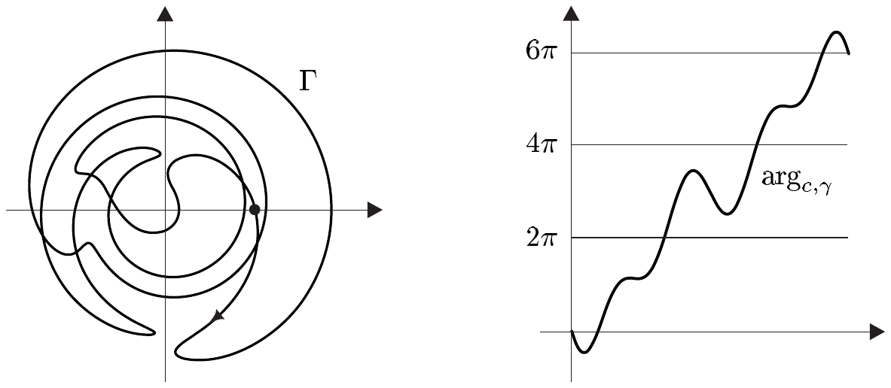
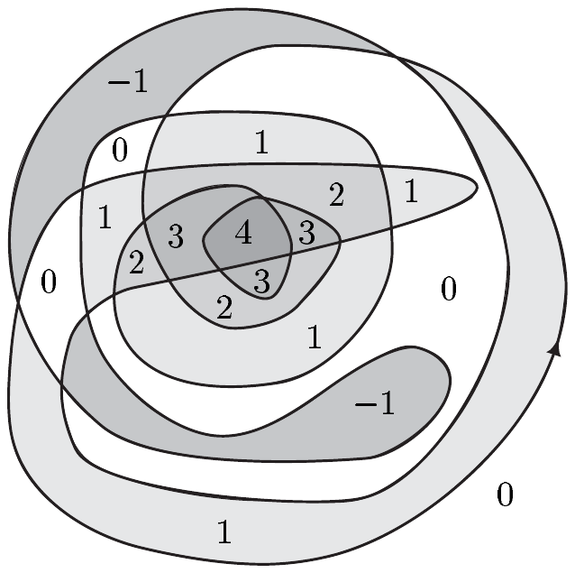

##### 绕数

我们已在上一节看到，全纯函数的线积分的同伦不变性（命题 5.7）可用来有效地计算其他积分。现在我们来对亚纯函数推导类似的结果。为此，我们必须更多地了解极点相对于积分曲线的位置。

在下文中

• $ \Gamma $ 总是 $ \mathbb{C} $ 中的一条闭的紧致分段 $ C^{1} $ 曲线。

对 $ a \in \mathbb{C}\setminus\Gamma $，

\[ w(\Gamma,a) := \frac{1}{2\pi i}\int_{\Gamma}\frac{dz}{z - a} \]

称为 $ \Gamma $ 关于 $ a $ 的**绕数**、**循环数**或**指数**。

6.12 例 (a) 设 $ m \in \mathbb{Z}^{\times} $ 且 $ r > 0 $。则对 $ z_{0} \in \mathbb{C} $，参数化 $ \gamma_{m} : [0,2\pi] \to z_{0} + re^{imt} $ 是一条光滑曲线 $ \Gamma_{m} := \Gamma_{m}(z_{0},r) $ 的参数化，其像是定向圆 $ \partial\mathbb{D}(z_{0},r) $。若 $ m $ 为正 [或负]，则 $ \Gamma_{m} $ 与 $ \partial\mathbb{D}(z_{0},r) $ 定向相同 [或相反]。因此当 $ t $ 从 $ 0 $ 变到 $ 2\pi $ 时，$ \partial\mathbb{D}(z_{0},r) $ 将沿正 [或负] 方向环绕 $ |m| $ 次。基于这些理由，我们称 $ \Gamma_{m} $ 为以 $ z_{0} $ 为中心、以 $ r $ 为半径的 **$ m $ 次遍历圆**。我们有

\[ w(\Gamma_{m},a) = \begin{cases} m , & |a - z_{0}| < r , \\ 0 , & |a - z_{0}| > r . \end{cases} \]

证明 同引理 6.1 的证明一样，在情形 $ |a - z_{0}| < r $ 下可得

\[ \int_{\Gamma_{m}}\frac{dz}{z - a} = \int_{\Gamma_{m}}\frac{dz}{z - z_{0}} = \int_{0}^{2\pi}\frac{i\,mre^{imt}}{re^{imt}}\,dt = 2\pi i m . \]

当 $ |a - z_{0}| > r $ 时，曲线 $ \Gamma_{m} $ 在 $ \mathbb{C}\setminus\{a\} $ 中零伦。■

(b) 对 $ z_{0} \in \mathbb{C} $，设 $ \Gamma_{z_{0}} $ 是像 $ \operatorname{im}(\Gamma_{z_{0}}) = \{z_{0}\} $ 的点曲线。则对 $ a \in \mathbb{C}\setminus\{z_{0}\} $，$ w(\Gamma_{z_{0}},a) = 0 $。

(c) 若 $ \gamma_{1} $ 与 $ \gamma_{2} $ 是 $ U $ 中同伦的分段 $ C^{1} $ 闭路，且 $ a \in U^{c} $，则

\[ w(\Gamma_{1},a) = w(\Gamma_{2},a) \]

其中 $ \Gamma_{1} = [\gamma_{1}] $ 且 $ \Gamma_{2} = [\gamma_{2}] $。

证明 对 $ a \in U^{c} $，函数 $ z \mapsto 1/(z - a) $ 在 $ U $ 中全纯。因此结论由命题 5.7 可得。■

(d) 若 $ U $ 单连通且 $ \Gamma \subset U $，则对 $ a \in U^{c} $，$ w(\Gamma,a) = 0 $。

证明 这由 (b) 和 (c) 可得。■

根据例 6.12(a)，$ m $ 次遍历圆 $ \Gamma_{m} := \Gamma_{m}(z_{0},r) $ 的绕数 $ w(\Gamma_{m},a) $ 是 $ \Gamma_{m} $ “绕”点 $ a $ 的（带符号的）次数。下面我们证明，绕数的这种几何解释对每条闭的分段 $ C^{1} $ 曲线都成立，但我们必须先证明一个技术性结果。

6.13 引理 设 $ I $ 是一个完全紧致区间，且 $ \gamma : I \to \mathbb{C}^{\times} $ 有分段连续导数。则存在一个连续且分段连续可微的函数 $ \varphi : I \to \mathbb{C} $ 使得 $ \exp\circ\varphi = \gamma $。这里，$ \gamma $ 与 $ \varphi $ 在同一个区间 $ I $ 上有连续导数。

证明 (i) 对 $ \alpha \in \mathbb{R} $，我们定义 $ \log_{\alpha} := \operatorname{Log}|\left(\mathbb{C}\setminus\mathbb{R}^{+}e^{i\alpha}\right) $。则由命题 III.6.19 与习题 III.6.9，$ \log_{\alpha} $ 是 $ \mathbb{C}\setminus\mathbb{R}^{+}e^{i\alpha} $ 到 $ \mathbb{R} + i(\alpha,\alpha + 2\pi) $ 上的拓扑映射，且满足

\[ \exp(\log_{\alpha}z) = z \quad \text{对 } z \in \mathbb{C}\setminus\mathbb{R}^{+}e^{i\alpha} . \tag{6.8} \]

由此我们得到（见例 IV.1.13(e)）$ \log_{\alpha} $ 是 $ \mathbb{C}\setminus\mathbb{R}^{+}e^{i\alpha} $ 到 $ \mathbb{R} + i(\alpha,\alpha + 2\pi) $ 上的 $ C^{1} $ 微分同胚，且满足

\[ (\log_{\alpha})'(z) = 1/z \quad \text{对 } z \in \mathbb{C}\setminus\mathbb{R}^{+}e^{i\alpha} . \tag{6.9} \]

(ii) 因为 $ \gamma(I) $ 是紧致的，存在 $ r > 0 $ 使得 $ r\overline{\mathbb{D}}\cap\gamma(I) = \varnothing $。由 $ \gamma $ 的一致连续性，存在 $ I $ 的划分 $ (t_{0},\ldots,t_{m}) $ 使得对 $ 1 \le j \le m $ 有 $ \operatorname{diam}\left(\gamma|[t_{j-1},t_{j}]\right) < r/2 $。因为 $ \gamma $ 有分段连续导数，我们可以选取该划分使得对 $ 1 \le j \le m $，$ \gamma|[t_{j-1},t_{j}] $ 连续可微。因为圆盘 $ D_{j} := \mathbb{D}(\gamma(t_{j}),r) $ 不含零点，我们可以固定一个 $ \alpha_{j} \in (-\pi,\pi) $ 使得对 $ 1 \le j \le m $ 有 $ \mathbb{R}^{+}e^{i\alpha_{j}}\cap\overline{D}_{j} = \varnothing $。然后我们令 $ \log_{j} := \log_{\alpha_{j}} $ 与 $ \varphi_{j} := \log_{j}\circ\gamma|[t_{j-1},t_{j}] $。由 (i)，我们知道 $ \varphi_{j} $ 属于 $ C^{1}\left([t_{j-1},t_{j}]\right) $，又因为对 $ t \in [t_{j-1},t_{j}] $ 有 $ \gamma(t) \in D_{j}\cap D_{j+1} $，利用 (6.8) 我们得到

\[ \exp\left(\varphi_{j}(t_{j})\right) = \gamma(t_{j}) = \exp\left(\varphi_{j+1}(t_{j})\right) \quad \text{对 } 1 \le j \le m - 1 . \]

因此，命题 III.6.13 与指数函数的加法定理保证存在 $ k_{j} \in \mathbb{Z} $ 使得

\[ \varphi_{j}(t_{j}) - \varphi_{j+1}(t_{j}) = 2\pi ik_{j} \quad \text{对 } 1 \le j \le m - 1 . \tag{6.10} \]

现在我们定义 $ \varphi : I \to \mathbb{C} $ 为

\[ \varphi(t) := \varphi_{j}(t) + 2\pi i\sum_{n=0}^{j-1}k_{n} \quad \text{对 } t_{j-1} \le t \le t_{j} \text{ 且 } 1 \le j \le m , \tag{6.11} \]

其中 $ k_{0} := 0 $。则由 (6.10) 以及 $ \log_{j} $ 与 $ \gamma|[t_{j-1},t_{j}] $ 的连续可微性可得，$ \varphi $ 有分段连续导数。最后，由 (6.8)、$ \varphi_{j} $ 的定义以及指数函数的 $ 2\pi i $ 周期性，我们得到 $ \exp\circ\varphi = \gamma $。■

6.14 定理 对每个 $ a \in \mathbb{C}\setminus\Gamma $，指数 $ w(\Gamma,a) $ 是整数。

证明 设 $ \gamma $ 是 $ \Gamma $ 的一个分段 $ C^{1} $ 参数化，且 $ (t_{0},\ldots,t_{m}) $ 是参数区间 $ I $ 的划分，使得对 $ 1 \le j \le m $，$ \gamma|[t_{j-1},t_{j}] $ 连续可微。则根据引理 6.13，对 $ a \in \mathbb{C}\setminus\Gamma $ 存在一个 $ \varphi \in C(I) $ 使得对 $ 1 \le j \le m $ 有 $ \varphi|[t_{j-1},t_{j}] \in C^{1}[t_{j-1},t_{j}] $，且 $ e^{\varphi} = \gamma - a $。由此可得，对 $ t_{j-1} \le t \le t_{j} $ 与 $ 1 \le j \le m $ 有 $ \dot\gamma(t) = \dot\varphi(t)\left(\gamma(t) - a\right) $。因此我们得到

\[ \int_{\Gamma}\frac{dz}{z - a} = \sum_{j=1}^{m}\int_{t_{j-1}}^{t_{j}}\frac{\dot\gamma(t)\,dt}{\gamma(t) - a} = \sum_{j=1}^{m}\int_{t_{j-1}}^{t_{j}}\dot\varphi(t)\,dt = \varphi(t_{m}) - \varphi(t_{0}) . \tag{6.12} \]

因为 $ \Gamma $ 是闭的，我们有

\[ \exp\left(\varphi(t_{m})\right) = E_{\Gamma} - a = A_{\Gamma} - a = \exp\left(\varphi(t_{0})\right) , \]

因此根据命题 III.6.13(i)，$ \varphi(t_{m}) - \varphi(t_{0}) \in 2\pi i\mathbb{Z} $。所以 $ w(\Gamma,a) $ 是整数。■

6.15 注 (a) 设引理 6.13 的假设满足。用其证明中的记号，对 $ 1 \le j \le m $ 与 $ t \in [t_{j-1},t_{j}] $，我们用 $ \arg_{j}(\gamma(t)) $ 记满足 $ \operatorname{Im}(\varphi_{j}(t)) = \eta $ 的唯一数 $ \eta \in (\alpha_{j},\alpha_{j} + 2\pi) $。则由

\[ e^{\log|\gamma(t)|} = |\gamma(t)| = |e^{\varphi(t)}| = e^{\operatorname{Re}\varphi(t)} \]

可得

\[ \varphi_{j}(t) = \log_{j}\gamma(t) = \log|\gamma(t)| + i\arg_{j}(\gamma(t)) \tag{6.13} \]

对 $ t_{j-1} \le t \le t_{j} $ 与 $ 1 \le j \le m $ 成立。现在我们令

\[ \arg_{c,\gamma}(t) := \arg_{j}(\gamma(t)) + 2\pi\sum_{n=0}^{j-1}k_{n} \]

对 $ t_{j-1} \le t \le t_{j} $ 与 $ 1 \le j \le m $ 成立。则 (6.11) 与 (6.13) 蕴含

\[ \varphi = \log\circ|\gamma| + i\arg_{c,\gamma} . \tag{6.14} \]

因为 $ \varphi $ 分段连续可微，(6.14) 表明这对 $ \arg_{c,\gamma} $ 也成立，其中 $ \arg_{c,\gamma} $ 与 $ \gamma $ 在 $ I $ 的相同子区间上连续可微。换言之，$ \arg_{c,\gamma} $ 是一个分段连续可微函数，它“从”集值函数 $ \operatorname{Arg}\circ\gamma $ “选取”，即

\[ \arg_{c,\gamma} \in \operatorname{Arg}(\gamma(t)) \quad \text{对 } t \in I . \]

同样，$ \varphi $ 是集值对数 $ \operatorname{Log}\circ\gamma $ 的一个分段连续可微的“选取”。

(b) 设 $ \gamma $ 是 $ \Gamma $ 的一个分段 $ C^{1} $ 参数化，且 $ a \in \mathbb{C}\setminus\Gamma $。又设

\[ \varphi = \log\circ|\gamma - a| + i\arg_{c,\gamma-a} \]

是 $ \operatorname{Log}\circ(\gamma - a) $ 的一个分段 $ C^{1} $ 选取，其中对 $ 1 \le j \le m $，$ \varphi $ 属于 $ C^{1}[t_{j-1},t_{j}] $。则我们有

\[ \int_{t_{j-1}}^{t_{j}}\dot\varphi(t)\,dt = \log\circ|\gamma - a|\big|_{t_{j-1}}^{t_{j}} + i\arg_{c,\gamma-a}\big|_{t_{j-1}}^{t_{j}} = \varphi(t_{j}) - \varphi(t_{j-1}) . \]

因为 $ \log|\gamma(t_{m}) - a| = \log|\gamma(t_{0}) - a| $，因此由 (6.12) 可得

\[ w(\Gamma,a) = \frac{1}{2\pi i}\int_{\Gamma}\frac{dz}{z - a} = \frac{1}{2\pi}\left(\arg_{c,\gamma-a}(t_{m}) - \arg_{c,\gamma-a}(t_{0})\right) . \]

这表明 $ \Gamma $ 关于 $ a $ 的绕数的 $ 2\pi $ 倍是当 $ \Gamma $ 从 $ \gamma(t_{0}) $ 走到 $ \gamma(t_{m}) $ 时 $ \gamma - a $ 的辐角 $ \arg_{c,\gamma-a} $ 的“累积改变”。因此 $ w(\Gamma,a) $ 刻画了 $ \Gamma $ 绕点 $ a $ 的次数，其中 $ w(\Gamma,a) > 0 $ 表示它逆时针绕行，$ w(\Gamma,a) < 0 $ 表示它顺时针绕行。■

一条绕数 $ w(\Gamma,0) = 3 $ 的曲线

##### 绕数的连续性

我们首先对离散空间中的映射证明一个简单的引理。

6.16 引理 设 $ X $ 与 $ Y $ 是度量空间且 $ Y $ 离散。若 $ f : X \to Y $ 连续，则 $ f $ 在 $ X $ 的每个连通分支上为常数。

证明 设 $ Z $ 是 $ X $ 的一个连通分支。由定理 III.4.5，$ f(Z) $ 连通。因为 $ Y $ 离散，$ Y $ 的每个连通分支恰好由一个点构成。因此 $ f $ 在 $ Z $ 上为常数。■

因为 $ \Gamma $ 紧致，存在 $ R > 0 $ 使得 $ \Gamma \subset R\mathbb{D} $。因此 $ \mathbb{C}\setminus\Gamma $ 包含集合 $ R\mathbb{D}^{c} $，这表明 $ \mathbb{C}\setminus\Gamma $ 恰有一个无界连通分支。

6.17 推论 映射 $ w(\Gamma,\cdot) : \mathbb{C}\setminus\Gamma \to \mathbb{Z} $ 在每个连通分支上为常数。若 $ a $ 属于 $ \mathbb{C}\setminus\Gamma $ 的无界连通分支，则 $ w(\Gamma,a) = 0 $。

证明 设 $ a \in \mathbb{C}\setminus\Gamma $，并定义 $ d := d(a,\Gamma) $。然后我们选取一个 $ \varepsilon > 0 $ 并定义 $ \delta := \min\{\varepsilon\pi d^{2}\backslash L(\Gamma),d/2\} $。则我们有

\[ |z - a| \ge d > 0 \quad \text{且}\quad |z - b| \ge d/2 \quad \text{对 } z \in \Gamma \text{ 且 } b \in \mathbb{D}(a,\delta) . \]

由此可得

\[ |w(\Gamma,a) - w(\Gamma,b)| \le \frac{1}{2\pi}\int_{\Gamma}\left|\frac{a - b}{(z - a)(z - b)}\right|dz < \frac{1}{2\pi}L(\Gamma)\frac{2}{d^{2}}\delta \le \varepsilon \]

对 $ b \in \mathbb{D}(a,\delta) $ 成立。因为 $ \varepsilon $ 是任意的，$ w(\Gamma,\cdot) $ 在 $ a \in \mathbb{C}\setminus\Gamma $ 处连续。第一个陈述现在由定理 6.14 与引理 6.16 可得。

以 $ Z $ 记 $ \mathbb{C}\setminus\Gamma $ 的无界连通分支。又设已选取 $ R > 0 $ 使得 $ Z $ 包含集合 $ R\mathbb{D}^{c} $。最后，我们选取 $ a \in Z $ 使得 $ |a| > R $ 且 $ |a| > L(\Gamma)/\pi + \max\{|z| ; z \in \Gamma\} $。则我们有

\[ |w(\Gamma,a)| \le \frac{1}{2\pi}\int_{\Gamma}\frac{dz}{|z - a|} < \frac{1}{2} . \]

因为 $ w(\Gamma,a) \in \mathbb{Z} $，我们有 $ w(\Gamma,a) = 0 $，因此对每个 $ b \in Z $ 有 $ w(\Gamma,b) = 0 $。■

6.18 推论 设 $ f $ 在 $ U $ 中亚纯，且对 $ a \in U^{c} $ 有 $ w(\Gamma,a) = 0 $。则 $ \{z \in P(f)\setminus\Gamma ; w(\Gamma,z) \ne 0\} $ 是有限集。

证明 由推论 6.17，$ B := \{z \in U\setminus\Gamma ; w(\Gamma,z) \ne 0\} $ 有界。当 $ B\cap P(f) $ 不是有限集时，该集合有聚点 $ z_{0} \in \overline{B} $。根据注 6.7(b)，$ P(f) $ 在 $ U $ 中有聚点，因此 $ z_{0} $ 属于 $ U^{c} $。于是由假设，$ w(\Gamma,z_{0}) = 0 $。另一方面，由 $ w(\Gamma,\cdot) $ 的连续性与 $ w(\Gamma,B) \subset \mathbb{Z}^{\times} $ 可得，$ w(\Gamma,z_{0}) $ 异于零。因此 $ B\cap P(f) $ 是有限集。■
