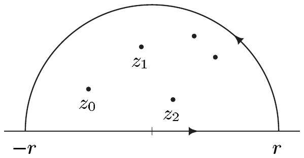
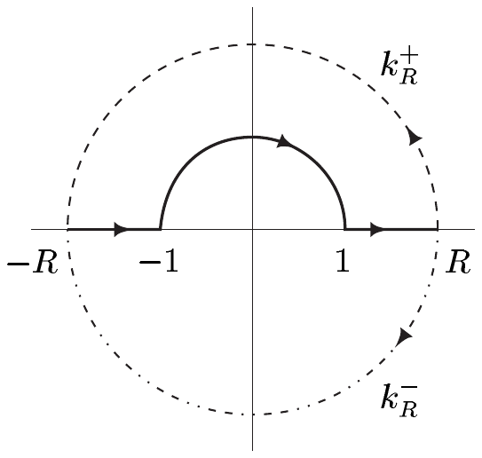

##### 广义柯西积分定理

绕数的概念使我们得以扩展柯西积分定理与柯西积分公式的适用范围。我们先给出一个引理。

6.19 引理 设 $ f : U \to \mathbb{C} $ 全纯且 $ \Gamma \subset U $。

(i) 函数

\[ g : U\times U \to \mathbb{C} , \quad (z,w) \mapsto \begin{cases} (f(w) - f(z))/(w - z) , & z \ne w , \\ f'(z) , & z = w , \end{cases} \]

是连续的。

(ii) 映射

\[ h : U \to \mathbb{C} , \quad z \mapsto \int_{\Gamma}g(z,w)\,dw \]

是解析的。

证明 (i) 显然，$ g $ 在满足 $ z \ne w $ 的每个点 $ (z,w) $ 处连续。

设 $ z_{0} \in U $ 且 $ \varepsilon > 0 $。则存在 $ r > 0 $ 使得 $ \mathbb{D}(z_{0},r) \subset U $ 且对 $ \zeta \in \mathbb{D}(z_{0},r) $ 有 $ |f'(\zeta) - f'(z_{0})| < \varepsilon $。对 $ z,w \in \mathbb{D}(z_{0},r) $ 与 $ \gamma(t) := (1 - t)z + tw $（其中 $ t \in [0,1] $），由 $ \operatorname{im}(\gamma) \subset \mathbb{D}(z_{0},r) $ 与中值定理可得

\[ g(z,w) - g(z_{0},z_{0}) = \int_{0}^{1}\left[f'(\gamma(t)) - f'(z_{0})\right]dt . \]

因此 $ |g(z,w) - g(z_{0},z_{0})| < \varepsilon $，这表明 $ g $ 在 $ (z_{0},z_{0}) $ 处连续。

(ii) 由 (i)，$ h $ 是良定义的。我们将借助莫雷拉定理（定理 5.24）验证 $ h $ 是解析的。设 $ \Delta $ 是 $ U $ 中的三角形道路。由习题 5.11 可得\footnote{这是富比尼定理的一个初等版本，将在第 III 卷中以完全一般的形式证明。另见习题 5.12。}

\[ \int_{\Delta}\left(\int_{\Gamma}g(z,w)\,dw\right)dz = \int_{\Gamma}\left(\int_{\Delta}g(z,w)\,dz\right)dw . \tag{6.15} \]

此外，引理 6.2 的证明表明，对每个 $ w \in U $，$ g(\cdot,w) $ 属于 $ C^{\omega}(U) $。因此由定理 5.25 可得，对 $ w \in \Gamma $ 有 $ \int_{\Delta}g(z,w)\,dz = 0 $，并由 (6.15) 得到 $ \int_{\Delta}h(z)\,dz = 0 $。因此 $ h $ 是解析的。■

称 $ U $ 中的曲线 $ \Gamma $ **在 $ U $ 中同调于零**，如果它是闭的、分段连续可微的，并且对 $ a \in U^{c} $ 有 $ w(\Gamma,a) = 0 $。\footnote{当 $ U = \mathbb{C} $ 时，每条闭的分段 $ C^{1} $ 曲线都同调于零。}

6.20 定理（柯西积分定理与柯西积分公式的同调版本）设 $ U $ 是 $ \mathbb{C} $ 中的开集且 $ f $ 在 $ U $ 中全纯。若曲线 $ \Gamma $ 在 $ U $ 中同调于零，则

\[ \frac{1}{2\pi i}\int_{\Gamma}\frac{f(\zeta)}{\zeta - z}\,d\zeta = w(\Gamma,z)f(z) \quad \text{对 } z \in U\setminus\Gamma , \tag{6.16} \]

且

\[ \int_{\Gamma}f(z)\,dz = 0 . \tag{6.17} \]

证明 我们沿用引理 6.19 的记号。

(i) 显然，(6.16) 等价于陈述

\[ h(z) = 0 \quad \text{对 } z \in U\setminus\Gamma . \tag{6.18} \]

为验证这一点，设 $ U_{0} := \{z \in \mathbb{C}\setminus\Gamma ; w(\Gamma,z) = 0\} $ 且

\[ h_{0}(z) := \frac{1}{2\pi i}\int_{\Gamma}\frac{f(\zeta)}{\zeta - z}\,d\zeta \quad \text{对 } z \in U_{0} . \]

根据定理 6.14，且由于 $ w(\Gamma,\cdot) $ 连续，$ U_{0} $ 是开集。我们还有

\[ h_{0}(z) = \frac{1}{2\pi i}\int_{\Gamma}\frac{f(\zeta)}{\zeta - z}\,d\zeta - f(z)w(\Gamma,z) = h(z) \quad \text{对 } z \in U\cap U_{0} . \]

由于 $ h_{0} $ 全纯，解析函数的唯一性定理（定理 V.3.13）表明，存在一个在 $ U\cup U_{0} $ 上全纯的函数 $ H $，使得 $ H \supset h_{0} $ 且 $ H \supset h $。由假设，对 $ a \in U^{c} $ 有 $ w(\Gamma,a) = 0 $。于是 $ U^{c} $ 属于 $ U_{0} $，从而得知 $ H $ 是整函数。

(ii) 设 $ R > 0 $ 且 $ \Gamma \subset R\mathbb{D} $。由于 $ R\mathbb{D}^{c} $ 位于 $ \mathbb{C}\setminus\Gamma $ 的无界连通分支中，我们有 $ R\mathbb{D}^{c} \subset U_{0} $。现设 $ \varepsilon > 0 $。令 $ M := \max_{\zeta\in\Gamma}|f(\zeta)| $ 且 $ R' := R + L(\Gamma)M/2\pi\varepsilon $。对 $ z \in R'\mathbb{D}^{c} $，我们便有

\[ |\zeta - z| \ge |z| - |\zeta| > L(\Gamma)M/2\pi\varepsilon \quad \text{对 } \zeta \in \Gamma , \]

并且我们得到

\[ |h_{0}(z)| \le \frac{1}{2\pi}\int_{\Gamma}\left|\frac{f(\zeta)}{\zeta - z}\right|d\zeta < \varepsilon \quad \text{对 } z \in R'\mathbb{D}^{c} . \tag{6.19} \]

由于 $ h_{0} \subset H $，且 $ H $ 作为整函数在有界集上有界，由此可得 $ H $ 在整个 $ \mathbb{C} $ 上有界。因此由刘维尔定理与 (6.19) 可得 $ H $ 处处为零。现在 $ h \subset H $ 蕴含 (6.18)。

(iii) 设 $ a \in \mathbb{C}\setminus\Gamma $ 且

\[ F : U \to \mathbb{C} , \quad z \mapsto (z - a)f(z) . \]

由于 $ F $ 全纯且 $ F(a) = 0 $，(6.16) 表明

\[ \frac{1}{2\pi i}\int_{\Gamma}f(z)\,dz = \frac{1}{2\pi i}\int_{\Gamma}\frac{F(z)}{z - a}\,dz = w(\Gamma,a)F(a) = 0 . ■ \]

6.21 注 (a) 若 $ U $ 单连通，则每条闭的分段 $ C^{1} $ 曲线都在 $ U $ 中同调于零。于是定理 6.20 是定理 5.5 与 5.9 的推广。

证明 这由例 6.12(d) 推出。■

(b) 在定理 6.20 的假设下，我们有广义柯西导数公式

\[ w(\Gamma,z)f^{(k)}(z) = \frac{k!}{2\pi i}\int_{\Gamma}\frac{f(\zeta)}{(\zeta - z)^{k+1}}\,d\zeta \quad \text{对 } z \in U\setminus\Gamma , \quad k \in \mathbb{N} . \]

证明 这由定理 6.20 容易推出。■

##### 留数定理

下一个定理把柯西积分定理的同调版本进一步推广到亚纯函数的情形。

6.22 定理（留数定理）设 $ U $ 是 $ \mathbb{C} $ 中的开集且 $ f $ 在 $ U $ 中亚纯。又设 $ \Gamma $ 是 $ U\setminus P(f) $ 中在 $ U $ 中同调于零的曲线。则

\[ \int_{\Gamma}f(z)\,dz = 2\pi i\sum_{p\in P(f)}\operatorname{Res}(f,p)w(\Gamma,p) , \tag{6.20} \]

其中和式中只有有限多项不等于零。

证明 由推论 6.18 我们知道 $ A := \{a \in P(f) ; w(\Gamma,a) \ne 0\} $ 是有限集。于是 (6.20) 中的和式只有有限多项不等于零。

设 $ A = \{a_{0},\ldots,a_{m}\} $，且对 $ 0 \le j \le m $，$ f_{j} $ 是 $ f $ 在 $ a_{j} $ 处洛朗展开的主部。则 $ f_{j} $ 在 $ \mathbb{C}\setminus\{a_{j}\} $ 中全纯，并且 $ F := f - \sum_{j=0}^{m}f_{j} $ 在 $ a_{0},\ldots,a_{m} $ 处的奇点都是可去的（因为 $ F $ 在 $ a_{j} $ 处局部具有形式

\[ F = g_{j} - \sum_{\substack{k=0 \\ k \ne j}}^{m}f_{j} \]

其中 $ g_{j} $ 是 $ f $ 在 $ a_{j} $ 处的正则部）。因此，由黎曼可去奇点定理，$ F $ 在

\[ U_{0} := U\setminus\left(P(f)\setminus A\right) = A\cup\left(U\setminus P(f)\right) . \]

上有全纯延拓（仍记作 $ F $）。由于 $ \Gamma $ 位于 $ U\setminus P(f) $ 中且在 $ U $ 中同调于零，$ \Gamma $ 位于 $ U_{0} $ 中且在其中同调于零。因此由广义柯西积分定理可得 $ \int_{\Gamma}F\,dz = 0 $，这蕴含

\[ \int_{\Gamma}f\,dz = \sum_{j=0}^{m}\int_{\Gamma}f_{j}\,dz . \tag{6.21} \]

由于 $ a_{j} $ 是 $ f $ 的极点，存在 $ n_{j} \in \mathbb{N}^{\times} $ 与 $ c_{jk} \in \mathbb{C} $（对 $ 1 \le k \le n_{j} $ 与 $ 0 \le j \le m $）使得

\[ f_{j}(z) = \sum_{k=1}^{n_{j}}c_{jk}(z - a_{j})^{-k} \quad \text{对 } 0 \le j \le m . \]

因此由注 6.21(b)（取 $ f = \mathbf{1} $）可得

\[ \int_{\Gamma}f_{j}\,dz = \sum_{k=1}^{n_{j}}c_{jk}\int_{\Gamma}\frac{dz}{(z - a_{j})^{k}} = 2\pi i\,c_{j1}w(\Gamma,a_{j}) . \]

由于 $ c_{j1} = \operatorname{Res}(f,a_{j}) $，利用 $ A $ 的定义，结论由 (6.21) 推出。■

##### 傅里叶积分

留数定理有许多重要应用，我们现在通过计算若干反常积分来举例说明。我们集中于一个特别重要的类，即傅里叶积分。

设 $ f : \mathbb{R} \to \mathbb{C} $ 绝对可积。对 $ p \in \mathbb{R} $，有 $ |e^{-ipx}| = 1 $（对 $ x \in \mathbb{R} $），因此函数 $ x \mapsto e^{-ipx}f(x) $ 绝对可积。于是 $ f $ 在 $ p $ 处的**傅里叶积分**，由

\[ \widehat{f}(p) := \int_{-\infty}^{\infty}e^{-ipx}f(x)\,dx \in \mathbb{C} , \tag{6.22} \]

给出，对每个 $ p \in \mathbb{R} $ 都有定义。通过 (6.22) 定义的函数 $ \widehat{f} : \mathbb{R} \to \mathbb{C} $ 称为 $ f $ 的**傅里叶变换**。

下一个定理与随后的例子表明，留数定理有助于计算许多傅里叶变换。

6.23 命题 设 $ \mathbb{C} $ 上的亚纯函数 $ f $ 具有下列性质

(i) $ P(f) $ 有限，

(ii) $ P(f)\cap\mathbb{R} = \varnothing $，

(iii) $ \lim_{|z|\to\infty}zf(z) = 0 $。

则

\[ \widehat{f}(p) = \begin{cases} -2\pi i\sum_{\substack{z\in P(f) \\ \operatorname{Im} z < 0}}\operatorname{Res}(f e^{-ip\cdot},z) , & p \ge 0 , \\ 2\pi i\sum_{\substack{z\in P(f) \\ \operatorname{Im} z > 0}}\operatorname{Res}(f e^{-ip\cdot},z) , & p \le 0 . \end{cases} \]

证明 设 $ p \le 0 $。由假设 (i)，存在 $ r > 0 $ 使得 $ P(f) \subset r\mathbb{D} $。我们选取 $ \Gamma $ 作为 $ V := r\mathbb{D}\cap\{z \in \mathbb{C} ; \operatorname{Im} z > 0\} $ 的正向边界。

于是我们有

\[ w(\Gamma,z) = \begin{cases} 1 , & z \in V , \\ 0 , & z \in \left(\overline{V}\right)^{c} , \end{cases} \]

（见习题 13）。因此由留数定理可得

\[ \int_{-r}^{r}f(x)e^{-ipx}\,dx + i\int_{0}^{\pi}f(re^{it})e^{-ipre^{it}}re^{it}\,dt = 2\pi i\sum_{z\in V}\operatorname{Res}(f e^{-ip\cdot},z) . \]

由于 $ p \le 0 $，半圆上的积分可估计为

\[ \left|\int_{0}^{\pi}f(re^{it})e^{-ipre^{it}}re^{it}\,dt\right| \le \pi\max_{0\le t\le\pi}\left|rf(re^{it})e^{pr\sin t}\right| \le \pi\max_{|z|=r}|zf(z)| . \]

假设 (iii) 现在推出 $ p \le 0 $ 情形的结论。

$ p \ge 0 $ 的情形类似，但积分路径在 $ \{z \in \mathbb{C} ; \operatorname{Im} z \le 0\} $ 中。■

6.24 例 (a) 对 $ f(x) := 1/(x^{2} + a^{2}) $（其中 $ a > 0 $），我们有

\[ \widehat{f}(p) = \pi e^{-|p|a}/a \quad \text{对 } p \in \mathbb{R} . \]

证明 函数 $ f(z) := 1/(z^{2} + a^{2}) $ 在 $ \mathbb{C} $ 中亚纯。进一步，$ f|\mathbb{R} $ 绝对可积（见例 VI.8.4(e)），且 $ \lim_{|z|\to\infty}zf(z) = 0 $。对 $ z \mapsto e^{-ipz}f(z) $ 在单极点 $ \pm ia $ 处的留数，我们在例 6.11(e) 中已求得

\[ \operatorname{Res}\left(e^{-ipz}f(z),\pm ia\right) = \pm e^{\pm pa}/2ia . \]

因此结论由命题 6.23 推出。■

(b) 我们有

\[ \int_{-\infty}^{\infty}\frac{dx}{x^{4} + 1} = \frac{\pi}{\sqrt{2}} . \]

证明 我们考虑 $ \mathbb{C} $ 中的亚纯函数 $ f $，由 $ f(z) := 1/(z^{4} + 1) $ 定义。$ f $ 在 $ \{z \in \mathbb{C} ; \operatorname{Im} z > 0\} $ 中的极点是 $ z_{0} := (1 + i)/\sqrt{2} $ 与 $ z_{1} := iz_{0} = (-1 + i)/\sqrt{2} $。由例 6.11(f)，我们知道

\[ \operatorname{Res}(f e^{-ip\cdot},z_{0}) + \operatorname{Res}(f e^{-ip\cdot},z_{1}) = \frac{1}{4z_{0}^{3}}\left(e^{-ipz_{0}} + i\,e^{-ipz_{1}}\right) . \]

现在由命题 6.23 可得

\[ \int_{-\infty}^{\infty}\frac{dx}{x^{4} + 1} = \widehat{f}(0) = 2\pi i\left(\frac{1}{4z_{0}^{3}}(1 + i)\right) = \frac{\pi i}{2}(-z_{0})(1 + i) = \frac{\pi}{\sqrt{2}} . ■ \]

即使 $ 0 $ 是 $ x \mapsto \sin(x)/x $ 的可去奇点且该积分不绝对收敛（见习题 VI.8.1），我们仍可用留数定理计算收敛的反常积分 $ \int_{\mathbb{R}}\sin(x)\,dx/x $。

6.25 命题 对 $ p \in \mathbb{R} $，我们有

\[ \lim_{R\to\infty}\int_{-R}^{R}\frac{\sin x}{x}e^{-ipx}\,dx = \begin{cases} \pi , & |p| < 1 , \\ \pi/2 , & |p| = 1 , \\ 0 , & |p| > 1 . \end{cases} \]

证明 (i) 设 $ R > 1 $。我们对整函数

\[ z \mapsto \frac{\sin z}{z}e^{-ipz} \]

沿道路 $ \gamma_{R} $ 积分，该道路从 $ -R $ 沿实轴到 $ -1 $，再沿单位圆的上半部分到 $ +1 $，最后沿实轴到 $ R $。柯西积分定理给出

\[ \int_{-R}^{R}\frac{\sin x}{x}e^{-ipx}\,dx = \int_{\gamma_{R}}\frac{\sin z}{z}e^{-ipz}\,dz . \]

由于 $ \sin z = (e^{iz} - e^{-iz})/2i $，可得

\[ \int_{-R}^{R}\frac{\sin x}{x}e^{-ipx}\,dx = \frac{1}{2i}\int_{\gamma_{R}}\left(e^{-iz(p-1)} - e^{-iz(p+1)}\right)\frac{dz}{z} . \]

(ii) 现在我们希望计算积分

\[ h_{R}(q) := \frac{1}{2\pi i}\int_{\gamma_{R}}\frac{e^{-izq}}{z}\,dz \quad \text{对 } q \in \mathbb{R} . \]

于是考虑由闭路 $ \gamma_{R} + k_{R}^{\pm} $ 参数化的曲线 $ \Gamma_{R}^{\pm} $，其中

\[ k_{R}^{\pm} : [0,\pi] \to \mathbb{C} , \quad t \mapsto Re^{\pm it} . \]

则 $ w(\Gamma_{R}^{+},0) = 0 $ 且 $ w(\Gamma_{R}^{-},0) = -1 $。由于 $ \operatorname{Res}(e^{-izq}/z,0) = 1 $，由留数定理可得

\[ h_{R}(q) = -\frac{1}{2\pi i}\int_{k_{R}^{+}}\frac{e^{-izq}}{z}\,dz = -\frac{1}{2\pi}\int_{0}^{\pi}e^{-iqRe^{it}}\,dt \]

且

\[ h_{R}(q) = -1 - \frac{1}{2\pi i}\int_{k_{R}^{-}}\frac{e^{-izq}}{z}\,dz = -1 + \frac{1}{2\pi}\int_{-\pi}^{0}e^{-iqRe^{it}}\,dt . \]

(iii) 接下来我们要证明

\[ \int_{0}^{\pi}e^{-iqRe^{it}}\,dt \to 0 \quad (R \to \infty) \quad \text{对 } q < 0 . \tag{6.23} \]

设 $ \varepsilon \in (0,\pi/2) $。由于对 $ t \in [0,\pi] $ 有 $ q\sin t \le 0 $，可得

\[ \left|e^{-iqRe^{it}}\right| = e^{qR\sin t} \le 1 \quad \text{对 } q < 0 , \quad R > 1 , \quad t \in [0,\pi] , \]

并且我们得到

\[ \left|\left(\int_{0}^{\varepsilon} + \int_{\pi - \varepsilon}^{\pi}\right)e^{-iqRe^{it}}\,dt\right| \le 2\varepsilon \quad \text{对 } q < 0 \text{ 且 } R > 1 . \tag{6.24} \]

由于 $ q\sin\varepsilon < 0 $，存在 $ R_{0} > 1 $ 使得

\[ e^{qR\sin t} \le e^{qR\sin\varepsilon} \le \varepsilon \quad \text{对 } R \ge R_{0} \text{ 且 } \varepsilon \le t \le \pi - \varepsilon . \]

因此

\[ \left|\int_{\varepsilon}^{\pi - \varepsilon}e^{-iqRe^{it}}\,dt\right| \le \varepsilon\pi \quad \text{对 } R \ge R_{0} , \]

它与 (6.24) 一起证明了 (6.23)。类似地，对 $ q > 0 $ 可验证

\[ \int_{-\pi}^{0}e^{-iqRe^{it}}\,dt \to 0 \quad (R \to \infty) . \]

(iv) 容易验证，对 $ R > 1 $ 有 $ h_{R}(0) = -1/2 $。因此由 (ii) 与 (iii)，我们有

\[ \lim_{R\to\infty}h_{R}(q) = \begin{cases} 0 , & q < 0 , \\ -1/2 , & q = 0 , \\ -1 , & q > 0 . \end{cases} \]

由 (i)，我们知道

\[ \lim_{R\to\infty}\int_{-R}^{R}\frac{\sin x}{x}e^{-ipx}\,dx = \pi\lim_{R\to\infty}\left(h_{R}(p - 1) - h_{R}(p + 1)\right) , \]

结论由此推出。■

6.26 推论

\[ \int_{-\infty}^{\infty}\frac{\sin x}{x}\,dx = \pi . \]

证明 反常积分 $ \int_{-\infty}^{\infty}(\sin x/x)\,dx $ 的收敛性由习题 VI.4.11(ii) 与 VI.8.1(ii) 推出。其值由命题 6.25 得到。■

6.27 注 (a) 由命题 6.25 **不能**推出反常积分

\[ \int_{-\infty}^{\infty}\frac{\sin x}{x}e^{ipx}\,dx \]

对 $ p \in \mathbb{R}^{\times} $ 收敛。要使其成立，我们必须确认 $ \lim_{R\to\infty}\int_{0}^{R}\cdots\,dx $ 与 $ \lim_{R\to\infty}\int_{-R}^{0}\cdots\,dx $ 各自独立地存在。当极限

\[ \mathrm{PV}\int_{-\infty}^{\infty}f := \lim_{R\to\infty}\int_{-R}^{R}f(x)\,dx \]

对一个（连续）函数 $ f : \mathbb{R} \to \mathbb{C} $ 存在时，称它为 $ \int_{-\infty}^{\infty}f $ 的**柯西主值**\footnote{见习题 VI.8.9。}。若 $ f $ 反常可积，则柯西主值存在且与 $ \int_{-\infty}^{\infty}f $ 一致。然而，该陈述的逆命题不成立，如例 $ f(t) := t $（对 $ t \in \mathbb{R} $）所示。

(b) 由于函数 $ g : \mathbb{R} \to \mathbb{R} $，$ x \mapsto \sin(x)/x $ 不绝对可积，我们不能给 $ g $ 指派一个傅里叶变换 $ \widehat{g} $。取而代之，可以（而且必须！）使用傅里叶变换的一个更一般的定义——来自分布理论\footnote{关于分布理论的入门及其许多重要应用，见例如 [Sch65]。}的框架——正如我们在这里所做的。在一般理论中，$ g $ 的傅里叶变换有定义，且 $ \widehat{g} $ 就是由命题 6.25 中给出的柯西主值所定义的同一个分段常值函数。

(c) **傅里叶变换** $ f \mapsto \widehat{f} $ 在数学与物理的许多领域都非常重要。然而，对这一映射的更精确研究有待于勒贝格积分理论。因此，我们将在第 III 卷中回到傅里叶积分。■

关于柯西积分定理与留数定理的大量进一步应用，以及全纯函数与亚纯函数理论的更深入处理，我们请你参考习题与复分析的文献（例如 [Car66]、[Con78]、[FB95]、[Rem92]）。
