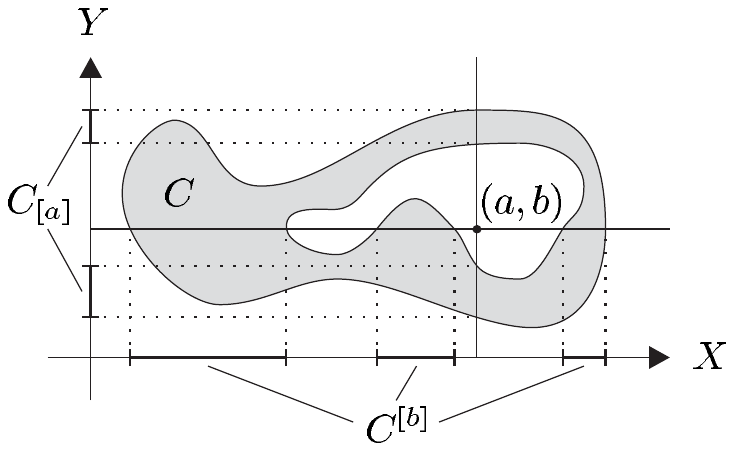

1.12 定理 设集合族 $ \mathcal{M} = \{ M_\alpha \subset X ; \alpha \in \mathsf{A} \} $ 满足 $ \bigcup_{\alpha \in \mathsf{A}} M_\alpha = X $。则 $ \mathcal{M} $ 是 $ X $ 上某个拓扑（称为**由 $ \mathcal{M} $ 生成的拓扑**）的基，当且仅当对每个 $ (\alpha, \beta) \in \mathsf{A} \times \mathsf{A} $ 与每个 $ x \in M_\alpha \cap M_\beta $，都存在 $ \gamma \in \mathsf{A} $，使得 $ x \in M_\gamma \subset M_\alpha \cap M_\beta $。

证明 “$ \Rightarrow $” 设 $ \mathcal{T} $ 是 $ X $ 上的拓扑，$ \mathcal{M} = \{ M_\alpha \subset X ; \alpha \in \mathsf{A} \} $ 是 $ \mathcal{T} $ 的基。取 $ \alpha, \beta \in \mathsf{A} $ 与 $ x \in M_\alpha \cap M_\beta $。则 $ M_\alpha \cap M_\beta $ 是 $ x $ 的开邻域。由于 $ \mathcal{M} $ 是 $ \mathcal{T} $ 的基，我们可以把 $ M_\alpha \cap M_\beta $ 表示成 $ \mathcal{M} $ 中集合的并；特别地，存在 $ \gamma \in \mathsf{A} $，使得 $ x \in M_\gamma \subset M_\alpha \cap M_\beta $。

“$ \Leftarrow $” 设 $ \mathcal{M} $ 是具有上述性质的集合族，并令 $ \mathcal{T}(\mathcal{M}) := \{ \bigcup_{\alpha \in \mathsf{A}'} M_\alpha ; \mathsf{A}' \subset \mathsf{A} \} $。显然 $ \varnothing $、$ X $ 以及 $ \mathcal{T}(\mathcal{M}) $ 中集合的任意并都属于 $ \mathcal{T}(\mathcal{M}) $。

设 $ O_1, O_2 \in \mathcal{T}(\mathcal{M}) $，并令 $ O := O_1 \cap O_2 $。我们来验证 $ O $ 属于 $ \mathcal{T}(\mathcal{M}) $，且不妨假设 $ O $ 非空。由 $ \mathcal{T}(\mathcal{M}) $ 的定义，存在 $ \mathsf{A}_j \subset \mathsf{A} $，使得 $ O_j = \bigcup_{\alpha \in \mathsf{A}_j} M_\alpha $（$ j = 1, 2 $）。于是对每个 $ x \in O $ 都能找到 $ \alpha_j(x) \in \mathsf{A} $（$ j = 1, 2 $），使得 $ x \in M_{\alpha_1(x)} \cap M_{\alpha_2(x)} $。此外，按假设存在 $ \alpha(x) \in \mathsf{A} $，使得

\[ x \in M_{\alpha(x)} \subset M_{\alpha_1(x)} \cap M_{\alpha_2(x)} \subset O . \]

因此 $ O = \bigcup_{x \in O} M_{\alpha(x)} $，即 $ O $ 属于 $ \mathcal{T}(\mathcal{M}) $。

现在一个简单的归纳论证表明，$ \mathcal{T}(\mathcal{M}) $ 中任意有限多个集合的交仍属于 $ \mathcal{T}(\mathcal{M}) $。■

##### 乘积拓扑

设 $ \mathcal{T}_1 $ 与 $ \mathcal{T}_2 $ 是 $ X $ 上的拓扑。若 $ \mathcal{T}_1 \subset \mathcal{T}_2 $，则称 $ \mathcal{T}_1 $ 比 $ \mathcal{T}_2 $ **更粗**（且 $ \mathcal{T}_2 $ 比 $ \mathcal{T}_1 $ **更细**）。

1.13 注 (a) $ \{\varnothing, X\} $ 是 $ X $ 上最粗的拓扑，$ \mathfrak{P}(X) $ 是最细的拓扑，即对 $ X $ 的每个拓扑 $ \mathcal{T} $，都有 $ \{\varnothing, X\} \subset \mathcal{T} \subset \mathfrak{P}(X) $。

(b) 设 $ \mathcal{M} \subset \mathfrak{P}(X) $ 是拓扑 $ \mathcal{T}(\mathcal{M}) $ 的基。则 $ \mathcal{T}(\mathcal{M}) $ 是 $ X $ 上包含 $ \mathcal{M} $ 的最粗的拓扑。换言之，若 $ \mathcal{T} $ 是 $ X $ 的拓扑且 $ \mathcal{M} \subset \mathcal{T} $，则 $ \mathcal{T} \supset \mathcal{T}(\mathcal{M}) $。

(c) 若 $ \mathcal{T}_0 $ 是 $ X $ 上的拓扑，则 $ \mathcal{T}_0 $ 是它自身的基：$ \mathcal{T}(\mathcal{T}_0) = \mathcal{T}_0 $。

(d) 设 $ \mathcal{M}_j \subset \mathfrak{P}(X) $ 是 $ \mathcal{T}_j $ 的基（$ j = 1, 2 $），且 $ \mathcal{M}_1 \subset \mathcal{M}_2 $。则 $ \mathcal{T}_1 \subset \mathcal{T}_2 $。■

设 $ (X_1, \mathcal{T}_1) $ 与 $ (X_2, \mathcal{T}_2) $ 是拓扑空间，且对 $ j = 1, 2 $ 有 $ (O_j, U_j) \in \mathcal{T}_1 \times \mathcal{T}_2 $。显然，

\[ (O_1 \times U_1) \cap (O_2 \times U_2) = (O_1 \cap O_2) \times (U_1 \cap U_2) . \]

因此定理 1.12 表明，

\[ \mathcal{T}_1 \boxtimes \mathcal{T}_2 := \{ O_1 \times O_2 \subset X_1 \times X_2 ; (O_1, O_2) \in \mathcal{T}_1 \times \mathcal{T}_2 \} \]

是 $ X_1 \times X_2 $ 上某个拓扑 $ \mathcal{T} := \mathcal{T}(\mathcal{T}_1 \boxtimes \mathcal{T}_2) $ 的基，我们称该拓扑为**$ \mathcal{T}_1 $ 与 $ \mathcal{T}_2 $ 的乘积拓扑**（在 $ X_1 \times X_2 $ 上）。拓扑空间 $ (X_1 \times X_2, \mathcal{T}) $ 称为 $ (X_1, \mathcal{T}_1) $ 与 $ (X_2, \mathcal{T}_2) $ 的**拓扑积**。除另有明确说明外，我们总给 $ X_1 \times X_2 $ 赋予乘积拓扑。

1.14 注 (a) 乘积拓扑是 $ X_1 \times X_2 $ 上包含 $ \mathcal{T}_1 \boxtimes \mathcal{T}_2 $ 的最粗的拓扑。

(b) 乘积拓扑是 $ X_1 \times X_2 $ 上使投影 $ \operatorname{pr}_j : X_1 \times X_2 \to X_j $（$ j = 1, 2 $）都连续的最粗的拓扑。

证明 先证 (i)。对 $ O_1 \in \mathcal{T}_1 $ 与 $ O_2 \in \mathcal{T}_2 $，有

\[ \operatorname{pr}_1^{-1}(O_1) = O_1 \times X_2 \quad \text{与} \quad \operatorname{pr}_2^{-1}(O_2) = X_1 \times O_2 . \]

因此投影 $ \operatorname{pr}_1 $ 与 $ \operatorname{pr}_2 $ 关于 $ \mathcal{T} := \mathcal{T}(\mathcal{T}_1 \boxtimes \mathcal{T}_2) $ 都连续。

再证 (ii)。用 $ \widetilde{\mathcal{T}} $ 记 $ X_1 \times X_2 $ 上使 $ \operatorname{pr}_1 $ 与 $ \operatorname{pr}_2 $ 都连续的一个拓扑。对每个 $ V \in \mathcal{T} $，存在指标集 $ \mathsf{A} $ 以及元素对 $ (O_\alpha, U_\alpha) \in \mathcal{T}_1 \times \mathcal{T}_2 $（$ \alpha \in \mathsf{A} $），使得 $ V = \bigcup_{\alpha \in \mathsf{A}} O_\alpha \times U_\alpha $。由定理 III.2.20 与注 III.2.29(e)，集合 $ \operatorname{pr}_1^{-1}(O_\alpha) $ 与 $ \operatorname{pr}_2^{-1}(U_\alpha) $ 都属于 $ \widetilde{\mathcal{T}} $。由于 $ O_\alpha \times U_\alpha = \operatorname{pr}_1^{-1}(O_\alpha) \cap \operatorname{pr}_2^{-1}(U_\alpha) $，这表明 $ V \in \widetilde{\mathcal{T}} $，即 $ \mathcal{T} \subset \widetilde{\mathcal{T}} $。■

(c) 设 $ \mathcal{M}_j \subset \mathfrak{P}(X_j) $ 是 $ \mathcal{T}_j $ 的基（$ j = 1, 2 $）。则 $ \mathcal{M}_1 \boxtimes \mathcal{M}_2 $ 是 $ X_1 \times X_2 $ 的乘积拓扑的基。

(d) 设 $ (X_j, d_j) $ 是度量空间（$ j = 1, 2 $），并用 $ \mathcal{T}_j $ 记 $ d_j $ 在 $ X_j $ 上诱导的拓扑。又设 $ \mathcal{T}(d_1 \vee d_2) $ 是乘积度量 $ d_1 \vee d_2 $ 在 $ X_1 \times X_2 $ 上诱导的拓扑；参见例 II.1.2(e)。则

\[ \mathcal{T}(\mathcal{T}_1 \boxtimes \mathcal{T}_2) = \mathcal{T}(d_1 \vee d_2) , \]

也就是说，由 $ d_1 $ 与 $ d_2 $ 诱导的乘积拓扑与由乘积度量 $ d_1 \vee d_2 $ 诱导的拓扑一致。

证明 由习题 III.2.6 与定理 1.12，$ \mathcal{T}(d_1 \vee d_2) $ 是 $ X_1 \times X_2 $ 上的一个拓扑，且满足

\[ \mathcal{T}_1 \boxtimes \mathcal{T}_2 \subset \mathcal{T}(d_1 \vee d_2) \subset \mathcal{T}(\mathcal{T}_1 \boxtimes \mathcal{T}_2) , \]

于是结论由 (a) 推出。■

(e) 上述定义与结果显然可以推广到有限多个拓扑空间的乘积。表述与证明留给读者。■

##### 乘积博雷尔 σ-代数

设 $ (X_1, \mathcal{A}_1) $ 与 $ (X_2, \mathcal{A}_2) $ 是可测空间。$ \mathcal{A}_1 \boxtimes \mathcal{A}_2 $ 未必是 $ X_1 \times X_2 $ 上的 $ \sigma $-代数，这一点在简单情形中就能看出（见习题 15）。因此我们定义 $ \mathcal{A}_1 $ 与 $ \mathcal{A}_2 $ 的**乘积 $ \sigma $-代数 $ \mathcal{A}_1 \otimes \mathcal{A}_2 $** 为 $ X_1 \times X_2 $ 上包含 $ \mathcal{A}_1 \boxtimes \mathcal{A}_2 $ 的最小的 $ \sigma $-代数：

\[ \mathcal{A}_1 \otimes \mathcal{A}_2 := \mathcal{A}_\sigma(\mathcal{A}_1 \boxtimes \mathcal{A}_2) . \]

下一个命题表明如何由 $ \mathcal{A}_1 $ 与 $ \mathcal{A}_2 $ 的生成集得到 $ \mathcal{A}_1 \otimes \mathcal{A}_2 $ 的生成集。

1.15 命题 设 $ \mathcal{S}_j \subset \mathfrak{P}(X_j) $ 且 $ X_j \in \mathcal{S}_j $（$ j = 1, 2 $），则有

\[ \mathcal{A}_\sigma(\mathcal{S}_1) \otimes \mathcal{A}_\sigma(\mathcal{S}_2) = \mathcal{A}_\sigma(\mathcal{S}_1 \boxtimes \mathcal{S}_2) . \]

证明 令 $ \mathcal{A}_j := \mathcal{A}_\sigma(\mathcal{S}_j) $，显然有 $ \mathcal{A}_\sigma(\mathcal{S}_1 \boxtimes \mathcal{S}_2) \subset \mathcal{A}_1 \otimes \mathcal{A}_2 $。为证反向的包含关系，令

\[ \widetilde{\mathcal{A}}_j := (\operatorname{pr}_j)_*\left( \mathcal{A}_\sigma(\mathcal{S}_1 \boxtimes \mathcal{S}_2) \right) \quad \text{对 } j = 1, 2 . \]

由于 $ X_2 \in \mathcal{S}_2 $，有 $ \mathcal{S}_1 \subset \widetilde{\mathcal{A}}_1 $；同样，$ \mathcal{S}_2 $ 是 $ \widetilde{\mathcal{A}}_2 $ 的子集。现在例 1.3(e) 表明 $ \widetilde{\mathcal{A}}_j \supset \mathcal{A}_j $（$ j = 1, 2 $）。给定 $ A_1 \times A_2 \in \mathcal{A}_1 \boxtimes \mathcal{A}_2 $，我们便可推出

\[ \begin{aligned} A_1 \times X_2 &= (\operatorname{pr}_1)^{-1}(A_1) \in \mathcal{A}_\sigma(\mathcal{S}_1 \boxtimes \mathcal{S}_2) , \\ X_1 \times A_2 &= (\operatorname{pr}_2)^{-1}(A_2) \in \mathcal{A}_\sigma(\mathcal{S}_1 \boxtimes \mathcal{S}_2) , \end{aligned} \]

所以 $ A_1 \times A_2 = (A_1 \times X_2) \cap (X_1 \times A_2) \in \mathcal{A}_\sigma(\mathcal{S}_1 \boxtimes \mathcal{S}_2) $。这表明 $ \mathcal{A}_1 \otimes \mathcal{A}_2 = \mathcal{A}_\sigma(\mathcal{A}_1 \boxtimes \mathcal{A}_2) $ 包含于 $ \mathcal{A}_\sigma(\mathcal{S}_1 \boxtimes \mathcal{S}_2) $。■

这个定理同样容易推广到有限多个可测空间的情形，此时乘积 $ \sigma $-代数按显然的方式定义。

设 $ (X_1, \mathcal{T}_1) $ 与 $ (X_2, \mathcal{T}_2) $ 是拓扑空间。在 $ X_1 \times X_2 $ 上自然出现两个 $ \sigma $-代数：博雷尔 $ \sigma $-代数 $ \mathcal{B}(X_1) $ 与 $ \mathcal{B}(X_2) $ 的乘积 $ \sigma $-代数 $ \mathcal{B}(X_1) \otimes \mathcal{B}(X_2) $，以及拓扑积 $ X_1 \times X_2 $ 的博雷尔 $ \sigma $-代数 $ \mathcal{B}(X_1 \times X_2) $。现在我们研究这两者之间的关系。

1.16 命题 设 $ X_1 $ 与 $ X_2 $ 是拓扑空间。则

\[ \mathcal{B}(X_1) \otimes \mathcal{B}(X_2) \subset \mathcal{B}(X_1 \times X_2) . \]

证明 设 $ \mathcal{T}_j $ 是 $ X_j $ 的拓扑。$ X_1 \times X_2 $ 上的乘积拓扑 $ \mathcal{T} $ 包含 $ \mathcal{T}_1 \boxtimes \mathcal{T}_2 $。因此

\[ \mathcal{A}_\sigma(\mathcal{T}_1 \boxtimes \mathcal{T}_2) \subset \mathcal{A}_\sigma(\mathcal{T}) = \mathcal{B}(X_1 \times X_2) . \]

此外，命题 1.15 表明 $ \mathcal{B}(X_1) \otimes \mathcal{B}(X_2) = \mathcal{A}_\sigma(\mathcal{T}_1 \boxtimes \mathcal{T}_2) $，由此得到结论。■

习题 19 用例子表明，与命题 1.16 相反方向的包含关系未必成立：一般地，$ \mathcal{B}(X_1 \times X_2) \neq \mathcal{B}(X_1) \otimes \mathcal{B}(X_2) $。因此下面的结果特别重要。

1.17 定理 对满足第二可数公理的拓扑空间 $ X_1 $ 与 $ X_2 $，有

\[ \mathcal{B}(X_1 \times X_2) = \mathcal{B}(X_1) \otimes \mathcal{B}(X_2) . \]

证明 设 $ \mathcal{M}_j $ 是 $ X_j $ 的拓扑 $ \mathcal{T}_j $ 的可数基。由注 1.14(c) 与命题 I.6.9，$ \mathcal{M}_1 \boxtimes \mathcal{M}_2 $ 是乘积拓扑 $ \mathcal{T} := \mathcal{T}(\mathcal{T}_1 \boxtimes \mathcal{T}_2) $ 的可数基。于是每个 $ O \in \mathcal{T} $ 都能表示成 $ \mathcal{M}_1 \boxtimes \mathcal{M}_2 $ 中集合的可数并。因此 $ \mathcal{T} \subset \mathcal{B}(X_1) \otimes \mathcal{B}(X_2) $，从而 $ \mathcal{B}(X_1 \times X_2) \subset \mathcal{B}(X_1) \otimes \mathcal{B}(X_2) $。结论由命题 1.16 推出。■

1.18 推论 对 $ m, n \in \mathbb{N}^\times $，有 $ \mathcal{B}^m \otimes \mathcal{B}^n = \mathcal{B}^{m+n} $ 与 $ \mathcal{B}^m = \underbrace{\mathcal{B}^1 \otimes \cdots \otimes \mathcal{B}^1}_{m} $。

证明 这由注 1.14(e)、推论 1.9(ii)、定理 1.17 以及向 $ m $ 个因子情形的相应推广推出。■

##### 截口的可测性

对 $ C \subset X \times Y $ 与 $ (a, b) \in X \times Y $，集合

\[ \begin{aligned} C_{[a]} &:= \{ y \in Y ; (a, y) \in C \} , \\ C^{[b]} &:= \{ x \in X ; (x, b) \in C \} \end{aligned} \]

称为 $ C $ 的**截口**（分别在 $ a \in X $ 与 $ b \in Y $ 处）。

可测集的截口是可测的：

1.19 命题 设 $ (X, \mathcal{A}) $ 与 $ (Y, \mathcal{B}) $ 是可测空间，且 $ C \in \mathcal{A} \otimes \mathcal{B} $。则对任意的 $ x \in X $ 与 $ y \in Y $，有 $ C_{[x]} \in \mathcal{B} $ 与 $ C^{[y]} \in \mathcal{A} $。

证明 (i) 令

\[ \mathcal{C} := \{ C \in \mathcal{A} \otimes \mathcal{B} ; C_{[x]} \in \mathcal{B}, C^{[y]} \in \mathcal{A}, (x, y) \in X \times Y \} \]

并证明 $ \mathcal{C} $ 是 $ X \times Y $ 上的 $ \sigma $-代数。

显然 $ X \times Y $ 属于 $ \mathcal{C} $。对 $ C \in \mathcal{C} $ 与 $ (x, y) \in X \times Y $，有

\[ (C^c)_{[x]} = (C_{[x]})^c \in \mathcal{B} \quad \text{与} \quad (C^c)^{[y]} = (C^{[y]})^c \in \mathcal{A} , \]
