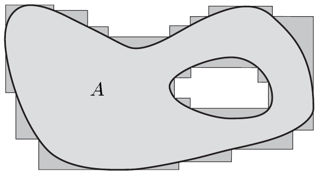
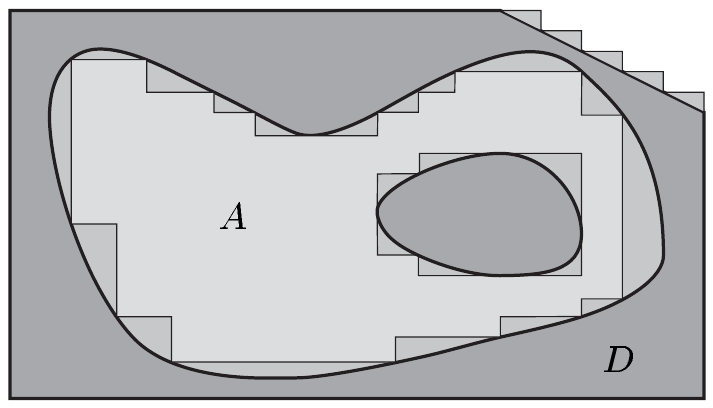
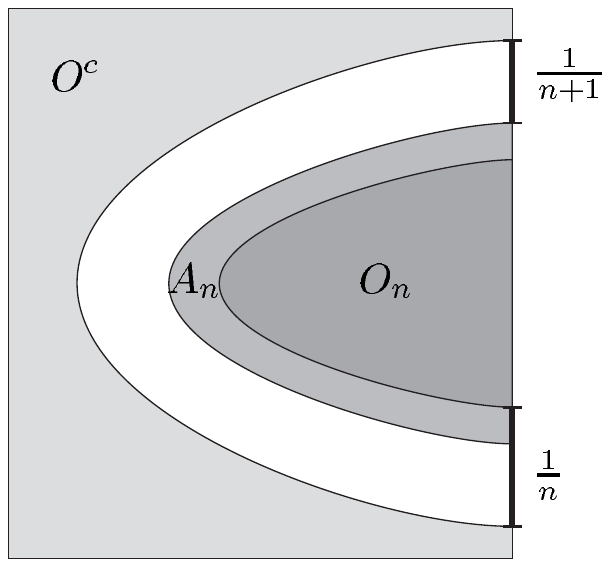

## 4 可测集

本节中，我们完成在集合上构造测度的过程。我们从一个外测度出发，把它限制到一个适当的子集族上。通过巧妙地选取这个子集族，我们最终得到一个完备的测度空间。这一技巧可追溯到卡拉泰奥多里，随后被应用于前面各节的例子，以得出应用中最重要的那些测度——特别是勒贝格测度。

##### 动机

卡拉泰奥多里构造的关键在于可测集的定义。对证明主要定理来说，这是一个方便的定义，但它并不是一个能立刻凭直觉把握的定义。因此我们先给出一个启发性的动机。

设 $ A $ 是 $ \mathbb{R}^n $ 的有界子集。若 $ (I_j) $ 是开区间序列，使得 $ \bigcup I_j \supset A $，则 $ \sum_{j=0}^{\infty} \operatorname{vol}_n(I_j) $ 表示 $ \lambda_n^*(A) $ 的一个近似值；$ \bigcup_j I_j $ 对集合 $ A $ 的逼近越好，这个近似值就越接近 $ \lambda_n^*(A) $。由命题 3.4，我们可以用左开区间代替开区间；特别地，可以选取有限多个两两不交的区间，使其并包含 $ A $。集合 $ A $ 被一个**拼块**从“外部”逼近，拼块是一种边界分段平行于坐标超平面的形状。在这个意义上，我们把

\[ \lambda_n^*(A) := \inf\left\{ \sum_{j=0}^{\infty} \operatorname{vol}_n(I_j) \; ; \; I_j \in \mathbb{J}(n),\; j \in \mathbb{N},\; A \subset \bigcup_{j=0}^{\infty} I_j \right\} \]

视为对 $ A $ 的体积的“从外部逼近”。

现在不考察 $ A $，而考察集合 $ D \setminus A $，其中 $ D $ 是 $ A $ 在 $ \mathbb{R}^n $ 中的有界超集。像上面那样用拼块从外部逼近 $ D \setminus A $，我们就得到 $ A $ 的“从内部”逼近。因此自然地，我们把 $ A $ 的**内测度**（相对于 $ D $）定义为

\[ \lambda_{n,*}^{D}(A) := \lambda_n^*(D) - \lambda_n^*(D \setminus A) . \]

现在可以合理地期望，$ \mathbb{R}^n $ 的那些外测度与相对于每个有界超集 $ D $ 的内测度都一致的子集 $ A $ 具有特殊的地位，也就是满足

\[ \lambda_n^*(A) = \lambda_{n,*}^{D}(A) \quad\text{对 } D \subset \mathbb{R}^n \text{ 且 } D \supset A , \]

其中 $ D $ 同样是有界的。这对应于等式

\[ \lambda_n^*(D) = \lambda_n^*(A) + \lambda_n^*(D \setminus A) \quad\text{对 } D \subset \mathbb{R}^n \text{ 且 } D \supset A , \tag{4.1} \]

由此我们现在可以放弃 $ A $ 与 $ D $ 有界的要求。于是 (4.1) 恰好挑出这样的集合 $ A $：对每个满足 $ D \supset A $ 的 $ D \subset \mathbb{R}^n $，勒贝格外测度关于 $ D $ 的不交分解 $ A \cup (D \setminus A) $ 是可加的。

##### μ*-可测集构成的 σ-代数

设 $ \mu^* $ 是 $ X $ 上的外测度。若把 $ \mathbb{R}^n $ 换成 $ X $、把 $ \lambda_n^* $ 换成 $ \mu^* $，则等式 (4.1) 对每个 $ A \subset X $ 都有意义。由于外测度是次可加的，我们也可以把 (4.1) 中的等号换成 $ \ge $。这样便得到关键的定义：$ X $ 的子集 $ A $ 是**$ \mu^* $-可测**的，若对每个 $ D \subset X $，

\[ \mu^*(D) \ge \mu^*(A \cap D) + \mu^*(A^c \cap D) . \]

我们用 $ \mathcal{A}(\mu^*) $ 记 $ X $ 的全部 $ \mu^* $-可测子集所成的集。若 $ N \subset X $ 满足 $ \mu^*(N) = 0 $，则称集合 $ N $ 是 **$ \mu^* $-零**的（或**$ \mu^* $ 测度为零**的）。

4.1 注 (a) 每个 $ \mu^* $-零集都是 $ \mu^* $-可测的。

证明 取 设 $ D \subset X $，$ N \subset X $ 满足 $ \mu^*(N) = 0 $。由 $ \mu^* $ 的单调性可得 $ 0 \le \mu^*(N \cap D) \le \mu^*(N) = 0 $。因此 $ N \cap D $ 是 $ \mu^* $-零集，由此可得

\[ \mu^*(N \cap D) + \mu^*(N^c \cap D) = \mu^*(N^c \cap D) \le \mu^*(D) . \]

因此 $ N $ 是 $ \mu^* $-可测的。■

(b) 对 $ A \subset X $，下列陈述等价：

(i) $ A \in \mathcal{A}(\mu^*) $。

(ii) 对所有满足 $ \mu^*(D) < \infty $ 的 $ D \subset X $，有 $ \mu^*(D) \ge \mu^*(A \cap D) + \mu^*(A^c \cap D) $。

(iii) 对所有 $ D \subset X $，有 $ \mu^*(D) = \mu^*(A \cap D) + \mu^*(A^c \cap D) $。

证明 “(i)$ \Rightarrow $(ii)”与“(iii)$ \Rightarrow $(i)”这两个蕴含关系是显然的。

“(ii)$ \Rightarrow $(iii)” 设 $ D \subset X $。由 $ \mu^* $ 的次可加性可得

\[ \mu^*(D) = \mu^*((A \cap D) \cup (A^c \cap D)) \le \mu^*(A \cap D) + \mu^*(A^c \cap D) . \tag{4.2} \]

若 $ \mu^*(D) < \infty $，则由 (4.2) 与 (ii) 推出 (iii)。在 $ \mu^*(D) = \infty $ 的情形，由 (4.2) 同样可知该陈述成立。■

下面的定理表明，全体 $ \mu^* $-可测集构成一个 $ \sigma $-代数，而外测度 $ \mu^* $ 到这个 $ \sigma $-代数上的限制是一个完备测度。这就是重要的**卡拉泰奥多里延拓定理**，它使非平凡测度的构造成为可能。

4.2 定理 设 $ \mu^* $ 是 $ X $ 上的外测度。则 $ \mathcal{A}(\mu^*) $ 是 $ X $ 上的 $ \sigma $-代数，且 $ \mu := \mu^* \mid \mathcal{A}(\mu^*) $ 是 $ \mathcal{A}(\mu^*) $ 上的完备测度，即由 $ \mu^* $ 诱导的 $ X $ 上的测度。

证明 (i) 显然 $ \varnothing $ 属于 $ \mathcal{A}(\mu^*) $。此外，若 $ A $ 属于 $ \mathcal{A}(\mu^*) $，则 $ A^c $ 也属于 $ \mathcal{A}(\mu^*) $，因为 $ \mu^* $-可测性这个概念关于 $ A $ 与 $ A^c $ 是对称的。

(ii) 取 $ A, B \in \mathcal{A}(\mu^*) $ 与 $ D \subset X $。则

\[ \mu^*(D) \ge \mu^*(A \cap D) + \mu^*(A^c \cap D) . \tag{4.3} \]

由于 $ B $ 是 $ \mu^* $-可测的，我们有

\[ \mu^*(A^c \cap D) \ge \mu^*(B \cap A^c \cap D) + \mu^*(B^c \cap A^c \cap D) . \]

于是 (4.3) 与 $ \mu^* $ 的次可加性给出

\[ \mu^*(D) \ge \mu^*((A \cap D) \cup (B \cap A^c \cap D)) + \mu^*(B^c \cap A^c \cap D) . \]

注意到

\[ (A \cap D) \cup (B \cap A^c \cap D) = [A \cup (B \cap A^c)] \cap D = (A \cup B) \cap D \]

以及 $ (A \cup B)^c = A^c \cap B^c $，我们看出

\[ \mu^*(D) \ge \mu^*((A \cup B) \cap D) + \mu^*((A \cup B)^c \cap D) . \]

因此 $ A \cup B $ 是 $ \mu^* $-可测的，且 $ \mathcal{A}(\mu^*) $ 是 $ X $ 上的代数。

(iii) 设 $ (A_j) $ 是 $ \mathcal{A}(\mu^*) $ 中的不交序列。由于 $ A_0 $ 是 $ \mu^* $-可测的，由注 4.1(b) 得到

\[ \mu^*((A_0 \cup A_1) \cap D) = \mu^*(((A_0 \cup A_1) \cap D) \cap A_0) + \mu^*(((A_0 \cup A_1) \cap D) \cap A_0^c) , \]

又由 $ A_0 \cap A_1 = \varnothing $ 可得

\[ \mu^*((A_0 \cup A_1) \cap D) = \mu^*(A_0 \cap D) + \mu^*(A_1 \cap D) . \]

由完全归纳法可得

\[ \mu^*\left(\left(\bigcup_{j=0}^{m} A_j\right) \cap D\right) = \sum_{j=0}^{m} \mu^*(A_j \cap D) \quad\text{对 } m \in \mathbb{N} . \tag{4.4} \]

为简便起见令 $ A := \bigcup_j A_j $，则 $ \mu^* $ 的单调性表明

\[ \mu^*(A \cap D) \ge \sum_{j=0}^{m} \mu^*(A_j \cap D) \quad\text{对 } m \in \mathbb{N} . \]

令 $ m \to \infty $，得到不等式 $ \mu^*(A \cap D) \ge \sum_{j=0}^{\infty} \mu^*(A_j \cap D) $。结合 $ \mu^* $ 的 $ \sigma $-次可加性，这蕴含

\[ \mu^*(A \cap D) = \sum_{j=0}^{\infty} \mu^*(A_j \cap D) . \tag{4.5} \]

由于 (ii) 表明 $ \mathcal{A}(\mu^*) $ 是 $ X $ 上的代数，故对每个 $ m \in \mathbb{N} $ 都有

\[ \mu^*(D) = \mu^*\left(\left(\bigcup_{j=0}^{m} A_j\right)^{c} \cap D\right) + \mu^*\left(\left(\bigcup_{j=0}^{m} A_j\right) \cap D\right) . \]

于是 $ \mu^* $ 的单调性与 (4.4) 给出

\[ \mu^*(D) \ge \mu^*(A^c \cap D) + \sum_{j=0}^{m} \mu^*(A_j \cap D) , \]

因此利用 (4.5) 得到

\[ \mu^*(D) \ge \mu^*(A^c \cap D) + \sum_{j=0}^{\infty} \mu^*(A_j \cap D) = \mu^*(A^c \cap D) + \mu^*(A \cap D) \]

令 $ m \to \infty $。因此 $ A $ 是 $ \mu^* $-可测的，且注 1.2(c) 蕴含 $ \mathcal{A}(\mu^*) $ 是 $ \sigma $-代数。

(iv) 要看出 $ \mu^* \mid \mathcal{A}(\mu^*) $ 是 $ \mathcal{A}(\mu^*) $ 上的测度，只需在 (4.5) 中令 $ D = X $。最后，$ \mu^* $ 的单调性与注 4.1(a) 表明这个测度是完备的。■

若 $ \mu $ 是由 $ \mu^* $ 诱导的 $ X $ 上的测度，则 $ \mathcal{A}(\mu^*) $ 中的集合理所当然地称为 **$ \mu $-可测**集，而 $ \mu^* $-零集与 **$ \mu $-零**集则是一致的。

##### 勒贝格测度与豪斯多夫测度

现在我们把定理 4.2 应用于命题 3.3、3.5 与 3.7 中讨论的外测度。

• 由 $ \lambda_n^* $ 诱导的 $ \mathbb{R}^n $ 上的测度称为 $ \mathbb{R}^n $ 上的 **$ n $ 维勒贝格测度**，记作 $ \lambda_n $。我们称 $ \lambda_n $-可测集为**勒贝格可测**集。

• 若 $ F\colon \mathbb{R} \to \mathbb{R} $ 是测度生成函数，则我们把由 $ \mu_F^* $ 产生的 $ \mathbb{R} $ 上的测度称为 $ \mathbb{R} $ 上由 $ F $ 诱导的**勒贝格–斯蒂尔杰斯测度**。我们把它记作 $ \mu_F $。

• 设 $ X $ 是可分度量空间，$ s > 0 $。由 $ \mathcal{H}_*^s $ 诱导的 $ X $ 上的测度就是 $ X $ 上的 **$ s $ 维豪斯多夫测度**；它记作 $ \mathcal{H}^s $。

##### 度量测度

尽管定理 4.2 保证了 $ \mu^* $ 到 $ \mathcal{A}(\mu^*) $ 的限制是测度，但它对 $ \mathcal{A}(\mu^*) $ 中集合的多寡未作任何说明。对于度量空间，我们现在给出一个充分条件，使得至少所有博雷尔集都是 $ \mu $-可测的。

设 $ X = (X, d) $ 是度量空间，$ \mu^* $ 是 $ X $ 上的外测度。若

\[ \mu^*(A \cup B) = \mu^*(A) + \mu^*(B) \]

对所有相距正距离的 $ A, B \subset X $ 成立，即对满足\footnote{见例 III.3.9(c)。} $ d(A, B) > 0 $ 者，则称 $ \mu^* $ 以及由 $ \mu^* $ 诱导的 $ \mathcal{A}(\mu^*) $ 上的测度是**度量的**。

下面的定理表明，由度量外测度诱导的 $ \sigma $-代数包含博雷尔 $ \sigma $-代数。反之，可以证明：若外测度 $ \mu^* $ 的 $ \mu^* $-可测集构成的 $ \sigma $-代数包含博雷尔 $ \sigma $-代数，则 $ \mu^* $ 是度量测度；见习题 1。

4.3 定理 设 $ \mu^* $ 是 $ X $ 上的度量外外测度。则 $ \mathcal{A}(\mu^*) \supset \mathcal{B}(X) $。

证明 (i) 由于 $ \mathcal{A}(\mu^*) $ 是 $ \sigma $-代数，且博雷尔 $ \sigma $-代数由开集生成，故只需验证每个开集都是 $ \mu^* $-可测的。

(ii) 取 $ X $ 中的开集 $ O $ 与满足 $ \mu^*(D) < \infty $ 的 $ D \subset X $。我们将证明

\[ \mu^*(D) \ge \mu^*(O \cap D) + \mu^*(O^c \cap D) . \]

由注 4.1(b) 可得 $ O \in \mathcal{A}(\mu^*) $。

我们令

\[ O_n := \{ x \in X ; d(x, O^c) > 1/n \} \]

与

\[ A_n := \{ x \in X ; 1/(n+1) < d(x, O^c) \le 1/n \} \]

其中 $ n \in \mathbb{N}^{\times} $。显然 $ d(O_n, O^c) \ge 1/n > 0 $。对 $ x \in A_k $，有

\[ 1/(k+1) < d(x, O^c) \le d(x, z) \le d(x, y) + d(y, z) \quad\text{对 } z \in O^c \text{ 与 } y \in X . \]

由于这对每个 $ z \in O^c $ 都成立，我们有

\[ 1/(k+1) \le d(x, y) + d(y, O^c) \le d(x, y) + 1/(k+2) \quad\text{对 } y \in A_{k+2} , \]

从而

\[ d(A_k, A_{k+2}) \ge \frac{1}{k+1} - \frac{1}{k+2} > 0 \quad\text{对 } k \in \mathbb{N}^{\times} . \tag{4.6} \]

(iii) 由于 $ \mu^* $ 是度量外测度，由 (4.6) 与完全归纳法可得

\[ \sum_{j=1}^{n} \mu^*(A_{2j-i} \cap D) = \mu^*\left(\left(\bigcup_{j=1}^{n} A_{2j-i}\right) \cap D\right) \le \mu^*(D) \quad\text{对 } n \in \mathbb{N}^{\times} \text{ 与 } i = 0, 1 . \]

由此得到

\[ \sum_{k=1}^{\infty} \mu^*(A_k \cap D) \le 2\mu^*(D) < \infty . \]

特别地，我们发现级数余项 $ r_n := \sum_{k=n}^{\infty} \mu^*(A_k \cap D) $ 构成零序列。同样显然有 $ O \setminus O_n = \bigcup_{j=n}^{\infty} A_j $。因此 $ \mu^* $ 的 $ \sigma $-次可加性给出

\[ 0 \le \mu^*((O \setminus O_n) \cap D) \le \sum_{j=n}^{\infty} \mu^*(A_j \cap D) = r_n . \]

因此 $ \left(\mu^*((O \setminus O_n) \cap D)\right)_{n \in \mathbb{N}^{\times}} $ 也是零序列。

(iv) 显然

\[ \mu^*(O \cap D) \le \mu^*(O_n \cap D) + \mu^*((O \setminus O_n) \cap D) . \tag{4.7} \]

由于 $ d(O_n \cap D, O^c \cap D) \ge d(O_n, O^c) \ge 1/n $，且 $ \mu^* $ 是外测度，我们有

\[ \mu^*(O_n \cap D) + \mu^*(O^c \cap D) = \mu^*((O_n \cup O^c) \cap D) \le \mu^*(D) . \]

由此及 (4.7) 可得

\[ \mu^*(O \cap D) + \mu^*(O^c \cap D) \le \mu^*(D) + \mu^*((O \setminus O_n) \cap D) \quad\text{对 } n \in \mathbb{N}^{\times} . \]

令 $ n \to \infty $，即得所要的不等式。■

4.4 例 (a) $ \lambda_n^* $ 是 $ \mathbb{R}^n $ 上的度量外测度。因此每个博雷尔集都是勒贝格可测的。

证明 设 $ A, B \subset \mathbb{R}^n $ 且 $ d(A, B) > 0 $，并令 $ \delta := d(A, B)/2 $。根据命题 3.4，给定 $ \varepsilon > 0 $，存在 $ \mathbb{J}_\ell(n) $ 中的序列 $ (I_j) $，使得 $ \bigcup_j I_j \supset A \cup B $ 且 $ \sum_j \operatorname{vol}_n(I_j) \le \lambda_n^*(A \cup B) + \varepsilon $。沿坐标超平面切分，我们可以把每个 $ I_j $ 写成有限多个左闭区间的不交并，且这些区间的直径都小于 $ \delta $。因此，不妨假设对每个 $ j \in \mathbb{N} $ 都有 $ \operatorname{diam}(I_j) < \delta $。由于 $ d(A, B) = 2\delta $，这意味着对每个 $ j \in \mathbb{N} $，或者 $ I_j \cap A = \varnothing $，或者
