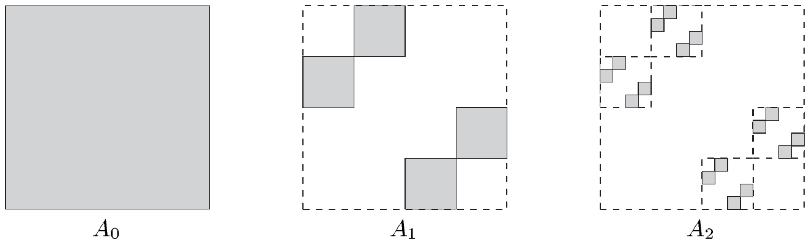

$ I_{j} \cap B = \varnothing $；换言之，存在 $ (I_{j}) $ 的子序列 $ (I'_{k}) $ 与 $ (I''_{\ell}) $，它们分别覆盖 $ A $ 与 $ B $，并且使得对 $ k, \ell \in \mathbb{N} $ 有 $ I'_{k} \cap I''_{\ell} = \varnothing $。于是

\[ \lambda^{*}_{n}(A) \le \sum_{k} \operatorname{vol}_{n}(I'_{k}) \quad \text{与} \quad \lambda^{*}_{n}(B) \le \sum_{\ell} \operatorname{vol}_{n}(I''_{\ell}) , \]

从而得到

\[ \begin{aligned} \lambda^{*}_{n}(A) + \lambda^{*}_{n}(B) &\le \sum_{k} \operatorname{vol}_{n}(I'_{k}) + \sum_{\ell} \operatorname{vol}_{n}(I''_{\ell}) \le \sum_{j} \operatorname{vol}_{n}(I_{j}) \\ &\le \lambda^{*}_{n}(A \cup B) + \varepsilon . \end{aligned} \]

由于 $ \varepsilon > 0 $ 是任意的，利用 $ \lambda^{*}_{n} $ 的次可加性即得结论。■

(b) 对测度生成函数 $ F\colon \mathbb{R} \to \mathbb{R} $，$ \mathbb{R} $ 上相应的勒贝格–斯蒂尔杰斯外测度 $ \mu^{*}_{F} $ 是度量外测度。

证明 这可由对 (a) 的证明作简单修改得到。■

(c) $ \mathbb{R}^{n} $ 上的豪斯多夫外测度 $ \mathcal{H}^{s}_{*} $ 对每个 $ s > 0 $ 都是度量外测度。每个 $ A \in \mathcal{B}^{n} $ 都是 $ \mathcal{H}^{n} $-可测的。

证明 这同样可类比 (a) 的证明得到。■

##### 习题

1 设 $ X $ 是度量空间，$ \mu^{*} $ 是 $ X $ 上的外测度。证明：若 $ \mathcal{A}(\mu^{*}) $ 包含所有博雷尔集，则 $ \mu^{*} $ 是度量外测度。

2 设 $ (X, \mathcal{A}, \nu) $ 是测度空间。用 $ \mu^{*} $ 记由 $ (\mathcal{A}, \nu) $ 在 $ X $ 上诱导的外测度，用 $ \mu $ 记由 $ \mu^{*} $ 在 $ X $ 上诱导的测度。证明 $ \mu $ 是 $ \nu $ 的延拓。它们相等吗？

3 证明例 4.4(b) 与 (c) 中的陈述。

4 设 $ \mu^{*} $ 是 $ X $ 上的外测度，并定义**由 $ \mu^{*} $ 在 $ X $ 上诱导的内测度** $ \mu_{*}\colon \mathfrak{P}(X) \to [0, \infty] $ 为

\[ \mu_{*}(A) := \sup\{\, \mu^{*}(D) - \mu^{*}(D \setminus A) ;\ D \subset X,\ \mu^{*}(D \setminus A) < \infty \,\} \quad \text{对 } A \subset X . \]

证明：对 $ A \in \mathcal{A}(\mu^{*}) $ 有 $ \mu_{*}(A) = \mu^{*}(A) $。

5 设 $ I \subset \mathbb{R} $ 是紧致完全区间，$ \gamma \in C(I, \mathbb{R}^{n}) $ 是 $ \mathbb{R}^{n} $ 中的单射可求长道路，其像为 $ \Gamma $。证明 $ \mathcal{H}^{1}(\Gamma) = L(\gamma) $。

6 令 $ A_{0} := [0, 1]^{2} \subset \mathbb{R}^{2} $。把 $ A_{0} $ 划分成由 $ 4 \times 4 $ 个全等正方形组成的阵列，并按下面的草图去掉其中十二个正方形，使得每一行与每一列中都恰好剩下一个闭正方形。这样就得到集合 $ A_{1} $。对每个剩下的正方形重复这一过程，便得到由十六个正方形组成的 $ A_{2} $。一般地，对 $ A_{k} $ 作这种细分，再从 $ A_{k} $ 中去掉一些子正方形，就得到 $ A_{k+1} $。所有 $ A_{k} $ 的交，即 $ A := \bigcap_{k=0}^{\infty} A_{k} $，称为**康托尔尘埃**。

证明：$ 1 \le \mathcal{H}^{1}(A) \le \sqrt{2} $ 且 $ \dim_H(A) = 1 $。

（提示：为从上方估计 $ \mathcal{H}^{1}(A) $，可使用由 $ A $ 的构造所提示的覆盖。为得到下界，考虑 $ \operatorname{pr}_{1}\colon A \to \mathbb{R} $，并应用习题 5 与 3.6(f)。）

7 证明习题 III.3.8 中的康托尔集\footnote{康托尔集与康托尔尘埃是\textbf{分形}的例子（例如参见 [Fal90]）。} $ C $ 满足

(i) $ \dim_H(C) = \log 2 / \log 3 =: s $ 且 $ 1/2 \le \mathcal{H}^{s}(C) \le 1 $；

(ii) $ \lambda_{1}(C) = 0 $。

（(i) 的提示：$ \mathcal{H}^{s}(C) $ 的上界可用与习题 6 中 $ \mathcal{H}^{1}(A) $ 的上界大致相同的方法得到。为得到下界，紧致性论证表明只需考虑由有限多个开区间构成的覆盖。若 $ \{\, I_{i} ;\ 0 \le i \le N \,\} $ 是这样的覆盖，则对每个 $ i $ 取整数 $ k $ 使得 $ 3^{-(k+1)} \le \operatorname{diam}(I_{i}) < 3^{-k} $。于是 $ I_{i} $ 至多能与 $ C_{k} $ 中的一个区间相交（习题 III.3.8）。对 $ j \ge k $，覆盖 $ I_{i} $ 至多与 $ C_{j} $ 中的 $ 2^{j-k} = 2^{j} 3^{-sk} \le 2^{j} (3 \operatorname{diam}(I_{i}))^{s} $ 个区间相交。现在取 $ j $ 足够大，使得对所有的 $ i $ 都有 $ 3^{-(j+1)} \le \operatorname{diam}(I_{i}) $。然后数一数区间即可。）

8 设 $ F\colon \mathbb{R} \to \mathbb{R} $ 是测度生成函数，$ \mu_{F} $ 是由 $ F $ 诱导的勒贝格–斯蒂尔杰斯测度。对 $ a \in \mathbb{R} $，计算 $ \mu_{F}(\{a\}) $。

9 设 $ (\mathbb{R}, \mathcal{B}^{1}, \mu) $ 是局部有限的\footnote{若 $ X $ 是拓扑空间，$ \mu\colon \mathcal{A} \to [0, \infty] $ 是满足 $ \mathcal{A} \supset \mathcal{B}(X) $ 的测度，则当每个 $ x \in X $ 都有开邻域 $ U \ni x $ 使得 $ \mu(U) < \infty $ 时，称 $ \mu $ 是\textbf{局部有限的}。}测度空间。证明：

(i) 存在测度生成函数 $ F $，使得 $ \mu = \mu_{F} \mid \mathcal{B}^{1} $，也就是说，$ \mu $ 是由 $ F $ 诱导的**博雷尔–斯蒂尔杰斯测度**。这个 $ F $ 在相差一个加性常数的意义下唯一。

(ii) 定义

\[ \mathcal{F}_{0} := \{\, F\colon \mathbb{R} \to \mathbb{R} ;\ F \text{ 是测度生成函数且 } F(0) = 0 \,\} . \]

则 $ F \mapsto \mu_{F} \mid \mathcal{B}^{1} $ 是从 $ \mathcal{F}_{0} $ 到 $ \mathcal{B}^{1} $ 上所有局部有限测度之集的双射。

（(i) 的提示：对 $ t \ge 0 $ 考虑 $ F(t) := \mu([0, t)) $，对 $ t < 0 $ 考虑 $ F(t) := -\mu([t, 0)) $。）

10 设 $ F\colon \mathbb{R} \to \mathbb{R} $ 是测度生成函数，且具有下列性质：$ F $ 在每个区间 $ (a_{k}, a_{k+1}) $ 上是常数，其中 $ a_{k} $（$ k \in \mathbb{Z} $）满足 $ \lim_{k \to \pm\infty} a_{k} = \pm\infty $；此外，$ F $ 在每个 $ a_{k} $ 处都有跃度为 $ p_{k} \ge 0 $ 的跳跃间断点。证明 $ \mathcal{A}(\mu_{F}) = \mathfrak{P}(\mathbb{R}) $，并对 $ A \subset \mathbb{R} $ 计算 $ \mu_{F}(A) $。
