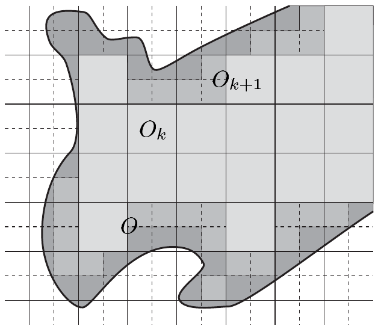

## 5 勒贝格测度

迄今为止，我们考察的都是一般测度；现在我们转向最重要的特殊情形——勒贝格测度。这个测度具有如下基本性质：区间的笛卡儿积被赋予其自然的容度，因此它可以用来计算更一般形状的容度。此外，它还构成计算曲面或更一般流形容度的基础，这一点我们将在后面各章中看到。

##### 勒贝格测度空间

由 $ n $ 维勒贝格外测度生成的 $ \sigma $-代数 $ \mathcal{A}(\lambda_n^{*}) $ 称为 $ \mathbb{R}^n $ 的**勒贝格可测子集构成的 $ \sigma $-代数**，记作 $ \mathcal{L}(n) $。相应地，对 $ \mathbb{R}^n $ 的勒贝格零子集（即 $ \lambda_n^{*} $-零集，或等价地 $ \lambda_n $-零集），我们称其**勒贝格测度为零**（使用这一说法意味着属于 $ \mathcal{L}(n) $）。如有必要，我们也说**勒贝格 $ n $-测度**。

在下面的定理中，我们列出**勒贝格测度空间** $ (\mathbb{R}^n, \mathcal{L}(n), \lambda_n) $ 的一些初步性质。

5.1 定理 (i) $ (\mathbb{R}^n, \mathcal{L}(n), \lambda_n) $ 是完备的 $ \sigma $-有限测度空间。

(ii) $ \mathcal{B}^n \subset \mathcal{L}(n) $，也就是说，$ \mathbb{R}^n $ 的每个博雷尔子集都是勒贝格可测的。

(iii) 对 $ a, b \in \mathbb{R}^n $，任何满足 $ (a, b) \subset A \subset [a, b] $ 的集合 $ A $ 都属于 $ \mathcal{L}(n) $，并且

\[ \lambda_n(A) = \operatorname{vol}_n(a, b) = \prod_{j=1}^{n} (b_j - a_j) . \]

(iv) $ \mathbb{R}^n $ 的每个紧致子集都是勒贝格可测的，并且具有有限测度。

(v) 集合 $ N \subset \mathbb{R}^n $ 的**勒贝格测度为零**，当且仅当对每个 $ \varepsilon > 0 $，存在 $ \mathbb{J}(n) $ 中的序列 $ (I_j) $，使得 $ \bigcup_j I_j \supset N $ 且 $ \sum_j \lambda_n(I_j) < \varepsilon $。

(vi) $ \mathbb{R}^n $ 的每个可数子集的勒贝格测度都为零。

证明 (i) 定理 4.2 与命题 3.3 表明 $ (\mathbb{R}^n, \mathcal{L}(n), \lambda_n) $ 是完备测度空间。因为 $ \mathbb{R}^n = \bigcup_{j=1}^{\infty} (j\mathbb{B}_{\infty}) $ 且 $ \lambda_n(j\mathbb{B}_{\infty}) = (2j)^n $，所以它是 $ \sigma $-有限的。

(ii) 这由定理 4.3 与例 4.4(a) 推出。

(iii) 对 $ M := A \setminus (a, b) $，我们有 $ M \subset N := [a, b] \setminus (a, b) \in \mathcal{B}^n $。因此由 (ii) 与命题 2.3 推出 $ N $ 的勒贝格测度为零，因为 $ \lambda_n(N) = \lambda_n([a, b]) - \lambda_n((a, b)) = 0 $。现在 (i) 说明 $ \lambda_n $ 是完备的，所以 $ M $ 的勒贝格测度也为零。因此 $ A = (a, b) \cup M $ 属于 $ \mathcal{L}(n) $；又因 $ (a, b) $ 与 $ M $ 不交，我们得到 $ \lambda_n(A) = \lambda_n((a, b)) = \operatorname{vol}_n(a, b) $。

(iv) 由 (ii) 与 (iii) 推出。陈述 (v) 是勒贝格外测度定义的直接推论。为看出 (vi)，利用任何单点集的勒贝格测度为零这一显然事实即可。■

5.2 例 含于单个坐标超平面内的 $ \mathbb{R}^n $ 的任何子集，其勒贝格测度都为零。

证明 由于 $ \lambda_n $ 是完备的，只需验证每个坐标超平面都是 $ \lambda_n $-零集。我们考虑情形 $ H := \mathbb{R}^{n-1} \times \{0\} $（对其他坐标超平面，作此论证的显然变形即可）。

取 $ \varepsilon > 0 $，并对 $ k \in \mathbb{N}^{\times} $ 定义 $ \varepsilon_k := \varepsilon(2k)^{-n+1}2^{-(k+2)} $ 以及

\[ J_k(\varepsilon) := (-k, k)^{n-1} \times (-\varepsilon_k, \varepsilon_k) \in \mathbb{J} . \]

则 $ \operatorname{vol}_n(J_k(\varepsilon)) = \varepsilon 2^{-(k+1)} $，从而 $ \sum_{k=1}^{\infty} \operatorname{vol}_n(J_k(\varepsilon)) = \varepsilon/2 < \varepsilon $。由于 $ (J_k(\varepsilon)) $ 覆盖 $ H $，等式 $ \lambda_n(H) = 0 $ 由定理 5.1(v) 推出。■

下面的推论 5.23 将表明，含于一个真仿射子空间内的 $ \mathbb{R}^n $ 的每个子集，其勒贝格测度都为零。

##### 勒贝格测度的正则性

我们现在来证明几个基本的逼近结论，但首先收集一些关于拓扑空间上测度的术语。

设 $ X $ 是拓扑空间，$ (X, \mathcal{A}, \mu) $ 是满足 $ \mathcal{B}(X) \subset \mathcal{A} $ 的测度空间。我们称 $ (X, \mathcal{A}, \mu) $ 与 $ \mu $ 是**正则的**，若对每个 $ A \in \mathcal{A} $ 都有

\[ \begin{aligned} \mu(A) &= \inf \{ \mu(O) ; \ O \subset X \text{ 是开集且 } O \supset A \} \\ &= \sup \{ \mu(K) ; \ K \subset X \text{ 是紧致集且 } K \subset A \} . \end{aligned} \]

若每个 $ x \in X $ 都有一个满足 $ \mu(U) < \infty $ 的开邻域 $ U $，则称 $ (X, \mathcal{A}, \mu) $ 与 $ \mu $ 是**局部有限的**。最后，若 $ \mathcal{B}(X) = \mathcal{A} $，我们称 $ \mu $ 为 $ X $ 上的**博雷尔测度**。特别地，$ \beta_n := \lambda_n|\mathcal{B}^n $ 称为 $ \mathbb{R}^n $ 上的**博雷尔–勒贝格测度**。

5.3 注 (a) 若 $ \mu $ 是局部有限的，则每个紧致集 $ K \subset X $ 都有一个满足 $ \mu(U) < \infty $ 的开邻域 $ U $。

证明 由于 $ \mu $ 是局部有限的，每个 $ x \in K $ 都有一个满足 $ \mu(U_x) < \infty $ 的开邻域 $ U_x $。因为 $ K $ 是紧致的，存在 $ x_0, \ldots, x_m \in K $ 使得 $ K \subset U := \bigcup_{j=0}^{m} U_{x_j} $，于是我们得到 $ \mu(U) \le \sum_{j=0}^{m} \mu(U_{x_j}) < \infty $。■

(b) 设 $ X $ 是局部紧的。\footnote{若一个拓扑空间是豪斯多夫空间，且每一点都有紧致邻域，则称它是\textbf{局部紧的}。} 于是 $ \mu $ 局部有限当且仅当每个紧致集 $ K \subset X $ 都满足 $ \mu(K) < \infty $。

证明 这直接由 (a) 推出。■

5.4 定理 勒贝格测度是正则的。

证明 设 $ A \in \mathcal{L}(n) $。

(i) 对每个 $ \varepsilon > 0 $，存在 $ \mathbb{J}(n) $ 中的序列 $ (I_j) $，使得

\[ A \subset \bigcup_j I_j \quad \text{ 且 } \quad \sum_j \operatorname{vol}_n(I_j) < \lambda_n(A) + \varepsilon . \]

因此开集 $ O := \bigcup_j I_j $ 满足

\[ \lambda_n(A) \le \lambda_n(O) \le \sum_j \lambda_n(I_j) = \sum_j \operatorname{vol}_n(I_j) < \lambda_n(A) + \varepsilon . \tag{5.1} \]

由于这对每个 $ \varepsilon > 0 $ 都成立，

\[ \lambda_n(A) = \inf \{ \lambda_n(O) ; \ O \subset \mathbb{R}^n \text{ 是开集且 } O \supset A \} . \]

(ii) 为验证

\[ \lambda_n(A) = \sup \{ \lambda_n(K) ; \ K \subset \mathbb{R}^n \text{ 是紧致集且 } K \subset A \} \]

我们首先考虑有界的勒贝格可测集 $ B $ 的情形。这时存在紧致集 $ C \subset \mathbb{R}^n $ 使得 $ B \subset C $。利用 (i)，对每个 $ \varepsilon > 0 $ 我们都能找到包含 $ C \setminus B $ 的开集 $ O \subset \mathbb{R}^n $，并使得 $ \lambda_n(O) < \lambda_n(C \setminus B) + \varepsilon $。由于 $ \lambda_n(B) < \infty $，由命题 2.3(ii) 可得

\[ \lambda_n(O) < \lambda_n(C) - \lambda_n(B) + \varepsilon . \tag{5.2} \]

紧致集 $ K := C \setminus O $ 满足 $ K \subset B $ 且 $ C \subset K \cup O $。因此 (5.2) 表明

\[ \lambda_n(C) \le \lambda_n(K \cup O) \le \lambda_n(K) + \lambda_n(O) < \lambda_n(K) + \lambda_n(C) - \lambda_n(B) + \varepsilon , \]

由此推出不等式 $ \lambda_n(B) - \varepsilon < \lambda_n(K) $。因此

\[ \lambda_n(B) = \sup \{ \lambda_n(K) ; \ K \subset \mathbb{R}^n \text{ 是紧致集且 } K \subset B \} \]

对每个有界的勒贝格集 $ B $ 成立。

(iii) 我们可以假设 $ \lambda_n(A) $ 是正的。存在 $ \alpha > 0 $ 使得 $ \alpha < \lambda_n(A) $。令 $ B_j := A \cap \mathbb{B}^n(0, j) $，勒贝格测度的下连续性表明 $ \lambda_n(A) = \lim_j \lambda_n(B_j) $。因此存在 $ k \in \mathbb{N} $ 使得 $ \lambda_n(B_k) > \alpha $。由于 $ B_k $ 有界，由 (ii) 我们得到紧致集 $ K $，使得 $ K \subset B_k \subset A $ 且 $ \lambda_n(K) > \alpha $。因此

\[ \sup \{ \lambda_n(K) ; \ K \subset \mathbb{R}^n \text{ 是紧致集且 } K \subset A \} > \alpha . \]

由于 $ \alpha < \lambda_n(A) $ 是任意的，结论得证。■

5.5 推论 设 $ A \in \mathcal{L}(n) $。则存在 $ F_\sigma $ 集 $ F $ 与 $ G_\delta $ 集 $ G $，使得 $ F \subset A \subset G $ 且 $ \lambda_n(F) = \lambda_n(A) = \lambda_n(G) $。若 $ A $ 有界，则可选取 $ G $ 有界。

证明 (i) 我们只证第一个断言，第二个是显然的。先考虑 $ \lambda_n(A) < \infty $ 的情形。由定理 5.4，对每个 $ k \in \mathbb{N}^{\times} $ 都存在紧致集 $ K_k $ 与开集 $ O_k $，使得 $ K_k \subset A \subset O_k $ 且

\[ \lambda_n(A) - 1/k \le \lambda_n(K_k) \le \lambda_n(A) \le \lambda_n(O_k) \le \lambda_n(A) + 1/k . \tag{5.3} \]

令 $ F := \bigcup_k K_k $、$ G := \bigcap_k O_k $，我们有包含关系 $ F \subset A \subset G $；把命题 2.3(ii) 用于 (5.3) 便得，对每个 $ k \in \mathbb{N}^{\times} $ 有

\[ \lambda_n(A \setminus F) \le \lambda_n(A \setminus K_k) \le 1/k , \qquad \lambda_n(G \setminus A) \le \lambda_n(O_k \setminus A) \le 1/k . \]

由此 $ \lambda_n(A \setminus F) = \lambda_n(G \setminus A) = 0 $，再由命题 2.3(ii) 即得结论。

(ii) 反之，若 $ \lambda_n(A) = \infty $，则由定理 5.3，对每个 $ k \in \mathbb{N} $ 都存在紧致集 $ K_k $，使得 $ K_k \subset A $ 且 $ k \le \lambda_n(K_k) $。$ F_\sigma $ 集 $ F := \bigcup_k K_k $ 与 $ G_\delta $ 集 $ G := \mathbb{R}^n $ 满足所要的等式。■

定理 5.4 蕴含：我们可以用适当选取的开超集的测度，以任意精度逼近 $ \mathbb{R}^n $ 的勒贝格可测子集的测度。由下一个命题，开集的勒贝格测度本身，就是先把有限多个两两不交的区间 $ [a, b) $ 的体积相加（这些区间选取得使其并逼近该开集），再取所得值之极限。这正是本章引言中所描述的容度计算方法。

5.6 命题 $ \mathbb{R}^n $ 中的每个开子集 $ O $ 都可以表示成形如 $ [a, b) $（其中 $ a, b \in \mathbb{Q}^n $）的区间构成的一个不交序列 $ (I_j) $ 的并。此时

\[ \lambda_n(O) = \sum_{j=0}^{\infty} \operatorname{vol}_n(I_j) . \]

证明 对 $ k \in \mathbb{N} $，定义

\[ \mathcal{W}_k := \{ a + [0, 2^{-k}\mathbf{1}_n) ; \ a \in 2^{-k}\mathbb{Z}^n \} \]

其中 $ \mathbf{1}_n := (1, \ldots, 1) \in \mathbb{R}^n $。换言之，每个 $ W \in \mathcal{W}_k $ 都是一个立方体（与坐标超平面平行），其棱长为 $ 2^{-k} $，其“左下角”落在网格 $ 2^{-k}\mathbb{Z}^n $ 的点上。显然 $ \mathcal{W}_k $ 是 $ \mathbb{R}^n $ 的可数不交覆盖。若 $ O_k $ 是 $ \mathcal{W}_k $ 中完全含于 $ O $ 的那些立方体之并，则应用命题 I.6.8 即完成证明，因为

\[ O = O_0 \cup (O_1 \setminus O_0) \cup (O_2 \setminus (O_0 \cup O_1)) \cup \cdots \quad \blacksquare \]

##### 勒贝格可测性的一个刻画

设 $ X $ 是拓扑空间。若存在紧致子集构成的序列 $ (K_j) $ 使得 $ M = \bigcup_j K_j $，则称 $ X $ 的子集 $ M $ 是 **$ \sigma $-紧的**。

5.7 定理 对 $ A \subset \mathbb{R}^n $，下列陈述等价：

(i) $ A $ 是勒贝格可测的。

(ii) 存在 $ \mathbb{R}^n $ 的 $ \sigma $-紧子集 $ S $ 与勒贝格测度为零的集合 $ N $，使得 $ A = S \cup N $。

证明 “(i)$ \Rightarrow $(ii)” 由于测度空间 $ (\mathbb{R}^n, \mathcal{L}(n), \lambda_n) $ 是 $ \sigma $-有限的，存在 $ \mathcal{L}(n) $ 中的序列 $ (A_j) $，使得 $ A = \bigcup_j A_j $ 且对 $ j \in \mathbb{N} $ 有 $ \lambda_n(A_j) < \infty $。推论 5.5 的证明表明，对每个 $ j \in \mathbb{N} $ 都存在 $ \mathbb{R}^n $ 的 $ \sigma $-紧子集 $ S_j $，使得 $ S_j \subset A_j $ 且 $ \lambda_n(S_j) = \lambda_n(A_j) $。因此 $ N_j := A_j \setminus S_j $ 是勒贝格测度为零的集合，且 $ A_j = S_j \cup N_j $。于是 $ S := \bigcup_j S_j $ 是 $ \sigma $-紧的，$ N := \bigcup_j N_j $ 的勒贝格测度为零，并且 $ A = S \cup N $。

“(ii)$ \Rightarrow $(i)” $ \mathbb{R}^n $ 的每个 $ \sigma $-紧子集都是勒贝格可测的，因为 $ \mathcal{B}^n \subset \mathcal{L}(n) $。勒贝格测度为零的集合同样是勒贝格可测的。■

在推论 5.29 中我们将表明，博雷尔–勒贝格测度不是完备的。借助定理 5.7，我们可以立即确定它的完备化。

5.8 定理 勒贝格测度 $ \lambda_n $ 是博雷尔–勒贝格测度 $ (\mathbb{R}^n, \mathcal{B}^n, \beta_n) $ 的完备化。

证明 (i) 给定 $ A \in \overline{\mathcal{B}^n_{\beta_n}} $，取 $ B, N \in \mathcal{B}^n $ 与 $ M \subset \mathbb{R}^n $，使得 $ A = B \cup M $、$ M \subset N $ 且 $ \lambda_n(N) = 0 $。$ \lambda_n $ 的完备性表明 $ M $ 的勒贝格测度为零。于是由 $ \mathcal{B}^n \subset \mathcal{L}(n) $ 推出 $ A = B \cup M \in \mathcal{L}(n) $，也就是说，$ \overline{\mathcal{B}^n_{\beta_n}} \subset \mathcal{L}(n) $。

(ii) 设 $ A \in \mathcal{L}(n) $。由定理 5.7，存在 $ B \in \mathcal{B}^n $ 与勒贝格测度为零的集合 $ M $，使得 $ A = B \cup M $。此外，推论 5.5 保证存在 $ G \in \mathcal{B}^n $，使得 $ M \subset G $ 且 $ \lambda_n(G) = \lambda_n(M) = 0 $。因此 $ A $ 属于 $ \overline{\mathcal{B}^n_{\beta_n}} $。这就证明了包含关系 $ \mathcal{L}(n) \subset \overline{\mathcal{B}^n_{\beta_n}} $。■

##### 勒贝格可测集的像

我们将在定理 5.28 中看到，并非 $ \mathbb{R}^n $ 的每个子集都是勒贝格可测的。因此不能指望可测集在任意映射下的像都是可测的。\footnote{以下我们几乎只与勒贝格测度打交道，只要不必担心混淆，就省略“勒贝格”这一修饰语。} 然而，对局部利普希茨连续的函数，这些像的可测性可以直接得到保证。为说明这一点，我们先考虑零集。

5.9 定理 设 $ N \subset \mathbb{R}^n $ 的勒贝格 $ n $-测度为零，且 $ f $ 是 $ C^{1-}(N, \mathbb{R}^m) $ 中的元素，其中 $ m \ge n $。（也就是说，$ f $ 是局部利普希茨连续的。）则 $ f(N) $ 的勒贝格 $ m $-测度为零。

证明 (i) 我们首先假设 $ f: N \to \mathbb{R}^m $ 是（全局）利普希茨连续的。则存在 $ L > 0 $ 使得

\[ |f(x) - f(y)|_{\infty} \le L|x - y|_{\infty} \quad \text{对 } x, y \in N . \tag{5.4} \]

设 $ 0 < \varepsilon < L^m $。由于 $ N $ 具有测度零，由命题 3.4 我们可以找到 $ \mathbb{J}_{\ell}(n) $ 中覆盖 $ N $ 的序列 $ (I_k) $，且满足 $ \sum_{k=0}^{\infty} \lambda_n(I_k) < \varepsilon/L^m $。我们可以把棱长取为有理数。通过细分，我们还可以不失一般性地假设每个 $ I_k $ 都是立方体，其棱长设为 $ a_k $。于是由 (5.4)，$ f(N \cap I_k) $ 含于一个棱长为 $ La_k $ 的立方体 $ J_k \subset \mathbb{J}(m) $ 中。这些立方体的 $ n $ 维体积为

\[ \lambda_m(J_k) = (La_k)^m = L^m \lambda_n(I_k)^{m/n} \quad \text{对 } k \in \mathbb{N} . \]

于是我们得到

\[ f(N) = \bigcup_k f(N \cap I_k) \subset \bigcup_k J_k \tag{5.5} \]

以及

\[ \sum_{k=0}^{\infty} \lambda_m(J_k) = L^m \sum_{k=0}^{\infty} \lambda_n(I_k)^{m/n} \le L^m \sum_{k=0}^{\infty} \lambda_n(I_k) < \varepsilon , \tag{5.6} \]

其中 $ \le $ 估计依赖于假设 $ m \ge n $：我们有

\[ \lambda_n(I_k) \le \sum_{j=0}^{\infty} \lambda_n(I_j) < \varepsilon/L^m < 1 , \]

从而 $ \lambda_n(I_k)^{m/n} \le \lambda_n(I_k) $。由于这一切对每个 $ \varepsilon \in (0, L^m) $ 都成立，由 (5.5) 与 (5.6) 可知 $ f(N) $ 具有 $ m $-测度零。

(ii) 现在设 $ f $ 只是局部利普希茨连续的。每个 $ x \in N $ 都有一个开邻域 $ U_x $，使得 $ f|(N \cap U_x) $ 是利普希茨连续的。由推论 1.9(ii) 与命题 1.8 可得 $ N $ 是林德勒夫空间。因此 $ N $ 的开覆盖 $ \{ U_x \cap N ; \ x \in N \} $ 有可数子覆盖 $ \{ V_j ; \ j \in \mathbb{N} \} $。由于勒贝格测度是完备的，每个 $ V_j $ 都具有 $ n $-测度零。因此由 (i) 可得 $ f(V_j) $ 具有 $ m $-测度零，再由等式 $ f(N) = \bigcup_j f(V_j) $ 与注 2.5(b) 即得结论。■

5.10 推论 设 $ U $ 是 $ \mathbb{R}^n $ 中的开集，$ f \in C^1(U, \mathbb{R}^m) $ 且 $ m \ge n $。若 $ N \subset U $ 的勒贝格 $ n $-测度为零，则 $ f(N) $ 的勒贝格 $ m $-测度为零。

证明 这由定理 5.9 与注 VII.8.12(b) 推出。■

5.11 注 (a) 在定理 5.9 的情形下，若只要求 $ f: N \to \mathbb{R}^m $ 连续，结论未必成立。对膨胀的控制是必不可少的。

证明 对 $ N := [0, 1] \times \{0\} \subset \mathbb{R}^2 $，有 $ \lambda_2(N) = 0 $。设 $ \gamma $ 是习题 VIII.1.8 中皮亚诺曲线的参数化，则 $ \gamma \in C(N, \mathbb{R}^2) $ 且 $ \gamma(N) = \overline{\mathbb{B}}^2 $，但 $ \lambda_2(\gamma(N)) > 2 $，因为 $ \overline{\mathbb{B}}^2 $ 含有与坐标轴平行的边长为 $ \sqrt{2} $ 的正方形。■

(b) 仍在定理 5.9 的情形下，若把 $ m \ge n $ 换成 $ m < n $，结论就不成立。

证明 对 $ N := (0, 1) \times \{0\} \subset \mathbb{R}^2 $ 与 $ f := \operatorname{pr}_1 \in C^{\infty}(N, \mathbb{R}) $，有 $ \lambda_2(N) = 0 $ 且 $ \lambda_1(f(N)) = \lambda_1((0, 1)) = 1 $。■

由于 $ \sigma $-紧集的连续像是 $ \sigma $-紧的，定理 5.9 与定理 5.7 中勒贝格集的刻画很容易导出勒贝格可测性的一个不变性结论：

5.12 定理 设 $ A \in \mathcal{L}(n) $，且 $ f \in C^{1-}(A, \mathbb{R}^m) $ 是从 $ A $ 到 $ \mathbb{R}^m $ 的局部利普希茨映射，其中 $ m \ge n $。则 $ f(A) $ 属于 $ \mathcal{L}(m) $。

证明 由定理 5.7，存在 $ \mathbb{R}^n $ 的 $ \sigma $-紧子集 $ S $ 与勒贝格 $ n $-测度为零的集合 $ N $，使得 $ A = S \cup N $。于是 $ f(S) $ 是 $ \mathbb{R}^m $ 的 $ \sigma $-紧子集。根据定理 5.9，$ f(N) $ 具有 $ m $-测度零。因此由定理 5.7，$ f(A) = f(S) \cup f(N) $ 属于 $ \mathcal{L}(m) $。■

5.13 推论 设 $ U $ 是 $ \mathbb{R}^n $ 中的开集。假设 $ f \in C^1(U, \mathbb{R}^m) $ 且 $ m \ge n $，$ A \in \mathcal{L}(n) $ 且 $ A \subset U $。则 $ f(A) $ 属于 $ \mathcal{L}(m) $。

证明 这由定理 5.12 与注 VII.8.12(b) 推出。■

5.14 注 (a) 在定理 5.12 的情形下，若只要求 $ f: N \to \mathbb{R}^m $ 连续，结论未必成立。

证明 设 $ C $ 是习题 III.3.8 中的康托尔集。在习题 17 中你将证明存在同胚 $ g: [0, 1] \to [0, 2] $，它把 $ C $ 映成测度为 1 的集合。由定理 5.28，任何正测度集都有不可测子集；因此我们可以取定不可测集 $ B \subset C $。但原像 $ A := g^{-1}(B) $ 是可测的，因为 $ \lambda_1 $ 是完备的、$ A \subset C $，且 $ C $ 的测度为零（习题 4.7）。现在取 $ f := g|A $。■

(b) 仍在定理 5.12 的情形下，若把 $ m \ge n $ 换成 $ m < n $，结论就不成立。

证明 对 $ V \in \mathbb{R} \setminus \mathcal{L}(1) $，令 $ A := V \times \{0\} $。则由例 5.2 与勒贝格测度的完备性可得 $ A $ 属于 $ \mathcal{L}(2) $。此外 $ f := \operatorname{pr}_1|A $ 是利普希茨连续的，但 $ f(A) = V $ 不是 $ \lambda_1 $-可测的。■

(c) $ \mathbb{R}^n $ 的子集 $ A $ 是勒贝格可测的，当且仅当每个 $ x \in A $ 都有 $ \mathbb{R}^n $ 中的开邻域 $ U_x $，使得 $ A \cap U_x $ 是勒贝格可测的。也就是说，可测性是局部性质。

证明 蕴含“$ \Rightarrow $”是显然的。为证逆命题，对每个 $ x \in A $ 选取开邻域 $ U_x \ni x $，使得 $ A \cap U_x \in \mathcal{L}(n) $。则 $ A \subset \bigcup_{x \in A} U_x $，并且由于 $ A $ 是林德勒夫空间（推论 1.9(ii) 与命题 1.8），存在可数集 $ \{ x_j \in A ; \ j \in \mathbb{N} \} $，使得 $ U_{x_j} $ 仍然覆盖 $ A $。因此 $ A = \bigcup_j (A \cap U_{x_j}) $ 属于 $ \mathcal{L}(n) $。■

##### 勒贝格测度的平移不变性

我们现在转向检验集合的勒贝格测度与其在空间中的位置无关这一任务。作为第一步，我们证明它在平移下不变。给定向量 $ a \in \mathbb{R}^n $，由 $ a $ 给出的**平移**是映射

\[ \tau_a: \mathbb{R}^n \to \mathbb{R}^n , \quad x \mapsto x + a . \tag{5.7} \]

5.15 注 把映射的复合作为乘法，$ \mathcal{T} := \{ \tau_a ; \ a \in \mathbb{R}^n \} $ 成为一个交换群，即 $ \mathbb{R}^n $ 的**平移群**。映射 $ a \mapsto \tau_a $ 是从加法群 $ (\mathbb{R}^n, +) $ 到平移群 $ \mathcal{T} $ 的同构。■

5.16 引理 $ \mathbb{R}^n $ 上的博雷尔与勒贝格 $ \sigma $-代数都是平移不变的，也就是说，对 $ a \in \mathbb{R}^n $ 有 $ \tau_a(\mathcal{B}^n) = \mathcal{B}^n $ 与 $ \tau_a(\mathcal{L}(n)) = \mathcal{L}(n) $。

证明 (i) 对 $ a \in \mathbb{R}^n $，映射 $ \tau_{-a} $ 是 $ \mathbb{R}^n $ 到自身的连续映射。因此由习题 1.6，$ \tau_{-a} $ 是博雷尔可测的。于是

\[ \tau_a(\mathcal{B}) = (\tau_{-a})^{-1}(\mathcal{B}) \subset \mathcal{B} . \tag{5.8} \]

把 $ a $ 换成 $ -a $，我们还得到 $ \tau_{-a}(\mathcal{B}) \subset \mathcal{B} $。利用 (5.8)，我们推出

\[ \mathcal{B} = \tau_a \circ \tau_{-a}(\mathcal{B}) = \tau_a(\tau_{-a}(\mathcal{B})) \subset \tau_a(\mathcal{B}) \subset \mathcal{B} , \tag{5.9} \]

这就证明了 $ \tau_a(\mathcal{B}) = \mathcal{B} $。

(ii) 由于 $ \tau_a $ 是 $ \mathbb{R}^n $ 到自身的光滑满射，由定理 5.12 与群的性质可得，对 $ a \in \mathbb{R}^n $ 有 $ \tau_a(\mathcal{L}(n)) = \mathcal{L}(n) $。■

5.17 定理 勒贝格测度与博雷尔–勒贝格测度都是平移不变的：对 $ a \in \mathbb{R}^n $，有 $ \lambda_n = \lambda_n \circ \tau_a $ 与 $ \beta_n = \beta_n \circ \tau_a $。

证明 显然 $ \mathbb{J}(n) $ 与 $ \operatorname{vol}_n: \mathbb{J}(n) \to \mathbb{R} $ 都是平移不变的。因此勒贝格外测度也是平移不变的，再由引理 5.16 以及 $ \lambda_n $ 与 $ \beta_n $ 的定义即得结论。■

设 $ O $ 是 $ \mathbb{R}^n $ 中的非空开集。容易验证 $ O - O $ 是 $ 0 $ 的邻域。下面的定理表明，事实上对每个具有正测度的勒贝格可测集，这一点都成立。直观上这意味着这样的集合绝不会“太薄”。（另请比较习题 12。）
